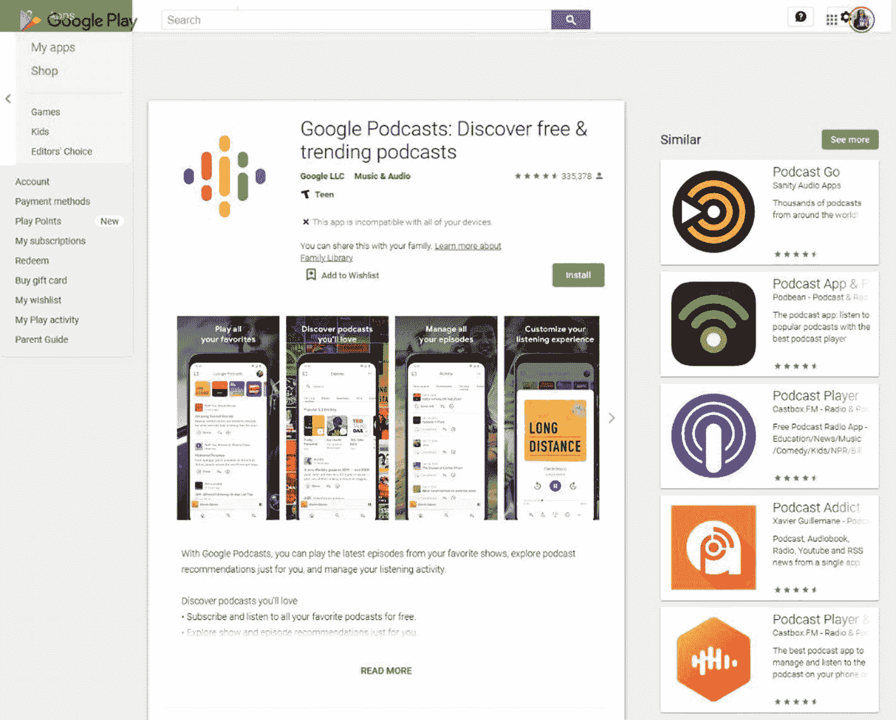
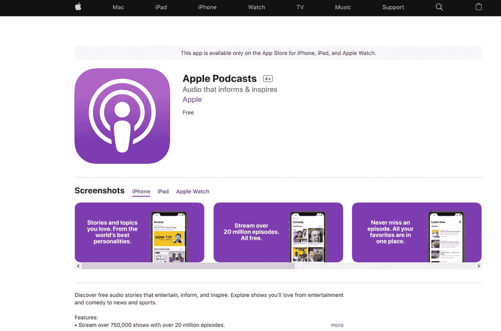
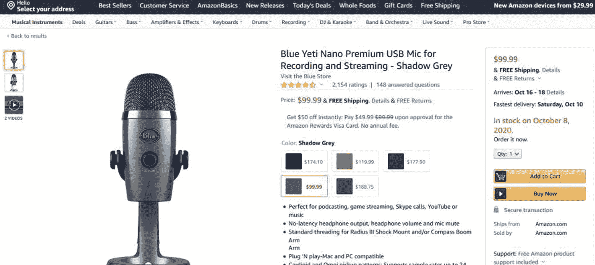
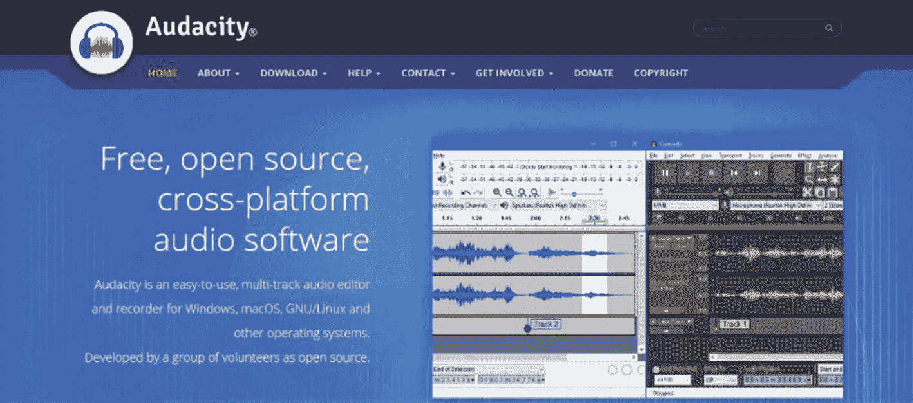
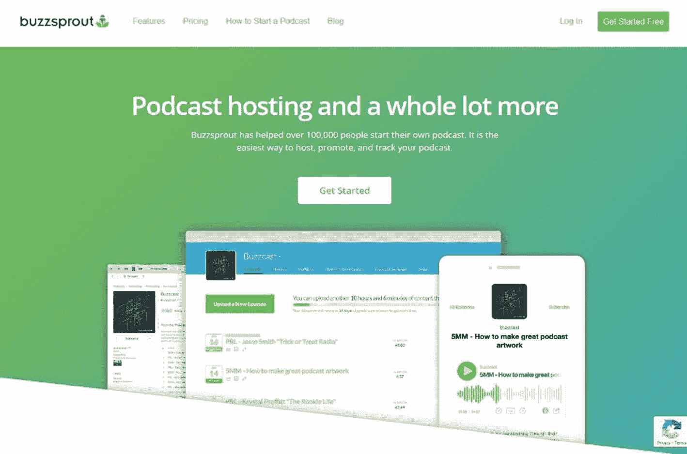

# 8. 播客

在第七章 7 中，你学习了网络研讨会及其在传递内容的同时促进在线学习环境互动的作用。网络研讨会在在线学习中是一种有效工具，能够在教育者和学习者之间建立类似传统学习中的个性化联系。由于电脑和移动设备上提供了众多免费和付费选项，任何希望使用网络研讨会的人都能轻松获得。

学习者参与是在线学习体验的关键组成部分。没有两个学习者的学习方式是完全相同的。与过去相比，如今有更多不同且价格实惠的内容选项可供选择，教育者拥有更多工具来促进学习者的参与。随着使用移动和可穿戴设备的学习者数量空前增长，教育者需要更灵活的解决方案。播客就是其中之一。

## 播客基础

播客已经存在很长时间了。根据 `howstuffworks.com` 的说法，播客最初由前 MTV 视频主持人亚当·库里和软件开发者戴夫·温纳于 2004 年创建，当时库里编写了一个名为 `iPodder` 的程序，用于将互联网广播下载到他的 `iPod` 上。¹⁹ 其他开发者改进了他的代码，我们熟知的播客便迅速传播开来。基于其名称，许多人错误地将播客与苹果的 `iPod` 设备联系起来。然而，大多数人通常使用各种不同的移动设备来收听播客，因为它们便于携带，可以随时随地收听。例如，苹果的 `播客 (Podcasts)` 应用可用于在 iOS 设备上收听播客（图 8-1）。此前在 iOS 设备上，播客包含在 `iTunes` 应用中。在安卓设备上，可以通过 `Google 播客 (Google Podcasts)` 应用获取播客（图 8-2）。

图 8-2

`Google 播客 (Google Podcasts)` 应用可在安卓设备的 `Google Play 商店` 中获取，用于查找和收听播客

图 8-1

苹果的 `播客 (Podcasts)` 应用在 iOS 设备上可用

其他在 iOS 和安卓设备上均可使用的播客应用包括：

* `Pandora`
* `Spotify`
* `Amazon Music`
* `Stitcher`
* `Deezer`
* `TuneIn`

播客是一系列被称为“剧集”的音频文件，其内容针对播客的主题量身定制。这些文件可从在线播客目录或任何移动设备上按需获取。大多数播客剧集的时长为 30 分钟到 1 小时。通常，播客的形式类似于广播脱口秀，由主持人独自主持整集节目或邀请嘉宾。每个播客都有一个与之关联的文件，称为简易信息聚合（RSS）。RSS 源向称为 RSS 阅读器的程序以及播客目录提供播客信息，以便潜在订阅者可以发现和收听播客。`Podcasthosting.org` 报告称，截至 2020 年 7 月，已有超过 100 万个播客，剧集数量超过 2900 万集。²⁰ 如今一些流行的教育类播客包括：

* `The Google Teacher Tribe`
* `The Book Love Foundation`
* `Flipped Learning Worldwide`
* `House of #EdTech`
* `The 10 Minute Teacher`

## 播客优势

播客是适用于传统和在线学习的好工具。首先，目前播客涵盖任何主题。如果你访问任何播客目录并搜索特定主题，你会找到无数播客。由于已有如此多的播客，你无需重复发明，这节省了时间和精力。其次，你总能知道新内容何时可用。一旦订阅了播客，当新剧集发布时，你会通过播客应用收到通知，从而节省了查看播客目录寻找新内容的时间。由于播客是免费的，并且在网络上的播客目录中很容易找到，你永远不会缺少宝贵的学习资源。

要将播客纳入你的在线学习环境，你需要播客的 RSS 源或可在网上找到的播客剧集 URL。获取这些信息后，你可以从学习管理系统中向学习者发送每周公告，将其包含在每周课程中，或发送电子邮件通知学生有关播客或播客剧集的信息。大多数学习管理系统允许将 RSS 源轻松插入到通过 LMS 或电子邮件发送给学习者的公告中。

你还可以在学习管理系统中发起一个讨论帖，并附上播客剧集 URL，这不仅能补充你的课程材料，还能引发讨论。此外，你可以基于与学习者共享的播客剧集 URL 创建作业，以强化课程内容。由于学习者总是在使用移动设备，他们可以从播客通过 Web 或移动设备上的应用提供的灵活性和便携性中受益，这不仅能增强课程内容，还能提升他们的学习体验。

尽管大多数播客是音频形式，但它们也可以包含视频，这将进一步补充学习者对材料的理解。正如我们在第四章 4 中讨论的，视频播客可以是支持听觉和视觉学习者的另一种方式。视频播客以 `.mp4` 格式保存，而不是纯粹的音频格式 `.mp3`。在 `新冠疫情 (Covid-19)` 大流行和保持社交距离期间，视频播客可以使用免费工具轻松进行远程录制，例如：

* `Zoom`
* `Microsoft Teams`
* `iMovie Maker`
* `OBS Studio`

一旦你的视频播客剧集以 `.mp4` 格式录制完成，就可以轻松地在 `YouTube`、社交媒体平台和博客上分享，以获得良好的可见性和推广效果。

## 播客规划

你无需依赖他人来为你的在线学习需求创建播客剧集。你可以自己以低成本且轻松的方式完成。如果你决定创建自己的播客，需要进行一些初期规划。该规划将包括回答一些关于你播客的基本问题：

* 我的播客的主题或话题是什么？
* 它是音频播客、视频播客还是两者结合？
* 每集播客的时长是多少？
* 播客剧集多久发布一次？
* 你将如何推广你的播客？
* 你将独自主持播客剧集，还是邀请嘉宾？
* 你的开场白是否包含音乐？
* 你的播客图片看起来是什么样的？
* 你将如何结束你的节目？
* 你将如何构建你的播客剧集？

## 播客制作设备

对于初学者来说，音频播客是开始最快、成本最低的方式，因为你可能已经拥有必要的设备。对于你没有的设备，许多都可以免费或以低价获得。

# 麦克风

任何优秀播客的核心都在于音质。要获得良好的音质，你需要一个高质量的麦克风。一个好的、高品质的麦克风会提升录音质量。为了显得专业，你不仅要为潜在订阅者提供优质内容，还要提供优质的音效。购买一个价格亲民、适合播客的高品质麦克风大约需要 100 美元。`Blue Yeti` 是一款适合播客初学者的麦克风，音质出色，许多播客主都在使用（图 8-3）。

**图 8-3** `Blue Yeti` 麦克风是播客初学者的不错选择

随着播客需求的变化，你随时可以升级到高端麦克风，例如 `Heil Sound Pro`，以及价格更高的其他设备，如声卡。不过，对于初学者来说，基础的播客设备已经足够使用。

## 播客创作应用

可以使用手机应用来创作播客剧集。许多此类应用还能将完成的剧集发布到你选择的播客目录中。这些播客创作应用因移动设备而异。

### Backpack Studio 应用

适用于 iOS 系统的 `Backpack Studio` 应用（原 `Bossjock`）是一款集所有功能于一体的播客应用。iOS 用户可以直接在 iOS 设备上录制播客剧集。如果你的 `Apple iPhone` 或 `iPad` 使用的是 `Lightning` 接口，则需要一个适配你的麦克风接口类型的 `Lightning` 转换器。例如，大多数麦克风都有 `USB` 或 `XLR` 接口，因此你需要一个针对特定接口的转换器。`Backpack Studio` 还允许你通过 `Icecast` 或 `Shoutcast`（需付费）向任何电台进行直播。使用 `Backpack Studio`，你可以从云存储服务添加音效：

- `iCloud`

- `Dropbox`

- `Google Drive`

你还可以通过 `Backpack Studio` 从 iOS 设备录制自己的音效，或添加设备上已有的音效。你也可以直接在 `Backpack Studio` 的“笔记”部分添加节目笔记，帮助你在录制剧集时紧扣主题。一旦你的音效和播客简介加载到调音台中，你就可以在应用内开始录制剧集了。剧集完成后，你可以添加剧集标题、艺术家姓名和描述，以方便他人找到你的剧集。输入这些信息后，你可以将剧集导出到指定位置，或保存在 `Backpack Studio` 应用内。你还可以在 `Backpack Studio` 内为你的播客创建音频图表，以便在 `YouTube`、课堂或社交媒体平台上分享。

### 在线音频录制

另一个播客录制选择是 `online-voice-recorder.com`。它是免费的，可以在网页浏览器中直接进行音频录制。只需一个麦克风，就能将录音保存为 `mp3` 或 `mp4` 文件。其界面易于使用，你可以快速创建音频文件，并在需要时导入到其他录音应用（如 `Audacity`）中进行编辑。

## 录音软件

有许多录音软件应用可以帮助你制作播客。有些是免费且开源的，适合预算有限的情况。

一个开源解决方案是 `Audacity`（图 8-4）。`Audacity` 是一款免费的跨平台、开源数字编辑和录音软件应用，可在网上获取。它不仅允许用户录制音频文件，还能导入音频文件。你还可以将文件导出为多种格式，如 `mp3` 或 `mp4`。它还能让你在导出前提升音频录音的音质。

**图 8-4** 可从 [www.audacityteam.org/](http://www.audacityteam.org/) 获取的 `Audacity` 录音软件

`Mac` 和 `iOS` 用户的另一个选择是 `GarageBand`。它在 `Apple App Store` 中免费提供。`GarageBand` 是满足你播客需求的另一个一体化解决方案。使用 `GarageBand`，你可以录制音频播客，还可以为其创作音乐。`GarageBand` 包含可嵌入播客的音乐循环片段。如果你是音乐人，你可以连接键盘或吉他等乐器来创作音乐，并添加到播客中。如果你的 iOS 移动设备较新，则需要使用 `Apple` 转换器来连接带有 `USB` 端口的设备（图 8-5）。

**图 8-5** 适用于需要使用 `USB` 麦克风的 `iOS` 移动设备的转换器

## 播客托管

像 `Buzzsprout.com` 这样的播客目录提供免费和付费的播客托管服务（图 8-6）。这些目录不仅能存储你的播客文件，还能生成提交给其他播客目录所需的 RSS 源。然而，免费账户提供的功能有限。例如，免费套餐通常会包含广告，除非购买付费套餐，否则这些广告不会被移除。此外，许多免费套餐不允许你使用自己的统一资源定位符（`URL`）。与使用系统生成的 `URL` 相比，你自己的 `URL` 能提供更多品牌推广和营销机会。在你准备开始为更高级的播客功能付费之前，坚持使用免费的播客托管服务可能是个好主意。其他提供免费和付费托管的播客服务包括：

**图 8-6** `Buzzsprout.com` 为播客主提供播客托管服务

- `Anchor.fm`

- `Podbean.com`

- `Spreaker.com`

选定播客托管提供商后，你需要为播客设置标题、描述、封面图和分类。如果你不擅长设计，`Canva` 可以帮助你创建封面图。`Canva` 提供了模板供你使用，你也可以自行设计。其他需要配置的播客设置包括：

- 播客类型

- 网站地址

- 剧集数量限制

- 关键词

- 艺术家名称

- 联系邮箱

录制并上传播客剧集后，你需要定期登录播客托管平台查看你的播客统计数据。这些数据将为你提供有关剧集的宝贵见解。你将获得的关于听众的一些洞察包括：

- 下载次数

- 地理位置

- 使用的收听设备

- 使用的收听应用

一旦你获得了播客的 RSS 源，别忘了将它提交到众多播客目录中，以提高你的播客被发现的机会。

## 总结

播客是另一款有助于提升在线内容吸引力、同时保持学习者参与度的工具。由于网络上广泛提供免费的播客，而且制作起来很容易，因此它们非常适合任何预算规模以及在线学习。它们还让学习者能够灵活地在方便的时间，使用自己喜欢的移动设备和可穿戴设备收听和学习。最重要的是要记住，将播客融入你的在线学习应该是有趣且引人入胜的。

脚注 1 2

