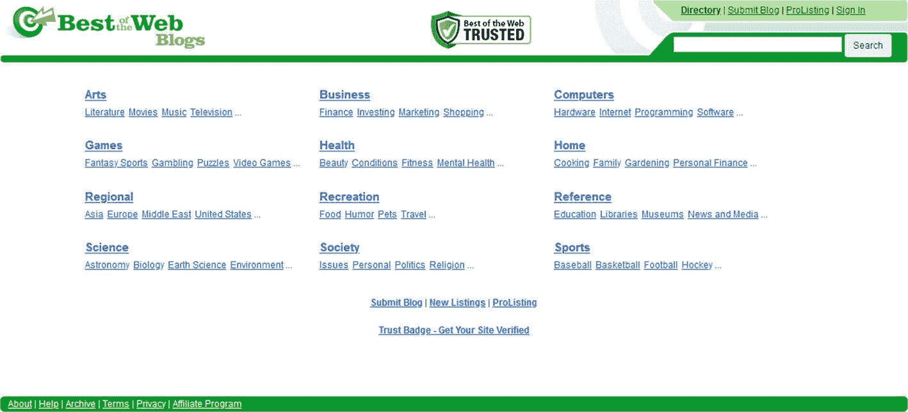
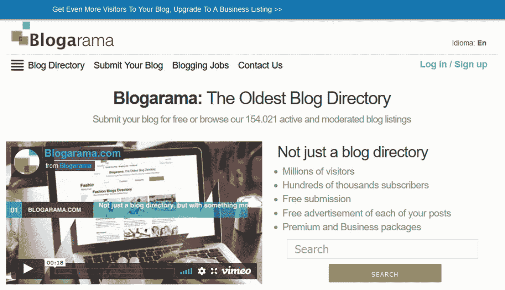

# 10. 博客

正如你在第 9 章所学到的，社交媒体可以在在线学习中发挥关键作用。它为教育者和学习者提供了联系和参与课程内容的各种渠道。教育者可以利用社交媒体的力量来帮助学习者弥合理论与实践之间的差距。

随着技术的不断进步，在教育者和学习者的在线学习环境中将有更多工具可用。这些工具将减少许多在线学习者与传统学习相比所经历的孤立感。博客就是目前可用但有时会被遗忘的工具之一。

## 博客基础

在社交媒体出现之前，就有博客。什么是博客？`Dictionary.com` 将博客定义为“包含一个或多个作者的个人经历、观察、观点等的网站，并且通常包含图片和其他网站的链接。”第一个博客于 1994 年由斯沃斯莫尔学院的学生 `Justin Hall` 在一个名为 `Links.net` 的博客平台上创建。^(²²) `Justin` 的博客名为 `Justin's Links from the Underground`，它提供了最早的网络导览之一，并详细描述了他的个人生活。早期，像 `Justin` 这样的博客被视为常态——它们只是由一个人创建的电子个人日记，用来分享他们的想法和感受。多年来，它们已经演变。如今，互联网上已有超过 5 亿个博客。^(²³)

如今，博客涵盖了面向任何受众的众多主题。这些博客可以有一个或多个内容创作者（称为博主），博客文章由文本或多媒体组成。博客文章通常按时间倒序排列，最新的文章显示在最前面。一些用于创建免费和付费博客的流行平台包括：

- `WordPress`

- `Squarespace`

- `Blogger`

- `Tumblr`

- `LiveJournal`

博客目录有助于找到可能令你和你的学习者感兴趣的博客。它们允许轻松搜索，并且通常按类别组织。一个流行的博客目录是 `Best of the Web Blogs` ([`https://blogs.botw.org`](https://blogs.botw.org))（图 10-1）。

图 10-1：来自 [`https://​blogs.​botw.​org/​`](https://blogs.botw.org/) 的网络博客列表

另一个查找博客的资源是 [`www.blogarama.com`](http://www.blogarama.com)（图 10-2）。`Blogarama.com` 通过其易于使用的搜索功能，提供了网络上超过 10 万个博客的列表。根据你的主题，你可以找到一个博客与你的学习者分享，并鼓励在线讨论。你也可以通过在 `Google.com` 上搜索来查找博客。

图 10-2：在 `Blogarama.com` 上搜索博客

# 视频博客（Vlog）

到目前为止，你了解的大多数博客都是传统的文字博客，但还有另一种值得提及的博客形式：视频博客（`vlog`）。`Vlog`是视频博客的简称，指由记录个人兴趣或专业知识的视频组成的博客。这些视频可以看作是网络剧集。`YouTube`是大多数`vlog`的来源。创建`vlog`只需要一个麦克风和一台摄像机，摄像机可以是以下设备之一：

-   `网络摄像头`
-   `便携式摄像机`
-   `数码相机`
-   `智能手机`
-   `平板电脑`

`Vlog`正在迅速成为常态。由于这些`vlog`是可视化的，它们能满足学生不同的学习风格，从而提高参与度。

## 博客的优势

尽管许多人认为博客已经过时，但它们依然充满活力。许多人仍在使用博客来获取最新信息。与网站相比，用户可以订阅博客的`RSS`源，当有新内容时便会收到通知。教育工作者和学习者都能从博客中受益。

### 更新频繁

博客的内容更新比网站更频繁。通过定期更新，`Google`会注意到这一点，并根据关键词和短语更新其搜索结果中的博客文章。因此，教育工作者可以找到及时的信息，来补充在线学习环境中的课程材料。

### 鼓励讨论

在线学习环境中的参与度始终是人们持续关注的问题。利用来自外部来源的博客文章，或者你在自己的`LMS`中创建的博客，可以为学习者提供另一种参与工具。没有两个人会对同一个话题持有完全相同的观点，健康的讨论能使双方受益。因此，这可以引发教育工作者和学习者之间激动人心的讨论。

### 易于创建

如果你找不到能按你期望的方式补充课程内容的博客，为什么不自己创建一个呢？有许多免费的博客平台可供选择，例如`WordPress`或`Blogger`，你可以花费最少的时间和精力轻松创建一个博客。创建完成后，你可以自定义博客内容来丰富你的课程内容。因为是你的博客，你可以随时更新。

你应该写什么样的博客文章？既然是自己的博客，你在博客主题方面拥有完全的创作自由。然而，始终要牢记博客的目标。你的博客文章应与课程主题以及学习者的需求保持一致。对于那些学习者可能感到吃力的课程概念，可以考虑撰写博客文章，通过解答未解决的问题来加深学习者的理解。通常，学生不敢主动让你知道他们在理解课程材料或作业方面遇到困难。不幸的是，我们必须预见到这些问题。博客是一个很好的解决方案。例如，你可以创建一篇博客文章，针对某个特定的讨论问题或课程主题提出相反的观点。在`LMS`中，你可以创建一个讨论题，要求学习者阅读该博客文章，并讨论他们是否同意其中的观点。无论哪种情况，都可以引发包含不同观点的健康讨论。

在创建博客文章时，切记学习者的注意力持续时间较短。你的文章需要快速抓住并保持他们的注意力。其中一种方法是在文章中融入与博客主题相关且能吸引注意力的高质量图片。第`11`章将提供一些免费图片资源，帮助你找到用于博客文章的引人入胜且富有吸引力的图片。其次，你要善用项目符号，使内容更易于阅读和浏览。大段的文字可能会让学习者望而生畏，因此使用项目符号配合短段落有助于吸引和激励学习者阅读。同样，在文字中融入视频是激励学习者阅读的另一种技巧。你可以自己制作视频，也可以使用`YouTube`视频提供的嵌入代码。

## 创建博客的优势

既然网上已经有这么多现成的博客，为什么还要花费时间、精力和资源去创建一个新博客呢？拥有一个博客的优势之一是，你和你的学习者可以很容易地在社交媒体网络上分享文章。在社交媒体平台上分享你的博客文章，可以让你确立自己专家的地位，获得关注者，并通过评论鼓励讨论。与那些你无法管理但使用其内容的其他博客相比，你是博客的所有者，可以控制博客内容的创建和发布时间。最后，你可以自定义博客内容，以补充你的课程内容。如果你决定使用免费的博客平台，请记住其功能是有限的。同样，如果不升级到付费版本，你将无法使用自己的`URL`来自定义博客的`URL`。

## 博客的劣势

在在线学习中使用博客，通过帮助学习者进一步理解课程材料而使他们受益。它还能鼓励协作和分享。然而，在在线学习中使用博客也存在一些弊端。

### 作者可信度存疑

当一位知名人士创建博客或博客文章时，他或她立即拥有可信度。你会对其文章的内容和准确性感到有信心。但由于任何人都可以创建博客，你必须保持谨慎。如果你不了解博客的创建者，就无法确定他或她的专业水平。在将任何信息发布到在线学习环境之前，最好先核实一下。否则，可能会损害你的声誉，并破坏你在学习者心中的可信度。

### 缺乏掌控权

如果你没有创建某个特定的博客，你就无法控制它的可用性。他人创建的博客可能会在没有任何事先通知的情况下停止运营。它也可能会经历宕机。发生这种情况时，你的学习者将无法访问该博客。同样，博客的`URL`可能会被重命名，导致你在`LMS`中分享的先前链接失效。

## 总结

博客是在线学习中的宝贵资产。通过提供博客的`RSS`源，并将其作为公告或讨论帖分享，博客可以轻松地在任何`LMS`中被找到和分享。它们也可以被纳入讲座和作业中。你的课程内容将决定你需要搜索哪些博客类别，以找到能够补充和辅助你课程内容的博客。同样，它们也易于创建和维护。学习者能从博客中受益，因为他们拥有了补充课程材料的另一种资源。博客还能鼓励教育工作者和学习者之间的讨论。

脚注 `1` `2`

