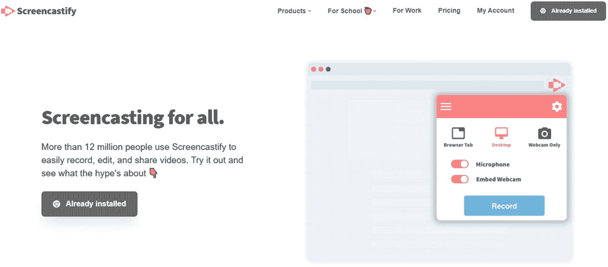
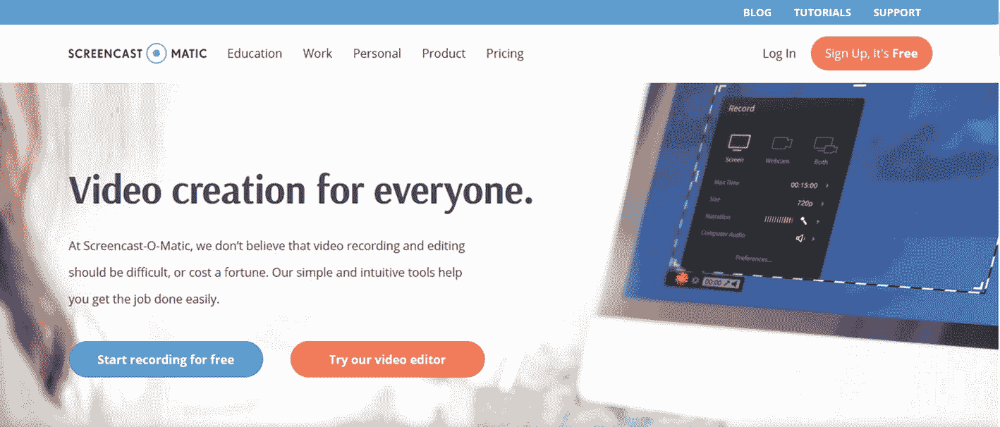
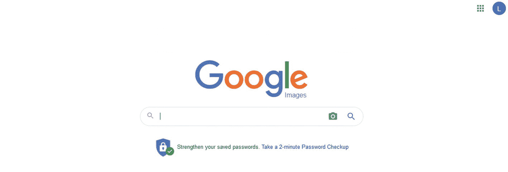
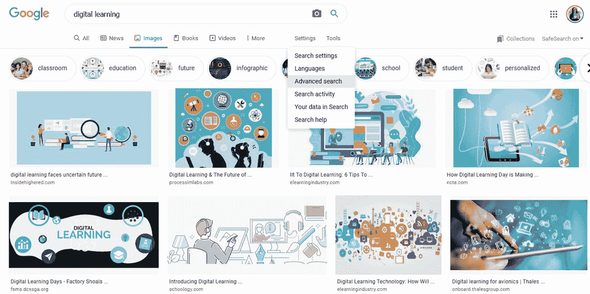
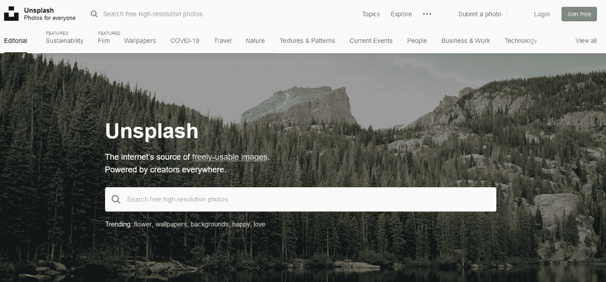
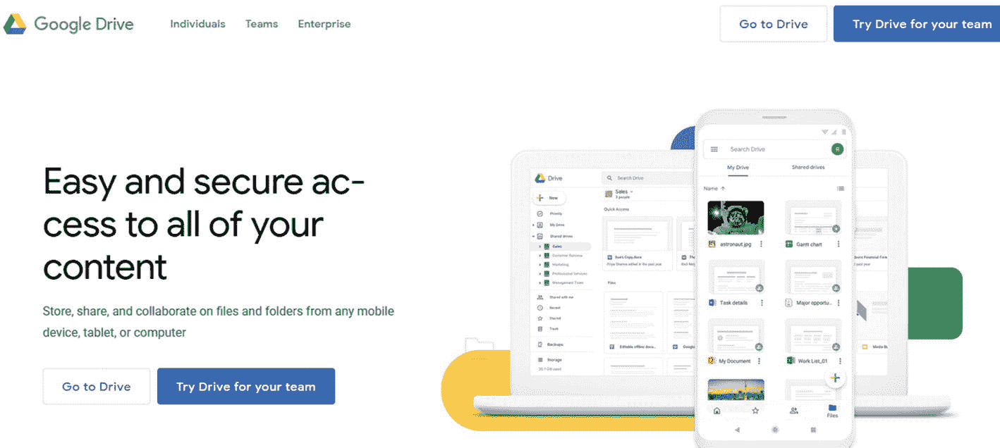
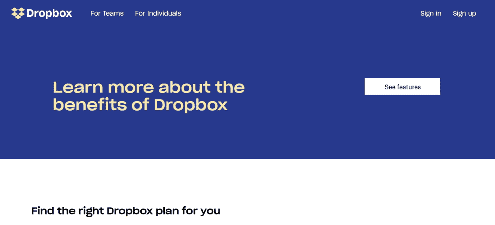

# 11. 免费在线资源

在第`10`章中，你了解了博客，以及它们如何成为提升在线学习环境中参与度和讨论度的宝贵工具。网络上存在大量关于各种主题的免费博客，并且数量还在不断增长，除非你自己想创建，否则无需重新发明轮子。如果你想要更多的掌控权，有许多免费的博客软件平台（如`Blogger`和`WordPress`）可供你用来创建自己的博客。

每位教育工作者都需要在自己的工具包中配备一套好工具。不幸的是，由于价格上涨和预算缩减，一些付费工具过于昂贵，可望而不可及。幸运的是，有许多免费在线资源可用，既能为你省钱，又能促进学习。你只需要知道在哪里能找到它们。

好的，作为一名高级文档工程师和翻译员，我将严格遵循您的注意事项和示例格式，将给定的英文文本翻译成中文。

# 参与工具

在新冠疫情下的虚拟学习中，参与度至关重要。教育者和学习者都在应对关于“学习”样貌的范式转变。每个人都以某种方式感到疲惫，并尽其所能地适应他们所知道的最佳方式。在创意高涨而预算紧张的情况下，作为一名教育者，您有众多免费选项可供使用，但您必须知道去哪里寻找。

## 屏幕录制

在在线学习环境中，视频构成了内容的大部分。与书面文本相比，学习者往往更愿意通过视频参与。视频也有助于视觉型学习者更好地理解内容。正如您在第 4 章所学到的学习风格，为了帮助视觉型学习者，您可以尝试使用免费的屏幕录制工具。尽管有许多屏幕录制工具可用，让我们来看看其中几个流行的。

### Screencastify

`Screencastify` 是一款录制工具，仅作为扩展程序在 Google Chrome 浏览器中使用（图 11-1）。您可以通过 Chrome 网上应用店将其安装到浏览器中。它与大多数设备兼容，包括使用 Google Chrome 浏览器的 Chromebook，但不包括移动设备。

图 11-1

`Screencastify` 可在 `www.screencastify.com` 获取

您可以使用它来录制以下其中一项：

*   桌面

*   浏览器标签页

*   仅网络摄像头

无论您选择哪种录制类型，您都可以提供软件演示、演示文稿等，以提高学习者的理解能力。同样，您可以使用“仅网络摄像头”选项来录制讲座、提供作业反馈或给予鼓励性话语。选项是有限的。无论您选择哪种录制类型，免费版每次录制都有 `5 分钟的限制`。您可以随时升级到付费版本，但免费版本应该足以满足您和学习者的需求。

### Screencast-O-Matic

另一个值得考虑的免费屏幕录制应用程序是 `Screencast-O-Matic`（图 11-2）。它允许您在 Mac 或 Windows 电脑、Chromebook 以及 iOS 和 Android 设备上创建录制。与 `Screencastify` 相比，免费账户的录制时长限制为 `15 分钟`。录制完成后，您可以使用其编辑器进行编辑并分享您的视频。与 `Screencastify` 不同，它是一款独立应用程序，可以从 `www.screencast-o-matic.com` 安装。

图 11-2

`Screencast-O-Matic` 允许您免费创建录制

## 图片

谁没有遇到过需要找一张图片来丰富内容，但又不想付费的情况呢？没有人。选择合适的图片是抓住还是失去学习者注意力的关键。虽然网络上有大量的图片库，但有一个不应被遗忘：谷歌图片。

### 谷歌图片

一个您可能无意中忽略的图片库是谷歌图片（图 11-3）。

图 11-3

谷歌图片是一个包含各种类型图片的图库

与 `Google.com` 保持相同的简洁设计，谷歌图片也非常易于使用。谷歌图片（`https://images.google.com`）允许您应用高级搜索条件来查找具有使用权限的图片，以便您可以出于商业或非商业目的自由使用、分享或修改。要应用此功能，您需要选择 `设置` ➤ `高级搜索`（图 11-4）。

图 11-4

在谷歌中使用设置来应用高级搜索功能

想想如果先搜索谷歌图片，您可以节省多少时间和金钱。

### Unsplash

另一个免费图片资源是 `Unsplash.com`（图 11-5）。免费加入，图片免费使用。此外，该网站易于使用，并提供许多类别可供选择。如果您在演示文稿中使用 `Google Slides`，您可以使用 `Google Slides` 插件和 `Unsplash` iPad 应用来查找图片。

图 11-5

`Unsplash` (`unsplash.com`) 是另一个免费的图片库

### Pexels

如果您需要更多图片来支持您的虚拟学习内容，您应该访问 `Pexels.com`。`Pexels.com` 上的所有图片均可免费使用，无需署名。它还提供视频。您不仅可以将这些图片整合到您的课程内容材料（如公告和讨论）中，还可以用于您的社交媒体平台和博客文章。可能性是无限的，唯一的限制是您的创造力和想象力。

## 在线表单

能够在虚拟学习环境中使用在线表单可以节省您的时间，并让您更快地收到回复。有许多选项可以帮助您，但有一个您不应忽视的免费资源：`Google Forms`。

### Google Forms

`Google Forms` 允许您为个人或商业用途创建在线表单。要开始使用 `Google Forms`，您需要一个 Google 帐户，个人创建是免费的。如果您为一个组织工作，您应该核实该组织是否可以使用 `Google Workspace`。如果不能，则您的组织需要注册 `Google Workspace` 以获得增强的安全性和团队协作能力。

在 `Google Forms` 中，有许多模板可以帮助您快速入门。如果找不到满足您需求的模板，您可以创建自己的模板。`Google Forms` 的界面易于使用，并且可以在您的虚拟教室中轻松实施。您需要做的就是在课程材料中包含一个 URL。您可以创建的一些表单类型包括：

*   调查问卷

*   测验

*   活动注册

*   课程评估

*   活动反馈

您可以创建的表单类型不受限制。只要您能想象到，就能在 `Google Forms` 中设计出来。表单是获取学习者反馈的好方法，可以帮助您调整教学方法。

## 云存储

在您为课程创建内容时，您希望确保可以从任何设备访问您的材料。您永远不知道意外何时会发生，因此做好备份是个好主意。云存储就是解决方案。使用云存储，您的信息被存储在“云端（网络上的计算机上）”，从而可以从任何联网设备访问。

### Google 云端硬盘

许多人使用的云端存储解决方案之一是 `Google 云端硬盘`（图 11-6）。它在任何类型的设备上都易于使用，并且还提供适用于 `iOS` 和 `Android` 移动设备的移动应用。要使用 `Google 云端硬盘`，你需要一个免费的 Google 账户。在撰写本文时，`Google 云端硬盘` 提供 `15GB` 的免费存储空间，该空间由 `Google 云端硬盘`、`Gmail` 和 `Google 相册`共享。如果你需要更多空间，始终可以升级到付费方案。你的组织可能有提供无限存储空间的方案，因此最好去了解一下。你还可以在 `Google 云端硬盘` 内与他人共享文件和文件夹，这可以节省时间和纸张，并促进协作。

图 11-6

`Google 云端硬盘` (`www.google.com/drive`) 提供满足您需求的云端存储

### Dropbox

另一个提供免费云端存储的竞争者是 `Dropbox`（图 11-7）。`Dropbox` 提供一个免费的基本方案，为你的文件提供 `2GB` 的云端存储空间。与 `Google 云端硬盘` 相比，这个空间很小，但它是一个选择。要获得更多存储空间，你必须升级到付费方案。

图 11-7

`Dropbox` (`www.dropbox.com`) 是满足您在线需求的另一个云端存储解决方案

## OneDrive

如果你有 Microsoft 账户，则可以使用 `OneDrive`。`OneDrive` 可在以下设备上运行：

- 搭载 `Windows 10` 的 `Windows` 个人电脑和笔记本电脑

- `Windows Surface` 平板电脑

- `Xbox One` 主机

它包含 5GB 的免费文件存储空间。OneDrive 的一个功能是它会自动将你的文件备份到云端。它还会同步这些文件，以便你可以从任何设备访问它们。你也可以从 OneDrive 共享文件。大多数组织使用 Office 365，因此你已经可以访问 OneDrive。你需要询问你的存储容量。

## 实用工具

除了已经提到的工具之外，一些重要的实用工具可以帮助你创建引人入胜的虚拟学习内容。它们还可以帮助你呈现更专业的形象。

### Grammarly

你收到过多少次不仅难以阅读，而且难以理解的书面沟通内容？可能比你愿意记起的次数还要多。想象一下，当你的在线学习者收到写得糟糕的沟通内容时，他们会是什么感受。写得糟糕的沟通内容会导致学习者失去对教育工作者及其专业知识的信任和信心。没有恰当书写的思想和想法无法轻易传达。

Grammarly 是一个基于 Web 的应用程序，可以帮助你提高写作的有效性和专业性。它提供免费和付费版本。要使用它，你可以将书写的文本复制并粘贴到 Grammarly 网站，或者将文件上传到 Grammarly 进行检查。还可以安装一个 Grammarly 插件，并在 Microsoft Word 以及你的浏览器中运行。一旦 Grammarly 获得你的文本，它就会检查其中的语法错误以及其他方面，以产生清晰简洁的写作。它还可以检查你的电子邮件、社交媒体帖子等。通过使用 Grammarly，你可以确保你的课程内容没有错误，并以最佳方式呈现自己。它还能帮助你的学习者建立对你和你的专业知识的信任和信心。你可以访问 [`www.grammarly.com`](http://www.grammarly.com) 找到 Grammarly。

### 截图工具

虽然它不是在线资源，但它是一个免费且对教育工作者有价值的资源。对于使用 Windows 7 及更高版本的 PC 用户来说，有一个预装的应用程序叫截图工具。截图工具提供了执行屏幕截图的功能。可以通过在 Windows 任务栏的搜索框中输入 `Snipping Tool` 来打开它。打开后，你可以按以下形式之一截图或捕获信息：

- 任意格式截图

- 矩形截图

- 窗口截图

- 全屏截图

截图完成后，你可以将其保存到个人电脑中，以包含在你的课程材料中，例如讲座、文档、公告、讨论、作业等。

## 总结

正如你所见，免费并不总是意味着差劲或低劣。网上有如此多的可用于虚拟学习的免费资源，我们很难在这本书中一一列举。希望你已经看到，许多这些免费资源与它们的付费版本相比毫不逊色。既然你已经了解了其中一些资源，你就可以开始创造令人兴奋的在线学习体验，让你的学习者永难忘怀。你也不会忘记它，因为在此过程中你省下了钱。

