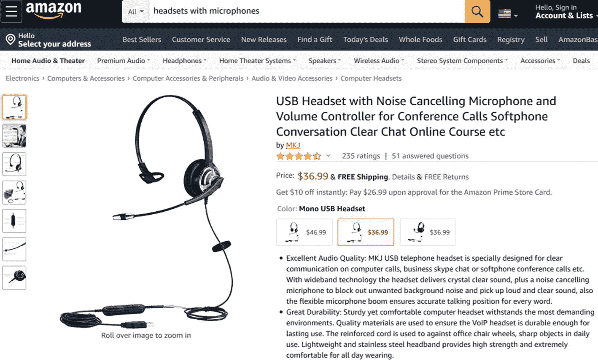

# 配件

既然您已经了解了核心硬件和软件需求，那么还需要购买一些必要的配件。这些配件将为您带来更好的在线学习体验。

## 带麦克风的耳机

根据您的环境，配备带麦克风的耳机总是个好主意。耳机可以让您在不依赖设备扬声器的情况下私密地查看多媒体内容，同时也不会打扰到周围的人。对于需要使用语音的学习活动，投资一款带降噪麦克风的耳机是明智之举。它可以过滤背景噪音，让听众清晰地听到您的声音。大多数电脑和移动设备都内置了麦克风，但它们往往具有方向性，会拾取房间内的所有背景噪音而非过滤或降低噪音。此外，与外部麦克风相比，其语音质量也欠佳。

一款带降噪麦克风的外部耳机并不昂贵。平均价格约为 40 美元，但根据降噪级别不同会有所上涨。无论选择哪款耳机，请注意其接口类型是 USB、Lightning 端口还是 3.5 毫米插头，以适配您的设备（图 2-3）。

图 2-3 可从亚马逊购买的、适用于电脑在线学习的 USB 耳机

对于 iPhone 用户，苹果公司带 Lightning 接口的 EarPods 是另一选择（图 2-4）。它也支持 3.5 毫米转接器，可用于电脑，以及新款 iPhone、iPad 和其他移动设备。大多数智能手机都附带带麦克风的耳机，可在您找到替代品前使用。尽管苹果 EarPods 带有麦克风，但并未提供降噪功能。

图 2-4 适用于在线学习的苹果 EarPod 耳机选项

## 网络摄像头

虽然对于某些在线学习来说，网络摄像头是可选项，但它是一个不错的补充。大多数电脑和移动设备都内置了网络摄像头。对于学习者而言，它能为在线课堂带来传统学习的面对面元素。对于教育者而言，网络摄像头也有很多好处。首先，它允许教育者录制课程内容并在虚拟课堂中分享。这些内容还可以被重新利用，并在各种社交媒体平台上分享。网络摄像头让教育者能与学习者建立个人联系。当学习者能将名字与面孔对应起来时，可以缓解在线学习中的一些孤立感和焦虑感。

如果您没有网络摄像头，移动设备的摄像头也能派上用场。大多数移动设备摄像头分辨率很高，不仅能拍摄出色的照片，还能录制视频。例如，iPhone 7 之后的新款 iPhone 拥有卓越的摄像头，不仅可用于拍照，还能制作视频。新款 iPad 也是如此。如果您使用这些设备，还需要购买一个三脚架来稳定设备。

## 总结

正如我们所看到的，在线学习对技术设备的要求其实很低。您可能已经拥有其中的许多物品，这可以节省您的时间和金钱。这也有助于打消您可能听过的关于开始在线学习的某些误解。第一次尝试任何事情都可能看起来令人生畏，但您能做到。有了合适的设备，您的旅程就能从一个积极的开始起步。在下一章中，您将探索如何成功规划您的在线学习之旅。正如那句老话所说：“*如果你不做计划，那你就是在计划失败*。”您将制定一个计划。

脚注 1 2

