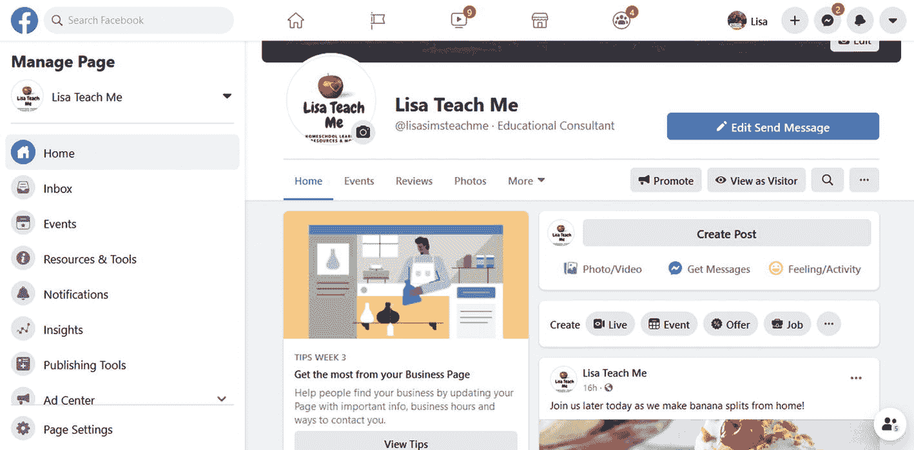
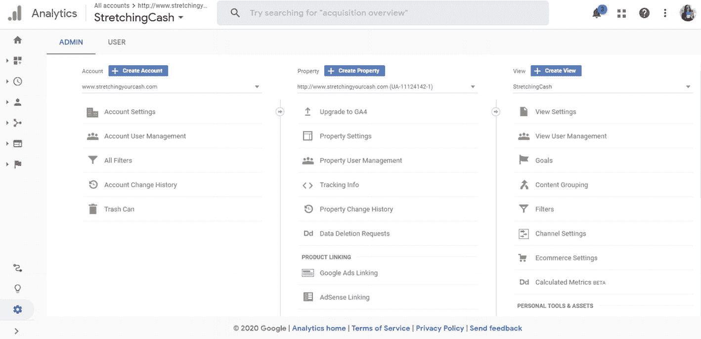
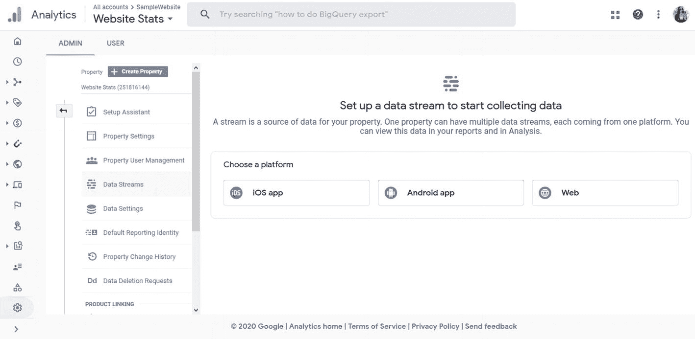
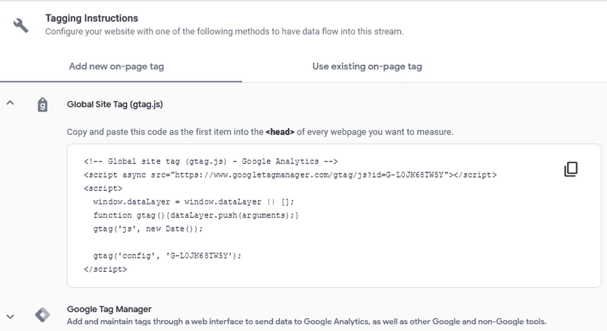

# 13. 营销在线学习

在上一章中，您探讨了测试在线学习组件的重要性。虽然测试通常由学习管理系统管理员负责，但作为教育者，您也必须测试自己的学习内容，不仅要确保其准确性，还要确保其可理解性。不测试您的内容可能会暴露潜在的错误，这不仅会对您作为教育者的声誉产生负面影响，还可能损害您所在学校的声誉。核实学生体验的各个方面，使其尽可能无错误，至关重要。同样，您需要确保所有学生都能按照您的预期访问和查看您的内容。

一旦您已经测试了在线学习材料，就该为您的课程宣传造势了。无论您是在拥有自己营销部门的学校工作，还是独立开展工作，您都需要营销您的专业知识和课程。

## 广而告之

如果拥有专业知识和课程却无人知晓，那又有什么用呢？如果您指望人们偶然发现您，那您就错了。您必须积极主动，帮助人们了解您的专业知识和课程。如今，有许多资源和工具可以帮助您做到这一点。大多数资源都是免费的，只需要您投入时间。让我们来看看其中一些。

# 口碑营销

尽管口碑营销由来已久，但它至今仍是最有效的营销策略之一。当人们获得积极体验时，他们乐于与他人分享。借助社交媒体，口碑营销的传播速度比以往更快，覆盖范围也更广。口碑营销是指来自可信来源的潜在客户对产品或服务进行口头或书面的认可。其价值无法估量，且无需任何成本。`Nielsen.com` 报告称，92% 的人信任来自朋友和家人的推荐，胜过任何其他类型的广告。^(²⁴) 你还等什么？开始向你的朋友和家人介绍你的专业知识和课程吧。你甚至可以鼓励他们报名参加你教授的课程。无论你需要做什么来打造自己的品牌大使，尽管去做。例如，使用 `Canva` 创建一些包含你专业知识和课程信息的图片，提供给品牌大使，让他们在社交媒体平台上分享。他们的粉丝越多，你获得的曝光机会就越多。你也可以使用本书中提到的免费资源制作一个视频，并发布到 `YouTube` 和你的社交网络上。同样，你可以将 `YouTube` 链接分享给品牌大使，让他们与自己的粉丝分享。虽然需要一些时间才能看到成效，但这会带来巨大的回报。关键在于坚持。

## 社交媒体

社交媒体极大地拓展了口碑营销的覆盖面。随着 `Facebook`、`Twitter`、`Instagram`、`LinkedIn` 等社交媒体手机应用触手可及，与他人分享信息比以往任何时候都更容易。如果你还没有任何社交媒体账号，需要立即开始创建一个。想想你的目标受众使用哪些社交媒体平台，并确保你也使用这些平台。一些有助于你了解社交媒体人口统计特征的资源包括：

- `HubSpot` – [`https://blog.hubspot.com/marketing/state-of-social-media-demographics`](https://blog.hubspot.com/marketing/state-of-social-media-demographics)
- `Marketing Charts` – [`www.marketingcharts.com/digital/social-media-108184`](http://www.marketingcharts.com/digital/social-media-108184)
- `Social Media Examiner` – [`www.socialmediaexaminer.com`](http://www.socialmediaexaminer.com)
- `Kronos.com` – [`https://khoros.com/resources/social-media-demographics-guide`](https://khoros.com/resources/social-media-demographics-guide)
- `Pew Research Center` – [`www.pewresearch.org`](http://www.pewresearch.org)

在创建社交媒体档案名称时，请确保它们具备以下四个特征：

- 易于记忆
- 易于拼写
- 在所有平台上保持一致
- 能提供关于你从事领域的某些信息

通过融入这四个特征，当潜在学习者在 `Google` 或社交媒体平台上进行搜索时，你将节省他们寻找你和你的在线学习课程的时间。你的社交媒体档案还需要包含潜在学习者搜索类似课程时会用到的关键词。一个有助于此的免费优质资源是 `Google Keyword Planner`。它是 `Google Ads` 的一部分。`Google Keyword Planner` 允许你搜索人们在 `Google` 上使用的词语和短语。它会显示这些词语和短语的搜索量，并提供建议。以 `Google Keyword Planner` 为指导，你将获得一张路线图，了解应该针对哪些关键词以获得成果。

### Facebook 主页

除了你的个人社交媒体账号外，创建一个 `Facebook 主页` 正迅速成为必要之举。`Facebook 主页` 供个人和企业用来推广其产品和服务，而不是使用个人 `Facebook` 账户（图 13-1）。

图 13-1 使用 `Facebook 主页` 推广你的在线学习课程

`Facebook 主页` 提供与个人账户相同的功能，同时还能提供关于页面表现的详细数据分析。这些信息经过分析和应用后，可以改善你的营销效果。通过你的 `Facebook 主页`，你还可以发布图片、网址、视频等内容。你还可以举办 `Facebook Live` 直播，在指定的日期和时间就某一特定主题进行教学。你的 `Facebook Live` 直播将会出现在公共信息流中，供所有人观看。一个好的做法是创建一个活动，以便将其添加到 `Facebook 活动日历` 中，供所有人查看。一旦 `Facebook Live` 活动结束，录像会保存到你的 `Facebook 主页` 上。你也可以下载 `Facebook Live` 视频，并将其发布到其他网站，如 `YouTube` 和社交媒体平台。其他社交媒体平台，如 `LinkedIn`、`Periscope`、`Instagram` 和 `TikTok`，也允许你进行直播。

### YouTube

还有什么地方比 `YouTube` 更适合推广你自己和你的在线课程呢？根据 `hootsuite.com` 的数据，`YouTube` 是 18 至 34 岁人群在电视屏幕上观看视频的第二大首选平台。^(²⁵) `Pew Research` 也认为 `YouTube` 是美国最受欢迎的平台。^(²⁶) 为了展示你的专业知识，何不创建一个 `YouTube` 频道，上传教授你课程内容的简短教程视频呢？观众可以一窥你的教学风格，同时更多地了解你和你能提供的内容。在制作视频时，请确保在视频标题和描述中包含关键词，以便学习者在 `YouTube` 或 `Google` 上搜索时更容易找到。你还应确保在 `YouTube` 视频中包含你的社交媒体账号，以吸引关注者。关键在于让学习者能够轻松地找到并关注你。

`YouTube` 的另一个优点是，你可以将 `YouTube` 视频嵌入到你的网站/博客中，或者轻松地在多个社交媒体平台上分享视频链接。这是你利用单一的营销资产实现多种营销目的以获得最大影响力的另一种方式。

# 线上会议与社交

由于`Covid-19`疫情，大多数线下会议已转为诸如网络研讨会之类的线上活动。无论形式如何，它们都提供了绝佳的机会，不仅可以学习，还可以与他人建立联系。强大的人脉网络可以帮助你接触以前无法触及的受众。不确定在哪里可以找到会议？

参加线上活动时，不要忘记社交。尽管线上活动中的社交方式与线下活动有所不同，但它仍然很重要。正如那句老话所说：“重要的不是你知道什么，而是你认识谁。”你的社交方法必须有创意。例如，大多数线上活动平台都为参与者提供聊天功能。你可以利用聊天功能介绍自己，并提供你的网站或`LinkedIn`个人资料的链接，以便与他人建立联系。对于允许创建个人资料的线上会议，不要错过这个机会：不仅要撰写包含你专业领域的信息性简介，还要附上社交媒体账号和在线课程网站的链接。永远不要错过宣传自己、你的网站和在线课程的机会。你可能不会有第二次机会。

一些寻找线上会议的资源包括：

-   [`www.Edweb.net`](http://www.edweb.net)
-   [`www.linkedin.com`](http://www.linkedin.com)
-   [`www.facebook.com`](http://www.facebook.com)
-   [`www.eventbrite.com`](http://www.eventbrite.com)
-   [`www.meetup.com`](http://www.meetup.com)
-   [`www.google.com`](http://www.google.com)

# 嘉宾出演

为了推广您的专业知识和在线课程，请寻找在各种媒体平台担任嘉宾的机会。例如，您可以联系一些与您的在线课程主题相符的`BlogTalkRadio`主持人或播客主，申请成为嘉宾。这样一来，您不仅为主持人提供了内容，还能将营销范围扩展到他们的听众群体。同样，您将获得免费宣传，因为主持人会在其节目页面和社交媒体网络上推广您。这种推广可以包含您的形象照片、个人简介、网站链接、社交媒体链接等。此外，您还可以在节目播出前后，在自己的社交媒体网络和网站上对这次嘉宾出演进行宣传。

在网络研讨会上担任嘉宾是推广您专业知识和在线课程的另一种方式。由于新冠疫情实施社交隔离后，每个人都在举办网络研讨会并寻找嘉宾。为什么您不试试呢？为什么不去寻找一些正在举办与您专业领域相关主题网络研讨会的公司，并请求成为嘉宾呢？他们最多只会拒绝而已。一旦您成为网络研讨会的嘉宾或小组成员，且研讨会结束后，您就获得了一份录像，可以将其添加到媒体资料库中，帮助您推销自己和在线课程。别忘了，您还可以使用`Zoom`等工具创建自己的网络研讨会，录制自己讲授某个主题的过程，并将录像保存下来，以便在您的任何社交媒体平台上分享。

## 网站/博客

如果您拥有网站或博客，那便是推销自己和专业知识的最佳场所。如果您还没有网站或博客，第 10 章可以帮助您入门。无论如何，拥有其中一个或两者都很重要。由于这些平台归您所有，您可以随时更新新内容。例如，您可以在网站或博客上创建一个媒体专区页面，链接到您过往所有的嘉宾出演记录。当您寻找新的嘉宾出演机会时，可以将此页面作为您的作品集，向潜在播客或网络研讨会主持人展示您的才华。您还可以在社交媒体网络上分享此链接。如第 10 章所述，您还可以根据您的专业知识撰写博文，这些博文可以轻松地在社交媒体网络上分享。

使用社交媒体固然很好，但拥有自己的网站或博客也是个好主意。虽然社交媒体会长期存在，但有些网络曾经历过意外的宕机。对许多人来说，社交媒体网络是他们唯一的推广和销售来源。而拥有自己的网站，您就能完全控制和拥有它，可以每周 7 天、每天 24 小时地推销自己和专业知识。别忘了利用`Google Keyword Planner`来研究关键词，这将有助于合适的访问者找到您。

另一种网站推广技巧是使用电子邮件注册表单。您可以以新闻通讯的形式提供与您专业相关的免费信息。访问者可以提供他们的电子邮件地址来换取这份新闻通讯。`Mailchimp`（[`www.mailchimp.com`](http://www.mailchimp.com)）是一个可以帮助您实现这一点的免费资源。它很容易添加到您的网站上。同样，它还会为您提供一个可在社交媒体网络上分享的链接。通过在网站上设置电子邮件注册表单或提供可分享的链接，您正在为您的在线课程建立一个潜在客户列表，从而可以进行持续营销。

一旦您运行了网站或博客，就必须确保经常查看其分析数据。分析数据能提供有关您网站或博客表现的深刻见解。其中包含的信息如下：

*   访问者数量

*   访问者的地理位置

*   访问者停留时长

*   访问者浏览的页面

*   用于找到您网站的设备

这些信息可以从您的网站或博客托管服务商处获取。另一个可以集成到您网站或博客的优秀分析工具是`Google Analytics`。`Google Analytics`是一个免费工具，能为您的网站或博客提供宝贵的见解，帮助提高其性能和营销覆盖范围。您可以通过网页浏览器或`Google Analytics`的 iOS 和 Android 应用来访问它。您可以访问[`https://analytics.google.com`](https://analytics.google.com)，使用您的`Google 帐户`注册`Google Analytics`。创建账户后，点击页面底部的`管理`即可开始设置您的网站或博客。进入`管理`选项卡后，为新的网站或博客点击`创建账号`按钮（图 13-2）。

**图 13-2** 为您的网站或博客设置`Google Analytics`

您需要为您的网站设置一个`账号名称`和`资源名称`，并填写业务信息。填写完信息后，点击`创建`按钮。在继续之前，您必须接受`Google Analytics（分析）服务条款`以及`适用于与 Google 共享数据的附加条款`。同意条款后，系统会显示一个屏幕，让您选择是要跟踪应用还是网站。您需要选择网站（图 13-3）。

**图 13-3** 在`Google Analytics`中选择您的数据流

选择网站选项后，您可以提供您的网站地址。提供网站后，您将收到一段代码，需要将其复制到您想要衡量的每个 HTML 网页的`<head>`部分中（图 13-4）。

**图 13-4** 用于插入网页进行跟踪的全局网站标签代码

如果这看起来令人困惑，不必担心。`Google Analytics`中提供了教程和其他帮助资源，可以帮您入门。设置完成后，您可以通过网页浏览器或`Google Analytics`移动应用查看您网站的`Google Analytics`数据。同样，您可以对网站进行修改以扩大其营销覆盖范围。最后，您随时可以在`Google Analytics`中调整要衡量的网站信息。

## 播客

如第 8 章所述，播客不仅是一种很好的在线学习工具，也是一种很好的营销工具。您不仅可以推广您的专业知识，还可以推销自己。例如，在播客的开场介绍中，您可以向订阅者提供任何即将推出的在线课程、嘉宾出演以及其它活动的信息。您也可以在播客的结尾提醒订阅者相同的信息。由于您是创作者，您控制着每一集的内容及其发布时间表。务必在您的社交媒体网络上发布您的播客剧集，并将播客播放器嵌入到您的网站上。不知道如何操作？您的播客托管服务商会为您提供相关信息。与您的网站一样，不要忘记经常查看您的统计数据。

## 总结

要有效地推销自己和你的在线课程，你必须明确确定你的目标受众。一旦确定了目标受众，你就可以制定营销策略或营销计划来有效触达他们。在实施营销计划时，请记住，营销必须持续且频繁地进行才能有效并看到成果。此外，你必须衡量你的营销努力，并进行必要的调整，以扩大你的营销覆盖面。永远记住，营销没有捷径。你必须持续在正确的地方开火，才能击中目标。

脚注 1 2 3

