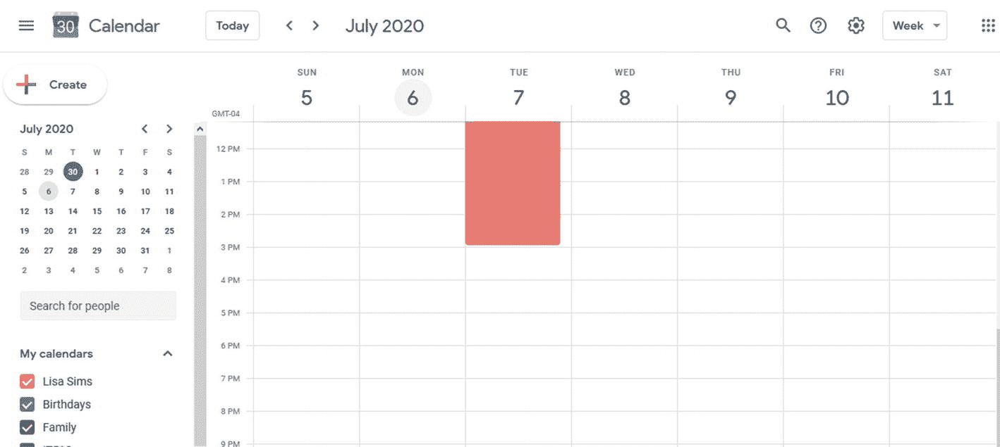
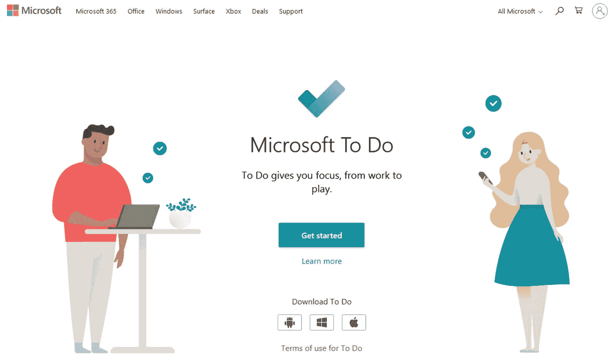

# 时间管理

每个人一天都有 24 小时。在这 24 小时内，我们要同时处理那些可能完成也可能无法完成的日常事务。一旦这些时间过去，我们就无法挽回，必须第二天重新开始。与传统学习相比，在线学习没有固定的在校时间，这需要更好的时间管理能力。与许多人的看法相反，在线学习需要大量的准备和努力。很多时候，在努力平衡学习者的需求以及自己的职业和个人需求时，你的工作日似乎永无止境。有时，这可能会让人感到不堪重负。由于没有传统学习提供的预排日程表，在规划教学安排时很容易忘记事情。

在线学习提供的灵活性有助于平衡工作与生活。然而，许多教育工作者仍然被生活中的各种任务压得喘不过气来。在新冠疫情期间，许多教育工作者既要进行在线教学，又要帮助自己的孩子进行在线学习。有些人可能还需要照顾他人或应对个人健康问题。在传统学习和在线学习模式中，教育工作者都需遵守出勤和参与要求，同时要学会在这种新常态下保障安全并开展教学。兼顾这些并不容易。尽管你可能已经有了日程安排工具，但多一些选择总没坏处。

`Google Calendar` 是一个免费的在线日历系统，用于安排约会和其他重要事件。你可以把它看作一个具有时间管理功能的在线计划本。这些事件不仅可以在线查看，还可以保存到你的移动设备日历中（图 3-1）。通过使用像`Google Calendar`这样的日历系统，你可以安排备课时间、作业截止日期、办公时间等，而不会遗漏任何事项。由于它是基于云端并通过`Gmail`账户使用的，可以在任何设备上查看。同样，`Google Calendar`应用程序可以下载到`iOS`和`Android`移动设备上。

图 3-1

可用于约会和提醒的`Google Calendar`

另一种选择是使用你移动设备的日历。由于我们很多人总是随身携带移动设备，我们可以轻松地安排活动并接收通知。你甚至可以提前几天设置提醒，通知你会议、办公时间和评分截止日期。

`Microsoft To Do` 是另一个可以加入你教学工具箱的工具。它可以作为个人计划本，用于创建待办事项列表和提醒，帮助你在一天中保持专注和条理清晰。它是免费的，可以通过网络使用，也可以在`Windows`、`Android`和`iOS`平台上作为应用程序使用（图 3-2）。

图 3-2

`Microsoft To Do` 允许你创建待办事项列表，以保持条理清晰和专注