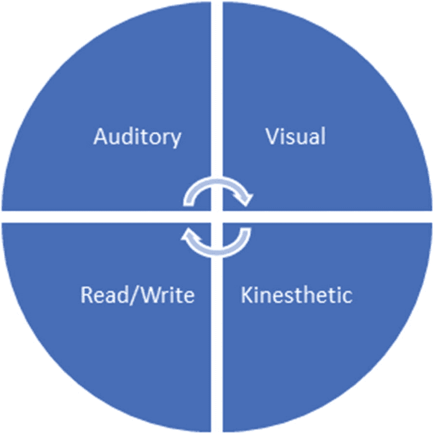
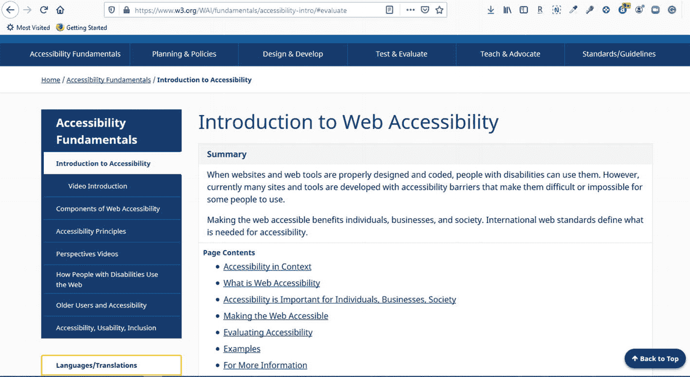

# 4. 内容为王

在第三章中，你了解了规划的重要性及其在在线学习体验中的作用。规划为教育者和学习者双方取得良好成果奠定了基础。然而，它并不能总是保证积极的教学成果。新冠（Covid-19）等意外情况会发生，因此必须制定应急方案。不过，规划确实有助于以积极的方式开启在线学习之旅。充分理解了规划过程后，你就可以开始构思和规划你的在线学习内容了。

我们都听过“内容为王”这个说法，而在在线学习领域，这一点尤为确切。由于在线学习不像传统学习那样有实体教师和教室，因此内容必须经过精心规划和设计。根据质量和交付方式，内容可以成就或毁掉一次在线学习体验。它还必须由许多不同的学习组件构成。否则，它可能无法带来预期的益处，从而导致失败。

## 内容基础

内容是在线学习体验的核心。它包含学习者在指定路径上完成的学习目标和成果。在学习主题的过程中，学习者与内容进行交互。在学术界，传统学习和在线学习通常遵循某种教学法。韦氏词典将教学法定义为“教学的艺术、科学或专业”。教学法与内容协同作用，以实现学习目标和目的。

许多不同的内容元素被用于实现在线学习教学法。以往，将书面讲义插入学习管理系统或发布在指定网站上，再辅以电子书，是传递在线课程内容的主要方法。除了测验和考试，几乎没有方法可以分析学习材料是否有效。随着技术创新和创造性思维的发展，内容创作已经大大演变。书面讲义现在与以下内容相结合：

- 视频

- 播客

- 网络文章

- 博客文章

- 幻灯片（PowerPoints）

- Prezis

如今，内容的组织不仅旨在促进批判性和分析性思维，也旨在促进学习者的参与。在接下来的章节中，你将探索特定的应用程序和应用，以帮助你创建各种类型的内容。

尽管内容可以有多种形式，但其关注点必须始终将学习者及其需求放在首位。学习者是在线学习等式中最重要的利益相关者。在创建任何内容之前，都应始终考虑学习者及其学习风格（图 4-1）。

图 4-1. 学习者的四种学习类型

不幸的是，不存在一种适用于所有学习者的“一刀切”内容。并非所有学习者的学习方式都相同。例如，一些学习者有听力或视力障碍等残疾，需要无障碍便利措施（图 4-2）。无障碍便利措施的一个例子是在视频中包含字幕和文字记录，以方便使用屏幕阅读器的视力障碍学习者。在创建内容时未能考虑这些学习者，可能会将他们排除在你的在线学习体验之外。

图 4-2. W3C 提供了关于使网站内容可访问的信息

内容还应该是易于快速浏览的。大多数人不喜欢在任何尺寸的屏幕上阅读长篇大段的文字和长句。这可能会让人望而生畏。使用项目符号是使内容易于浏览的好方法。在段落之间利用空白区域是使内容易于浏览的另一种方法。

## 内容的目的

作为一名教育工作者，你比任何人都更了解你的学科。你是主要的内容创作者和学科专家，知道哪些学习材料有效或无效。新的学习资源层出不穷。根据你的预算和可用资源，你可能忍不住想购买其中一些。尽管它们可能补充你的内容，但你需要做出一些重要决定。例如，这些材料的价格范围从免费到昂贵不等。无论价格如何，学习材料必须服务于一个主要目的：促进学生学习。那些提供最新花哨功能的内容和材料可能看起来很棒，但你必须愿意问自己以下问题：

- 它是否有助于学生更好地理解材料？

- 它是否会鼓励学生运用他们的批判性思维技能？

- 它是否会为内容以及学生增加价值？

不考虑学习者而考虑内容，就如同在黑暗中作画。你确实会把颜料涂到墙上，但当打开灯时，效果却不会好看。切勿忽视你内容的主要目的。