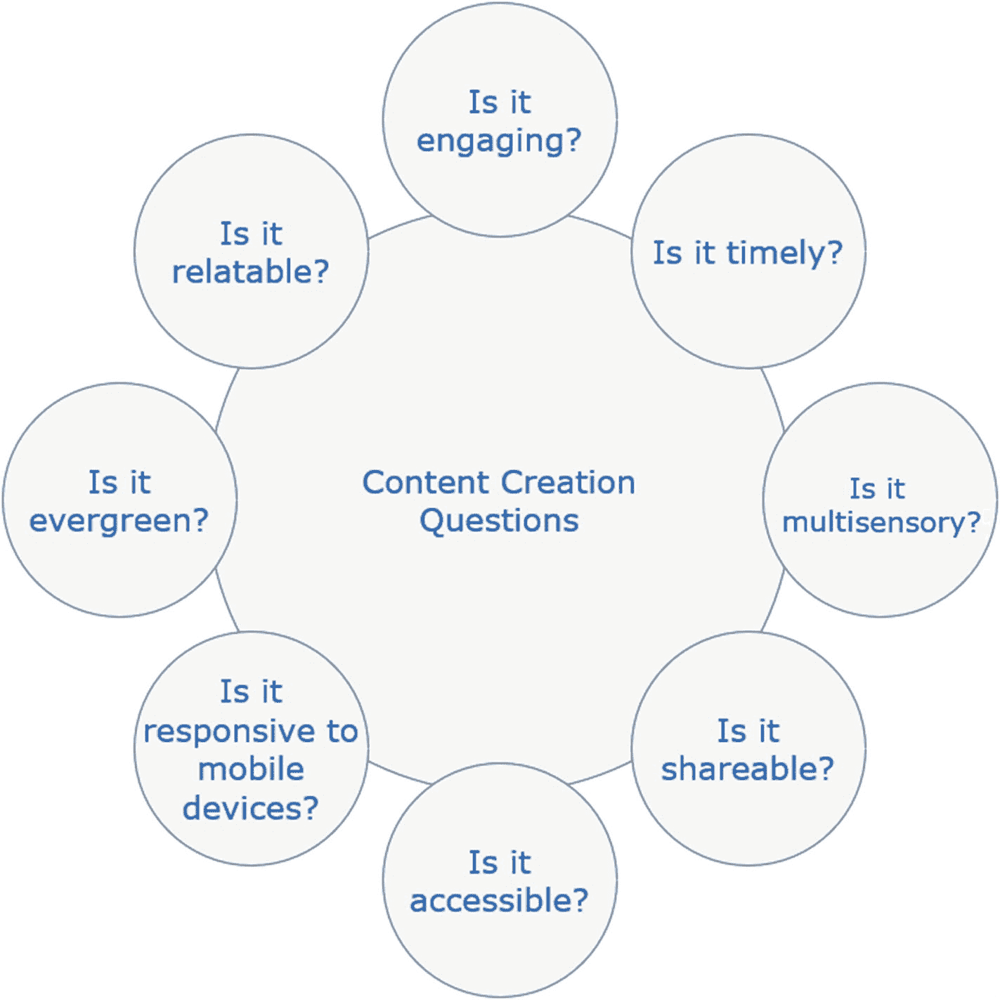

# 内容目标

确定内容目标至关重要。站在学习者的角度思考是设定目标的有效方法之一。对内容提出问题，是评估其是否能满足学习者需求与期望的好技巧（图 4-3）。同样，这也有助于你判断内容是否能帮助你实现课程成果。这些问题的顺序并不重要，重要的是它们能帮助你集思广益，明确内容目标。

图 4-3

准备内容时应思考的问题

另一个需要牢记的目标是**注意力持续时间**。大多数人的注意力持续时间并不长。此外，所有学习者的注意力持续时间也不尽相同。根据微软的一项研究，平均注意力持续时间已从 2000 年的 12 秒下降到 2018 年的 8 秒。^(¹⁰) 如果再加上在线学习环境中学习者感到无聊时可以上网冲浪，注意力持续时间可能会进一步缩短。使用视频和 Prezi 等具有吸引力和互动性的内容，可以在补充内容的同时帮助保持注意力。它还能激励学习者。我们将在本书后面讨论视频及其制作。

**简洁性**通常是一个被忽视的内容目标。在内容中加入所有最新技术可能很有诱惑力。然而，这对学习者有何益处？这为内容增加了什么价值？如果你无法回答这些问题，那么可能就不需要这项技术。在考虑为内容应用任何技术时，请始终牢记**KISS 原则**。简洁的内容不会出错，因为它总是可以进一步深化。

## 总结

制作以学习者为中心的内容很重要。这有助于学习者判断内容的价值以及如何将其应用到实际情况中。创建在线学习内容没有神奇的公式。只要内容围绕学习者及其需求展开，就很有可能获得成功的结果。

脚注 1 2

