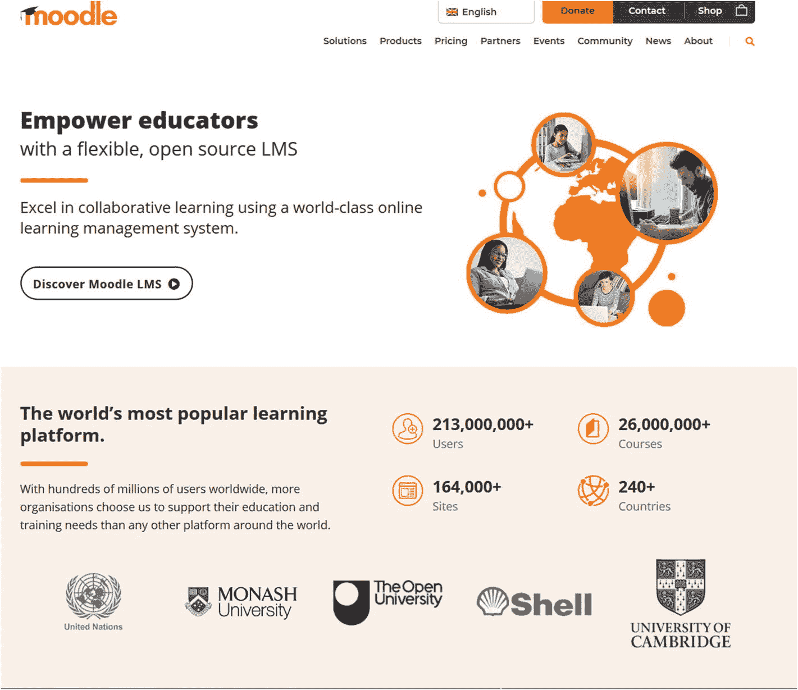
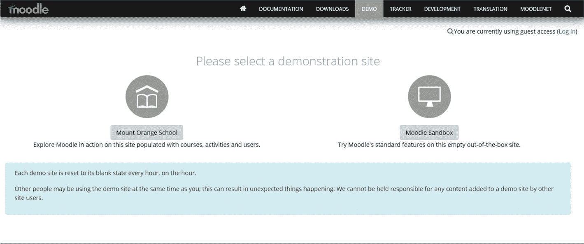
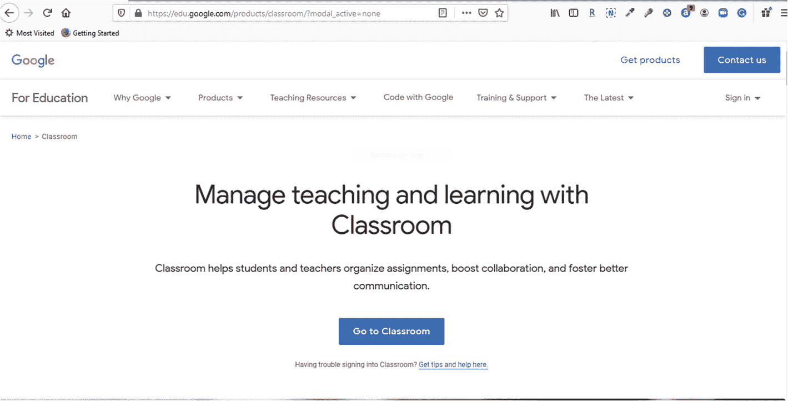
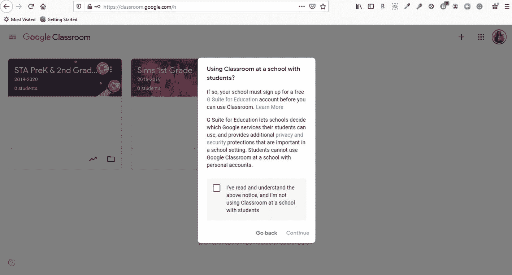

# 5. 学习管理系统

在第 4 章中，你学习了内容创作的基础知识，以及教育者和学习者如何从中获益。内容是任何学习，尤其是在线学习的核心。它奠定了学习的基调，并帮助学习者达到预期的课程成果。内容应侧重于质量而非数量。当高质量的内容具有吸引力并模拟真实应用场景时，学习者就会受到激励去学习，并渴望学习更多。他们的学习体验会变得更有意义，因为他们看到了内容的价值。他们也能看到自己的投资回报，而无需担心错失恐惧症（FOMO）。

一旦内容被规划和创建好，就需要一个存储位置。通常情况下，内容会存储在内容创建者的电脑上，或者存储在 Google Drive、OneNote 等云存储中。尽管这些都是不错的短期选择，但还需要一个更具长期性、可扩展的解决方案，以便让目标受众能够访问这些内容。**学习管理系统（LMS）** 提供了解决方案。

## 学习管理系统基础

学习管理系统（`LMS`）是一种基于 Web 的软件应用程序，用于存储在线学习的学习内容材料和配套资源。这些资源可以包括：

*   多媒体
*   PDF 文件
*   图片
*   电子书
*   音频文件
*   社交媒体动态
*   视频会议
*   RSS 订阅源
*   演示文稿文件

由于 LMS 基于 Web，因此可以通过大多数联网设备上的 Web 浏览器进行访问。学习者通过 Web 浏览器访问 LMS，即可开始由教育者预先设定的学习路径，从而帮助他们实现预期的学习成果。LMS 还能促进学习者和教育者之间便捷的沟通和信息共享。

大多数 LMS 应用程序都提供移动应用，可以从苹果的 App Store 或安卓的 Google Play 商店下载。下载后，教育者和学习者都可以访问课程及其资料。例如，`Canvas`（Instructure 公司开发）是最流行的 LMS 平台之一，被许多高等教育机构使用，它提供的移动应用可用于随时随地访问在线课堂。LMS 平台及其移动应用为学习者和教育者提供了在线学习所带来的额外灵活性和便利性。一些较大型机构使用的最流行的付费专有 LMS 包括：

*   Brightspace
*   Blackboard Learn

### 选择 LMS 的考量因素

在决定选择哪个 LMS 之前，你必须确定你的预算和需求。你不会在头脑中没有价格范围和需求清单的情况下去买房子。选购 LMS 也是如此。你不想投资一个至少不能满足你 80% 需求的 LMS。这通常被称为**帕累托法则**，或 80/20 法则，以备受尊敬的经济学家维尔弗雷多·帕累托的名字命名。^(¹¹) 在考虑 LMS 时，你应该提出的一些问题包括：

*   你的目标是什么？
*   你需要哪些功能？
*   LMS 能处理多少用户？
*   LMS 的可扩展性如何？
*   LMS 在你的预算范围内吗？
*   提供什么类型的支持？
*   LMS 对学习者和教育者来说使用起来有多容易？
*   提供了哪些分析功能？
*   LMS 是否提供无障碍访问设置？
*   LMS 提供什么类型的安全保障？
*   正常运行时间保证是多少？
*   是否支持品牌定制？
*   提供什么类型的培训？
*   数据中心位于何处？
*   它提供什么类型的安全保障？
*   它易于使用吗？
*   它是否具有响应式设计？

### LMS 的类型

在寻找 LMS 解决方案时，你会遇到很多选择。然而，并非所有解决方案都同等优秀。不幸的是，没有一个万能的 LMS 适用于所有情况。因此，明确自己的需求非常重要。大多数 LMS 产品属于以下三类之一：

*   专有（商业）
*   开源
*   免费

让我们探索这些类型，以帮助你根据自己的需求选择合适的 LMS。

### 专有 LMS

专有或商业 LMS 平台由营利性组织创建。这些 LMS 平台按用户收取许可费，可以是按月、按年或基于订阅的方式，以便用户使用其系统。由于其高昂的价格和品牌声誉，它们通常被大型组织和大学使用。专有 LMS 提供了许多组织现在或将来可能用到的各种花哨功能。同样，它们通常也为 LMS 提供托管服务以及安全保障。它们还通过服务水平协议提供所有维护和软件更新，这有助于可能缺乏技术资源的组织。当新功能可用时，通常会通过网络研讨会或录制视频向客户提供某种形式的培训。此外，还提供电话、电子邮件、在线聊天和在线支持论坛等形式的技术支持，这些通常包含在 LMS 费用中。学校使用的几个 LMS 平台包括：

*   Blackboard
*   Microsoft Teams
*   Canvas

尽管专有 LMS 有优势，但也存在一些缺点。例如，客户必须等待 LMS 供应商提供软件修复和更新。同样，价格也可能随时上涨。

### 开源学习管理系统

除了专有学习管理平台之外，还有开源学习管理系统可供选择。根据 Opensource.com 的定义，开源软件是“源代码可供任何人检查、修改和增强的软件”。^((12)) 与专有软件相比，开源软件无需支付许可费。尽管可以免费下载和修改，但与微软等大型专有供应商相比，一些人和组织仍然对其可靠性和安全性持怀疑态度。开源软件可以修改，但专有软件只能由其创建者修改。

在比较开源学习管理系统和专有学习管理系统时，你必须记住，专有学习管理系统在其定价结构中提供了不同级别的专属支持。这种支持可以通过电话、电子邮件、在线聊天或在线知识库提供。开源学习管理系统通常通过在线论坛和文档提供支持。YouTube 和谷歌搜索是解决开源学习管理系统问题的其他途径。

如果你或你的组织缺乏实施开源学习管理解决方案的技术专长，则必须聘请人员或指定组织内的个人，通过在线文档、在线论坛和反复试验来学习并成为所选开源解决方案的专家。由于 `Apache` 是一个由 Apache 软件基金会维护的流行开源 Web 服务器平台，并被众多 Linux（开源）服务器的主机提供商使用，因此与 Windows 主机相比，你有可能节省托管费用。^((13)) 如果你更喜欢 Windows 虚拟主机，`Apache` 也可以使用，但你的网站托管费用可能会更高。

一个开源学习管理系统的例子是 Moodle（图 5-1）。

**图 5-1** 可从 [`moodle.org`](https://moodle.org) 下载的 Moodle 开源学习管理系统

`Apache` 虚拟主机提供商免费提供 Moodle，只需从名为 `cPanel` 的网络控制台单击一下即可安装。一些提供 Moodle 的热门网站托管服务商包括：

- Scala Hosting – [`www.scalahosting.com`](http://www.scalahosting.com)
- Amazon Web Services – [`http://Aws.amazon.com`](http://aws.amazon.com)
- MoodleCloud – [`https://moodlecloud.com`](https://moodlecloud.com)
- Lambda Solutions – [`www.lambdasolutions.net`](http://www.lambdasolutions.net)

虽然 Moodle 是免费的，但你仍需支付网站托管费用。安装好 Moodle 后，你可以轻松地根据课程规格设置你的学习管理系统。Moodle 网站还提供了一个演示站点，你可以使用它来进一步熟悉其功能^((14))（图 5-2）。

**图 5-2** Moodle 提供演示来了解其功能

Moodle 可以安装为自托管选项。使用自托管选项，你或你的机构将负责设置平台所涉及的一切事务，包括：

- 网站托管
- 设置
- 用于支付的商户账户
- 维护
- 升级
- SSL 证书
- 网站托管监控
- 安全
- 备份
- 支持
- 培训
- 负责维护和软件升级的 Moodle 技术资源

最初，自托管的学习管理系统解决方案似乎比专有学习管理系统更具成本效益，但必须考虑所有成本才能确定真正的拥有成本。如果你对自托管选项不感兴趣，Moodle 也为中小型企业提供付费的托管选项。使用托管选项，你需要按月或按年付费，这提供了前面提到的自托管选项以及其他功能。网站托管费用通常从每年 100 美元或更多起，具体取决于用户数量以及选择的是共享主机还是专属主机。但是，你仍然需要一名 Moodle 技术资源来解决任何技术问题，并作为与网站托管服务商的联系点。

### 免费学习管理系统选项

如果开源、自托管的选项不可行，你可以考虑使用 Google Classroom。Google Classroom 是 Google 提供的免费托管学习管理系统，可用于促进小学、中学和高等教育阶段教育者与学习者之间的互动（图 5-3）。诸如 Google Classroom 之类的免费学习管理解决方案具有专有学习管理系统的许多特性，但无需付费。然而，根据你的预期用途，你可能需要付费才能使用像 Google Classroom 这样的学习管理系统。

**图 5-3** Google Classroom 作为 Google 教育套件的一部分提供

如果你计划在学校与学生一起使用 Google Classroom，则必须由你的学校完成 `G Suite for Education` 的注册（图 5-4）。`G Suite for Education` 提供了选择安全选项以及必要的 Google 产品以保护学习者和教育者信息安全的选项。

**图 5-4** 在 Google Classroom 中创建新课程

对于不是 `G Suite for Education` 成员的用户，需要一个 Google 帐户才能创建免费的 Google Classroom。创建 Google Classroom 后，可以通过以下形式创建课程内容：

- 作业
- 测验
- 通过 Google Meet 进行视频会议
- 提问
- 教育者发布的资料
- 重新使用帖子
- 主题

`Google Calendar`、`Google Drive` 以及 `Google Docs` 等 G Suite 应用程序也集成在 Google Classroom 中，以协助创建课程内容。如果课程需要涉及付费的注册流程，你需要查看 `G Suite for Education` 关于商业用途的使用条款。

