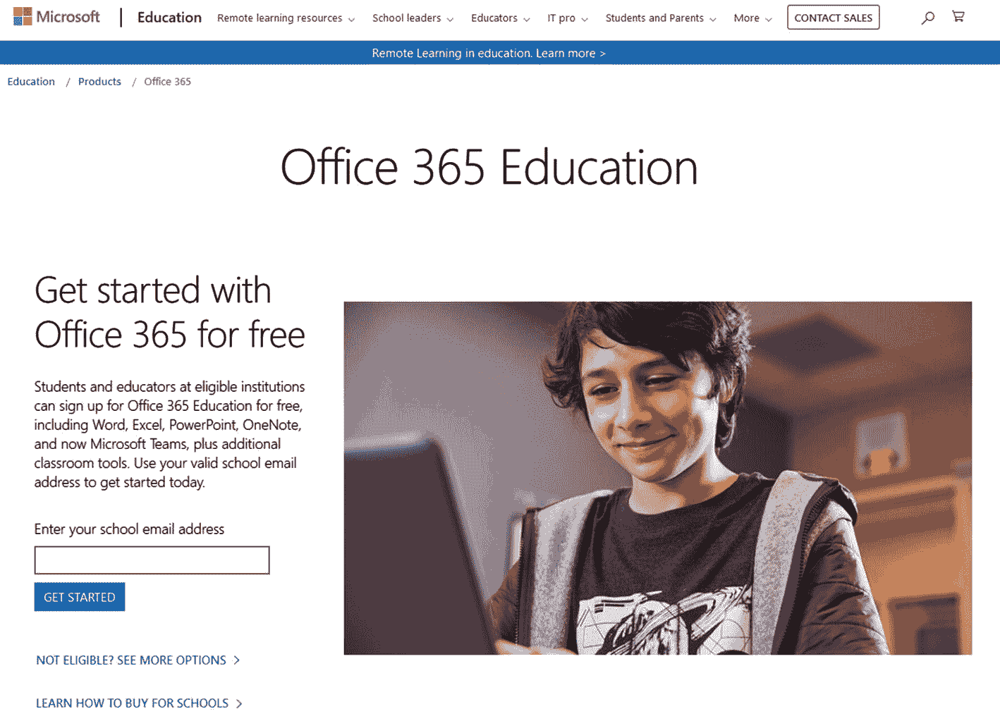
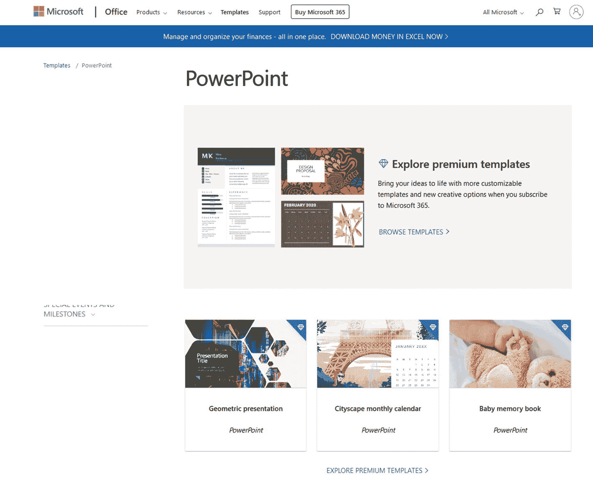
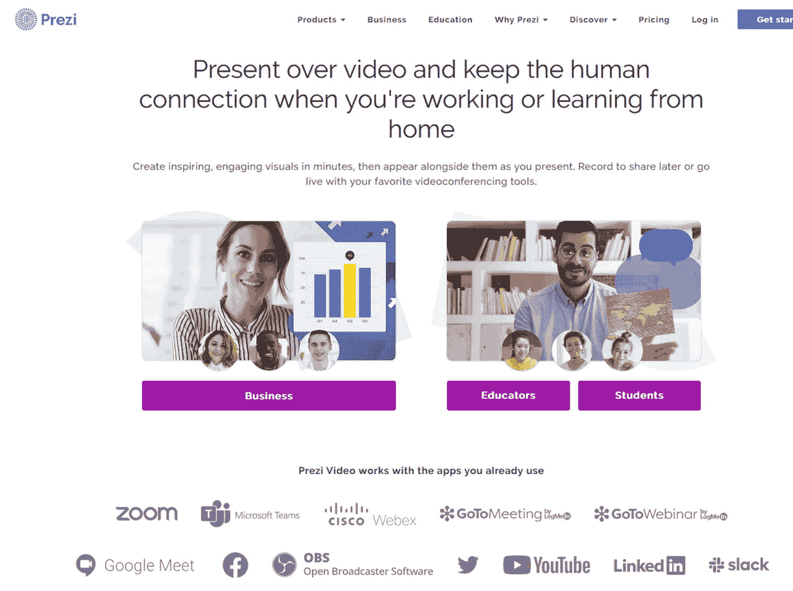
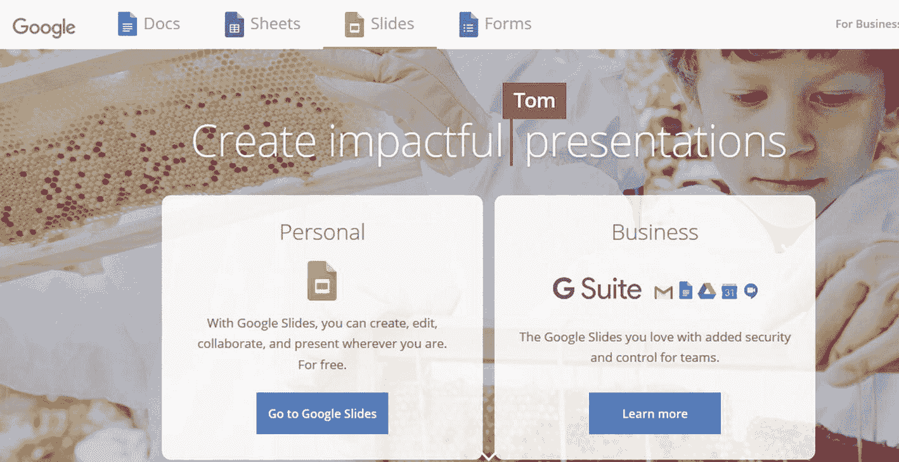
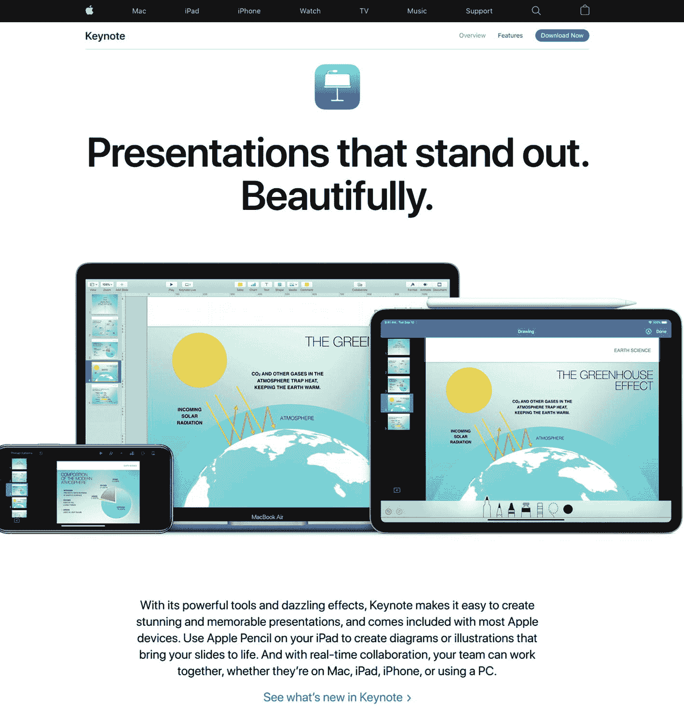
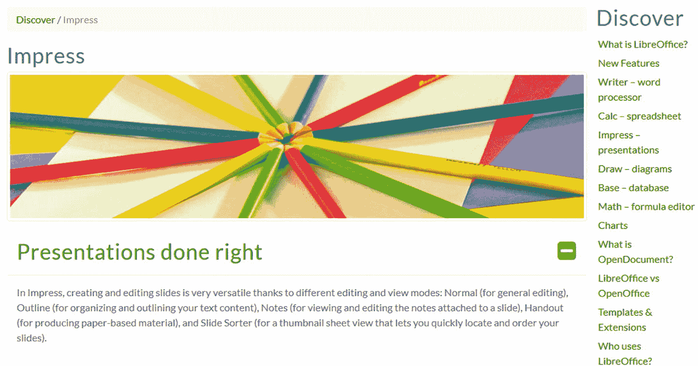

# 6. 演示工具

在上一章中，我们探讨了学习管理系统（LMS）及其在帮助机构与教育工作者组织内容方面的作用。LMS 还有助于连接来自任何地点、使用任何设备的学习者和教育工作者。它们还提供了另一种沟通媒介，同时减少了纸张消耗和成本。在选择 LMS 时，机构与教育工作者必须意识到，没有一种万能的 LMS 解决方案。每个人的需求都不同。对一个组织或教育工作者有效的方法，可能对另一个无效。任何 LMS 的首要目标都应该是帮助学习者在学习过程中更好地参与课程内容。

LMS 中存储的内容可以采取多种形式，但主要是数字形式。无论内容以何种形式呈现，它都有其目的。它也有助于提升学习者的学习体验。其中最流行和最常见的内容格式之一就是演示文稿。

## 选择您的演示材料

“*重要的不是你说什么，而是你如何说。*” 你可能已经听过这句话无数次了。然而，在演示方面尤其如此。演示文稿是一种用于组织某个主题信息的内容形式。演讲者和教育工作者通常用它来传达主题内容。演示文稿通常由包含要点的幻灯片组成。这些要点被用作谈话要点。当信息传达给观众时，观众会跟着理解。

正如你在第 4 章所学到的，每个人都按照自己的学习风格进行学习。大多数学习者都有一种主导或偏好的学习风格。这种学习风格不仅有助于学习者更好地接收信息，也有助于他们更好地理解信息。通过使用演示文稿，教育工作者不仅能够满足视觉学习者的需求，也能满足听觉学习者的需求。演示幻灯片（也称为 slide decks）可以利用不同的配色方案来引发学习者的特定情绪。类似于营销活动中潜意识使用的色彩心理学，教育工作者也可以应用同样的效果。诸如 Adobe Color (`https://color.adobe.com`) 和 `www.presentationteam.com` 这样的网站可以帮助您为演示文稿选择合适的配色方案。在创建演示文稿时，不要忘记品牌标识，并在每张幻灯片的页眉或页脚区域包含您组织的徽标。

演示文稿可以设计得美观吸引人，以保持学习者的参与度。例如，许多演示软件应用程序提供了可用于创建内容的模板，而不必从头开始。可以在演示文稿中包含的一些吸引学习者的内容包括：

- 图片
- 图表
- 动画
- 音乐
- 形状
- 多媒体
- 切换效果

如果没有演示文稿，学习者将只能依赖他们的听觉学习风格，而这可能不是他们偏好的学习风格。我们都记得大学时代，有些教授在没有演示文稿的情况下讲完整堂课。在在线学习环境中，学习者很难观看一个演讲者头像视频来听取演示并保持参与。听到的信息比看到的信息更容易遗漏。

## 演示文稿创建策略

当大多数人听到“在线演示”这个词时，首先想到的是 PowerPoint。接下来想到的术语是“死于 PowerPoint”。“死于 PowerPoint”这个术语归功于 Angela R. Garber，但在此之前许多人已经经历过这种现象，只是没有命名而已。^(15) 一般而言，它指的是 PowerPoint 演示文稿及其演讲者所产生的枯燥乏味的效果。可以给演示文稿添加许多效果来使其变得有趣。然而，并非所有效果都是必需的。尽管演示工具允许您以任何方式创建演示文稿，但最好遵循一些行业最佳实践以达到最大效果。您的内容及其对学习者的影响应该是主要关注点，而不是您能使用多少演示软件的功能。

### KISS 原则

尽管有众多功能可供使用，您可能会想把所有功能都塞进演示文稿中。然而，这并不是一个好主意。这不仅会让学员不知所措，同时也会让您想要传达的信息丢失。每当设计演示文稿时，都应牢记 KISS 原则。KISS 原则，是“Keep It Simple Silly”（保持简单，傻瓜）的缩写，意味着您应该尽可能地简化演示文稿及其各个组成部分。例如，TED 演讲就简单直接。其重点在于传递优质内容，而非华丽的演示幻灯片。在演示中贯彻 KISS 原则的一些方法包括：

*   使用两到三种字体以保持一致性
*   留出足够的空白区域以提高可读性
*   在整组幻灯片中统一使用两到三种配色方案
*   使用项目符号让内容更易读

### 减少杂乱

有些 PowerPoint 幻灯片包含了过多信息，如文字和图片。学员会认为这些幻灯片杂乱无章、令人眼花缭乱且难以阅读。一个不幸的结果是学员会走神，不再参与其中。学员的注意力持续时间很短，您的演示文稿必须抓住并保持他们的注意力直到结束。一张幻灯片不应包含关于某个主题的所有内容。它只应突出主题的要点。这不仅适用于幻灯片上的文字，也适用于图片和项目符号。永远记住，少即是多。

### 限制动画效果

回想一下你上次观看包含动画效果的演示文稿时的情景。当你看到第一个动画时感觉如何？随着演示的继续，使用了更多的动画。你当时感觉如何？感到厌烦吗？你觉得你的学员会有什么感觉？适量使用时，动画可以增添演示的趣味性。然而，过多的动画会分散注意力，并且显得业余。请将演示文稿中的动画数量限制在不超过一两个。

### 限制切换效果

幻灯片之间的切换效果可以增添美感。与动画效果一样，任何事物过多都会迅速变成坏事。对于切换效果，您需要确保它们风格统一，并且不会干扰您的演示。如果您选择使用切换效果，请考虑在整个演示文稿中一致地使用一两种。

### 使用高质量的图片

除了为演示文稿选择良好的配色方案和设计外，高质量的图片也是必需的。低质量的图片会分散人们对演示文稿内容的注意力。您的图片需要能够独立支撑您的主题。它们还需要是专业、高分辨率的，能够在缩放时不影响画质。同样，请确保您拥有在 PowerPoint 或您使用的任何其他演示工具之外使用这些图片的版权许可。在一张幻灯片上，图片也应适量使用。每张幻灯片使用一到两张图片是一个好习惯。否则，您的幻灯片很快会变得杂乱。在第 11 章中，您将了解一些用于查找图片的免费资源。其他用于查找付费高清免版税图片的资源包括：

*   Getty Images – [`www.gettyimages.com`](http://www.gettyimages.com)
*   Shutterstock – [`www.shutterstock.com`](http://www.shutterstock.com)
*   Dreamstime – [`www.dreamstime.com`](http://www.dreamstime.com)

### 谨慎使用音乐

人人都喜欢音乐。音乐能连接我们、让我们充满活力。在演示中使用音乐可以很好，但您必须知道在何处使用。例如，在整场演示中持续播放音乐就不是个好主意。然而，可以在演示开始时使用音乐来定下基调。您还必须为您的听众选择合适的音乐类型，以产生预期的效果。例如，您不会想在面对一群年幼儿童听众时，以一段缓慢的音乐开场。孩子们精力充沛，所以一首更欢快的歌曲会更好。在选择要添加到演示中的音乐时，请确保它是免版税的，以避免版权问题。免版税音乐允许您一次性付费，但可以无限次使用。一些常见的免版税音乐来源包括：

*   Premiumbeat.com
*   Bensound.com
*   Youtube.com

## 演示工具选项

仍然对创建引人入胜的演示感到不安？没问题。好消息是，有许多演示软件应用程序可以帮助教育工作者创建他们的演示，以实现最大程度的学员参与度和影响力。在创建演示之前，集思广益构思演示创意是一个好主意。同样，如果您没有创建演示的经验，可以四处寻找灵感。一些有助于您寻找灵感的网站包括：

*   Slideshare.net
*   [`www.free-power-point-templates.com`](http://www.free-power-point-templates.com)
*   [`https://powerpointify.com`](https://powerpointify.com)
*   Powerhouse.net

### Microsoft PowerPoint

多年来，Microsoft PowerPoint 一直是创建 PowerPoint 演示文稿的行业标准和领导者。目前，它随 Microsoft 365 提供。它也在苹果 App Store 和安卓 Google Play Store 中提供免费的应用程序。要查看教育工作者和学员是否有资格免费获取 Microsoft Office 365，请访问 [`www.microsoft.com/en-us/education/products/office`](http://www.microsoft.com/en-us/education/products/office)（图 6-1）。如果您不是教育工作者或学生，可以使用免费应用，也可以从微软网站购买 Office 365。

图 6-1

检查您是否有资格免费获取 Office 365

创建演示可能是一项艰巨的任务，但 PowerPoint 提供了演示文稿模板助您入门（图 6-2）。这些模板可在微软 Office 网站上获取。PowerPoint 不仅能创建令人印象深刻的演示文稿，还能创建视频。您将在接下来的章节中了解更多相关信息。

图 6-2

用于获取 PowerPoint 模板的微软 Office 网站

### Prezi

Prezi 是一种演示工具，允许您创建交互式演示文稿以及视频（图 6-3）。

图 6-3

在 [`​prezi.​com/`](https://prezi.com/) 注册 Prezi 账户

Prezi 让您能够与屏幕上的演示内容进行交互。换句话说，它能让您的演示在学员面前变得生动。这是保持学员参与度的绝佳方式。您可以使用三种 Prezi 产品来创建交互式内容：

*   Prezi Presents 用于创建演示文稿
*   Prezi Video 用于创建视频
*   Prezi Design

Prezi 演示文稿可以在 Google Classroom、Zoom、Microsoft Teams 以及其他网络研讨会平台中使用。同样，PowerPoint 演示文稿可以导入到 Prezi 中，但将 Prezi 导出为 PowerPoint 则更为困难。

### Google Slides

Microsoft PowerPoint 的免费替代方案是`Google Slides`。`Google Slides`可用于个人和商业用途（作为 Google 商业套件的一部分）来创建演示文稿。它可在 Windows、Apple 电脑、Google Chromebook 和平板电脑上使用，并拥有适用于 Apple 和 Android 移动设备的移动应用（图 6-4）。要开始使用`Google Slides`，你必须拥有一个`Google`账户，该账户可以免费创建。

图 6-4：可从[www.google.com/slides](http://www.google.com/slides)获取`Google Slides`

如果你熟悉`Microsoft PowerPoint`，你将毫无困难地适应使用`Google Slides`。创建演示文稿的过程与在`PowerPoint`中创建演示文稿相同。

### Apple Keynote

对于 Apple Mac 和移动用户来说，`Keynote`应用程序是另一种演示文稿选择（图 6-5）。它可以通过`App Store`免费安装。

图 6-5：可从[www.apple.com/keynote/](http://www.apple.com/keynote/)或 Apple App Store 下载 Apple 的`Keynote`

不幸的是，如果你使用的是较旧的 Apple Mac，可能需要支付一次性费用。完成演示文稿后，可以将其导出为以下格式之一：

- PDF
- PowerPoint
- 影片
- 动画 GIF
- 图像
- Keynote 主题

与`PowerPoint`类似，`Keynote`提供了大量模板供你入门。它还可以与 iPad 上的`Apple Pencil`配合使用，以进行绘图和插图。

### LibreOffice Impress

另一款演示文稿软件是`LibreOffice Impress`（图 6-6）。`LibreOffice Impress`随免费的`LibreOffice`套件一起提供。`LibreOffice`取代了`OpenOffice.org`，并且已经成为数百万无法负担或不想支付`Microsoft Office`费用的用户的解决方案。与`Microsoft Office`类似，`LibreOffice`有一个扩展库，其中包含有助于设计演示文稿的模板。完成演示文稿后，可以将其保存为多种不同的格式，包括`PowerPoint`、`PDF`等。

图 6-6：可从[www.libreoffice.org](http://www.libreoffice.org)下载`LibreOffice Impress`演示文稿

## 总结

你使用哪个演示文稿软件并不重要。你必须选择不仅适用于你可用设备，还能让你以最佳方式呈现内容以吸引学习者的工具。每个演示文稿应用都允许你尽情发挥创意。你需要跳出固定思维模式。

脚注 1

