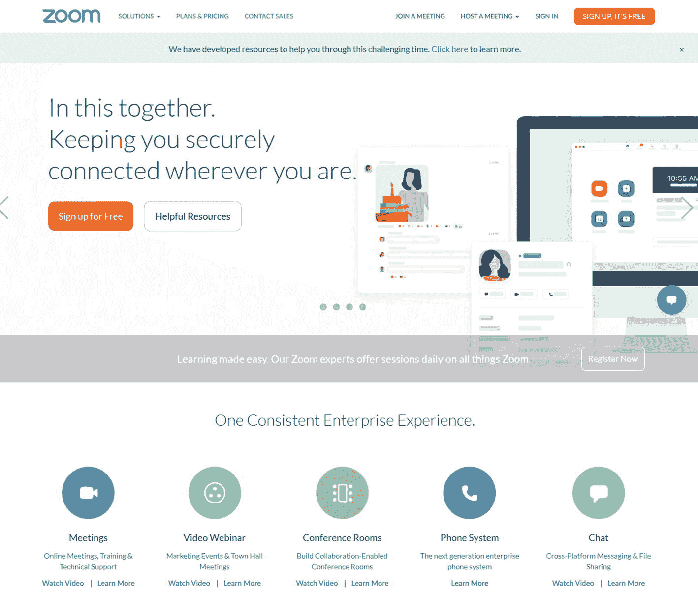
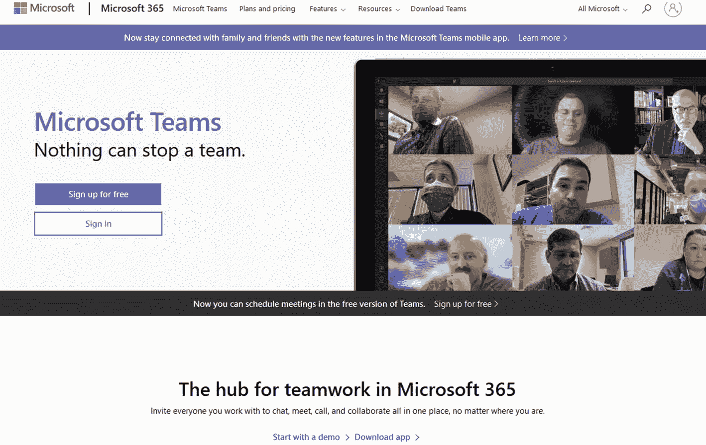
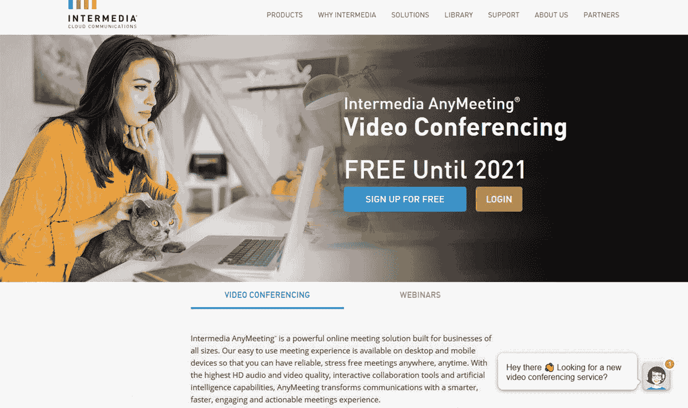
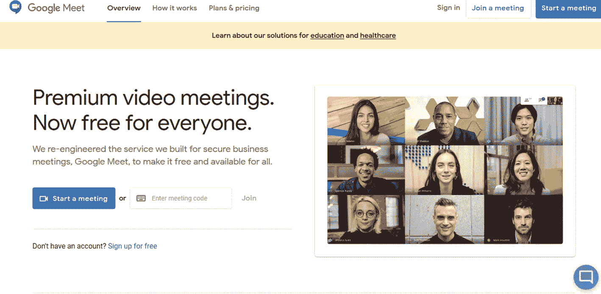

# 网络研讨会平台选项

既然你已经知道如何让网络研讨会更具吸引力，那么现在就该选择一个网络研讨会平台了。有许多免费和付费的网络研讨会平台可供选择，它们共享一些核心功能，同时提供不同的特性。让我们来审视几个平台。

## Zoom

自从新冠疫情迫使学校、企业、教堂和其他机构关闭以来，Zoom 的使用量激增。在撰写本文时，Zoom 提供免费账户，允许最多 100 名参与者进行 40 分钟的三人以上会议，或无限时长的一对一会议（图 7-1）。它既可以在网页浏览器中使用，也可以通过适用于 Apple App Store 或 Google Play Store 的 Zoom 应用程序使用。

**图 7-1** — 可从 [www.zoom.us](http://www.zoom.us) 获取的 Zoom 平台

大多数教育者和学习者已经熟悉 Zoom。它易于使用。对于那些不熟悉它的人来说，其学习曲线并不陡峭。然而，安全性一直是一个令人担忧的领域。在新冠疫情期间，“Zoom 轰炸”已成为一种新常态。根据 howtogeek.com 的说法，“Zoom 轰炸”是指“不请自来的陌生人加入 Zoom 会议，试图通过提供不当内容或评论来牺牲参与者利益博取廉价笑声”。^(¹⁸) 由于“Zoom 轰炸”事件，Zoom 加强了其安全性，并建议会议主持人执行以下操作：

- 为会议提供密码
- 启用等候室以验证和批准已注册用户
- 在所有与会者到达后锁定会议
- 在与会者加入时将其麦克风静音
- 锁定与会者共享屏幕的能力

Zoom 提供了可安装的应用程序，以便在 Zoom 会议、网络研讨会和分组讨论中更轻松地实现协作、分析、日程安排等功能。要安装这些应用程序，你需要通过 `zoom.us` 登录你的 Zoom 账户。Zoom 应用市场的一些应用包括：

- 分析
- 客户关系管理
- 协作
- 客户服务
- 教育
- 活动管理

Zoom 还提供了使用虚拟背景的功能。虚拟背景会用你选择的计算机生成背景，替换通过摄像头对学习者可见的真实背景。它能让你的会议或网络研讨会看起来更专业，并隐藏杂乱的背景。要启用虚拟背景，请导航至 Zoom 网页门户中的 `设置 ➤ 会议中（高级）` 选项，并启用虚拟背景选项。要浏览 Zoom 账户中可用的虚拟背景，请点击 `资源` 链接，然后点击虚拟背景链接。虚拟背景可以在线购买，或使用 Canva.com 等工具创建。

## Microsoft Teams

另一个网络研讨会解决方案是 Microsoft Teams。作为 Microsoft 365 的一部分，Microsoft Teams 提供免费和付费计划（图 7-2）。你可以在 Microsoft Teams 中使用任何 Microsoft Office 应用程序进行协作，也可以在会议期间使用。它可以在网页浏览器、桌面应用程序或来自 Apple App Store 或 Google Play Store 的移动应用程序中使用。它支持 Google Chrome、Firefox 和 Microsoft Edge 浏览器。在撰写本文时，为应对新冠疫情，会议时长和参与人数均无限制。

**图 7-2** — Microsoft Teams 用于在线协作等

使用 Microsoft Teams，一切都围绕团队概念展开。在安排会议之前，你必须创建一个团队。创建团队后，你可以分配成员并邀请他们参加包含音频和视频的在线会议。Microsoft Teams 还根据会议中的发言提供实时字幕，这对有辅助功能需求的学习者很有帮助。然而，会议结束后这些字幕不会被保存。由于它是 Microsoft 365 的一部分，它提供安全性以保护你的会议及其材料免受 Zoom 中遇到的类似“Zoom 轰炸”的威胁。

## AnyMeeting

另一个可用的网络研讨会方案是 AnyMeeting。这是一款视频会议软件，可通过网页浏览器（`www.anymeeting.com`）或 Apple App Store 或 Google Play Store 中的应用程序使用。在撰写本文时，它在 2020 年 12 月 31 日前免费，无会议时长限制（图 7-3），并允许使用所有专业功能。与前面提到的其他网络研讨会软件类似，AnyMeeting 提供相同的功能。

**图 7-3** — 可从 [www.anymeeting.com](http://www.anymeeting.com) 获取的 AnyMeeting 视频会议软件

## Google Meet

Google Meet 原名 Google Hangouts，是另一个选择。它由 Google 运营，需要一个 Google 账户。与其他选项一样，它提供免费和付费计划（图 7-4）。它也可以在网页浏览器、通过 Gmail，或通过可从 Apple Play Store 或 Google Play Store 下载的应用程序中使用。在撰写本文时，免费账户可以举行包含 100 名参与者、时长 60 分钟的会议。组织和学校可以增加参与人数和会议时长，但必须拥有 G Suite 账户。

**图 7-4** — 可在 `apps.google.com/meet` 使用的 Google Meet