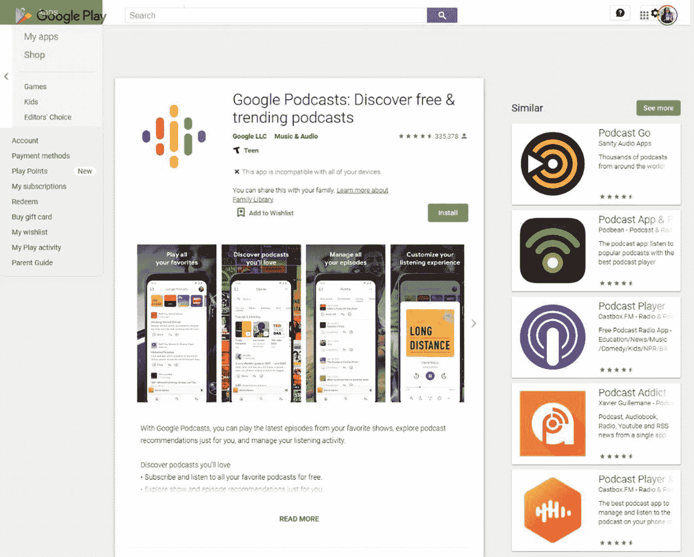
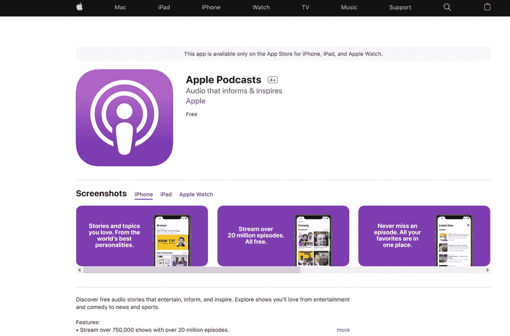

# 8. 播客

在第七章 7 中，你学习了网络研讨会及其在传递内容的同时促进在线学习环境互动的作用。网络研讨会在在线学习中是一种有效工具，能够在教育者和学习者之间建立类似传统学习中的个性化联系。由于电脑和移动设备上提供了众多免费和付费选项，任何希望使用网络研讨会的人都能轻松获得。

学习者参与是在线学习体验的关键组成部分。没有两个学习者的学习方式是完全相同的。与过去相比，如今有更多不同且价格实惠的内容选项可供选择，教育者拥有更多工具来促进学习者的参与。随着使用移动和可穿戴设备的学习者数量空前增长，教育者需要更灵活的解决方案。播客就是其中之一。

## 播客基础

播客已经存在很长时间了。根据 `howstuffworks.com` 的说法，播客最初由前 MTV 视频主持人亚当·库里和软件开发者戴夫·温纳于 2004 年创建，当时库里编写了一个名为 `iPodder` 的程序，用于将互联网广播下载到他的 `iPod` 上。¹⁹ 其他开发者改进了他的代码，我们熟知的播客便迅速传播开来。基于其名称，许多人错误地将播客与苹果的 `iPod` 设备联系起来。然而，大多数人通常使用各种不同的移动设备来收听播客，因为它们便于携带，可以随时随地收听。例如，苹果的 `播客 (Podcasts)` 应用可用于在 iOS 设备上收听播客（图 8-1）。此前在 iOS 设备上，播客包含在 `iTunes` 应用中。在安卓设备上，可以通过 `Google 播客 (Google Podcasts)` 应用获取播客（图 8-2）。

图 8-2
`Google 播客 (Google Podcasts)` 应用可在安卓设备的 `Google Play 商店` 中获取，用于查找和收听播客

图 8-1
苹果的 `播客 (Podcasts)` 应用在 iOS 设备上可用

其他在 iOS 和安卓设备上均可使用的播客应用包括：

* Pandora
* Spotify
* Amazon Music
* Stitcher
* Deezer
* TuneIn

播客是一系列被称为“剧集”的音频文件，其内容针对播客的主题量身定制。这些文件可从在线播客目录或任何移动设备上按需获取。大多数播客剧集的时长为 30 分钟到 1 小时。通常，播客的形式类似于广播脱口秀，由主持人独自主持整集节目或邀请嘉宾。每个播客都有一个与之关联的文件，称为简易信息聚合（RSS）。RSS 源向称为 RSS 阅读器的程序以及播客目录提供播客信息，以便潜在订阅者可以发现和收听播客。`Podcasthosting.org` 报告称，截至 2020 年 7 月，已有超过 100 万个播客，剧集数量超过 2900 万集。²⁰ 如今一些流行的教育类播客包括：

* The Google Teacher Tribe
* The Book Love Foundation
* Flipped Learning Worldwide
* House of #EdTech
* The 10 Minute Teacher

## 播客优势

播客是适用于传统和在线学习的好工具。首先，目前播客涵盖任何主题。如果你访问任何播客目录并搜索特定主题，你会找到无数播客。由于已有如此多的播客，你无需重复发明，这节省了时间和精力。其次，你总能知道新内容何时可用。一旦订阅了播客，当新剧集发布时，你会通过播客应用收到通知，从而节省了查看播客目录寻找新内容的时间。由于播客是免费的，并且在网络上的播客目录中很容易找到，你永远不会缺少宝贵的学习资源。

要将播客纳入你的在线学习环境，你需要播客的 RSS 源或可在网上找到的播客剧集 URL。获取这些信息后，你可以从学习管理系统中向学习者发送每周公告，将其包含在每周课程中，或发送电子邮件通知学生有关播客或播客剧集的信息。大多数学习管理系统允许将 RSS 源轻松插入到通过 LMS 或电子邮件发送给学习者的公告中。

你还可以在学习管理系统中发起一个讨论帖，并附上播客剧集 URL，这不仅能补充你的课程材料，还能引发讨论。此外，你可以基于与学习者共享的播客剧集 URL 创建作业，以强化课程内容。由于学习者总是在使用移动设备，他们可以从播客通过 Web 或移动设备上的应用提供的灵活性和便携性中受益，这不仅能增强课程内容，还能提升他们的学习体验。

尽管大多数播客是音频形式，但它们也可以包含视频，这将进一步补充学习者对材料的理解。正如我们在第四章 4 中讨论的，视频播客可以是支持听觉和视觉学习者的另一种方式。视频播客以 `.mp4` 格式保存，而不是纯粹的音频格式 `.mp3`。在 `新冠疫情 (Covid-19)` 大流行和保持社交距离期间，视频播客可以使用免费工具轻松进行远程录制，例如：

* Zoom
* Microsoft Teams
* iMovie Maker
* OBS Studio

一旦你的视频播客剧集以 `.mp4` 格式录制完成，就可以轻松地在 `YouTube`、社交媒体平台和博客上分享，以获得良好的可见性和推广效果。

## 播客规划

你无需依赖他人来为你的在线学习需求创建播客剧集。你可以自己以低成本且轻松的方式完成。如果你决定创建自己的播客，需要进行一些初期规划。该规划将包括回答一些关于你播客的基本问题：

* 我的播客的主题或话题是什么？
* 它是音频播客、视频播客还是两者结合？
* 每集播客的时长是多少？
* 播客剧集多久发布一次？
* 你将如何推广你的播客？
* 你将独自主持播客剧集，还是邀请嘉宾？
* 你的开场白是否包含音乐？
* 你的播客图片看起来是什么样的？
* 你将如何结束你的节目？
* 你将如何构建你的播客剧集？

## 播客制作设备

对于初学者来说，音频播客是开始最快、成本最低的方式，因为你可能已经拥有必要的设备。对于你没有的设备，许多都可以免费或以低价获得。

