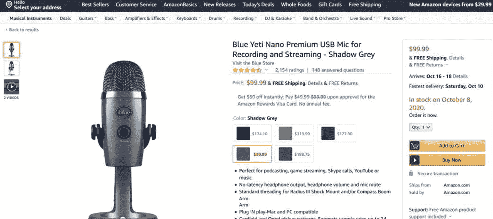
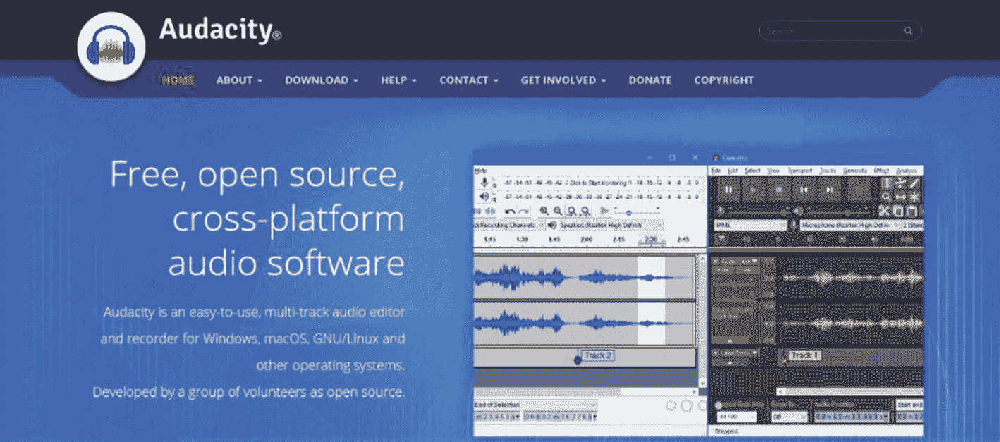
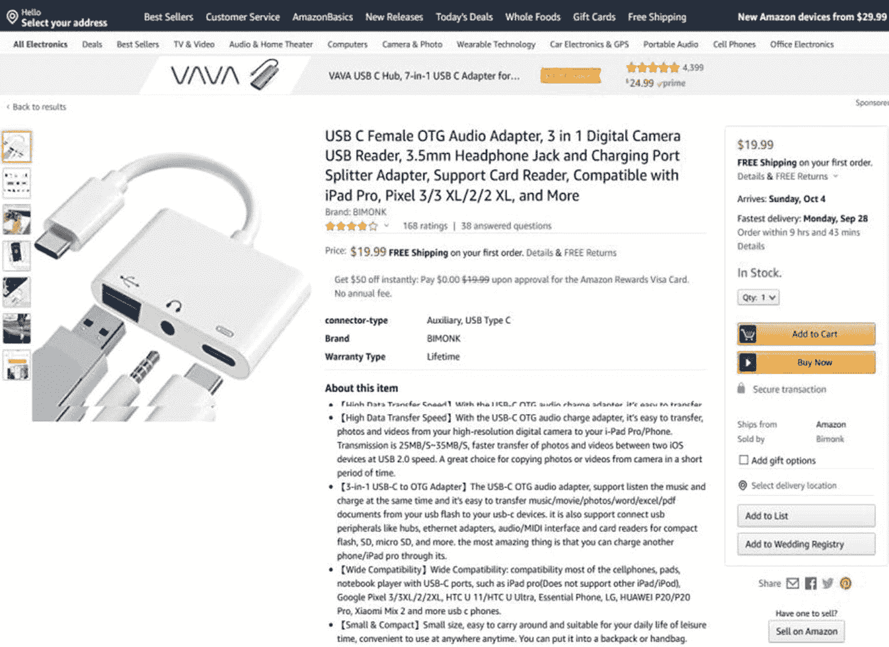
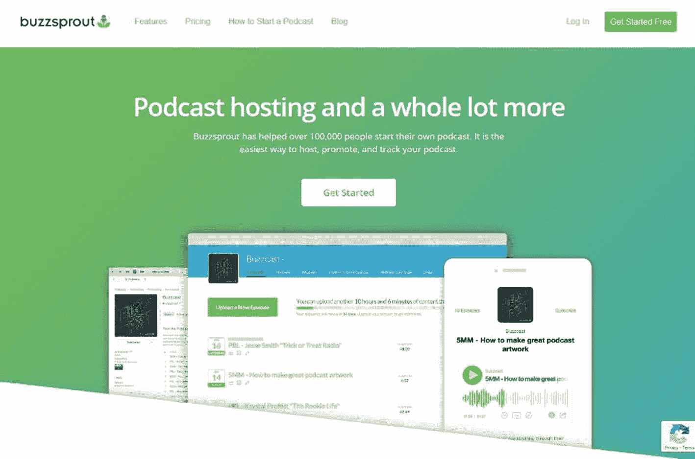

# 麦克风

任何优秀播客的核心都在于音质。要获得良好的音质，你需要一个高质量的麦克风。一个好的、高品质的麦克风会提升录音质量。为了显得专业，你不仅要为潜在订阅者提供优质内容，还要提供优质的音效。购买一个价格亲民、适合播客的高品质麦克风大约需要 100 美元。`Blue Yeti` 是一款适合播客初学者的麦克风，音质出色，许多播客主都在使用（图 8-3）。

**图 8-3** `Blue Yeti` 麦克风是播客初学者的不错选择

随着播客需求的变化，你随时可以升级到高端麦克风，例如 `Heil Sound Pro`，以及价格更高的其他设备，如声卡。不过，对于初学者来说，基础的播客设备已经足够使用。

## 播客创作应用

可以使用手机应用来创作播客剧集。许多此类应用还能将完成的剧集发布到你选择的播客目录中。这些播客创作应用因移动设备而异。

### Backpack Studio 应用

适用于 iOS 系统的 `Backpack Studio` 应用（原 `Bossjock`）是一款集所有功能于一体的播客应用。iOS 用户可以直接在 iOS 设备上录制播客剧集。如果你的 `Apple iPhone` 或 `iPad` 使用的是 `Lightning` 接口，则需要一个适配你的麦克风接口类型的 `Lightning` 转换器。例如，大多数麦克风都有 `USB` 或 `XLR` 接口，因此你需要一个针对特定接口的转换器。`Backpack Studio` 还允许你通过 `Icecast` 或 `Shoutcast`（需付费）向任何电台进行直播。使用 `Backpack Studio`，你可以从云存储服务添加音效：

- `iCloud`

- `Dropbox`

- `Google Drive`

你还可以通过 `Backpack Studio` 从 iOS 设备录制自己的音效，或添加设备上已有的音效。你也可以直接在 `Backpack Studio` 的“笔记”部分添加节目笔记，帮助你在录制剧集时紧扣主题。一旦你的音效和播客简介加载到调音台中，你就可以在应用内开始录制剧集了。剧集完成后，你可以添加剧集标题、艺术家姓名和描述，以方便他人找到你的剧集。输入这些信息后，你可以将剧集导出到指定位置，或保存在 `Backpack Studio` 应用内。你还可以在 `Backpack Studio` 内为你的播客创建音频图表，以便在 `YouTube`、课堂或社交媒体平台上分享。

### 在线音频录制

另一个播客录制选择是 `online-voice-recorder.com`。它是免费的，可以在网页浏览器中直接进行音频录制。只需一个麦克风，就能将录音保存为 `mp3` 或 `mp4` 文件。其界面易于使用，你可以快速创建音频文件，并在需要时导入到其他录音应用（如 `Audacity`）中进行编辑。

## 录音软件

有许多录音软件应用可以帮助你制作播客。有些是免费且开源的，适合预算有限的情况。

一个开源解决方案是 `Audacity`（图 8-4）。`Audacity` 是一款免费的跨平台、开源数字编辑和录音软件应用，可在网上获取。它不仅允许用户录制音频文件，还能导入音频文件。你还可以将文件导出为多种格式，如 `mp3` 或 `mp4`。它还能让你在导出前提升音频录音的音质。

**图 8-4** 可从 [www.audacityteam.org/](http://www.audacityteam.org/) 获取的 `Audacity` 录音软件

`Mac` 和 `iOS` 用户的另一个选择是 `GarageBand`。它在 `Apple App Store` 中免费提供。`GarageBand` 是满足你播客需求的另一个一体化解决方案。使用 `GarageBand`，你可以录制音频播客，还可以为其创作音乐。`GarageBand` 包含可嵌入播客的音乐循环片段。如果你是音乐人，你可以连接键盘或吉他等乐器来创作音乐，并添加到播客中。如果你的 iOS 移动设备较新，则需要使用 `Apple` 转换器来连接带有 `USB` 端口的设备（图 8-5）。

**图 8-5** 适用于需要使用 `USB` 麦克风的 `iOS` 移动设备的转换器

## 播客托管

像 `Buzzsprout.com` 这样的播客目录提供免费和付费的播客托管服务（图 8-6）。这些目录不仅能存储你的播客文件，还能生成提交给其他播客目录所需的 RSS 源。然而，免费账户提供的功能有限。例如，免费套餐通常会包含广告，除非购买付费套餐，否则这些广告不会被移除。此外，许多免费套餐不允许你使用自己的统一资源定位符（`URL`）。与使用系统生成的 `URL` 相比，你自己的 `URL` 能提供更多品牌推广和营销机会。在你准备开始为更高级的播客功能付费之前，坚持使用免费的播客托管服务可能是个好主意。其他提供免费和付费托管的播客服务包括：

**图 8-6** `Buzzsprout.com` 为播客主提供播客托管服务

- `Anchor.fm`

- `Podbean.com`

- `Spreaker.com`

选定播客托管提供商后，你需要为播客设置标题、描述、封面图和分类。如果你不擅长设计，`Canva` 可以帮助你创建封面图。`Canva` 提供了模板供你使用，你也可以自行设计。其他需要配置的播客设置包括：

- 播客类型

- 网站地址

- 剧集数量限制

- 关键词

- 艺术家名称

- 联系邮箱

录制并上传播客剧集后，你需要定期登录播客托管平台查看你的播客统计数据。这些数据将为你提供有关剧集的宝贵见解。你将获得的关于听众的一些洞察包括：

- 下载次数

- 地理位置

- 使用的收听设备

- 使用的收听应用

一旦你获得了播客的 RSS 源，别忘了将它提交到众多播客目录中，以提高你的播客被发现的机会。

## 总结

播客是另一款有助于提升在线内容吸引力、同时保持学习者参与度的工具。由于网络上广泛提供免费的播客，而且制作起来很容易，因此它们非常适合任何预算规模以及在线学习。它们还让学习者能够灵活地在方便的时间，使用自己喜欢的移动设备和可穿戴设备收听和学习。最重要的是要记住，将播客融入你的在线学习应该是有趣且引人入胜的。

脚注 1 2