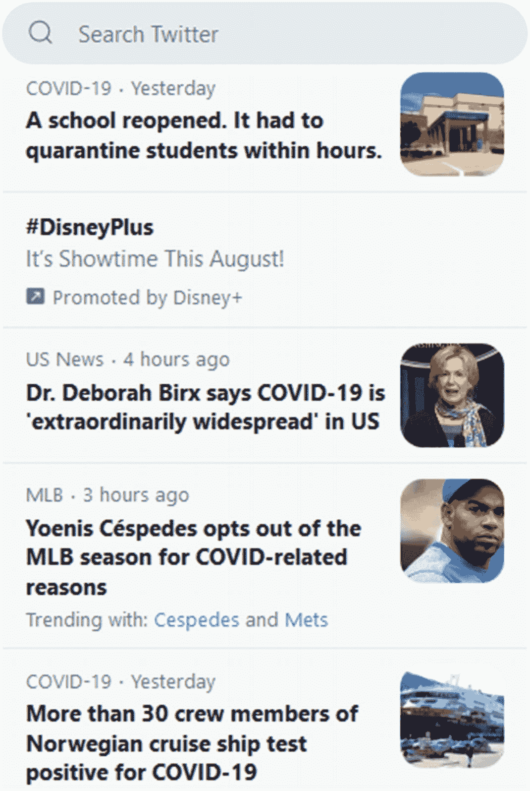

# 9. 社交媒体工具

在上一章中，你了解了播客及其作为在线教学工具的有效性。由于播客是按需提供的，学习者可以轻松地将它们安排进自己繁忙的日程中，并利用移动设备在方便的时候收听。几乎所有主题都有大量免费播客可供选择。如果找不到满足你学习需求的播客，你也可以使用一些简单的工具，轻松且低成本地创建自己的播客。

播客不仅对移动设备友好，而且易于通过社交媒体网络分享。社交媒体改变了人们接收和分享信息的方式，也改变了人们建立联系和构建关系的方式。由于新冠疫情导致的社会隔离，社交媒体比以往任何时候都更加被依赖。同样，它也打破了曾经阻碍关系建立的地理界限。为什么不将其优势应用到在线学习体验中呢？

## 社交媒体的兴起

在社交媒体出现之前，教育工作者与学习者之间主要的传统教育沟通方式是邮件、电话和电子邮件。这些方法可以被视为单向沟通，因为通常是教育工作者发起联系。一旦联系建立，其效果就取决于学习者的回应。

虽然社交媒体似乎在 21 世纪中期突然爆发，但它自 1997 年就已经存在了。`Sixdegrees.com` 是第一个类似于我们今天所熟知的社交媒体网站。六度分隔理论被描述为“世界上每个人都可以通过一个不超过五个链接的关系网络与其他人联系起来。”这个概念类似于社交媒体网络 `LinkedIn`，人们可以通过共同的联系人相互连接，或者主动建立新的联系。尽管 `sixdegrees.com` 拥有大约一百万用户，但它还是在 2000 年被收购并关闭了。

从本质上讲，人是社会性动物。传统教育的一个卖点一直是社会化。在在线学习环境中，教育工作者和学习者之间的社会化，通过利用诸如网络会议和社交媒体等在线工具，采用了传统社会化方法的变体。根据皮尤互联网研究，2019 年大约 72%的美国成年人至少使用一个社交媒体网络^(²¹)。为了帮助学习者学习，教育工作者必须愿意适应当前学习者的习惯和环境，而不是期望他们所处的环境。当今一些流行的社交媒体网站示例包括：

- `Facebook`
- `Instagram`
- `LinkedIn`
- `Pinterest`
- `TikTok`
- `Twitter`
- `YouTube`

像 `Facebook` 这样的社交媒体平台可以在移动设备和智能手机上使用，而这些设备通常与你以及你的学习者形影不离。你上一次忘记带手机又迅速跑回家去取是什么时候？可能比你愿意承认的次数还要多。由于移动设备随时可用，每个人都可以即时连接，并在自己方便的时候学习。

## 社交媒体信息流

将社交媒体信息流整合到在线学习中，有助于促进协作，并让学习者了解最新的新闻动态。这是在课程内容与现实世界应用之间建立联系的好方法。例如，整合一个关于特定行业或主题的 `Twitter` 信息流，可以补充课程内容（图 9-1）。来自 `Facebook` 和 `Instagram` 等社交媒体网站的信息流也可以进行定制，以增强学习者的体验。一旦信息流被整合进来，它们就很容易维护和更新。

**图 9-1** 可整合到在线学习中的 `Twitter` 信息流

## Facebook 主页

你和其他教育工作者可能已经拥有个人社交媒体账号。然而，你可能希望将这些账号分开，以便在你的职业生活和个人生活之间划定界限。考虑到许多公司因员工个人 `Facebook 主页` 的内容而解雇员工的案例，你或许应该考虑这一点。一个解决方案是使用 `Facebook 主页`。`Facebook 主页` 与你的个人账号是分开的，通常由以下几类用户使用：

- 艺术家
- 公众人物
- 企业
- 品牌

任何希望以更多方式与客户和可能不是其 `Facebook` 好友的目标受众互动的人都可以使用它们。在创建 `Facebook 主页` 之前，你必须拥有一个个人 `Facebook` 账号或个人资料。如果你决定创建一个 `Facebook 主页`，你可以为你的课程创建一个主页，并经常更新来自其他网站的、有趣的视频和链接，以补充课程材料，然后通过课程 `LMS` 中的公告或电子邮件，将主页网址分享给你的学习者。通过提供真实世界的、实际的例子，学习者可以获得对该主题的不同视角。学习者还可以通过评论你的帖子来与你以及他人联系和互动。他们也可以与自己的 `Facebook` 好友分享你的帖子，这可以增加你的曝光度和知名度。如果学习者没有 `Facebook` 账号，他们仍然可以访问 `Facebook 主页`，但将无法发表评论。由于这是一个公开页面，`Facebook` 上的任何人都可以通过“动态消息”看到它。你也可以鼓励学习者和其他人关注你的 `Facebook 主页`。

### Twitter 聊天

`Twitter` 聊天，或称 `Tweetchats`，是定期在 `Twitter` 上使用同一个 `Twitter` 账号举办的聊天活动。你可以将其视为在 `Twitter` 上的虚拟聚会。它们每周或每月在固定时间举行。时长可以从 30 分钟到 1 小时不等。这些聊天基于一个核心主题或话题，并配有专属的话题标签。例如，如果你想举办一场关于数字学习的 `Twitter` 聊天，你可以创建一个类似于 `#数字学习聊天` 的话题标签，在 `Twitter` 聊天当天讨论数字学习的某个具体话题。关键在于，每一条推文都必须包含该话题标签，才能被纳入此次 `Twitter` 聊天。

一旦你确定了主要 `Twitter` 话题标签下的子话题，就可以开始准备问题来吸引你的学习者了。问题通常有 5 到 15 个，并以 `Q1` 开头，代表第一个问题。只要有人知道你的 `Twitter` 聊天话题标签，任何人都可以加入，但他/她必须拥有一个 `Twitter` 账号。`Twitter` 聊天是一种绝佳的方式，让你和学习者可以在在线学习课堂之外建立联系，并进行有意义的对话。你还可以与其他人互动，以获得不同的视角。这也是展示你专业知识的好方法，同时可以增加你的 `Twitter` 关注者。

不确定如何开始？建议你在计划自己的 `Twitter` 聊天之前，先参加一次 `Twitter` 聊天来熟悉它的运作方式。你可以使用 `Twitter` 的搜索功能，搜索 `#Twitter 聊天活动` 来找到 `Twitter` 聊天。一旦找到你感兴趣的 `Twitter` 聊天，就参与进去，并记下你喜欢和不喜欢的部分，这样你就可以构建自己的 `Twitter` 聊天，以实现最大程度的参与。你可以通过以下网站获取更多关于如何开始自己的 `Twitter` 聊天的信息：

- [`https://sproutsocial.com/insights/twitter-chats/`](https://sproutsocial.com/insights/twitter-chats/)
- [`https://blog.hubspot.com/blog/tabid/6307/bid/28979/8-steps-to-hosting-a-successful-twitter-chat.aspx`](https://blog.hubspot.com/blog/tabid/6307/bid/28979/8-steps-to-hosting-a-successful-twitter-chat.aspx)