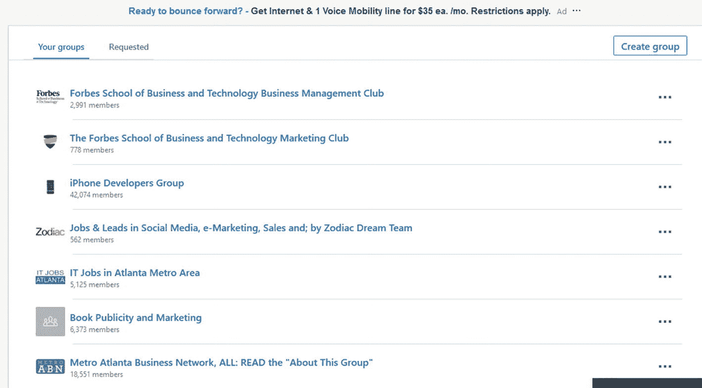

# 社交媒体群组

许多社交媒体网络（例如 `Facebook` 和 `LinkedIn`）允许用户创建群组。这些群组可以是公开的或私密的，可以视为一种在线聚会。只要群组不违反社交媒体平台的使用条款政策，就可以创建。群组的权限和规则在创建时设定，以决定谁可以加入以及成员需要遵守哪些行为准则才能留在群内。与 `Facebook 页面` 类似，大多数社交媒体群组要求您已经拥有个人资料或账户。例如，通过创建一个 `Facebook 群组`，成员可以参与以下活动：

- 创建和回复帖子

- 观看预录和直播视频

- 参与“观剧派对”

- 寻求推荐

- 参与投票

- 查看照片

在 `Facebook 群组` 内，您还可以举办活动来获得更多曝光。例如，你可以就某个课程主题举办一场 `Facebook 直播` 活动，或邀请仅对群组成员开放的嘉宾演讲。您还可以将该活动添加到 `Facebook 活动日历` 中，供其他 `Facebook` 用户发现。

`LinkedIn` 是另一个也允许用户创建群组并邀请成员加入的社交媒体平台（图 9-2）。类似于 `Facebook 群组`，用户可以执行一些相同的功能。这些群组是推广您的课程资料、活动和专业知识的绝佳途径。

图 9-2：创建 `LinkedIn 群组` 是利用社交媒体吸引学习者的另一种方式

## 直接消息 (DM)

许多社交媒体网络都内置了称为直接消息（简称“DM”）的通讯功能。类似于短信，这些直接消息允许用户在社交媒体平台上向认识或不认识的人发送消息。这可能是学习者与教育者联系的另一种方式。例如，`Facebook` 使用 `Facebook Messenger` 允许其用户向其他 `Facebook` 用户发送消息。然而，每个用户都必须使用 `Facebook Messenger` 才能使其生效。同样，`Twitter`、`LinkedIn` 和 `Instagram` 也允许用户互相发送消息。这对你意味着什么？学习者可以通过直接消息联系你。他们还可以在消息中附上视频、照片、链接和其他内容来寻求帮助。但是，你必须谨慎点击，以防止病毒和恶意软件感染你的设备。恶意软件很容易伪装在链接中，因此当收到学生发来的链接时，请保持警惕和专注。最佳做法是安装并经常更新防病毒或反恶意软件。`Staysafeonline.org` 提供了如何在社交媒体上保持安全的建议。

## Facebook 聊天室

`Facebook` 的一个可能对在线学习有帮助的新功能是 `Facebook Messenger 聊天室`。类似于 `Zoom`，`Facebook Messenger 聊天室` 可用于邀请最多 50 名 `Facebook` 用户和非 `Facebook` 用户进行视频聊天，且没有时间限制。可以在 `Facebook Messenger` 或 `Facebook` 中创建聊天室。一旦创建了 `Facebook Messenger 聊天室`，`Facebook` 会为你的聊天室提供一个 `URL`，可以在其他社交媒体网络上分享。随着 `新冠疫情` 的爆发，教育者和学习者在物理隔离期间有了另一种联系方式。但是，请注意，`聊天室` 的安全性并非端到端加密，因此要小心你分享的内容。

## 社交媒体直播活动

诸如 `Facebook` 和 `Instagram` 之类的社交媒体网络允许用户创建直播活动。直播活动允许用户立即或在预定时间广播自己的视频，供其他用户观看。对于 `Instagram` 用户，可以通过 `Facebook 创作者工作室` 为企业账户安排视频和 `Instagram TV (IGTV)` 视频。`Facebook 直播活动` 可以在完成后下载并上传到 `YouTube` 以获得更多曝光。直播活动对所有人开放，因此你需要注意你分享的信息。

## 总结

通过精心规划和研究，社交媒体可以融入在线学习，不仅能提高学习者的理解力，还能增强参与度。有许多工具可以帮助教育者在学习者所在的地方与他们见面和交流。然而，教育者必须了解哪些社交网络能为他们的学习者带来最佳效果。社交媒体已成为我们生活中不可或缺的一部分，我们必须拥抱它。否则，我们将错失与他人联系、分享和协作的潜在机会，无论他们身在何处。

脚注 1