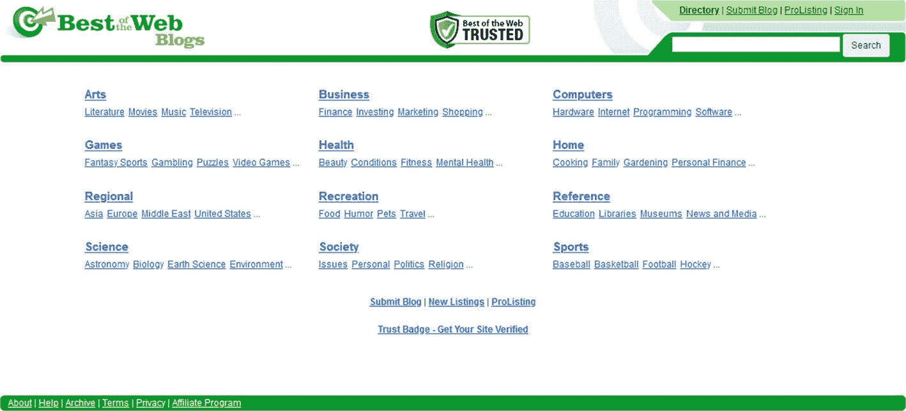

# 10. 博客

正如你在第 9 章所学到的，社交媒体可以在在线学习中发挥关键作用。它为教育者和学习者提供了联系和参与课程内容的各种渠道。教育者可以利用社交媒体的力量来帮助学习者弥合理论与实践之间的差距。

随着技术的不断进步，在教育者和学习者的在线学习环境中将有更多工具可用。这些工具将减少许多在线学习者与传统学习相比所经历的孤立感。博客就是目前可用但有时会被遗忘的工具之一。

## 博客基础

在社交媒体出现之前，就有博客。什么是博客？`Dictionary.com` 将博客定义为“包含一个或多个作者的个人经历、观察、观点等的网站，并且通常包含图片和其他网站的链接。”第一个博客于 1994 年由斯沃斯莫尔学院的学生 `Justin Hall` 在一个名为 `Links.net` 的博客平台上创建。^(²²) `Justin` 的博客名为 `Justin's Links from the Underground`，它提供了最早的网络导览之一，并详细描述了他的个人生活。早期，像 `Justin` 这样的博客被视为常态——它们只是由一个人创建的电子个人日记，用来分享他们的想法和感受。多年来，它们已经演变。如今，互联网上已有超过 5 亿个博客。^(²³)

如今，博客涵盖了面向任何受众的众多主题。这些博客可以有一个或多个内容创作者（称为博主），博客文章由文本或多媒体组成。博客文章通常按时间倒序排列，最新的文章显示在最前面。一些用于创建免费和付费博客的流行平台包括：

- `WordPress`
- `Squarespace`
- `Blogger`
- `Tumblr`
- `LiveJournal`

博客目录有助于找到可能令你和你的学习者感兴趣的博客。它们允许轻松搜索，并且通常按类别组织。一个流行的博客目录是 `Best of the Web Blogs` ([`https://blogs.botw.org`](https://blogs.botw.org))（图 10-1）。

图 10-1：来自 [`https://​blogs.​botw.​org/​`](https://blogs.botw.org/) 的网络博客列表

另一个查找博客的资源是 [`www.blogarama.com`](http://www.blogarama.com)（图 10-2）。`Blogarama.com` 通过其易于使用的搜索功能，提供了网络上超过 10 万个博客的列表。根据你的主题，你可以找到一个博客与你的学习者分享，并鼓励在线讨论。你也可以通过在 `Google.com` 上搜索来查找博客。

图 10-2：在 `Blogarama.com` 上搜索博客

