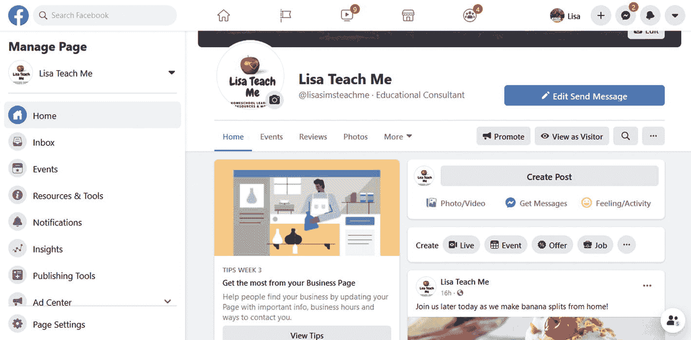

# 口碑营销

尽管口碑营销由来已久，但它至今仍是最有效的营销策略之一。当人们获得积极体验时，他们乐于与他人分享。借助社交媒体，口碑营销的传播速度比以往更快，覆盖范围也更广。口碑营销是指来自可信来源的潜在客户对产品或服务进行口头或书面的认可。其价值无法估量，且无需任何成本。`Nielsen.com` 报告称，92% 的人信任来自朋友和家人的推荐，胜过任何其他类型的广告。^(²⁴) 你还等什么？开始向你的朋友和家人介绍你的专业知识和课程吧。你甚至可以鼓励他们报名参加你教授的课程。无论你需要做什么来打造自己的品牌大使，尽管去做。例如，使用 `Canva` 创建一些包含你专业知识和课程信息的图片，提供给品牌大使，让他们在社交媒体平台上分享。他们的粉丝越多，你获得的曝光机会就越多。你也可以使用本书中提到的免费资源制作一个视频，并发布到 `YouTube` 和你的社交网络上。同样，你可以将 `YouTube` 链接分享给品牌大使，让他们与自己的粉丝分享。虽然需要一些时间才能看到成效，但这会带来巨大的回报。关键在于坚持。

### 社交媒体

社交媒体极大地拓展了口碑营销的覆盖面。随着 `Facebook`、`Twitter`、`Instagram`、`LinkedIn` 等社交媒体手机应用触手可及，与他人分享信息比以往任何时候都更容易。如果你还没有任何社交媒体账号，需要立即开始创建一个。想想你的目标受众使用哪些社交媒体平台，并确保你也使用这些平台。一些有助于你了解社交媒体人口统计特征的资源包括：

-   `HubSpot` – [`https://blog.hubspot.com/marketing/state-of-social-media-demographics`](https://blog.hubspot.com/marketing/state-of-social-media-demographics)
-   `Marketing Charts` – [`www.marketingcharts.com/digital/social-media-108184`](http://www.marketingcharts.com/digital/social-media-108184)
-   `Social Media Examiner` – [`www.socialmediaexaminer.com`](http://www.socialmediaexaminer.com)
-   `Kronos.com` – [`https://khoros.com/resources/social-media-demographics-guide`](https://khoros.com/resources/social-media-demographics-guide)
-   `Pew Research Center` – [`www.pewresearch.org`](http://www.pewresearch.org)

在创建社交媒体档案名称时，请确保它们具备以下四个特征：

-   易于记忆
-   易于拼写
-   在所有平台上保持一致
-   能提供关于你从事领域的某些信息

通过融入这四个特征，当潜在学习者在 `Google` 或社交媒体平台上进行搜索时，你将节省他们寻找你和你的在线学习课程的时间。你的社交媒体档案还需要包含潜在学习者搜索类似课程时会用到的关键词。一个有助于此的免费优质资源是 `Google Keyword Planner`。它是 `Google Ads` 的一部分。`Google Keyword Planner` 允许你搜索人们在 `Google` 上使用的词语和短语。它会显示这些词语和短语的搜索量，并提供建议。以 `Google Keyword Planner` 为指导，你将获得一张路线图，了解应该针对哪些关键词以获得成果。

## Facebook 主页

除了你的个人社交媒体账号外，创建一个`Facebook 主页`正迅速成为必要之举。`Facebook 主页`供个人和企业用来推广其产品和服务，而不是使用个人 `Facebook` 账户（图 13-1）。

图 13-1

使用`Facebook 主页`推广你的在线学习课程

`Facebook 主页`提供与个人账户相同的功能，同时还能提供关于页面表现的详细数据分析。这些信息经过分析和应用后，可以改善你的营销效果。通过你的`Facebook 主页`，你还可以发布图片、网址、视频等内容。你还可以举办`Facebook Live`直播，在指定的日期和时间就某一特定主题进行教学。你的`Facebook Live`直播将会出现在公共信息流中，供所有人观看。一个好的做法是创建一个活动，以便将其添加到`Facebook 活动日历`中，供所有人查看。一旦`Facebook Live`活动结束，录像会保存到你的`Facebook 主页`上。你也可以下载`Facebook Live`视频，并将其发布到其他网站，如 `YouTube` 和社交媒体平台。其他社交媒体平台，如 `LinkedIn`、`Periscope`、`Instagram` 和 `TikTok`，也允许你进行直播。

## YouTube

还有什么地方比 `YouTube` 更适合推广你自己和你的在线课程呢？根据 `hootsuite.com` 的数据，`YouTube` 是 18 至 34 岁人群在电视屏幕上观看视频的第二大首选平台。^(²⁵) `Pew Research` 也认为 `YouTube` 是美国最受欢迎的平台。^(²⁶) 为了展示你的专业知识，何不创建一个 `YouTube` 频道，上传教授你课程内容的简短教程视频呢？观众可以一窥你的教学风格，同时更多地了解你和你能提供的内容。在制作视频时，请确保在视频标题和描述中包含关键词，以便学习者在 `YouTube` 或 `Google` 上搜索时更容易找到。你还应确保在 `YouTube` 视频中包含你的社交媒体账号，以吸引关注者。关键在于让学习者能够轻松地找到并关注你。

`YouTube` 的另一个优点是，你可以将 `YouTube` 视频嵌入到你的网站/博客中，或者轻松地在多个社交媒体平台上分享视频链接。这是你利用单一的营销资产实现多种营销目的以获得最大影响力的另一种方式。

