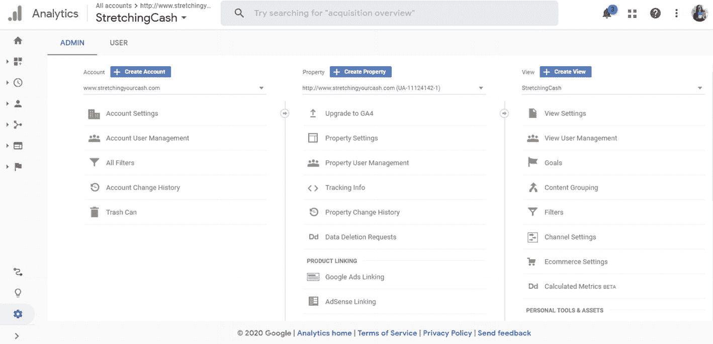
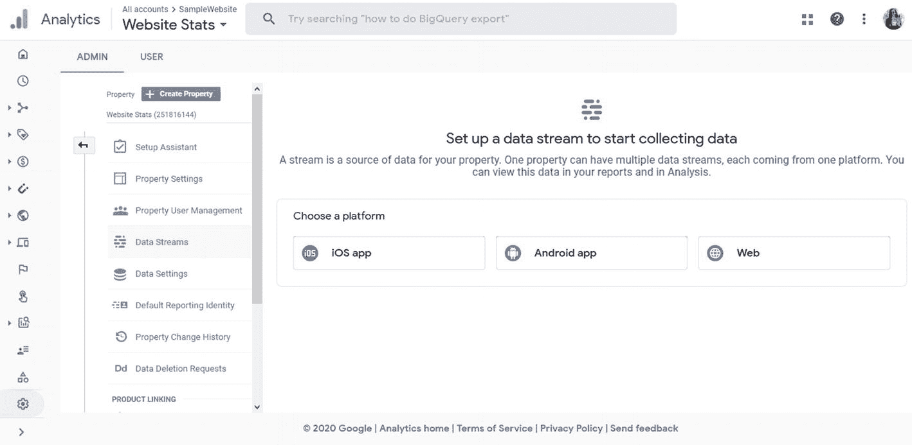
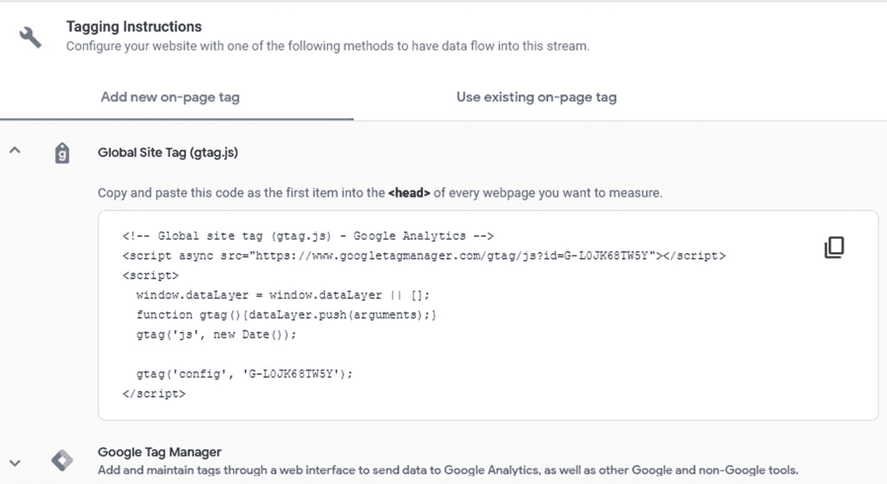

# 嘉宾出演

为了推广您的专业知识和在线课程，请寻找在各种媒体平台担任嘉宾的机会。例如，您可以联系一些与您的在线课程主题相符的`BlogTalkRadio`主持人或播客主，申请成为嘉宾。这样一来，您不仅为主持人提供了内容，还能将营销范围扩展到他们的听众群体。同样，您将获得免费宣传，因为主持人会在其节目页面和社交媒体网络上推广您。这种推广可以包含您的形象照片、个人简介、网站链接、社交媒体链接等。此外，您还可以在节目播出前后，在自己的社交媒体网络和网站上对这次嘉宾出演进行宣传。

在网络研讨会上担任嘉宾是推广您专业知识和在线课程的另一种方式。由于新冠疫情实施社交隔离后，每个人都在举办网络研讨会并寻找嘉宾。为什么您不试试呢？为什么不去寻找一些正在举办与您专业领域相关主题网络研讨会的公司，并请求成为嘉宾呢？他们最多只会拒绝而已。一旦您成为网络研讨会的嘉宾或小组成员，且研讨会结束后，您就获得了一份录像，可以将其添加到媒体资料库中，帮助您推销自己和在线课程。别忘了，您还可以使用`Zoom`等工具创建自己的网络研讨会，录制自己讲授某个主题的过程，并将录像保存下来，以便在您的任何社交媒体平台上分享。

## 网站/博客

如果您拥有网站或博客，那便是推销自己和专业知识的最佳场所。如果您还没有网站或博客，第 10 章可以帮助您入门。无论如何，拥有其中一个或两者都很重要。由于这些平台归您所有，您可以随时更新新内容。例如，您可以在网站或博客上创建一个媒体专区页面，链接到您过往所有的嘉宾出演记录。当您寻找新的嘉宾出演机会时，可以将此页面作为您的作品集，向潜在播客或网络研讨会主持人展示您的才华。您还可以在社交媒体网络上分享此链接。如第 10 章所述，您还可以根据您的专业知识撰写博文，这些博文可以轻松地在社交媒体网络上分享。

使用社交媒体固然很好，但拥有自己的网站或博客也是个好主意。虽然社交媒体会长期存在，但有些网络曾经历过意外的宕机。对许多人来说，社交媒体网络是他们唯一的推广和销售来源。而拥有自己的网站，您就能完全控制和拥有它，可以每周 7 天、每天 24 小时地推销自己和专业知识。别忘了利用`Google Keyword Planner`来研究关键词，这将有助于合适的访问者找到您。

另一种网站推广技巧是使用电子邮件注册表单。您可以以新闻通讯的形式提供与您专业相关的免费信息。访问者可以提供他们的电子邮件地址来换取这份新闻通讯。`Mailchimp`（[`www.mailchimp.com`](http://www.mailchimp.com)）是一个可以帮助您实现这一点的免费资源。它很容易添加到您的网站上。同样，它还会为您提供一个可在社交媒体网络上分享的链接。通过在网站上设置电子邮件注册表单或提供可分享的链接，您正在为您的在线课程建立一个潜在客户列表，从而可以进行持续营销。

一旦您运行了网站或博客，就必须确保经常查看其分析数据。分析数据能提供有关您网站或博客表现的深刻见解。其中包含的信息如下：

*   访问者数量
*   访问者的地理位置
*   访问者停留时长
*   访问者浏览的页面
*   用于找到您网站的设备

这些信息可以从您的网站或博客托管服务商处获取。另一个可以集成到您网站或博客的优秀分析工具是`Google Analytics`。`Google Analytics`是一个免费工具，能为您的网站或博客提供宝贵的见解，帮助提高其性能和营销覆盖范围。您可以通过网页浏览器或`Google Analytics`的 iOS 和 Android 应用来访问它。您可以访问[`https://analytics.google.com`](https://analytics.google.com)，使用您的`Google 帐户`注册`Google Analytics`。创建账户后，点击页面底部的`管理`即可开始设置您的网站或博客。进入`管理`选项卡后，为新的网站或博客点击`创建账号`按钮（图 13-2）。

**图 13-2** 为您的网站或博客设置`Google Analytics`

您需要为您的网站设置一个`账号名称`和`资源名称`，并填写业务信息。填写完信息后，点击`创建`按钮。在继续之前，您必须接受`Google Analytics（分析）服务条款`以及`适用于与 Google 共享数据的附加条款`。同意条款后，系统会显示一个屏幕，让您选择是要跟踪应用还是网站。您需要选择网站（图 13-3）。

**图 13-3** 在`Google Analytics`中选择您的数据流

选择网站选项后，您可以提供您的网站地址。提供网站后，您将收到一段代码，需要将其复制到您想要衡量的每个 HTML 网页的`<head>`部分中（图 13-4）。

**图 13-4** 用于插入网页进行跟踪的全局网站标签代码

如果这看起来令人困惑，不必担心。`Google Analytics`中提供了教程和其他帮助资源，可以帮您入门。设置完成后，您可以通过网页浏览器或`Google Analytics`移动应用查看您网站的`Google Analytics`数据。同样，您可以对网站进行修改以扩大其营销覆盖范围。最后，您随时可以在`Google Analytics`中调整要衡量的网站信息。

## 播客

如第 8 章所述，播客不仅是一种很好的在线学习工具，也是一种很好的营销工具。您不仅可以推广您的专业知识，还可以推销自己。例如，在播客的开场介绍中，您可以向订阅者提供任何即将推出的在线课程、嘉宾出演以及其它活动的信息。您也可以在播客的结尾提醒订阅者相同的信息。由于您是创作者，您控制着每一集的内容及其发布时间表。务必在您的社交媒体网络上发布您的播客剧集，并将播客播放器嵌入到您的网站上。不知道如何操作？您的播客托管服务商会为您提供相关信息。与您的网站一样，不要忘记经常查看您的统计数据。

## 总结

要有效地推销自己和你的在线课程，你必须明确确定你的目标受众。一旦确定了目标受众，你就可以制定营销策略或营销计划来有效触达他们。在实施营销计划时，请记住，营销必须持续且频繁地进行才能有效并看到成果。此外，你必须衡量你的营销努力，并进行必要的调整，以扩大你的营销覆盖面。永远记住，营销没有捷径。你必须持续在正确的地方开火，才能击中目标。

脚注 1 2 3

