# 1. 为何数据中心能效至关重要

数据中心是塑造我们现代体验的信息工厂。当我们访问包括阅读个人邮件、新闻，进行商业活动、使用社交媒体以及消费娱乐内容在内的各类在线信息时，我们依赖的正是为互联网提供计算支撑的数据中心。它们制作了我们观看的许多电影，设计了我们驾驶的汽车，优化了我们乘坐的飞机。它们还被用于科学发现、勘探石油以及预测疾病传播。数据中心处于数字经济的核心位置。

2010 年，全球约有 3000 万台服务器在运行，¹ 且这一数字逐年递增。物联网的发展²预计将使联网设备数量在 2020 年超过 250 亿。推动增长的其他因素还包括商品的持续“非物质化”、³ 全球经济的增长，⁴ 以及人们期望通过计算技术使生活相互连接的日益增长的需求。

从整体能源使用角度来看，在现代设施中进行集中化数据中心计算是高效的。近期，Facebook 估算维持一个普通账户一个月的能耗大约相当于制作一杯咖啡所需的能耗。⁵ eBay 公布的数据中心能耗数据⁶显示，每笔交易产生的碳排放量，比开车去商店完成同样购买所产生的碳排放量低约 50 倍。⁷ 一项近期研究发现，在线购买音乐比任何通过 CD 交付音乐的方式节省 40%至 80%的能耗，即便该计算采用了互联网数据传输电力强度的上限估算值。⁸

颇具讽刺意味的是，数据中心能效的一个主要驱动力——即规模——同时也让数据中心的能源使用备受关注。大型数据中心能共享更多资源；例如，在`N + 1`冗余配置的关键基础设施系统（如空气处理设备或备用电源系统）中，⁹ 随着规模（进而`N`）增大，新增的代价逐渐降低。然而，因其规模庞大，数据中心运行也需要大量电能。典型的大型数据中心需要数十兆瓦的电力——足以维持一座小城市的运转。正是这种高密度的本地化能源使用引起了人们对数据中心的关注——它们是显眼且耗能巨大的大型建筑。因此，它们可能招致社会活动家、¹⁰ 周边居民¹¹ 以及立法者的审视。¹²

## 行业的行动号召

是两个互不相关的事件交汇，才使得数据中心能源使用问题受到关注。第一个是数据中心和互联网规模的扩张。据一项估算，从 2000 年到 2004 年，登录互联网的成年人数量增长了 37%。另一个趋势是通过提升时钟频率和效率来实现计算性能的增长。¹³ 数据中心数量的增长，加上数据中心内部服务器能耗（主要是由服务器数量驱动，服务器单体能耗增长只占少量因素）的增加，导致了数据中心总能耗的爆炸式增长。尽管有些夸大，但“数据中心经济崩溃”的说法无疑吸引了注意。¹⁴

为回应公众对数据中心能源使用日益增长的关注，美国国会在 2007 年委托进行了一项关于美国数据中心能耗的分析。¹⁵ 该研究由劳伦斯伯克利国家实验室于 2007 年完成，采用了“自下而上”的方法，估算出数据中心消耗了美国约 1.5%的电能。更令人警醒的是，到 2006 年，数据中心的能源使用量自 2000 年以来已翻了一番，并有望在未来五年内再次翻番。

该报告指出，如果数据中心行业不协同努力提升能效，能源消耗的增长将面临难以为继的风险，这不仅会影响到直接受影响的行业，也会波及经济本身。

该报告强调了一些提升能效的机会，并描绘了几种可行的情景。其中，影响最大的可改进领域包括数据中心基础设施的能效以及数据中心内部的 IT 设备。尽管本书记述的重点是数据中心 IT 设备，特别是服务器的能效，但讨论在提升数据中心基础设施能效方面所取得的一些进展也是值得的。

### 数据中心基础设施能耗

数据中心的基础设施能耗，即用于为 IT 设备提供清洁、可靠、不间断的电力，以及排除设备产生的废热所消耗的能量，是数据中心总能耗的重要组成部分。在许多情况下，基础设施可能消耗数据中心总能耗的很大一部分。图 1-1 展示了数据中心的功耗构成，分为基础设施（非 IT 电力）和 IT 设备功耗。由于非 IT 电力并不直接作用于信息处理，因此它被视为导致数据中心能效低下的因素。

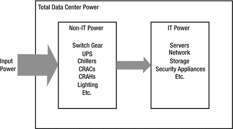

*图 1-1. 数据中心的功耗构成*

由于基础设施的存在仅仅是为了通过维持可接受的环境因素并确保清洁、不间断的电力输送来支持 IT 设备，因此它被认为是额外功耗。另一方面，IT 设备直接贡献于信息处理，因此直接关系到数据中心的能效。这一点在图 1-1 中示意性地说明。

衡量基础设施能效的公认指标是电能使用效率（PUE），其定义为数据中心总能耗与 IT 设备能耗之比。

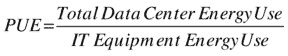

按照现已过时的机房建筑标准设计的企业级数据中心，其 PUE 值通常在 2 到 3 之间。¹⁶ 这意味着，每使用 1 瓦特功率运行计算机，就需要 1 到 2 瓦特的功率来为 IT 设备供电和冷却。按照现代标准，这效率极低。图 1-2 展示了数据中心基础设施与 PUE 之间的反比关系。当 PUE = 2.0 时，数据中心 50%的电力用于非计算目的。一些效率极低的数据中心，其 PUE 甚至可能大于 3。当 PUE 超过 2.0 时，超过 50%的数据中心电力被用于加热、冷却和电力调节。

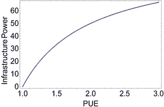

*图 1-2. 数据中心基础设施消耗的总电力占比随 PUE 的变化*

通过像绿色网格（The Green Grid）¹⁷这样的行业组织所推动的工作，提高基础设施能效的标准方法已在整个行业中得到定义和实施。这些努力已使最先进数据中心的 PUE 值得到了显著改善。

关于 PUE 作为数据中心能效指标的一个常见讨论的潜在弱点是：PUE 所致力解决的那些低效问题——即输送冷却空气和调节电力供应——同样存在于服务器（以及 IT 设备）内部。尽管事实如此，但通过优化能效来改进服务器的动力在于系统制造商（本章稍后将讨论）。PUE 提供了一个指标，数据中心设施的设计者和运营者可以用它来优化其可控范围内的环节。正因如此，PUE 才成为推动整体数据中心能效如此成功的驱动力。

像雅虎、Facebook 和谷歌那样专为特定用途建造的超大规模数据中心，严重依赖自然风冷。¹⁸ 这些数据中心的典型 PUE 值约为 1.1，这意味着数据中心所消耗的能量中，只有 10%用于非计算相关任务。其他更传统的、近期建造的数据中心，其 PUE 值接近 1.4，意味着数据中心约 40%的能量用于支持基础设施。这些数值高于专建超大规模数据中心的原因，与特定的架构选择有关，例如冷却设计，以及为满足特定业务弹性目标而对设备冗余的要求。

尽管新建的数据中心通常遵循行业最佳实践进行高效设计，但提高老旧传统数据中心的效率仍然是一个长期存在的问题。这有几个根本原因。其中之一是数据中心技术的快速演进。例如，就在 2011 年，ASHRAE 批准了新的建筑标准，鼓励在许多类型的数据中心中采用更高的运行温度。¹⁹ 据报道，通常情况下，更高的运行温度可使基础设施能耗每升温 1 摄氏度降低高达 4%，²⁰ 这可节省大量能源。²¹

数据中心过去的运行温度通常保持在 68 至 72 华氏度之间，这主要是历史原因造成的。旧式 IT 设备和大型主机的冷却要求不太明确，并且由于它们的规模和尺寸，严重依赖房间级冷却。²² 房间大小的计算机需要房间大小的冷却。随着向当前一代服务器的迁移，服务器的冷却要求已经改变，但房间规格的更新却相对滞后。

虽然在旧建筑中可以调整更高的温度设定点，但气流管理系统可能并非为缓解数据中心内的局部热点而设计或优化。除非对热点进行仔细管理，否则除非对架构进行重大更改，否则这可能会增加服务可用性的风险。由于数据中心建筑通常按 10 到 20 年的周期进行折旧，因此大多数数据中心需要数年时间才能赶上当前最佳实践（更不用说匹配未来的进步），这并不完全令人惊讶。在这一点上，许多用于改进数据中心基础设施的技术创新已经完成或为人所知，当前实践赶上最佳实践只是一个时间问题。

### 节能比例服务器效率

几乎在向美国国会提交数据中心能源消耗报告的同时，Google 的 Luiz André Barroso 和 Urs Hölzle 发表了一篇颇具影响力的论文²³，引入了节能比例计算的概念。计算效率取决于服务器的计算工作输出以及服务器消耗的能量。节能比例模型的关键见解在于，认识到在所有工作负载条件下将服务器效率提升至接近理论最大值，将有助于提高数据中心整体效率。通过确保服务器能耗与工作负载成比例地缩放，可以在更广泛的利用率范围内优化服务器效率，如图 1-3 所示。左图显示了一台服务器（约 2006 年）的功耗，其空闲功耗为峰值功耗的 70%。由于功耗不随工作负载变化，在大多数运行条件下，效率远低于峰值。右图显示了一台空闲功耗为峰值 20% 的服务器。在这种情况下，所有利用率点的效率都高得多。

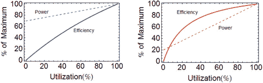

图 1-3. 两台模型服务器的功耗与效率

2007 年的大多数服务器在 0% 利用率（即不执行计算）时消耗的功率几乎与 100% 利用率（即执行最大工作负载或每秒计算次数）时消耗的功率相同。例如，`SPECPower` 基准测试报告的最早系统之一，其空闲功耗约为峰值功耗的 70%。²⁴ 这值得关注，因为在这种情况下，功耗与工作负载不成比例；效率可能远低于服务器的峰值效率。事实上，服务器常常在低利用率下运行很长时间。“节能比例”能耗缩放确保这些服务器即使在较低的工作负载利用率下也能以高能效运行。

### 监管环境

向国会提交报告的一个重大成果是，美国环境保护署的能源之星计划集中精力制定能效标准。²⁵ 由于当时理解和测量服务器效率的技术尚处于起步阶段，初期工作主要集中在测量服务器空闲功耗。如前所述，只要同时考虑服务器性能，空闲功耗就可以很好地代表“能效比例”。

一个常见的误区是将“能效”等同于低功耗。服务器空闲功耗虽然在某些情况下与更高效率的服务器相关，但其本身不能作为可靠的效率指标。原因是效率与服务器能耗和服务器性能均相关。性能较低的计算机完成给定工作量的时间相对更长，这可能会抵消降低功耗带来的任何好处。

当前的能源之星标准广泛关注“能效”，包括高效电源、测量和监控功耗的能力、高效组件以及先进的电源管理功能。²⁶

除美国外，其他一些国家也已采取措施鼓励甚至要求服务器达到一定的能效水平。其中包括欧盟²⁷、澳大利亚²⁸和中国。在某些情况下，由于电网容量不足，必须实施能效限制；而在其他情况下，这些标准则符合减少碳足迹的框架。²⁹

图 1-4 总结了国际法规对服务器设计的影响。尽管服务器空闲功耗是共同关注点，但不同地区采取的方法各不相同。这可能带来问题，因为某一要求（例如，总能耗）可能与另一要求（例如，计算能效）不一致。服务器“能效”标准和法规可能侧重于“能效”的不同方面。能源之星计划侧重于空闲功耗和组件效率。它正计划转向“能效”测量。

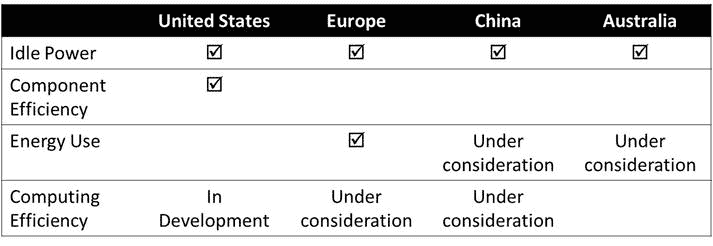

图 1-4. 服务器能效标准与法规

高效电源对于服务器整体效率至关重要，因为电源中的任何损耗对于最终用于计算的所有能耗来说都是开销。在 2006 年左右，电源效率低至 50%。³⁰ 低效率电源生产成本低廉，由于客户不要求更高效率，服务器制造商也就没有改进效率的动力。但改进空间巨大。随着美国环保署于 2007 年在能源之星计划中采纳 80 Plus 电源效率指南，电源效率迅速提高。当前符合能源之星标准的电源，在 50% 负载下要求效率达到 89%，功率因数为 0.9。与 50% 的效率相比，对于固定负载，服务器功耗可降低 35%。

## 测量能效

将能效等同于低功耗是一个常见的误区。效率通常将一定量的输出与一定量的输入联系起来。在计算领域，与效率测量相关的输出是完成的计算周期数。因此，虽然低功耗绝对有助于提高“能效”，但如果没有足够的性能，则是不够的。

有多种指标可用于测量服务器的“能效”，但最常用的两种是 `SPECPower_ssj2008` 和 `Linpack`。`SPECPower` 由标准性能评估公司（SPEC）于 2008 年开发，专门用于测量服务器“能效”。`Linpack` 是一个高性能计算基准测试，由一组 Fortran 子程序组成。³¹ 它被用作 `Green500`³² 超级计算“能效”榜单上的“能效”衡量标准。

### SPECPower

`SPECPower` 使用渐进式负载来衡量单台服务器的“能效”。该负载以测量到的最大性能（即 100%服务器工作负载性能）的 10%为增量进行递增。`SPECPower` 基于服务器端 Java 技术，其优势在于只需一套客户端设置即可完成测量，因此运行起来经济实惠。

图 1-5 ³³ 展示了已发布的 `SPECPower` 测量结果示例。性能功耗比在一系列预设的负载点上进行测量。以下指标

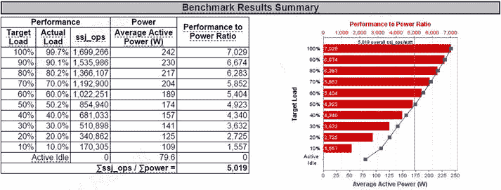

图 1-5. `SPECPower` 发布结果示例。该表格同时强调了工作负载性能和能效。

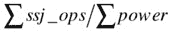

是公认的系统整体“能效”指标。截至撰写本文时（2015 年 3 月），已发布了超过 480 个系统的测量数据。已发布的 `SPECPower` 数据实用性非常高，因为它将功耗和性能的评估贯穿于从 0%到 100%最大工作负载的整个“负载线”。

已发布的 `SPECPower` 数据显示出服务器“能效”强劲提升的趋势。尽管 `SPECPower` 并未针对所有类型的服务器进行测量，但它代表了电源管理配置得当的服务器的能力。图 1-6 展示了所有搭载英特尔至强处理器的双插槽服务器的“能效”与系统“硬件可用”日期的关系图。数据显示，服务器的“能效”呈指数级增长（注意对数刻度），大约每 1.6 年翻一番。这意味着自 2007 年该基准测试发布以来的 7 年间，“能效”提高了大约 20 倍。

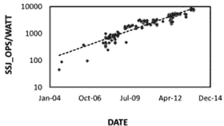

图 1-6. 基于 `SPECPower` 测量的双插槽服务器“能效”，展示了基于英特尔至强处理器的系统与其“硬件可用”日期的关系。注意对数刻度，表明呈指数趋势。

不太明显的是，“能效”提升的贡献因素是什么。由于“能效”是性能与功耗的比率，因此“能效”提升可以归因于性能提升或功耗降低。事实证明，在 `SPECPower` 的情况下，两者都起了作用。

为了理解这一点，我们可以查看图 1-7 中所示的 `SPECPower` 数据详情。该图展示了 `SPEC.org` 上所有已发布的基于双插槽英特尔至强处理器服务器的 `SPECPower_ssj2008` 基准测试中，空闲功耗与最大功耗比率以及性能两者的趋势。这两种趋势都强调了服务器性能与功耗成比例特性在提升“能效”方面日益增长的重要性。空闲功耗与最大功耗的比率是衡量服务器成比例性的一个指标。`SPECPower` 报告包含了有关服务器的丰富信息，包括 CPU 和内存配置。

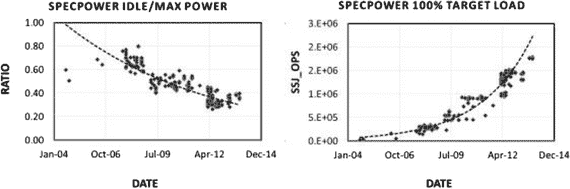

图 1-7. 所有已发布的基于双插槽英特尔至强处理器服务器的空闲功耗与最大功耗比率以及性能的演变趋势。

“能效”成比例的历史趋势可以通过另一种方式可视化——即通过检查由 `SPECPower` 测量的各代服务器的“负载线”。负载线是一张简单的图表，描绘了服务器功耗与绝对工作负载之间的关系。从这张图中可以推断出服务器的功耗、“能效”和性能。图 1-8 展示了从特定代处理器家族构建的平台中选出的图表。水平轴衡量的是直至测量到的系统性能极限的计算工作量。垂直轴测量的是系统功耗。随着时间的推移，根据这个特定的基准测试，系统性能提高了，而系统功耗却降低了。

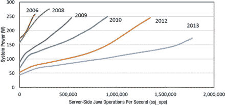

图 1-8. 由 `SPECPower_ssj2008` 测量的几代双插槽服务器的“负载线”。

如何阅读这张图？系统工作负载绘制在 x 轴上（从活动空闲到系统容量 100%的负载点），系统功耗绘制在 y 轴上。每条服务器的曲线都遵循直观的递进关系：随着系统工作负载的增加，功耗也随之增加。这种增加的程度与系统的成比例性有关。请注意，更高的性能在右侧，更低的功耗在下方，因此更高的“能效”在右下方。还要注意，工作输出能力以每秒服务器端 Java 操作数（`ssj_ops`）衡量，这是一个衡量系统性能的指标。

从图中首先可以明显看出，每一代新产品的峰值性能都更高。系统性能的提升带来了“峰值”“能效”的增益（即完成了更多的“工作”）。这就是俗称的摩尔定律的进展。请注意，这些系统的峰值功耗相对稳定，大约在 250 瓦左右。

然而，这张图还揭示了另一个进展趋势，即在低利用率下功耗更低，也就是说，通过“性能功耗成比例”技术，在实际数据中心工作负载下实现了更高的“能效”提升。假设每个系统都在半负载点运行，平均功耗从 2006 年的略高于 200 瓦下降到 2012 年的约 120 瓦。这净减少了约 40%的功耗，假设电费为 0.10 美元/千瓦时，PUE（电能使用效率）为 2.0，那么每年可节省约 150 美元的操作成本。此外，在该负载点的工作输出能力（以 `ssj_ops` 衡量）提高了 10 倍以上。

这些曲线族揭示了一些有趣的趋势。首先值得注意的趋势是系统空闲功耗的稳步下降。你会注意到这些曲线成对出现。在宏观层面上，这是因为管理服务器的空闲功耗主要与微架构相关。事实上，优化微架构特性以在功耗和性能能力之间取得适当的平衡，是本书的主要主题之一。

你还会注意到，每一代产品的性能都在稳步提升。这些性能提升有两个来源。在 2006 年、2009 年和 2012 年，引入了新的微架构。在其间的年份，引入了新的制程技术（英特尔的“Tick-Tock”模式³⁴），从而实现了更低的功耗和显著提升的性能。表 1-1 列出了源于制程技术和微架构革命的高能效服务器的演进过程。新架构和新硅制程技术的开发代表着巨大的资本和工程投入。其中重点强调了交错进行的制程技术和架构的 Tick-Tock 开发周期。

**表 1-1. 高能效服务器的演进**

| 年份 | 微架构系列 | 制程技术 | 处理器系列 |
| --- | --- | --- | --- |
| 2006 | Core | 45 nm | Xeon 5100 |
| 2008 | Core | 32 nm | Xeon 5400 |
| 2009 | Nehalem | 32 nm | Xeon 5500 |
| 2010 | Nehalem | 22 nm | Xeon 5600 |
| 2012 | Sandy Bridge | 22 nm | Xeon E5 |
| 2014 | Haswell | 14 nm | Xeon E5 v3 |

从 SPECPower 数据推导出的每操作能耗的减少也很有启发性。能耗减少在图 1-9 中很容易被观察到，表现为平均功率与每次`ssj_op`时间所定义的矩形面积。每个数据点都进行了标记，以便与图 1-8 对应。每次`ssj_op`的时间计算为图 1-8 中 SPECPower 趋势曲线上 10%利用率时测量的`ssj_ops`的倒数。

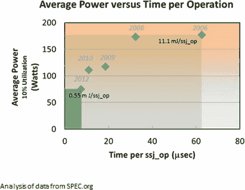

图 1-9. 由`SPECPowerssj_2008`测量的每次`ssj_op`能耗表示，显示了减少计算时间和功耗所起的作用。两者在降低总能耗方面都非常重要。

有趣的是图 1-10 中显示的阶梯状模式——每操作能耗随时间变化的趋势显示出每年 41%的降幅。从 2006 年到 2008 年，我们经历了从 65 nm 到 45 nm 的硅制程技术，从 2009 年到 2010 年，又从 45 nm 过渡到 32 nm 的硅制程技术。在每次过渡中，完成操作所需的时间大约减少了一半。与此互补的是，从 2008 年到 2009 年，以及从 2010 年到 2012 年，微架构发生了重大变化。这些变化带来了与性能提升相关的时间减少，同时也显著降低了功耗。总体而言，时间和功耗的降低共同促进了能效的提高。

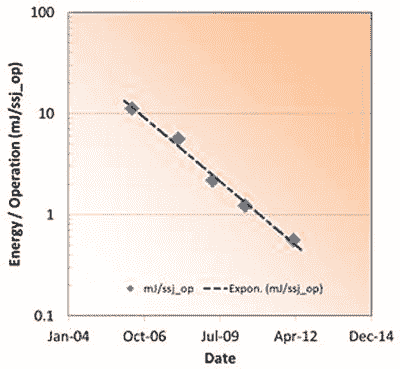

图 1-10. `SPECPowerssj_2008` 中每操作能耗随时间变化的趋势呈指数级下降，这与 0.9 年能效翻倍的时间一致。这比 Koomey 报告的 1.5 年要快得多，原因在于从能量比例性中获得了额外的能效增益。

将数据作为时间序列与 SPECPower 数据中的“系统可用”日期进行绘制，显示出预期的指数趋势。拟合参数相当于每操作能耗每年减少 41%，在所示范围内总共减少了约 20 倍。将计算所需的能量放在背景中来看，0.5 毫焦耳的能量大约相当于点亮一盏 100 瓦灯泡 5 微秒所需的能量。

微架构带来的性能和能效提升在其他基准测试中也扮演着重要角色，接下来关于高性能计算的讨论将证明这一点。

## 高性能计算能效

高性能计算（HPC）是另一个通过公认方法建立了计算能效趋势的领域。自 2007 年以来，Green500 榜单每半年发布一次全球能效最高的超级计算机列表。³⁵ Green500 与 Top500 超级计算机性能榜单共享相同的工作负载。³⁶两者都基于`HP Linpack`，该程序源自 20 世纪 70 年代用 Fortran 编写的一系列 Fortran 线性代数例程。关于 Linpack 例程的优秀原始资料可以在网上找到。³⁷

其他替代基准测试已经出现，例如`Graph500`，³⁸ 它更适用于衡量运行数据密集型应用的超级计算机的性能。可以说，随着“大数据”应用在未来继续增长，这类基准测试将与更广泛的超级计算应用相关。然而，在撰写本文时，这些替代方案才刚刚起步，尚未获得与`Top500`和`Green500`榜单同等的认可度。因此，本讨论将聚焦于`Green500`和`Top500`榜单的历史趋势。

在当前超级计算机的规模下，由于功耗的实际限制，性能领先地位几乎与能效领先地位密不可分。如今，全球最大超级计算机的功耗在 10 到 20 兆瓦之间。虽然这些限制并非一成不变，但以大约每瓦 10 美元的估算基础设施成本计算，要将规模扩展到这些限制之上，除非是最大的政府机构和私营机构，否则成本高昂，令人却步。随着超级计算在从办公级 DNA 解码到野外地球物理学等各个领域中的作用不断扩大，在固定功耗环境中对更高性能的需求正在日益增长。³⁹

由于性能和能效对于超级计算的领先地位都至关重要，因此同时考察超级计算机的能效和性能会很方便。`Exascalar`方法正是如此，它通过性能和能效来绘制`Green500`榜单上的数据点。⁴⁰ 图 1-11 显示了自 2007 年以来`Top500`超级计算机列表中计算机的能效和性能。历史趋势线表明，顶尖系统的性能提升归功于能效提升和功耗增加两方面。`Exascalar`衡量了超级计算领先地位在 20 兆瓦功耗范围内向`10¹⁸ flops`（一个 Exaflop）目标的进展。如图 1-11 所示，数据点大致呈三角形分布，其分类法反映了计算性能和能效以及成本方面的最新技术水平。

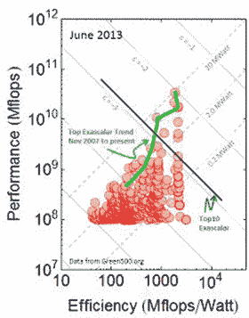

图 1-11. 2013 年 6 月`Green500`榜单的`Exascalar`图。

此图中的`Exascalar`值根据公式计算得出，其中能效和性能都归一化到在 20 兆瓦功耗范围内达到一个 Exaflop 的目标。

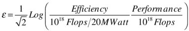

因子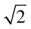确保了与早期（但更复杂且通用性较差）`Exacalar`公式的一致性。⁴¹

此前提及的三角形形状源于通用应用中的功耗限制。尽管从顶级`Exascalar`系统的趋势线可以明显看出功耗增加，但这种增长（约 10 倍）也使得安装成本大致增加 10 倍，因此对大多数采用者而言是一个主要障碍。⁴²图中另一个值得注意的点是，三角形左下角的系统功耗几乎是右下角系统的 100 倍，但两者性能相同。这可能意味着总拥有成本（`TCO`）存在非常大的差异。

`Exascalar`的趋势也可以表示为时间序列，如图 1-12 所示。顶级`Exascalar`系统趋势线与`Exascalar`的 Exaflop 等效值（``）在 2019 年左右相交。中位数`Exascalar`趋势的增长速度较慢，这是因为通用系统的功耗增长较慢（但效率提升类似）。顶级和中位数`Exascalar`增长之间的差异由顶级系统的功耗水平提高所致。

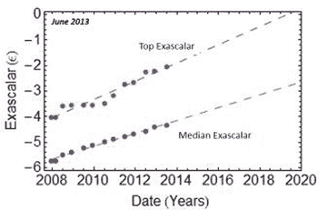

图 1-12. 顶级和中位数`Exascalar`趋势与发布日期之间的关系

将`SPECPowerssj_2008`结果与`Exascalar`结果进行比较，揭示了通过基准测试来追踪能源使用和效率趋势的挑战。在`SPECPowerssj_2008`的情况下，系统总功耗随时间推移而降低以提高效率；而在 HPC 基准测试的情况下，系统总功耗随时间推移而增加以实现更高的性能。

## 能源效率与成本

能源效率是数据中心非常理想的特性，但数据中心的总体目标是在组织的物理和财务约束内满足计算需求。这些约束通常包含在`TCO`模型中，该模型考虑数据中心的资本成本和运营成本（见表 1-2）。

**表 1-2. TCO 模型的参数范围**

| | 低成本范围（美国） | 高成本范围（美国） |
| --- | --- | --- |
| 设施每瓦资本成本 | $8–$12 | $20–$40 |
| 设施资本折旧 | 10 年 | 20 年 |
| 设施每瓦每年资本成本 | $0.80–$1.20 | $1.0–$2.0 |
| 每瓦电费 | $0.03/kWh | $0.15/kWh |
| PUE | 1.2 | 2.0 |
| 每瓦每年运营服务器能源成本 | $0.31 | $2.62 |

TCO 通常很大程度上取决于数据中心的特定应用或预期用途。这反映了数据中心应用范围的广泛性。例如，在某些地点，高昂的能源成本可能倾向于选择特定功耗范围的服务器；或者在其他情况下，软件许可成本可能强烈影响硬件选择。

然而，在这些特殊情况之外，可以对 TCO 做出一些一般性观察。

成本分为两类：资本成本和持续运营成本。资本成本与数据中心设施本身以及数据中心运行所需的服务器和其他 IT 设备相关。重要的运营成本包括电费、水费、维护费等。其他因素，如设施和 IT 硬件的预期折旧，也可能对模型结果产生显著影响。

许多 TCO 模型可以在线获取。有些需要付费；有些作为服务提供。⁴³这些模型的复杂程度各不相同，取决于所需的精度和容错能力。

表 1-2 列出了 TCO 模型的参数范围。运营服务器能源成本包括`PUE = 2.0`的开销。在这两种情况下，数据中心运行服务器的能源成本都与设施成本相当。

由于本书主要关注服务器能源成本，表中显示了一个简化模型，重点是比较设施成本和运行服务器所需的能源。低成本范围的数据中心可能对应于一个位于气候温和且电价低廉地区的、高效的云数据中心。高成本范围可能对应于大都市附近的一个高安全性和高冗余的数据中心。在这两种情况下，数据中心的能源成本显然与设施资本成本相当。

更复杂的模型会考虑对单个数据中心成本进行更详细的分析，并在表 1-2 中的简单分析基础上进行构建和验证。⁴⁴在图 1-13 所示的模型中，电力和冷却基础设施成本约等于公用事业能源成本。尽管能源成本和设施资本成本在 TCO 中各占大约相等的部分，但服务器折旧也是一个重要的贡献因素。

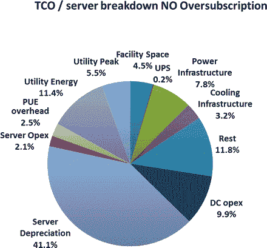

图 1-13. 数据中心 TCO 分解示例

然而，传统的数据中心总拥有成本（TCO）模型并未考虑数据中心本身的工作产出成本；它们仅将服务器视为耗电单元，而忽略了其计算能力的能效或性能。令人惊讶的是，从工作产出的角度来看，数据中心中最浪费能源的消费者（即使是低 PUE 的数据中心）可能就是低效的服务器。

为了说明这一点，请参考图 1-14，该图取自对一家《财富》100 强公司数据中心的实际评估。分析内容包括查看服务器的年龄分布，然后根据其配置评估能耗，最后评估其工作产出（或性能）能力。尽管较老的服务器仅占总数的 32%，但它们消耗了大部分能源，却只贡献了数据中心总计算产出的很小一部分。由于服务器效率大约每一到两年翻一番（具体取决于应用程序和所使用的特定指标），较老的服务器效率远低于新服务器，它们消耗了更大比例的能源，却只提供了更小比例的计算周期。

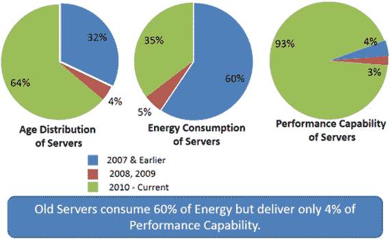

图 1-14. 对一家《财富》100 强公司的数据中心进行实地盘查所获得的数据，显示了服务器的能耗和年龄分布

在这个特定的数据中心中，2007 年之前的老旧服务器消耗了 60%的能源，但估计仅贡献了 4%的计算能力。尽管这似乎有悖常理，但请从摩尔定律的角度来思考这个论点；如果性能大约每两年翻一番，那么相对于数据收集时的 2012 年，2006 年的服务器所做的计算工作量大约只有其 1/8。考虑到前面提供的功耗数据，更新服务器的能耗也可能会降低，具体取决于配置。

因此，在不仅关注能源使用，还关注实际计算工作的数据中心中，服务器的能效和性能是需要考虑的重要方面。通常需要对实际或代表性工作负载进行详细测量，才能达到最高水平的整体工作负载效率。本书的其余部分将重点关注不仅可以在服务器层面，还可以在数据中心层面进行的优化，以便对这笔可能高达数百万甚至数十亿美元的投资，优化其能源使用和计算产出。

# 摘要

在本章中，我们回顾了数据中心的性能和效率趋势，并指出服务器可能对数据中心的整体能源使用产生显著影响，特别是在基础设施效率已经得到优化的情况下。

我们基于 `SPECPowerssj_2008` 基准测试和衍生的 `Exascalar` 基准测试，对服务器的性能和效率趋势进行了比较。在这两种情况下，服务器的效率都随着时间的推移呈指数级增长，尽管根据具体的工作负载不同，其增长趋势也有所不同。

在后续章节中，我们将展示如何针对特定工作负载优化服务器效率，从而使用户能够定制其服务器配置以实现最佳性能和效率。在本书的最后一章中，我们将把这些结论与 `TCO` 联系起来，展示性能、功耗和成本是如何在数据中心 `TCO` 的整体框架中结合在一起的。

脚注

1. Jonathan G. Koomey，《数据中心电力使用增长（2005-2010）》(奥克兰，加利福尼亚州：Analytics Press，2011 年)，[`http://analyticspress.com/datacenters.html`](http://analyticspress.com/datacenters.html)。
2. 参见 [`www.gartner.com/newsroom/id/2636073`](http://www.gartner.com/newsroom/id/2636073)。
3. 参见 [`http://gigaom.com/2010/04/29/greennet-the-dematerialization-opportunity/`](http://gigaom.com/2010/04/29/greennet-the-dematerialization-opportunity/)。
4. 参见，例如 John M. Jordan，《信息、技术与创新：互联世界中的增长资源》(纽约：Wiley，2012 年)。
5. 参见 [`www.facebook.com/green/app_439663542812831`](http://www.facebook.com/green/app_439663542812831)。
6. 参见 [`http://tech.ebay.com/dashboard`](http://tech.ebay.com/dashboard)。
7. 参见 [`www.datacenterknowledge.com/archives/2013/03/12/why-ebays-digital-service-efficiency-changes-the-game/`](http://www.datacenterknowledge.com/archives/2013/03/12/why-ebays-digital-service-efficiency-changes-the-game/)。
8. Christopher Weber, Jonathan G. Koomey, 和 Scott Matthews, “不同音乐传播方式的能源与气候变化影响,” 《工业生态学杂志》 14, 第 5 期 (2010 年 10 月): 754–769, [`http://dx.doi.org/10.1111/j.1530-9290.2010.00269.x`](http://dx.doi.org/10.1111/j.1530-9290.2010.00269.x)。
9. 参见 [`www.lifelinedatacenters.com/data-center/ups-configuration-redundancy/`](http://www.lifelinedatacenters.com/data-center/ups-configuration-redundancy/)。
10. 参见 [`www.greenbiz.com/blog/2011/12/15/facebook-ends-greenpeace-campaign-major-green-commitments`](http://www.greenbiz.com/blog/2011/12/15/facebook-ends-greenpeace-campaign-major-green-commitments)。
11. 参见 [`http://news.idg.no/cw/art.cfm?id=7C75C477-1A64-67EA-E4F528FE768FA524`](http://news.idg.no/cw/art.cfm?id=7C75C477-1A64-67EA-E4F528FE768FA524)。
12. 参见 [`www.whitehouse.gov/blog/2014/09/30/better-buildings-challenge-expands-take-data-centers/`](http://www.whitehouse.gov/blog/2014/09/30/better-buildings-challenge-expands-take-data-centers/)。
13. 参见 Jonathan G. Koomey, Stephen Berard, Marla Sanchez, 和 Henry Wong, “计算电气效率历史趋势的影响,” 《IEEE 计算史年鉴》 33, 第 3 期 (2011 年 7 月–9 月): 46–54, [`http://doi.ieeecomputersociety.org/10.1109/MAHC.2010.28`](http://doi.ieeecomputersociety.org/10.1109/MAHC.2010.28)。
14. 肯·布里尔，《摩尔定律的经济崩溃与绿色数据中心》，（2007）[`www.usenix.org/legacy/event/lisa07/tech/brill_talk.pdf`](http://www.usenix.org/legacy/event/lisa07/tech/brill_talk.pdf)。
15. 参见 [`www.energystar.gov/index.cfm?c=prod_development.server_efficiency_study`](http://www.energystar.gov/index.cfm?c=prod_development.server_efficiency_study)。
16. 维克多·阿维拉尔、丹·阿泽维多、艾伦·弗伦奇编，《PUE：该指标的全面审视》，白皮书第 49 号（2013 年），`www.thegreengrid.org/∼/media/WhitePapers/WP49-PUE%20A%20Comprehensive%20Examination%20of%20the%20Metric_v6.pdf?lang=en`
17. 参见 [`www.thegreengrid.org/`](http://www.thegreengrid.org/)。
18. 参见 [`www.google.com/green/efficiency/datacenters`](http://www.google.com/green/efficiency/datacenters)。
19. 《数据处理环境热指南》，第 3 版（美国采暖、制冷与空调工程师学会，2012 年）。
20. 参见 [`www.datacenterknowledge.com/archives/2007/09/24/data-center-cooling-set-points-debated/`](http://www.datacenterknowledge.com/archives/2007/09/24/data-center-cooling-set-points-debated/)。
21. 关于这种节省的更详细研究似乎是有必要的。
22. 参见 [`www.intel.com/content/www/us/en/data-center-efficiency/efficient-datacenter-high-ambient-temperature-operation-brief.html`](http://www.intel.com/content/www/us/en/data-center-efficiency/efficient-datacenter-high-ambient-temperature-operation-brief.html)。
23. 参见 [`www.barroso.org/publications/ieee_computer07.pdf`](http://www.barroso.org/publications/ieee_computer07.pdf)。
24. 参见 [`http://spec.org/power_ssj2008/results/res2007q4/power_ssj2008-20071129-00017.html`](http://spec.org/power_ssj2008/results/res2007q4/power_ssj2008-20071129-00017.html)。

25. 参见 [`www.energystar.gov/index.cfm?c=prod_development.server_efficiency_study`](http://www.energystar.gov/index.cfm?c=prod_development.server_efficiency_study)。
26. 参见 [`www.energystar.gov/products/specs/enterprise_servers_specification_version_2_0_pd`](http://www.energystar.gov/products/specs/enterprise_servers_specification_version_2_0_pd)。
27. 参见 [`www.powerint.com/en/green-room/agencies/ec-eup-eco-directive`](http://www.powerint.com/en/green-room/agencies/ec-eup-eco-directive)。
28. 参见 [`www.energyrating.gov.au/wp-content/uploads/Energy_Rating_Documents/Product_Profiles/Other/Data_Centres/200905-data-centre-efficiency.pdf`](http://www.energyrating.gov.au/wp-content/uploads/Energy_Rating_Documents/Product_Profiles/Other/Data_Centres/200905-data-centre-efficiency.pdf)。
29. 参见 `www.digitaleurope.org/DocumentDownload.aspx?Command=Core_Download&EntryId=109`。
30. 参见 [`http://en.wikipedia.org/wiki/80_Plus`](http://en.wikipedia.org/wiki/80_Plus)。
31. 参见 [`www.top500.org/project/linpack/`](http://www.top500.org/project/linpack/)。
32. 参见 [`www.green500.org/`](http://www.green500.org/)。
33. 参见 [`http://spec.org/power_ssj2008/results/res2013q4/power_ssj2008-20131001-00642.html`](http://spec.org/power_ssj2008/results/res2013q4/power_ssj2008-20131001-00642.html)。
34. 参见 [`www.intel.com/content/www/us/en/silicon-innovations/intel-tick-tock-model-general.html`](http://www.intel.com/content/www/us/en/silicon-innovations/intel-tick-tock-model-general.html)。
35. 参见 [`www.green500.org/`](http://www.green500.org/)。
36. 参见 [`www.top500.org/`](http://www.top500.org/)。
37. 参见 [`www.top500.org/project/linpack/`](http://www.top500.org/project/linpack/)。
38. 参见 [`www.graph500.org/`](http://www.graph500.org/)。
39. 参见 [`www.intel.com/content/www/us/en/research/tomorrow-project/intel-labs-dna-sequencing-and-bio-chem-sensing-video.html`](http://www.intel.com/content/www/us/en/research/tomorrow-project/intel-labs-dna-sequencing-and-bio-chem-sensing-video.html)。
40. 参见 [`www.datacenterknowledge.com/archives/2012/07/10/june-2012-exascalar-efficiency-dominates-hpc/`](http://www.datacenterknowledge.com/archives/2012/07/10/june-2012-exascalar-efficiency-dominates-hpc/)。
41. 巴拉吉·苏布拉马尼亚姆、温斯顿·桑德斯、汤姆·斯科格兰、吴春风，《节能计算趋势：来自 Green500 的视角》，第四届国际绿色计算会议论文集（弗吉尼亚州阿灵顿，2013 年 6 月）。
42. [`www.datacenterknowledge.com/archives/2013/01/28/the-taxonomy-of-exascalar/`](http://www.datacenterknowledge.com/archives/2013/01/28/the-taxonomy-of-exascalar/)。
43. 瓦西利奥斯·康托里尼斯等人，《管理分布式 UPS 能源以实现数据中心有效功率封顶》，国际计算机体系结构研讨会，ISCA（2012 年），`http://cseweb.ucsd.edu/∼tullsen/DCmodeling.html`。
44. 同上。

