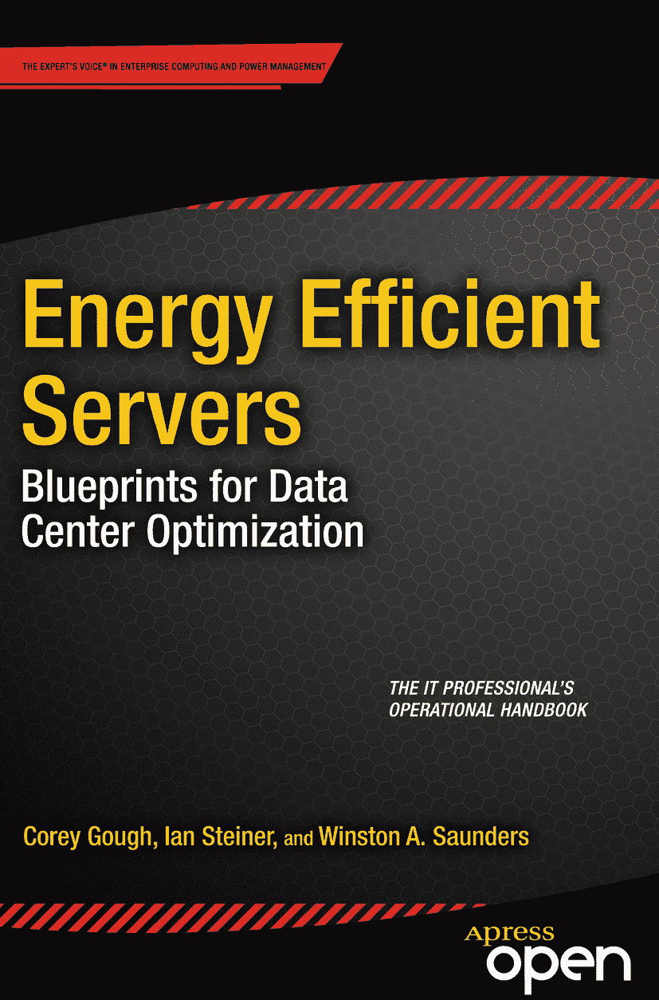

**节能服务器：数据中心优化蓝图**

作者：Corey Gough、Ian Steiner 和 Winston Saunders

ISBN 978-1-4302-6637-2  
电子版 ISBN 978-1-4302-6638-9  
DOI 10.1007/978-1-4302-6638-9  
© Apress 2015

*节能服务器：数据中心优化蓝图*

ApressOpen 权利声明：您有权复制、使用和分发本作品（完整且未经修改的电子版），但仅限于非商业用途。尽管本书中的建议和信息在出版之日被认为是真实准确的，但作者、编辑及出版商均不对可能存在的任何错误或遗漏承担法律责任。出版商对本书所涉内容不作任何明示或暗示的担保。

常务董事：Welmoed Spahr  
首席编辑：Jeffrey Pepper (Apress)；Stuart Douglas (Intel)  
协调编辑：Kevin Walter  
封面设计：Crest Premedia

本书通过 Springer Science+Business Media New York 在全球图书贸易中发行，地址：233 Spring Street, 6th Floor, New York, NY 10013。电话：1-800-SPRINGER，传真：(201) 348-4505，电子邮箱：`orders-ny@springer-sbm.com`，或访问 [`www.springeronline.com`](http://www.springeronline.com/)。如需了解翻译相关信息，请发送邮件至 `rights@apress.com`，或访问 [`www.apress.com`](http://www.apress.com/)。

作品分发许可：本作品版权归 Apress Media, LLC 所有，保留所有权利。除本许可规定外，禁止使用本作品。行使此处任何权利即表示您接受本许可条款。您拥有非独家权利，可出于所有非商业目的，以目前已知或今后出现的任何媒体和格式，复制、使用和分发本英文作品（完整且未经修改的电子版，但为在特定设备上格式化而进行的必要修改除外）。尽管本书中的建议和信息在出版之日被认为是真实准确的，但作者、编辑及出版商均不对可能存在的任何错误或遗漏承担法律责任。出版商对本书所涉内容不作任何明示或暗示的担保。

本书中可能出现商标名称、标识和图片。对于商标名称、标识或图片，我们仅在编辑性用途中使用，以维护商标所有者权益，并无意侵犯商标权。本书中使用的商品名称、商标、服务标志及类似术语，即使未明确标注，也不应视为对其是否受专有权利保护的立场表达。

## 关于 ApressOpen

### 什么是 ApressOpen？

ApressOpen 是一个开放获取图书计划，出版高质量的技术和商业信息。

ApressOpen 电子书可供全球免费非商业用途使用。

ApressOpen 电子书提供 PDF、ePub 和 Mobi 格式。

用户友好的 ApressOpen 免费电子书许可条款已展示在本书的版权页上。

## 致谢

我们感谢技术和内容审阅者，他们显著提升了本书的质量。这包括 Ameya Ambardekar、Avinash Avanthakrishnan、Len Brown、Bill Carter、Gaurav Khanna、Naren Meadem、Bains Kuljit、Raghunathan Srinivasan、Ankush Varma、Vish Viswanathan、Sujal Vora 和 Henry Wong。

我们还要感谢 Dan Kingsley、Harry Li、Yingqi (Lucy) Lu 和 Shubin Zhao，他们提供了来自数据中心工作负载的测量数据，我们使用这些数据来阐述书中所讨论的概念。

Wes Perdue 和 Knut Grimsrud 在 HDD 和 SSD 电源管理特性及趋势方面提供了关键见解。

感谢我们的编辑以及 Apress 的同仁给予的支持和耐心。

最后，作者感谢家人在我们利用夜晚、周末和假期创作本书期间给予的支持。