# 2. CPU 电源管理

数据中心内的 CPU 和内存消耗总功耗的一部分，但它们的效率及内置的电源管理能力是对数据中心效率影响最大的因素之一。在 CPU 内部节省功耗会带来更大规模的乘数效应。由于服务器内部电源转换效率的损耗，在 CPU 处节省 1 瓦功耗很容易转化为 1.5 瓦的节省，而在数据中心范围内则可高达 3 瓦。降低 CPU 功耗可减少冷却成本，因为必须从整个系统中排出的热量更少。

在讨论如何在 CPU 中节省功耗之前，我们首先回顾一些 CPU 架构的基础知识以及电路中的功耗原理。然后，我们将讨论在内存和 CPU 内部节省功耗的方法和算法。第 7 章和第 8 章将研究如何监控和控制这些特性。

## 服务器 CPU 架构/设计

多年来，服务器 CPU 核心设计经历了显著演进，旨在实现工作负载的高性能与高能效执行。然而，若缺乏有效的支撑系统为核心提供执行所需的数据，任何核心都不算完整。缓存、主内存和硬盘共同构成了一个分层存储机制，在容量、带宽和延迟之间进行权衡。近年来，CPU 内部开发了高度可扩展的互连结构，以支持核心数量的扩展。

CPU 设计一个较少人知的目标，是优化总体拥有成本（TCO）的摊销。由于 CPU 在信息处理中扮演核心角色，将 CPU 的性能/能力与其它数据中心基础设施进行合理匹配，对于实现最佳 TCO 至关重要。不同工作负载有不同的最佳平衡点。例如，许多高性能计算（HPC）工作负载对扩展性和跨节点通信非常敏感。这些通信网络可能非常昂贵，因此对数据中心 TCO 贡献显著。在此类系统中，理想的做法是最大化单节点性能，以降低通信子系统的成本和依赖性。另一方面，冷存储部署¹——即大量硬盘通过较低带宽连接存储极少访问的数据——可能只需要较低的 CPU 性能即可满足最终用户的需求。

### CPU 架构构建模块

典型的多核服务器 CPU 遵循通用高层架构，以高效地为计算代理提供其所需的数据。现代 CPU 的主要组件包括：执行计算的核心、用于发送和接收计算所需数据的 I/O、内存控制器，以及使这些组件能够高效相互通信的支持基础设施。图 2-1 展示了此类系统的一个示例。虚线框中的组件可选地集成在 CPU 硅晶片上，而其他组件现在几乎总是与核心集成在同一晶片中。表 2-1 提供了主要 CPU 组件的一些高层定义。

**表 2-1.** CPU 主要组件

| 组件 | 描述 |
| --- | --- |
| 核心 | 核心是 CPU 的计算代理。这可以包括通用核心以及更具针对性的核心，例如图形处理器上的通用计算（GPGPU）。核心加载软件程序，并通过加载、存储、算术运算和控制流（分支）来执行这些程序。 |
| 缓存 | 缓存保存频繁使用的数据，使核心无需一直访问主内存来获取所需数据。缓存层次结构提供多级缓存，较低级别的缓存访问速度快但容量小，较高级别的缓存访问速度慢但容量大得多。缓存通常与核心位于同一晶片上，但这并非严格必要（尤其对于大型缓存）。 |
| 片上互连结构 | CPU 晶片上存在互连结构，通常称为片上互连或片上结构。不要将其与数据中心层面用于连接多个 CPU 晶片的结构混淆。 |
| 内存控制器 | 内存控制器提供与主内存的接口（在最近几代处理器中为 DDR）。 |
| PCIe | PCIe 提供了一种机制，用于将网卡等外部设备连接到 CPU。 |
| 芯片组 | 芯片组可视为 CPU 的支撑实体。除了支持启动过程外，它还可以提供 PCIe、硬盘访问、网络和管理等附加功能。在微服务器领域，芯片组功能被集成到与核心相同的晶片或封装中。 |

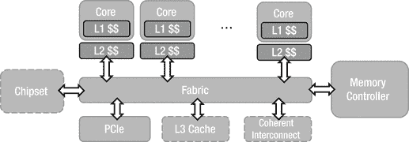

**图 2-1.** 典型服务器 CPU 架构框图

#### 线程、核心与模块

传统服务器 CPU，例如 Intel Xeon E5 系统中的 CPU，采用针对广泛工作负载优化以提供良好性能的通用核心构建。然而，在广泛工作负载上实现最高性能会带来相关成本。因此，也出现了更多专用核心的可能性。例如，某些核心可能为了减少面积和成本而牺牲浮点性能。另一些核心可能在牺牲处理复杂控制流能力的同时，增加大量的矢量处理能力。

单个核心可以支持多个硬件执行线程。这些线程也被称为逻辑处理器。这种技术有多种名称，包括同时多线程（SMT）和超线程技术（HT）。这些技术于 2002 年引入 Intel CPU。SMT 试图利用这样一个事实：在许多工作负载下，核心上的单个执行线程并未使用核心内所有可用资源。当线程因某种原因（例如等待内存响应）而停滞时，尤其如此。在给定核心上运行多个线程会降低每个线程的性能，同时提高整体吞吐量。SMT 通常是一种非常节能的技术。额外的吞吐量和性能可能会增加总功耗，但与潜在的性能提升相比，功耗墙的增加幅度很小。

> **注意**  
> 线程分为两种类型：硬件线程和软件线程。操作系统管理大量软件线程，并执行上下文切换，以选择在特定时间点哪个软件线程在给定的硬件线程上处于活动状态。

Intel Atom 处理器还引入了 CPU 模块的概念。在这些处理器中，两个核心共享一个大容量 L2 缓存。模块与 CPU 互连结构连接，而不是核心直接连接。

术语“线程”和“处理器”在硬件和软件语境中通常指代不同的事物。不同的术语可能指代相同的事物（见表 2-2）。这经常导致混淆。

**表 2-2.** 线程、核心与处理器术语

| 术语 | 描述 |
| --- | --- |
| 硬件线程 | 硬件线程、逻辑处理器和逻辑核心是相同的。每个在给定时间点可以执行单个软件线程。 |
| 逻辑处理器 |
| 逻辑核心 |
| 硬件核心 | 硬件核心和物理核心代表了一组能够执行应用程序的硬件模块。一个物理核心如果支持 SMT，则可以支持多个逻辑核心。共享同一物理核心的逻辑核心共享该核心的许多硬件资源（缓存、算术单元等）。 |
| 物理核心 |
| 软件线程 | 软件线程是一系列软件指令。在给定时间点，系统中存在许多软件线程。操作系统调度器负责在特定时间点选择哪个软件线程在给定的逻辑处理器上执行。 |

##### 缓存与缓存层级结构

服务器 CPU 核心通常消耗处理器大部分功耗，同时也占据 CPU 大部分面积。这些核心在执行指令时需要消耗数据。如果数据供应不足，它们可能会因等待数据而停滞，这对性能和能效都不利。缓存试图存储频繁使用的数据，以便核心执行单元能够快速访问，从而减少这类停滞。

缓存通常由 SRAM 单元构成。缓存占用与核心相当的 CPU 面积并不罕见。然而，它们对功耗的贡献要小得多，因为在任何给定时间，只有一小部分晶体管会发生状态切换。

缓存存在多种可能的层级结构。图 2-2 展示了两种缓存层级结构的示例。左侧的图展示了自 Nehalem²代以来至强处理器使用的缓存层级结构，右侧的图展示了 Avoton³代使用的层级结构。不同的层级结构在性能上各有取舍，也会影响电源管理决策。例如，左侧设计中核心外的大容量三级缓存可能需要应用电源管理算法以实现良好的能效。

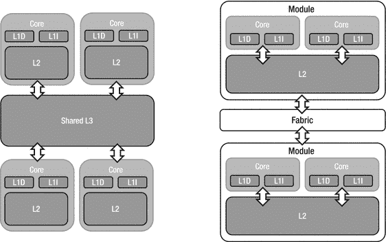

图 2-2.

缓存层级结构示例

##### 芯片与封装

CPU 由单晶硅晶圆制造而成。在制造过程中，每片晶圆上会印制大量矩形的 CPU 芯片，待制造完成后，这些芯片会从晶圆上切割下来。一个中等大小的服务器芯片边长约为 20 毫米（约 400 平方毫米）。图 2-3 展示了两块放大的芯片，一块来自 8 核 Avoton SoC（片上系统），另一块来自 Ivy Bridge 10 核。实际上，Avoton 芯片的尺寸比至强芯片小得多。

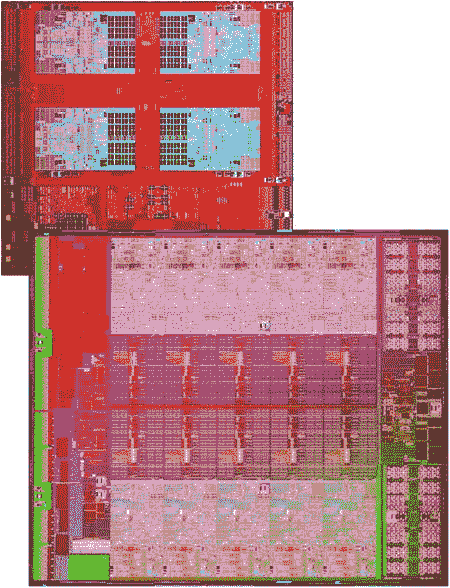

图 2-3.

8 核 Atom Avoton（上）和 10 核至强 Ivy Bridge EP（下）的芯片照片（未按比例缩放）

作为制造过程的一部分，芯片随后会被置入封装中。封装提供了芯片与主板之间的接口。有些封装（尤其是低功耗、低成本的产品）会直接焊接到主板上。其他则称为插槽式封装，这意味着它们可以被安装、移除和更换到主板上。封装通过金属引脚连接到主板，这些引脚既为 CPU 提供电力，也提供通信通道（例如与 DDR 内存的连接）。电力通过许多引脚流入 CPU，更高功耗的 CPU 需要更多引脚来供应所需功率。额外的连接性（例如更多的 DDR 通道或对更多 PCIe 设备的支持）也会增加引脚数量。

封装还可以包含一个集成式导热器（IHS），它在概念上是一个集成散热器。散发 CPU 内部因功耗产生的热量对于实现高性能系统至关重要。IHS 有助于将热量从核心（以及其他高功耗/高热密度区域）扩散到芯片的其他部分，以避免产生热点，这些热点可能导致过早降频和性能降低。图 2-4 展示了两种 CPU 封装——一个来自 Avoton SoC，一个来自 Sandy Bridge。Sandy Bridge 封装要宽得多、深得多，以容纳更大的芯片和额外的引脚，同时其高度也更高。这部分额外高度部分归因于 IHS。

图 2-4.

8 核至强 Sandy Bridge EP（右）和 8 核 Atom Avoton（左）的封装照片

单个封装内可以包含多个芯片。这被称为多芯片封装（MCP）。MCP 可以成为一种提升产品能力的成本效益之选。可以连接两个相同的芯片（通常用于增加核心数量），或连接不同的芯片（例如芯片组和 CPU）。在封装内部连接两个设备比连接两个独立封装更密集、功耗更低、延迟更小。还可以连接来自不同工艺技术或优化节点的芯片。MCP 在过去已被有效用于提供高核心数的处理器，以满足高端服务器的需求，而无需制造成本高昂的巨大芯片。MCP 内的各芯片共享电力输送和热约束，因此存在限制。例如，冷却两个粘合在一起的 130 瓦 CPU，使其变成一个 260 瓦的封装，可能非常具有挑战性（且成本高昂）。与单个芯片内部所能达到的效果相比，MCP 内两个芯片之间的带宽和延迟也受到限制。

##### 片上互联结构与非核心部分

历史上，英特尔将所有核心之外的片上逻辑称为非核心部分。在 Nehalem 代，这包括三级缓存、集成内存控制器、快速通道互联（QPI，用于多路处理器间通信）以及一个将它们连接在一起的互联结构。到了 Sandy Bridge 代，PCIe 被集成到 CPU 的非核心部分。非核心部分持续集成越来越多的功能和特性，因为更多组件不断被集成到 CPU 芯片中。因此，CPU 概念正逐渐被片上系统（SoC）所取代。这在诸如手机等用户设备中最为常见，大量特殊功能硬件组件提供了各种能力（调制解调器、传感器中枢、通用核心、图形核心等）。随着像 Avoton 这样将核心、SATA、以太网、PCIe、USB 和芯片组集成到单个 CPU 封装中的产品出现，这种趋势也正在扩展到服务器领域。更高的集成度可以降低总体拥有成本（TCO），因为需要采购的分立器件更少。出于同样的原因，它也能实现更紧凑的设计。将更多功能集成到单个芯片或封装中也能提高能效，因为集成后的高性能连接消耗的功耗更低。

在这些 SoC 中，提供各个 IP 模块之间通信的互联结构近年来被称为片上互联结构。也存在片外互联结构，用于将多个 CPU 连接成大型非一致性⁴的 CPU 组。现代片上互联结构是早期代 CPU 中非核心互联结构的演进。

在服务器上，当核心处于活动状态并执行工作负载时，非核心部分的功耗贡献通常远小于核心。然而，当所有核心都空闲并处于深度睡眠状态时，非核心部分往往成为 CPU 上的主要功耗来源，因为在不影响服务器工作负载性能的情况下高效执行电源管理更具挑战性。核心与非核心之间的确切功耗分配会根据工作负载、产品或功耗范围而有很大差异。

### 电源控制单元

随着电源管理变得越来越复杂，CPU 内部添加了带有特殊固件的微控制器，用于管理 CPU 的电源管理流程。在英特尔，这些微控制器被称为 `PCU`（电源控制单元）和 `P-Unit`，它们执行的代码被称为 `pcode`。`PCU` 与 CPU 内核集成在一起。这些微控制器通常是专有的，其上运行的固件也是保密的。OEM 或最终用户无法编写自己的固件，也不能更改这些 `PCU` 中的现有固件。然而，OEM 和最终用户可以使用各种配置选项。这些选项可以通过操作系统或 BIOS 进行控制。如何调优和配置这些选项将在第 8 章中讨论。

`PCU` 负责本章剩余部分将讨论的大部分电源和热管理功能。微控制器上运行的固件实现了多种用于管理 CPU 功耗和性能的控制算法。表 2-3 提供了 `PCU` 部分角色和功能的高级概览。`PCU` 几乎连接到 CPU 芯片上的每一个主要逻辑块，并持续监控和控制它们的活动。

**表 2-3. 常见的 PCU 角色**

| 角色 | 描述 |
| --- | --- |
| 电源管理 | 管理电压、频率和其他省电状态的中央控制中心 |
| 热管理 | 执行算法以防止 CPU 过热 |
| 复位控制器 | 协助 CPU 上电 |

固件可以在现场通过 BIOS 甚至直接从操作系统的运行系统中进行修补。然而，设备进入量产后，补丁部署并不频繁。

服务器供应商确实使用他们自己的专有固件，这些固件在芯片外运行于基板管理控制器（`BMC`；一个微小型控制器）上。此固件经常与 `PCU` 交互，通过平台环境控制接口（`PECI`）执行电源和热管理。这些主题将在第 4 章和第 5 章中更详细地讨论。

### 外部通信

虽然在 CPU 上执行计算很重要，但将数据传入和传出 CPU 是许多服务器工作负载的关键部分。表 2-4 提供了一些关键接口的概览。

**表 2-4. 外部通信**

| 接口 | 详情 |
| --- | --- |
| 内存 (DDR) | 内存为应用程序代码和数据提供存储。它也可以为来自驱动器的频繁访问数据提供缓存。服务器 CPU 拥有数百 GB 内存容量的情况并不少见，甚至可以达到 TB 级别。 |
| 驱动器存储 | 驱动器存储也普遍存在于服务器中。一些终端用户正逐步放弃在计算节点上使用本地驱动器存储，转而将所有持久性数据存储到通过高带宽网络访问的独立存储节点上。启动过程甚至可以完全通过网络完成。这可以节省大量的采购成本。其他客户仍然认为单个节点上需要本地存储。 |
| 网络 | 以太网或 InfiniBand 是大多数服务器节点的基本配置，用于将数据传入和传出给定 CPU 进行处理，或者在利用多颗 CPU 执行单一任务的节点之间传输数据。 |
| 视频端口 | 视频端口很少见，通常不包含在平台上。在极少数需要视频的情况下，用户通常会连接独立显卡。 |
| USB 端口 | USB 端口也很常见，主要用于固件更新或调试等特殊任务（非正常运行期间）。 |
| 可管理性 | 服务器通常包含一个像 `PECI` 这样的接口，供外部控制器管理服务器。这些接口提供了一种机制，用于执行诸如监控温度或控制功耗等任务，而不会干扰在 CPU 内核上运行的软件。 |
| 一致性互连 | 在每节点包含多颗 CPU 的部署中，使用一致性互连来连接多个插槽（例如，英特尔 `QPI`）。这使得多颗 CPU 可以相互连接并共享一个操作系统。 |
| 非一致性桥接 | 一些 CPU 还支持使用 `PCIe`（例如，英特尔 `NTB` [非透明桥]）在节点之间创建非一致性互连的技术。这些技术在两台机器之间创建了进入物理内存空间的非一致性“窗口”，其中每台机器对于另一台机器都表现为一个 `PCIe` 设备（并分配了一个内存映射 `I/O` [`MMIO`] 范围）。目前，它主要用于跨服务器冗余的存储使用模型中。 |

### 热设计

CPU 在执行时需要消耗功率；这些功率必须被耗散，以控制温度。在现代 CPU 上，存在热传感器用于监控温度，并帮助确保 CPU 不会达到可能导致可靠性降低或损坏的危险温度。CPU 可能会通过降频来保持在目标温度以下，甚至在温度超过某些阈值时立即启动关停。

大多数服务器 CPU 的销售都基于热设计功耗（`TDP`）。`TDP` 指定了 CPU 在长时间运行一个市售的最坏情况 SSE 应用程序时可以消耗的功率，因此也是平台设计者必须能够移除的热量，以避免热节流情况。`TDP` 功率通常与一个基础频率（有时称为 `P1` 频率）配对。一个确定的 `TDP` 条件被用来描述这个（功率，频率）对。服务器上 `TDP` 条件的目标是识别客户可能运行的最坏情况真实工作负载⁵。不同的供应商（甚至同一供应商的不同产品）可能使用不同的 `TDP` 定义，这使得使用该数值进行跨边界的有意义的比较变得困难。确实存在一些代码序列，在 `TDP` 频率下消耗的功率会超过 `TDP` 功率，这些工作负载将被节流，以确保系统设计约束不被突破并防止 CPU 损坏。

> **注**  
> 在同一频率下，不同的工作负载可能消耗的功率范围差异很大。许多工作负载在 `TDP` 频率下消耗的功率远低于 `TDP` 工作负载。Turbo 是一项功能，允许这些工作负载在保持在处理器的热和电气规格范围内的同时，以更高的频率运行。

许多传统服务器处理器的 `TDP` 功率范围在约 30 W 到约 150 W 之间。微型服务器的 `TDP` 则更低，低至约 5 W。虽然可以构建具有更大 `TDP` 的处理器，但这类处理器通常更难处理。更高的热密度可能难以有效冷却并实现成本效益。也可以拥有热密度较低的更大处理器芯片，但这些芯片在制造效率上也可能面临挑战。

一些客户端处理器采用了一种称为场景设计功耗（`SDP`）的概念。这个概念表明，按 `TDP` 进行设计可能会导致在某些使用模型中出现过度设计。`SDP` 试图为 OEM 提供关于某些受限使用模型的热需求的指导。`SDP` 目前尚未被任何服务器产品采用。服务器倾向于依赖 Turbo 来减少因按 `TDP` 设计而导致的任何平台过度设计的风险。

好的，作为高级文档工程师和翻译员，我已经理解了您的格式要求。以下是给定英文文本的中文翻译：

#### CPU 设计构建模块

CPU 架构由模拟和数字组件混合构建而成。模拟设计通常用于设计片外通信（例如实现 `PCIe` 和 `DDR` I/O 的电路），而系统其余大部分则由数字逻辑构建。

##### 数字同步逻辑与时钟

CPU 执行的大部分计算由数字同步逻辑完成。同步设计可以看作是大型流水线。任务被分解为多个工作子集（见图 2-5）。逻辑门组（由晶体管实现）接收输入数据（1 和 0）并计算出一组输出数据。晶体管需要时间来根据输入集计算结果，在此期间，希望输入数据保持稳定。触发器在逻辑计算时为其保存状态，并在准备好下一组逻辑时存储输出数据。分布在整个 CPU 中的时钟告诉这些触发器何时应该锁存进入它们的数据。

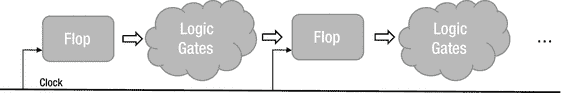

图 2-5. 数字同步逻辑

当人们想到 CPU 时，通常想到的是 CPU 内部完成所有工作的逻辑。然而，时钟对于所有这些数字电路是必需的，并且遍布整个 CPU。时钟通常由锁相环（`PLLs`）驱动，尽管也可以使用其他更简单的电路，例如环形振荡器。许多现代`PLL`设计提供了可配置性，允许它们锁定在不同的频率。将`PLL`锁定到目标频率需要时间（通常以微秒计）。

##### SRAM 与 eDRAM

静态随机存取存储器（`SRAM` 或静态 RAM）是一种用于存储数据的逻辑块。大多数缓存都是基于`SRAM`设计构建的，因此`SRAM`通常占 CPU 芯片的很大一部分。动态 RAM（`DRAM`）是另一种可用于存储数据的逻辑，用于`DDR`设备。

`SRAM`的尺寸比`DRAM`大得多，每字节数据消耗的功率也更多，但访问速度更快，设计也更容易。与`DRAM`不同，它采用与普通 CPU 逻辑类似的制造技术，因此更容易与其他逻辑集成到单个 CPU 芯片上。可以使用嵌入式 DRAM（`eDRAM`）构建大型缓存。`eDRAM`用于`Haswell E3`服务器。

### I/O

I/O 电路提供了在芯片上和芯片外进行通信的能力。例如，这些电路用于`DDR`、`PCIe`以及像`QPI`这样的相干互连。大多数互连是并行的——同时传输多位数据。然而，仍然存在一些串行互连，用于与各种平台代理（如电压调节器）进行低带宽通信。

可以使用两种主要类型的 I/O：差分信号和单端信号。单端信号是与 I/O 通信的最简单方法。从概念上讲，要传输`N`位并行数据，需要`N + 1`根线。一根线保存参考电压（通常是 0 V 地），而其他线则传输二进制数据，其中预定义的较高电压代表 1。差分信号更复杂，使用一对线（称为差分对）来传输一位数据。差分信号不易受到噪声和其他传输问题的影响，因此提供了一种达到更高频率和传输速率的机制。然而，与单端信号相比，差分信号所需的平台布线大约是其两倍，并且即使在没有主动传输有用数据时，也往往消耗更多功率。

#### Intel 服务器处理器

在本章中，将通过其代号来引用各种近期 Intel 服务器处理器，以说明技术的发展过程。图 2-6 展示了 Intel 服务器处理器的发展历程。每个主要服务器处理器世代都显示在一个方框中，并附有其主要特性（支持的插槽数量、核心数量和制程工艺）。具有相似架构的处理器组用不同深浅的灰色方框分组在一起。例如，`Sandy Bridge-E5`、`Ivy Bridge-E5`和`Ivy Bridge-E7`处理器都基于相似的架构，这与单插槽的`Sandy Bridge-E3`和`Ivy Bridge-E3`处理器不同。

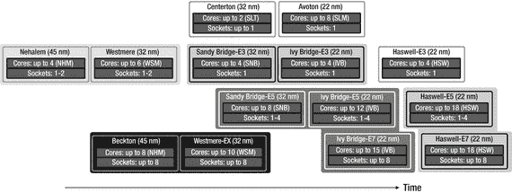

图 2-6. Intel 服务器处理器发展历程

需要注意的是，`E3`产品基于桌面处理器架构，因此限于单插槽且核心数量较少。同时，它们比`E5`和`E7`处理器的上市时间要早得多。因此，尽管`Haswell-E3`和`Haswell-E5`共享相同的核心设计，但其非核心设计是不同的。

## 功率介绍

电气工程中最早教授的课题之一是 `功率 = 电流 * 电压 (P = I * V)`。你可以将功率想象成一根有水流过的管子。电流实质上是水流的速度，而电压是管子的大小。如果管子很小（低电压），就很难流过大量的水（电）。类似地，如果能够减慢水流的速度，就可以减少用水量。CPU 中的电源管理就是关于高效地（且动态地）控制电流和电压，以便在提供最终用户期望的性能的同时，最大限度地降低功耗。

图 2-7 展示了一个概念性层级，说明了功率从墙壁插座传递到 CPU 内部电路的过程。本节将主要探讨 CPU 和内存的功率组件。

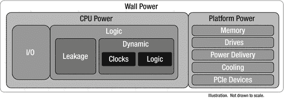

图 2-7. 电源功耗分解说明

表 2-5 提供了一些常见功率术语的总结。

表 2-5. 常见功率术语

| 术语 | 缩写 | 描述 |
| --- | --- | --- |
| 电压 | `V` | 电压是两点之间的电势差。 |
| 电流（安培） | `A` | 电流是能量流动的速率。 |
| 电容 | `C` | 电容是系统存储电荷的能力。电池可以被认为是存储电荷的大型电容器。 |
| 频率 | `f` | 频率指单位时间内的跳变次数。在处理器中，这通常指时钟切换的速率。 |
| 能量（焦耳） | `J` | 焦耳是能量或功的单位。与做功的快慢无关——只与做功的多少有关。 |
| 功率（瓦特） | `W` | 功率是单位时间内的能量度量。在相同时间内做相同的功需要两倍的功率。 |

### CPU 功率分解

CPU 的功率可以概念性地分解为：

-   逻辑功率（执行指令）
-   I/O 功率（将 CPU 连接到外部世界）

这些功率可以进一步细分，如下节所述。

#### 逻辑功耗

当 CPU 内部的逻辑在 0 和 1 之间切换时，会消耗功耗。晶体管本质上就是一个个微小的电容器，它们在不断充放电（过程中会消耗能量）。这被称为 CPU 的**动态功耗**。

动态功耗由两部分组成：

- 运行在整个 CPU 中的时钟所消耗的功耗。
- 执行实际计算操作的逻辑所消耗的功耗。

在给定周期内，CPU 中只有一部分比特位会在 0 和 1 之间切换。不同的工作负载会呈现不同的切换率。这就引出了公式中的**应用比率**（AR）值，它用于调节动态功耗。例如，某些类型的工作负载通常不会执行浮点运算。在这些工作负载中，浮点逻辑未被使用，因此不会发生切换，也不会消耗动态功耗。

**泄漏功耗**可以理解为 CPU 内部为保持晶体管通电而流失的电荷。泄漏功耗的计算公式比动态功耗更复杂，但从概念上讲很简单：泄漏功耗随电压和温度的升高呈指数级增长。

泄漏功耗与动态功耗之间的占比关系对工作负载、处理器、制程工艺和运行条件非常敏感。动态功耗通常占 CPU 总功耗的较大比例，尤其是在处理器以高利用率运行时。

表 2-6 总结了 CPU 逻辑功耗的构成。

**表 2-6.** CPU 逻辑功耗构成

| 组件 | 概念公式 | 描述 |
| --- | --- | --- |
| 动态功耗 | `I ∼ C * V * f * AR` `P ∼ C * V² * f * AR` | 动态功耗可以理解为在晶体管于 1 和 0 之间切换时所消耗的功耗。 |
| 泄漏功耗 | `I ∼ e^V * e^t` `P ∼ V * (e^V * e^t)` | 泄漏功耗可以理解为 CPU 内部为保持晶体管通电而流失的电荷。 |

#### I/O 功耗

现代 CPU 设计中常见的运行高带宽互连会消耗 CPU 总功耗的很大一部分。这一点在新兴的低功耗微服务器领域尤为突出。在某些此类产品中，I/O 设备消耗的功耗往往占整个 SoC 功耗的更大比例。

从概念上讲，I/O 设备分为两种类型：一种功耗与其传输的带宽量成正比（如 `DDR`），另一种在唤醒时消耗（几乎）恒定的功耗（如 `PCIe`/`QPI`）。

I/O 接口也存在动态功耗和泄漏功耗，但在讨论功耗管理时，将它们分开考虑会更有用。传统 I/O 接口中的切换率与流经该互连的数据带宽成正比。

为了在非常高的频率下传输数据，许多现代 I/O 设备已转向**差分信号传输**。它使用一对物理导线来传输单条信息。除了使用多根导线传输单个比特数据外，这些通道的协议通常被设计为频繁且持续地进行切换，以提高信号完整性。因此，即使在低利用率下，比特位仍在不断切换，这使得功耗在很大程度上对带宽不敏感。

表 2-7 总结了 I/O 功耗的类型。

**表 2-7.** I/O 功耗类型

| 组件 | 概念公式 | 描述 |
| --- | --- | --- |
| 传统 I/O 功耗 | `I ∼ BW * V * f` | 传统 I/O 组件的功耗通常是其带宽（利用率）、电压和频率的函数。例如：DDR3/4 数据和命令总线 |
| 差分信号 I/O 功耗 | `I ∼ V * f` | 差分信号 I/O 功耗是电压和频率的函数，但对带宽（利用率）通常不敏感。例如：`PCIe`、以太网和 Intel `QPI` 都使用差分信号传输数据。 |

#### 频率、电压与温度的相互作用

虽然功耗可以简单地看作是电压、频率和温度的函数，但这些组件中的每一个都会影响其他组件的表现方式。因此，它们之间的相互作用也与能效相关。

为了提高系统的频率，必须同时提高电压。电路运行所需的电压往往随频率的平方增加（见图 2-8）。这种关系对于理解功耗效率和功耗管理至关重要。在某个低频率范围内，改变频率可能仅对电压产生很小（如果有的话）的影响，并且整体功耗的增加也相对较小。在较高频率下，即使只获得很小的频率提升，也需要大幅提高电压。这两个组件之间的精确关系基于晶体管的設計。存在多种制造和设计技术，用于在不同频率点选择工作电压。因此，尽管概念上电压随频率的平方而变化，但在实际生产系统中并非总是如此运行。

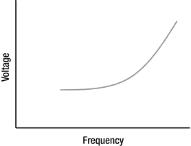

**图 2-8.** 电压/频率关系图

不同的晶体管设计和制程技术具有不同的特性。能够达到更高频率的晶体管必须在低功耗特性上进行权衡。这类晶体管常用于高功耗服务器 CPU 设计中。另一方面，晶体管可以针对低泄漏和低功耗运行进行优化，但需牺牲高频运行能力。这类晶体管用于手机、平板和笔记本电脑设备中。它们也可用于微服务器和其他低功耗服务器。这两种类型的晶体管均可用于构建高能效的 CPU 和数据中心。

> **注意**
> 在较低的电压和频率（以及功耗）下运行并不一定能使系统更高效。相反，最高效的运行点往往位于指数曲线的“拐点”附近（或略微偏右一点）。一个常见的误解是频率越低、功耗越低，运行效率就越高。这通常是错误的，尤其在以插座处测量功耗时。同样，通过使用基于功耗优化型晶体管的低功耗 CPU 和基于频率优化型晶体管的高功耗 CPU，也可以构建出非常高能效的数据中心。

泄漏电流对温度呈指数级敏感。传统上，温度升高会导致泄漏电流增加，从而导致功耗上升。然而，在近几代制程工艺中，泄漏功耗呈下降趋势。其结果是，功耗对温度的敏感性有所降低。

还存在一种称为**逆温效应**（ITD）的现象。随着温度降低，晶体管在给定频率下运行所需的电压可能会增加。这种行为在低电压下最为明显。在高功耗服务器 CPU 中，这种现象通常不会影响峰值性能或功耗，因为在这些情况下，电压和温度足够高，几乎不需要（如果有的话）进行 `ITD` 补偿。然而，对于在较低电压、频率和温度下运行的低功耗 CPU，`ITD` 可能变得更加显著。`ITD` 现象已为人所知多年，但随着泄漏功耗的降低，它可能变得更加突出。从历史上看，随着温度降低，泄漏功耗的下降幅度超过了 `ITD` 导致的功耗增加。在泄漏功耗水平非常低的产品上，`ITD` 效应可能导致低温下的净功耗增加。

## 节能技术

在了解了数据中心能耗的基本原理后，我们将探究实现高能效的一些高级技术。从概念上讲，节能有两种方式：

-   关闭它。
-   降低它。

数据中心和 CPU 中的不同组件在执行这两类操作时采用了不同的技术。本章后续部分将深入探讨这些技术的细节。

### 关闭它

关掉家里的灯是一种非常有效的省电方式。当节能灯（CFL）首次进入市场时，许多人对其需要很长时间才能快速提供所需亮度感到不满。在 CPU 中也存在类似的问题。存在不同级别的“关闭”状态，需要在节能与不同子组件在需要时能多快可用之间进行权衡（参见表 2-8）。

表 2-8. 关闭逻辑电路电源

| 组件 | 唤醒延迟 | 描述 |
| --- | --- | --- |
| 时钟门控 | 约 10 纳秒至约 1 微秒 | 停止时钟，节省动态功耗 |
| 电源门控 | 约 1 至 10 微秒 | 切断所有电源，同时节省漏电流和动态功耗 |

现代 CPU 中使用的同步设计依赖于路由到整个逻辑电路的时钟。如果某个逻辑块未被使用，则无需驱动通往该逻辑块的时钟。时钟门控就是停止向某个逻辑块提供时钟以节省功耗的行为。通过门控时钟，不仅可以节省时钟本身消耗的功耗，还可以节省逻辑电路中其他任何动态功耗（因为没有了时钟，电路无法进行状态转换）。

时钟门控可以在多种粒度上实现。例如，单个加法器在未使用时可以进行时钟门控，整个核心也可以进行时钟门控。当硬件检测到逻辑电路未被使用时，可以自主地执行时钟门控，也可以通过软件干预来执行。当某个逻辑块的时钟被门控时，该块的动态功耗会降至接近零，而漏电流功耗不受影响。电路中的状态（信息）得以保持。

电源门控是一种能够同时节省漏电流和动态功耗的技术。然而，与时钟门控相比，它需要更长的时间来唤醒电路。除了阻止晶体管状态转换外，电源门控还会切断电路的所有电源，从而使漏电流功耗也降至零。电源门控会导致状态丢失，因此必须配合特殊操作（如保存/恢复或保持触发器）一起使用。

### 降低它

电压对电路的动态功耗和漏电流功耗都有显著影响。当不需要高性能时，通过降低电压可以节省功耗。表 2-9 总结了两种常见的降低电压的机制。

表 2-9. 通过降低电压来降低逻辑电路功耗

| 组件 | 描述 |
| --- | --- |
| 电压/频率缩放 | 如果不需要高频率，可以动态降低频率以达到更低的功耗水平。当频率降低时，也可能降低电压。 |
| 保持电压（Vret） | 维持电路状态所需的电压可以低于电路工作所需的电压。例如，维持缓存中的数据所需的电压远低于读写该数据所需的电压。将电压降至`Vret`通常与时钟门控结合使用，以在基本时钟门控和电源门控之间取得一个“中间状态”。与电源门控相比，这种方式会继续消耗一些漏电流功耗，但状态得以保持，从而实现了更简单的设计和更快的唤醒延迟。 |

> **注意：** 电压降低是节能的关键。漏电流功耗随电压呈指数级增长，而动态功耗大约与电压的平方成正比。

### 节能策略

电源管理算法面临的一个主要挑战是理解多个算法如何相互影响。节省功耗是有代价的。例如，如果你将内存置于低功耗状态，则需要时间将其唤醒以响应内存请求。当该请求等待内存唤醒时，系统中的其他部分通常处于唤醒和等待状态，同时消耗着能量。如果不小心，在一个子系统上激进的节能措施实际上可能导致整个系统的净功耗增加。一些功能可能以整体性能为代价为其子系统节省功耗，而几乎不带来或完全没有带来整体功耗的节省。一个好的系统设计会向最终用户隐藏这些挑战，并使他们能够最大限度地发挥系统的性能。

平台特性在确定“最佳方案”方面起着重要作用。例如，在一个跨两个插槽连接了 1 TB 内存的系统中，平台功耗的很大一部分消耗在内存上。在这里，积极地使用内存电源管理通常是个好主意。另一方面，如果一个系统只有 8 GB 内存和一个内存条，那么使用内存电源管理只能节省极少量的整体内存功耗，并且可能由于增加 IA 核心的活动时间而增加平台功耗。第 8 章将讨论其中一些调优选项和权衡。

#### 竞速空闲 vs. 降速运行

在公路旅行中，汽车传统上以约 60 英里/小时的速度行驶时效率最高。如果开得更快，汽车运行时间会更短，运行时的效率会降低，油耗也会增加。如果开得更慢，单位时间内汽油消耗速率可能更低，但由于汽车运行时间更长，总的耗油量反而更大。当速度超过 60 英里/小时时，汽车会受到更大的风阻和拖拽力，且发动机通常未针对高效运行进行优化。在较低速度下，阻力可能较小，但发动机运行在其能力范围之下，效率反而更低。

CPU 内部也存在类似的行为。汽车的速度相当于 CPU 的电压/频率。从理论上讲，可以通过在最高效工作点与关闭状态之间循环，以提供所需的性能水平，从而实现最佳能效。这种策略传统上被称为“竞速空闲”或“竞速停机”（`HALT`是一条 CPU 指令，指示核心停止执行并进入省电状态）。

在许多服务器使用模式中，竞速空闲策略通常被证明效率低下，因为受限于其约束条件，空闲状态功耗过高。想象一下，每次你想用车时都需要花一小时来发动它。如果你一天中频繁用车，你可能压根不会熄火。到了晚上熄火可能是个好主意，但在周末充满杂务时，你绝不愿意花时间等车预热。同样，一位作息固定的通勤者或许能容忍早上花一小时启动汽车（他可以在准备上班前就发动）。因为他知道自己何时需要用车。而一位“随叫随到”的医生则无法容忍这种延迟，因为他们可能随时需要上班，对延误零容忍。因此，即使他们能快速完成任务，结束后也必须让车保持运转状态。

服务器更像是随叫随到的医生。它们永远无法精确预知何时会被需要，且一旦被需要就必须能快速响应。如果采用需要较长退出延迟的深度空闲状态，就可能导致网络丢包等问题。有时服务器确实知道不会被需要（比如医生去度假），但这通常是例外而非普遍情况。

表 2-10 总结了在服务器 CPU 中可用于省电的不同技术。

表 2-10. 省电策略

| 策略 | 行车示例 | 服务器应用 |
| --- | --- | --- |
| 竞速空闲 | 以 100 英里/小时行驶，途中休息 | 服务器以峰值功率和性能运行，试图进入深度省电状态。这种模式在服务器使用中通常无效或不采用。空闲状态功耗过高，且极深度空闲状态唤醒时间过长，难以精准预测唤醒时机。 |
| 慢跑至空闲 | 以 60 英里/小时行驶，途中休息 | 服务器在高效工作点运行（仍略高于当前需求），随后尝试进入空闲状态。理论上看似合理，但实际实现空闲时段颇具挑战。 |
| 慢速稳定 | 以 45 英里/小时连续行驶 | 服务器根据预估所需利用率运行以完成任务，不刻意寻求中途休息。由于系统限制深度空闲省电，这通常是当前服务器电源管理中最常用的技术。 |

## CPU 电源与性能状态

存在多种标准技术用于关闭逻辑电路以及降低 CPU 内部工作电压。本节将概述 CPU 中的电源管理能力，并详细说明各状态在不同环境下的表现。表 2-11 提供了不同电源管理状态的概览，后续页面将详细阐述。

表 2-11. CPU 电源管理状态概览

| 状态 | 粒度 | 描述 |
| --- | --- | --- |
| C 状态 | 核心/线程 | 关闭核心并停止指令执行：通过停止核心运行来省电。存在不同级别的 C 状态，省电效果和退出延迟各不相同。`C1`退出延迟最短但省电最少。编号更大的状态（如`C6`）意味着更深的省电效果和更长的退出延迟。 |
| 封装 C 状态 | 封装 | 空闲时关闭部分封装以省电：当所有核心均处于非`C0`(活动)的 C 状态时，封装 C 状态生效。与核心 C 状态类似，存在多个级别的封装 C 状态，在省电与退出延迟之间权衡。封装包含所有核心及其他模块，如共享缓存、集成`PCIe`、内存控制器等。在 Intel Xeon CPU 中，这些状态的退出延迟通常<40 微秒以避免网络丢包。 |
| P 状态 | 多种 | 改变系统子集的频率和电压：传统上侧重核心，但也可改变 CPU 其他组件（如共享的`L3`缓存）的频率。使用 P 状态时，可继续在不同性能与功耗水平下执行指令。 |
| T 状态 | 核心 | 以固定时间间隔对核心进行占空比控制：通过占空比控制核心执行以进一步省电。通常用于因热、电气或功耗原因所需的激进限频场景，传统上不用于能效优化。 |
| S 状态 | 封装 | 关闭整个封装（睡眠状态）：常见于客户端和工作站模式，部分服务器 CPU 也可应用。退出延迟较长（秒级），但可将功耗降至接近零。`S0`表示活动状态，`S5`表示“关闭”状态（中间有多个状态）。 |
| G 状态 | 平台 | 全局状态：指平台的电源状态，与 S 状态类似。通常对终端用户不可见，由平台设计者使用。 |
| D 状态 | 设备 | 设备（`PCIe`、`SATA`等）处于断电状态：传统上用于`PCIe`卡和`SATA`等设备，指设备断电的低功耗状态。D 状态并非服务器重点。 |

### C-States（C 状态）

C 状态为软件提供了一种能力，使其可以请求 CPU 通过关闭核心或其他逻辑单元来进入低功耗状态。如果单个 CPU 核心支持同步多线程（SMT），那么它可以支持多个软件线程。每个硬件线程都有自己的状态，并有机会请求不同的 C 状态。这些状态被称为线程 C 状态，表示为`TCx`（其中`x`为整数）。为了使核心进入核心 C 状态（表示为`CCx`），该核心上的每个线程都必须请求该状态或更深的状态。例如，在一个支持两个线程的核心上，如果任一线程处于`TC0`，那么该核心必须处于`CC0`。如果一个线程处于`TC3`而另一个处于`TC6`，则允许核心进入`CC3`。线程 C 状态本身节省的功耗（如果有的话）微乎其微，而核心 C 状态则可以节省大量功耗。

此外还有封装 C 状态，当封装上的所有核心都进入深度核心状态时，即可进入这些状态。这些状态通常表示为`PCx`或`PkgCx`（其中`x`为整数）。有时，封装状态的编号与该封装上核心的状态相关，但这并非硬性规则。例如，在某些现代服务器处理器上，当该封装上的所有核心都处于`CC3`或`CC6`状态，但其他约束条件阻止系统进入比`PC2`更深的状态时，会使用`PC2`状态。

#### 线程 C 状态

软件以线程粒度请求 C 状态。当一个线程进入线程 C 状态而未同时引发核心 C 状态时，其节省功耗的动作（如果有的话）微乎其微。在支持 SMT 的 CPU 上，这些状态实际上是进入核心 C 状态的垫脚石。在不支持 SMT 的 CPU 上，线程 C 状态和核心 C 状态实际上是等同的。

### 核心 C 状态

核心 C 状态决定核心是开启还是关闭。在正常执行情况下，核心被称为处于`C0`状态。当软件（通常是操作系统）指示某个逻辑处理器应进入空闲状态时，它将进入一个 C 状态。存在各种唤醒事件可以触发核心再次开始执行代码（常见示例包括中断和定时器）。

软件向 CPU 提供关于应进入哪种状态的提示（更多详情请参见第 6 章）。`MWAIT`指令通知 CPU 进入某个 C 状态，其参数中包含了所需状态的描述。然而，CPU 的电源管理子系统被允许执行其认为最优的任何状态（这称为 C 状态降级）。

表 2-12 展示了 Sandy Bridge、Ivy Bridge 和 Haswell CPU 的 C 状态定义。关于这些状态的命名方式并无硬性规则，但在跨代产品线中，这些定义的变化微乎其微。

表 2-12. 核心 C 状态示例

| 核心 C 状态 | 唤醒延迟 | 描述 |
| --- | --- | --- |
| `CC0` | 无 | 活动状态（正在执行代码）：至少有一个线程在此状态下主动执行。对未使用的逻辑块进行自主时钟门控是常见做法。 |
| `CC1` | ∼1 μs | 核心时钟门控：在`CC1`状态下，核心时钟（大部分）被门控。某些时钟可能仍然有效（例如，用于处理外部侦听），但动态功耗被降至接近零。核心缓存和 TLB 得以保持、一致且可用。 |
| `CC1e` | ∼1 μs + 频率转换 | 增强型`C1`——降低电压的提示：`CC1e`实际上与`C1`相同，只是它为全局电压/频率控制提供了一个提示，即可以降低电压/频率以节省更多功耗。 |
| `CC3` | ∼50–100 μs | 时钟门控并请求保持电压：处理器状态得以保持，但允许电压降至 Vret。L1 + L2（核心）缓存被刷新。核心 TLB 被刷新。 |
| `CC6` | ∼50–100 μs | 电源门控：核心被电源门控（电压为 0）。L1 + L2（核心）缓存被刷新。核心 TLB 被刷新。处理器状态被保存在核心外部（并在唤醒时恢复）。 |
| `CC7`–`CC10` | 多种 | 在核心外部实现额外节能的`CC6`：某些 CPU 上存在比`CC6`更深的其他状态。由于延迟较长，这些状态目前在服务器处理器上通常不支持。 |

##### 核心 C0

核心 C0（`CC0`）是核心执行一个或多个线程时的活动状态。核心的所有缓存均可用。自主节能动作（如时钟门控）是可能且常见的。例如，如果正在执行整数代码，则可能对浮点逻辑进行时钟门控。

##### 核心 C1 和 C1e

核心 C1（`CC1`）是退出延迟最短的核心休眠状态。大部分逻辑都执行了时钟门控，但所有核心状态（缓存、TLB 等）均得以保持。通常，某些逻辑仍处于活动状态以支持对核心缓存的侦听，从而维护一致性。核心 C1 是核心可以在不与 PCU 交互的情况下进入和退出的状态。这实现了快速转换，但也阻止了全局电源管理算法利用此状态进行某些优化。

核心 C1e 是一个类似的状态，不同之处在于它提供了一个提示，表明该核心的电压/频率也可以降低。尽管从 C1 和 C1e 退出的延迟大致相同，但在唤醒后将核心频率提升回请求频率确实需要一些时间。C1e 状态通常以封装粒度实现。换句话说，在将任何请求 C1e 的核心电压/频率降低之前，插槽上的所有核心必须首先进入 C1e 或更深的状态。

##### 核心 C3

核心 C3（`CC3`）提供门控时钟并请求将电压降至保持电压。从概念上讲，它是 C1e 的低电压版本，且不需要频率转换。然而，C3 会刷新核心缓存和核心 TLB。其唤醒延迟也比 C1e 长得多。`CC3`的进入和退出与 PCU 协调进行，因此额外的优化可以进一步利用此状态（稍后详述）。

##### 核心 C6

核心 C6（`CC6`）通过对核心进行电源门控来节省大量功耗。这需要核心刷新其状态，包括其缓存和 TLB。核心 C6 的唤醒延迟比`CC3`更长（通常长一倍），因为它必须重新锁定 PLL 并取消电源门控，但它能节省的功耗也远多于`CC3`或 C1e（具体节省量因产品而异）。这是核心本身所能达到的最深节能状态。

注意

`CC6`是服务器实现主要空闲功耗节省的主力。`CC1`适用于短时空闲期间的节能，或在对延迟要求不允许使用`CC6`的系统上。在实践中，`CC3`状态在服务器中通常显示出极小的价值。由于缓存刷新，该状态的性能影响与`CC6`类似，并且只有在电压域内的所有核心都同意时，电压才能降至 Vret。

##### 核心 C7（及更深状态）

比 CC6 更深的状态已在许多客户端设备上产品化。核心本身不具备比电源门控和 CC6 更深的状态，但这些更深的状态可由软件请求，并为全局电源管理算法提供关于封装级电源管理优化（例如刷新共享 L3 缓存）可能性的提示。

**注意：** 比 CC6 更深的状态通常在服务器上受到挑战，⁶ 因为服务器软件环境很少会完全空闲。例如，刷新 L3 缓存会带来显著的内存能耗成本（在进入和唤醒时均如此），并且在短时唤醒事件中会导致更长的唤醒周期（因为所有数据/代码都必须从内存中获取）。这些额外的电源成本往往会显著抵消（甚至超过）刷新缓存所节省的能耗。此外，服务器通常具有更低的延迟容忍度，这使得进一步的优化更具挑战性。

##### C-State 降级

`PCU` 可以降级由软件发出的 C-State 请求，并在认为操作系统请求的状态并非最优时决定进入更浅的状态。早期的软件 C-State 控制版本有时会在启用状态下发出过于激进的 C-State 请求，导致一些客户在使用 C-State 时出现性能下降。为了解决这些问题，`PCU` 固件中加入了 C-State 降级功能，当处理器判断进入深层 C-State 可能对性能或能效不利时，会阻止进入。这些算法的细节并未公开，并且不同产品代际部署了不同的算法。尽管 `PCU` 已致力于减少由 C-State 性能下降带来的影响，但操作系统也调整了其选择算法，以减少自身面临的性能下降风险。

早期核心 C-State 的实现要求操作系统软件保存并恢复时间戳计数器（TSC）和本地 APIC 定时器。较新的处理器已取消了这一要求，进入 C-State 和唤醒的大部分工作均由 CPU 硬件和固件自主处理。

### 封装 C-States

当整个 CPU 处于空闲状态时，可将其置入封装 C-State，以在子组件单独节能的基础上进一步节省能耗。这些状态针对空闲（或接近空闲）的状况。这些封装状态的具体定义（关闭哪些部分以及执行关闭所需的条件）会因 CPU 型号和代际不同而变化。然而，其高层概念保持不变。

当 CPU 进入深度封装 C-State 时，连接到 CPU 的设备（如网卡）将无法再访问内存。英特尔服务器通常将最坏情况的目标设定为约 40 微秒，以便为 PCIe 设备恢复通往主内存的路径。

表 2-13 提供了 Sandy Bridge、Ivy Bridge 和 Haswell 服务器代际中使用的封装 C-State 定义示例。Avoton 未实现封装 C-State，它能够在不依赖电源控制单元管理的独立状态的情况下实现极低的空闲功耗。相反，空闲功耗的节能优化是由 SoC 中的各个 IP 模块自主实现的。

**表 2-13. 封装 C-State 示例**

| 封装 C-State | 核心 C-States | 内存路径 | 描述 |
| --- | --- | --- | --- |
| `PC0` | 至少一个核心处于 `CC0`。 | 可用 | 活动状态（正在执行代码）。无封装级节能。 |
| `PC1e` | 无核心处于 `CC0/CC1`。至少一个核心处于 `CC1e`。 | 可用 | 所有核心已进入 `C1e` 或更深状态，允许电压和频率降低的机会。至少一个核心仍处于 `C1e`，阻止了更激进的节能。 |
| `PC2` | 所有核心处于 `CC3/CC6`。 | 可用 | 所有核心处于 `CC3/CC6`，但 PCIe 或远端插槽仍处于活动状态。共享非核心部分必须保持活动以支持这些其他流量源。此处可进行最低限度的封装级优化。此状态下的操作实际上与 `PC1e` 相同。 |
| `PC3` | 所有核心处于 `CC3/CC6`。至少一个核心处于 `CC3`。 | 不可用 | 所有核心处于 `CC3/CC6`，且其他流量源（PCIe 和远端插槽）也处于空闲状态。可以进行封装级操作，例如深度内存自刷新或非核心 Vret。 |
| `PC6` | 所有核心处于 `CC6`。 | 不可用 | 与 `PC3` 相同，但无核心处于 `CC3`。可能允许进行额外更激进的节能。例如，在 Ivy Bridge EP 上，L3 缓存仅在 `PC6` 中降至保持电压，而在 `PC3` 中则不会。 |
| `PC7` | 所有核心处于 `CC7`。 | 不可用 | 与 `PC6` 相同，但 L3 缓存也被刷新。 |

**注意：** `PC7` 状态在许多服务器处理器中尚未产品化（尽管已经过评估）。刷新 L3 缓存会消耗内存能耗，并且会导致任何短期的核心唤醒花费更长时间，因为所有数据/代码都需从内存获取。这些额外成本往往会显著降低此类状态所能实现的节能效果，同时还会为用户带来更长的唤醒延迟。

### 模块 C-States

模块是指共享资源的一组核心。在基于英特尔 Atom 的服务器处理器（如 Avoton）上，每两个核心共享一个 L2 缓存。理论上还存在其他分组方式，例如共享单个电压/频率域。C-State 在模块级别也是可能的，通常称为 `MCx`（其中 `x` 是整数）。

**注意：** 在服务器生产环境中，模块 C-State 的使用未像核心和封装 C-State 那样积极，原因是在服务器环境中难以利用它们实现能效优化。这些问题与在封装 C-State 中刷新 L3 缓存时观察到的问题类似。

### P-State（性能状态）

P-State 的发明是为了动态降低（或提高）CPU 的工作电压和频率，以匹配用户在特定时间点的需求。在较低频率下运行会导致性能降低，完成相同工作量的延迟更长。然而，有可能用更低的能耗完成所需的工作量。一个很好的例子是运行新闻网站的 Web 服务器。在凌晨 3 点，不太可能有很多人访问该 Web 服务器上的数据。通过以较低的电压/频率运行，可以节省功耗。该 CPU 上的每个 Web 请求事务完成所需时间会更长，但在许多情况下，与网络传输延迟相比，延迟差异非常小，以至于客户永远无法察觉。当系统负载开始增加时，可以提高频率以满足更高的需求水平，同时保持持续的服务质量。传统上，操作系统负责选择系统应在哪个频率下运行。更多详情请参见第 6 章。

> **注意**
>
> 如图 2-8 所示，降低频率所带来的电压节省在较低频率下会减少（并最终变为零）。可以降低频率至电压缩放点以下，但这往往效率低下。用户在此时最好使用 C-State 来节省功耗。因此，处理器有一个最低支持的工作频率（称为 `Pn`），并且可能不会向操作系统暴露更低频率或允许请求更低频率。

P-State 后来也被扩展，用于切换其他域（domains）的电压/频率，以节省更多功耗。在一些现代服务器中，L3 缓存和片上互连对 CPU 的功耗贡献不小，当不需要高性能时，降低该域的电压/频率是合意的。

P-State 管理是基于基频（`bclk`）的比率进行的。在 Nehalem 代，`bclk` 以 133 MHz 运行。如果操作系统请求的比率为 20，则系统将以 2.66 GHz 运行。从 Sandy Bridge 开始，所有 Xeon 处理器都使用 100 MHz 的 `bclk`。Avoton 架构有一个基于系统内存频率的可变 `bclk`。每个不同的比率通常被称为一个频率档位（bin）。无法控制比 `bclk` 速度更精细粒度的频率。

电压调节器（`VRs`）从外部平台向 CPU 提供电压（更多详情请参见第 4 章）。拥有大量 `VRs` 来提供不同电压是昂贵且难以管理/设计的。通常，如果不降低电压，仅降低系统频率是功耗效率不高的。因此，CPU 过去只支持核心的一个可变电压/频率域。

> **注意**
>
> 在 CPU 上，不同核心以不同频率但相同电压运行并非最优方案，因为无电压缩放的频率缩放往往效率低下。因此，大多数受限于单一核心电压域的处理器被设计为要求所有核心始终以相同频率运行。

在 Haswell 架构中，英特尔引入了集成电压调节器（`IVR`）。这使得各个核心能够拥有自己的电压（以及频率）域，从而实现每个核心的 P-State（`PCPS`）。低压差稳压器（`LDOs`）也可用于在具有单一输入电压的 CPU 中为不同核心提供可变电压，但迄今为止英特尔尚未将此类技术产品化。

表 2-14 展示了近几代处理器中 P-State 的发展历程。当引入新平台时，处理器上经常会出现变化和创新，因为这些优化会对平台设计产生影响。

**表 2-14.** 各代服务器 P-State 发展

| 代际 | 基频 | 核心 P-State | 非核心 P-State | 备注 |
| --- | --- | --- | --- | --- |
| Nehalem Westmere | 133 MHz | 一个可变域 | 固定频率（基于 SKU） |   |
| Sandy Bridge Ivy Bridge | 100 MHz | 一个可变域 | 与核心域电压/频率相同 | 在低利用率下，非核心 V/f 缩放可提供显著的功耗节省。 |
| Avoton | 基于内存速度可变 | 一个可变域 | 固定频率（基于内存速度） | 非核心域功耗贡献低（无 L3 缓存）。 |
| Haswell E3 | 100 MHz | 一个可变域 | 一个专用可变域 | 使用 `IVR` 实现独立的非核心域。 |
| Haswell E5/E7 | 100 MHz | 每个核心可变域 | 一个专用可变域 | `IVR` 实现了每个核心的控制。 |

#### 每插槽 P-State

某些处理器，如 Sandy Bridge、Ivy Bridge 和 Avoton，在插槽上的所有核心之间提供一个单一的电压/频率域。目标频率是通过查看所有具有投票权的线程所请求的频率，并取这些频率的最大值来选择的。投票权由线程所处的状态决定，且随代际变化。例如，处于 `TC6` 状态的线程可能会在某些处理器代际上放弃其投票权。需要重点注意的是，目标频率并不总是被授予——系统的其他方面，如温度和功耗，可能会限制频率能达到多高。

在 Sandy Bridge 和 Ivy Bridge 上，任何处于 `C1e`/`C3`/`C6` 状态的线程都会失去投票权。这对系统产生了两个影响。首先，当一个插槽上的所有线程都进入这些 C-State 之一时，该插槽上的任何核心都没有投票权，核心频率将降至最低频率。其次，如果不同核心请求不同频率，而请求最高频率的核心进入睡眠状态，频率可能会降低到下一个最高的请求频率。

Avoton 采用了不同的方法。所有核心即使在 `C1e`/`C6` 状态（Avoton 上没有 `C3` 状态）下也保留投票权。然而，还使用了一个封装 `C1e` 状态，该状态会检测到所有线程都处于 `C1` 或更深层次状态的某些条件，并将频率降低到一个高效的水平。

#### 每核 P 状态

`Haswell E5/E7` 提供了独立改变 CPU 中单个核心频率和电压的能力。⁷ 在此工作模式下，给定核心的目标频率只需取该核心上线程所请求频率的最大值。此处没有投票权的概念。

许多服务器执行的工作负载（例如 Web 服务器）服务于小型、离散的“事务”。当事务进入系统时，它们会被分发到各个线程进行处理。在这类工作负载中，不同硬件核心往往会出现利用率不均衡的情况。这些不均衡状态不断变化，但可以利用瞬时的负载不均，降低利用率不足的核心的频率。图 2-9 展示了一个此类工作负载的示例。它将插槽粒度下的 P 状态管理（每插槽 P 状态，即 `PSPS`）与每核粒度下的管理（`PCPS`）进行了比较。X 轴代表系统利用率（从左到右利用率递增），Y 轴代表 CPU 插槽功耗。

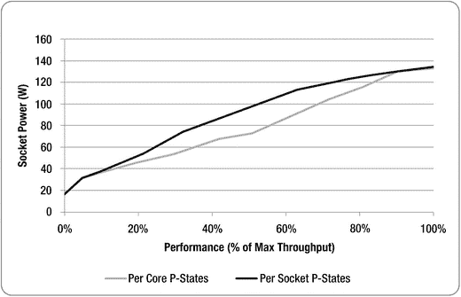

图 2-9.

每核 P 状态（`PCPS`）与每插槽 P 状态（`PSPS`）对比

当系统上运行不同的工作负载时，以不同的频率执行它们可能很有益处。虚拟化就是一个常见的例子。一个用户可能希望使用其虚拟化资源的 100%，而另一个用户可能运行在非常低的利用率下。`PCPS` 允许活跃用户提升其电压和频率，而无需将这些功耗成本强加给第二个用户。类似的情况也出现在系统上运行不同类型的工作负载时。如果一部分核心用于执行某些性能关键任务并运行在高频率下，而另一个核心周期性唤醒以服务一个守护进程，则无需以高电压/频率来执行该守护进程。当线程以高电压/频率唤醒并执行时，理论上它们可以更快地进入深度 C 状态（从而抵消高频率的成本，甚至实现净功耗节省）。服务器平台上通常存在大量后台软件线程，这些线程可能会干扰系统，导致线程频繁唤醒，从而阻碍在中到高系统利用率下使用这些深度 C 状态。这种行为在注重功耗优化的消费级平台上要少得多，因为在这些平台上，无论是否使用 `PCPS`，这都会导致电池续航显著下降。

每核 P 状态并非总是能带来巨大收益。低功耗微服务器就是一个很好的例子。在微服务器中，IA 核心消耗的功耗在平台总功耗中所占比例通常较小。此外，这些 CPU 通常以较低的频率和较小的电压动态范围运行。没有良好的电压缩放，更优的策略是让单个核心竞速进入停止状态并进入深度 C 状态，而不是单独降低该核心的频率和电压。

### 非核心频率缩放

`Nehalem` 和 `Westmere` 系列处理器在非核心部分保持一个恒定频率。在低系统利用率（约 10%–40%）下，这是一种低效的运行状态，因为 L3 缓存被维持在不必要的高频率和高电压下。然而，它提供了通常较为一致的性能表现。

在 `Sandy Bridge` 和 `Ivy Bridge` 代处理器上，一个插槽内的非核心部分和核心被绑定到一个单一的电压/频率域。当核心改变频率时，非核心部分（L3 缓存）也随之改变。这在低系统利用率下提供了显著更好的能效，因为 L3 缓存电压降低了，从而节省了漏电功耗。此外，许多服务器工作负载的频率缩放效率也得到了提升（通过提升频率获得了更大的性能增长）。

在 `Haswell` 上，核心和非核心被分离到独立的可变电压/频率域。这使得系统既能利用可变非核心域的所有优势，又能实现更高的能效。例如，在一个双插槽系统中，如果一个插槽需要高性能而第二个插槽空闲，则它会通知第二个插槽其处于高性能模式。然后，空闲插槽能够提高其非核心部分的频率，以便为高性能插槽提供最佳的存储器和侦听延迟，而无需提高该空闲插槽上空闲核心的电压/频率。此功能称为 perf p-limit。当 PCIe 需要高性能时，也可能出现类似的行为。

`Avoton` 没有像 Xeon 处理器中常见的 L3 缓存或高功耗非核心部分。因此，在这种情况下，管理非核心频率根本不值得付出代价。

#### Turbo

CPU 服务器平台通常设计为为相对最坏情况下的实际工作负载提供足够的冷却和功率输送能力。在服务器中，在这些系统上运行的绝大多数典型工作负载都远低于它们所设计的这些限制。引入 Turbo 技术正是为了利用这种动态余量。它通过提高 CPU 的运行频率来利用任何可用余量，余量来自：

*   功耗
*   热量
*   电气特性

为了在单元基础频率之上提供额外的频率，这三个主要领域都必须存在余量。能够达到的 Turbo 量取决于平台/数据中心的热特性、运行的工作负载，甚至具体单元的个体差异。

##### Turbo 架构

Turbo 架构/微架构在很大程度上是英特尔产品线（从手机/平板到 E7 服务器）所共用的。然而，这些算法的行为在每个领域通常有所不同。在消费类设备（笔记本电脑、平板电脑等）上，用户经常需要短期的性能提升。这些平台也经常受到热限制。Turbo 在温度升高（包括 CPU 内部以及人们触摸的设备“外壳”）时提供额外的性能。对于某些工作负载，热容量最终会耗尽，CPU 必须降低其频率，以保持在平台的热限制范围内。在 Sandy Bridge 一代引入的 Turbo 架构（称为 Turbo 2.0 或运行平均功率限制 [RAPL]）试图对这些热特性进行建模，并提供一种机制，使实际 CPU 和平台都能保持在期望的热限制内。在服务器上，某些工作负载能够无限期地维持高水平的 Turbo 频率。

##### 功耗/热限制

在长时间常数下，热限制通常直接与功耗相关。例如，笔记本电脑可以散发一定量的功耗/热量而不会改变温度。如果使用更多功耗，笔记本电脑会升温；使用更少功耗，则会降温。Turbo 算法对这些行为进行建模，并在热时间常数（通常为秒级）内限制功耗，以保持在期望的热设计功耗范围内。同样的算法也存在于服务器中，用于使 CPU 保持在期望的功耗/热设计范围内。更多详细信息请参见“T 状态”一节。

##### 热保护

除了通过限制功耗来控制热量外，CPU 还提供了热管理程序，以确保 CPU 在其热规格范围内运行。这些热算法在 Turbo 模式下同样会生效。相关说明详见“CPU 热管理”一节。

###### 电气保护

虽然功率和热问题通常可以被动处理，但电气约束通常更不宽容。平台的电力传输有一个它能提供的最大电流（称为 `ICCMAX`）。这个限制通常来自电压调节器（包括 `IVR` 和 `MBVR`），但也涉及 CPU 封装和插槽的约束。短时间内（微秒级）超过电压调节器的 `ICCMAX` 可能导致电压下降和系统故障。这些时间常数太快，目前无法可靠地检测和响应，因此必须结合主动强制措施和平台设计约束来防止系统故障。Turbo 算法有一个电气设计点（EDP）限制，当检测到可能超过处理器的 `ICCMAX` 时，会主动降低频率以避免这些问题。典型的工作负载几乎不会或完全不会遇到 EDP 节流，因为 CPU 经过测试，确保在大多数条件下能够电气地达到最大 Turbo。

这条规则的主要例外是高级矢量扩展（AVX）工作负载。AVX 是一组宽矢量指令，主要针对高性能计算和其他密集型数学应用。这些指令有可能消耗大量功率并吸取大量电流。因此，当使用 AVX 指令时，EDP 算法可以将频率降低一个或多个频率档位。AVX 可以显著提升性能和功率/性能效率，但如果只是轻度使用，也可能降低整体性能。

> **注意**
> 
> AVX 在使用时有可能消耗大量功率。然而，当它不使用时，大部分逻辑可以自动（且动态地）被门控关闭，并且 CPU 在进行电气保护计算时无需考虑 AVX。通常没有 BIOS 或操作系统旋钮来禁用 AVX，因为它对于不使用它的工作负载来说成本极低。

表 2-15 展示了各代产品中 EDP 的表现。在 Sandy Bridge 中，EDP 对系统行为没有显著影响。在 Ivy Bridge 上，EDP 节流更为常见。这种节流应用于整个插槽。换句话说，如果一个核心使用了 AVX，所有核心都会被节流以保持在限制范围内。Haswell 的运行方式与 Ivy Bridge 类似。然而，其中包含了独立的约束来定义当 AVX 活动时可实现的 Turbo 等级。

**表 2-15. 各代产品的 Turbo 电气保护**

| 代际 | EDP 节流 |
| --- | --- |
| Sandy Bridge E5 | 不常见。按插槽应用。 |
| Ivy Bridge E5 | 与 AVX 共同使用时常见。按插槽应用。 |
| Haswell E5 | 与 AVX 共同使用时常见。按插槽应用。对 AVX 代码应用了 Turbo 硬限制。 |
| Avoton | 无。 |

##### C 状态与 Turbo

C 状态不仅能节省功耗，还能在与 Turbo 配合使用时提供额外性能。通过将核心置于深度 C 状态（C3 或更深），有可能获得更高的 Turbo 频率。C 状态不仅节省了可用于 Turbo 的功耗，而且在休眠状态下，PCU 知道核心不能突然需要高电流。这意味着平台 `ICCMAX` 约束被分配到更少的核心上，允许它们达到更高的频率。这在混合有并行和串行部分的工作负载中尤其有用，因为串行部分可以达到更高的频率并更快完成。核心 C1e 和 C1 状态不与全局 PCU 协商，以提供快速的唤醒和休眠响应。它们也不会降低电压，并且某些硬件继续运行（如用于侦听未刷新的缓存的路径）。因此，使用 C1 和 C1e 状态可以通过节省功耗来略微提升 Turbo 性能，但不会提供额外的 Turbo 档位。

> **注意**
> 
> C 状态通常与 Turbo 结合使用时，通过允许在活动软件线程数少于可用硬件线程数时实现更高频率，来提升某些工作负载的峰值性能。

##### 熔断的 Turbo 频率

每个处理器 SKU 都熔断了一个基础（P1）频率以及一个最大 Turbo（P0）频率。除了这两个点之外，通常还会根据活动核心的数量对 Turbo 施加限制。例如，一个 8 核 CPU 可能有 2.8 GHz 的基础频率和 3.6 GHz 的最大 Turbo 频率，但如果所有核心都活动，它可能只被允许达到 3.2 GHz 的频率，或者如果四个核心活动，则频率为 3.4 GHz。许多服务器工作负载在运行 Turbo 时会使用所有可用的核心，因此被限制在全核 Turbo 频率（P0n 频率）。针对不同活动核心数量所支持的最大 Turbo 频率被称为 Turbo 调度表。在 Haswell 上，Turbo 调度表概念被扩展到 AVX。除了传统的 Turbo 调度表之外，当 AVX 工作负载活动时，还会增加并应用一组额外的熔断限制。

### T 状态

T 状态提供了一种对核心进行占空比调节的机制，以实现比 P 状态更低的功耗节省水平，而无需依赖操作系统使用 `MWAIT` 请求 C 状态。T 状态是一种非常低效的节能方式，通常仅在灾难性情况下用于避免系统关机或崩溃。T 状态可以由操作系统请求，或者在 CPU 检测到严重的热力或功率约束时自主进入。现代操作系统不使用 T 状态请求基础设施，但其为了兼容旧版而得以保留。

T 状态通常通过在一个类似 C1 的状态和 C0 状态之间进行粗粒度的占空比调节来实现（几十到几百微秒的时钟门控，随后是一段活动期）。然而，也可以使用细粒度的时钟调制（或时钟占空比调节）来实现这些状态，或者结合更深的 C 状态使用粗粒度的占空比调节。

### S 状态和 G 状态

S 状态和 G 状态在平台层面上提供深度电源管理。S 状态对软件（和最终用户）可见，而 G 状态主要针对平台设计人员。软件必须请求 CPU 进入一个 S 状态，并且从 S 状态唤醒需要软件（BIOS 和操作系统）支持。这与封装状态不同，后者的唤醒完全由 CPU 管理。大多数服务器 CPU 支持 S0/S4/S5 状态。S3 通常更是工作站和客户端的功能，并非所有服务器处理器都支持。表 2-16 总结了一些常见的 S 状态和 G 状态。

**表 2-16. S 状态和 G 状态**

| G 状态 | S 状态 | 描述 |
| --- | --- | --- |
| G0 | S0 | CPU 已通电并自行管理电源。 |
| G1（休眠） | S1/S2 | 旧的睡眠状态，已被封装 C 状态取代。 |
| | S3（挂起） | CPU（大部分）关闭，状态保存在 DRAM 中以实现快速唤醒（秒级）。 |
| | S4（休眠） | CPU 完全关闭，状态保存在硬盘上以改善唤醒延迟。 |
| G2（软关机） | S5（软关机） | CPU 完全关闭，未保存任何状态。PSU 仍提供一些微小电力以支持唤醒（按键、键盘、WoL [网络唤醒]等）。从该状态唤醒可能需要数秒到数分钟。 |
| S3（机械关机） | 不适用 | PSU 不再提供任何电力。可能仍存在一些微小电力用于维持系统时钟或最小限度的易失性状态。 |

### S0ix

S0ix 状态提供的节能效果，在概念上类似于封装 C 状态。它们在空闲状态下进行全局优化以节省大量电能。存在不同级别的 S0ix 状态（目前从 `S0i1` 到 `S0i3`），通过逐步增加的退出延迟来提供更深层次的节能效果。`S0ix` 术语主要应用于消费类设备，而非服务器。这些不同状态的确切定义（至今）随代际更迭而变化。

### 运行平均功率限制 (RAPL)

想象有一辆最高时速为 35 英里的汽车，每当你试图开得比 35 mph 更快时，它就会通过将速度降至 32 mph 来做出反应。在这种情况下，很难将 35 mph 的速度保持住。从概念上讲，这就是 Turbo 技术在 `Nehalem` 代处理器上的工作方式。每当功率超过允许阈值时，频率就会降低以使其回到限制以下。频率以 133 MHz 为增量进行管理，只有大约 10 种不同的频率可供选择（想象一个只有 10 种不同“选项”来决定踩下多深的油门踏板），这导致系统降至目标最大功率水平以下。结果，在功率受限的工作负载中，很难充分利用系统的全部能力。

Sandy Bridge 引入了运行平均功率限制（`RAPL`）的概念，用于控制平台上的功耗以达到平均限制。`RAPL` 是一种闭环控制算法，用于监控功率并控制频率（和电压）。在之前的架构中，Turbo 算法试图将功率保持在某个限制以下。每当功率超过该限制时，频率就会降低，以便尽快回到限制以下。而使用 `RAPL`，短时间（通常最多几秒）超出功率限制是可以接受的。`RAPL` 的目标是以一种使系统保持在热/功率约束范围内的方式，提供期望限制下的平均功率。

平台有多种不同的约束条件必须满足，以保持系统稳定。这些约束包括各种不同的热要求（例如，CPU、电压调节器、电源、内存和其他设备不过热）以及功率传输要求（例如，保持在 VR 的 `ICCMAX` 以下）。其中许多约束将在第 4 章中讨论。`RAPL` 提供了解决其中许多（但不是全部）不同约束的能力。

平台中的不同组件/约束有不同的功率要求。有些约束是宽松的——它们可以在特定时间段内被突破。其他则是硬约束，违反它们可能导致故障。表 2-17 提供了一些这些约束的示例。

**表 2-17. 平台功耗约束示例**

| 平台约束 | 典型功耗限制 | 备注 |
| --- | --- | --- |
| 电压调节器 | 约 TDP 的 2 倍 | 短时间（微秒级）超出电压调节器的约束可能导致系统故障。这些限制通常是硬限制。 |
| 电源 | 约 TDP 的 1.2 倍 | 电源和平台可以在一段时间内（通常为毫秒级）突发到更高的功率水平。这些时间常数可以通过增加成本来延长。 |
| CPU 热管理 | 约 TDP 值 | CPU 升温通常需要时间。因此，短时间超出热功耗预算是可以接受的（同时系统在升温）。这些时间常数因平台和工作负载而异，通常在几百毫秒到几秒之间。如果 CPU 检测到温度超过指定限制，它会进行自我保护。 |

`RAPL` 致力于控制上述众多要求中的一部分（并非全部）。不同级别的 `RAPL` 为不同的时间常数提供保护，这些时间常数针对不同的平台约束（参见表 2-18）。这些能力已经随时间演变（参见表 2-19）。`RAPL` 提供了一种机制（`PL1`），用于控制在热学上显著的时间常数（秒级）内的平均功率。其目标是在保持于配置的约束范围内的同时，最大化可用总功率。它还提供了额外的机制（`PL2`/`PL3`），用于在更短的时间常数内控制系统，以试图保持在各种功率传输约束范围内。这些限制通常高于 `PL1`，但必须在更短的时间窗口内强制执行。与热约束严格的消费类平台（如小型笔记本电脑）不同，确切的 `PL2` 和 `PL3` 值通常对整体系统性能不太关键，并且通常不会进行激进调优。

**表 2-19. 各代产品中 RAPL 的能力**

| 产品 | `PL1`/`PL2` | `PL3` | `ICCMAX` | 内存 |
| --- | --- | --- | --- | --- |
| Sandy Bridge/Ivy Bridge | 支持 | 不支持 | 静态，启动时决定 | 按插槽 |
| Haswell | 支持 | 支持¹¹ | 动态控制 | 按插槽 |
| Avoton | 支持 | 不支持 | 不支持 | 不支持 |

**表 2-18. RAPL 级别¹⁰**

| 级别 | 时间常数 | 目标用途 | 示例配置 |
| --- | --- | --- | --- |
| `PL1` | 秒级 | 热管理 + 平均功率 | TDP |
| `PL2` | ~10 毫秒 | 热管理 + 功率传输 | 约 TDP 的 1.2 倍 |
| `PL3` | 带占空比的 <10 毫秒 | 功率传输 | 约 TDP 的 1.2 倍 |
| `ICCMAX` | 主动预防 | 功率传输 | SKU 特定 |

Sandy Bridge 实现了 `PL1` 和 `PL2` 时间尺度。默认情况下，`PL1` 设置为处理器/SKU 的 `TDP` 功率，`PL2` 设置为约 `TDP` 的 1.2 倍。每个限制都可以静态设置（由 BIOS 设定）或在运行时动态控制（通过 `PECI` 或 IA 软件）。任何设置为高于 `TDP` 功率水平的 `PL1` 限制都将被截断为 `TDP`（支持超频的高端桌面处理器除外）。尽管这在某些使用模型中运行良好，但仅支持 `PL1` 和 `PL2` 使得难以使用 `RAPL` 进行功率传输保护。它仍被部署用于数据中心功率预算和控制，但需要保护带。

Haswell 扩展了 Sandy Bridge 的能力，试图更好地处理短期功率传输约束。除了 `PL1`/`PL2` 之外，系统中增加了第三个约束（`PL3`），它可以在更短的时间常数上检测功率偏移，并以确定性的占空比进行节流。这减少了功率传输的过度设计（特别是在电源供应器（PSU）的粒度上）。

Sandy Bridge 也强制执行了 `ICCMAX` 限制。如前所述，`ICCMAX` 是被动预防执行的，因此永远不会被超过。在 Haswell 上，`ICCMAX` 变得可在运行时编程。这允许数据中心管理软件设置一个永远不会被超过的最大电流/功率硬限制。

图 2-10 提供了 `PL1` 和 `PL2` 运行时的图示（未按比例）。`PL3` 功率水平在概念上以类似于 `PL2` 的方式运行，只是其行为定义更明确，更适合平台设计。两个图的 x 轴都代表时间。随着时间从左到右，不同的工作负载阶段被执行（如图表底部“活动”所示）。开始时，工作负载处于低活动阶段（例如内存分配）。尽管频率运行较高，但实际功率较低。在此阶段，温度通常相对较低，控制环路可以获取这些功率额度以供后续使用。

#### 电源限制与 RAPL 技术详解

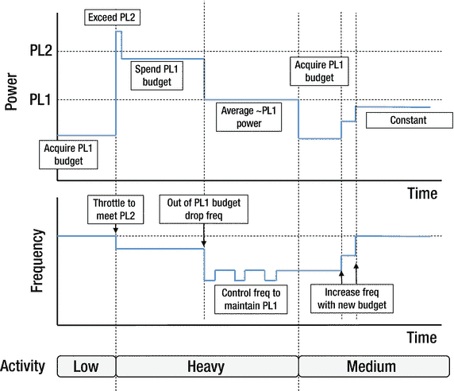

**图 2-10**: Turbo 2.0 电源限制示意图

然后，工作负载进入“重度”阶段。在高频率下，重度工作负载超过`PL2`级别，并迅速被限制回落到`PL2`以下。随后，尽管平均功率高于`PL1`，CPU 仍能在一段时间内维持略低的频率。CPU 实际上在消耗之前低功耗阶段积累的“能量信用”。这旨在模拟系统的热容量——在散热器升温期间，可以暂时超过`PL1`功率运行。一旦这些信用被用尽，频率将进一步下降以维持`PL1`平均值。`PL1`控制环路会周期性调整频率，使得运行平均值符合`PL1`约束。

最终，工作负载完成重度阶段并过渡到中等活动阶段。随着活动减少，功率下降。短暂间隔后，控制环路获得足够的预算并再次开始提升频率。此时，频率稳定在最大支持频率，因为该频率下的功耗低于`PL1`约束。这种运行模式在许多服务器工作负载中非常常见，这些负载即使在最大支持的 Turbo 频率下也消耗低于`PL1`的功率。

`RAPL`概念可以应用于任何支持功率报告并提供限流机制来控制功率的电源域。`DRAM RAPL`提供了控制`DRAM`域功率的接口。`PP0 RAPL`存在于 Sandy Bridge 和 Ivy Bridge 代际，用于控制核心电源域（`VCC`）的功率。但在生产环境中发现其并非特别有用，因此在 Haswell E5 代中被移除。

#### IMON 与数字功率计

为了为`RAPL`提供闭环算法，需要提供功率测量反馈。有两种高级方式实现：(1) 使用模拟电路测量功率/电流，或 (2) 使用 CPU 内部逻辑估算功率。电压调节器电流监控（`VR IMON`）是选项 1 的主要实现方式。当`VR`向 CPU 提供电流时，`VR`内部的电路会跟踪功率估算值。CPU 随后定期（通常约为 100 微秒到 1 毫秒）采样该读数并从中计算功率。替代方案是使用数字功率计实现方式 2。

`VR IMON`通常更容易实现/调优（对 CPU 而言），但会增加部分平台成本。对于单个`VR`，这些成本通常很小（远低于 1 美元）。其缺点在于`VR`电路必须针对精度进行调优。数字功率计提供了一种无需平台要求的功率估算机制。大多数服务器设计利用`VR IMON`，因为它能以较低投入提供良好的精度。例外情况是 Sandy Bridge 和 Ivy Bridge 上的 CPU，它们使用了数字功率计。`VR IMON`通常也包含针对部分芯片区域的简化数字功率计。例如，在 Avoton 上有大量输入`VR`。其中许多`VR`为 CPU 提供小而（通常）恒定的电压/电流。为了避免在这些电源轨上实现`VR IMON`（这会增加平台成本和设计复杂性），使用了简单的数字功率计来估算这些电源轨的功率。表 2-20 说明了功率监控在近几代处理器中的演变。

**表 2-20**: 各代 Turbo 功率监控/执行机制

| 代际 | 限流器 | 功率测量 |
| --- | --- | --- |
| Nehalem/Westmere E5 | Turbo 1.0 | CPU: VR IMON DRAM: N/A（不支持） |
| Sandy Bridge/Ivy Bridge E5 | RAPL (Turbo 2.0) | CPU: 数字功率计 DRAM: VR IMON |
| Haswell E5 | RAPL (Turbo 2.0) | CPU: VR IMON DRAM: VR IMON |
| Avoton | RAPL (Turbo 2.0) | CPU: VR IMON DRAM: VR IMON |

> **注意**：`VR IMON`通常在`VR`能提供的最大电流水平下进行优化。随着负载降低，误差量基本恒定（以安培计）。但作为负载的百分比，误差会增加。例如，100 安培中 1 安培的误差仅为 1%误差。然而，在 10 安培利用率下，该误差变为 10%。因此，当系统空闲时，`DRAM`和`CPU IMON`报告往往表现出更高的误差。平台内存功率（和电流需求）可能因内存容量而异。对于容量远低于平台支持能力的系统，`DRAM VR`的不准确性可能很大（以百分比计）。

#### Linpack 示例

`Linpack (HPL)`是说明典型服务器工作负载功耗行为的糟糕示例。但它非常适合给系统施加压力并展示`RAPL`算法的行为，因此在此使用。许多使用默认系统配置（`PL1 = TDP`）运行的典型服务器工作负载不会经历来自`RAPL`的任何限流，并且可以无限期维持 Turbo 状态。

图 2-11 展示了在 85°C 温度和 1 秒时间常数下启用`RAPL`时，`Linpack (HPL)`在工作负载运行子集上的行为。这些数据有几个有趣的观察点。首先，它们展示了`RAPL`在实际工作负载中的整体行为。在开始时（左侧），`Linpack`正在执行内存分配，尽管频率较高但功耗相对较低。接下来，实际工作负载启动。功率跃升至`PL1`限制以上。数秒后，`RAPL`的`PL1`限制生效，将功率拉低至`TDP/PL1`限制。此时，频率下降约 100MHz 以维持 85 瓦特限制。

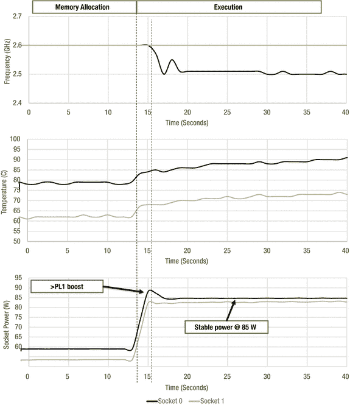

**图 2-11**: 85 瓦特 RAPL 限制下的 Linpack 功率、频率和温度

其次，Socket 0 比 Socket 1 消耗更多功率且达到更低的频率（和性能）。在所研究的平台中，Socket 0 位于插槽的热阴影区。换句话说，风扇先吹过 Socket 1，然后加热后的空气再经过 Socket 0。结果是 Socket 0 的温度远高于 Socket 1，增加了该 CPU 的漏电功耗。因此，Socket 0 在稳态下达到的平均频率更低，且工作负载启动时的初始加速持续时间更短。

许多典型服务器工作负载不会表现出这种跨插槽的性能差异，因为它们即使在较高温度下也倾向于达到最大支持的 Turbo 频率。然而，当启用较低的功率限制时，可以观察到这种变异性。数据中心管理工具会监控数据中心内不同插槽和不同节点达到的性能水平，以尝试平衡优化性能所需的必要功率。

#### DRAM（内存）RAPL

除插槽域外，至强 E5 系列还支持 DRAM RAPL，该技术可为内存域提供功耗限制。内存功耗可能是整个平台功耗的重要组成部分，在使用 1.5V DDR3 时尤其如此。随着向 DDR4 的过渡，这一比例有所下降，但在大内存容量系统中仍然很重要。

DRAM RAPL 在概念上与插槽 RAPL 非常相似。通过在一个时间窗口内监控功耗，并执行节流以保持在设计功耗限制内。对于 CPU RAPL，通过控制系统电压和频率来调节功耗。而对于 DRAM，更改电压和频率并不常见。因此，功耗是通过限制对 DRAM 设备的访问事务数量来控制的。DRAM 功耗对带宽非常敏感。与支持独立 `PL1` 和 `PL2` 功耗等级及时间常数的插槽 RAPL 不同，当前的 DRAM RAPL 仅支持单个配置点。也没有 `ICCMAX` 控制点，但可以使用热管理基础设施来执行主动的峰值带宽控制。

DRAM 功耗域与 CPU 域是分离的。目前两者无法自动共享功耗。为内存供电的 VR 通常也为 CPU 上的 DDR I/O 供电。这部分功耗包含在 CPU 域中（通常使用某种数字功耗计）。为了避免重复计数，此部分功耗会从 DRAM RAPL 中扣除。数据中心管理软件可以实现允许在插槽和 DRAM 域之间共享功耗的算法。尽管两个域是分离的，但它们会相互影响。设置一个导致 CPU 严重节流的强 CPU RAPL 限制通常会导致 DRAM 功耗降低，因为较低的 CPU 性能会导致较低的 DRAM 带宽。DRAM RAPL 对 CPU 功耗的副作用则不那么明显。当 DRAM RAPL 节流启动时，核心会花费更多时间处于停滞状态。这些停滞会降低核心的活动并（在短期内）降低其功耗。如果这些核心以低频率运行，操作系统可能会观察到更高的利用率并提高电压和频率，最终增加 CPU 功耗。另一方面，如果频率已经以最大值运行，则功耗将会降低。

对内存进行节流通常是一种非常低效的功耗控制行为。核心处于停滞状态，无法有效完成工作以进入 C 状态。因此，在正常操作下，DRAM RAPL 通常用于将功耗限制在略高于工作负载需求的水平。例如，如果一个工作负载在不节流时消耗 20 W，但系统可能消耗高达 30 W，则可以部署一个 20 W 的限制，该限制既避免了对工作负载进行节流，也防止其功耗跃升至 30 W。剩余的 10 W 随后可由管理软件用于其他用途。如果需要降低功耗并需要执行节流，通常应从 CPU 域开始，然后仅在万不得已时才转向 DRAM 域。

**注意**：DRAM RAPL 最有效地用于确保你不会为 DRAM 过度配置不必要的功耗。但是，除非在极其必要的情况下，否则应避免对内存进行节流。

### CPU 热管理

维持安全的运行温度对于 CPU 的长期功能性至关重要。管理平台冷却以使 CPU 保持在最佳温度范围内通常是平台软件的责任，这将在第 4 章中详细讨论。然而，CPU 自身会监控其温度，并提供自动热节流机制来保护 CPU 免受损坏或数据丢失。

CPU 使用多个热传感器来跟踪裸片的内部温度（`Tj` 或结温）。如果这些热传感器检测到温度高于 SKU 允许的最高温度（`DTSMAX`），则运行频率将被节流，以使其保持在热约束范围内。通过这种机制进行的热节流通常不常见，但其设计目的是在使用时提供良好性能。当温度超过预期水平时，频率通常会被缓慢节流。由于不可忽略的热阻，CPU 内部的温度不会瞬时响应功耗/频率的变化。温度的变化速度通常不会超过每 10 毫秒（并且通常慢得多）。因此，热节流算法被调整为在进一步降低频率之前，先降低频率并在毫秒级时间尺度上评估其对温度的影响。

如果温度开始大幅超过 `DTSMAX`，则会执行激进节流（通常降至支持的最低频率）以快速降低温度。这通常被称为临界温度事件。在服务器中，这种情况非常罕见，通常仅在平台/机架的冷却能力出现灾难性问题时（例如，一个或两个风扇停止工作）才会发生。当启动此类节流时，目标是保持系统功能正常，直到平台问题得到诊断和解决。性能不是优先考虑的事项。可以配置操作系统/BIOS，在该事件发生时尝试从软件执行“优雅”关机，但服务器系统通常不启用此功能，而是依赖激进的节流机制。

除了 `DTSMAX` 之外，每个单元都熔断了灾难性跳闸温度，通常称为 `THERMTRIP`。当温度超过此熔断限制时，CPU 会立即通过引脚向平台发出信号，表明应立即执行（无需操作系统介入的）硬件关机。此功能完全在简单、专用的异步硬件中实现，并且旨在即使在 CPU 内部发生其他故障时也能正常运行。换句话说，核心和内部微控制器都可能挂起，时钟网络也可能失效，但 `THERMTRIP` 仍然可以工作。在生产单元中观察到 `THERMTRIP` 的事件非常罕见，即使在实验室中，不禁用其他热控制算法也很难触发它。

**注意**：热节流可能由不当冷却（例如，风扇故障或不良的热设计）引起，也可能是因为睿频消耗了所有可用的散热余量。现代处理器上存在的热报告机制无法区分这两种情况，这可能会导致最终用户产生一些困惑。

图 2-12 展示了 Linpack 在 Socket 0 上遭遇热节流时的示例。与图 2-11 中的示例类似，在此场景下，Linpack 运行在 Socket 0 处于 Socket 1 热阴影中的系统上，导致其温度更高。在负载开始时，系统会执行内存分配，并能以完整的 2.6 GHz 频率运行，且无明显升温。一旦内存分配完成，实际负载开始运行，功耗显著增加，处理器开始升温。在大约 150 秒时，Socket 0 开始达到 95°C 的 DTSMAX 温度，此时频率开始受到限制，以将 CPU 温度控制在 95°C 以下。频率持续下降，直到稳定在约 2.45 GHz 的平均频率。请注意，在此情况下，CPU 实际上是在 100MHz 的频率粒度（主要是 2.4 GHz 和 2.5 GHz）之间切换，而维持约 2.45 GHz 的是其平均频率。

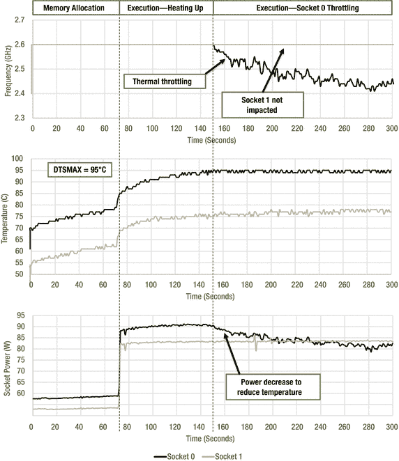

图 2-12. 热节流时的 Linpack 频率、温度与功耗 注意

在许多 Linux 内核版本中，任何形式的热节流通常都会被报告为“需关注的”错误消息。热节流虽然在服务器中不常见，但在产品的整个生命周期中会频繁发生，且系统本身并无任何问题。当从低功耗负载快速过渡到极高功耗负载时，CPU 温度升高的速度通常快于风扇转速控制算法做出反应以将温度保持在 DTSMAX 以下的速度。CPU 热管理算法旨在保护 CPU 免受损坏，并优雅地做出响应，通过控制频率以维持在热预算范围内。

### Prochot

在现代服务器 CPU 上，存在一个名为 `PROCHOT#` 的引脚，它既可以指示 CPU 何时处于热节流状态（输出模式），也可以作为平台通知 CPU 进行节流的机制（输入模式）。它也可以用作双向引脚，以便同时使用两种模式。Prochot 输出模式可用于多种平台使用场景。输入模式则向 CPU 发出信号，指示其应尽快执行深度节流（通常降至低频率）。Haswell 改进了 Prochot 机制的速度，使其可用于电源输送保护。更多详情请参见第 4 章。

### CPU 电源管理总结

图 2-13 提供了一个高级示例，展示了软件和 CPU 通过“关闭”和“降频”相结合的方式节省功耗所采用的各种状态。

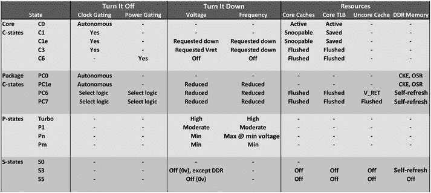

图 2-13. 服务器 CPU 电源管理示例

