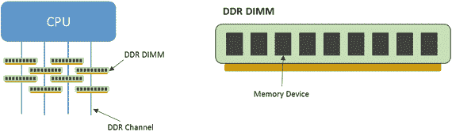
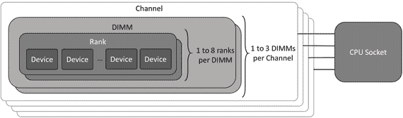
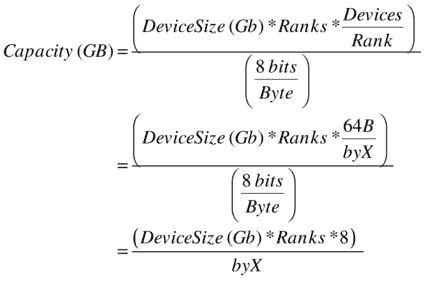
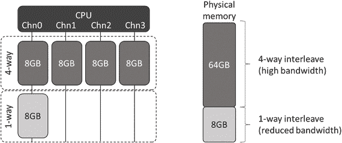

# 3. 内存与 I/O 电源管理

如果没有内存来存储工作数据，以及 I/O 接口来从驱动器和网络引入数据，CPU 就无法有效运行。尽管在电源管理和能效讨论中 CPU 通常是焦点，但在许多系统中，内存子系统可能占据相当大的功耗。I/O 也很重要，但通常只占较小的一部分。本章将概述服务器内存架构，以及电源与热管理技术的工作原理。此外，还会讨论如何为其他提供 CPU 运行时所需数据的 I/O 设备进行电源管理。

## 系统内存

在某些系统设计中，内存功耗可能占整个平台功耗的很大比例。不同的使用模式需要不同范围的内存容量，这导致内存功耗的重要性因用户而异。不同类型的内存功耗范围也可能相差很大。本节将概述内存架构及其如何影响数据中心的功耗。

### 内存架构基础

在讨论服务器系统的电源管理能力之前，理解内存的工作原理以及功耗是如何产生的至关重要。让我们从宏观层面开始。内存条，即 `DIMM`，被插入到平台上的插槽中。每个插槽都连接到一个内存通道。多个 `DIMM` 可以连接到同一个内存通道，但这样做时，这些 `DIMM` 共享相同的命令/数据连接，因此可以增加容量，但不会增加带宽。每个通道的 `DIMM` 数量缩写为 `DPC`（例如，`1 DPC = 每个通道 1 个 DIMM`）。

当 `CPU` 向内存发起读取操作时，它通常从单条内存条中获取 64 字节（`B`）的数据。系统中的每个物理地址（`PA`）都映射到连接到 `CPU` 的特定通道/`DIMM`。读/写操作在命令总线上发出，如果是读取，则数据在数据总线上返回；如果是写入，则与写命令一起发送。该通道上相关的 `DIMM` 会判定该命令是发给它的，并处理该请求。

`DDR3`/`DDR4` 上的数据以 8 节突发长度（`BL8`）进行处理。这意味着单次访问（读或写）会使用内存总线上的八个时隙（见图 3-1）。内存总线宽度为 8 字节，在这八个突发中提供 64 字节的数据，并以 `DDR` 频率运行。因此，一个给定的通道可以提供 `DDR 频率 (GHz) * 8 (字节/时钟)` 的内存带宽（以 `GB/s` 为单位）。这八个突发中的每一个都会从 `DIMM` 上的多个设备中获取一些数据（具体数量取决于 `DIMM` 的类型）。

图 3-1. DDR 与 CPU 平台

#### 设备与秩

图 3-2 提供了内存 `DIMM` 及其如何连接到 `CPU` 插槽的高层概览。每条内存 `DIMM` 由多个内存设备组成。这些设备就是实际焊接到 `DIMM` 上的“芯片”。每个设备提供每个突发中返回的 8 字节数据块的一个子集。服务器内存设备/`DIMM` 可以是 `×4` 或 `×8`（称为“4 位宽”或“8 位宽”）。这指的是每个设备为每个 8 字节突发提供的数据量。`×4` 内存为每个 8 字节块仅提供 4 位数据，因此需要 16 个设备才能提供全部数据。`×8` 内存提供 8 位数据，因此只需要 8 个设备。设备制造商通常一次只生产几种容量的设备——这些设备既可以制造为 `×8` 内存，也可以制造为 `×4` 内存。与使用相同容量的设备相比，`×4` 设备可以通过要求更多设备为单次 64 字节访问提供数据，从而实现更高的 `DIMM` 容量，并借助纠错码（`ECC`）提高可靠性。

图 3-2. DDR 通道、`DIMM` 与秩

`DIMM` 还具有秩（通常为一个、两个、四个或八个）。单个 `DRAM` 设备是单秩的。因此，例如，当一个 `DIMM` 支持两个秩时，这意味着该 `DIMM` 上的 `DRAM` 设备数量翻倍。因此，一个需要 8 个设备来提供 64 字节数据的 `×8 DIMM`，如果有两个秩，实际上会有 16 个设备；如果有四个秩，则有 32 个设备。一条总线将 `DIMM` 连接到 `CPU`，该 `DIMM` 上的所有秩共享这条总线。然而，每个秩能够与其他秩在一定程度上独立运行。`DRAM` 设备面临的最大挑战之一是在执行读取和写入之间切换（以及再切换回来）。因此，内存控制器必须在针对给定秩的此类事务之间插入一个可观的时间气泡。支持多个秩的 `DIMM` 能够在一个秩切换模式时将其他事务“偷偷”挤入通道总线，从而提高了带宽和平均延迟。因此，出于性能考虑，我们通常建议在一个通道上使用两个相同容量的单秩（`SR`）`DIMM`，或者使用一个或多个双秩（`DR`）`DIMM`，以帮助隐藏这些低效问题。市场上也存在四秩（`QR`）甚至某些八秩（`OR`）`DIMM`。

**注意**

所有内存并非都一样。与 `CPU` 一样，内存也采用了新的制程技术，从而能够实现更低的功耗和更高的容量。在特定时间点，供应商只能经济地制造出一定容量的设备。有时会出现“下一更大容量”（两倍容量）的产品，但它们的价格会有显著溢价。通过增加秩的数量或从 `×8` 设备转向 `×4` 设备，供应商可以增加 `DIMM` 上的设备数量，从而提高容量。使用较少数量但容量更高的设备，其功耗可能显著低于使用大量但容量较低的设备，尽管两者都能提供相同的内存容量。

---

在 Sandy Bridge 和 Ivy Bridge 代际产品中存在一些混淆，因为 `CC7` 状态在 Sandy Bridge 上通过 `CPUID` 向软件予以列举，然后在 Ivy Bridge 上被移除了。Sandy Bridge `E5` 上的 `CC7` 状态具有与 `CC6` 相同的节能特性。因此，为避免长期混淆，`CC7` 状态在 Ivy Bridge 上被移除，并且在 Haswell `E5` 或 Avoton 上也不存在。

此功能在 `HSW E3` 产品上不可用。

请参阅 `www.intel.com/content/dam/www/public/us/en/documents/white-papers/performance-xeon-e5-v3-advanced-vector-extensions-paper.pdf`。

从技术上讲，T 状态也包括在电压无法再降低的点之下进行频率降低。

此表中的数值仅作为典型示例提供。它们绝不是一个硬性限制，并且所有数值均可由系统设计人员编程设置（在一定约束条件下）。

`PL3` 在 `HSW E5/E7` 上受支持。在该处理器上，该功率级别与 `PL2` 功率级别共享。在 `HSW E3` 上，`PL3` 使用一个与 `PL2` 不同的独立可配置功率级别。

#### 内存错误校正（ECC）

服务器内存通常采用 `ECC` 内存来提供保护，既能应对瞬时错误，也能防范设备故障。每 8 字节突发数据传输中包含了额外的第九字节数据，用于提供 `ECC` 保护。这成比例地增加了内存的成本和功耗，但在服务器部署中被普遍视为“必备功能”。

**注意：** 在当今的系统中，无法为节省功耗而禁用 `ECC` 设备。

对于 `×8` 内存，`DIMM` 上会额外包含一个设备来支持 `ECC`。而对于 `×4` 内存，则需要两个额外的设备。`×4` 内存提供了更高的可靠性，因为每个设备提供的数据占比更小。如果单个设备发生故障，`ECC` 算法能够校正所有数据并使系统继续运行。对于 `×8` 内存，如果设备发生故障，可以检测到此类状况并使系统挂起，但无法进行校正。

#### 内存容量

`DIMM` 的容量是秩、设备数量以及设备容量的函数。`DIMM` 通常以吉字节（`GB`）为单位销售，而设备容量通常以吉比特（`Gb`）为单位。以下公式总结了如何根据组件计算 `DIMM` 的容量：

示例：

- 双秩 `×8` 4 Gb = `4 Gb * 2 秩 * 8 / (×8) = 8 GB`
- 四秩 `×4` 8 Gb = `8 Gb * 4 秩 * 8 / (×4) = 64 GB`

可以通过增加秩数、设备容量或每个 `DIMM` 的设备数量（从 `×8` 变为 `×4`）来增加 `DIMM` 容量。

**注意：** 为了获得最佳性能，我们通常建议使用双秩（`DR`）内存，因为它能更有效地利用内存总线。这一点对于使用高内存带宽的工作负载尤其如此。单秩内存在每个通道使用多个同容量 `DIMM` 时也能展现出良好的性能（因为内存控制器有多个秩可供使用）。四秩（`QR`）内存也能有效利用内存总线，但通常需要工作在较低频率下。

#### 设备功耗特性

许多用户对自己需要多少内存有大致概念，但可能难以理解如何配置系统以实现所需内存。表 3-1 提供了一些关于内存功耗如何缩放的一般性经验法则。在每种情况下，容量都增加了 1.5 倍或 2 倍。你可能预期功耗会与容量成正比，但不同的选择会导致不同的功耗影响。（请注意，这些数字仅作为概念性指导，而非硬性规则。）

**表 3-1. DDR4 DIMM 功耗缩放示例**

| 参数 | 功耗影响 | 容量 | 其他说明 |
| --- | --- | --- | --- |
| 单秩到双秩 | ∼1.3–1.5 倍 | 2 倍 | 在单条每通道（`one-DPC`）配置中性能提升，尤其是高带宽工作负载。 |

## 内存配置与能效

| `×8` 到 `×4` | ∼1.4 倍 | 2 倍 | 可靠性提升。 |
| :--- | :--- | :--- | :--- |
| 两倍设备容量 | <1.1 倍 | 2 倍 | 设备容量增加通常伴随着更先进的制程技术，因此难以精确量化。 |
| 单条每通道到两条每通道 | ∼1.5–1.7 倍 | 2 倍 | 使用单秩 `DIMM` 时性能提升。可能降低内存频率。此情况下功耗不会翻倍，因为每个 `DIMM` 提供的带宽仅为使用两个 `DIMM` 时带宽的 50%。 |
| 两条每通道到三条每通道 | 见说明 | 1.5 倍 | 通常对内存频率有显著影响。并非公平比较。对于需要两条每通道配置在经济上无法实现的容量的客户，应使用三条每通道配置。 |

**注意：** 在单条每通道配置中使用双秩内存，通常在一系列工作负载中具有最佳的功耗/性能效率。增加每个通道的 `DIMM` 数量往往比其它方案的功耗效率更低，但从 `DIMM` 成本角度看可能具有吸引力。如果只需要低容量和低带宽，单条每通道单秩拓扑结构是最省电的。然而，这种效率在内存带宽开始紧张时会迅速下降。在购买单条每通道单秩系统之前，我们强烈建议你先分析其工作负载的带宽需求（如第 7 章所述）。

`DDR` 已经过优化以最小化漏电功耗。这不仅使得功耗随温度变化极小，还最小化了增加设备容量的功耗成本。这通常是增加容量最节能的机制，但成本可能过高，尤其是在达到一定程度之后。

在更高带宽下，额外增加秩和 `DIMM` 带来的功耗增量往往较小，因为这些开销被提供必要带宽所需的功耗所分摊。但在 `×8` 到 `×4` 的缩放中情况并非如此。

## DDR3 与 DDR4 对比

在高层级上，`DDR3` 和 `DDR4` 的架构非常相似。从最终用户的角度来看，`DDR4` 能够在更低电压和更低功耗下实现更高的频率。还有一些其它内部改进用于提升性能（例如，更多的存储体）。表 3-2 展示了近年来内存技术的发展。尽管最大频率有所提高，电压却降低了。随着制程技术的缩小，也能制造出越来越大的设备。请注意，最大设备容量并不总是代表给定处理器能够支持的水平。

**表 3-2. DDR 代际比较**

| DDR 代际 | 电压 | 频率 | 设备容量 |
| :--- | :--- | :--- | :--- |
| `DDR2` | `1.8 V` | 最高约 `1600` | 最高 `1 Gb` |
| `DDR3` | `1.5 V` | 最高约 `1866/2133` | 标准支持最高 `8 Gb`（常见 `4 Gb`） |
| `DDR3L` | `1.35 V` | 最高约 `1333/1600` | |
| `DDR4` | `1.2 V` | 最高约 `3200`（待定）| 标准支持最高 `16 Gb` |

`DDR3` 支持两种不同的电压：`1.35 V` 和 `1.5 V`。然而，在较低频率下运行会降低可达到的峰值频率。`DDR4` 将所有内存过渡到使用 `1.2 V` 电压，同时也提供了峰值频率（以及随之而来的峰值带宽）的显著提升。

`DDR` 电压在能效方面扮演着重要角色（具体数值因内存类型而异）。在支持 `DDR3`/`DDR3L` 内存的处理器上，通常需要在选择 `DDR3` 内存以获得更高频率，或选择 `DDR3L` 以在较低电压下运行之间做出权衡。更高的频率可以显著改善某些工作负载（尤其是在高性能计算领域）的内存带宽和性能。它们还提供了稍低的延迟，但这些优势通常较小（最好情况下性能提升几个百分点）。许多具有大内存容量的企业系统远未触及系统的内存带宽瓶颈，通过使用 `DDR3L` 可以在对性能影响极小的情况下显著节省能源。在内存拓扑结构较小的平台中，内存电压的总体重要性要小得多。

## RDIMM、UDIMM、SODIMM 与 LRDIMM

大多数服务器通常使用带寄存器的双列直插式内存模块（RDIMM），但无寄存器的双列直插式内存模块（UDIMM）也是一种替代方案。高速内存的信号完整性极具挑战性，尤其是当多条内存 DIMM 共存于同一内存通道时。RDIMM 在 DIMM 上包含一个寄存器，可减轻内存控制器的电气负载；这能改善信号完整性，并允许更高的内存频率（从而带来更高性能）。由于产量较小且组件更多，RDIMM 传统上比 UDIMM 更昂贵。然而，随着更多客户端设备转向与服务器不同的内存技术，这一趋势可能会延续，也可能不会。寄存器在激活状态下还会消耗可观的功率（每个 DIMM 约 `0.5` 到 `1` 瓦）（其中部分功率可在低功耗状态下节省）。不同的处理器和平台对于不同类型内存（UDIMM 与 RDIMM）所支持的最大频率以及内存拓扑结构（秩数量、每通道 DIMM 数量等）有各种不同的规则和限制。

UDIMM 可选配或不配备 ECC。ECC 会使所需器件数量增加 `12.5%`，功耗也以大致相同的比例增加。小型双列直插式内存模块（SODIMM）的特性与 UDIMM（包括 ECC 和非 ECC）非常相似——只是物理尺寸更小，因此无法容纳那么多器件。

ECC UDIMM 和 SODIMM 是低容量、低功耗、低成本部署的理想解决方案。需要较大容量或高可靠性的系统通常使用 RDIMM。

LRDIMM（负载降低型 DIMM）是 RDIMM 的一种，它提供额外的缓冲功能，使其能够访问大量器件，同时仍能保持高频率。QR RDIMM 存在电气问题，限制了其频率。LRDIMM 试图通过在 DIMM 上增加一个额外的缓冲芯片来解决这一问题，以应对器件数量增加并改善信号完整性。LRDIMM 提供高容量和高性能。额外的缓冲芯片会消耗一些额外功耗并略微增加内存延迟，但这两者在平台层面都不会产生实质性影响。与普通的 DR RDIMM 相比，LRDIMM 每 GB 内存通常更贵。在其最初发布时，其价格相比高容量 QR RDIMM 也有显著溢价，但随着时间的推移（针对 `DDR3`），这一价格差距已经缩小。如果你需要巨大的内存容量，LRDIMM 是一个不错的选择。

## 内存通道交错与不平衡内存配置

每个通道都有其能维持的有限内存带宽。通过将请求流交错分布在多个通道上，可以实现较高的内存带宽（和更高性能）。为了在系统中获得最佳性能，每个通道应填充相同容量的内存。然而，有时这并非实现特定所需内存容量最具成本效益的方式。如果要使用不平衡配置，最好避免单个通道容量超过其他通道的情况，因为这将导致一段内存区域采用“单路”交错方式（仅有理论峰值带宽的 `25%`），如图 3-3 所示。

图 3-3. 不平衡内存交错示例

默认情况下，当今大多数系统会为每个插槽分配独立的非统一内存访问（NUMA）内存区域。例如，一个具有 `32 GB` 内存的系统，前 `16 GB` 内存会分配给插槽 0，后 `16 GB` 分配给插槽 1。另一种替代方案是使用统一内存访问（UMA）分配，它会在插槽之间交错分配每一条缓存行（在上述示例中，实际上在两个插槽上提供了一个单一的 `32 GB` 区域）。在许多使用模式下，这会对性能产生不利影响，因为会强制一半的请求访问远程插槽从而增加延迟。许多用户最好让操作系统（OS，它了解此行为）来管理内存分配，并尝试将内存定位在本地插槽上，以减少内存延迟。然而，确实存在某些使用模式，其中内存 NUMA 方案无法成功地将内存定位在最佳位置，反而因尝试这样做而损失性能。不过，这通常并不常见，大多数工作负载要么从此类分配中受益，要么对之不太敏感。

内存交错通常不会直接影响内存功耗节省。此处能效通常通过优化性能来实现。不过，在不平衡配置下，可能会产生一些有趣的效果。例如，不平衡配置可能导致某些秩被低频次访问，从而实现更高的 CKE 功耗节省（将在后续页面进一步讨论）。

## 电源与性能状态

内存未充分利用时，存在多种功耗节省技术⁴可用于降低内存功耗。通常，这些技术大多属于“关闭”而非“调低”的范畴。实际上主要有两种省电技术：

*   关闭 CKE（时钟使能）：在短时空闲期间，按秩粒度节省功耗
*   自刷新：在长时间空闲期间，按通道粒度节省功耗

自刷新可以节省大量内存功耗，但也会带来不小的唤醒成本（约 `10` 微秒）。关闭 CKE 可节省的功耗较少，但唤醒速度非常快（约 `10` 纳秒）。关闭 CKE 也可以逐个秩地进行，而自刷新则必须在通道粒度上执行。因此，在服务器中，自刷新通常针对空闲系统，而 CKE 则针对中等活跃系统。在运行时动态管理内存频率尚未产品化。改变频率是一项复杂的工作，而且由于电压固定，功耗节省通常并不显著。

### CKE 节能技术

每个 rank 都有一个从 CPU 内存控制器连接到 DIMM 的时钟使能（`CKE`）信号。通过取消断言 `CKE`，允许该 rank 进入一种可以快速退出的低功耗状态（约 `10` 纳秒至 `100` 纳秒）。有几种不同类型的 `CKE` 在细节上存在差异，但总体而言，它们的行为方式大致相同。由于 `CKE` 是按 rank 粒度进行管理的，因此在具有更多 rank 的系统上，可能存在更多通过 `CKE` 节能的机会。

从宏观层面看，有两种类型的 `CKE`：

*   **激活掉电（`APD`）**：内存页面保持打开⁵，行缓冲器保持通电状态。
*   **预充电掉电（`PPD`）**：某个 rank 上所有 bank 中的内存页面已被“关闭”或“预充电”，行缓冲器可以断电。

乍一看，这听起来像是一个简单的功耗/性能权衡。`APD` 节省的电量稍少，但保持页面打开。然而，在实际的服务器应用中，情况并非如此。很多时候，当一个 rank 空闲足够长的时间以关闭 `CKE` 时，内存页面的访问也已经结束，因此关闭它们对性能和功耗都有好处。`CKE PPD` 和 `CKE APD` 都能节省约 30% 的功耗，且两者在功耗和性能上的差异可以忽略不计。

CPU 可以在取消断言 `CKE` 之前，通过向指定 rank 发送 `PREALL` 命令来强制使用 `PPD`。这会关闭该 rank 上所有 bank 中的所有页面，从而允许使用 `PPD`。或者，当所有必要的时间参数都已满足时，CPU 可以简单地取消断言 `CKE`。如果一个或多个页面处于打开状态，`DIMM` 将处于 `APD` 模式。否则，它将处于 `PPD` 模式。在 Intel 服务器文档中，`PPD` 模式指的是在取消断言 `CKE` 之前显式发出 `PREALL` 的情况，而 `APD` 模式则禁用了此 `PREALL`。即使是 `APD` 模式，如果在取消断言 `CKE` 时恰好所有页面都已关闭，也有可能进入 `PPD` 状态。

在 `DDR3` 上，有两个主要版本的 `PPD`：`PPDF`（快速）和 `PPDS`（慢速）。`PPDS` 以略微增加退出延迟为代价节省更多电量。通常增加的退出延迟很小，因此 `PPDS` 通常是更优的状态。总体来看，`PPDF`、`PPDS` 和 `APD` 之间的差异并不大（无论是性能还是能效）。

从 `DDR3` 过渡到 `DDR4` 的重大变化之一在于 `ODT` 的处理方式。不再需要内存控制器来管理 `ODT`，而是由 `DIMM` 自主处理。除此之外，`PPDS` 和 `PPDF` 状态已合并为一个 `PPD` 状态，在该状态下，`DLL` 保持供电，而 `ODT` 由 `DIMM` 管理。这种新的简化模式具有出色的节能效果。`DLL` 在 `DDR4` 上经过了重新设计，激活时功耗大大降低。当整个通道空闲时，可以关闭通道上的所有 `DLL` 以节省更多电量。然而，到目前为止，这种状态尚未在 Intel 服务器上实现产品化。

当 `DIMM` 上的所有 rank 都掉电时，`RDIMM` 上的寄存器也可以进入低功耗状态。这并不能节省所有的寄存器功耗，但每个 `DIMM` 可以节省几百毫瓦。

也可以对 `IBT`（输入缓冲器端接）进行掉电操作。理论上，`IBT OFF` 在启用 `CKE` 的情况下每个 `DIMM` 可节省约 100 毫瓦（在自刷新状态下也是如此）。然而，在实践中，由于退出延迟的增加，平台层面的节省往往要小得多。由于节能效果有限且存在唤醒延迟风险，此模式在服务器上并未被广泛启用。它在微服务器使用模式中更有意义，特别是在自刷新状态下（后续会有更多介绍）。

表 3-3 总结了各种类型的 `CKE` 节能技术，包括它们支持的 `DDR` 类型。表 3-4 总结了 `CKE` 在多个处理器代际间的演变过程。

**表 3-4. CKE 各代演变**

| 代际 | DDR | APD | PPDF | PPDS | 通道 PPDS-DLLOFF |
| --- | --- | --- | --- | --- | --- |
| Nehalem/Westmere E5 | DDR3 | Y | Y | 1 DPC | N |
| Sandy Bridge/Ivy Bridge E5 | DDR3 | Y | Y | Y | Y |
| Avoton | DDR3 | Y | Y | 1 DPC | N |
| Haswell E5 | DDR4 | Y | N | N | N |

**表 3-3. CKE 模式概述**

| 类型 | 粒度 | Bank 状态 | ODT | DLL | DDR3 | DDR4 |
| --- | --- | --- | --- | --- | --- | --- |
| APD | 按 rank | ≥ 1 个激活 | 开启 | 开启 | 支持 | 支持 |
| PPDF | 按 rank | 全部预充电 | 开启 | 开启 | 支持 | 支持 (PPD) |
| PPDS | 按 rank | 全部预充电 | 关闭 | 关闭 | 支持 | 不支持 |

### 自刷新

DRAM 器件（与 SRAM 不同）必须定期刷新以保持数据有效。刷新内存实际上就是将数据从存储阵列中读出再写回。在正常操作期间，内存控制器会定期发出刷新命令来刷新器件的一部分。整个器件必须定期刷新（通常是几十毫秒的量级）。当某个通道未被使用时，可以将该通道上的所有 `DIMM` 置于自刷新状态，由 `DIMM` 自身负责处理刷新。这种状态既能节省 `DIMM` 的功耗，也能节省 CPU 内存控制器和 I/O 的额外功耗。然而，这种额外的节能通常伴随着不小的延迟代价。与 `CKE` 类似，自刷新也有不同的形式，提供不同的节能和延迟特性。

由于自刷新是按通道粒度执行的，并且其退出延迟通常较长，因此它通常用于系统完全空闲时的节能。活动系统中自刷新的驻留时间往往非常短。典型的处于自刷新状态的高容量服务器 `DIMM` 功耗约为 0.2 瓦到 0.5 瓦。

不同自刷新形式的主要区别在于 `CK` 信号的处理方式。这被称为时钟停止模式。`CK` 和 `CK#` 是一对差分时钟，用于在 CPU 和内存之间传输命令和数据。如果在自刷新期间 CPU 继续驱动这些信号，唤醒延迟可以相对较快（< 1 微秒）。然而，与简单地关闭 `CKE` 和 `DLL` 相比，这种模式节省的附加电量极少。时钟也可以被停止。它可以被设置为高阻态、驱动为低电平或驱动为高电平。这些状态中的每一种都能节省更多电量，但退出延迟会增加到约 10 微秒。

在自刷新期间，`CKE` 也可以被设置为高阻态（即既不驱动为 0 也不驱动为 1），以节省一些额外的电量（与驱动为低电平相比）。在 `UDIMM` 上，`CKE` 必须驱动为低电平，但在其他情况下可以设置为高阻态（电压不驱动为高或低；只是让其浮动到自然稳定值）。

> **注**
>
> 当整个系统空闲且 `CK` 可以停止时，自刷新最为有用。因此，在核/I/O 活跃时（此时会改用 `CKE` 管理），它较少被使用。然而，当整个系统空闲时，它可以被更积极地使用。特别是当它与封装 C 状态节能特性结合使用时。在这些情况下，10 微秒的唤醒延迟通常可以与其他长延迟操作（如电压爬升、锁相环锁定等）并行进行，从而使这种节能效果近乎“免费”。

### 电压/频率

当今的系统不会动态改变 `DDR` 的电压/频率。在 `DDR3` 上，一些设备支持在 1.5 V 和 1.35 V 两种电压下运行（称为 `DDR3L`）。随着向 `DDR4` 的过渡，所有 `DIMM` 均在 1.2 V 电压下运行。`DDR3L` 是在 `DDR3` 之后发布的，预计未来也会出现 `DDR4L`。

在 1.35 V 电压下运行 `DDR3` 通常会显著节省内存功耗。节省的功耗量/百分比对相关配置非常敏感，但对于使用大量内存的系统，使用 `DDR3L` 可以节省大量功耗。

另一方面，内存频率通常并不那么重要。在 `DDR3` 上，以较低电压运行可能会限制系统可实现的频率，并且频率会影响 `DIMM` 的最大功耗，但运行大多数工作负载所需的功率通常对频率并不那么敏感。例如，将通常运行在 1333 频率的 `DDR3L` 内存频率降至 1066，并在相同（中等）吞吐量下运行，可节省不到 5% 的内存功耗。同时，这种变化还可能降低内存 `CKE` 驻留时间或增加内核活动时间，进一步降低降频带来的功耗收益。话虽如此，以 1333 频率运行确实能提供额外的 25% 带宽，如果实际使用了该带宽，则内存功耗将增加约 10%–20%。然而，这通常是一个很好的功耗/性能权衡——多使用 25% 的带宽通常意味着多获得 25% 的性能。以 10%–20% 的内存功耗增加换取 25% 的性能提升，从整体能耗角度看，付出的功耗代价很小。

在 `DDR4` 上，降频带来的功耗节省百分比更大，但这主要是由于整体功耗已经下降。在使用 `DDR4` 时，每降低一个频率等级，每个 `DIMM` 通常可节省 50–400 mW 的功耗（同样，不考虑因性能降低而在其他部分消耗的额外功耗）。简而言之：降低内存频率通常不是一个好主意。

## DDR 散热管理

管理内存 `DIMM` 的温度对于防止数据丢失或系统崩溃至关重要。大多数服务器内存都能够监控温度，但 CPU 负责提供保护 `DIMM` 的散热管理算法。内存温度是第 4 章 中讨论的风扇速度控制算法的另一个输入。

### 监控温度

`DIMM` 本身通常提供一个称为片上热传感器 (`TSOD`) 的传感器，该传感器为整条内存提供单一温度读数。历史上，并非所有用于服务器的内存都包含 `TSOD`（尤其是 `UDIMM`），但随着时间的推移，这已成为标准配置。`DIMM` 上只有一个热传感器，通常位于 `DIMM` 的中央位置（沿长度方向）。空气通常沿着 `DIMM` 流动，并在经过设备时升温。因此，第一个设备的温度往往低于最后一个设备，传感器在中间某处获取一个温度读数。CPU（或 `BMC`）通过系统管理总线 (`SMBus`) 读取该温度。

### 内存节流

当内存温度开始进入高温范围时，CPU 负责限制对 `DIMM` 的请求以降低温度。表 3-5 总结了管理内存散热的一些常用方法。

**表 3-5. 内存散热管理技术**

| 机制 | 是否需要 `TSOD` | 描述 |
| --- | --- | --- |
| (表内容未提供) | | |

| --- | --- | --- |
| `OLTT` | 否 | 开环热节流 `OLTT` 是管理散热的最简单机制。它会设置一个静态带宽限制，以尝试避免高功耗运行。 |
| `CLTT` | 是 | 闭环热节流 `CLTT` 从 `TSOD` 获取温度读数，并执行不同级别的内存带宽节流，以使 `DIMM` 保持在安全工作范围内。 |
| 动态 `CLTT` | 是 | 动态 `CLTT` 动态 `CLTT` 是 `CLTT` 的增强版本，它会考虑其他平台信息（例如风扇速度）来动态调整节流配置，以节省更多功耗。 |

`OLTT`（开环热节流）是执行节流的最基本机制。历史上，它被用于没有 `TSOD` 的低成本系统，这些系统无法基于温度进行节流。如今，`TSOD` 是大多数服务器内存的标准配置，但传统的 `OLTT` 机制仍然可用。

`CLTT`（闭环热节流）是提供内存温度保护的标准机制。CPU 监控 `DIMM` 的温度，并根据温度启动不同级别的节流。在较高温度下，通常还会加倍内存刷新率以避免数据损坏。

如前所述，随着空气沿 `DIMM` 长度方向流动，温度会升高。这种升高被称为热梯度。梯度的大小可能随其他平台参数而变化。例如，高风扇速度会产生更多气流，导致比低风扇速度更小的温度梯度。在基础的 `CLTT` 支持下，平台设计人员在配置 `CLTT` 节流算法时必须假设一定的梯度。CPU 通过动态 `CLTT` 提供一个接口，允许平台管理固件根据热梯度的估计值动态更改节流约束。这可用于在风扇速度高且梯度较小的情况下节省功耗或防止节流。用于估计梯度和配置节流器的算法通常是平台设计人员的专有知识产权。

`MEMHOT` 是一个与 `PROCHOT` 类似的平台信号。不同产品对 `MEMHOT` 的使用方式不同。它可以作为 CPU 的输入，向 CPU 发出平台指示，要求其执行内存节流。当平台检测到散热问题（即使 `DIMM` 本身温度不高）时，可以利用此输入触发内存节流。它也常用于在平台检测到其他不良事件（例如电源过热）时对内存功耗/热量进行节流。`MEMHOT` 也可以作为 CPU 的输出，向平台管理指示 `DIMM` 已达到高温。在某些 CPU 上，`MEMHOT` 还可以是双向的，同时支持输入和输出模式。

`DDR3` 和 `DDR4` 内存还支持一个 `EVENT#` 引脚，当 `TSOD` 检测到高温时会触发该引脚。这个开漏引脚通常直接连接到 `BMC`，CPU 不直接使用。它通常用于检测需要立即关闭系统的临界温度水平。

## CPU DDRIO

CPU 上存在连接到通往 `DIMM` 的走线的 I/O。这些 I/O 通常与内存运行在相同电压下，并由同一个稳压器供电。⁶ 多个通道通常共用一个稳压器。`DDRIO` 功耗主要取决于其驱动的带宽（包括读取和写入）。增加 `DIMM` 数量会带来一些额外的功耗成本，但这并非主要影响。尽管 `DDRIO` 功耗与内存共用稳压器，但在运行平均功耗限制 (`RAPL`) 使用模型中，该功耗通常被分配给 CPU。这样做是为了在功耗预算内有效管理散热。它还允许 CPU 在利用率不足时，将未使用的功耗（和散热）余量重新分配给 CPU 内核。这可能很有用，因为许多高 `DDRIO` 功耗的工作负载并不需要很高的内核功耗，而以内核为中心的工作负载通常具有低到中等的 `DDRIO` 使用率。

### 工作负载行为

工作负载往往要么需要非常高的内存带宽（≥80% 峰值），要么对内存吞吐量相对不敏感（<30% 峰值）。虽然总有例外，但这是在一系列服务器工作负载中都能观察到的趋势。许多属于高带宽类别的工作负载来自高性能计算领域，或者可以通过数据结构优化来改善缓存局部性而受益。即使没有内存功耗管理功能，内存功耗也具有适度的动态范围。在单通道（`one-DPC`）配置下尤其如此。而在双通道（`two-DPC`）和三通道（`three-DPC`）配置下，这种趋势往往不那么明显，因为平均而言，流向给定 `DIMM` 的流量比例会降低（减半或减少三分之一），从而缩小了 `DIMM` 带宽的实际动态范围。例如，在单通道（`one-DPC`）`DR` 配置下，将带宽从 20% 扩展到 80% 会使内存功耗增加约 1.5 倍。

### 内存可靠性特性

内存存在多种可靠性特性，这些特性会影响给定工作负载的功耗。

`内存锁步` 是一种可靠性特性，它将单个 64 B 的数据块存储在两个不同内存通道的两个 `DIMM` 上。由于 `DDR3` 和 `DDR4` 在 `BL8` 模式下工作，一次读或写操作实际上会从内存中获取 128 B 的数据，这增加了大多数工作负载所消耗的内存带宽量。`锁步` 通常仅在需要高可靠性的环境中使用，因为它既会增加内存功耗，又往往会对性能产生可测量的影响。

`巡检擦除` 是一种内存可靠性特性，通常默认在所有服务器 CPU 上启用。该特性会大致每 24 小时尝试遍历所有内存空间，读取每一行并检查 `ECC`。其目标是在错误仍可纠正时将其识别出来。每个插槽上的单个通道通常一次只擦除一个。在某些情况下，这会导致通道无法进入自刷新状态，因为这会阻塞擦除过程，从而增加空闲系统的内存功耗。`巡检擦除` 通常是一种低成本的方法，用于降低遭受不可纠正错误的风险，而其增加的电量成本通常对于降低这种风险来说是值得的。