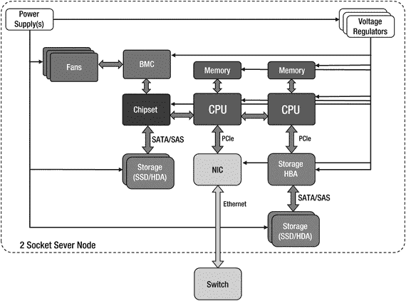
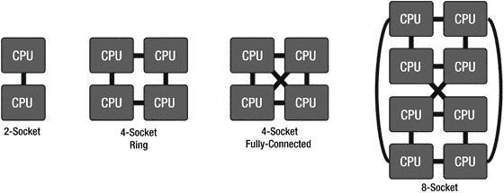
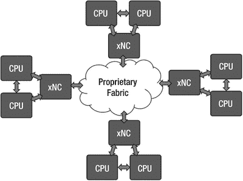

# 平台电源管理

数据中心中的每个 CPU 都需要大量支持硬件。这些包含在服务器机箱内的支持硬件通常被称为平台。多年来，越来越多的平台组件已被集成到 CPU 中，例如内存控制器和`PCIe`连接。然而，数据中心整体功耗的很大一部分仍然由 CPU 和内存之外的支持基础设施消耗。存储（驱动器）、网络、电源输送和冷却都会显著增加数据中心的总成本。其中一些组件（如风扇）拥有复杂的算法来管理其功耗，而其他组件（如驱动器）则倾向于采用最低限度的电源管理技术。

## 平台概述

从概念上讲，平台是 CPU 运行所需的一切（包括 CPU 本身）。它包括电源输送（将电网的电能转换为不同平台组件可用的形式）、冷却（风扇、散热器等），以及连接到 CPU 插槽的内存、驱动器和网络。

### 常见平台组件

单个平台通常被称为一个节点，一般包含 1 到 8 个通过一致性协议连接的 CPU。¹ 可用的平台设计种类繁多。然而，几乎任何平台设计都包含一些标准构建模块（见表 4-1）。本章将探讨这些不同平台组件的部分电源管理特性。

**表 4-1.** 常见平台组件

| 组件 | 描述 |
| --- | --- |
| CPU | 这些处理器提供用户工作负载的计算和执行。参见第 2 章。 |
| 内存 | 内存为 CPU 正在使用的数据提供临时存储。参见第 3 章。 |
| 存储 | 存储（驱动器）提供数据的大容量存储。`SAS`（串行连接 SCSI）和`SATA`（串行 ATA）是将驱动器连接到存储控制器的两种常见协议。 |
| 网络 | 网络提供多个节点之间的通信。`以太网`和`InfiniBand`（IB）是常见的网络接口。`NIC`（网络接口卡）提供 CPU 与`以太网`/`IB`网络之间的连接。 |
| 电源输送 | 系统中的不同组件需要不同的电压和电流类型（交流/直流）。`VR`（电压调节器）是直流到直流的转换器，它将输入电压降低到更低的工作电压。`PSU`（电源供应器）将交流电转换为直流电。 |
| 冷却 | 当服务器消耗电力时，它会转化为热量。风扇和其他冷却设备用于将热量从平台中排出，以维持安全的工作温度。 |

业界使用了多种平台设计。一些设计提供大量数据存储并连接大量驱动器。另一些可能完全无驱动器，并利用网络将数据引入节点。图 4-1 展示了一个带有两个 CPU 插槽的潜在平台节点示例。

**图 4-1.** 双插槽平台节点示例

### 整合

随着时间的推移，越来越多的平台组件已被整合到更少的独立芯片中。这可以在某些情况下节省成本、功耗，甚至提升性能。

#### CPU 集成

多年来，CPU 芯片的唯一作用是提供一个（或几个）核心以及相应的缓存层级结构。这些核心通过系统总线（在 Intel 系统中为前端总线 FSB）连接到芯片组，而芯片组则提供内存控制器和 PCI 连接，用于支持磁盘和网络控制器等设备。这些总线消耗功率、限制带宽并增加延迟。因此，越来越多的芯片组功能开始被集成到 CPU 自身中，这既能降低平台功耗，又能提升性能。表 4-2 概述了至强处理器历代产品中的一些关键集成里程碑。

**表 4-2.** Intel EP 系列 CPU 的集成历程

| 代际 | 集成特性 |
| --- | --- |
| Nehalem | 内存控制器 |
| Jasper Forest（Nehalem 衍生版） | PCIe 2.0（最多 16 条通道） |
| Sandy Bridge | PCIe 3.0（最多 40 条通道），可与核心共享 L3 缓存 |
| Haswell | 电压调节模块 |

尽管这种集成可以节省功耗（减少了驱动它们的平台总线和 I/O）并提升性能（片上总线相比片外互连具有更高带宽和更低延迟），但它并非没有代价。CPU 的面积必须增加以容纳这些额外的组件。CPU 封装可能需要容纳更多引脚（这会增加成本）。这种集成还将原本消耗在平台中的功耗转移到了距离传统 CPU 组件更近的物理位置。这要么要求为 CPU 提供更多的功率（和冷却），要么意味着可供核心使用的功率会减少。

CPU 通常采用能提供最佳能效的最新制造工艺技术构建。平台中的其他设备通常采用较旧的技术制造。当它们被集成到 CPU 中时，由于制造工艺的改进，这些功能的能效会立即得到提升。

#### 芯片组集成

在 Nehalem 和 Sandy Bridge 代际中，CPU 从芯片组那里吸收了内存控制器和部分 PCIe 连接功能。然而，芯片组也开始集成平台的其他组件。存储和网络控制器现在已成为服务器芯片组的标准配置。PCIe 仍然提供，但其性能通常低于 CPU 的链接，并且侧重于低带宽连接。本章后面将更详细地讨论芯片组。

#### 微型服务器与服务器 SoC

服务器片上系统（SoC）组件正变得越来越普遍。在这些设计中，芯片组和 CPU 被集成到单个芯片中，或作为多芯片封装（MCP）存在。其主要目标是降低部署单个 CPU 节点的成本。微型服务器的概念是，在数据中心大规模部署这些低成本设备，以在降低成本的条件下提供足够的性能。尽管微型服务器近年来得到了大量媒体报道，但将这些低成本、高能效、高度集成的设备部署到嵌入式市场，或许更具吸引力。

### 平台可管理性

运行大型数据中心需要具备监控和管理数据中心各种组件的能力。控制风扇、重启崩溃的节点、监控功耗以及许多其他任务，对于管理典型数据中心都至关重要。这些概念将在第 5 章和第 9 章中讨论。许多服务器平台传统上并非通过在 CPU 核心上运行软件来提供这些能力，而是部署专用的管理芯片。这些芯片通常被称为基板管理控制器（BMC）。

服务器 BMC 是 OEM 专有设备，其核心是一个小型微控制器。它们拥有遍布整个平台的“触角”，以便监控和控制各个子系统。平台环境控制接口（PECI）是用于 BMC 与 CPU 之间交互的标准。系统管理总线（SMBus）协议也常用于将平台设备（如电源等）的遥测信息提供给 BMC。智能平台管理接口（IPMI）是一种接口，用于软件与 BMC 交互，以提取 BMC 所知晓的大量信息（示例请参见第 7 章）。一个包含 N 个一致性 CPU 插座的平台通常搭配一个 BMC，但这并非严格必要。

BMC 本身并不消耗大量功率，但由于它们控制着与给定平台节点相关的风扇，因此会对系统的整体功耗产生显著影响。本章后面将讨论热管理。为了降低功耗和节省集成成本，业界曾研究过不带 BMC 的服务器，但迄今为止，这类设计尚未流行起来。

## CPU 插槽

现代 CPU 节点可以支持不同数量的 CPU 插槽。单处理器（`UP`）和双处理器（`DP`）服务器构成了当今销售的服务器处理器节点的主体。

多处理器（`MP`）节点通常由四个或八个处理器组成，但其他拓扑结构也是可能的。`MP` 平台的采购成本较高，常用于需要大型单节点性能或内存容量的场景。通过增加每个节点的 CPU 处理器数量，某些平台组件的成本可以得到分摊。例如，如果每个节点都需要一个启动 SSD 和一个网络连接，那么从 `UP` 平台转向 `DP` 平台，理论上可以将所需的 SSD 和网络连接数量减少一半。

> **注意**  
> 由于 `MP` 系统相关的采购成本和使用模式较高，能效和节能通常不是最终用户的首要优先事项。

`DP` 平台在成本与性能之间提供了一个极佳的平衡点。`MP` 平台通常要求每个 CPU 的整体价格更高，而 `UP` 平台在分摊其他平台成本（电力和采购）方面效果不佳。`DP` 平台对于许多工作负载也表现出强劲的性能扩展能力。

`UP` 服务器系统传统上被局限于那些根本不需要 `DP` 或 `MP` 系统性能的场景。它们并非部署在数据中心，而是用于其他低端服务器设备，例如小型企业 NAS（网络附加存储）。随着单节点性能的持续提升，`UP` 系统的成本分摊情况正在改善。如果一个 `DP` 系统需要两个网络连接才能提供足够的数据来饱和内核的能力，那么扩展到两个插槽并不会带来额外的节省。集成了网络等功能的服务器 SoC（例如微服务器）也有助于降低多插槽系统的电力和采购分摊优势。

直接将两到八个处理器彼此保持一致（coherent）连接的平台被称为*无粘合（glueless）*平台。多年来，已经开发出多种无粘合拓扑结构。图 4-2 展示了一些来自英特尔近期处理器系列的示例。请注意，在这些示例中，每个插槽与平台上其他插槽之间的“跳数”要么是一跳，要么是两跳。在一致（coherent）网络中连接更多处理器也是可能的，但这通常需要称为节点控制器的特殊硬件（或粘合胶）。如果所有处理器都通过点对点链路直接相互连接，则该平台被称为*全连接（fully connected）*平台。全连接平台通常具有更低的延迟、更高的带宽以及比非全连接平台更好的性能扩展。额外的连接性会带来很小的电力成本，但对于大多数使用模型来说，投资回报（性能）是非常值得的。

**图 4-2.** 示例无粘合一致（coherent）平台拓扑结构

### 节点控制器

尽管大多数平台将一致（coherent）CPU 的数量限制在最多八个，但使用节点控制器（`xNC`）构建更大的一致系统是可能的。节点控制器通常是独立的芯片，通过专有结构将一、两个或四个 CPU 连接到其他节点控制器（见图 4-3）。这些系统常用于构建超级计算机，可以将数百个处理器和数千个内核连接到一个运行单一操作系统的单一一致域中。请注意，也可以通过网络以非一致方式连接大量节点来构建大型超级计算机，而无需节点控制器。这些设计之间的差异超出了本书的讨论范围。

**图 4-3.** 节点控制器示例

## 内存提升卡与内存缓冲芯片

某些高端服务器需要非常大的内存容量。数据库是最常见的例子。每个 CPU 插槽能够直接连接的 DDR 内存数量通常是有限的。插槽上的 DDR 通道数量受到封装和芯片成本的限制。通道上的 DIMM 数量受到电气负载限制的约束。LR-DIMM 试图解决其中一些问题，但能力有限。为了扩展内存以突破 CPU 插槽带来的限制，一些高端服务器采用了内存提升卡和内存缓冲芯片。CPU 并非直接连接到内存，而是与平台中的独立芯片通信，该芯片随后能够与实际 DDR 内存通信。在这些平台中，内存连接在独立的提升卡上，其中一组 DIMM 连接到一张卡上，然后该卡再连接到主板。多年来，这些技术存在多种变体。英特尔在历史上曾将其内存缓冲技术作为其 EX 平台的一部分进行产品化（称为可扩展内存缓冲器 [SMB]），其他 OEM 厂商也部署了自己的专有技术来提供类似功能。这些缓冲芯片确实会消耗可测量的电力（通常是几瓦），但在此类平台中，与其他功耗（包括它们提供连接的内存）相比，往往相形见绌。

