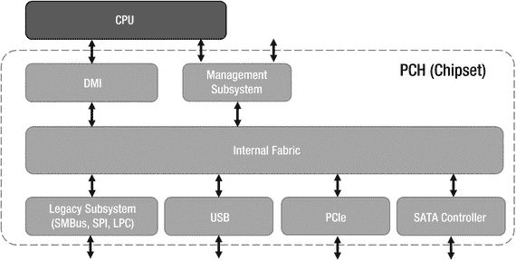

# 服务器芯片组

许多服务器平台采用与 CPU 相连的独立芯片组。这些设备提供启动平台所需的关键传统功能、可管理性能力，并集成了许多原本需要独立控制器（如存储、网络和 USB 控制器）的功能。部分 `SoC` 通过 `MCP` 将芯片组功能集成到封装中，而其他方案（如 Avoton）则将整个芯片组集成到与 `CPU` 相同的芯片上。英特尔至强服务器设计中使用的独立芯片组被称为 `PCH`（平台控制器中心）。`PCH` 通过专有的 `DMI`（直接媒体接口）链路连接至 `CPU`，为平台提供启动、可管理性及 I/O 服务。

自 Nehalem/Tylersburg 时代起，`PCH` 便成为双芯片至强英特尔架构的南桥，是 `CPU` 的配套组件。这一架构取代了此前采用三芯片方案的英特尔集线器架构。历代 `PCH` 不断推进 IA 平台的 I/O 能力，Wellsburg 已支持 Gen2 `PCIe`、Gen3 `SATA` 及 Gen3 `USB`。基于微控制器的电源管理控制器（`PMC`）和管理引擎（`ME`）被添加到 `PCH` 中，以支持传统电源管理功能及多项扩展特性。

芯片组在平台中承担多种职能。表 4-3 对部分关键能力进行了高层面总结。图 4-4 展示了此类系统的示例框图。表 4-4 列举了现代 `PCH` 的部分集成功能。

**表 4-4. PCH 主要组件**

| 组件 | 描述 |
| --- | --- |
| 片内互连 | `PCH` 上存在通常被称为片内或片上互连的互联结构。这些互连在概念上与 `CPU` 中的类似，但不应与数据中心层面连接多个 `CPU` 的互连结构相混淆。 |
| `DMI` | `DMI` 提供一种将 `PCH` 及其下游组件连接至 `CPU` 的机制。其运作方式与 `PCIe` 非常相似。 |
| `PCIe` | `PCIe` 连接可同时集成到 `CPU` 和 `PCH` 中，并共享相同的基本电源管理能力。`PCH` 适用于高扇出、低带宽的连接场景。 |
| `SATA` | 部分 `PCH` 集成了存储连接功能，详见本章"存储"部分。 |
| `USB` | `USB` 主要面向消费类使用模式，但也存在于服务器中（尤其适用于调试场景）。本章后续将进行讨论。 |
| 以太网 | `PCH` 也集成了以太网功能。网络电源管理详见本章"网络"部分。 |
| `SPI`/`LPC`（传统 I/O） | 串行外设接口（`SPI`）和低引脚数接口（`LPC`）为平台启动设备提供连接点，这些设备包含 BIOS/UEFI 镜像及其他 `PCH` 组件（如 `ME`、以太网）的固件。 |
| `ME` | `PCH` 上的管理引擎（`ME`）提供平台管理服务、密钥管理及加密服务。 |
| `SMBus` | `SMBus` 提供一种传统机制，用于与平台外设通信，处理系统与电源管理相关任务。 |

图 4-4. 典型的服务器 `PCH` 架构框图

**表 4-3. PCH 高层能力**

| 能力 | 描述 |
| --- | --- |
| 高性能 I/O 连接 | 包括 `PCIe`、存储（`SATA` 和/或 `SAS`）、网络等。这些能力仅在 `CPU` 激活且系统处于 `S0` 状态时可用。 |
| 唤醒/启动 | `PCH` 既能检测唤醒事件（如局域网唤醒），也能控制平台在电源状态之间转换。`PCH` 还提供对 BIOS 闪存的访问。 |
| 可管理性 | 提供数据中心监控和管理节点的接口，例如读取温度。 |
| 实时时钟（`RTC`） | 维护跟踪时钟时间的系统时钟。即使拔掉台式机电源，时间和日期也不会丢失，因为它们由 `RTC` 维护。服务器 `PCH` 也具备相同能力。 |
| 传统 I/O 连接 | 提供对系统运行通常所需的低性能平台连接的访问。 |

传统上，`PCH` 一直是访问各种高速 I/O（`SATA`、以太网、`PCIe`、`USB`）的组件，尽管这些能力正越来越多地被集成到 `CPU` 中以形成 `SoC` 组件。`SATA`/`PCIe`/以太网/`USB` 接口提供对外通信的访问，包括磁盘/固态存储、网络、USB 端口及可管理性。在平台内两个设备之间以更高性能传输数据会消耗可观的功耗，而集成是显著改善整体平台功耗的有效途径。

在内部，`PCH` 架构由模拟与数字组件混合构成。与 `CPU` 非核心区类似，模拟设计用于片外通信（如 `PCIe`/`SATA`/`USB` 物理接口）和片内存储器（`SRAM`），而剩余系统的大部分则由同步数字逻辑构建。与传统服务器 `CPU` 不同，芯片组功耗的很大一部分消耗在模拟 I/O 电路（通常称为物理层或 `PHY`）上，而非数字逻辑。

## PCH 与平台电源管理

`PCH` 负责协调第 2 章中介绍的许多平台电源状态。除此之外，它还负责管理自身的电源状态。表 4-5 概述了 `PCH` 参与的电源管理状态。

**表 4-5. 服务器 `PCH` 支持的电源状态**

| 状态 | 描述 |
| --- | --- |
| `C-states` | `PCH` I/O 的低功耗状态。有关 `CPU` `C-states` 的详细信息，请参见第 2 章。`PCH` 不支持所有传统的 `CPU` `C-states`，但在 `CPU` 不活动时，它会将其 I/O 置于低功耗状态。•`C0` 是活动状态，此时 `PCH` 逻辑和 I/O 功能正常。•`Cx` 是时钟/电源门控状态，在此期间 `PCH` I/O 会转换到功耗更低的受管状态。 |
| `S-states` | 关闭 `CPU` 封装（休眠状态）。有关 `S-states` 的详细信息，请参见第 2 章。`PCH` I/O 被关闭（`S0` 除外），但 `PCH` 核心逻辑在所有 `S-states` 中保持活动。`PCH` 可以根据平台信号将 `CPU` 从 `S3`/`S4`/`S5` 状态唤醒。从 `S3` 状态唤醒需要数秒，而从 `S5` 状态唤醒需要进行完整系统启动，可能需要数分钟。 |
| `M-states` | 关闭管理引擎。这些状态与管理引擎相关。•`M0`：活动状态，当平台处于 `S0` 状态时。•`M3`：活动状态，当平台处于 `S3`/`S4`/`S5` 状态时，用于带外平台管理和诊断。•`MOff`：管理引擎在 `Sx` 状态中关闭。 |
| `G-states` | 全局状态。有关详细信息，请参见第 2 章。`PCH` 在 `G0` 到 `G2` 状态下处于活动状态，仅在 `G3` 状态（机械关闭）下关闭。 |

由于 `PCH` 控制平台电源轨和时钟，即使在 `CPU` 断电的状态下（`G-` 和 `S-states`），它也需要保持供电。这一目标是通过使用平台电源轨实现的，这些电源轨会根据系统状态依次断电。`PCH` 提供一系列高级功能，这些功能会在较低电源状态下被依次禁用。表 4-4 概述了这些功能，而表 4-6 则展示了这些功能在每个电源状态下如何被禁用。

**表 4-6. `PCH` 电源状态及功能示例**

| `G-State` | `M-State` | `S-States` | 电源轨 | 可管理性 | 唤醒能力 |
| --- | --- | --- | --- | --- | --- |
| `G0` | `M0` | `S0` | 全部可用 | 可用 | 无（已唤醒） |
| `G0` | `M3` | `S3`/`S4`/`S5` | 唤醒 + 可管理性 + `RTC` | 可用 | 是 |
| `G2` | `MOff` | `S4`/`S5` | 唤醒 + `RTC` | 禁用 | 是 |
| `G3` | `MOff` | `S4`/`S5` | `RTC` | 禁用 | 无 |

当平台重新供电时，系统会自动从 `G3` 状态转换到 `G2` 状态。从那里开始，可以使用各种唤醒事件，根据需要将状态转换到更高功率的运行模式。因此，`G3` 状态对用户是隐藏的。

## PCH 电源管理

`PCH` 消耗节点总功率的一小部分。由于 `PCH` 的大部分功耗存在于 I/O `PHY` 中，因此负载下的典型功耗在很大程度上取决于所连接设备的数量。当所有高速 I/O 端口都连接时（完全满载），`Patsburg`（与 `Sandy Bridge` 和 `Ivy Bridge E5` 处理器配合使用的芯片组）的 `TDP` 功率为 8 W 到 12 W。当完全满载时，`Wellsburg`（与 `Haswell E5` 配对）的 `TDP` 功耗为 7 W。如果某些 I/O 未被使用，则可以节省显著的功率。表 4-7 概述了 `PCH` 的四种不同使用配置以及这些配置对应的 `TDP` 功率。

**表 4-7. 不同 I/O 端口配置下的 `PCH` `TDP` 功耗 (W)**

| | 工作站 | 服务器 | 低功耗 | 仅引导 |
| --- | --- | --- | --- | --- |
| `USB2` 端口 | 14 | 6 | 2（检测） | 0 |
| `USB3` 端口 | 4 | 4 | 1（检测） | 0 |
| `SATA3` 端口 | 8 | 5 | 2 | 0 |
| `SATA2` 端口 | 2 | 1 | 1 | 0 |
| `PCIe` 通道 | 8 | 4 | 2 | 0 |
| `TDP` (W) | 6.5 | 5 | 3.2 | 1 |

## 芯片组中的 PCIe

与 `Haswell Server CPU` 一同推出的 `Wellsburg PCH`，采用低漏电工艺制造，并未采用电压-频率缩放或电源门控等技术来降低运行时的功耗。不支持 Turbo 模式。为了节省功耗，会对已禁用或当前未使用的逻辑功能模块实施时钟门控。由于 `PCH` 以 I/O 为主，其功耗的相当一部分来自于为平台提供物理接口的电路。这些接口的电压通常是静态的（由行业标准规范定义）。为了根据运行状态机会性地降低功耗，为链路定义了若干电源管理状态，如下节所述。

如果某个逻辑功能模块整体未被使用，则驱动该模块的 `PLL`（锁相环）可以断电。例如，如果用户构建的计算节点没有任何本地驱动器，那么 `PCH` 中的存储子系统可以完全断电。

在 `Sandy Bridge` 和 `Jasper Forest` 之前，芯片组负责提供平台上的 `PCIe` 连接。当 `Sandy Bridge` 将 `PCIe` 集成到 CPU 中时，芯片组继续提供这项能力。如今，在配备独立 `PCH` 设备的平台中，`PCIe` 连接同时存在于 CPU 芯片和 `PCH` 上。`PCH` 中的 `PCIe` 提供了第 3 章中描述的相同节电功能（`L1`、`DLW`）。

CPU 上的 `PCIe` 提供高性能和（相对）低延迟的连接，但代价是扇出方面的限制（小于 `x4` 的设备会消耗四个通道）。而 `PCH` 提供较低的带宽和较长的延迟，但可以分叉至 `x1`，使其成为低带宽设备的绝佳选择。

## PCH 热管理

`PCH` 包含热传感器，用于监控温度，并帮助确保 `PCH` 不会达到可能导致可靠性降低或损坏的危险温度。`PCH` 可能会自行降频以保持在目标温度以下，甚至可能在温度超过灾难性阈值时立即启动关机。与 CPU 类似，`PCH` 的规格包含一个用于设计散热方案的 `TDP` 额定值，以及一个用于确定电压调节器尺寸以向电源轨供电的 `ICCMAX` 额定值。它们还包含类似的热保护机制，例如在检测到灾难性温度时关闭平台。平台热管理将在本章后面详细讨论。