# 电源供电

服务器平台包含大量组件，每个组件都需要电力来执行其必要功能。系统中的不同组件对接收的电源类型有着不同要求。有些需要高电压，有些则需要低电压。有些对在特定电压下工作非常敏感，而另一些则能容忍一定范围的电压。

由于输入服务器系统的电源类型与家用墙壁插座提供的电源类似，因此系统包含许多电源转换器，用于将这种交流（`AC`）电压转换为所有组件所需的多种特定直流（`DC`）电压。将交流电压转换为所需的直流电压会消耗功率，这被称为转换器损耗。衡量电源转换器损耗的典型指标是效率。效率表示为输出功率与输入功率之比。由于输入功率等于输出功率加上转换器的功率损耗，因此效率可用以下公式表示：

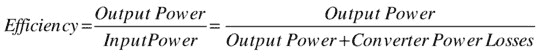

这些电源转换器将较高电压转换为负载所需的较低电压的效率，对系统的整体效率至关重要。即使在采用最佳转换器效率的系统中，这些损耗也可能占到系统功耗的 10%–20%。在系统低利用率情况下，它们所占的功耗比例甚至更高。本节概述了这些电源转换器的损耗、系统中使用的不同类型转换器的基础知识、导致损耗的各种电源转换环节，以及有助于减少这些电源转换器损耗的特殊功能。

## 电源供电概览

图 4-5 展示了一个标准双处理器系统的示例电源转换器框图。这种框图常见于主板电路图中。

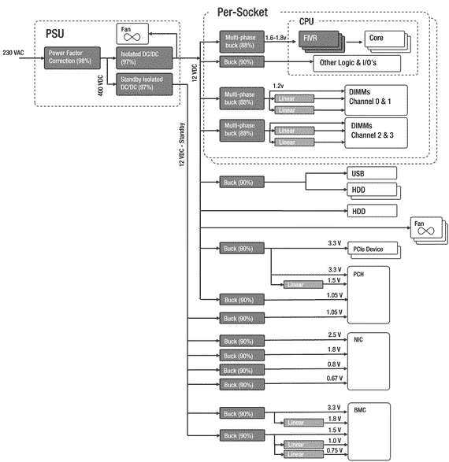

图 4-5. 双路电源转换框图

电源首先由电源单元处理，从交流转换为直流（见表 4-21）。然后，电源单元输出的直流电被转换为不同平台组件所需的各种直流电压等级（见表 4-22）。必须为系统中的每个组件确定电源预算，以便在电源传输网络的每个阶段进行规格设计（见表 4-23）。

表 4-23. 电源框图——负载

| 组件 | 描述 |
| --- | --- |
| 核心、非核心、内存条 | 系统中的这些负载是主要的功耗来源，并提供系统的核心计算能力。 |
| 局域网、平台控制器集线器、通用串行总线、高速外围组件互连 | 这些是系统中的较低功耗负载，为系统计算能力提供输入/输出功能。 |
| 硬盘驱动器 | 这些是中等功耗负载，提供存储能力。 |
| 主动冷却 | 这些是中等功耗负载，主要是系统中的轴流风扇。其他类型的特殊冷却方式，例如液体冷却，也是可行的。 |

表 4-22. 直流/直流电源转换器类型

| 组件 | 类型 | 典型效率 | 描述 |
| --- | --- | --- | --- |
| 多相降压转换器 | 主板上的直流/直流开关电源转换器 | 80–90% | 用于在低电压下提供大电流的电源转换器。常将 `12 V` 转换为 `1–2 V`。 |
| 降压稳压器 | 主板上的简易直流/直流开关电源转换器 | ∼90% | 用于为主板上较低功耗设备供电的简易转换器。典型输入为 `12 V/5 V/3.3 V`，转换为 `5 V` 至 `<1 V` 的输出。 |
| 线性稳压器 | 用于为主板上极低功耗设备供电的电源转换器 | 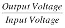 | 非常简易且低成本的转换器，但效率低，因此仅用于极低功耗负载。其效率由输出电压与输入电压之比决定。 |

表 4-21. 电源单元中的组件

| 组件 | 类型 | 典型效率 | 描述 |
| --- | --- | --- | --- |
| 功率因数校正电路 | 系统交流/直流电源单元中的电源转换器 | ∼98% | 这是系统电源单元内部的一个电源转换级，其主要功能是提供功率因数校正。它是第一级转换器，为电源单元中的第二级提供 `400 V` 直流输出电压。 |
| 隔离直流/直流级 | 系统交流/直流电源单元中的电源转换器 | ∼97% | 这是系统电源单元内部的一个电源转换级，其主要功能是为交流输入提供安全隔离，并提供系统可使用的稳定直流输出电压。 |

该框图包含开关电源转换器、线性稳压器和负载。系统中几乎所有的功耗都需经过三到四级电源转换，才能从 `230` 伏交流输入到达负载点。电源经过这些串联级有多个原因：

-   第一步是从交流转换为直流，以提供功率因数校正。大多数数字电路需要直流电才能运行。
-   在较长距离上传输更高电压效率更高。这就是为何应尽可能长时间地保持较高电压。
-   低功耗负载由线性稳压器供电。虽然这些稳压器的效率低于更复杂的电压稳压器，但由于其设计简单且组件数量少，成本也较低。在整个功耗中，效率损失很小。
-   平台中容易接触到的部分不得使技术人员暴露于危险电源（例如交流输入）之下。

> **注意：** 使用更高电压传输功率效率更高。用于传输功率的导线存在电阻。由于此电阻会消耗功率，且与电流的平方成正比。
>
> ```
> 瓦特 = I²R
> ```
>
> 通过在固定功率下提高电压，电流会减小，从而降低了这些平方相关的损耗。
>
> ```
> 功率 = I * R
> ```

在一个系统及其主板上，通常会看到总共 `25` 到 `30` 个电源转换器。使用这么多转换器有几个原因：

-   可以通过增加更多稳压器来减少 `I²R` 损耗，从而提高电源效率。
-   某些传统功能和能力需要特定的电压等级。
-   系统标准组件（`USB`、硬盘驱动器、高速外围组件互连适配器）需要无法更改的行业标准电压。
-   为了达到高性能和高能效设计，处理器及其他硅器件需要定制电压。

### 电源转换器基础

如前所述，系统中包含了不同类型的电源转换器。每种转换器都有其权衡取舍，这会对平台的总体电源效率产生重大影响。

首先，电能可以以 `AC`（交流电）或 `DC`（直流电）的形式传输。数字电路需要 `DC` 电源才能运行。`AC` 电源通常用于从发电厂通过电网传输电能，因为使用变压器改变 `AC` 电压相对容易且成本低廉。`AC` 电源也用于数据中心内部配电力，但必须在某个节点转换为 `DC` 电源才能驱动数字电路。`AC/DC` 电源转换就提供了这种机制。平台中的不同组件需要不同的电压。`DC/DC` 电源转换器改变 `DC` 电源的电压，以满足每个组件的需求。标准服务器系统中使用的主要电源转换器类型包括升压转换器、隔离式降压转换器、单相和多相降压转换器以及线性稳压器。

#### 系统 AC/DC 电源

节点电源传输网络中的第一个组件——升压转换器和隔离式降压转换器，被集成在电源中。这些转换器的基本示意图如图 4-6 所示。了解这些转换器的基本功能对于理解效率与特性之间的权衡取舍至关重要。

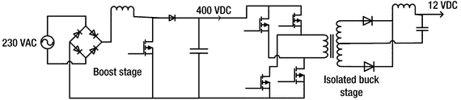

图 4-6. 示例 `AC/DC` 电源原理图

注意：并非必须使用 `AC` 电压作为平台节点和电源的输入。其他输入电压，例如 `380 VDC` 和 `240 VDC`，正被用于提高设施配电效率和可用性。在这些情况下，无需 `AC` 转 `DC` 阶段，可以将其从电源中移除以提高效率。

系统 `AC/DC` 电源中的两个转换器都是开关转换器，这意味着使用 `MOSFET` 将输入电压斩波成方波，然后再进行滤波以获得 `DC` 电压。有一个 `PWM`（脉冲宽度调制）控制器控制占空比，以维持所需的输出电压。

##### PSU 和升压级

电源中的升压转换器为电源的隔离式降压级提供稳定的电压。升压的主要目的是对输入电流进行波形整形，以提供功率因数（`PF`）校正并降低电流谐波畸变率（`ITHD`），从而提高电源效率。良好的电源能达到 `PF > 0.99` 且 `ITHD < 5%`。由于升压转换器要求其输出电压始终大于输入电压，因此通常可以看到升压输出电压约为 `400 VDC`（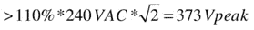）。

注意：除了 `240 VAC` 之外的其他输入也是可能的。`277 VAC`（`480 VAC` 系统的一相）正变得越来越常见，因为它可用于更高效的设施供电设计。

##### PSU 和隔离式降压级

`PSU` 的隔离式降压级提供几个基本功能：

-   稳定的输出电压（在大多数服务器系统中为 `12 V`），供下游的 `DC` 转 `DC` 转换器以及风扇使用
-   根据安全机构要求，在 `AC` 输入和 `DC` 输出之间提供电流隔离（防止电流流动）
-   持续供电能力，即在 `AC` 输入短暂（½ 到 1 个周期）丢失期间，利用其输入的大容量电容器为系统供电

`AC` 持续供电能力非常重要，需要牢记，因为这要求隔离式降压级在其大容量电容器放电期间，能够在更宽的输入范围内保持输出稳定。这往往使得该级的设计在效率方面并非最优；然而，这对于 `IT` 设备的可靠性是必需的。

##### 冗余电源

历史上，许多服务器部署了冗余电源和冗余`AC`馈电（向系统供电），以提高可靠性。两者都是通过系统中使用多个电源来实现的。一种常见的设计是使用两个电源。一个`PSU`有足够的电力为系统供电（有时性能较低），另一个相同功率的电源并联使用，以在其中任何一个发生故障时提供冗余。这被称为`1+1`设计。冗余电源通常分担系统的负载。由于每个电源都有自己的`AC`输入，这也为系统提供了`1+1`冗余`AC`馈电。当系统中使用更多电源时，有时会采用`2+2`或`3+1`冗余配置。这可以扩展到`N+N`或`N+1`个电源的数量；其中需要`N`个电源来为系统供电。

近年来，某些类型的服务器部署专注于提高软件的弹性。大型云部署尤其如此。在这种情况下，系统故障是可预期的（以某种低概率发生），并且系统上运行的软件足够健壮，能够处理偶然的故障。从概念上讲，过去需要额外硬件（和采购成本）解决的问题，现在正通过软件来处理。在这种设计中，冗余电源并非必需。

## 共享电源

在某些设计中，单个电源（甚至是冗余电源）可以被多个节点共享。微服务器就是一个很好的例子。在这种设计中，`CPU`的输出功率被路由到与机架中不同节点相关联的多组电压调节器上。在这种情况下，平台的定义有些模糊，因为`PSU`现在是一个共享资源。这种方法的一个缺点是爆炸半径，即当一个组件发生故障时，受影响的节点/组件的数量。

## PMBus

电源已成为`IT`设备中关键的功率测量设备，设施部门用它来查看`IT`负载消耗了多少功率。通过在电源中使用特殊的计量`IC`并在生产线上使用校准技术，这些嵌入式传感器的精度在系统的典型负载范围内已提高到`+/- 2%`。电源中的功率传感器被英特尔节点管理器（参见第 5 章）结合处理器`RAPL`特性（参见第 2 章）使用，以控制系统功耗。这允许用户确保系统不超过预定义的限制，从而保护设施基础设施。

# 直流转直流电源转换器

一旦电源从高电压`VAC`转换为约`12 VDC`，还需要进行许多额外的`DC`转`DC`转换步骤，以便为平台中的每个组件提供它们所需的电压（和电流）。有多种不同类型的`DC`转`DC`转换器可在不同情况下使用。

### 单相降压变换器

对于中等功率负载，使用单相降压变换器将系统中的 12V 电压转换为较低电压。其输出范围可从低于 1A 到 30A。

图 4-7 给出了单相降压变换器的示例原理图。`PWM`控制器通过切换高端`MOSFET`对 12V 输入进行斩波，从而将 12VDC 输入转换为输出电压。随后，输出端的`LC`滤波器重建出直流电压。使用低端`MOSFET`是为了让电感电流能持续流过输出滤波器。业界已针对这类将 12V 输入转换为低输出电压的变换器，优化了专用组件。高端`MOSFET`经过特殊设计，能以极低的占空比处理高开关电压；而低端`MOSFET`则针对它们在该类变换器特殊要求下所需的高占空比和高`RMS`电流进行了优化。

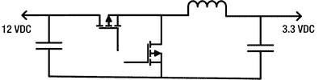

图 4-7. 单相降压变换器

### 主板多相降压变换器

在标准服务器系统中，超过一半的系统电力用于为处理器和内存供电。对于主流主板而言，这部分电力由多相降压变换器提供，以实现高性能和小型化。这些电源变换器的设计要求其必须能对处理器和`DIMM`所需的负载变化做出极快响应，在硅工艺缩小几何尺寸时保持低压轨的严格电压调节，并且占用面积小以适应高密度主板。所有这些要求都对主板`VR`设计的效率提出了挑战。采用多相降压变换器已成为实现最佳设计的方法，以满足所有这些日益增长的要求，同时仍能保持良好的效率。

图 4-8 展示了一个多相降压变换器功率级的简化原理图。此示例显示的是一个四相降压变换器。现有的`PWM`控制器能够灵活地提供两相到六相的配置，部分控制器还能提供多路输出电压。这些多相变换器共享输入和输出电容。`PWM`控制器对相位的切换方式与单相降压类似；然而，控制器每次只切换一个相位。因此，对于一个四相降压变换器，每个相位彼此之间以 90 度相位差进行切换。这使得控制器能够满足处理器和`DIMM`的高负载瞬变和高电流需求。这些用于多相降压变换器的`PWM`控制器还增加了新特性：在轻负载时关闭相位以节省功耗（且不影响软件性能），并通过串行通信来通信/管理这些高功率变换器。

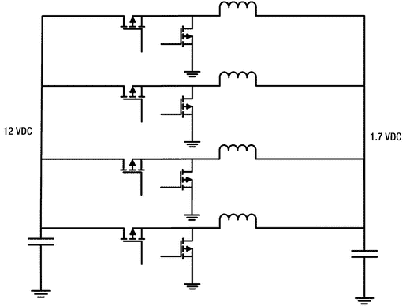

图 4-8. 多相降压变换器

### SVID

用于为主`CPU`电压轨和`DDR`内存供电的`VR`通常支持`SVID`（串行电压识别）。`SVID`是处理器封装与电压调节控制器之间的串行通信总线，主要用于两个目的：帮助提升处理器效率和管理系统功耗：

- `电压设定点`：处理器使用`SVID`为主板`VR`设置最佳电压以供电。这可用于为特定类型的处理器在某些电压轨上设置静态电压。也可用于随着`P-state`变化（参见第 2 章）动态设置处理器核心的电压。

- `功率报告`：在某些系统中，处理器使用`SVID`从`VR`读取功率数据。这样处理器可以监控自身及内存消耗的功率，从而实现`RAPL`（参见第 2 章）。

每个`CPU`插槽可以使用一个或多个`SVID`总线。这些总线将`CPU`与所有为该`CPU`（或连接到该`CPU`的内存）供电的`SVID`控制器调节器连接起来。`SVID`总线是一个简单的三线接口，包括时钟线（不同平台频率可能不同）、警报线（中断）和数据线。根据总线对支持前述两种主要使用模式所需的带宽需求，可能需要多个`SVID`总线。

### 主板线性稳压器

线性稳压器通过在一个工作于线性区的串联`FET`（场效应晶体管）上产生压降，将较高电压转换为较低电压。输出由`FET`的栅极电压控制。线性稳压器因其效率较低而使用较少。其效率由输出电压与输入电压之比加上一个很小的静态功耗决定。对于在整个系统背景下损耗影响不大的极低功率电源，或者当需要非常小的电压降时，线性稳压器可能是一个不错的设计选择。

### 集成稳压器

英特尔`Haswell`处理器通过一项名为集成稳压器（`IVR`）的新功能，将最后一级稳压器集成到了处理器封装中。这一增加的功率转换级带来了诸多优势，足以抵消增加另一级串联功率转换级的弊端。

- `最大电流降低`。设计具有高最大电流的主板稳压器成本可能过高。通过向裸片提供更高的输入电压（并利用`IVR`降压以供电路使用），流向裸片的最大电流得以降低。

- `更高的处理器输入电压，从而降低平台中的功率传输损耗`。`IVR`允许向处理器封装提供更高的电压，同时仍能维持芯片所需的较低电压，因为`IVR`功率转换器控制着芯片的功率。在`Haswell`中，封装的输入电压维持在约 1.8V，约为封装内电路所需电压的两倍。通过以两倍电压运行，提供给定功率水平所需的电流减半。电流降低导致`VR`与封装之间（在平台中）的电压损耗减少，从而提升了整体平台的功率效率。

- `更严格的电压调节，从而降低电压保护带并实现更低功耗运行`。`IVR`对芯片的电压调节更为严格，因为它在物理上更靠近芯片。这意味着芯片上的电压可以保持更低，因为需要为寄生电感压降留出的余量更少——电压越低，硅片的功耗越低（漏电更低，有效功耗也更低）。

- `IVR 提供了对裸片内微小子组件（如单个核心）进行成本效益型电压控制的能力`。这使得每核心`P-state`等特性得以实现（参见第 2 章）。它还能针对这些子组件分别优化电压水平。

`IVR`的一个缺点是，原先存在于主板`VR`中的功率损耗被转移到了`CPU`裸片上的`IVR`中。尽管这可能会使整个平台在功耗上获得净收益，但它增加了`CPU`裸片上的功耗，这可能会带来热密度和散热方面的挑战。当你比较`Haswell` E5（带`IVR`）和`Ivy Bridge` E5（不带`IVR`）的类似`SKU`时，会注意到`Haswell`的`TDP`功率有所增加。这些变化主要是由集成`IVR`导致的`CPU`功耗增加所驱动的。

### 电源管理集成电路

术语“电源管理集成电路”（`PMIC`）指的是将多个电源转换控制器集成在单个小型封装中的集成电路；它们也可能包含用于支持开关降压转换器的集成开关。将多个转换器集成到一个封装中有助于减小尺寸，传统上这被用于手机和平板电脑等移动设备的小型化设计中。如今，`PMIC`正被应用于服务器计算机，以在保持体积小巧的同时，支持主板上众多的低压电源轨。这些`PMIC`可用于为标准服务器主板上的`LAN`、`PCH`和`BMC`设备供电，或为采用`SoC`封装的微型服务器中的内存和处理器电源轨供电。使用`PMIC`的目的并非为了减少系统损耗，而是为了减小电源转换器的尺寸。

### 电源转换损耗

在回顾了各类电源转换器及其应用之后，本节将从整体角度审视电源转换器，以了解损耗的成因。同时，我们还将探讨系统级的设计权衡。

# 电源损耗概述

由于导线存在电阻，能量在导线中传输时总会有所损耗。电流通过电阻时会产生损耗；这些是导通损耗，与电阻值以及电流的平方成正比（功率 = 电流² × 电阻）。如果我们只考虑这些电阻损耗，可能会认为在极轻负载（例如系统处于空闲状态时）下，损耗会降至非常低的水平；然而，实际情况并非如此。我们还需要考虑开关电源转换器中发生的另外两种损耗，它们通常被称为比例损耗和固定损耗。

比例损耗是电源转换器中随转换器输出功率（或输出电流，因为电源转换器是稳压器）线性增加的损耗。例如，二极管产生的损耗等于其正向压降乘以通过它的电流。电源转换器的比例损耗并非特别值得关注的因素，因为在任何负载下它都不是主导损耗。

固定损耗在轻负载下则非常重要。电源转换器中的固定损耗由以下元件引起：`MOSFET`寄生电容的开关、流过功率元件的电流切换，以及电源中变压器磁芯的磁滞损耗。只要电源转换器在工作，这些固定损耗就始终存在。表 4-24 概述了平台上各类电源传输损耗的类型。

**表 4-24.** 电源转换损耗类型
| 类型 | 描述 |
| --- | --- |
| 导通损耗 | 由电流通过电阻元件引起的功率损耗。 |
| 比例损耗 | 主要由二极管正向压降引起的功率损耗。在三种损耗类型中，这一类影响最小。 |
| 固定损耗 | 不随转换器输出负载变化而改变的功率损耗。 |

## 主板电压调节器

不同类型的主板`VR`展现出不同的电源效率特性。不同类型电压调节器的行为和效率会随着其负载（电流需求）的变化而改变。本节将通过分析不同`VR`的功率损耗（以瓦特为单位）及其效率，来对其进行评估。

**注意：** 电压调节器在低利用率下的效率通常看起来较差。但重要的是要认识到，与高利用率下的损耗相比，这些情况下的实际功率损耗绝对值相对较小。

### 单相降压转换器

图 4-9 和图 4-10 展示了一个单相降压转换器的损耗曲线和效率曲线，该转换器支持最大 30A 的输出负载，可将 12V 输入转换为 1.7V 输出。描述损耗与输出电流关系的二阶多项式趋势线非常贴合这条损耗曲线。这三个系数分别代表了单相降压转换器的平方项损耗（`0.052x²`）、比例损耗（`0.045x`）和固定损耗（`+ 1`），其中`x`是该`VR`的输出电流。该图还分别展示了这三项损耗要素，以观察它们在整个输出负载范围内的贡献情况。在小于 10A 的较轻负载下，固定损耗占主导地位；而在大于 20A 的重负载下，平方项损耗居主导地位。固定损耗的影响导致当负载降至 10A 以下时效率迅速下降；而由于平方项损耗的影响，在重负载下效率则逐渐降低。

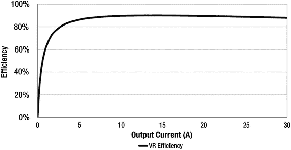

**图 4-10.** 单相降压转换器效率示例

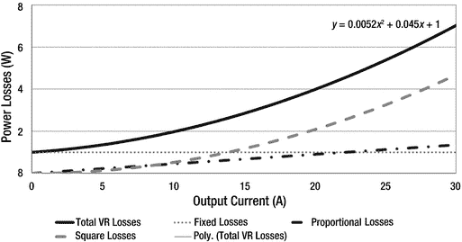

**图 4-9.** 单相降压转换器损耗示例

**注意：** `VR`必须按照其供电负载可能出现的最恶劣电流需求进行设计，以避免系统故障。然而，即使在重负载下，典型的稳态电流需求通常也处于低得多的利用率水平。因此，在高利用率下观察到的效率衰减，对于整体供电效率而言，通常不如低利用率下的效率损失那么重要。

### 多相电压调节器损耗

多相`VR`通常用于主板上的较重负载，例如内存`DIMM`和处理器核心。如果我们考虑同样的 12V 转 1.7V 降压转换器，但将其扩展为三相以支持高达 90A 的电流，我们会看到与单相转换器不同的损耗曲线。图 4-11 显示，三相转换器的损耗高于单相转换器。这是由于额外相位带来的附加固定损耗以及额外相位增加的开关损耗。

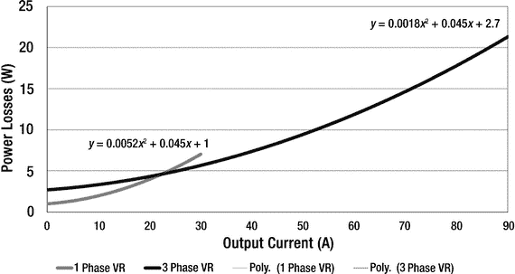

**图 4-11.** 多相电压调节器功率损耗示例

在大于 20A 的负载下，三相转换器开始具有更低的损耗。多相`VR`的平方项组件（来自导通损耗）较小（`0.0018` vs. `0.0052`）。这是因为电流只需通过约三分之一的电阻。

比较效率曲线可以看出，单相转换器在较轻负载下表现更好，而三相转换器在较重负载下表现更好。请注意，此示例是在未启用相位脱落（稍后讨论）的情况下给出的，而相位脱落可以提高多相`VR`在低利用率下的效率。

### 相位脱落

`图 [4-12]`表明，与能够提供更高最大电流的多相`VR`相比，单相`VR`在低电流需求下能提供更好的效率。相位脱落是一些多相`VR`的一项功能，旨在两全其美：既具备单相降压转换器在轻负载下的出色效率，又能在重负载下发挥多相降压转换器的功率/效率优势。在现有系统中，相位脱落主要由处理器控制；当处理器确定其功率需求低于单相能力时，便会脱落相数。在新型`PWM`控制器中，控制器在感知到负载下降时会自动关闭相数，并在负载增加时开启相数。这被称为自动相位脱落。自动相位脱落可能比`CPU`管理的相位脱落效率高得多，因为`CPU`并不总是了解瞬时的电流需求，必须假设某些最坏情况来请求相数。

![A978-1-4302-6638-9_4_Fig12_HTML.gif]

**图 4-12.** 多相`VR`效率示例

### 二极管仿真与突发模式

用于在极轻负载下帮助减少`VR`损耗的另外两种方法是二极管仿真模式和突发模式。二极管仿真模式会关闭低侧`FET`开关，转而使用`FET`中的体二极管，从而节省低侧`FET`的开关损耗。这仅在极小的电流需求下使用。突发模式通过跳过开关周期来有效降低转换器的开关频率，从而减少损耗，这同样有助于在极轻负载下进一步降低开关损耗。

> **注意：** 在典型的服务器中，即使系统完全空闲，电流需求也不会下降到足以利用二极管仿真的程度。因此，此功能不太常用。在服务器`VR`设计中，相位脱落提供了低利用率下的大部分效率提升。

## 系统电源 (`AC/DC`)

系统电源也存在类似功率损耗，并且可以精确地建模为一个由平方损耗、比例损耗和固定损耗组成的二次多项式。在大多数服务器系统中，制造商提供多种可在同一系统中使用的电源额定功率。这使用户能够根据计划在系统中使用的配置（例如，处理器性能、内存大小、存储大小）来优化电源的成本。电源额定功率的选择也会影响系统的功耗。在系统中使用合适功率的电源有助于降低系统功耗。在系统中使用冗余电源以提高可用性也会影响系统的效率。

`图 [4-13]`展示了一个`750 W`电源的损耗分解图，其中包括固定损耗、比例损耗和平方损耗。这是一个`80-Plus`铂金级高效电源。与主板`VR`一样，在低负载（低于峰值约 30%）下，固定损耗占主导地位，导致效率下降。在中高负载（高于峰值约 50%）下，平方损耗占主导地位，导致效率下降。

![A978-1-4302-6638-9_4_Fig13_HTML.gif]

**图 4-13.** `750 W` `PSU` 损耗示例 (`230 VAC`)

> **注意：** `PSU`损耗随输入电压降低而增加。`图 [4-14]`中的图表是在`230 VAC`输入（高压线路）下测量的。在较低的输入电压（例如`120 VAC`）下，效率会降低约`2%`。这是由于电源的功率因数校正级电流更高所致。

![A978-1-4302-6638-9_4_Fig14_HTML.gif]

**图 4-14.** `750 W` `PSU` 效率示例 (`230 VAC`)

### 恰到好处的电源选型

接下来，我们将考虑使用更高和更低额定功率的电源之间的权衡。`图 [4-15]`展示了四种不同电源的损耗曲线：`460 W`、`750 W`、`1200 W` 和 `1600 W`。根据`80 Plus`标准，这些均为铂金级高效电源。同时列出了平方、比例和固定损耗系数作为比较。从该图表中可以得出两个显著结论：

![A978-1-4302-6638-9_4_Fig15_HTML.gif]

**图 4-15.** 不同额定功率的`PSU`损耗示例

- 额定功率较低的电源具有较低的固定损耗。
- 额定功率较高的电源具有较低的平方损耗。

> **注意：** 电源的选择会影响系统的功耗。运行在低利用率下的系统，使用刚好满足系统要求的电源将获得最佳能效。另一方面，如果系统利用率通常较高，则选择功率较大的电源可以节省功耗。

以下两个示例说明了根据系统的典型负载，不同尺寸的电源如何能够提高能效。对于平均运行在较高利用率下的系统，较大的电源可能更节能。

- **示例 1：** 电源输出端负载为`100 W`时，`460 W`电源产生`7.7 W`损耗，而`1200 W`电源产生`13.0 W`损耗，使用较小电源可节省`5.3 W`。
- **示例 2：** 电源输出端负载为`700 W`时，`750 W`电源产生`55.2 W`损耗，而`1600 W`电源产生`43.4 W`损耗，使用较大电源可节省`8.2 W`。

### 闭环系统节流 (`CLST`)

在为系统配置和计划运行的工作负载恰到好处地选择合适的电源时，必须考虑系统可靠性。如果系统出现某些异常情况（例如运行更高功耗的工作负载），系统不能因系统电源过载而关闭。许多运行英特尔节点管理器和`PMBus`电源的系统都具备一项称为闭环系统节流 (`CLST`) 的保护功能。当电源检测到过载警告条件时，此功能将限制系统功耗/性能。这种快速的负载降低将保护电源免于关闭。因此，`CLST` 可针对意外的高系统功耗提供保护。这使您在采用较低额定功率电源时也能获得维持良好系统可靠性所需的保护。这种节流非常激进，可能导致显著的性能损失。因此，在电源选型时必须预留足够的余量，以补偿服务器生命周期内可能出现的功耗需求增长（例如，软件更新导致功耗增加、温度升高等）。

### 冗余电源中的损耗

在考虑冗余电源时，请记住系统电源将分担系统负载，这会改变系统中的总体电源损耗。图 4-16 展示了一个 750 W 电源在非冗余单`PSU`配置与冗余 1+1 `PSU`配置下的电源损耗示例。图中的 x 轴代表系统中所有电源的总负载。您可以再次看到，对于负载较重的系统（在此示例中 > ~500 W），采用两个电源的冗余 1+1 系统在电源中的损耗更低。而对于负载较轻的系统（< ~500 W），冗余电源系统的电源损耗高于由单个电源供电的系统。

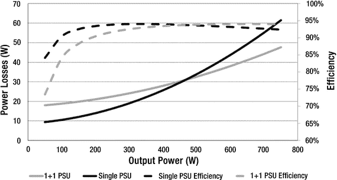

图 4-16. 带冗余电源的示例 `PSU` 损耗。

> **注意：** 对于服务器客户来说，系统的可用性和可靠性通常是高优先级目标。与冗余电源相关的效率损失通常被视为可接受的成本，因此许多系统都采用了冗余电源。

冗余电源与单电源的相对效率取决于具体电源的特性，如下面两个示例所示：一个展示了更高效的单电源，另一个则列出了更高效的冗余电源。

-   **示例 1：** 在系统负载为 200 W 时，单个 750 W 电源的损耗为 14.0 W，而 1+1 电源的总损耗为 21.1 W，采用单电源的系统损耗节省了 7.1 W。
-   **示例 2：** 在系统负载为 650 W 时，单个 750 W 电源的损耗为 49.3 W，而 1+1 电源的总损耗为 41.1 W，采用 1+1 配置的系统损耗节省了 8.2 W。

### 电源冷冗余

从前面的电源冗余损耗示例中可以看出，为了在所有情况下都能实现最佳电源效率，最好能采用类似于前面讨论过的主板`VR`相位脱落功能的设计。因此，在轻负载时，系统由一个电源供电（同时仍保持冗余），而在重负载时，系统则由两个电源以负载分担模式运行。这可以通过当今许多服务器系统所支持的一项功能实现，该功能有时被称为冷冗余。在这种情况下，一个电源会在轻负载时自动关闭，进入冷待机状态。冷待机状态仍允许该电源在主用电源发生故障时快速启动。这维持了系统的电源冗余特性。然后，在重负载时，冷待机电源会自动启动，以分担负载并维持电源中尽可能低的损耗。

### 热管理

数据中心中典型的服务器消耗大量电能，并将其转化为热量。将这些热量从数据中心排出需要消耗整个数据中心相当大量的电能。随着时间的推移，冷却效率已显著提高，减少了其对电力的总体贡献。然而，它仍然是能源消耗的一个主要因素。

服务器冷却系统必须确保每一个组件都符合其规格。大多数组件都有损坏、功能和可靠性温度规格，如图 4-17 所示。一个设计良好的热管理方案必须确保符合这些规格，同时又不导致过度冷却和浪费功耗。在大多数情况下，设计一个能够处理所有极端条件组合下所有可能工作负载的系统是不切实际的，这些条件包括风扇故障、机房环境温度过高和海拔高度。

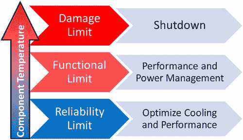

图 4-17. 组件温度规格与热管理。

功能极限通常与系统最大利用率相对应，此时服务器处于其设计所允许的环境等级（温度、海拔、湿度）范围的最坏情况边界。在较低的利用率下，系统会维持在较低的温度，以减少因长时间维持较高温度（处于或接近功能极限）可能导致的组件磨损。

设计良好的服务器会具备热管理功能，以确保直接通过冷却设计实施，或结合热管理系统来满足这些规格。在风冷系统中，组件温度由表 4-25 中定义的三个因素决定：系统环境温度、空气加热和自发热。这些因素在图 4-18 中进行了说明。表 4-26 提供了一些用于传热的常用术语。

表 4-26. 常见传热术语

| 类型 | 描述 |
| --- | --- |
| 传导 | 相邻粒子在分子层面上的热传递。来自芯片的热量通过周围的封装进行传导，直到传递到传热表面（例如散热器）。 |
| 对流 | 通过流体（或空气）的无规则分子运动和宏观移动进行的热传递。服务器中的气流是对流的一个示例。 |
| 辐射 | 通过电磁波进行的热传递；由于强制对流的支配地位，辐射在服务器热传递中通常可忽略不计。 |

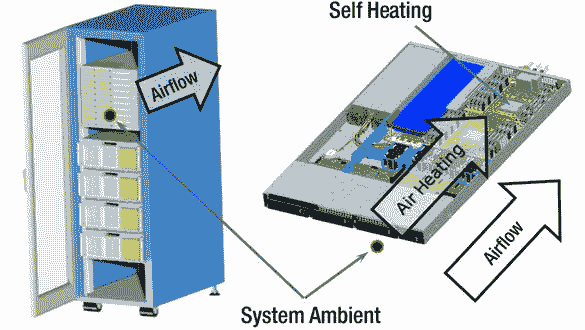

图 4-18. 第二个插槽的本地环境温度、空气加热和自发热。

表 4-25. 加热类型

| 类型 | 描述 |
| --- | --- |
| 系统环境温度⁹ | 系统的进风温度。这包括任何机架效应，这些效应可能会增加输送到平台节点的温度。 |
| 空气加热 | 由于平台中的上游热源导致的空气温度升高。这受组件布局、上游组件功耗、空气移动装置和局部送风的影响。 |
| 自发热 | 由于所关注设备上散发的热量导致的组件温度高于本地环境温度的升高。这由组件封装、功耗和散热解决方案（例如散热器）决定。 |

大部分服务器处理器裸片连接到由 FR4（一种玻璃纤维增强环氧层压板）制成的基板上，通过插座实现简单集成，便于处理器的拆卸和更换。为了便于安装散热器，封装顶部附有一个集成式均热片（IHS）。元件热量通过传导传递到均热片，并通过强制对流排出。

在元件上使用散热器时，需要一种导热界面材料（TIM）来填充元件与散热器之间的空气间隙。`TIM`的热导率远高于空气。

图 4-19 展示了带有集成式均热片（`IHS`）的典型处理器封装。`IHS`的作用是保护裸片、扩散热量并为散热器提供安装表面。热量主要通过第一层导热界面材料（`TIM 1`）传导至`IHS`，然后通过第二层导热界面材料（`TIM 2`）传导至散热器。CPU 封装与散热器之间的导热膏就是`TIM 2`的一个例子。大多数服务器使用风扇产生的强制对流来提供更高的局部风速，从而增强散热器的对流传热。

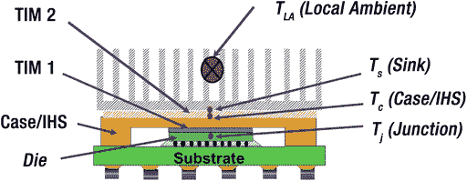

图 4-19. CPU 封装散热术语

在设计风冷系统时，散热工程师必须考虑诸多影响元件温度的因素。通过对关键元件、其规格和布局要求的仔细理解，散热工程师可以优化布局，以最低成本、最高效率和最佳性能来维持解决方案。所谓的元件“遮蔽效应”会显著增加散热难度并降低散热能力。“遮蔽”意味着在以下元件温度方程式中，空气加热量会相对较高，从而导致成本高昂的散热方案和高风扇功耗。

具有高功率密度（功率/面积）的元件需要散热增强，例如使用散热器或均热片。这些器件将热量扩散到更大的表面积，从而显著改善对流传热。

以下方程式描述了功率、空气加热量和环境温度如何影响封装暴露的温度。实际的硅裸片（及晶体管）承受的温度甚至比`T-case`更高。

```
T[C] = Ψ[CA] x Power + System Pre-heating + External Ambient
```

其中：

-   `T[C]`（`T-case`）是元件的表面温度。
-   `Ψ[CA]`（`psi-CA`）是散热器从表面（`C`）到环境（`A`）测得的散热特性，单位为`°C/W`。`Ψ[CA]`值越低，散热解决方案的散热性能越好，因为在给定功耗下，元件（表面）温度将更接近环境温度。
-   `Power`是元件所消耗的功率。

元件和散热器的对流传热性能与气流的倒数成正比，如图 4-20 所示的示例特性曲线。这意味着散热效率（`Ψ[CA]`）随气流增加而显著提高，直至达到某一点（在图中大致为`10`到`15 CFM`之间）。超过该点后，即使大幅增加气流（以高功耗为代价）也只能带来微小的实际散热提升。风扇功耗与气流（及风扇转速）的立方成正比。在散热器的热传导主导区域运行，会显著增加系统的功耗（和低效性）。

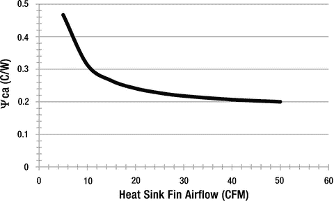

图 4-20. 示例散热器性能

注意：散热效率与气流是非线性关系。一旦散热器达到其最大能力，大幅提高风扇转速（和风扇功率）可能仅带来散热效果的微小改善。

### 系统考量

平台设计团队必须仔细考量元件、配置、使用模式、环境条件以及系统级、机架级和机房级的气流协议，才能实现最优的散热解决方案。必须根据解决方案的成本、性能和能效目标来评估这些设计考量。

# 热管理基础

注意：在较高温度下运行系统会增加 CPU（以及平台中其他器件）的漏电流功耗。然而，降低冷却所带来的功耗节省通常远远超过器件漏电流的增加。

元件选择与布局细节将决定设计方向，因此是设计阶段最需要仔细考量的要素。一个例子是选择要支持的内存技术。为支持最高容量和频率内存而设计的入门级服务器，可能会因配备昂贵但大多数客户从未需要的风扇而加重系统设计负担。所有组件都必须进行类似的考量，包括它们必须在其下工作的功率范围。

注意：由高温引起的 CPU 漏电流功耗增加会降低睿频性能。然而，对平台过度冷却所带来的性能回报通常并不大，且成本可能过高。将温度降低`20°C`可能仅带来几个百分点的性能提升（甚至没有）。

在许多平台设计中，元件布局主要受电气布线考量驱动。必须最小化关键元件之间的走线长度，以确保信号完整性并满足时序要求。散热考量在布局时固然重要，但并非首要驱动因素。散热工程师必须为电路板设计团队提供指导，以便在不必达到散热最优的情况下，设计出有较大成功可能性的解决方案。图 4-21 展示了散热难度各异的系统示例，其中左侧系统中的内存和处理器存在散热遮蔽，而右侧系统则没有。“散热遮蔽”指的是某个元件在气流方向上位于另一个元件的下游。在这种设计中，被遮蔽的元件会暴露在更高的温度下。

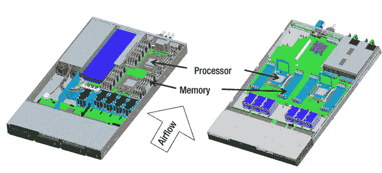

`图 4-21. 示例电路板布局`

热遮蔽在密集型多路平台设计中很常见。由于第一个处理器会加热流向后一个处理器的空气，因此后一个处理器的环境温度更高。散热解决方案必须补偿环境温度的升高。这通常会导致使用更昂贵的散热器和更高的风扇转速，从而增加采购成本和功耗。更高密度带来的散热需求是以功率/性能效率为代价的。

注意：位于其他高功耗元件热遮蔽下游的元件，通常工作在更高温度下，因此会消耗更多漏电流功耗。对于 CPU，这种功耗增加可能导致：如果两个插槽分配了相等的功率，则它们达到的睿频级别会不同。

设计工程师必须透彻理解预期的气流路径，并据此优化气流输送，以最大化散热子系统的能效。空气移动器件的选型和使用必须与服务器设计相匹配。必须在空气移动器和散热器设计之间进行权衡，以找到两者的最佳设计点。散热性能、功耗、噪音特性、风扇可靠性和冗余功能都是影响整体解决方案的重要特性。

# 组件热管理功能

电源管理功能用于执行功耗性能限制，使组件能够保持在温度限制范围内。传感器可创建触发电源管理所需的数据。处理器、内存及部分芯片组组件包含复杂的热管理功能，将在以下章节讨论。

## 处理器

处理器具有三个高级温度节点，如表 4-27 所示。这些温度值因不同产品而异，表中数值仅为典型值示例。

`表 4-27.` 处理器关键温度等级

| 等级 | 描述 | 典型温度 |
| --- | --- | --- |
| `TCONTROL` | 高于此温度时，风扇应全速运行以确保处理器长期可靠性。在`TCONTROL`与`PROCHOT`之间时，所有风扇将全速运行。这种情况通常发生在处理器满载运行且环境温度较高时。 | 约低于`PROCHOT` 5°C–10°C |
| `PROCHOT`（`DTSMAX`） | 处理器功能得到保证的最高温度。处理器内部的自主热管理算法（参见第 2 章）将确保不超过此温度值。在`PROCHOT`与`THERMTRIP`之间时，处理器功能无法保证。可能出现数据损坏（静默或可检测）或系统死机。 | 约 80°C–100°C |
| `THERMTRIP` | 灾难性关机温度。超过此温度，处理器可能发生不可逆的物理损坏。此保护机制由处理器与平台共同实现。 | 约 125°C |

## 内存

与处理器类似，电源管理功能用于管理内存模组（DIMM）可能出现的超温异常。由于内存控制器现已集成在处理器中，由处理器判断内存热状态并激活电源管理功能。处理器可访问 DIMM 上的热传感器，并根据需要激活内存流量调节。

DIMM 所用 DRAM 器件的数据保持时间与温度相关。提高内存刷新率可支持在更高温度下运行，这种高温运行模式称为扩展温度范围（`ETR`），并得到大多数主流 DRAM 制造商的支持。通过支持更高温度运行，可降低平台冷却成本。这确实会因额外刷新操作导致内存功耗小幅增加，并带来少量性能损失，但由此节省的风扇功耗意味着平台级能效提升。当内存温度超过`ETR`阈值时，CPU 中的内存热节流功能将启动。更多详情请参阅第 3 章。

## 平台热管理

热控制能根据使用模式、配置、散热能力和环境因素优化系统性能。这种优化的基础在于并行运用风扇转速控制和电源管理，以满足客户需求。部分客户可能追求极致性能且不考虑冷却成本，而另一些客户则可能愿意在特定场景下牺牲少量性能以实现更佳能效（及更低冷却成本）。

组件及其规格是服务器热设计（例如散热器、风扇选型及气流管理）的主要驱动因素。热设计工程师可以打造卓越的热设计，但如果没有热管理系统提供实时优化，该设计可能在声学方面不可接受或效率极低。真正的优越性往往体现在热管理方案及其精准提供所需性能、满足组件规格的同时实现最低功耗的能力上。

平台热管理在以下四个方面实现优化：

- 在组件热限值内运行
- 性能最大化
- 声学输出最小化
- 整机功耗最小化

所有服务器组件均设计为可承受数千次热循环，这是由于工作负载需求导致的自然温度变化所致。服务器每天可能多次从空闲状态切换至高负载状态，并须能在这种变化下运行多年，导致组件经历大幅温度波动。

热管理（`TM`）系统通过两种主要机制管理组件温度、性能、功耗和声学表现：

- 风扇转速控制（冷却输送）
- 组件功率限制功能（例如`P-states`和内存节流）

在某些服务器中，启动阶段的初始设置允许最终用户配置系统，以优先优化声学表现、能效或性能。

### 热控制输入——传感器

传感器为控制方案提供输入。表 4-28 概述了用于平台热管理的一些传感器类型。

`表 4-28.` 用于热管理的传感器类型

| 传感器类型 | 描述 |
| --- | --- |
| 直接温度 | 位于处理器、内存、硬盘驱动器 (HDD)、芯片组、GPGPU 等组件上的片上传感器。 |
| 间接温度 | 位于组件外的分立传感器，用于直接测量空气或主板温度。该信息可与未配备传感器的组件相关联。 |
| 功率或活动 | 功率可用于估算平台不同组件的温度（结合平台特性分析和其他温度传感器）。算法也可利用功率来优化整体平台功耗。 |
| 风扇转速 | 用于确保风扇在设计参数范围内运行。 |
| 风扇在位 | 用于检测风扇是否已安装（例如，冗余配置）。 |

平台中的不同组件使用不同类型的传感器来监测温度（见表 4-29）。

`表 4-29.` 平台组件传感器类型

| 组件 | 传感器描述 |
| --- | --- |
| 处理器 | 服务器处理器拥有许多热传感器，但仅向平台热管理暴露最高温度。多个传感器被策略性地布置，以便处理器的自身电源管理特性能够在必要时启动，从而确保硅晶温度不超过处理器鉴定和测试的极限点，同时消除确定实际芯片热点温度时的不准确性。 |
| 内存 | 大多数服务器 DIMM 都有一个位于 PCB（印刷电路板）上的分立式热传感器。热传感器温度与 DRAM 温度高度相关，因此单个传感器即可覆盖 DIMM 上的所有组件。某些 DIMM 带有缓冲器，该缓冲器也可能有一个可单独访问的热传感器。 |
| 芯片组（及其他硅器件） | 许多硅器件都有一个可供热管理使用的传感器。这些器件上可能提供有限的本机热管理功能，但主要用途是风扇转速控制和灾难性保护。 |
| 硬盘驱动器 | 硬盘驱动器包含可通过驱动器或 RAID（廉价磁盘冗余阵列）控制器访问的热传感器。 |
| 电压调节器 | 几乎所有高功率电压调节器都配有本地热传感器，以保护 VR 区域内的组件。历史上这主要用于高温保护。 |
| PCIe 卡 | 在某些情况下，PCIe 卡支持传感器功能，服务器可将其用于热管理。但这并不常见，因此必须根据可能安装的任何卡来设计冷却能力。有时会使用间接传感器来推断 PCIe 温度。 |
| 电源 | 大多数电源都有其自身的冷却系统（内部风扇）并自主管理冷却，无需系统干预。 |

图 4-22 举例说明了热传感器在平台上的分布情况。

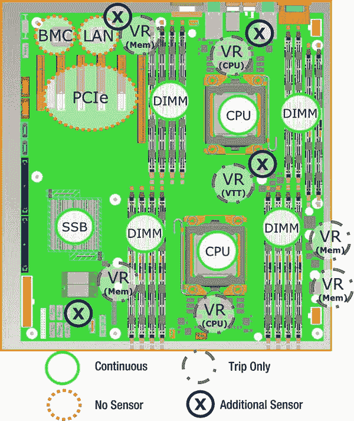

`图 4-22.` 示例平台热传感器布局

### 电压调节器

电压调节器 (VR) 可由主板上的多个分立元件构成，热传感器通常放置在预期温度最高的元件附近。过去，该传感器主要提供功能保护，很少用于风扇转速控制。更精细的热管理实现方案能够利用 VR 传感器参与风扇转速控制算法。VR 可以支持：

- `OTP`（过温保护），导致立即关闭
- `Prochot`，连接到平台的 `Prochot` 信号，当 VR 温度过高时，使 CPU 进行强力的频率调节
- `VRHOT`，通过 `SVID` 发出的警报，通知 CPU 进行频率调节

### 电源

电源拥有自己的热传感器和风扇，用于自主热管理。它们具有温度保护机制，当检测到灾难性情况时可以关闭系统。在某些条件下，电源的风扇可以补充服务器的冷却能力。因此，平台热管理系统有时可以覆盖电源风扇控制，以便在需要时为冷却系统组件驱动更高的风扇转速。

### 风扇转速控制与设计

优化系统中风扇的转速可以显著提高能效。简单地将风扇以最高转速运行是一种易于确保系统在其规格内运行并提供最大性能的方法，但这会带来巨大的能源成本。

系统设计人员在其`BMC`中运行专有的风扇转速控制算法；这些算法试图在保持组件规格范围内的情况下，将风扇转速降至最低。可以同时使用多种算法，并通过比较这些算法的结果来确定最终的风扇转速。

算法中会使用多个（例如数十个）传感器，并根据那些裕量最小的组件来设定所需的风扇转速。算法必须确保不会出现不可接受的风扇振荡，即使在低风扇转速下也是如此。这种振荡对客户来说，可能和持续的巨大噪音一样令人讨厌。

> **注意：** 系统有可能在微秒内从低功耗和相应的低风扇转速状态转换到高功耗工作负载状态。虽然`CPU`芯片不会因功耗增加而瞬间升温，但其升温速度可能快于风扇转速控制子系统提升风扇转速的速度，从而导致短时间的`CPU`热频率调节。那些为能效进行了高度优化的风扇转速控制算法，更容易受到此类行为的影响。

风扇或冷却区域常用于精确调整特定风扇，以满足与该风扇耦合最紧密的组件需求。冷却区域可以基于邻近性，也可以是物理上分隔的。在设计通过冷却区域划分的冷却分区时，会权衡优化程度与成本。采用风扇区域实现方案可以最小化总风扇功耗和噪音。处于低压力区域的风扇可以比高压力区域所需的风扇以更低的转速运行。压力区域意味着该区域内至少有一个组件正接近其温度极限。图 4-23 展示了映射到两种设计用于`1U`机箱的不同主板的风扇区域示例。

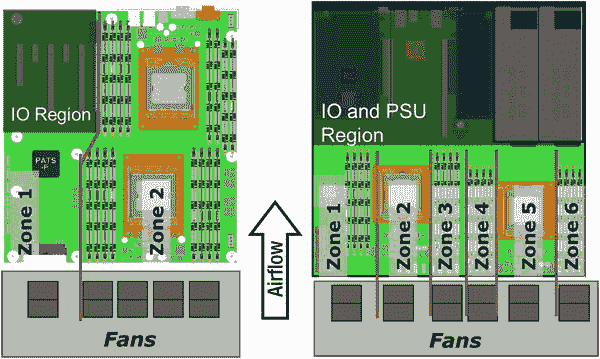

图 4-23. 风扇区域映射

每个传感器根据其与风扇区域的热连接关系映射到相应区域。单个传感器可能影响单个或多个区域，具体取决于传感器位置和风道设计。通过将特定组件映射到特定风扇区域，可以在风扇控制中获得更精细的粒度，从而降低总风扇功耗。

通常使用比例-积分-微分 (`PID`) 控制器的变体来进行风扇转速控制。对于每个热传感器或热传感器组，都会运行一个独立的`PID`算法。在每个时间步长，`PID`控制器根据每个传感器的温度值计算出新的风扇转速设定值。管理控制器根据所有同时运行的`PID`算法计算出的最大风扇转速设定值，来确定实际的风扇转速设定值。

风扇转速设定值通常设有一个下限，以防止风扇转速低于冷却那些无传感器（其实时温度未知）组件所需的最低水平。