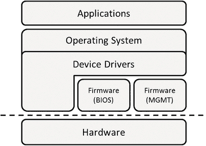
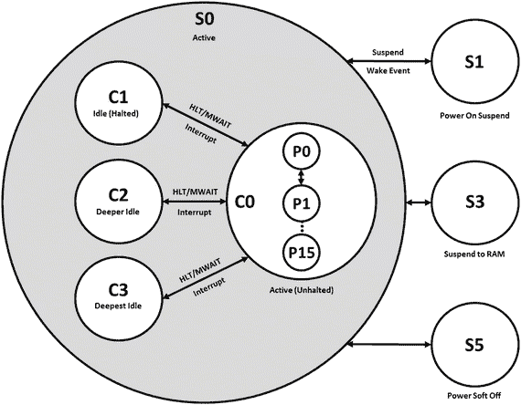
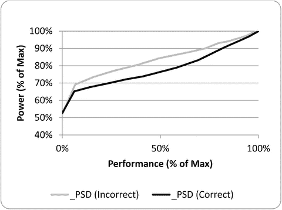

# 5. BIOS 与管理固件

CPU、内存、系统互连及其他组件每秒都在成千上万次地在多种不同的活动电源状态和空闲电源状态之间切换，以最大限度地减少能耗。如果没有硬件和软件（包括 BIOS 固件、管理固件、操作系统和应用程序）之间的精心协调，就不可能高效地利用这些电源状态。如果这些固件或软件组件中的任何一个在此协调过程中未能履行其职责，就可能引发从功耗增加到性能下降的各种问题。图 5-1 展示了用于启用和控制电源管理功能的软件组件层次结构。

图 5-1. 电源管理中的软件组件层次结构

BIOS 固件负责开启和配置电源管理功能。BIOS 还必须向操作系统（OS）公开电源管理功能，以便进行软件控制。这种宣告包括支持的电源状态列表、每种状态的功耗和性能特性，以及控制接口的描述。在某些情况下，操作系统设备驱动程序可以直接发现和配置电源管理功能。操作系统负责在运行时监控系统，并根据过去、当前和预测的未来活动，使用 BIOS 提供的接口来控制电源管理功能。这些活动最终由使用系统资源执行计算和操作数据的应用程序产生。

本章首先描述 BIOS 固件及其在激活和配置功能中的作用。接着概述 BIOS 固件在更新微码以及创建高级配置与电源接口（`ACPI`）对象（用于向软件描述电源管理功能）方面的作用。其中包括对管理固件的概述，涵盖硬件保护、功耗封顶和系统监控功能。本章最后描述了智能平台管理接口（IPMI）以及如何使用它来配置和控制用于电源管理的固件功能。

## BIOS 固件

当服务器通电启动时，诸如 `C-states`、`P-states`、互联电源状态和内存电源状态等电源管理功能并未被配置或启用。这与许多其他不需要显式固件或软件启用的系统功能不同。启用和配置电源管理功能是 BIOS 固件的职责。

许多电源管理功能存在于不同的处理器单元或系统组件中。这些功能拥有不同的时钟域和电源域、不同的初始化序列以及不同的启用要求。因此，配置和启用过程会跨越多个阶段，在此过程中 BIOS 固件与 CPU 的电源控制单元（`PCU`）及其他单元协同工作，以初始化各个功能。如果此初始化失败，电源和热管理将无法正常运行。

在各种电源管理初始化阶段，固件与硬件之间有两种常见的通信方式。第一种是读写硬件中称为寄存器的小型数据数组。寄存器的大小通常以位来衡量，例如 32 位寄存器或 64 位寄存器。寄存器为软硬件通信提供了一种便捷的机制，并广泛用于电源管理功能的控制和配置。用于电源管理的三种最常见的寄存器类型是：模型特定寄存器（`MSRs`）、控制和状态寄存器（`CSRs`）以及内存映射输入/输出（`MMIO`）。这些寄存器只能在 Ring 0 下读写，这意味着只有具有最高特权级别的内核态软件才能访问。当需要频繁使用寄存器访问状态信息、反复更改配置设置或定期更改处理器电源状态时，会使用 `MSRs`。可以使用专用的 `RDMSR` 和 `WRMSR` 指令以较低的软件开销访问这些寄存器。当某些电源管理控制或状态信息需要不频繁访问（仅限启动时）时，会使用 `CSRs` 和 `MMIO`。`CSRs` 是映射到传统 PCI 配置空间中内存位置的寄存器，在控制权移交给操作系统后，可能需要多层设备驱动程序才能访问这些寄存器。

第二种软硬件通信方式是 x86 `CPUID` 指令。`CPUID` 指令为软件提供了一种快速机制来查询处理器，以确定功能支持和配置信息，并且可以在 Ring 3 或用户态软件中访问（例如，CPU 类型、核心与线程的拓扑结构以及各种功能支持标志）。`CPUID` 指令提供了一种低延迟、高容错的方法，用于确定处理器是否支持像 `P-states` 或 `C-states` 这样的电源管理功能，以及当处理器空闲时各种时钟源会发生什么。

并非所有电源管理功能都直接受操作系统控制。第 2 章详细介绍了 Turbo 如何允许处理器在 CPU 基础频率之上运行，多插槽系统如何进入协调的封装 `C-states`，以及电源和热事件如何触发处理器节流。这些类型的功能由 CPU 微码和 `PCU` 固件控制。应用程序或操作系统电源管理策略产生的活动可能会影响这些功能的使用，但核心功能在其他地方被控制。除了 `PCU` 之外，系统中的其他微控制器，例如基板管理控制器（`BMC`）或芯片组中的管理引擎（`ME`），也可能参与电源管理功能的控制。

### 微码更新

在某些情况下，可能需要更改硬件电源管理功能的行为——例如修复问题、添加新功能或优化功能使用。大多数此类更新可以通过 BIOS 固件更新来完成。固件更新的最大好处是能够在不更换任何组件的情况下改进系统行为。然而，其缺点是需要重启系统才能完成更新。在拥有数万台服务器的数据中心里，一次简单的固件更新就会变成一个成本高昂且复杂度极高的事件。

当需要增强或修正 CPU 特定行为时，这可以通过操作系统来执行。操作系统包含更新的 CPU 微码，并且无需安装和验证新的 BIOS 固件映像或重新启动服务器，就能更新 CPU 微码。CPU 微码的更新是通过将微码加载到内存中，并将微码的地址写入 `IA32_UCODE_WRITE` MSR 来完成的。

纵观全书，所列举的几个 `MSRs` 都以 `IA32_` 前缀开头。此前缀表示该 MSR 是架构性的，这意味着它在未来的 CPU 中会使用一致的地址和数据字段定义得到支持。保留或未定义的数据字段可用于随时间推移添加新功能。架构性的 `MSRs` 在不同的产品领域之间也不会改变。例如，`IA32_PERF_CTRL` 的定义在手机、平板电脑、笔记本电脑和服务器上都是相同的。这对于维持电源管理中所使用的各种软件组件的前向和后向兼容性至关重要。`MSRs` 在《英特尔架构软件开发人员手册》中有详细记载。

### 高级配置与电源接口

正如第 2 章中所讨论的，`C-states` 和 `P-states`，即处理器空闲功耗状态和处理器性能状态，均由操作系统控制。在 BIOS 固件配置并启用这些功能后，BIOS 固件负责向操作系统通告这些电源状态及控制接口信息。为了在不同硬件和软件实现之间实现兼容性和灵活性，业界采用了一种名为高级配置与电源接口（`ACPI`）的标准接口。¹`ACPI` 提供了一种以抽象术语传达电源状态信息的接口，使得操作系统和硬件电源管理功能可以独立演进而不会导致任何功能损失。例如，2015 年发布的新硬件 `C-state` 可以被 2005 年发布的操作系统高效使用，只要该 `C-state` 使用 `ACPI` 进行描述。这种抽象是必要的，因为不同平台、架构和 CPU 之间的电源状态行为可能存在显著差异，即使这些电源状态共享相同的名称。同样，操作系统的电源管理策略可能会在某一产品或版本中选择不使用某种电源状态，而在另一产品中则选择使用。`ACPI` 的范围超越了描述电源状态和控制接口。本节并非对 `ACPI` 功能的全面回顾，而是仅讨论那些与理解电源管理中的软硬件交互最相关的关键接口。

`ACPI` 为几种不同类型的状态提供了抽象，包括 `S-states`、`C-states`、`P-states`、`T-states` 和 `D-states`。`ACPI` 状态通过一个表示状态类型的字母和一个表示状态深度的数字来标识。例如，`S0` 表示系统状态 0，`P5` 表示性能状态 5。

数字越小，表示状态的活动更多、功耗更高——数字 0 始终表示活动最多、性能最高、功耗最高的状态。因此，编号较小、功耗较高的状态被称为浅睡状态，而编号较大、功耗较低的状态则被称为深睡状态。将状态描述为浅睡或深睡是为了传达状态转换的成本，例如进入或退出某一状态所需的延迟或过渡性能量。在这些转换过程中，系统会停滞或可能正在执行某些操作，这些操作将在处理器恢复执行时影响性能，例如刷新缓存和转换后备缓冲区（`TLBs`）。

任何资源在给定时刻只能处于一种状态类型。例如，一个系统一次只能处于一个 `S-state`，一个核心一次只能处于一个 `P-state`，一个设备一次只能处于一个 `D-state`。图 5-2 展示了 `S-states`、`C-states` 和 `P-states` 之间的关系与依赖，以及系统如何在它们之间进行转换。

图 5-2. `ACPI` 电源状态与转换概述

#### `S-states`

`S-states` 指系统级睡眠状态，包括 `S0`、`S1`、`S3`、`S4` 和 `S5`。CPU 仅在 `S0` 状态下执行指令。对于服务器而言，其他 `S-states` 的使用并不常见，因为大多数服务器通常处于活动状态（`S0`），即它们正在执行或准备执行指令，或者处于关机状态（`S5`）。处于 `S5` 或软关机状态的服务器是指已断电但仍连接电源的服务器。尽管 `ACPI S0` 状态描述的是活动状态，但系统中的处理器、设备或其他资源仍有可能处于空闲状态。系统级状态可以比处理器或其他设备的状态更浅，但绝不能更深。

`ACPI S3`，通常称为挂起，是一种睡眠状态，其中操作系统上下文被保存到系统内存中；内存保持供电，但大多数其他系统组件已断电。在 `S4` 状态下，所有设备均已断电，但当前操作系统上下文已保留在存储设备上。`S3` 和 `S4` 的支持情况因产品而异，许多服务器产品不支持这些状态。

> 注意：

## ACPI电源状态详解

> `S3`和`S4`在服务器中不常用。这些状态不维持活动的网络连接，执行上下文也不再存在于 CPU 缓存中。从这些状态恢复可能需要相当长的时间，这使得它们难以在负载动态变化的环境中使用。

### C-states

`ACPI`规范定义了三种类型的空闲功耗状态或`C-states`：`C1`、`C2`和`C3`。`C0`状态描述的是正在执行指令的活动处理器。`ACPI C1`状态是强制性的。它描述了最低延迟的空闲电源状态，并保留给那些转换延迟或性能影响可忽略不计的处理器状态。`ACPI C2`状态是比`C1`更深的状态，功耗更低但延迟更高。它允许产生可测量的延迟影响，但不需要比`ACPI C1`状态所需的额外软件处理。`ACPI C3`状态是功耗最低、延迟最高的状态，并且与`C-state`进入和退出相关的额外软件开销。`ACPI C3`类型的状态具有软件可见的影响。使用这些状态可能需要操作系统在进入该状态前检查芯片组活动，或者可能由于处理器时间戳计数器或本地 APIC 定时器在进入`C-state`后停止，而要求操作系统识别并使用替代时间源。

由于`ACPI C3`类型状态增加了软件复杂性，大多数现代服务器不会实现映射到比`ACPI C2`类型状态更深的状态的`C-states`。随着时间的推移，硬件`C-states`已经过优化，以消除或减少软件可见的影响。这包括设计定时器使其在处理器处于深度`C-states`时继续运行，以及消除对 CPU 外部活动级别的依赖，从而积极降低深度`C-state`的退出延迟。

> **注意**：
> 一个常见的混淆点在于硬件`C-states`和`ACPI C-state`类型之间的区别。第 2 章中描述的每个硬件`C-state`在由 BIOS 固件通告时，都会映射到一个`ACPI C-state`类型。例如，硬件`C1`状态映射到`ACPI C1`类型，而硬件`C3`和硬件`C6`状态则映射到`ACPI C2`类型状态。

### P-states

`P-states`指处理器性能状态，包括`ACPI P0`以及`P1`到`Pn`，其中 0 到`n`之间的状态数量取决于处理器支持的独特电压和频率工作点的数量。`Pn`也被称为最深`P-state`。与表示空闲状态的`S-states`或`C-states`不同，`P-states`表示活动状态，因此`ACPI P-states`仅在处理器处于`C0`状态并积极执行指令时才被使用。

`P0`状态是性能最高、功耗最高的状态，从`P1`到`Pn`的每个状态相比编号更小的状态，都会导致功耗和性能的下降。`ACPI`将`P-states`的数量限制为不超过 16 个。如果处理器拥有超过 16 个硬件`P-states`，BIOS 固件必须决定哪些状态暴露给操作系统。BIOS 固件通常会在处理器的`最小频率`（`Pn`）和 CPU 基本频率之间的每个基频步进上暴露一个`ACPI P-state`。第 2 章中讨论的睿频模式，始终映射到`ACPI P0`。

### D-states

ACPI 规范也定义了设备电源状态，即`D-states`。`ACPI D-states`在服务器上的使用频率不如在客户端上高。许多服务器无法使用`D-states`，因为从这些状态恢复的延迟对于活动服务器来说过于显著。另一个原因是，存在额外的标准接口用于设备状态发现和控制，例如由 PCI 和 PCIe 规范定义的电源管理控制和状态寄存器（`PMCSR`）。一些设备驱动程序通过私有的设备特定控制来管理本机设备特定的电源状态。许多设备能够监控自身的设备活动并在无需任何软件控制的情况下管理电源。即使在没有软件暴露的`D-states`的情况下，设备或 CPU 也可能在运行时自主地在各种电源状态之间转换以管理电源。

尽管存在描述 ACPI 之外的设备电源管理的各种控制方法和规范，但它们都使用相同的术语。`D0`状态是活动状态，`D1`和`D2`是保存设备上下文的低功耗状态，而`D3`是功耗最低、延迟最高且不保存设备上下文的状态。

### ACPI 接口

操作系统需要关于电源状态及其行为的更详细信息，才能高效地利用它们。在选择不同的电源状态时，操作系统需要知道每个状态的功耗、进入和退出状态的转换时间、进入状态时会丢失多少执行上下文，以及用于触发进入的特定机制。`ACPI`标准化了表格来描述这些详细信息给操作系统。

BIOS 固件负责构建这些表格并将其加载到内存中，操作系统读取这些表格并枚举能力。包含核心电源状态信息的 ACPI 表格包括`DSDT`（差异化系统描述表）和`SSDT`（辅助系统描述表）。这些表格由多个对象组成，为操作系统提供所需的电源状态和控制信息。以下列表描述了操作系统使用的主要 ACPI 对象集：

*   ACPI 规范以保证的频率来描述 P-states。Turbo 模式，即处理器核心以高于 CPU 基础频率运行的能力，是不保证的。Turbo 是机会性的，其频率取决于热或功率余量。由于 Turbo 频率不被保证，因此通过 ACPI 暴露最大 Turbo 频率是不恰当的。因此，ACPI `_PSS`将 Turbo（`P0`）以比`P1`高 1 MHz 的频率暴露。当操作系统请求 Turbo 时，硬件将最大化频率，可能运行得远高于向操作系统通告的频率。如果频率确定性是用户的硬性要求，则提供软件接口以便可以禁用 Turbo。

*   `_OSC`和`_PDC`（操作系统能力和处理器驱动程序能力）：这些方法用于将操作系统的能力传达给 BIOS 固件。这包括描述操作系统在协调跨多个逻辑和物理处理器的控制方面的能力，以及其控制 P-states 和 C-states 的能力。操作系统的能力将决定 BIOS 固件将暴露哪些电源管理功能。

*   `_PSS`（性能支持状态）：此对象列出了可供操作系统使用的 P-states。对于每个状态，该对象包括一个性能级别（通常是核心频率，单位为 MHz）、最大功耗和转换延迟。此外，该对象还列出了一个控制寄存器值（操作系统在请求电源状态变化时用于标识 P-state）和一个状态值（操作系统在检查处理器状态时用于标识 P-state）。一个单独的 ACPI 对象定义了处理器状态寄存器，操作系统使用它来确定当前的 P-state 并检查现有 P-state 控制请求的状态。

    > **注意**：在许多情况下，将 Turbo 作为单个 P-state 暴露是不节能的。不允许操作系统在`P1`和最大 Turbo 频率之间选择中间 P-states，可能导致选择一个性能更高且功耗超过需求的 P-state。

*   `_PSD`（P-state 域）：ACPI `_PSD`对象描述了 CPU 控制依赖关系，定义了 CPU 中的逻辑处理器是拥有自己的 P-states，还是逻辑处理器子集共享一个公共的 P-state。某些服务器 CPU 具有单个 P-state 域，这意味着该 CPU 中的所有逻辑处理器共享一个单一频率。其他服务器 CPU 的每个核心都有不同的 P-state 域，这意味着 CPU 中的所有核心可以运行在各自独立的频率上。`_PSD`对象还负责描述 P-state 协调类型，这将在本章后面更详细地讨论。

    > **注意**：ACPI 对象中的错误可能导致严重的电源问题。图 5-3 展示了在具有不正确 `_PSD` 的系统上运行在线事务处理工作负载的影响。这些问题已在多种不同的运行条件下导致功耗显著增加（高达 40 W）。
    > 
    > 图 5-3. ACPI `_PSD` 对象映射不正确导致的功耗影响

*   与 ACPI P-state 对象类似，存在一个 `_CSD` 对象用于描述 C-state 的处理器控制依赖关系。理解跨逻辑处理器的 C-state 依赖关系有助于理解当操作系统需要将执行任务集中到 CPU 中的某几个逻辑处理器子集时的 C-state 影响。

*   `_CST` (C-states)：此对象列出操作系统可用的 C-state。为每个 C-state 提供的详细信息包括用于将处理器置于 C-state 的寄存器、ACPI C-state 类型、最坏情况延迟以及典型功耗。`_CST` 中的功耗数值不被操作系统使用，因为它们被认为只是估算值。延迟字段被一些操作系统控制策略用于根据系统活动级别或存在不能容忍超过某个阈值的特定设备时来限制某些 C-state 的使用。

*   大多数现代处理器用 ACPI 所谓的功能固定硬件（FFH）或处理器 MSR 来指定这些接口。这允许将性能控制接口直接在硬件中实现，从而提供低延迟和高弹性的接口。如果原生处理器接口不可用或不理想，原始设备制造商（OEM）可以实现特定于平台的代码来处理性能控制。

- `_PCT` (Performance Control)：此对象描述允许操作系统更改 P-state 及检查 P-state 请求状态的处理器寄存器或固件位置。要更改 P-state，操作系统使用 `_PCT` 指定的控制寄存器。P-state 转换由操作系统将 P-state 的控制值（在 `_PSS` 中指定）写入控制寄存器来启动。为了检查 P-state 请求的状态，操作系统使用 `_PCT` 指定的状态寄存器。状态寄存器还根据 `_PSS` 指定的 P-state 控制值来指定当前 P-state。

操作系统初始化后，会评估这些 ACPI 方法，并获得在空闲和活动状态之间请求硬件转换及检查这些请求状态所需的所有信息。操作系统控制策略使用 ACPI 通告的信息（概述了各种状态的预期功耗和性能影响）来做出状态转换决策，并使用 ACPI 通告的控制机制来执行这些决策。

> **注意**
>
> 关于 ACPI 接口在操作系统电源管理方面的弹性和健壮性，有着长期存在的问题。一些现代操作系统开始使用原生处理器接口（如 `CPUID`）直接从硬件发现 CPU 类型、电源管理特性和控制接口。使用原生处理器接口限制了电源管理解决方案的灵活性，但消除了因 ACPI 对象的错误导致的功能或性能问题。

### 设置工具

设置工具（也实现在 BIOS 固件中）是一个用于微调电源管理和针对特定工作负载优化平台的强大工具。大多数电源管理功能可以通过简单的设置选项来启用、禁用或更改其默认行为。第 8 章 是一个全面的优化参考，讨论了设置工具中常见的选项以及配置这些选项以降低功耗、提高性能或在理想情况下两者兼得的不同方法。

## 管理固件

汽车中的微控制器可以监控燃油液位和消耗率。它们可以指示轮胎压力是否过低或转向信号灯是否烧坏，并且可以记录诊断事件，以便技术人员在维修预约时检索。这些功能与谁在驾驶汽车、汽车是否超速或停车无关。

运行在服务器微控制器上的管理固件扮演着非常类似的角色。管理固件提供独立于操作系统或处理器状态的电源、监控、事件日志、清单和远程管理功能。这在拥有大量服务器、系统因维护而上下线、以及服务器运行不同操作系统的数据中心中尤为有用。对电源管理至关重要的两个关键固件组件是基板管理控制器（BMC）固件和管理引擎（ME）固件（称为 Node Manager）。

### Node Manager 功能

Node Manager 固件提供了在数据中心管理和优化电源及冷却资源的关键功能。它向 BMC 和外部管理软件公开了一套标准化的硬件保护、监控和功率封顶功能。Node Manager 充当卫星控制器，将电源管理职责从 BMC 中卸载，其中一些功能始终运行，而另一些功能则由配置文件激活。

### 硬件保护

Node Manager 固件实现了一套硬件保护机制，以在不利或意外条件下保护平台。存在主动保护机制，例如动态地将平台功耗限制在 PSU 的能力范围内。还存在被动保护机制，例如闭环系统保护（CLST）和智能保电（SmaRT），用于在 PSU 出现过温、欠压和过流事件时保护平台。这些功能由硬件辅助实现，传感器设备使用 `SMBUS` 协议通知 Node Manager 关键事件。保护机制在发生不利条件时立即响应，所需操作（例如处理器和内存节流）在不到一毫秒内发生。