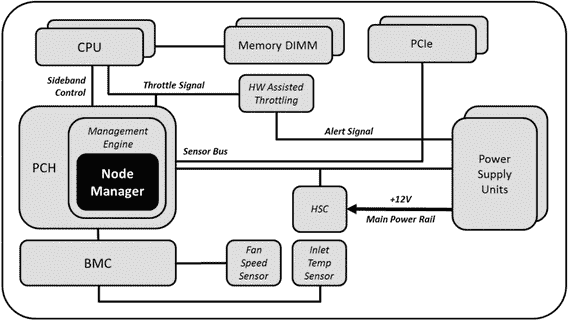

# 监控

Node Manager 固件的另一个关键功能是全面的平台监控。除了处理器和内存提供的监控功能外，现代服务器在智能电源单元（`PSU`）、电压调节器（`VR`）、热插拔控制器（`HSC`）以及 `BMC` 可访问的设备中实现了多个板载传感器。这些传感器能够报告单个组件的电压、电流、功率和能耗，从而实现精细的功耗监控。将所有板级、处理器和内存传感器组合在一起，就形成了一个 Node Manager 固件所依赖的传感器网格，用于电源管理。

这些监控功能的作用不仅仅局限于启用 Node Manager 的保护和功率封顶功能。外部管理软件以多种方式使用这些监控功能。例如，监控进风温度、出风温度和体积流量的事件被设施控制软件使用。

> **注意**
>
> 为了暴露更多关于平台的信息，Node Manager 添加了几个合成传感器，例如出风温度和体积流量。这些传感器源自平台中的其他传感器，并基于数学模型计算得出。

监控计算利用率和内存利用率的事件被编排软件用于辅助工作负载放置和迁移决策。监控功耗的事件用于表征和优化生产工作负载。不同类型的传感器及其用法将在第 7 章中更详细地描述。

## 功率封顶

节点管理器固件允许用户设置并强制实施功率封顶，确保功率不会超过定义的阈值。外部管理软件在多种不同场景中使用此功能，以实现功耗、性能和成本方面的优势。

大多数服务器的运行功率远低于理论最大平台功率，即使在工作负载处于峰值吞吐量时也是如此。这限制了在固定功率容量的机架中安全添加的服务器数量。与其让服务器运行至理论最大平台功率，用户可以对更符合典型峰值条件的情况强制实施功率封顶。此功率封顶可通过数据中心监控获得的洞察来确定，也可通过表征典型峰值条件下的生产工作负载来建立，或者基于理论最大平台功率的某个百分比来设定。使用更具代表性的功率封顶，可以提升机架密度。

> **注意**
>
> 节点管理器提供一项功能，可在 `BIOS POST` 期间使用特定工作负载自动表征平台的最小和最大功率。当无法使用生产工作负载进行表征时，此表征结果可用于确定合适的功率封顶。

功率封顶还有其他几种应用场景——例如，在数据中心遭遇电源或冷却故障时，通过功率封顶维持运行。在这些情况下，可以强制实施激进的功率封顶，降低服务器功率和冷却需求。这可使应用程序持续运行，延迟或避免自动关机。当能源成本存在变动时，也可以策略性地应用功率封顶，以最大化资源利用率。图 `5-4` 显示了节点管理器固件用于实现硬件保护、监控和功率封顶的外部接口和组件。

`图 5-4.` 节点管理器固件使用的外部接口和组件

## 节点管理器策略

默认情况下，节点管理器固件会激活硬件保护和基本监控。通过使用用户定义的策略（可创建、配置、启用和禁用）来支持额外的节点管理器固件功能。

策略可以始终运行，例如用更符合峰值条件的封顶值替代理论最大平台功率的功率封顶策略。策略也可以由触发器启用，或由某些用于激活策略的监控事件启用。例如，只有当进气温度超过某个阈值时，策略才会强制实施功率封顶。操作员可以定义多个不同的进气温度阈值，每个阈值对应激活不同的功率封顶。

节点管理器策略通常针对特定策略域进行监控或功率控制。域是对相关独立平台组件的抽象表示。例如，针对平台域的策略包括服务器中的所有组件。`CPU` 域将报告和控制系统中所有 `CPU` 的功率，并将其视为一个整体，而内存域则报告和控制系统中所有内存条和内存控制器的功率。

表 `5-1` 列出了节点管理器策略的所有不同属性，操作员可使用这些属性来配置策略，以满足所需行为和特定需求。这些属性支持更复杂的事件驱动管理。例如，如果服务器无法满足功率封顶，策略可以定义一个结果操作，如向外部管理软件发送事件或关闭平台。

`表 5-1.` 节点管理器策略的属性

| 属性 | 支持的值 | 描述 |
| --- | --- | --- |
| `分配的策略 ID` | 一个字节的数值。 | 表示策略的唯一标识符。在创建策略时分配。 |
| `策略域` | 可以是以下任一值：`整个平台`、`CPU 子系统域`、`内存子系统域`、`硬件保护域`、`高功耗 I/O 域` | 表示策略所应用的具体平台子系统。 |
| `策略管理状态` | 可以是以下任一值：`已启用`、`已禁用` | 表示策略的状态。即使策略被禁用，其监控功能仍然启用。 |
| `策略触发器类型` | 可以是以下任一值：`无策略触发器`、`进气温度限制`（单位：摄氏度）、`缺少功率读数超时`（单位：0.1 秒）、`主机复位后时间`（单位：0.1 秒）、`启动时策略`（此策略仅在启动时应用） | 表示策略激活的触发器。如果指定了“无策略触发器”，则策略始终处于激活状态。对于所有其他触发器，仅当条件满足时策略才处于激活状态。 |
| `策略触发器限制` | 一个温度值（单位：摄氏度）或时间值（单位：0.1 秒）。 | 表示与触发器关联的具体值。 |
| `策略限制` | 功率封顶可以指定为以下之一：`功率`（单位：瓦特）、`节流水平`（单位：%） | 表示要强制实施的功率封顶。在缺少功率读数的情况下使用平台节流水平。 |
| `激进程度` | 可以是以下任一值：`自动`、`强制非激进模式`、`强制激进模式` | 表示用于使服务器功率保持在封顶值以下的功率管理机制类型。节点管理器尝试使用可用的最高能效机制来满足封顶要求。仅当无法通过能效机制满足封顶时，才会使用对性能影响更大的机制。 |
| `修正时间限制` | 一个时间值，单位为毫秒。 | 表示节点管理器必须采取修正措施以满足功率封顶的最长时间（毫秒）。如果超过此时间，“策略异常操作”将指定下一步操作。 |
| `策略异常操作` | 可以是以下任一或两者：`发送警报`、`关闭系统`（通过 `BMC` 硬关机） | 表示无法满足策略限制时采取的操作。发送警报将导致节点管理器生成异步事件，通知外部管理软件所定义的封顶值过低。 |
| `策略存储选项` | 可以是以下任一值：`持久化存储`、`易失性内存存储` | 表示策略的存储类型。默认情况下，策略持久化存储，因此节点管理器会在每次平台复位后恢复策略。如果策略创建和更新频繁，应使用易失性存储。 |
| `统计报告周期` | 一个时间窗口，单位为秒。 | 表示监控的平均窗口大小。这允许操作员指定最长一小时的移动平均监控窗口。 |
| `警报阈值` | 最多三个阈值，单位为触发器类型指定的单位。对于无触发器的策略，阈值数组包含以瓦特为单位的平均功率。对于基于温度的触发器，阈值数组包含以摄氏度为单位的温度。对于基于时间的触发器，数组包含以 0.1 秒为单位的时间。 | 表示需要超过以生成事件的阈值触发值。 |
| `暂停时段` | 一个包含开始和停止时间的数组，包括基于星期几的重复模式。 | 表示策略将被强制实施的时间段。 |

该策略允许操作员指定各种警报阈值。每个策略最多支持三个可用于生成事件的阈值。例如，常见的做法是将阈值设置在接近定义的功率封顶值，以便外部管理软件能够了解系统距离强制实施封顶还有多远。

该策略允许操作员指定暂停时段。这定义了一个周模式，说明策略应在哪些日期和时间启用或禁用——例如，在夜间和周末对托管 `IT` 基础设施的服务器实施功耗上限。节点管理器会自动将用于调度的实时时钟与主机操作系统的实时时钟同步，以保持软件和系统同步。

### IPMI

基板管理控制器（`BMC`）和节点管理器固件的功能通过智能平台管理接口（`IPMI`）进行配置和控制。`IPMI` 支持广泛，绝大多数服务器都支持它。`IPMI` 提供了一个标准的、定义明确的接口，连接外部管理软件与底层平台，通过简单的请求和响应消息实现各种监控、日志记录、清单和恢复功能。

`IPMI` 消息或命令以 `BMC` 为目标。`BMC` 充当平台上卫星控制器的通信枢纽，这些卫星控制器拥有自身的监控和控制能力，例如平台控制器中枢（`PCH`）中的管理引擎（`ME`）。`BMC` 与卫星管理控制器之间的通信通过 `I2C` 总线进行，使用智能平台管理桥接（`IPMB`）接口。`I2C` 总线、`SMBus`、`PMBus`、内存映射 `I/O` 端口以及私有管理总线都用于将管理控制器连接到平台上的各种传感器。

使用 `IPMI` 消除了对不同平台之间不兼容的供应商特定工具的需求。由于 `IPMI` 是一个开放标准，它还允许服务器独立于操作系统（`OS`）、`BIOS` 或系统配置来实现管理功能。`BMC` 中的监控功能可以通过带外 `IPMI`（通过网络由连接的客户端访问）来访问。这些功能也可以通过带内 `IPMI`（通过安装在服务器上的管理工具和设备驱动程序）来访问。

#### 传感器模型

平台上的传感器，例如 `CPU` 和内存温度传感器，由管理软件通过 `IPMI` 命令发现。这种发现由 `IPMI` 传感器模型辅助。传感器模型描述了所有支持的传感器，以及每个传感器的名称、类型和返回的值。一些传感器可能提供实时测量值，而其他传感器可能仅提供过去事件的计数或指示。

传感器信息存储在 `IPMI` 传感器数据记录（`SDR`）中。除了存储传感器能力信息，`SDR` 还用于描述连接到 `ICMB` 的各种设备，并将每个传感器与主机管理控制器关联。`SDR` 还提供有关事件生成能力的信息，并描述可设置以触发事件的阈值。

IPMI 是可扩展的，因此服务器制造商可以添加自定义的传感器和命令。因此，管理控制器的监控能力在不同服务器之间可能存在很大差异。

诸如连接到平台上的`FRU`（现场可更换单元）设备等清单信息存储在`SDR`中。`FRU`数据包括用于库存管理的信息，例如序列号、部件号、制造商和描述。

#### 系统事件日志

由`BMC`和节点管理器固件生成的事件存储在一个名为系统事件日志（`SEL`）的集中式事件日志中——例如，风扇不再正常工作的指示。与`SDR`访问类似，`IPMI`允许访问`SEL`，提供诸如读取或清除日志等常见功能。

卫星控制器通过`IPMB`将其消息发送到此集中式日志，使`SEL`能够充当单一的平台事件存储库。存储在闪存中的`SEL`事件包含关键信息，即使电源断开或操作系统发生故障，这些信息也不会丢失。

#### 节点管理器 API

本章前面描述的节点管理器功能可通过`IPMI`命令访问和控制。节点管理器`IPMI` API 包含大量用于创建策略、配置策略、访问监控功能和访问运行时属性的`IPMI`命令。

节点管理器`IPMI` API 描述了操作员可用于查询能力和版本信息的命令。外部管理软件依赖此接口来发现能力，因为不同平台可能暴露不同的策略域和功能集。

该 API 描述了操作员可用于指定警报目标的命令。节点管理器定义了一组直接发送给外部管理软件（绕过`BMC SEL`）的事件。对于这些事件，使用`IPMI`警报即时 API。这为外部管理软件提供了事件驱动或周期性轮询管理之间的选择。该 API 还包括提供额外管理功能的命令。例如，使操作员能够设置 Turbo 同步比率或 Turbo 频率限制的命令。此功能可用于提高高性能计算（`HPC`）环境中的性能确定性。

节点管理器`IPMI` API 中包含的完整命令列表包含在节点管理器规范中，位于 [`www.intel.com/content/www/us/en/power-management/intelligent-power-node-manager-specification.html`](http://www.intel.com/content/www/us/en/power-management/intelligent-power-node-manager-specification.html)。

节点管理器`IPMI` API 包括两种类型的接口：

*   外部 API：此接口专为外部管理软件使用而设计。此 API 使用策略域抽象来向外部管理软件公开高级监控和控制。在域级别公开平台管理功能简化了管理并提高了可扩展性，尤其是在需要管理数千台服务器的环境中。

*   内部 API：此接口专为`BMC`或系统中的其他管理控制器使用而设计。此低级 API 允许`BMC`根据需要访问特定传感器和控制功能。

### ACPI 功率计量对象

除了`IPMI`之外，节点管理器还通过`ACPI`功率计量对象公开功率监控和功率上限功能。这使得操作系统能够参与监控和控制。启用此功能的关键`ACPI`对象概述如下：

*   `_PMC`（功率计量能力）：此对象描述了功率计量的能力，包括测量单位、类型、精度和采样时间。它描述了平台是能够监控平台功率、执行功率上限，还是两者皆可。

*   `_PMM`（功率计量测量）和`_PAI`（功率平均间隔）：`_PMM`对象返回功率计的最新读数。`_PMM`返回读数的平均窗口由`_PAI`定义。

*   `_PTP`（功率跳变点）：此对象用于定义功率计的上限和下限跳变点。

*   `_SHL`（设置硬件限制）和`_GHL`（获取硬件限制）：这些对象用于强制执行平台功率限制。