# 摘要

BIOS 与管理固件在初始化、配置、控制电源管理特性并将其通告给外部软件方面扮演着关键角色。若缺少这些操作，系统将无法利用电源管理功能，导致高能耗、低性能，或两者兼有。诸如`ACPI`和`IPMI`之类的标准接口被用来使固件能够以独立于操作系统的方式与外部软件进行通信。

第 6 章将继续讨论软件架构，描述操作系统在电源管理中的角色。它将说明操作系统如何利用 BIOS 固件暴露的`ACPI`对象来枚举和控制各种电源状态。同时，它还将阐述操作系统在电源状态选择、进程调度以及内存管理方面所作出的决策如何影响能效。

脚注 1：高级配置与电源接口规范，修订版 5.0a，2013 年 11 月 13 日。

脚注 2：`IPMI`规范，v2.0，修订版 1.1。

## 操作系统

软件计算与数据处理是服务器和数据中心工作内容的本质。但操作系统在决定工作性能（工作速度）与成本（消耗的能源）方面所起的关键作用却常常被忽视。操作系统管理者软件工作计划；一个高效的工作计划能以更低的成本更快地完成工作。

经过良好优化的操作系统可以增加 CPU、内存和互连结构处于低功耗状态的时间。它们避免草率使用系统资源，因为这会限制服务器使用低功耗状态——例如，轮询等待某个事件或活动的完成、选择系统定时器的次优分辨率，或者执行仅利用系统中少量逻辑处理器的操作。优化良好的操作系统会调整其对电源管理特性的使用，以适应工作负载的变化、服务器利用率的变化以及操作员偏好的变化。

本章首先概述操作系统及其在选择电源状态、调度和内存管理方面的角色。这包括对操作用途的接口的描述，以及操作系统用于驱动这些决策的策略和指标。接着会讨论虚拟化环境的额外考量因素，包括整合和虚拟机迁移。本章最后将比较不同的操作系统环境、这些环境独有的电源管理能力，以及这些能力随时间推移发生的变化。

**注意**：本章中使用的术语操作系统（`OS`）既包含原生操作系统，也包含虚拟机监视器（`VMM`）。`VMM`承担着与原生操作系统相同的电源管理角色和职责，因此本章的信息同样适用于这两种环境。

### 实施电源管理

一旦配备了电源状态信息以及来自 BIOS 的适当控制手段，操作系统就必须实施电源管理策略，以根据系统活动或任何已知的功耗与性能约束，决定如何以及何时使用各种电源状态。在低功耗与高性能之间找到恰当的平衡是一个难题，因为正确的平衡因环境而异、因用户而异。操作系统电源管理（`OSPM`）策略可能不了解现有的服务级别协议或服务质量要求。它们可能不清楚系统是运行独立应用程序，还是属于复杂分布式应用程序的一部分。即使是关于具体正在执行应用程序的知识，也几乎无法告诉操作系统什么是功耗与性能之间的恰当平衡点。对操作系统而言，一个托管家庭照片分享服务前端的 Web 服务器，与一个托管关键金融交易前端的 Web 服务器看起来一模一样。

数据中心多样化的功耗与性能要求，为在服务器上实施和优化 `OSPM` 策略带来了独特的挑战。在其他计算环境（如手机和平板电脑）中，常见的性能预期是事先已知的。例如，游戏在每秒 30 帧时表现尚可，在每秒 60 帧时表现出色。手持设备不应导致手掌出汗，触摸手势应在数毫秒内得到处理，并且在音频播放过程中出现可闻停顿是不可接受的。

在服务器环境中，电源管理特性对性能的影响因工作负载、应用程序、系统配置和性能要求的不同而有很大差异。有些工作负载看不到性能影响，而其他工作负载则可能会看到显著影响。在缺乏已知性能要求的情况下，`OSPM` 策略需要利用其掌握的有限信息，就低功耗与高性能之间的平衡做出尽可能最佳的决定。操作系统负责的两项主要策略是 `C-state` 和 `P-state` 的选择。以下各节描述了这些策略用于硬件状态控制的机制，以及用于策略反馈和决策的监控能力及指标。

### C-state 控制

如图 6-1 所示，大多数操作系统在设备驱动程序中实现 `OSPM` 策略。在此上下文中，处理器可以被视为另一个设备。这些驱动程序使用一组由`ACPI`描述或通过`CPUID`确定的标准化控制接口与硬件进行通信。当操作系统在某个逻辑处理器上没有工作时，它会进入一个空闲函数，在该函数中最终可以执行两条指令中的一条，以使逻辑处理器转换到空闲 `C-state`。

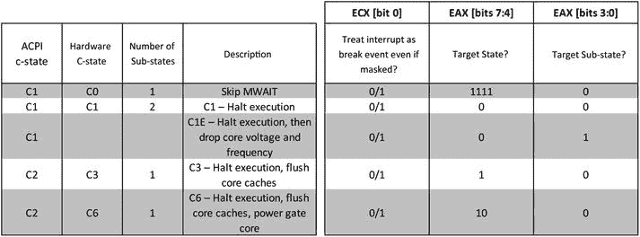

**图 6-1.** 操作系统用于指定各种处理器 `C-state` 的`MWAIT`提示示例

### MWAIT

操作系统进入空闲状态最常见的方式是执行`MWAIT`指令。`MWAIT`只能在 Ring 0 执行，因此应用程序无法直接进入空闲状态。`MWAIT`让操作系统能够控制要进入的具体 `C` 状态和子状态，以及退出该 `C` 状态的条件。操作系统通过`MWAIT`使用的两个通用寄存器来传达 `C` 状态控制的详细信息。

操作系统使用`ECX`寄存器来指定应如何退出 `C` 状态以响应外部中断。当操作系统指定的中断应被视为中断事件时，执行会在空闲函数内恢复，而不是直接执行中断服务例程（`ISR`）。操作系统使用`EAX`寄存器来指定目标 `C` 状态（`C1`、`C3` 或 `C6`）和目标子状态。`MWAIT`子状态用于对特定 `C` 状态进行更细粒度的控制。例如，如果某个特定 `C` 状态在进入时刷新缓存，则可以使用不同的子状态来修改缓存刷新的行为，例如一次性刷新整个缓存，或分多个时延阶段逐步刷新缓存。图 6-1 展示了处理器支持的各种 `C` 状态的示例，以及用于指定这些状态的`MWAIT`提示。

任何中断——例如定时器中断、设备中断或处理器间中断（`IPI`）——都会导致 `C` 状态退出并恢复执行。除了基于中断退出 `C` 状态外，`MWAIT`还可以与`MONITOR`指令结合使用。`MONITOR`指令由操作系统在`MWAIT`指令之前执行，它允许操作系统指定一个处理器要监视的内存地址。一旦设置了`MONITOR`指令，如果被监视的数据地址被修改，随后进入的任何 `C` 状态都将被退出。这为软件定义的 `C` 状态退出条件提供了一种额外的机制。例如，Linux 内核利用这种机制，通过将内核`need_resched`标志与`MONITOR`/`WAIT`配对来实现。当操作系统修改此标志时，表明应在特定逻辑处理器上激活内核调度器。基于修改后的`MONITOR`地址退出 `C` 状态，也提供了一种无需生成 `IPI` 即可唤醒特定逻辑处理器的机制。

### HLT

较旧的操作系统，或者禁用了深度 `C` 状态的操作系统，可能会在空闲函数中执行`HLT`（暂停）指令来代替`MWAIT`。`HLT`不需要也不支持`MWAIT`所具有的同等级别的控制能力。`HLT`只是简单地将逻辑处理器置于最浅的状态，即硬件 `C1` 状态。随着`MWAIT`的引入，不再需要使用`HLT`。在现代系统中，微码会将`HLT`指令转换为请求硬件 `C1` 状态的`MWAIT`指令。

### C 状态策略

简单来说，`OSPM` `C` 状态策略的作用是预测未来。当系统空闲持续时间很短时，例如高速网络上的数据包处理，最适合使用浅层 `C` 状态。当系统有较长、不间断的空闲持续时间时，例如提交 `I/O` 与完成 `I/O` 之间的空闲时间，最适合使用深度 `C` 状态。图 6-2 展示了一个逻辑处理器的示例利用率。它显示了不同长短空闲持续时间的混合情况，以及 `C` 状态的理想使用方式。

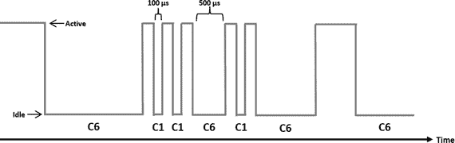

图 6-2. 示例逻辑处理器利用率及请求的 `C` 状态

由于每个逻辑处理器都会产生独特的利用率特征，`OSPM` 策略需要为它们每一个做出独立的决策。硬件负责协调来自两个逻辑处理器的逻辑处理器级别请求，以确定核心 `C` 状态。例如，如果某个核心上的一个逻辑处理器请求 `C6`，而另一个请求 `C1`，则核心将进入 `C1`。类似地，硬件在核心 `C` 状态之间进行协调，以确定封装 `C` 状态。在硬件协调期间，将使用所有 `C` 状态请求中最浅的那个。

最优使用 `C` 状态对于功耗和性能都至关重要。如前所述，深度 `C` 状态在退出时会带来性能损失。在一系列短空闲周期中始终使用深度 `C` 状态，会导致相对于执行指令所花费的时间出现大量停滞时间。除了延迟开销外，`C` 状态进入和退出还伴随着过渡性能量成本。这可能违反直觉，但在一系列短空闲周期中始终使用深度 `C` 状态，实际上可能导致更高的功耗和更低的性能。对于最深的 `C` 状态，空闲持续时间必须长达数百微秒才能节省功耗——否则，进入和退出的能量成本将无法被摊平。

`ACPI`暴露的 `C` 状态延迟信息对于 `OSPM` `C` 状态策略的用途有限。当软件确切知道它可以容忍和不能容忍的延迟时，它可能很有用。然而，`ACPI`暴露的延迟值代表最坏情况下的延迟，该值可能比平均或典型延迟大几倍，并且仅在处于封装 `C` 状态时才会遇到。`C` 状态延迟等于`ACPI`暴露值的情况可能永远不会遇到。实际上，不存在一个单一的值来表示 `C` 状态退出延迟——它是可变的，并且严重依赖于其他 CPU 活动。`ACPI`暴露的延迟的另一个缺点是，它没有传达其他对性能可见的影响，例如缓存和 `TLB` 刷新。当处理器从 `C` 状态唤醒时，由于运行在不再包含最近使用的指令和数据的缓存上，这些操作会暂时减慢执行速度。

# ACPI与处理器电源管理概述

ACPI 暴露的 C 状态功耗信息从功耗角度来看也提供了一个不完整的图景。逻辑处理器、核心和封装 C 状态的功耗都截然不同，但 ACPI 对象只暴露一个单一的功耗值。此外，ACPI C 状态对象没有捕获在能量方面达到收支平衡所需的空闲持续时间。总的来说，试图向软件传达低级状态的准确功耗是有问题的。实际测量的功耗取决于许多外部因素，例如芯片间 CPU 的差异、温度以及电源输送组件（如 `VR` 和电源）的效率。

第 2 章讨论了处理器用于禁止深度 C 状态的硬件 C 状态降级机制。如果 `PCU` 检测到正在使用此类 C 状态，结果可能是可测量的性能影响或功耗增加。有了这些特性，`OSPM` C 状态策略可以选择仅指定它们所能容忍的最深状态，而不是尝试确定理想状态，并允许在硬件中进行进一步的 C 状态选择优化。此选项的好处是消除了复杂的软件算法，并简化了进入空闲状态的路径。

## 处理器利用率

`OSPM` 的 C 状态策略用来决定采用深度或浅度 C 状态的指标之一是处理器利用率。该指标描述了处理器处于活跃或非暂停状态的时间百分比。CPU 提供了操作系统可用于测量每个逻辑处理器利用率的固定计数器。例如，表 6-1 中描述的 `IA32_FIXED_CTR1` MSR 以 CPU 基础频率（或 `P1` 频率）的速率对非暂停周期进行计数，而表 6-2 中描述的时间戳计数器（`TSC`）MSR 则以相同的 CPU 基础频率速率对所有周期（包括暂停和非暂停）进行计数。通过在一段时间内测量这两个事件，操作系统可以计算出平均利用率——即非暂停周期与所有可能周期之间的比率。

**表 6-2. `IA32_TSC` MSR (`0x10`)**

| 位 | 宽度 | 字段 | 描述 |
| --- | --- | --- | --- |
| 63:0 | 64 位 | 时间戳 | 持续运行的逻辑处理器时间度量。当处理器以部件 CPU 基础频率处于活跃或空闲状态时递增。 |

**表 6-1. `IA32_FIXED_CTR1` MSR (`0x30B`)**

| 位 | 宽度 | 字段 | 描述 |
| --- | --- | --- | --- |
| 63:0 | 64 位 | 非暂停周期 | 持续运行的逻辑处理器利用率度量。当处理器以部件 CPU 基础频率处于活跃状态时递增。 |

实际上，逻辑处理器在任何给定时间只能处于两种利用率状态之一：活跃（100%）或空闲（0%）。正是通过在较长的时间窗口内观察并平均逻辑处理器的利用率，我们才得以形成“部分利用”的概念。

每个 `OSPM` 策略都必须决定观察利用率的时间长度。如果时间窗口过短，平均利用率结果很可能为 0%、100%或非常接近这两个端点值。如果时间窗口过长，操作系统将无法识别利用率的短暂变化或其他有趣特征。除了通过单一时间窗口观察利用率外，`OSPM` 还可以使用多个时间窗口来更深入地了解长期的利用率趋势。用于选择 C 状态的另一个操作系统指标是已知的未来活动，例如即将到期的周期性定时器、未完成的 I/O 操作或重复的设备中断模式。与利用率不同，这些方法依赖于已知事件，因此可以更准确地进行预测。

`OSPM` 在准确预测空闲持续时间、空闲趋势或模式方面的复杂性，以及这些预测中可能存在的误差，并不会妨碍其做出正确的决策。事实上，通过非常简单的 C 状态策略就能实现 C 状态的恰当使用。在现代处理器中，深度 C 状态的退出延迟仅为该技术刚推出时的几分之一，因此次优决策的影响已显著降低。尽管存在对延迟极为敏感的环境，但这属于特例而非普遍情况。大多数数据中心工作负载在使用 C 状态时，并不会观察到可衡量的性能影响。

## P 状态控制

在当今的服务器中，P 状态代表了最重要的功耗与性能权衡。在大多数系统中，P 状态对功耗和性能的影响超过了平台中所有其他电源管理功能影响的总和。`OSPM` P 状态决策的影响是巨大的。在多路套接字系统中，某个决策可能带来功耗降低 100 瓦或事务响应时间减半的效果。因此，`OSPM` P 状态策略必须找到低功耗与高性能之间的平衡点，以满足大多数用户的需求。由于不可能满足所有用户的要求，`OSPM` 策略还必须提供机制，让管理员能够自定义 `OSPM` 的行为以满足其特定需求。

与 C 状态类似，软件对 P 状态的使用随着时间的推移也极大地简化了。例如，早期的 P 状态实现要求处理器处于协调空闲状态，并在 P 状态转换完成前暂缓系统活动。而在现代处理器中，P 状态转换延迟极低，并且是动态执行的。

### 软件控制接口

软件通过写入 `MSR`（模型特定寄存器）而非执行指令来发起 `P-State` 转换。状态转换由 `OSPM`（操作系统电源管理）写入控制值（或相对于基准时钟的频率比）至 `IA32_PERF_CTL` 寄存器来发起。表 6-3 描述了此接口及其功能。第 5 章 讨论的 ACPI `_PSS` 对象，根据控制值描述了每个独立的 `P-State`。它作为一个标识符，硬件将其与内部频率和工作点相关联。

**表 6-3. `IA32_PERF_CTL` MSR (`0x199`)**

| 位 | 宽度 | 字段 | 描述 |
| --- | --- | --- | --- |
| 7:0 | 8 位 | 保留 | 未使用 |
| 15:8 | 8 位 | `P-State` 目标 | 用于将逻辑处理器转换到 `P-State` 目标的控制值（相对于基准时钟的频率比） |
| 31:16 | 16 位 | 保留 | 未使用 |
| 33:32 | 1 位 | 涡轮模式禁用 | 禁用涡轮模式 |
| 63:34 | 31 位 | 保留 | 未使用 |

`IA32_PERF_CTL` 可以被操作系统、固件以及拥有内核级权限的高级应用程序访问。在某些情况下，多个实体可能同时尝试控制 `P-State`。尽管这种情况很少见，但一旦存在，管理员必须格外小心，以确保对于不应拥有控制权的实体，该功能被禁用。

ACPI `_PSD` 对象（在第 5 章中讨论）告知操作系统其在协调 `P-State` 转换中的角色和责任。如果 CPU 中的所有逻辑处理器共享同一个 `P-State` 域，则并非每个逻辑处理器都需要请求 `P-State` 变更。`OSPM` 策略有能力决定这些逻辑处理器中最终应由哪个来做出决策。类似地，如果 CPU 中的所有逻辑处理器都有各自独立的 `P-State` 域，则操作系统必须单独监控每个处理器，并做出唯一、逻辑且特定于处理器的请求。

硬件提供了多种机制，`OSPM` 可以利用它们获取关于策略决策的反馈。`IA32_PERF_STATUS` MSR 提供了当前频率比的度量，这传达了某个核心正在使用的特定处理器 `P-State`。操作系统外部的软件经常使用此机制来显示当前运行状况。另一种用于测量频率的机制是 `IA32_APERF` 和 `IA32_MPERF` MSR。`IA32_APERF` 以逻辑处理器的实际频率递增，而 `IA32_MPERF` 以 CPU 的基准频率递增。通过在一段时间内测量，`IA32_APERF`/`IA32_MPERF` 的比率允许 `OSPM` 计算逻辑处理器的平均频率。操作系统可以通过将 `IA32_APERF` 和 `IA32_MPERF` 写入零来重置它们，从而允许 `OSPM` 清除从一个观察窗口到下一个窗口的历史记录。某些操作系统不重置这些寄存器，因此操作系统外部的其他软件也可以使用 `IA32_APERF` 和 `IA32_MPERF`。表 6-4、6-5 和 6-6 更详细地描述了这些机制。

**表 6-6. `IA32_PERF_STATUS` MSR (`0x198`)**

| 位 | 宽度 | 字段 | 描述 |
| --- | --- | --- | --- |
| 7:0 | 8 位 | 保留 | 未使用 |
| 14:8 | 7 位 | 核心比率 | 核心的频率比。此值乘以基准时钟（通常为 100 MHz）得到核心频率。 |
| 63:15 | 49 位 | 保留 | 未使用 |

**表 6-5. `IA32_MPERF` MSR (`0xE7`)**

| 位 | 宽度 | 字段 | 描述 |
| --- | --- | --- | --- |
| 63:0 | 64 位 | 测量的性能 | 持续运行的时间度量。当处理器以该部件的 CPU 基准频率活动时递增。 |

**表 6-4. `IA32_APERF` MSR (`0xE8`)**

| 位 | 宽度 | 字段 | 描述 |
| --- | --- | --- | --- |
| 63:0 | 64 位 | 实际性能 | 持续运行的时间度量。当处理器以该部件的当前运行频率活动时递增。 |

### 协作接口

在硬件、固件和软件工程师之间争论多年的一个有争议的话题是：“谁才是控制 `P-State` 的理想实体？” 每个实体都拥有一些独特的信息，这些信息有助于做出最佳的 `P-State` 选择。例如，操作系统拥有关于进程和线程、它们的优先级以及它们之间依赖关系的独特信息。硬件在功耗、温度、漏电和资源可扩展性方面拥有独特的洞察力。硬件可以持续监控行为，并且检测变化的速度比操作系统更快。管理固件可能了解将虚拟机（`VM`）从服务器迁出的关键需求，或者拥有关于响应时间要求的独特知识。一个允许控制实体指定需求和提示（而非离散的 `P-State`）的协作接口，是朝着共同决策迈出的一步。

一些最新的 CPU 支持硬件控制的性能状态（HWP），这是一个用于硬件和软件之间协作决策的接口。HWP 使软件能够提供一个目标频率范围供其运行，并附上性能指导提示。这允许软件利用其独特信息提供指导，并允许硬件在软件提供的约束内优化 P-State 的选择。如果软件没有独特信息可提供，硬件能够自主选择 P-State。

该接口提供了许多旧接口中不存在的用于控制、反馈和通知的新功能。例如，该接口能够指示由外部电源或热控制策略发起的对保证频率的变更。表 6-7 和 6-8 强调了最重要的接口功能——即 OSPM 用于协作管理 P-State 的主要功能。HWP MSR 的详细文档记录在英特尔架构软件开发人员手册中。

**表 6-8. `IA32_HWP_REQUEST` MSR (0x774)**

| 字段 | 描述 |
| --- | --- |
| `最低性能` | P-State 选择中允许的最低性能。 |
| `最高性能` | P-State 选择中允许的最高性能。 |
| `期望性能` | 在 `IA32_HWP_CAPABILTIES`（见表 6-7）定义的性能范围内，向硬件提供的性能提示。如果设置为零，则硬件自主做出此决定。 |
| `能效性能偏好` | 向硬件提供的性能提示，影响性能增加/减少的速率以及硬件优化的结果。 |
| `保留` | 可选或未使用。 |

**表 6-7. `IA32_HWP_CAPABILITIES` MSR (0x771)**

| 字段 | 描述 |
| --- | --- |
| `最高性能` | 最大非保证性能级别（即 `Turbo` 模式）的值。 |
| `保证性能` | 当前保证性能级别的值。可能因内部或外部约束（例如热或功率限制）而动态变化。 |
| `最高效率性能` | 最高效率性能级别（即最低电压的 P-State）的值。 |
| `最低性能` | 最低性能级别的值。 |
| `保留` | 未使用。 |

## 固件控制

前面的章节详细介绍了软件在选择 `P-state` 时面临的一些挑战，比如如何在低功耗和高性能之间取得平衡，以满足大多数用户的需求。软件面临的另一个挑战是确保新的电源管理功能能在旧版软件上正常运行。

这是一个常见的挑战，因为新硬件经常与旧软件搭配使用。例如，一台采用 2014 年发布的硬件的服务器，可能运行着 2009 年发布的软件。同时升级软件和硬件的“叉车式升级”，由于成本、复杂性和集成风险而并不常见。在许多数据中心，同一软件栈下的硬件平台会被升级或更换多次。这种新硬件与新软件引入时间上的不匹配，造成了一个环境，使得服务器可能并未完全启用或针对最新的电源管理功能进行优化。这与客户端产品截然不同，后者可以依赖新硬件与新软件搭配使用，以及一些针对功耗和热管理的产品专用设备驱动程序。图 6-3 展示了在不改变服务器、应用程序或工作负载的情况下，不同 Linux 内核之间的能效差异。从 2008 年到 2012 年，空闲功耗降低了 35 瓦，在特定吞吐量水平下的活跃功耗降低了多达 15 瓦。

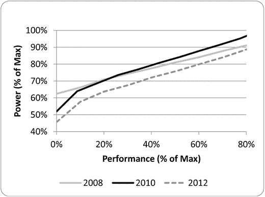

图 6-3. 不同 Linux 内核的功耗影响

数据中心的另一个挑战是在运行不同操作系统的系统中，强制实施一套一致的功耗与性能权衡策略。每个 `OSPM` 策略在电源状态选择上都有其独特的选择，从而导致不同的行为。一个策略可能偏向于最大化性能，而另一个可能偏向于最小化功耗。在某些情况下，希望有一种与操作系统无关的、可应用于多种不同软件环境的单一电源管理策略。

对于管理员来说，持续升级软件以支持最新的硬件特性并启用优化是不切实际的。同样，让管理员微调一个操作系统使其表现得像另一个操作系统也是不切实际的。为了解决这些问题，几家服务器制造商提供了它们在固件中实现的专有 `P-state` 控制能力。这使得管理员能够将统一的 `P-state` 控制策略应用于一整机架可能使用着各种不同操作系统和版本的服务器。与许多 `OSPM` 实现类似，这些固件策略允许管理员指定对低功耗、高性能或平衡设置的偏好。这些类型的高级配置选项可作为 `BIOS` 设置选项提供，允许管理员在固件控制策略或软件控制策略之间进行选择。

### P-state 策略

`P-state` 策略负责调整处理器的性能能力，以满足当前或预期的需求。当逻辑处理器利用率较低时，可以通过在低频率下运行处理器来满足需求。随着逻辑处理器利用率的增加，频率也必须增加，以防止系统达到完全利用率。

与 `C-state` 类似，`P-state` 策略主要基于逻辑处理器的利用率。单个策略可能会用额外的信息来补充利用率数据，例如当前运行频率或正在运行的进程的优先级。在为 `C-state` 讨论的利用率计算和时间窗口考虑，同样适用于 `P-state`，包括使用 `IA32_PERF_CTR1` 和 `IA32_TSC`。与 `C-state` 类似，在 `ACPI` 的 `P-state` 域表明必要时，`OS` 会代表每个逻辑处理器做出独立的决策。

#### 性能容量

服务器可以通过两种方式提高吞吐量，即每秒执行的指令数。第一种是利用可用资源。这很简单，就是在处理器未完全利用时，利用其空闲周期。第二种是提高逻辑处理器执行指令的速度或速率。这通过提高频率来实现。

在许多情况下，仅凭处理器利用率不足以了解处理器的工作状况。例如，如果一个处理器在 1.0 GHz（其最低频率）下运行且利用率为 50%，那么该处理器拥有的性能余量远大于在 3.0 GHz（其最高频率）下运行且利用率为 50%的情况。尽管在这两种情况下处理器利用率相同，但工作状况却大相径庭。

一个有助于理解处理器工作状况和 `OSPM` `P-state` 策略的重要概念是**性能容量**。这个指标基于处理器利用率，但它考虑了以更高或更低频率运行的影响，以准确捕捉性能余量。容量指标表示处理器当前正在使用的、相对于其最大保证吞吐能力的比例。

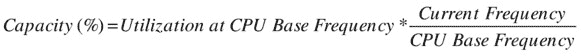

100%的容量可能代表一个处理器在 `CPU` 基础频率下以 100%的利用率运行。这是处理器的保证吞吐能力。使用 `Turbo`（一种非保证频率），容量可能超过 100%。

图 6-4 说明了 `OSPM` 如何使用频率来实现最大吞吐量。在最低频率下，仅通过利用空闲周期就能达到最大吞吐量的 40%。当逻辑处理器利用率开始接近 100%时，`OSPM` 的 `P-state` 策略会增加频率以提供额外的吞吐量。当处理器达到最大吞吐量的 90%时，它正在以最高频率运行，最后 10%的空闲周期被用来达到最大吞吐量。此图也用于说明为最佳能效而设计的 `P-state` 策略。

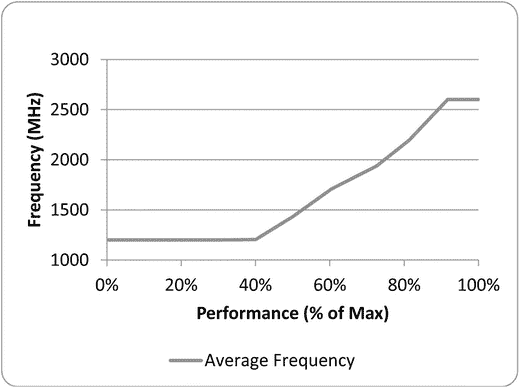

图 6-4. 全性能范围内的频率比较

从容量的角度来看，一个在 1.5 GHz 下 100%利用率的处理器与一个在 3.0 GHz 下 50%利用率的处理器是相同的。以高利用率和低频率运行可提供更低的功耗和更高的响应时间，而以低利用率和高频率运行则提供更高的功耗和更低的响应时间。`P-state` 对性能的影响在数据中心体现为响应时间的高低变化。

当系统承受持续负载时，`P-state` 策略绝不应影响最大吞吐量。`P-state` 的使用因操作系统而异，并且可以通过多种方式在给定容量下运行。是通过提高利用率还是提高频率来满足计算需求的增长，是 `OSPM` `P-state` 策略需要管理的关键决策。图 6-5 显示了平均逻辑处理器容量与平均逻辑处理器利用率之间的比较。

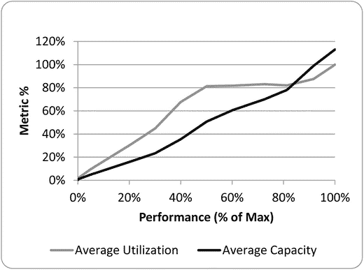

图 6-5. 平均利用率与平均容量对比

**注意**

数据中心管理员通常使用逻辑处理器利用率来描述服务器利用率，或者使用监控和分析工具显示的数据。不考虑频率来描述利用率会极具误导性，因为一台利用率为 40%的服务器，其实际容量利用率可能只有 25%。

在 `Figure 6-6` 中，容量超过 100%，因为该指标基于 `CPU` 基础频率，即处理器的保证频率。如前所述，`Turbo` 模式是一种非保证频率，因此图表展示了 `Turbo` 带来的性能，它超越了处理器的保证性能容量。容量也并非完美指标，它假设了理想的频率缩放（性能提升百分比与频率提升百分比的比率）。实际上，频率缩放因系统而异，因为它很大程度上取决于缓存和内存子系统的性能，并受到独特工作负载和系统特性的影响。

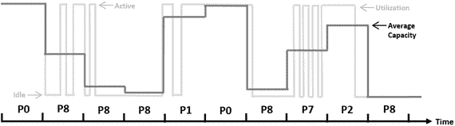

`Figure 6-6`. 一秒内具有请求 P 状态的示例逻辑处理器利用率

`Figure 6-6` 显示了一秒内单个逻辑处理器的样本容量以及 P 状态的能效使用情况。为简单起见，该示例假设有九个 P 状态，最低频率模式为 `P8`，处理器的 `CPU` 基础频率为 `P1`，`Turbo` 为 `P0`。在轻负载活动期间，即使容量大于 30%，也经常选择 `P8`。通过单独使用 `P8` 的空闲周期，即可满足处理器近一半的吞吐能力。

除了 Turbo 模式外，还存在 CPU 以高于操作系统请求的频率运行逻辑处理器的情况。内存控制器和 I/O（`PCIe`）在处理器中的集成，导致了仅凭逻辑处理器利用率不足以判断频率是否限制性能的情况。例如，对于网络密集型工作负载，可能在非常低的处理器利用率下驱动线速流量。由于处理器利用率低，典型的 OSPM 策略会选择低频率的 `P-states`。然而，在这种情况下，以最高频率运行逻辑处理器将通过降低延迟来增加吞吐量。由于 OSPM 无法洞察这些类型的瓶颈，现代处理器包含了特殊的特性来检测和处理这些情况。在高 IO 带宽的情况下，CPU 会自动提高处理器频率，以确保最大吞吐量不受影响。

### P 状态协调

对于 `P-states`，就像 `T-states` 和 `C-states` 一样，可以改变软件和硬件之间的协调方式。通过 ACPI 指定，电源状态协调可以使用以下方法之一。（绝大多数服务器操作系统使用`HW_ALL`。）

*   `HW_ALL`：操作系统为每个逻辑处理器发出状态转换请求，并将它们视为独立的。操作系统无需考虑对其他逻辑处理器的影响。硬件负责所有必要的协调。如果同一核心中的两个逻辑处理器请求`P1`，其中一个逻辑处理器将其请求更改为`Pn`，则该核心保持`P1`。

*   `SW_ANY`：操作系统为同一域中的单个逻辑处理器发出状态转换请求，效果是即时的，且与之前的请求无关。如果同一核心中的两个逻辑处理器请求`P1`，其中一个逻辑处理器请求`Pn`，则该核心变为`Pn`。

*   `SW_ALL`：操作系统为同一域中的每个逻辑处理器发出状态转换请求，并将它们视为相互依赖的。例如，如果单个域中有十六个逻辑处理器，操作系统通过在这十六个逻辑处理器中的每一个上发出相同的请求来更改该域的 `P-state`。

> **注意**
>
> 虽然 `P-state` 协调由 BIOS 固件控制，但选择除`HW_ALL`之外的模式可能会导致不良行为，因为大多数操作系统并未针对其他模式进行启用或优化。

### T 状态控制

操作系统也有能力控制 `T-states`，即节流状态，如[第 2 章]所述。现代服务器处理器都包含适当的温度传感器和硬件机制来防止处理器过热，因此操作系统对 `T-states` 的控制已无必要。通常不建议也不应使用 `T-states` 来提高能效。与 `P-states` 不同，`T-states` 不会调整电压——使用 `T-states` 会导致性能大幅下降，而功耗仅略有降低。

### 全局电源策略

在某些情况下，操作系统设置的默认 `C-state` 或 `P-state` 策略可能与用户的性能要求不一致。操作系统有两种不同的机制来解决这个问题，以调整电源管理。最常见的是支持预定义的电源策略。操作系统为管理员提供了设置全局电源管理策略的选项，该策略将改变 `C-states` 和 `P-states` 的行为和选择，使其更偏向低功耗、高性能或平衡方法。例如，Windows Server 控制面板公开了诸如高性能、平衡和省电等选项，这些选项会改变内部 OSPM 算法选择 `C-states` 和 `P-states` 的方式。第二种类型的调优可以通过使用低级工具或接口访问的高级设置或选项来实现，允许管理员定制自己的策略。

如[第 2 章]所述，除了 `C-states` 和 `P-states` 之外，还有许多其他电源管理功能会影响功耗和性能。大多数这些跨内存、缓存和处理器互连的电源状态并不由 OSPM 显式控制。做出电源状态决策所需的可见性仅存在于硬件中。尽管 OSPM 无法对这些电源特性进行低级控制，但硬件确实暴露了一种机制，允许操作系统指定能效策略偏好。

能效策略偏好，或者说 OSPM 对低功耗或高性能的偏向，由表[6-9]中描述的`IA32_ENERGY_PERF_BIAS MSR`控制。该寄存器用于为那些不由 OSPM 显式控制的电源管理功能定义功耗与性能之间的期望平衡。在具有严格响应时间要求的环境中，最好使用最小的`IA32_ENERGY_PERF_BIAS`值，而不是禁用功能，因为禁用电源管理功能可能会增加功耗和温度，最终影响最大性能。`IA32_ENERGY_PERF_BIAS`是动态的，因此可以在运行时根据 OSPM 的需要进行更改。

表 6-9。

`IA32_ENERGY_PERF_BIAS MSR (0x1B0)`

| 位 | 宽度 | 字段 | 描述 |
| --- | --- | --- | --- |
| 3:0 | 4 位 | 能效策略偏好提示 | 表示一个滑动比例，其中值 0 表示最大性能，值 15 表示最低能耗。值 7 大致对应平衡策略。 |
| 63:15 | 49 位 | 保留 | 未使用 |

### 进程调度

操作系统的进程调度器不直接与硬件电源管理功能交互，但其调度策略会对能效产生显著影响。许多提高性能的调度器特性，例如防止饥饿（确保每个进程都有机会运行）、对 CPU 密集型和 I/O 密集型进程的独特处理、负载均衡和迁移优化，对能效都有积极影响。然而，也存在许多性能提升对能效产生负面影响的特性。此外，关于各种调度器特性是否能提高能效，其答案可能取决于目标微架构。影响内核调度器能效的一些关键因素包括对逻辑处理器、核心和封装拓扑及能力的感知，定时器滴答频率，以及执行合并。

### 拓扑与能力感知

操作系统调度器为了做出节能决策所需的一项关键信息是，同一核心上的多个硬件线程或逻辑处理器在多大程度上共享资源。当逻辑处理器之间资源共享极少时，进程调度器可将它们视为独立的执行资源。然而，当逻辑处理器之间资源高度共享时，进程调度器需要理解，当共享相同资源的其他逻辑处理器被并发使用时，单个逻辑处理器的吞吐能力会受到何种影响。

由于大量服务器在低利用率下运行，进程调度器在如何利用逻辑处理器方面需要做出关键决策。一种策略是，在利用任何同步多线程（SMT）“兄弟”逻辑处理器之前，先利用每个核心上的单个逻辑处理器。这样做的好处是，让逻辑处理器能独占访问原本共享的核心资源，从而保持较低的逻辑处理器利用率。逻辑处理器利用率低会使操作系统电源管理（OSPM）采用功耗更低的`P-states`。另一种策略是，在利用其他核心之前，先利用一个核心上的两个逻辑处理器。这限制了缓存一致性流量，最小化了资源使用，从而改善了`C-states`驻留情况。它可能使部分核心能够长时间保持不间断的空闲状态。

对于应追求的最佳策略，并没有唯一正确的答案，因为最优决策取决于具体的微架构。你的策略取决于逻辑处理器之间共享的资源量；它受缓存大小和缓存层次结构级别的影响；它还受可用的不同`C-states`类型以及进出这些状态的延迟影响。在某种程度上，它甚至取决于独特的工作负载特征。一般来说，大多数服务器处理器受益于将软件线程分散到尽可能多的核心上。通常，能使核心频率保持最低的调度决策最为节能。当调度器在调度到下一个核心之前，先使用同一核心上的所有逻辑处理器时，资源争用会增加利用率，并导致 OSPM 更早地使用更高功耗的`P-states`。即使只是将`P-states`提升一个级别，也需要大幅增加`C-states`驻留才能抵消其影响。

从进程调度角度来看，另一种策略是，在利用另一个 CPU 上的逻辑处理器之前，先利用单个 CPU 上的所有逻辑处理器。从概念上讲，这很有道理，因为一个不执行任何指令的 CPU 应该能够进入非常低的功耗状态。实际上，这种方法的收益好坏参半。在包含两个或更多 CPU 的多插槽系统中，只要系统中的任何一个其他 CPU 处于活动状态，单个 CPU 就无法独立进入深度的封装级`C-states`。即使 CPU 的所有逻辑处理器都空闲，由于集成了内存控制器和 `PCIe`，该 CPU 上仍可能存在大量内存和 I/O 设备活动。

仅利用一个 CPU 上的逻辑处理器的另一个挑战，是对非统一内存访问（NUMA）局部性的影响。如果调度决策导致远程内存引用增加，则可能增加响应时间并降低能效。

为性能优化的 OSPM 的`P-state`策略可能会从这种方法中看到能效收益，因为即使在低利用率下，它们也会使用高频率的`P-states`。在这些环境中，在利用另一个 CPU 上的逻辑处理器之前，先利用一个 CPU 上的所有逻辑处理器，限制了在高电压下运行的 CPU 数量。

### 定时器滴答频率

周期性定时器中断决定了操作系统执行必要调度任务的频率。这个周期性定时器或定时器滴答在处理器处于活动状态和空闲状态时，都对能效起着重要作用。当逻辑处理器空闲时，它们必须唤醒以处理定时器滴答，这打断了进入深度封装级`C-states`所需的协同过程。现代操作系统会在系统空闲时抑制定时器滴答或限制其数量。例如，在空闲时，定时器滴答可能只由一个负责将中断转发给活动逻辑处理器的逻辑处理器接收。这改善了逻辑处理器的平均空闲时长，从而改善了封装级`C-states`驻留。这种行为通常被称为滴答跳过、动态滴答或无滴答空闲。

当处理器部分利用时，高频定时器滴答可以带来更高的性能，但这需要以功耗为代价。一个采用`1000 Hz`滴答率的内核每 1 毫秒产生一次定时器中断，而一个采用`64 Hz`滴答率的内核每 15.6 毫秒产生一次定时器滴答。Linux 甚至可以选择在忙碌时消除定时器滴答。

从性能角度来看，使用更高频率的滴答可以降低响应时间。更高频率滴答带来的时间精度提升改善了定时事件的分辨率——它使进程抢占更精确，并改进了优先级和公平性策略的执行。例如，一个从驱动器读取数据的高优先级进程，在使用高频定时器滴答时，驱动器读取之间的延迟会更小。从功耗角度来看，使用更高频率定时器的系统会花费更多时间处理定时器中断。中断处理时间的增加会推高逻辑处理器利用率，并将进入深度`C-state`所需的长空闲时长分割成多个较短的空闲时长。更高的中断率还会增加`C-state`转换次数，积累更多的`C-state`退出延迟，并增加额外的转换能耗。

### 执行整合（核心停泊）

进程调度器会将软件线程尽可能分散到多个逻辑处理器上，避免在同一逻辑处理器上调度多个软件线程，直到没有空闲逻辑处理器可用为止。这最大限度地利用了并行资源，并最小化了进程响应时间。在某些情况下，从性能、功耗或散热角度来看，采取相反的做法更可取——在单个逻辑处理器上调度多个线程，让其他逻辑处理器保持空闲。当以这种方式整合执行时，操作系统还必须确保设备中断和其他定时事件的处理仅在活动的逻辑处理器子集上进行。

#### 能效

将软件线程调度到单个逻辑处理器上以最大化其利用率，同时让其他逻辑处理器保持空闲，可以延长深度`C-state`驻留时间，并最小化电源状态转换。这种执行整合在产品和研究中拥有多种不同名称，例如核心停驻、核心空闲和功耗感知调度。以这种方式创建不均衡的负载，会使一定数量的逻辑处理器保持在无中断的空闲状态。

尽管执行整合确实能延长深度`C-state`驻留时间，但这并不一定能提高能效——这种做法是否有利于能效提升取决于诸多因素。一个关键的考量因素是核心功耗与其余非核心组件（如末级缓存、内存控制器和处理器互连）功耗的对比。对于非核心组件功耗占比较高的CPU而言，执行整合是不利的。因为仅需一个活动的逻辑处理器就能使非核心组件保持活动状态。在这种情况下，在两个核心上运行工作负载相比在一个核心上运行，其功耗增加百分比非常小。当CPU拥有由部分核心子集（而非所有核心）共享的非核心资源（如中级缓存）时，执行整合则更为有利。核心以及由少量核心子集共享的资源在CPU总功耗中所占比例越大，执行整合就越有利。

执行整合可能会增加响应时间，因为在任意给定时刻，一个逻辑处理器上只能运行一个软件线程。通过执行整合，准备就绪的软件线程可能需要等待执行，以避免利用那些被保持在无中断空闲状态的逻辑处理器。这种做法通常会导致活动核心以高利用率运行，同时也限制了CPU利用封装`C-state`的时间。另一个考量因素是软件线程之间共享数据的程度。当存在大量数据共享，尤其是频繁修改的数据时，执行整合可以显著改善缓存局部性。进程调度器很难清晰观察到这一特性，因此动态识别受益情况较为困难。在实现缓存收益的情况下，执行时间的缩短以及互连和内存利用率的降低，可以部分或全部抵消因执行时间增加带来的代价。相同的执行整合概念可以扩展到多插槽系统中的CPU。然而，即使没有软件线程在运行，CPU中的内存控制器和I/O（PCIe）通常也处于活动状态。这种非核心活动会消耗大量功耗。因此，简单地将软件线程从一个插槽移走，并不能让该插槽进入低功耗空闲状态。

在衡量能效时，一个关键的考量因素是如何将执行整合与`P-state`结合使用。对于大多数处理器而言，进程调度器采取的行动若导致逻辑处理器利用率升高，通常会导致使用更高频率的`P-state`。在这些情况下，能效会受到影响，因为即使是核心电压的微小增加也会导致功耗的大幅上升。在实践中，只有在非常特定的处理器上运行非常特定或合成的工作负载，才能显示出执行整合带来的能效提升，但这些情况属于少数。

#### 功率封顶

执行整合一个更具普遍效益的应用是用于功率封顶，即管理系统使其始终在定义的功率上限以下运行。服务器功率限制的主要机制是对逻辑处理器频率和内存带宽设置硬性限制。当这些机制用尽而功率限制仍未满足时，平台固件可以启动逻辑处理器空闲操作以进一步降低功耗。当电源或冷却基础设施发生故障时，可能需要多种不同的功率限制机制来满足功率上限并避免系统关机。

ACPI包含一个可选的处理器聚合器设备，它为固件提供接口和控制点来使逻辑处理器空闲。当需要额外的功率限制时，固件使用ACPI的`_PUR`方法请求指定数量的逻辑处理器空闲，操作系统将满足此请求。

当仅针对单台服务器来衡量这种做法时，功率限制并没有能效方面的好处。然而，当一机架服务器在机架级功率限制下运行时，数据中心管理软件可以限制重要性较低的服务器功率，以便为更重要的服务器提供额外的功率预算。

#### 单线程性能

执行整合的另一个应用是提升单线程性能。如第2章所述，睿频频率会随着CPU中空闲核心数量的增加而提高。将关键的软件线程以及设备中断处理、定时事件和任何其他后台活动都限制在单个核心上，可以确保活动核心始终以最高睿频频率运行。

### 内存管理

与执行合并的概念类似，如果服务器的内存使用未达到其全部容量，则可以将内存引用合并到内存的一个子集中。这允许剩余内存进入不间断的低功耗状态。该领域已有大量研究，但仅有有限数量的场景能从中获益。

内存合并需要操作系统了解物理内存拓扑。与CPU拓扑类似，此信息通过ACPI传递给操作系统。内存电源节点表（`MPST`）以内存电源节点的形式描述物理内存，即作为单一实体进行电源管理的特定地址范围。一个节点内可能包含多个地址范围，因为这些范围不一定连续。此外，`MPST`描述了硬件支持的电源状态，包括功耗和退出延迟。与`C-state`和`P-state`的`OSPM`类似，这一层级的信息对内存管理器至关重要，因为它提供了正确的输入来决定省电和性能影响。

与`C-state`和`P-state`不同，操作系统无需为内存节点启动电源状态转换。硬件事务根据节点的活动级别，自动在适当的电源状态之间进行切换。内存节点通常按通道层级定义，而非按列（rank）或`DIMM`层级。原因在于，内存的最低功耗状态（如自刷新）是在通道层级应用的。图6-7显示了物理内存与内存电源节点之间的关系。一个内存电源节点可能包含一至三个`DIMM`。

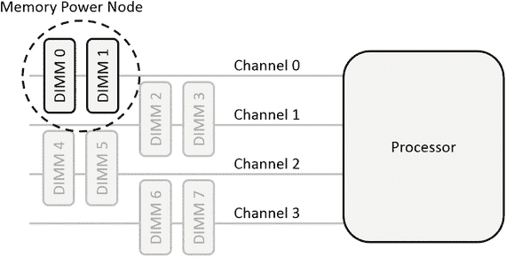

图 6-7. 物理内存与内存电源节点之间的关系

借助物理内存拓扑、延迟和功耗信息，操作系统内存管理器可以在内存分配时做出考虑功耗的决策。首先，可以分配物理内存，以便在一个通道上的`DIMM`被完全使用后，再从其余通道上使用`DIMM`。其次，操作系统内存管理器可以定期重新定位物理内存。由于大量未使用的物理内存并不常见，且内存会随时间推移变得碎片化，因此这一做法是必要的。重新定位将频繁引用的内存归入一组电源节点，而将不常引用或未分配的内存归入另一组电源节点。虽然这种做法并不能确保一组节点始终空闲，但它确实能显著改善在最低功耗状态下的驻留时间。

与本章描述的其他电源管理功能一样，内存合并需要平衡低功耗需求与高性能需求。服务器的默认设置是在通道和内存列之间交错内存。这通过将大块已分配内存均匀分布在通道、列和`DIMM`上，提高了系统的带宽能力。为了启用感知功耗的内存管理，BIOS固件在初始化内存控制器时需要禁用这种交错。从内存带宽的角度来看，许多数据中心工作负载仅使用带宽能力的一小部分，因此不会产生性能影响。对于内存带宽需求更高的其他工作负载，这是一种不可接受的权衡。操作系统有可能维持一定水平的内存交错以适配带宽需求，但在软件中管理这种交错的开销将抵消任何潜在收益。

内存引用合并面临的另一个挑战是内存重新定位的复杂性。内存重新定位会增加开销，体现在额外的处理器时间和额外的内存流量上，这两者都会减少系统处于低功耗状态的时间。那些随时间改变其内存引用特征的工作负载，或随时间被重新利用的内存页面，使得预测哪些页面会变热或变冷变得困难。最后，并非所有内存区域都可以重新定位，例如保留内存或非分页内存。

随着时间的推移，内存合并的潜在收益正在减少，因为数据中心正在从`DDR3 1.5 V`过渡到`DDR3L 1.35 V`，再到`DDR4 1.2 V`。不仅活动内存功耗更低，而且在列层级应用的浅层内存电源状态与在通道层级应用的深层内存电源状态之间的功耗差异也在缩小。感知功耗的内存管理的复杂导致了其适用性有限。它需要非常特定的工作负载和系统配置，才能展现出显著的能效优势。

### 设备驱动程序

除了实现`C-state`和`P-state`控制策略的处理器驱动程序外，一些I/O设备驱动程序也负责实现设备电源管理和控制策略。其他设备则自主管理电源，并且不定义用于电源状态发现和控制的软件接口。在生产环境中，大多数服务器无法容忍深度`D-state`的延迟。在延迟影响可以忽略不计的情况下，一些设备会监控自身的活动并利用浅层状态。在其他情况下，许多`D-state`特性在服务器上未被使用或被禁用。

#### PCIe、SATA 和 USB

## 如前文所述，操作系统使用 PCI-SIG 定义的标准接口来发现 PCIe `D 状态`的能力、将设备置入特定`D 状态`以及查询设备的电源状态。OS 的 PCI 驱动程序在枚举 PCI 设备时，会从 PCI 配置空间中发现所支持的能力。PCIe、SATA 和 USB 设备的`D 状态`通过类似的本地硬件接口进行管理。ACPI 被用于增强或补充这些能力；例如，处理缺乏本地硬件接口的设备，如`I2C`总线（用于连接低速外设的标准总线）上的端点设备。与`C 状态`和`P 状态`类似，软件与硬件协作以启动`D 状态`的转换。

软件启动的`D 状态`需要比处理器电源状态更高程度的协调，因为它们涉及设备、主机、总线和类别驱动程序。设备驱动程序负责在设备进入和退出低功耗状态之前和之后保存和恢复设备上下文。此外，操作系统还承担额外责任：在启动进入某个`D 状态`之前，必须确保设备没有待处理的事务。同样，操作系统必须确保总线上的所有设备都处于低功耗状态后，才能将总线置于低功耗状态。由于设备电源管理的延迟，服务器操作系统通常基于进入更高级别的系统状态（如`S3`）来启动`D 状态`。在进入`S3`之前，操作系统需要将每个设备置入`D3`状态。操作系统维护着`S 状态`与不同`D 状态`之间的特定映射关系，这些是总线和设备组件在进入目标`S 状态`之前必须达到的状态。

### 图形处理器

现代服务器处理器也可能包含集成图形处理器。I/O 设备驱动的电源管理中最复杂的案例之一就是图形处理器，因为除了管理 D 状态的责任之外，图形驱动还必须管理图形处理器的 P 状态。与处理器驱动类似，图形驱动的 P 状态请求同样基于衡量当前活动水平的事件。设备驱动结合了需求、延迟和每秒帧数（`fps`）要求来确定合适的 P 状态。图形驱动除了向`PCU`更新所需的核心和环形性能信息外，还会添加其他信息，以确保图形处理高效运行。

对于集成图形处理器，处理器核心和图形处理器共享相同的封装功率和热设计功耗预算。这与大多数采用独立图形控制器的服务器不同。在集成图形处理器的情况下，图形处理器和处理核心不可能同时以最高频率状态运行。如果在同一个 CPU 上，两个不同的设备驱动在彼此未协调的情况下请求更高的性能和电源状态，可能会导致处理器核心或图形处理器无法获得它们请求的性能。当功率预算无法满足两个驱动的请求时，`PCU`会根据其自身的内部知识做出决策，以最佳方式平衡功率预算。

图形设备也使用 C 状态，但这些状态由硬件自主控制。图形硬件会检测资源何时空闲，并处理 C 状态的进入，包括上下文保存和恢复。每当设备驱动访问图形硬件时，会立即退出 C 状态。

### 虚拟化

虚拟机监视器（`VMM`）肩负着与原生操作系统相同的电源管理职责。`VMM`，即宿主机，负责控制 C 状态、P 状态和全局电源策略。除了这些机制之外，VMM 还支持多种可提高能效的额外功能，例如服务器整合或通过虚拟机（`VM`）迁移实现的电源管理新方法。

#### 电源状态控制

`VMM`对 C 状态、P 状态和全局电源策略的管理职责不会与客户虚拟机共享。这些功能由宿主机控制。如果允许客户虚拟机访问电源状态控制功能，则会在并发运行的虚拟机之间产生大量策略冲突。某些虚拟机不了解其他虚拟机的情况，会要求高性能，从而偏向选择浅层空闲状态和高功耗活动状态；其他虚拟机则要求低性能，偏向选择深度空闲状态和低功耗活动状态；还有一些虚拟机则会要求介于两者之间的各种状态。

允许宿主机控制电源管理，同时限制或消除客户虚拟机的作用，是各种虚拟化模型中的常见做法，例如 `ESXi` 使用的 Hypervisor 模型、`Hyper-V` 和基于内核的虚拟机（或 `KVM`）使用的基于宿主机的模型，以及 `Xen` 使用的混合模型。这些 VMM 都使用虚拟 BIOS 启动虚拟机。暴露给客户虚拟机的虚拟 BIOS 所具备的功能集与物理服务器的 BIOS 固件不同。为方便宿主机控制电源管理，虚拟 BIOS 不会向客户虚拟机暴露电源管理功能。这可以防止客户虚拟机不必要地加载 C 状态和 P 状态的驱动及控制策略——所有客户虚拟机需要做的就是执行停机指令。这消除了客户虚拟机发出的、最终会被宿主机忽略的状态请求所带来的额外开销。

在某些情况下，客户机是“开悟的”，即它们知道自己运行在虚拟化环境中。这些客户机可能会被赋予某些控制能力，或者能感知到非典型客户虚拟机所不具备的电源管理功能。这种“开悟”允许宿主机进行一些电源管理优化。例如，可以向客户机暴露不同的 C 状态或 S 状态，使得单个 VM 的电源状态选择能够作为对宿主机的一种反馈。这些请求使得宿主机电源管理策略能够将单个 VM 的请求与其自身策略结合起来考虑，从而做出最佳的系统级决策。

##### 空闲状态考量

虚拟化环境在实现低空闲功耗方面带来了一些独特的挑战。即使一个操作系统什么都不做，当加载了许多不同的客户虚拟机操作系统时，也会产生显著的活动。与原生环境（或运行单个操作系统的环境）类似，空闲时也存在一些最低限度的活动，例如周期性定时器中断或网络心跳。这些周期性事件会持续唤醒逻辑处理器，并可能阻止系统进入深度封装 C 状态。当单个物理系统上存在大量 VM 时，即使最轻微的活动也会变得显著。

与原生操作系统类似，许多 VMM 优化了空闲场景，试图对齐周期性事件并减少逻辑处理器被唤醒的次数。例如，不同虚拟机（尤其是那些共享公共频率的虚拟机）的定时器滴答可以对齐到同一时刻发生。这使得多个虚拟机的周期性事件处理能够并行发生，从而减少了电源状态转换的次数，并增加了平均空闲驻留时间。

图 6-8 比较了经过几年软件改进后，VMM 和客户机的空闲场景。在该图中，系统基础空闲功耗约为 100 瓦。2009 年的软件栈使用了当时及更早发布的客户操作系统组合，其空闲活动优化程度各不相同。此场景下的 VMM 很少或根本不进行周期性活动对齐。2014 年的软件栈使用了当时及更早发布的客户操作系统组合，并且 VMM 对周期性活动进行了对齐。这一比较说明了软件组件在虚拟化环境中实现低空闲功耗的重要性。

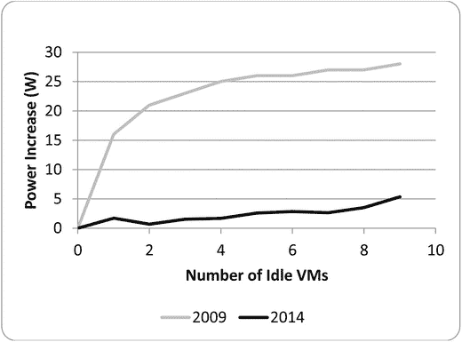
图 6-8. 虚拟化环境中软件对空闲功耗的影响

##### 主动考量

在虚拟化环境中的资源利用特性通常与原生环境不同。客户虚拟机的逻辑处理器数量、内存容量以及可使用的网络带宽均受到限制。这些限制因实例类型和虚拟机大小而异。将应用程序限制在不同的系统资源子集上会导致非对称的资源利用。在原生环境中，由于应用程序能够利用所有可用的系统资源，处理器和插槽之间的资源利用通常非常相似。而在虚拟化环境中，常见的情况是某些逻辑处理器持续处于 100%利用率，而其他处理器则处于空闲或低利用率状态。这些利用特性的显著差异会影响`OSPM`策略制定`P-state`决策的能力，使其难以满足各种虚拟机的性能需求。

图 6-9 和图 6-10 展示了在固定吞吐率下典型的逻辑处理器利用率。在原生环境示例中，系统利用特性变化很少，且多数逻辑处理器的利用率水平相近。在虚拟化环境示例中，系统利用特性频繁变化，且各逻辑处理器之间的利用率差异巨大。这些特性导致`OSPM`面临一系列棘手的决策。为了满足各类虚拟机的性能需求，虚拟化环境通常在电源管理方面采取较为保守的策略。

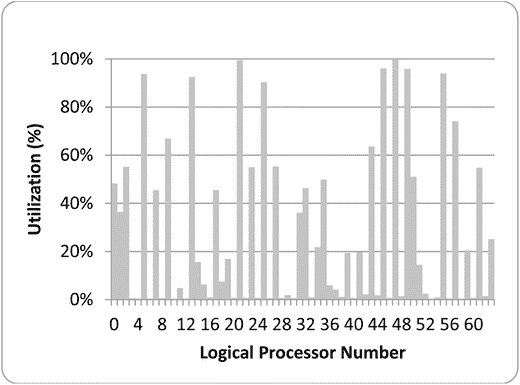
图 6-10. 虚拟化环境下 30%吞吐量的示例

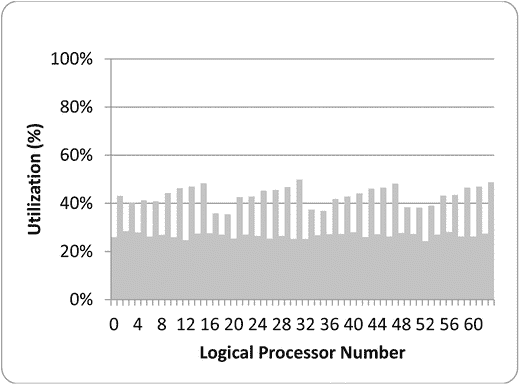
图 6-9. 原生环境下 30%吞吐量的示例

从能效角度来看，另一个考量因素是虚拟化环境中额外软件层带来的开销。这种开销会增加执行时间或响应时间，并降低吞吐量。任何这类影响都会增加功耗，因为事务或计算任务需要更长时间才能完成。随着更多虚拟服务器整合到同一台物理服务器上，虚拟化开销的影响也随之增大。CPU 密集型工作负载受开销影响较小（通常低于 10%），因为内核时间极少。而执行大量系统调用、执行大量特权指令并生成大量中断的 I/O 密集型工作负载，其开销通常超过 15%。

因此，能够限制或消除`VMM`开销的软件或硬件增强功能，能够显著提升能效。诸如`EPT`（扩展页表）或`VT-d`（直接设备分配虚拟化技术）之类的虚拟化技术通常被视为性能优化手段，但在启用和未启用这些特性的系统上运行工作负载，证明了它们同样具备功耗优化能力。

### 整合

大多数原生服务器（即运行单一操作系统的服务器）只支持一个主要应用程序。在此场景下，限制应用程序数量具有若干优势：提升性能、避免资源冲突、增强应用监控能力，并实现问题隔离。在许多情况下，在服务器上运行单一应用程序也会导致 CPU 利用率低下。

提高服务器能效的最佳方法就是提升利用率。服务器处理一笔事务的能耗成本与利用率成反比。例如，服务器在 60% 容量时处理一笔事务的平均能耗成本，比在 10% 容量时最高可降低五倍。服务器整合是提高利用率的主要机制之一。它允许将大量现有服务器（例如那些运行在低利用率或低性能处理器上的服务器）替换为一台更高性能的服务器。来自现有服务器的操作系统和应用程序被整合，并以客户虚拟机的形式部署在这台高性能服务器上运行于`VMM`之下。即使多个应用程序运行在同一物理服务器上，这些应用程序依然能够获得许多与应用程序和物理服务器一对一映射时相同的隔离优势。

整合在能效方面的好处是巨大的。首要好处是，通过减少支持相同应用程序集所需的物理服务器数量，实现了功耗节约。大多数虚拟化环境的整合比（单台物理服务器上运行的虚拟服务器数量）超过 10:1，因此节能潜力巨大。整合之后，许多老旧和高功耗的服务器可以彻底关闭并移除。整合的第二个好处是能够提高服务器的平均利用率。运行`VMM`并支持多个应用程序的物理服务器，其利用率通常远高于支持单一应用程序的原生服务器。

> **注意**
> 整合通常会受到非 CPU 资源的限制，例如平台上的 DRAM 容量或服务等级协议中定义的性能要求。

运行遗留软件（即较旧的应用程序和操作系统）的服务器是整合的常见目标。较旧的操作系统可能无法最优地支持最新的硬件电源管理功能，或者默认关闭了某些电源管理功能。例如，`Windows Server 2003`或使用 2.6.5 之前内核的`Linux`发行版等环境，并未默认启用最有益的电源管理功能。在此背景下，整合通过使遗留软件环境能够使用最新的`OSPM`策略，提供了额外的优势。当运行遗留软件的客户虚拟机在现代化`VMM`下运行时，许多最新的软件电源管理优势得以实现。

### 虚拟机迁移

一台以最大性能 25% 运行的服务器，如果其功耗不超过最大功率的 25%，则称为能量比例服务器。诸如`C`状态、`P`状态和内存`CKE`（时钟使能）等技术，是实现能量比例的关键要素；然而，服务器要达到这一目标仍有很长的路要走。

迁移技术允许虚拟机管理器（`VMM`）将客户虚拟机从一台物理服务器迁移到另一台，而不会中断服务或丢失执行上下文。将虚拟机从一台物理系统迁移到另一台有许多原因。最常见的原因包括对系统执行维护，或让出现某种性能或功能问题的系统腾空。数据中心管理软件也使用虚拟机迁移来跨物理服务器实现虚拟服务器的负载均衡。通过结合使用迁移和整合，某些服务器可以保持在高利用率状态，从而将事务处理的能耗成本降至最低。其余服务器则可以挂起（`S3`状态）或断电（`S5`状态）。图 6-11 展示了通过迁移和整合实现的能量比例效果。通过此示例所示的迁移与整合，能效可提升超过 25%。

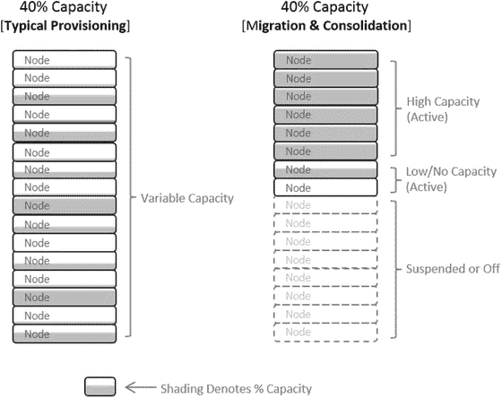
图 6-11. 通过迁移和整合实现能效的示例

非活动服务器可以通过局域网唤醒（`Wake-on-LAN`）数据包或标准带外管理接口（如智能平台管理接口`IPMI`）来唤醒。另一种常见做法是让一定数量的服务器保持空闲但未挂起状态。当创建新虚拟机时，这些实例可以在未充分利用但处于活动状态的服务器上进行配置，从而隐藏初始化挂起服务器带来的延迟。这些做法使得资源池更具动态性，能够最大化能效，并适应吞吐量的波动，而无需等待服务器进入和退出`S`状态。

迁移技术正越来越多地被采用，以提高利用率和能效，但这一做法目前尚未广泛普及。采用率受到抑制的原因有很多。首先，从延迟角度来看，虚拟机迁移的成本非常高。根据工作负载、应用程序和活动内存占用情况，迁移一个虚拟机可能需要几分钟时间。在迁移过程中，事务性工作负载的平均响应时间会急剧增加。对于计算型工作负载，最大吞吐量会下降。在这两种情况下，使用本地存储的应用程序都会带来额外的挑战。许多数据中心缺乏精确预测当前和未来需求的能力。进出`S`状态的转换延迟很高。退出`S3`状态可能需要几秒钟来恢复，因为需要恢复大量的执行上下文。硬件和软件创新将持续加速虚拟机迁移时间并缩短`S`状态转换时间，使这成为未来更可行的能效策略。

## 操作环境比较

所有操作系统都使用相同的机制进行电源管理的发现与控制，然而，这些接口的使用策略和方法却大相径庭。每个操作系统在如何测量活动、如何频繁地更改电源状态以及接受何种性能影响方面，都有一套独特的决策集。每个操作系统都决定这些决策是自包含的，还是受外部服务、管理和编排软件影响。每个操作系统还决定了其允许的定制和调优程度，以及不同的操作系统决策组合如何映射到更高级别的全局电源策略。

以下各节详细介绍了最广泛部署的服务器操作系统中每一个的独特特性。本节概述了操作系统电源管理（`OSPM`）默认设置的独特特征和行为，包括对功耗与性能平衡的探讨。还概述了每个操作系统的主要功能和策略变更，以比较本章中描述的不同电源管理特性和能力的特定操作系统版本。

### Microsoft Windows Server（包括 Hyper-V）

默认情况下，`Windows Server OSPM`为最佳能效进行了优化。在此环境中运行的应用程序消耗更少的能源，从而降低了成本。由于侧重于降低功耗，响应时间会显著增加。与所有操作系统的情况一样，`OSPM`策略通常不会影响最大性能。当`CPU`持续高利用率时，那些会影响性能的电源管理功能不会被使用。

`Windows Server`的`P`状态策略是容量驱动的，当利用率超过预定义阈值时会提高频率。提高频率的阈值设置得很高，这确保了仅在服务器在当前频率下无法满足需求时，才会使用更高频率。在利用率降低时，该策略降低频率的积极性，高于在利用率升高时提高频率的积极性，从而实现了更低的功耗。`Windows Server`的`P`状态策略在利用完整的`ACPI`暴露`P`状态范围方面表现出色。利用率以数十毫秒为单位进行观察，并且`OSPM`的`P`状态策略能够维护过去利用率的历史记录。

`Windows Server`的`C`状态策略比较简单，它在数十毫秒的时间窗口内检查利用率。该`C`状态策略基于上一个观察窗口做出一个单一的目标状态决策，该决策将在当前观察窗口内使用。该策略的简单性优势在于其非侵入性，不会在软件层面为`C`状态进入路径增加任何延迟。借助硬件降级机制过滤掉非最优的`C`状态决策，该解决方案提供了出色的能效。

`Windows Server`支持用户可配置的全局电源策略，包括节能、平衡和高性能。每种电源策略都代表了一组控制`C`状态和`P`状态策略决策的特定`OSPM`参数组合。这些参数和功能的行为高度可配置。例如，可以轻松设置`P`状态的上限或下限，修改频率升高或降低的阈值，或者更改用于测量利用率的观察窗口时长。一个例子就是在高性能模式下，不会使用低于`CPU`标称频率的`P`状态。

通常，调整`OSPM`策略以降低响应时间要比调整策略以降低功耗容易得多，这使得`Windows Server`的默认行为成为管理员想要微调`OSPM`以满足特定性能要求时的一个良好起点。电源策略也会更改`IA32_ENERGY_PERF_BIAS`，调整硬件电源管理功能，以实现操作系统指定的功耗与性能之间的期望平衡。`Windows Server`的几个关键调优机制将在第 7 章中详细描述。

#### Windows Server 高级电源管理功能

`Windows Server`还包含高级电源特性，在某些特殊情况下可提供额外优势。这些高级特性可以在特定系统上运行特定工作负载子集时实现节能。由于特性优势不适用于大多数工作负载和系统，这些高级特性通常默认被禁用。`Windows Server`中的核心停放（`core parking`）功能通过整合执行来提高能效。它会动态调整用于运行软件线程的逻辑处理器数量，允许某些逻辑处理器进入深度的、不间断的空闲状态。`Windows Server`的实用程序分发（`utility distribution`）特性可与核心停放结合使用。实用程序分发监控难以从某个逻辑处理器迁移到另一个逻辑处理器的活动，例如绑定到特定逻辑处理器的软件线程或中断。`Windows Server`利用此信息改进核心停放决策，并更好地预测未来需求。内存冷却（`memory cooling`）功能将内存引用整合到有限的一组内存电源域中，为拥有大容量内存且大部分内存不常被使用的系统节省电量。

`OSPM`在`Windows Server`和`Hyper-V`之间大致相同，但定义节能、均衡和高性能电源策略的具体参数和调优值在两者之间略有差异。`Hyper-V`包含一些细微更改，通过牺牲部分节能效果来换取更快的响应时间。

表 6-10 列出了随时间推移添加到`Windows Server`的主要电源管理特性和改进。

```
表 6-10. Microsoft 服务器操作系统环境的历次变更

| 版本 | 发布年份 | 变更内容 |
| --- | --- | --- |
```

| Windows Server 2003 | 2003 | 添加了对 `C-states` 的支持。添加了对 `P-states` 的支持。添加了对 `T-states` 的支持。添加了全局电源策略（用户可选）。默认策略为高性能（导致默认不使用 `P-states`）。对于 `P-states` 和 `C-states` 没有独立的逻辑处理器控制，仅支持单处理器。 |
| --- | --- | --- |
| Windows Server 2003 R2 | 2005 | 相对于 Windows Server 2003 无重大变更。 |
| Windows Server 2008（及 Hyper-V 角色） | 2008 | 默认处理器性能策略为均衡（导致默认使用 `P-states`）。为 `ASPM` 添加了电源策略。 |
| Windows Server 2008 R2（及 Hyper-V 角色） | 2009 | 新的处理器电源管理策略带来了显著的能效提升。添加了定时器滴答合并（`timer tick coalescing`）。添加了智能定时器滴答分发（`tick skipping`）。添加了核心停放。添加了电源计量和预算管理。添加了远程电源管理和组策略。Hyper-V 现已内置。Hyper-V 实时迁移功能。 |
| Windows Server 2012 | 2012 | 添加了逻辑处理器空闲（`logical processor idling`）。添加了内存冷却。Hyper-V 支持更多虚拟机和每虚拟机更多处理器（4 到 64）。 |
| Windows Server 2012 R2 | 2013 | 相对于 Windows Server 2012 无重大变更。 |

## Linux 发行版（包括 KVM）

Linux 的 `OSPM` 针对低延迟进行了优化。在此环境中运行的应用程序具有更好的性能，最小化了事务响应时间。由于专注于降低延迟，功耗显著增加。与其他操作系统类似，`OSPM` 策略不会影响最大吞吐量。在持续的 CPU 高利用率下，可能影响性能的电源管理特性不会被启用。

Linux 通过 `CPUfreq` 基础设施支持 `P-states`，该基础设施为底层控制驱动程序和称为调控器（`governors`）的高层控制策略提供了接口。调控器可以动态更改，但大多数服务器发行版的默认调控器是 `ondemand`。`Ondemand` 是由容量驱动的，当利用率超过预定义阈值时，选择最高可用频率；当利用率低于阈值时，则使用次低频率。在可变负载下，频率增加比降低更激进，从而实现了低延迟。当服务器部分利用时，`ondemand` 倾向于使用有限的 ACPI 暴露的 `P-states` 范围，其中大多数请求是 `Pn` 或 `P0`。这是因为只要利用率超过阈值，`P0` 就是唯一的目标状态。`Ondemand` 会观察数十毫秒级的利用率，并且不考虑历史记录。

对于没有响应时间要求且能容忍额外延迟的环境，`conservative` 调控器是 `ondemand` 的替代方案。此调控器能更均衡地使用全部范围内的 `P-states`。与 `ondemand` 相比，`conservative` 调控器会导致更高的响应时间，但功耗更低。可以使用 `performance` 调控器永久运行在最高频率，而使用 `powersave` 调控器永久运行在最低频率。

英特尔还提供了自己的原生 `P-state` 驱动 `intel_pstate`。此驱动针对低响应时间进行了优化，并通过将调控器和频率缩放驱动组合来最小化延迟以及 `P-state` 选择的软件开销。该驱动增强后可理解每个处理器的特定能力，从而更好地利用 Turbo（睿频加速）。`intel_pstate` 驱动可以被描述为原生驱动，意味着它使用 CPU 接口来确定关于电源管理能力的更丰富信息，而非使用 `ACPI`。原生驱动对于 BIOS 可能通过不正确的 `ACPI` 对象引入的任何问题都具有更强的鲁棒性。

与 `P-states` 类似，Linux 通过 `CPUidle` 基础设施支持 `C-states`，该基础设施同样提供了底层控制驱动程序和称为调控器的高层控制策略之间的分离。大多数服务器发行版的默认调控器是 `menu`。`OSPM` 策略使用多种不同的指标来做出最佳的 `C-state` 决策。这些指标包括先前的 `C-state` 驻留时间、预期的空闲持续时间以及目标 `C-state` 的退出延迟。系统会为每个逻辑处理器的每次空闲进入选择一个目标 `C-state`，而不是为所有逻辑处理器在一段时间窗口内确定一个单一的目标 `C-state`。这种方法的优点是错误的决策发生频率较低；缺点是增加了额外的软件开销。优点通常超过缺点，从而提供了卓越的能效。英特尔还提供了自己的底层 `intel_idle` 驱动，该驱动增强后可理解每个处理器的特定能力。`intel_idle` 能够比 ACPI BIOS 向 `acpi_idle` 暴露更多的硬件 `C-states`。例如，在某些服务器上，`intel_idle` 能够导出一个延迟低于 `C1E` 的 `C1` 状态。与 `intel_pstate` 不同，它不会取代现有的高层策略。

Linux 不包含通过单一设置即可自动调整调频器、其调优参数以及 `IA32_ENERGY_PERF_BIAS` 等平台级控制的全局电源策略。相反，Linux 依赖单独选择和调优 C-state 调频器与 P-state 调频器，并结合诸如 `cpupower` 等工具来管理 `IA32_ENERGY_PERF_BIAS` 设置及执行整合的选项。Linux 拥有强大的能力来微调单个电源管理参数，例如设置最低频率或限制特定 C-state 的使用。这些内容将在第 7 章中更详细地讨论。

Linux 具备一些高级电源特性，可在特定环境中提供额外优势。这些特性可能对特定工作负载和特定微架构表现良好，但在其他情况下则不然。因此，其中一些特性默认是禁用的。调度器通过 `cgroups` 和 CPU 热插拔基础设施支持核心停靠（core parking）。这些特性可用于将执行过程整合到特定子集的逻辑处理器上。然而，它必须与额外的管理软件相结合，才能实现动态执行整合。执行整合的能效优势在结合低延迟 P-state 策略（例如 `ondemand`）时更为常见。当此技术与平衡或低功耗 P-state 策略结合时，其能效优势则不那么常见。

> **注意**

> 基于内核的虚拟机（KVM）从 Linux 继承了关键电源管理功能，因此在使用 KVM 的本地环境与虚拟化环境之间，电源管理能力或策略的差异非常小。Xen 并非以相同方式继承关键电源管理功能。添加到 Linux 内核的电源管理特性必须重新实现或移植到 Xen 上，因此本节中的许多特性和说明并不直接以相同方式适用于 Xen。

表 6-11 列出了 Linux 内核中随时间推移新增的主要电源管理特性及其改进。在某些情况下，关键电源管理特性已被向后移植到现有 Linux 发行版中。为了避免逐一介绍每个发行版及其内核主次版本号，Linux 参考文档会引入首次引入该功能的版本。

### 表 6-11. Linux 服务器操作环境的历史变更

| 版本 | 发布年份 | 变更内容 |
| --- | --- | --- |
| 内核 2.4.22 | 2003 | 默认禁用 ACPI 内置 P-states |
| 内核 2.6.5 | 2004 | 新增 CPUfreq 子系统；新增 `ondemand` 及其他调频器；默认启用 P-states（使用 `ondemand` 调频器） |
| 内核 2.6.18 | 2006 | 新增对深度 C-state（I/O 端口）的支持 |
| 内核 2.6.19 | 2006 | 新增对深度 C-state 的 `MWAIT` 支持；新增用于 P-states 的 `APERF`/`MPERF` 反馈 |
| 内核 2.6.23 | 2007 | 默认禁用 ACPI OSI（Linux） |
| 内核 2.6.24 | 2008 | 新增无滴答空闲（`CONFIG_NO_HZ`）；新增 CPUidle 子系统 |
| 内核 2.6.30 | 2009 | 新增 USB HID 自动挂起 |
| 内核 2.6.32 | 2009 | 新增用于功率限制的 `acpi_pad`（处理器聚合设备） |
| 内核 2.6.35 | 2010 | 新增 `intel_idle`（Intel CPUidle C-state 驱动程序） |
| 内核 2.6.36 | 2010 | 新增 CPU 离线时的深度 C-state 支持；新增 USB 大容量存储自动挂起 |
| 内核 3.1 | 2011 | 新增对 `IA32_ENERGY_PERF_BIAS` 的内核支持（如果内核在启动时发现其值为 0，则将其设置为 6） |
| 内核 3.5 | 2012 | 移除 `sched_mc_power_savings` 调度器可调参数（早期动态执行整合实现） |
| 内核 3.9 | 2013 | 新增 `intel_pstate`（原生 Intel P-state 驱动程序）；新增空转注入驱动程序 |

### 内核版本历史

| 内核 3.10 | 2013 | 新增完全无滴答（`CONFIG_NO_HZ_FULL`），允许 Linux 在空闲或忙碌时均无时钟滴答 |
| --- | --- | --- |
| 内核 3.11 | 2013 | 新增用于带内功率限制的原生 RAPL 驱动程序 |

### VMWare ESX 和 ESXi

与其他操作系统的方法相比，基于 `ESXi` 的环境的一个关键重点是在集群级别，跨大量服务器管理电源。`分布式电源管理（DPM）`将活跃的虚拟机整合到一部分服务器上，使这部分活跃服务器以更高的利用率运行，同时将未使用的服务器置于待机或关闭模式。可以配置 `DPM`，使其尽可能在最小规模的服务器子集上运行虚拟机，以实现能源消耗与工作负载成正比。

针对 `C-states` 和 `P-states` 的 `OSPM` 策略由主机电源管理（`HPM`）负责。当多个虚拟机竞争系统资源时，`ESX` 主机电源管理针对低延迟进行了优化。在此环境中运行的应用程序性能得到提升，最大限度地减少了事务响应时间。在此环境中运行的应用程序具有更低的响应时间，但这是以更高的功耗为代价的。与其他操作系统类似，在持续高 CPU 利用率下，可能影响性能的电源管理特性不会被使用。

`ESXi` 支持用户可配置的电源策略，包括高性能、平衡、低功耗和自定义。这些策略既包括电源管理参数及其关联调优值的组合，也包括特性的静态启用和禁用。例如，在高性能模式下，`P-states` 和深度 `C-states` 被完全禁用。在平衡和低功耗模式下，`P-states` 和深度 `S-states` 均被启用。低功耗模式启用所有电源管理特性，并更积极地使用低功耗和高延迟状态。自定义策略允许管理员指定电源管理参数值，例如根据退出延迟限制 `C-states`，或更改用于测量利用率的观测窗口。

表 6-12 列出了 `ESXi` 中随时间推移新增的主要电源管理特性及其改进。

**表 6-12.** `VMWare ESX/ESXi` 操作环境的历史变更

| 版本 | 发布年份 | 变更内容 |
| --- | --- | --- |
| `VMware ESX 3.5` | 2007 | 新增`分布式电源管理`（虚拟机的动态迁移、服务器的关机和重启以管理电源）。 |
| `VMware ESX 4.0` | 2009 | 新增对 `P-states` 的支持（默认禁用）。 |
| `VMware ESX 4.1` | 2010 | 新增全局电源策略（用户可选择的）。默认策略为高性能（导致默认不使用 `P-states`）。 |
| `VMware ESXi 5.0` | 2011 | 新增`主机电源管理`。默认策略为平衡（默认启用 `P-states`，但无 `C-states`）。 |
| `VMware ESXi 5.1` | 2012 | 无重大变更。 |
| `VMware ESXi 5.5` | 2013 | 在平衡策略中新增对 `C-state` 的支持。 |