# 监控

以最少精力即可实现针对功耗、性能或成本的服务器优化。此过程始于监控系统行为，以了解其使用方式以及可改进之处。电压、电流、能耗、功率和温度等传感器测量值，可识别出对服务器总功耗贡献最大的单个组件。延迟、带宽和吞吐量事件则揭示了提供额外性能所需付出的能量代价。通过监控电源状态转换、时钟中断和设备中断，用户可以更深入地了解服务器上任务的分布情况。本章将介绍多种监控能力及其工作原理，并讨论各种事件和指标、它们的收集方式，以及用户能从中获取哪些信息。第 8 章将继续介绍如何利用这些事件和统计数据来指导优化决策。

系统和子组件的监控有助于用户改进组件选择及未来系统设计。监控有助于软件优化，并能识别出改进资源利用率的机遇和问题。管理软件中的控制决策会利用监控来调整基础设施以适应不断变化的情况。例如，管理软件可以监控处理器利用率和内存带宽，来指导虚拟机迁移决策。或者，CPU 可以利用温度传感器来判断何时应将处理器降频至更低频率。

监控功能分布在平台的多个子组件中。处理器在核心和核心外部分别设立了可编程性能监控单元，基板配备了由管理控制器监控的电源和温度传感器，操作系统则监控单个应用程序的处理器、内存和 I/O 使用情况。比较来自不同子组件的监控数据，用户可以构建出关于功耗和性能如何影响能效的完整图景。

## 硬件监控

有多种机制可从 CPU 提取被监控的事件或统计数据。其中一些高层级机制汇总于表 7-1。尽管每种机制都包含一些独特功能和特性，但某些事件通过多种机制进行追踪的情况也并不少见。

表 7-1. CPU 硬件监控类型

| 机制 | 描述 |
| --- | --- |
| 性能监控计数器（固定计数器） | 这些计数器持续追踪单个固定统计量。在许多情况下，它们是自由运行的，意味着它们持续计数且无法停止或清除。许多关键的硬件统计数据都保存在固定计数器中。 |
| 性能监控计数器（可编程） | 硬件性能监控常被软件开发人员用于代码的特征分析和优化。大多数此类计数器可被配置为对广泛的事件进行计数。性能监控计数器同时存在于核心内部和核心外部。 |
| 状态快照 | 寄存器提供了某些系统状态的快照。软件可以在特定时间点读取此状态以了解系统特征。状态快照最常见的例子是温度状态寄存器。 |

访问 CPU 功耗统计数据有多种不同机制。然而，这些功能中的大部分需要内核级权限（Windows 中的管理员权限，Linux 中的 root 权限）。如果你没有这些权限，那么只有在系统管理员允许普通用户访问时，这些统计数据才可用。这些统计数据通常也无法在虚拟机内部获取，因为这些统计数据是针对整个系统的。

### 固定计数器

系统中提供了一些固定计数器用于追踪各种统计量。这些计数器无法被停止或清除（除非通过 CPU 冷启动或热复位）。当多个用户同时需要访问一个通用统计量时，这些计数器非常有用。固定计数器的缺点在于它们无法使用一些更强大的监控技术。

### 核心性能监控器

英特尔 CPU 的核心已历经多代，均采用标准的性能监控基础设施。每个硬件线程都有专用的可配置计数器（通常为四个）。每个计数器都有一个配置寄存器，允许用户选择要计数的特定事件。除了这四个可配置计数器外，核心上还有三个固定计数器。所有这些计数器都作为 MSR 实现，并被视为核心性能监控架构的一部分。核心性能监控器的详细信息已在《英特尔软件开发手册》（SDM）中做过详尽描述，因此此处不再赘述。更多信息请参考以下资源：

*   [`www.intel.com/content/dam/www/public/us/en/documents/manuals/64-ia-32-architectures-software-developer-manual-325462.pdf`](http://www.intel.com/content/dam/www/public/us/en/documents/manuals/64-ia-32-architectures-software-developer-manual-325462.pdf)。
*   核心性能监控事件作为 SDM 的一部分，按处理器系列列出，因为这些事件可能随代际发生变化。每个处理器的核心性能监控事件也在以下链接提供的公开文件（tsv 和 json 格式）中有描述：[`https://download.01.org/perfmon/`](https://download.01.org/perfmon/)。

在监控电源管理方面，核心中的三个固定计数器 MSR（`IA32_FIXED_CTR[0,1,2]`）功能非常强大。每个计数器都可以通过`IA32_FIXED_CTR_CTRL` MSR 进行配置，以监控正在执行的特定线程，或者在具有 SMT 的处理器上，监控核心上的所有线程。第一个固定计数器追踪已退役指令数，即处理器执行的每条指令的计数。第二个计数器追踪非暂停周期数，即处理器积极执行指令的周期数。第二个计数器始终以处理器的当前运行频率计数。第三个计数器与第二个类似，也追踪非暂停周期，但其始终以处理器的基准频率计数。软件可以使用`IA32_FIXED_CTR_CTRL` MSR 来配置固定计数器，使其监控特定线程或共享一个核心的所有线程。此配置通过写入`IA32_FIXED_CTR_CTRL` MSR 中一个名为`AnyThread`的特定字段来完成。同一个 MSR 接口还提供了选项，可以分别或同时追踪用户态时间或内核态时间。

已有许多软件工具可用于监控固定和可编程的核心性能监控器（本章稍后会讨论其中一部分）。使用计数器的最简单方法是采用基于时间的采样，步骤如下：

1.  清除计数器（以避免早期溢出）。
2.  在配置寄存器中配置所需事件，并使能计数器。
3.  等待一段时间（在应用程序执行期间）。
4.  再次读取计数器。
5.  重复步骤 1-4。

更高级的技术也是可行的，例如基于事件的采样（EBS）。在 EBS 中，不是在固定的时间内收集样本，而是当某个计数器达到期望值时，计数器会自动停止。此时，会产生一个中断，通知监控软件收集关于系统和软件状态的额外信息。EBS 不常用于电源管理监控，因此在此不作讨论。

好的，作为一名高级文档工程师和翻译员，我将严格遵循您提供的注意事项和示例，将以下英文文本翻译成中文。

### 非核心性能监视器

与核心性能监视不同，非核心的性能监视架构并非在所有代际和产品线中都是标准化的。从 Sandy Bridge 代开始，Xeon E5/E7 产品采用了一种通用架构。在其他英特尔产品上，很少将非核心性能监视功能产品化，因此本章将重点介绍 E5/E7 中可用的功能。

Sandy Bridge 引入的非核心性能监视与核心中的功能非常相似。计数器分布在非核心的不同模块中，能够同时收集大量统计数据。尽管大部分与功耗相关的统计数据存在于 `PCU` 的计数器中，但其他模块也存在与功耗相关的事件。

每当产品发布时，都会公布非核心性能监视功能和寄存器的产品特定详细信息。以下链接包含了最新一代产品的 E5/E7 非核心性能监视文档：

*   [`www.intel.com/content/dam/www/public/us/en/documents/design-guides/xeon-e5-2600-uncore-guide.pdf`](http://www.intel.com/content/dam/www/public/us/en/documents/design-guides/xeon-e5-2600-uncore-guide.pdf)
*   [`www-ssl.intel.com/content/dam/www/public/us/en/documents/manuals/xeon-e5-2600-v2-uncore-manual.pdf`](http://www-ssl.intel.com/content/dam/www/public/us/en/documents/manuals/xeon-e5-2600-v2-uncore-manual.pdf)
*   [`www.intel.com/content/www/us/en/processors/xeon/xeon-e5-v3-uncore-performance-monitoring.html`](http://www.intel.com/content/www/us/en/processors/xeon/xeon-e5-v3-uncore-performance-monitoring.html)

#### 全局冻结/解冻

非核心性能监视的一个挑战是协调分布在各个非核心模块中的大量监视单元。简单地在这些模块中读取所有计数器可能需要数十微秒。这种延迟既可能干扰工作负载的执行（尤其是在非常短的时间窗口内进行采样时），也可能导致收集到关于监视软件而非目标工作负载的统计数据。因此，非核心性能监视架构包含了一个全局的“冻结”和“解冻”功能。该功能试图同时启动和停止各个非核心模块中的所有计数器。虽然同步并非完美，但非核心性能监视（也称为偏移）冻结中的任何延迟通常远低于一微秒。

#### 边沿检测和状态平均时间

许多监视事件指定了一个条件，该条件在每个满足条件的周期内被计数。例如，如果有一个事件监视核心处于目标 C 状态的时间，那么当核心处于该目标 C 状态时，该计数器会在每个周期递增。除了测量处于状态的时间外，能够监视进入和离开某个状态的次数也很有用。例如，您可能希望能够计算进入目标 C 状态的次数。为了避免为时间和转换分别设置独立的事件，系统使用了 `边沿检测` 硬件，它可以将任何对时间（或周期）进行计数的事件转换为对转换次数进行计数的事件。

一种常见的监视技术是使用一个计数器监视周期，并使用另一个计数器监视边沿。通过使用这两个事件，用户可以计算某个状态的平均时间：

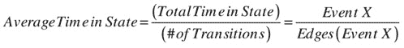

#### 标准事件和占用事件

许多事件在给定的周期内仅递增 1。例如，如果您正在监视对 DRAM 的读取次数，一个标准事件会在每次读取时递增 1。

在性能监视中，进行排队和延迟分析时，测量不同队列的占用率非常有用。占用事件在每个周期内可以递增 1 或更多。占用事件也可以与阈值比较一起使用，当某个队列的占用率达到可配置的阈值或更高时，该事件递增 1。

对于性能监视，占用事件通常用于以下方式：

*   在给定占用率（或更高）下的时间¹ 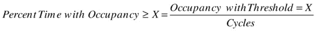
*   队列的平均占用率 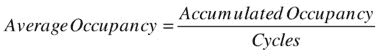 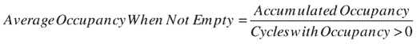
*   队列中的平均延迟 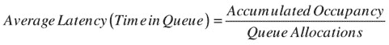

尽管“队列”在物理上并非电源管理的常见组成部分，但占用事件也可以应用于电源管理统计数据。例如，您可能想要了解所有核心同时处于核心 C6 状态的时间量。通过查看单个核心驻留状态，无法判断不同核心的活动在时间上的对齐情况。通过使用一个核心 C6 状态的占用事件，并将其阈值设置为系统中的核心数量，您可以计算出所有核心同时处于空闲状态的时间量。

### 状态快照

快照提供了系统特性的即时视图。这对于那些不经常变化的信息（如温度）特别有用。状态快照的一个缺点是，监视软件可能意外地收集到关于自身的信息。例如，如果监视软件以高采样率测量处理器频率，它可能导致频率升高到高于没有监视软件时的正常水平。

### 计数器访问和计数器约束

读取或写入计数器和快照通常需要一定的时间。访问核心可编程计数器可能需要数十个时钟周期，而访问非核心和其他计数器则可能需要数百个时钟周期。通过从整个系统收集大量信息，可能会干扰工作负载。收集的统计数据的量会对可执行的采样大小产生很大影响。通常，采样速度快于每 10 毫秒一次可能会导致显著的工作负载干扰。

计数器可以在处理器中以不同方式实现。大型硬件计数器可能相当昂贵（面积、功耗），并且并非总是理想的——尤其是在面积受限或多次复制的模块中。提供关于某些类型信息的即时信息也很困难或不可能，例如，用于监视能耗的计数器。通过常规同步逻辑精确监视能耗统计数据代价非常高昂。因此，一些固定计数器会定期使用这些信息进行更新，而不是即时更新。

### 事件和指标

前面章节描述的监视机制支持各种不同的可测量事件，例如核心温度、非核心 P 状态转换或在 CPU 互连上传输的高速缓存行。事件通常测量精确的低级事件发生、行为或状态时间。事件本身通常无法提供对系统或子组件行为有意义的洞察。因此，通常使用一个或多个低级事件来计算更高级别的功耗或性能指标。例如，内存性能的一个常见指标是带宽。它是基于一些低级事件（如 CAS 命令、DDR 频率和以 DDR 时钟周期为单位的测量持续时间）计算得出的。

事件和指标包括许多不同类型的统计数据。一些例子包括时间、温度、能量、电压、频率、延迟和带宽。存在于各个子组件中的特定事件和指标提供了对系统运行时特性的洞察。

#### 时间 (RDTSC)

大多数软件环境都提供了访问系统时间信息的机制。通常，在收集功耗和性能监控统计数据时，这些 API 足以收集已用时间信息。

系统中有多种不同的时间测量方法。x86 架构包含一条用于获取时间的指令——读取时间戳计数器 (`RDTSC`)，该指令对用户空间应用和内核均可用。由于指令可能乱序执行，因此还提供了 `RDTSCP`（`RDTSC` 的序列化版本）。该版本确保在读取时间戳计数器之前，所有先前的指令都已执行完毕。`RDTSC` 在同一个插槽上的所有线程之间以及多插槽系统中的线程之间都是同步的。`RDTSC` 指令返回一个以处理器基础频率速率递增的周期计数值。虽然每个 CPU 上都有一个集中时钟，但时间戳计数器也维护在核心中，这使得访问速度非常快。与某些性能监控计数器不同，`RDTSC` 在所有电源管理状态下都会进行计数。系统上还存在其他几种定时器，但首选时间戳计数器，因为其中许多定时器访问所需时间要长得多。

大多数软件工具都会提供测量已用时间的 API，因此通常无需直接使用 `RDTSC` 指令。尽管本章中许多依赖于已用时间的统计数据和公式会使用增量 TSC，但这可以用给定软件环境提供的任何时间测量方式来替代。

#### 基本性能

两个对于理解能效至关重要的基本性能指标是 CPI 和路径长度。CPI（即每指令周期数）衡量的是完成单条指令退役所需的平均 CPU 周期数。这是常用性能指标 IPC（即每周期指令数）的倒数。当计算工作简单、缺乏复杂操作且数据引用频繁命中核心缓存时，CPI 较低。当计算工作复杂、高延迟操作频繁且许多数据引用需要由内存满足时，CPI 较高。低 CPI 的软件能最大化各种子组件处于低功耗空闲状态的时间。它比高 CPI 的软件更节能。

路径长度衡量的是完成单个工作单元所需的平均指令数。该工作单元通常由所关注工作负载的吞吐量指标表示。例如，一个工作单元可能是一个 Web 服务器上的单个 HTTP 事务、一次数据库写入、复杂科学计算的一部分，或 I/O 测试工具中的一次单次磁盘读取。除了明显的性能优势外，低路径长度的软件还能最大化处于低功耗空闲状态的时间，因为完成一个工作单元所需的步骤更少。

性能可以通过更快地完成工作（降低 CPI）或通过使用更少的步骤完成工作（降低路径长度）来提高。在以下公式中，性能表示完成一个工作单元所需的时间。因此，性能通常可以通过将 CPI 乘以路径长度来表示。以下公式展示了如何计算这些基本性能指标。这些指标可以按逻辑处理器、按核心或按应用进程进行监控，也可以取平均值以提供系统级别的视图。

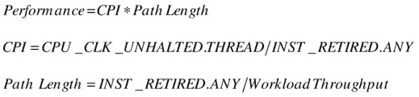

#### 能耗

能耗通过插槽和内存 RAPL 特性进行监控（详见第 2 章）。作为 RAPL 的一部分，自由运行的能耗计数器会追踪处理器所消耗的焦耳数。所有由 RAPL 测量的能耗都以相同的格式表示，称为能量单位。一个能量单位代表固定数量的微焦耳能耗。以更大粒度的能量单位来测量能耗，可以使高分辨率的能耗计数器覆盖更广泛的值域。然而，一个能量单位所代表的具体微焦耳数可能会因处理器代际而异。`RAPL_POWER_UNIT MSR` 会暴露在给定处理器上用于 RAPL 的能量单位。第 12:8 位显示了能量单位。例如，Sandy Bridge 架构呈现的值为 `0x10`，这对应约 15.3 微焦耳的增量 (1/2¹⁶)。

**注意：** 能量单位会根据代际发生变化。例如，Haswell 架构使用的单位（约 61 微焦耳）与 Sandy Bridge 和 Ivy Bridge 架构（约 15.3 微焦耳）不同。

一个时间窗口内消耗的能量和平均功率可以通过以下两个公式测量：

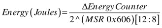

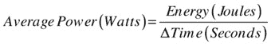

表 7-2 列出了处理器上可用的不同类型能耗统计数据。

**表 7-2.** 能耗统计

| 统计项 | 类型 | 描述 |
| --- | --- | --- |
| 插槽能耗 | 固定自由运行计数器 | 插槽能耗报告 CPU 封装中所有逻辑（包括所有电源轨）所用能耗的估算值。并非所有电源轨都处于活跃测量状态，因此此处报告的功率仅供参考。 |
| DRAM 能耗 | 固定自由运行计数器 | DRAM 能耗提供系统中 DDR3/4 内存设备所用能耗的估算值。请注意，对 DRAM RAPL 的支持确实需要一定的平台启用，且并非所有系统都支持 DRAM RAPL。 |
| 核心能耗 | 固定自由运行计数器 | 核心能耗计数器是在 Sandy Bridge 代引入的，但在 Haswell 代被移除了。为核心域提供准确的能耗估算成本高昂。 |

**注意：** 目前能耗计数器只有 32 位。例如，在 Sandy Bridge 架构上，计数器可能在几分钟后就会回绕。类似于汽车的里程表，当能耗计数器溢出时，它们会直接循环归零，从头开始计数。使用这些计数器的软件应检测并处理此溢出情况。

### 温度

现代处理器包含众多温度传感器，这些传感器对软件可见。这些传感器通常仅内核级软件可访问，因为它们通常位于 MSR 寄存器空间中。这些传感器有时被称为数字温度传感器（`DTS`）。温度数据通常相当精确，特别是在接近节流温度点时尤为准确。随着温度降低，`DTS` 的精确度往往会下降。

大多数服务器内存的 DIMM 上也包含温度传感器。RDIMM 始终如此，而 ECC UDIMM 也几乎总是如此。这些传感器被称为片上温度传感器（`TSOD`）。单个 `TSOD` 位于内存 DIMM 上（通常位于 DIMM 中部），而非每个设备都有独立传感器。由于 DRAM 设备可能较长，DIMM 长度方向上存在较大温度梯度的情况并不罕见。当 DIMM 的朝向与平台气流方向一致时尤其如此。当空气沿 DIMM 方向流经设备时，空气会升温，导致“最后一个”设备比第一个设备温度高得多。平台设计者在设计散热方案时会考虑这些梯度。由于 `TSOD` 位于设备中部，常见情况是一些设备温度较高，而另一些设备温度较低。

温度计数器并非报告以摄氏度为单位的具体温度，而是报告到节流的裕量（即最高允许温度与当前温度之间的差值）。到节流的裕量在核心级别通过 `IA32_THERM_STATUS` MSR 测量，在封装级别通过 `IA32_PACKAGE_THERM_STATUS` MSR 测量。封装温度报告了封装上所有传感器中的最高温度。这包括核心外可能存在的任何其他温度传感器。传统上，核心是服务器裸片上的热点，但在低功耗服务器设计中，由于封装功率预算中更大比例用于 I/O 功率，这一趋势开始改变。计算以摄氏度为单位的实际温度所需的最高允许温度，通过 `TEMPERATURE_TARGET` MSR 测量。

`IA32_THERM_STATUS` MSR 的作用域是线程级，意味着单个线程只能访问自身的温度信息。在某些系统中，多个线程可能共享一个温度传感器，因此总会得到相同的结果。除了报告温度外，`IA32_THERM_STATUS` MSR 还报告系统中可能已发生的热节流的日志和状态信息。`IA32_PACKAGE_THERM_STATUS` 和 `TEMPERATURE_TARGET` MSR 的作用域是封装级，意味着插槽上的所有线程共享相同的寄存器（及数据）。表 7-3 列出了系统上可获取的不同类型温度统计信息。

**表 7-3.** 温度统计信息

| 统计项 | 类型 | 描述 |
| --- | --- | --- |
| 核心温度 | 状态快照 | 核心温度通过 `IA32_THERM_STATUS`（`MSR 0x19C`）和 `TEMPERATURE_TARGET`（`MSR 0x1A2`）暴露。最高温度（或 `DTSMAX`）= `TEMPERATURE_TARGET` [`23:16`] 目标偏移量 = `TEMPERATURE_TARGET` [`29:24`] 到节流的裕量 = `IA32_THERM_STATUS` [`22:16`] 温度（`C`）= `DTSMAX` - 目标偏移量 - 到节流的裕量 |
| 封装温度 | 状态快照 | 封装温度通过 `IA32_PACKAGE_THERM_STATUS`（`MSRX B`）暴露。到节流的裕量 = `IA32_PACKAGE_THERM_STATUS` [`22:16`] |
| 附加封装温度传感器 | 状态快照 | 核心外通常确实存在传感器。尽管这些传感器的信息包含在 `PACKAGE_THERM_STATUS` 中，但尚未有标准化接口用于访问这些温度传感器的信息。 |
| 内存 DIMM 温度 | 状态快照 | 对于支持 `TSOD` DIMM 的系统，内存 DIMM 温度也维护在封装中。与其他封装传感器一样，没有用于访问温度信息的标准化寄存器集。虽然此信息目前未公开记录，但可以在平台级别使用 IPMI 监控内存 DIMM 温度。 |

### 频率与电压

在功耗与性能领域，频率是最重要的统计指标之一。系统中有多种机制用于监测工作频率。

两种主要机制是线程作用域的`IA32_PERF_STATUS`和`IA32_PERF_CTRL` MSR。`IA32_PERF_STATUS` MSR 保存了读取该寄存器的线程的当前频率比率。它还包含一个非架构字段，用于提供当前核心工作电压的参考信息。该电压字段在较旧一代的服务器 CPU 上不存在，但在许多当前世代的 CPU 中已具备此功能。`IA32_PERF_CTRL` MSR 与第 6 章中介绍的接口相同，允许操作系统为给定线程请求一个频率比率。与`IA32_PERF_STATUS` MSR 类似，`IA32_PERF_CTRL` MSR 也有一个用于请求电压的字段，但该字段已不再使用。电压现在由封装自主控制，写入这些位不会对系统行为产生影响。同时监测这两个寄存器，用户可以了解请求频率与授予频率之间的关系。

在基于 Haswell 微架构的 E5/E7 处理器上，非核心部分（Uncore）拥有自己的频率和电压（详情见第 2 章）。这些处理器包含一个`UNCORE_PERF_STATUS` MSR，用于保存非核心部分的当前工作比率。该寄存器并非架构性寄存器，通常仅在对非核心比率进行动态控制的系统上公开。

`IA32_APERF`和`IA32_MPERF` MSR 可用于测量用户定义时间窗口内的平均频率。这些自由运行的计数器有时也被称为`ACNT`和`MCNT`。从技术上讲，`ACNT`和`MCNT`没有架构定义，而是仅定义了这两者的比率。`ACNT`在线程活跃时，以线程当前运行的频率进行计数。`MCNT`在线程活跃时，以 CPU 的基础频率（P1）进行计数。当线程在 C1 或更深度的 C 状态中暂停时，这两个寄存器均不进行计数。

近期版本的 Windows 开始在核心中清零`ACNT`和`MCNT`，导致其他软件工具无法使用。较老版本的 Linux（2.6.29 之前）也有此行为。Linux 不再在运行时清零这些 MSR，以便其他软件工具（如内核附带的`turbostat`）也可以利用这些寄存器。

与`ACNT`和`MCNT`类似，固定计数器也可用于监测核心或特定线程在活动时的平均频率。该方法会自动过滤掉核心休眠的时间。当某个线程（或核心）未暂停时，`IA32_FIXED_COUNTER1` MSR 以当前频率的速率递增。当某个核心（或线程）未暂停时，`IA32_FIXED_COUNTER2` MSR 以处理器基础时钟的速率递增。如本章前面“核心性能监视器”所述，当固定计数器的 `AnyThread` 位设置为 0 时，计数器测量的是特定线程在活动期间的平均工作频率。当 `AnyThread` 位设置为 1 时，固定计数器测量的是整个核心的平均工作频率。

**注意**

系统中不同的线程报告不同的平均频率是很常见的，即使在不支持每核心 P 状态的处理器上也是如此。这是因为平均值仅在线程活跃时才进行计算。

要测量用户定义时间窗口内的平均非核心频率，可以使用 CPU 缓存代理中的可编程计数器对时钟进行计数（相关编程信息请参阅本章前面的非核心监测链接）。缓存代理时钟在封装 C6 状态时停止，因此在计算平均频率时需要考虑到这一点。表 7-4 列出了系统上可用的不同频率和电压统计信息。

**表 7-4.** 频率统计信息

| 统计信息 | 类型 | 描述 |
| --- | --- | --- |
| 当前核心频率 | 状态快照 | 核心频率通过 `IA32_PERF_STATUS`（`MSR 0x198`）公开。在 Nehalem 和 Westmere 世代：`` 在 Sandy Bridge（及其后续世代）：`` |
| 当前核心电压 | 状态快照 | 核心电压通过 `IA32_PERF_STATUS`（`MSR 0x198`）公开 `` |
| 请求的核心频率 | 状态快照 | 请求频率通过 `IA32_PERF_CTRL`（`MSR 0x199`）公开。`` |
| 当前非核心频率 | 状态快照 | 非核心频率通过 `UNCORE_PERF_STATUS`（`MSR 0x621`）公开。`` |
| 平均核心频率 (APERF/MPERF) | 自由运行计数器 | 平均核心频率通过 `IA32_APERF`（`MSR 0xE7`）和 `IA32_MPERF`（`MSR 0xE8`）公开。`` |
| 平均核心频率（核心性能监视） | 核心性能监视器 | 平均核心频率也通过 `IA32_FIXED_COUNTER1` 和 `IA32_FIXED_COUNTER2` 公开。`` |
| 平均非核心频率 | 非核心性能监视器 | 平均非核心频率通过可编程计数器与自由运行计数器的组合来公开。`` |
| 频率直方图 | 状态快照 | 部分处理器支持为核心、非核心或两者生成频率直方图的功能。配置这些事件可能具有挑战性。PCM 工具（本章后续讨论）在支持的处理器上提供了这些功能。 |
| 频率转换 | 状态快照 | 可以测量系统中发生的频率转换次数。在 Sandy Bridge 和 Ivy Bridge E5/E7 上，可以通过对 `FREQ_TRANS_CYCLES` 事件进行边缘检测来测量特定插槽上的频率转换次数。在 Haswell E5/E7 上，增加了一个额外的性能监视事件，用于跟踪非核心频率转换的次数。`FREQ_TRANS_CYCLES` 事件仍然存在，现在会计算所有核心以及非核心的频率转换总次数。注意：这些“周期”事件也提供了执行频率转换所需周期数的粗略估计，但通常，它们并不能高度准确地指示软件被阻止执行代码的时间长度。 |

#### C-States

表 7-5 和表 7-6 列出了系统上可用的不同 C-State 统计信息。

**表 7-6. 封装 C-State 硬件统计信息**

| 统计项 | 类型 | 描述 |
| --- | --- | --- |
| 封装 C-State 驻留时间 | 固定自由运行计数器，性能监视器 | 与核心 C-State 类似，存在用于测量封装 C-State 驻留时间的自由运行计数器。• 封装 C2 通过`MSR 0x60D`公开。• 封装 C3 通过`MSR 0x3F8`公开。• 封装 C6 通过`MSR 0x3F9`公开。 |
| 封装 C-State 转换次数 | 非核性能监视器 | 驻留时间 MSR 非常适合监控驻留时间，但无法通过它们测量转换次数。因此，在 Ivy Bridge 上，测量驻留时间的相同事件被添加到了非核性能监控基础架构中。将这些事件用于驻留时间并结合边缘检测，可以监控转换次数。您可以通过以下公式计算在某个封装 C-State 中停留的平均时间（整个节点的平均空闲周期）：`` 您还可以计算封装 C-State 之间的平均时间：`` |

**表 7-5. 核心 C-State 硬件统计信息**

| 统计项 | 类型 | 描述 |
| --- | --- | --- |
| 核心 C-State 驻留时间 | 固定自由运行计数器 | 在许多代处理器上都增加了自由运行计数器，用于跟踪每个核心上的 C-State 驻留时间。它们以与`RDTSC`相同的速率（以处理器的基准频率）计数。• 核心 C1 通过`MSR 0x660*`公开。• 核心 C3 通过`MSR 0x3FC`公开。• 核心 C6 通过`MSR 0x3FD`公开。这些计数器指的是实际的硬件 C-State，而非 ACPI C-State。 |
| 核心 C0 驻留时间 | 核心性能监视器 | 如本章前面所述，`IA32_FIXED_COUNTER2`（设置`AnyThread = 1`）监视在核心 C0 状态下花费的周期数，并以处理器的基准频率计数。 |
| 核心 C1 驻留时间 | 公式 | 在不包含核心 C1 驻留时间 MSR 的处理器上，可以通过以下公式计算：`` |
| 线程活跃（TC0） | 核心性能监视器 | `IA32_FIXED_COUNTER2` MSR（设置`AnyThread = 0`）将监视当前线程处于 TC0 状态的时间量。它以处理器的基准频率计数。 |
| 线程 C1 | 公式 | 线程 C1 不容易测量（除了在支持核心 C1 驻留计数器但不支持 SMT 的处理器上）。可以使用以下公式：`` |
| 核心 C-State 占用率 | 非核性能监视器 | 非核提供了一个性能监视器，用于跟踪在给定时间点处于特定状态的核心数量。这可用于计算活跃核心的平均数量。此外，用户可以使用非核性能监视器中的阈值逻辑来统计具有给定数量活跃核心的周期数。详情请参阅特定处理器的非核性能监控指南，或参考`PCM`的源代码（稍后详述）中的示例。 |

*目前，只有基于 Silvermont 的处理器支持核心 C1 驻留时间。

#### 内存功耗与性能

Xeon E5/E7 CPU 上的每个内存控制器通道都包含多个非核性能监控计数器和一个用于计数`DCLK`周期的固定计数器。在最近的处理器代中，内存控制器时钟在深度封装状态下被门控，性能监视器将在此状态下停止计数。表 7-7 列出了系统上可用的关键内存功耗和性能统计信息。

**表 7-7. 内存功耗与性能统计信息**

| 统计项 | 类型 | 描述 |
| --- | --- | --- |
| 带宽 | 非核性能监视器 | CAS 命令（详见第 2 章）指的是发往 DRAM 的读取和写入命令。通过计数 CAS 命令，可以测量内存带宽。`` |
| 时钟门控时间 | 非核性能监视器 | 每当时钟未被门控时，内存控制器中的固定性能监控周期计数器就会递增。通过结合使用`RDTSC`和固定周期计数器测量样本之间的时间，您可以计算出时钟门控的时间。`` |
| CKE | 非核性能监视器 | CKE 按秩进行控制。内存控制器有一个事件，用于计数 CKE 信号为高电平（且功耗为高）时花费的时间。可以从总时钟数中减去该时间，以确定 CKE 为低电平的时间。当内存控制器时钟被门控时，CKE 始终为低电平。`` |
| 自刷新 | 非核性能监视器 | 内存在通道级别应用自刷新。当一个通道完全进行时钟门控时，它也处于自刷新状态。因此，当计算实际处于自刷新的时间时，应将处于时钟门控状态的百分比时间始终添加到性能监视器计算出的总数中。自刷新主要用于空闲状态。即使在低利用率下，观察到处于自刷新状态和时钟门控状态的时间都非常少，这也是很常见的。`` |

内存带宽直接影响内存功耗。在构建系统时，所需的内存带宽也会显著影响采购决策。

#### PCIe 电源管理

从 SoC 内部几乎无法了解 PCIe 电源管理的情况。

#### QPI 电源管理与性能

QPI 提供了多种性能监视器。表 7-8 和 7-9 列出了系统上可获取的关键 QPI 电源和性能统计信息。QPI 模块中的性能监视计数器以该模块逻辑的时钟频率进行计数。QPI 链路以极高的频率运行，其单位是 GT/s（千兆传输/秒）。例如，Sandy Bridge 的运行频率高达 8 GT/s。在这些设计中，单个 flit（一个 80 位的传输单元）的数据在四次传输中完成（在此示例中，相当于 2 GHz 的速率）。从 Sandy Bridge 开始，用于 QPI 性能监视逻辑的时钟以该频率的一半运行（在此示例中相当于 1 GHz），并且该逻辑每个周期可以处理两个 flit。

**表 7-9. QPI 性能统计信息**

| 统计信息 | 类型 | 描述 |
| --- | --- | --- |
| 带宽 | 非核心性能监视器 | QPI 带宽不仅由缓存行的数据传输驱动，还由维护一致性和 QPI 协议的附加信息传输所驱动。QPI 性能监视器可以将协议开销 flit 与数据 flit 分开。与以下事件掩码配合使用的 `TxL_FLITS_G0` 事件（代码 `0x0`）可提供此信息。  • 掩码：`0000_0001b`：空闲 flit  • 掩码：`0000_0010b`：数据 flit  • 掩码：`0000_0100b`：协议 flit  • 掩码：`0000_0110b`：已使用的 flit 总数（不包括空闲 flit）  请回忆，当 QPI 未处于 L1 状态时，它总是在传输 flit。当无需传输实际信息时，会使用空闲 flit。因此，一种简单的链路利用率测量方法是通过以下公式。  对于 Sandy Bridge 和 Ivy Bridge：  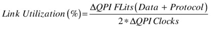  对于 Haswell：  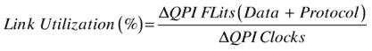  还可以减去在 QPI L1 状态中花费的周期，以便从利用率指标中过滤掉长时间的空闲周期，但在监控活跃工作负载时，这通常意义不大。数据带宽（GB/s）是另一个有趣的指标，它可以指示预期的 QPI 功耗。QPI 中的每个 flit 包含 8 字节的数据。因此，数据带宽可以通过以下公式计算：  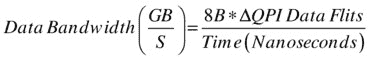 |

**表 7-8. QPI 电源统计信息**

| 统计信息 | 类型 | 描述 |
| --- | --- | --- |
| QPI 频率 (GT/s) | 非核心性能监视器 | 对于 Sandy Bridge 和 Ivy Bridge，可以通过以下公式测量 QPI 模块的频率：  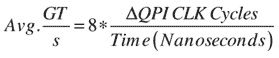  对于 Haswell，可以通过以下公式测量 QPI 模块的频率：  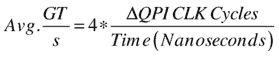  请注意，此公式假设系统处于活动状态，从而阻止任何粗粒度的时钟门控发生。在几乎空闲的系统中，可能会测量到较低的频率。 |
| L0p 时间 | 非核心性能监视器 | 在 L0p 状态下花费的时间可以通过 QPI L0p 事件进行监控。  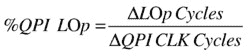  通过使用边沿检测，还可以测量 L0p 转换的次数。请注意，L0p 转换阻塞数据传输的时间非常短。 |
| L1 时间 | 非核心性能监视器 | 在 L1 状态下花费的时间可以通过 QPI L1 事件进行监控。在最近的处理器代次中，L1 专门用于封装 C6 状态，因此几乎不需要单独测量其驻留时间。事实上，由于同时发生的时钟门控，在许多情况下此 QPI 计数器会停止计数。 |
| 时钟门控 | 非核心性能监视器 | 当链路处于 L1 状态时，某些处理器代次上的整个 QPI 模块可以被时钟门控。通过测量 QPI 周期，可以计算链路处于时钟门控和 L1 状态的时间量。为此，必须首先知道 QPI 链路的时钟频率。  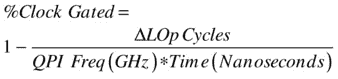 |

## 管理控制器监控

系统中的管理控制器，包括基板管理控制器（BMC）和 PCH 中的管理引擎（ME），提供了更广泛的平台级监控功能。BMC 连接到系统中的各种总线、传感器和组件，使其能够充当覆盖大量不同系统组件的集中式监控资源。BMC 还可以将监控功能与阈值配对以生成事件，例如指示某个组件温度已超过安全级别。

管理控制器监控补充了 CPU 和操作系统提供的监控功能。BMC 和 ME 提供了对许多无法在其他地方监控的独特监控事件的访问，例如风扇转速、电源、电压以及常规平台健康状况。它还允许在系统启动、断电或无响应时进行监控。如第 5 章所述，管理控制器的监控功能通过 IPMI 进行访问。

### 组件功耗传感器

了解单个组件的功耗以及各个组件如何累加形成平台总功耗，可以获得极大的洞察力。在理想的监控解决方案中，平台功耗（扣除 PSU 效率损失后）应等于所有单独测量组件的功耗总和。然而，大多数服务器只能测量 CPU 和内存功耗，这留下了不完整的图景。

**注意**

一个常见的问题是“系统中的功耗是如何分解的？”一种工程方法是识别出消耗功率最多的几个组件，并将优化工作重点放在这些组件上。系统中功耗的分解在不同服务器之间差异很大，并且系统中的许多单个组件仅占总功耗的一小部分。

可以向基板添加额外的传感器来测量这些缺失的组件，报告功率或电流和电压。在电路板设计期间，添加这些计算组件功率所必需的增强型传感器的成本相对较小，例如，添加通过 SMBus 接口暴露读数的 VR，或添加可通过 I2C 访问的电流传感器。这些额外的传感器允许节点管理器（NM）固件计算平台中所有组件的能耗，以确定未说明的功耗来自何处。例如，NM 可以暴露 PCH、LAN、风扇和 BMC 的单独能耗测量值。当前一代的节点管理器支持多达 32 个额外的监控设备，因此可以以精细的粒度监控组件能耗。

与使用 CPU 能耗事件类似，NM 能耗事件与时间戳相关联，因此用户可以定期读取传感器，以在所需的时间窗口内计算功耗。

### 合成传感器

为了公开更多关于平台的信息，节点管理器为那些不易测量的平台特性添加了新的合成传感器。节点管理器 3.0 增加了报告体积气流和出风口温度的能力。这些值是基于服务器机箱特性化过程以及来自风扇转速传感器、平台消耗的能耗和进风口空气温度的当前读数计算得出的。外部管理软件可以根据数据中心内服务器的物理位置信息和报告的出风口温度创建热图。此信息可用于提高数据中心效率，例如，动态管理冷却设定点、识别热点或优化工作负载放置决策。

### 传感器与事件

BMC 与 ME 之间提供了大量用于监控的传感器、事件和指标。表 7-10 举例说明了用于表征服务器能效的主要事件。对各种传感器的支持及其具体名称可能因平台而异，因此表中使用通用或典型名称。许多不同类型的传感器，例如错误指示、硬盘状态或故障和活动 LED 状态，被有意排除在表外，以便专注于那些与功耗最相关的传感器。

**表 7-10.** 可通过 `IPMI` 访问的常见监控事件

| 类型 | 描述 |
| --- | --- |
| PSU 输入功率 | 监测进入电源的功率。这代表节点的总功耗。 |
| PSU 输出功率 | 监测电源输出的功率。有助于了解电源的效率。 |
| PSU 电流 | 监测 PSU 电流。有助于观察过流等状况，并验证 PSU 在设计规范内工作。 |
| PSU 电压 | 监测 PSU 电压。有助于观察欠压等状况，并验证 PSU 在设计规范内工作。 |
| 电压 | 监测各电源轨上的电压。这通常与某些警报配对使用，以确保电压不超过预期阈值。 |
| CPU 能耗 | 监测单个 CPU 的能耗。随时间监测能耗传感器有助于计算功耗。如果某个 CPU 消耗的功率显著高于其他 CPU，则需要调查。这可能存在通过优化软件来提高能效的机会。 |
| 内存能耗 | 监测共享通用 VR 的 DIMM 子集的能耗。有助于评估组件选择的影响。 |
| LAN 能耗 | 监测单个接口的 LAN 能耗。 |
| 风扇能耗 | 监测单个风扇的能耗。与风扇转速计和组件温度结合使用，有助于评估风扇转速控制的效率。 |
| PCH 能耗 | 监测包括 ME 在内的 PCH 能耗。 |
| BMC 能耗 | 监测 BMC 能耗。 |
| 机箱进风温度 | 监测前面板（冷空气进入处）的温度。 |
| 出风温度 | 监测后面板（热空气排出处）的温度。结合进风温度和组件温度，有助于了解热量排出情况。 |
| 扩展卡进风温度 | 监测指定扩展卡位置的温度。 |
| 扩展卡出风温度 | 监测指定扩展卡位置的温度。 |
| 主板温度 | 监测主板上的温度。 |
| PCH 温度 | 监测包括 ME 在内的 PCH 温度。 |
| PSU 温度 | 监测电源的温度。 |
| CPU 温度 | 监测单个 CPU 的温度。如果某个 CPU 运行温度显著高于其他 CPU，则需要调查。这可能存在通过优化软件来提高能效的机会。 |
| DIMM 温度 | 监测单个 DIMM 的温度。 |
| CPU 处理器热节流 | 监测因 CPU 达到或超过其最高安全工作温度而触发的热节流使用情况。 |
| CPU 热跳闸 | 监测热保护机制的使用情况。在这种情况下，系统被断电以防止因温度达到灾难性水平而损坏硬件。 |
| 内存热节流 | 监测因一个或多个 DIMM 达到或超过其最高安全工作温度而导致内存控制器使用带宽节流的情况。 |
| VR 热节流 | 监测 VR 达到或超过其最高安全工作温度的情况。 |
| 风扇转速计 | 监测单个风扇的转速（单位：RPM）。 |
| 体积空气流量 | 描述体积空气流量的指标，是风扇转速（RPM）和平台区域数量的函数。 |
| CPU 利用率 | 此 NM `CUPS`（每秒计算使用量）指标监控所有内核的平均利用率。可用于各种数据中心管理和编排功能，例如虚拟机放置。 |
| 内存利用率 | 此 NM `CUPS` 指标监控所有内存通道的平均内存利用率。 |
| I/O 利用率 | 此 NM `CUPS` 指标监控 `PCIe` 的平均 I/O 利用率。 |
| 整体利用率 | 这是一个复合指标，使用 CPU、内存和 I/O 的 `CUPS` 利用率指标的加权平均值来监控服务器利用率。它提供了工作负载性能和可用性指标的整体评估。有助于优化数据中心内功耗和散热的资源。 |

当将几个相关事件进行对比时，这些事件的实用性会大大增强。例如，同时监测 `PSU 输入` 和 `PSU 输出` 功率使用户能够计算 PSU 效率和功率转换损耗。

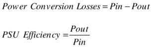

**注意**

在计算 PSU 效率时，最好使用在较长时间窗口内平均的 `Pout` 和 `Pin` 值。此方法考虑了 PSU 的电容，从而得到更具代表性的数值。

当使用代表生产环境的工作负载来测量 BMC 监控数据时，用户能够更深入地了解各个组件之间的交互。图 7-1 展示了不同服务器负载下的各种系统组件温度。

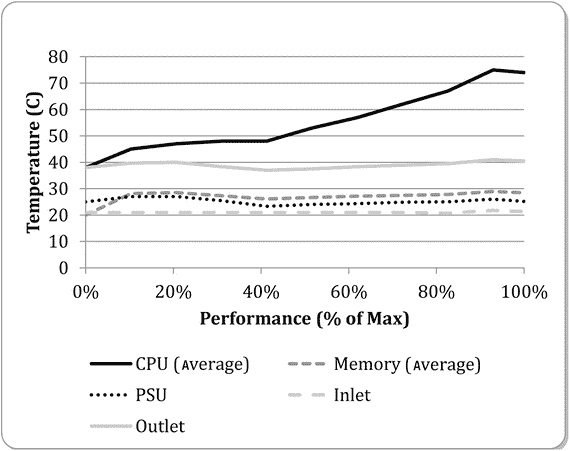

**图 7-1.** 不同服务器负载下的组件温度

图 7-1 中的组件温度可以与同时采集的图 7-2 进行比较。对比这些图可以说明风扇转速是如何提高以使每个组件保持在安全工作温度范围内的。结合组件级功耗来分析相关热事件，能使运营人员深入了解其散热解决方案的效率。

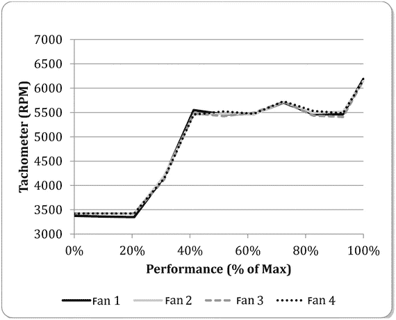

**图 7-2.** 不同服务器负载下的风扇转速

