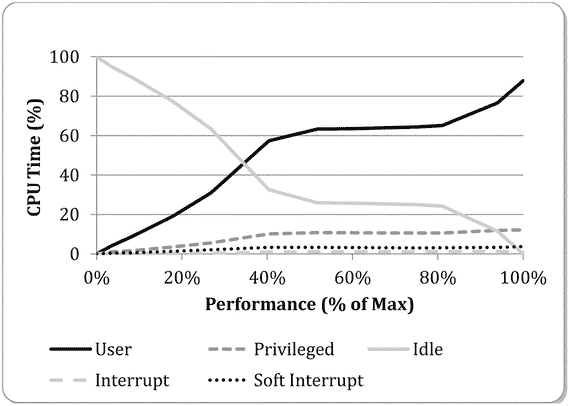
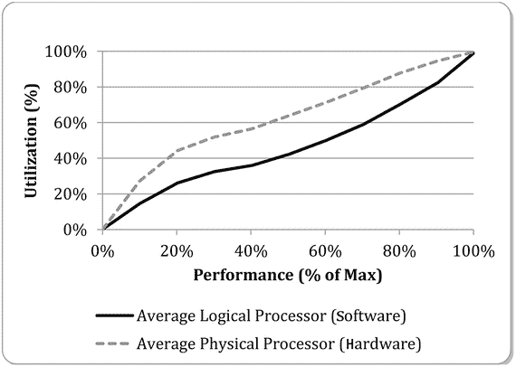
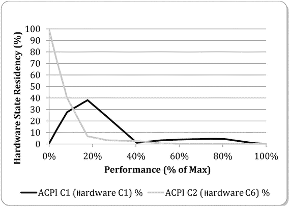
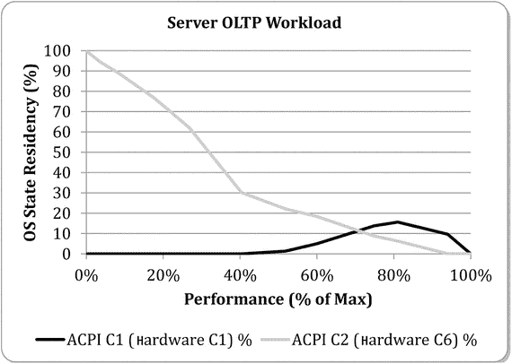
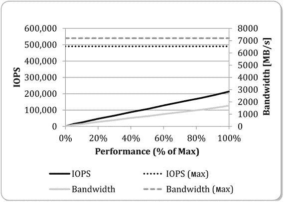

# 软件监控

第 6 章讨论了操作系统在选择电源状态时所扮演的角色，以及操作系统在管理系统资源时如何平衡性能与功耗。系统上运行的不同类型的应用程序可能会在调度、内存管理和 I/O 方面带来各种挑战。操作系统提供了全面的监控能力，使用户能够分析这些行为。这种分析使用户能够评估系统运行的效率，检测不良的应用程序行为，并发现硬件配置方面的问题。

操作系统会追踪许多与 CPU 监控相同的事件。例如，操作系统和 CPU 都可以监控内核时间和用户时间。在某些情况下，操作系统能够提供对 CPU 无法理解的事件的独特洞察。操作系统可以追踪系统调用所花费的时间、中断处理程序所花费的时间，以及提交和完成 I/O 所花费的时间。它们还可以追踪各个进程所花费的时间。这些增强功能使操作系统能够对诸如内核时间等事件提供更深入的洞察。在某些情况下，操作系统能够为同时被 CPU 和操作系统测量的事件添加不同的视角。例如，CPU 根据被授予的 `P` 状态来衡量 `P` 状态驻留时间。而操作系统则能够根据被授予的 `P` 状态和请求的 `P` 状态来衡量 `P` 状态驻留时间。

当操作系统事件与 CPU 事件结合使用时，用户可以更深入地理解软件/硬件接口。例如，CPU 能够测量一个具体的效果，比如某个核心有 90% 的时间处于空闲状态且仅使用 `C1` 状态。而操作系统则能够测量一个具体的原因，比如在该核心上频繁的网络中断处理导致了较高的 `C1` 驻留率。

CPU 和操作系统所测量事件的另一个区别在于准确性。CPU 事件通常是时钟周期精确的，而操作系统事件的准确性则可能因产品和版本而异。例如，某些事件可能只是被采样而非精确测量，而某些事件可能只在频率较低的时钟中断期间才会更新。

用于监控资源利用率和内核函数的事件在不同的操作系统中是通用的。尽管这些事件本身相似，但在事件名称和具体测量内容上可能存在一些细微差别。例如，一个操作系统可能在衡量驱动器延迟时包括了内核时间、队列时间和设备时间，而另一个操作系统可能只包含设备时间。本节将以操作系统无关的方式讨论常见的操作系统事件。在概述这些事件之后，将提供几个不同操作系统特定的工具及其使用方法的示例。

## 利用率与处理器时间

操作系统能够将活动时间和空闲时间分解成一组非常详细的信息。这些事件可用于确定执行应用程序代码所花费的时间，以识别在意外时间运行的应用程序，或识别运行频率高于预期的应用程序。例如，这些事件可以检测到那些可能导致系统无法进入低功耗空闲状态的侵入式管理或安全服务。

处理器时间事件可以跨逻辑处理器、跨核心或跨封装进行分析，以识别利用率不对称的情况。这可能表明软件配置错误，或由于并行设计不佳导致效率低下的遗留软件。这些事件也可用于评估随着时间推移，活动量增加或减少时的资源利用率。本章中的一些图表展示了这类示例，说明了事件如何在整个服务器负载范围内变化。表 7-11 列出了描述处理器时间的几个常见事件。

**表 7-11. 操作系统暴露的常见 CPU 利用率事件**

| 类型 | 描述 |
| --- | --- |
| 用户时间 | 监控执行应用程序代码所花费的时间。存在多种操作系统工具，例如 Windows 环境下的 `Perfmon` 或 Linux 环境下的 `SAR`，可以按线程、处理器或虚拟机细分用户时间。 |
| 内核时间 | 也称为特权时间，它监控操作系统所花费的时间，包括调度、内存管理以及与系统中不同设备的交互。 |
| 内核中断时间 | 监控处理硬件中断所花费的时间。这代表了中断中需要立即处理的高优先级部分，即上半部。 |
| 内核软中断时间 | 也称为软件中断时间、`softirq` 时间或延迟过程调用，它监控处理中断剩余的较低优先级操作所花费的时间，即下半部。 |
| 内核空闲时间 | 监控没有进程被调度或准备运行的时间。某些操作系统支持 `iowait`，这是一种更具体的内核空闲时间度量，用于区分空闲状态下是否有未完成的 I/O。 |
| 来宾时间（仅限 `VMM`） | 监控在虚拟化环境中运行来宾虚拟机所花费的时间。 |
| 等待时间（仅限 `VMM`） | 监控在虚拟化环境中等待争用物理资源所花费的时间。等待时间也称为偷取时间、调度时间或就绪时间。高值可能表示超额订阅或虚拟机频繁等待抢占另一个虚拟机。 |

图 7-3 展示了处理器时间的各个组成部分如何随着服务器负载的增加而变化。在最大吞吐量水平下，只有 85% 的时间用于执行应用程序代码，其余处理器时间用于执行常见的内核函数，例如执行系统调用或处理中断。减少系统时间的优化可以显著提高能效，因为它为完成工作的应用程序提供了额外的处理器时间。例如，在网络设备中启用中断合并可以减少中断总数，从而减少系统时间。

**图 7-3.** CPU 时间分解为不同类别

### 同步多线程（SMT）

在讨论处理器时间时，重新审视物理处理器和逻辑处理器（或超线程（`HT`）中的硬件线程）之间的关系非常重要。由于两个逻辑处理器共享物理处理器的缓存和执行单元，即使每个逻辑处理器仅以 50% 的利用率运行，也可能使物理处理器达到 100% 的利用率。两个 50% 利用率的逻辑处理器也可能只使物理处理器的利用率略高于 50%。对于数据中心工作负载，物理处理器的利用率通常比报告的逻辑处理器利用率高出 50%。图 7-4 展示了一个典型情况，即实际的物理处理器利用率显著高于逻辑处理器利用率。

**图 7-4.** 逻辑处理器与物理处理器利用率之间的 CPU 时间对比

操作系统测量的是逻辑处理器的利用率，这可能会对硬件资源利用率给出误导性的画面，因为功耗以及主动和空闲电源管理功能的使用与物理处理器的利用率关系更为密切。最佳的整体利用率是使用本章前面描述的硬件机制来测量的。

### 虚拟化

虚拟化给处理器时间的监控带来了额外的挑战。如果从虚拟机内部测量利用率，那仅能衡量虚拟处理器的利用率，或者仅能衡量该虚拟机所拥有资源的利用率。例如，在虚拟机过度分配的情况下，虚拟机可能测得平均虚拟处理器利用率为 10%，而实际处理器自身的运行负载远高于此。因此，若仅因虚拟处理器平均利用率低就断定系统处于轻负载状态，是不准确的。

类似于通过比较物理处理器利用率与逻辑处理器利用率可以获得洞察，检查虚拟处理器利用率也能提供更多信息。对于系统级分析而言，最佳监控视角是从宿主机出发。宿主机拥有与原生操作系统相同的监控可见性，并且能够追踪各个客户虚拟机的个体利用率。

### 处理器电源状态请求

第 2 章和第 4 章曾介绍过，操作系统对于特定 `C` 状态或 `P` 状态的请求并不一定会被硬件完全批准。例如，操作系统可能请求一个高频率的 `P` 状态，但最终因为热事件而获得了一个更低频率的 `P` 状态。操作系统能够监控其自身的内部状态请求以及硬件所批准的状态。图 7-5 和图 7-6 展示了 `C` 状态驻留中软件请求状态与硬件批准状态之间的差异。在图 7-5 中，`ACPI C2`（硬件 `C6`）在整个服务器负载范围内都有被请求，但图 7-6 显示它实际上仅在 0% 到 20% 的负载区间内被使用。

**图 7-6.** `ACPI C1` 和 `ACPI C2` 的硬件 `C` 状态驻留（已批准）对比

**图 7-5.** `ACPI C1` 和 `ACPI C2` 的软件 `C` 状态驻留（已请求）对比

在图 7-5 和图 7-6 中，`ACPI C1`（硬件 `C1`）和 `ACPI C2`（硬件 `C6`）的驻留时间之和等于总空闲时间。图中未表示的剩余时间为活动时间。

将请求的驻留状态与批准的驻留状态进行比较，可以突显各种硬件和软件控制策略的有效性。这些对比能够识别出意外状态驻留的来源，说明线程间 `P` 状态和 `C` 状态协调的影响，并有助于指导服务器调优决策。

请求状态与批准状态存在显著差异的一个原因是，软件是在逻辑处理器级别监控请求，而硬件则是在物理处理器级别进行监控。如果系统中一半的逻辑处理器请求 `C6`，另一半逻辑处理器请求 `C1`，那么每个核心很可能都处于 `C1` 状态。任何时候，当兄弟逻辑处理器请求不同状态时，较浅的那个状态会被批准。

请求状态与批准状态存在差异的另一个原因是，硬件会利用一些机制来限制深度 `C` 状态的使用，这些机制会在检测到显著的延迟影响时，或者在进入和退出深度 `C` 状态所消耗的能源成本无法通过短暂的空闲时长回收时被触发。这些机制在第 2 章中有详细描述。

表 7-12 和 7-13 列出了操作系统暴露出的用于监控 `C` 状态和 `P` 状态驻留及转换的几个常见事件。

**表 7-13. 操作系统暴露的常见 `P` 状态事件**

| 类型 | 描述 |
| --- | --- |
| 频率转换（软件请求） | 监控各种运行频率被请求的次数。针对每个逻辑处理器进行测量。用于评估 `P` 状态转换的延迟影响。 |

| 频率驻留百分比（软件请求） | 监控操作系统处于请求各种运行频率状态的时间百分比。针对每个逻辑处理器进行测量。对于所有核心共享同一封装内单个 P 状态的服务器，这可用于识别驱动频率升高的应用程序或线程。 |
| --- | --- |
| 运行频率（硬件批准） | 通过采样硬件反馈机制来监控运行频率，该机制指示任何逻辑处理器当前正在运行的频率。 |
| TSC 频率 | 也称为 CPU 基频，监控最大保证频率，即 P1。 |
| 最大频率百分比 | 监控当前运行频率与 CPU 基频的比率。大于 1 的值表示使用了睿频或非保证频率。用于确定在任何给定时间内睿频额外提供了多少频率。 |
| 处理器容量百分比 | 也称为`%processor utility`，监控在第 4 章中介绍的性能容量概念。 |

**表 7-12. 操作系统暴露的常见 C 状态事件**

| 类型 | 描述 |
| --- | --- |
| C1/C2/C3 驻留百分比（软件请求） | 监控操作系统请求 ACPI C1、ACPI C2 或 ACPI C3 状态的时间百分比。通常针对每个逻辑处理器进行测量。 |
| C1/C2/C3 驻留百分比（硬件批准） | 监控 CPU 核心实际处于各种状态的时间百分比。操作系统将本章前面描述的驻留 MSR 的输出映射到相应的 ACPI 状态。 |
| C1/C2/C3 转换次数 | 监控针对每种 ACPI C 状态类型的软件请求次数。由于逻辑处理器的协调性，操作系统的 C 状态转换计数通常远高于实际的硬件 C 状态转换次数。 |
| 平均空闲时间 | 监控逻辑处理器的平均空闲持续时间。 |
| 唤醒事件 | 也称为空闲中断事件，这些事件统计逻辑处理器因中断或中断事件而被唤醒的次数。用于评估 C 状态转换的延迟影响。 |
| 空闲状态 | 也称为核心停靠状态，该事件表示某个逻辑处理器不再可用于进程调度。这是执行整合的一种表现，在第 4 章中进行了讨论。 |

### 调度器、进程与线程

调度器在决定计算资源如何分配、共享和利用方面的决策，对能源效率起着关键作用。监控这一行为使用户能够深入了解同时运行多个虚拟机、应用程序或进程时的交互与影响。例如，如果操作系统过于激进地迁移进程，那么恢复执行上下文或引用远程内存所需的额外时间就会增加功耗。如果操作系统过于保守地迁移进程，则可能导致可扩展性问题与利用率不对称。当一部分逻辑处理器的利用率显著高于其他逻辑处理器时，会导致更激进地使用更高电压与频率状态，从而增加功耗。

第 2 章、第 3 章、第 4 章和第 6 章介绍了硬件和软件电源管理策略为了在低功耗与低延迟之间取得平衡所需做出的一系列决策。调度器在平衡高吞吐量与低延迟方面也面临着类似的挑战，并产生类似的影响。旨在最小化延迟的调度决策可以改善事务响应时间，但这可能会以牺牲能源效率为代价。如果为了改善延迟而降低最大吞吐量，则会导致需要更多的资源（和电力）来满足峰值性能需求。

能够描述和理解调度器、进程与线程行为的管理员，可以发掘调整线程亲和性与优先级以提升能源效率的机会。表 7-14 列出了几个用于监控调度器的常见事件。

**表 7-14. 操作系统公开的常见调度器、进程与线程事件**

| 类型 | 描述 |
| --- | --- |
| 处理器队列长度 | 也称为处理器队列深度，用于监控等待调度任务的队列长度。与其他处理器时间和中断事件结合使用，有助于识别利用率不对称的原因。 |
| 上下文切换 | 监控进程间执行上下文切换的次数。由于保存和恢复上下文会引入额外开销，因此对效率分析很有用。 |
| 迁移 | 监控进程或线程被调度到与上一次不同的逻辑处理器的次数。 |
| 系统调用 | 监控内核代表应用程序执行某些操作（例如读取或修改无法访问的数据，或与硬件设备交互）的请求次数。由于高系统调用率可能表明内核接口使用效率低下，因此非常有用。 |
| 进程/线程 | 监控当前的进程和线程数量。 |
| 进程/线程状态 | 监控进程和线程的当前状态。提供关于优先级、就绪运行状态以及线程等待原因的洞察。 |

### 中断

中断的频率、中断在逻辑处理器间的分布、中断处理在顶半部和底半部之间的划分以及中断的批处理，为深入了解服务器上的工作分布以及中断处理如何影响能源效率提供了更深刻的洞察。例如，当时钟中断或设备中断在空闲期间发生时，它们会导致逻辑处理器退出 C 状态。在低吞吐量时出现高中断率是不可取的，因为低吞吐量通常伴随着低利用率。当中断在活跃期间发生时，它们会导致进程和线程被挂起，直到中断处理完成。

将中断处理的顶半部与底半部分开，使得内核能够在单个逻辑处理器处理特定类型中断时并行处理中断。然而，底半部不一定在与处理中断相同的逻辑处理器上执行。由极少数逻辑处理器处理中断可能是不利的。这可能导致处理中断的逻辑处理器上的利用率显著升高，并导致中断的顶半部和底半部由不同的逻辑处理器处理。这会在调度以及访问不在任何逻辑处理器本地缓存中的共享数据时引入额外开销。由于额外的处理器间中断（IPI），硬中断和软中断的分布可能会增加中断的总数。

表 7-15 列出了可用于识别中断处理如何在逻辑处理器间分布的事件。

**表 7-15. 操作系统公开的常见中断事件**

| 类型 | 描述 |
| --- | --- |
| 设备中断 | 监控设备中断的次数。通过特定的 IRQ 和中断发生的位置进行监控非常有用。单个设备可能具有由不同逻辑处理器处理的多个 IRQ。 |
| 设备软中断 | 也称为软中断请求（softirq）或延迟过程调用（DPC）率，用于监控软件中断的数量及其发生位置。有助于了解中断处理的顶半部和底半部是否发生在同一个逻辑处理器上，或者某个逻辑处理器是否因中断处理而超载。 |
| 时钟中断 | 监控时钟中断的次数及其发生位置。有助于了解时钟中断是否会影响 C 状态驻留时间或调度决策的频率。 |
| 处理器间中断（IPI） | 监控用于在逻辑处理器之间通信的处理器间中断的数量及其发生位置。这些中断用于刷新缓存和转换后备缓冲区（TLB）、进行调度以及请求远程逻辑处理器执行某些操作。 |
| 中断合并 | 也称为中断调节或中断批处理，用于监控被批处理并周期性（而非正常时机）处理的硬件中断。这降低了处理中断的开销，但增加了事务响应时间。有助于确定默认的中断处理行为是偏向于能源效率还是低延迟。 |

### 内存

监控内存使用量和内存局部性至关重要，这有助于判断应用程序的内存使用方式如何影响能效。合理规划内存容量以满足应用需求（而非过剩）对能效至关重要。如果系统中存在过多空闲内存，大量电能将被消耗在无法带来性能提升的内存上。同样，如果可用内存不足，系统将因频繁的交换操作而严重影响性能和效率。

监控还能帮助判断已用内存的有效性。某些应用能够利用近乎无限的内存容量，但这未必有益。例如，将内存用作磁盘内容缓存的应用，其收益往往会达到递减点。此时，增加额外内存仅能带来极低的缓存命中率提升，相当于用极高的能耗代价换取极小的性能增益。

尽量减少对远程处理器的内存引用次数，能大幅提升效率。在非统一内存访问（NUMA）系统或多路处理器系统中，各处理器访问本地 DRAM 的速度远快于访问远程 DRAM 或其他插槽 DRAM 的速度。许多应用未针对 NUMA 进行充分优化，导致本地与远程内存访问量相当。使用远程内存完成操作所需的处理器时间更长，因为内存延迟的增加会体现在 CPU 停滞周期中。

**注意**

令人惊讶的是，有些环境采用了广泛且激进的高效优化技术，却仍在使用未针对 NUMA 优化的应用。应用的 NUMA 优化仍然是提升性能与能效时最容易错失的机会之一，尤其是考虑到无需任何硬件更改即可实现优化。

表 7-16 列出了可用于识别内存利用效率及分析内存引用局部性的常见事件。

**表 7-16. 操作系统暴露的常见内存事件**

| 类型 | 描述 |
| --- | --- |
| NUMA 局部性 | 监控由本地内存满足的内存引用百分比或数量。有助于了解软件在多插槽系统中的优化程度。可通过`NumaTOP`等 Linux 工具采集。NUMA 局部性对 CPU 利用率有显著影响。 |
| 总内存 | 监控系统的总内存容量。 |
| 已用/空闲内存 | 监控系统当前已使用的内存量。建议按具体应用、进程和线程进行监控，以识别优化空间。同时需了解用于磁盘缓存的内存容量，因为这部分内存虽显示为已用，但仍可供应用使用。 |
| 分页 | 监控物理内存与辅助存储设备之间移动的内存块或页面。 |
| 交换 | 监控物理内存与辅助存储设备之间移动的完整进程内存映像。交换操作对性能和能效影响严重。若系统频繁交换，需优化工作负载以减小工作集规模，或增加内存容量。 |

### I/O

识别 I/O 性能不足的问题至关重要，因为这会迫使部署更多服务器（消耗更多电力）才能满足性能需求。I/O 瓶颈会阻碍应用充分利用 CPU 和内存，导致系统组件消耗大量能源却难以完成有效工作。

判断何种 I/O 性能才算"足够"是一大挑战。当今不同技术的峰值性能差异巨大。例如，存储子系统可采用不同接口（3 Gb/s、6 Gb/s 或 12 Gb/s）、不同协议（SATA、SAS 或 FC）以及不同驱动器类型（HDD 或 SSD）。SSD 通过消除困扰许多工作负载的延迟瓶颈，能对系统行为产生巨大影响。除所用技术外，峰值性能还取决于 I/O 类型、块/数据包大小、读写混合比例，以及随机/顺序 I/O 混合比例。操作系统监控功能是了解特定工作负载特性及 I/O 子系统局限性的关键。

监控 I/O 时，理解 I/O 子系统的最大性能与性能需求之间的对比至关重要，这同时适用于网络和存储。图 7-7 对比了不同服务器负载下，驱动器的理论峰值 IOPS 和带宽与运行时实际测量值。

`图 7-7.` 运行时 IOPS 与带宽对比理论最大值

I/O 瓶颈常出现于技术更新换代阶段。CPU 与内存性能的提升速度与 I/O 子系统完全不同。升级至最新平台可能导致计算性能与 I/O 性能出现显著差异。另一个经常引发 I/O 性能不足问题的转型是虚拟化。当多个虚拟机共享 I/O 子系统时，流量增加、资源竞争加剧以及 I/O 流量多样性，都会导致 I/O 峰值性能显著下降。

部分 I/O 瓶颈可通过调优解决，例如启用 I/O 适配器的卸载功能、将流量分段或隔离至特定接口、启用中断批处理，或使用定向 I/O 虚拟化技术（VT-d）。表 7-15 列出了可用于监控 I/O 性能及比较运行时性能与峰值性能的常见事件。

`表 7-17.` 操作系统暴露的常见 I/O 事件

| 类型 | 描述 |
| --- | --- |
| 读/写次数（或 Rx/Tx） | 监控读写次数。用于计算 IOPS。 |
| 读/写字节数（或 Rx/Tx 字节数） | 监控读写带宽。建议按驱动器或接口级别监控，以定位潜在问题。 |
| 队列长度 | 监控读写的平均队列长度，或等待处理的 I/O 平均数量。用于识别 I/O 瓶颈。 |
| 队列等待时间 | 也称为队列延迟，监控 I/O 请求在提交给设备前在队列中的平均等待时间。用于识别 I/O 瓶颈。 |
| 服务时间 | 也称为设备延迟，监控提交给设备的 I/O 完成所需的平均时间。与队列等待时间结合使用，可了解 I/O 各阶段对端到端延迟的影响。 |
| 延迟 | 监控 I/O 的端到端延迟，包括内核时间。 |
| 利用率% | 监控设备处理 I/O 的活动时间百分比。 |
| 控制器空闲状态 | 监控各类控制器的设备电源状态。 |