# 工具

本章介绍了几种用于配置和访问监控功能的底层机制。在大多数使用场景中，这些复杂性可以由软件工具而非最终用户来管理。以下部分简要介绍了一些常见的软件工具及其示例用法。这并非旨在全面列出所有工具和用法。相反，它旨在向读者介绍可用于监控的工具类型以及如何使用它们。这些软件工具的详细文档可在网上获取。

## 健康检查

很多时候，用户只希望了解系统运行情况的高层概览，而不太想深入研究架构和微架构细节。Linux 有两种常用工具（`PowerTOP` 和 `turbostat`），Windows 也有两种（`Perfmon` 和 `Powercfg`），它们都是获取系统功耗特性信息的绝佳起点。

### Turbostat (Linux)

`Turbostat` 是一款简单但功能强大的工具，内置于 Linux 内核树中。它监控以下指标：

-   每线程：平均频率、活跃度
-   每核心：核心 C 状态、温度
-   每插槽：温度、插槽 C 状态、插槽功耗、核心功耗（若支持）、DRAM 功耗

`Turbostat` 有多个不同的命令行选项，可满足一系列使用场景的需求。只需不带任何参数运行它，它就会每秒输出一组统计数据的快照。图 7-8 展示了 `turbostat` 输出的一个示例。

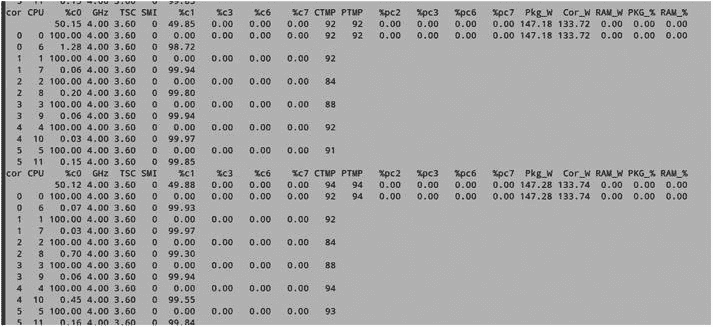

**图 7-8.** 来自 3.12 内核的 `Turbostat` 输出

`Turbostat` 通常与工作负载一起运行，以在测量期间获取系统的统计数据。请注意，虽然所提供的统计数据受工作负载影响很大，但它也会受到系统上运行的任何其他程序的影响。

```
>> turbostat <程序>
```

`-v` 选项是收集有关系统配置的各种调试信息的好方法。

```
>> turbostat -v
```

以一秒为间隔运行 `turbostat`，特别是在大型多插槽系统上，可能会扰动工作负载的行为（以及该工具的结果）。如果不需要一秒间隔的统计数据，请考虑增加监控间隔。这在尝试收集空闲系统的统计数据时特别有用。

```
>> turbostat -i 2
```

`Turbostat` 也可以用作监控系统中各种 MSR 的简单工具。`-m` 和 `-M` 选项将在每个样本周期内从每个线程读取一次相应的 MSR。`-M` 选项将输出 64 位结果，而 `-m` 选项则进行短输出。以下命令将以两秒为间隔转储 MSR 0x199。

```
>> turbostat -i 2 -M 0x199
```

`-C` 和 `-c` 选项提供了类似的功能，但这两个选项不是显示寄存器的原始值，而是提供当前样本与先前样本之间差值的转储。这对于随时间监控计数器的增量很有用。例如，以下命令将以每秒样本间隔转储 APREF（MSR 0xE7）的增量。

```
>> turbostat -i 1 -M 0xe7
```

并非所有发行版都自动包含 `turbostat` 二进制文件，但一旦你拥有内核源代码，编译和使用它就非常简单。该工具是独立的，因此如果你下载一个较新的内核（来自 `kernel.org`），它将包含源代码。`Turbostat` 要求你的内核支持 MSR。

```
// 下载后解压内核源代码
>> tar xf linux-3.12.20.tar.xz

// 查找源代码并切换到相关目录
>> cd linux-3.12.20
>> find . -name turbostat.c
>> cd tools/power/x86/turbostat/

// 构建工具
>> make

// 确保 MSR 内核模块已激活
>> sudo modprobe msr

// 运行工具
>> sudo ./turbostat
```

### PowerTOP (Linux)

`PowerTOP` 是一款用于描述电源管理特征和诊断电源管理问题的开源工具。与 `turbostat` 类似，它针对多种使用场景（不仅仅是服务器）。它是一个有用的补充，因为它提供了一些超出 `turbostat` 所能提供的信息。一些值得注意的补充包括 C 状态的平均时间和频率直方图。`Powertop` 还提供了大量针对消费类使用场景（设备空闲功耗）的信息。设备统计数据在服务器上通常相关性较低。图 7-9 展示了该工具的示例输出。

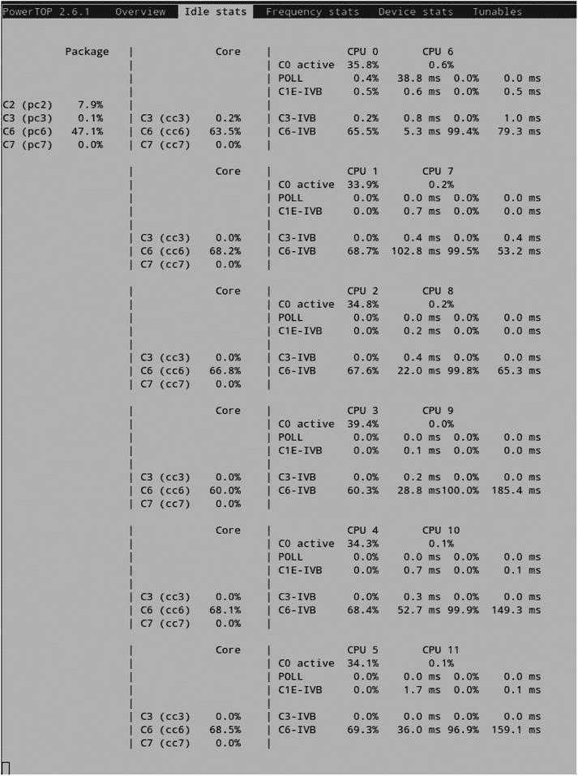

**图 7-9.** `Powertop` 2.6.1 空闲统计

基本的 `powertop` 命令行默认提供较慢的采样间隔（数秒）。这有助于最小化应用程序的开销，尤其是在空闲系统上，但它也会导致结果输出得更慢。时间参数可以加快速度（代价是增加 CPU 开销）。

`--html` 选项将转储一个 HTML 文件。默认情况下，这将收集该工具的单次测量结果。但是，可以收集更多测量结果，从而生成多个 HTML 文件。`--html` 选项可以与 `--workload` 参数一起使用，收集在某个工作负载执行期间的统计数据。与 `turbostat` 类似，`powertop` 将收集整个系统的统计数据，而不仅仅是指定的工作负载。

```
>> powertop --workload=./test.sh --html=test.powertop.html
```

### Powercfg (Windows)

`Powercfg` 是一款 Windows 命令行工具，使用户能够调整较低级别的操作系统电源管理设置。它允许用户启用和禁用功能、更改电源策略以及识别可能影响电源管理的问题。例如，可以使用 `Powercfg` 更改硬盘在闲置期间的电源选项设置，以及查询设备以了解它们支持的电源状态。

`Powercfg` 的独特应用之一是其生成能耗报告的能力。该选项分析系统并报告可能影响电源管理的事件和配置细节。`Powercfg` 能耗报告提供有关空闲中断、设备活动、设备不支持电源状态、操作系统计时器频率更改以及所支持的电源状态的详细统计数据。

以下示例命令使用 `Powercfg` 列出操作系统支持的不同电源策略，并指示当前活动的策略为“平衡”。此设置也对应于操作系统在初始化期间如何设置 `IA32_ENERGY_PERF_BIAS`。

```
C:\Windows\system32>powercfg -list
现有电源方案 (* 为活动状态)
-----------------------------------
电源方案 GUID: 381b4222-f694-41f0-9685-ff5bb260df2e  (平衡) *
电源方案 GUID: 8c5e7fda-e8bf-4a96-9a85-a6e23a8c635c  (高性能)
电源方案 GUID: a1841308-3541-4fab-bc81-f71556f20b4a  (节能)
```

以下示例命令展示了如何创建能耗报告。

```
C:\Windows\system32>powercfg.exe /energy
```

图 7-10 展示了能耗报告结果的示例。在此示例中，系统的插槽 C 状态驻留率很差，能耗报告已识别出多个连接到服务器但未启用 USB 选择性挂起的 USB 设备。此活动阻止了系统在其最低空闲功耗状态下最大化驻留率。

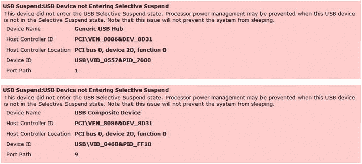

**图 7-10.** 由 Windows `Powercfg` 工具生成的能耗报告的一部分

## 硬件监控工具

对处理器核心和非核心中的各种性能计数器进行编程和读取可能变得相当复杂。为了简化此任务，有许多独立工具可以为用户执行事件编程、数据收集和可视化。


### Intel 性能计数器监视器 (PCM)

`PCM` 提供了一套独立的工具，用于处理计数器的编程和数据收集。`PCM` 还包含示例程序，演示了如何用开源 C++ 代码配置和读取性能计数器。这些示例程序能将原始事件转换为有意义的指标，例如以 GB/s 为单位的内存流量或以焦耳为单位的能耗。`PCM` 面向功耗与性能的监控及特性分析，以类似 BSD 许可证的授权方式提供源代码，下载地址为 [www.intel.com/software/pcm](http://www.intel.com/software/pcm)。

Intel `PCM` 可在多种平台上运行，包括 Linux、Microsoft Windows、FreeBSD 和 Mac OS X。之所以能做到这一点，是因为它仅需要一个驱动程序来对 MSR 进行编程。对于像 Windows 这样本身没有提供此类驱动程序的平台，软件包中也包含了该驱动程序的示例代码。在发布时并未提供二进制文件，但包含了编译说明。

`PCM` 有两种使用方式：(1) 作为一组独立工具使用，或 (2) 集成到应用程序中使用。图 7-11 展示了一个示例图表，该图表由独立的 `pcm-power` 工具在一个四路系统上收集的数据生成。

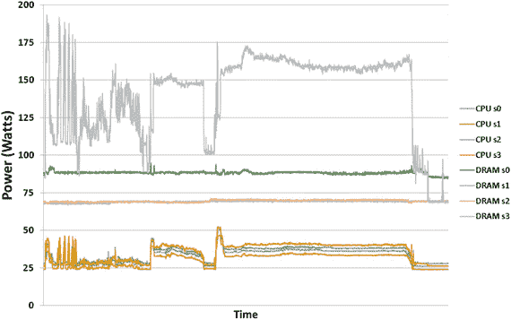

**图 7-11.** 由 PCM 在四路系统上收集的数据生成的插槽和 DRAM 功耗轨迹

独立的命令行程序 `PCM` 与 `turbostat` 类似，它会按给定的时间间隔定期将输出打印到屏幕上。这个时间间隔可以作为第一个参数指定。对于拥有数十或数百个核心的大型服务器，通常使用 `-nc` 参数（例如 `> pcm.x 1 –nc`）来抑制单个核心的指标会很有用。图 7-12 展示了一个四路系统的示例。

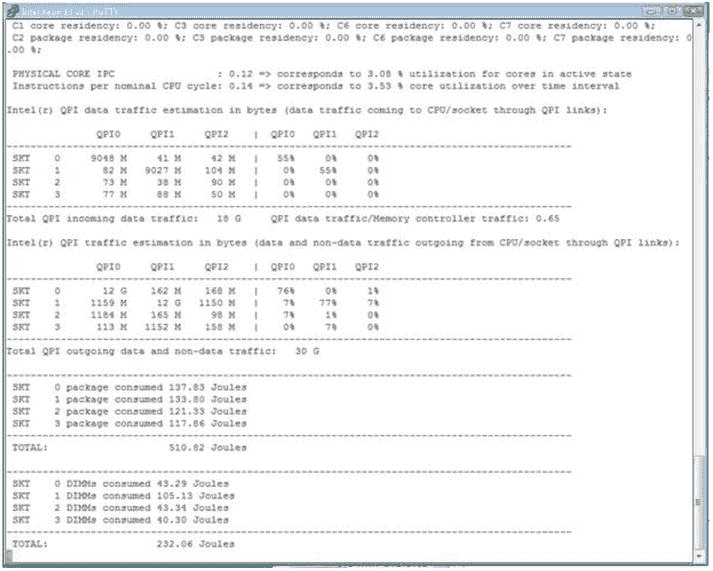

**图 7-12.** 独立 PCM 显示来自四路系统的功耗和性能指标

也可以通过将工作负载的可执行文件作为参数提供，从而在运行工作负载的整个期间内使用 `PCM` 进行监控。由于 `PCM` 监控的是整个系统，该脚本实际上可以作为一个之前已启动的服务器应用程序的工作负载驱动程序。请注意，在这种情况下，`PCM` 报告的是整个工作负载测量期间的指标，例如总能耗。

```
> pcm.x ./run_workload.sh
```

为了便于通过电子表格程序进行后期处理，另一个便捷的功能是能够使用 `-csv` 选项生成逗号分隔的列表：

```
> pcm.x 1 -csv 2>&1 | tee pcm.txt
```

`PCM` 包含一个专门针对功耗管理的工具：`pcm-power`。该工具可以测量通过 Xeon E5/E7 处理器上的非核心性能监视器提供的多项统计数据，包括：

*   核心 C 状态驻留时间
*   频率限制触发原因（热、功耗、操作系统请求、电气/保险丝）
*   频率转换统计信息
*   Prochot 统计信息
*   频率直方图
*   DRAM 功耗节省 (CKE 和自刷新)

例如，要以一秒为间隔监控系统中发生的频率转换次数（并隐藏内存统计信息），可以执行以下命令：

```
> pcm-power.x 1 -p 5 -m -1
```

图 7-13 显示了此命令的输出。除了显示频率转换统计信息外，还会显示一些功耗和热统计信息。附加信息是通过自由运行计数器收集的，因此无论命令行参数如何，都会显示出来。请注意，DRAM 能耗计数器在测试系统上未启用，因此报告为 0。DRAM RAPL 并非必需功能，且并非在所有平台上都支持。

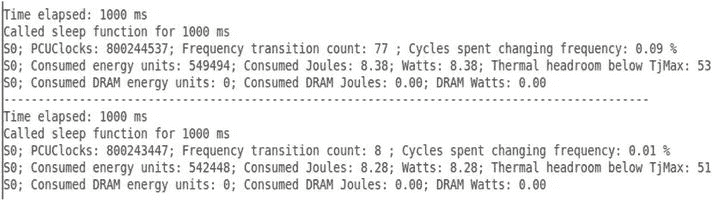

**图 7-13.** pcm-power 截图——频率转换

图 7-14 展示了一个示例，其中 `pcm-power` 通过使用以下命令行来监控系统为何无法达到最高可能频率（频率裁剪原因）。在此命令行中，使用了 `grep` 来过滤掉一些无关信息。

```
> pcm-power.x 1 -p 3 -m -1 | grep –E "(PCUClocks|limit cycles)"
```

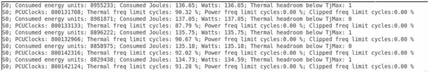

**图 7-14.** pcm-power 截图——频率裁剪原因

“TjMax 以下余量”显示为 1 或 0，表示系统处于热极限状态。同时，“热频率限制周期”徘徊在 90%，表明系统频率在绝大部分时间因热极限而受到限制。

此外，还提供了许多其他专门的独立应用程序：

*   `pcm-numa` 报告每个核心到本地和远程内存的流量。
*   `pcm-memory` 报告每个内存通道的内存流量。
*   `pcm-pcie` 报告进出 PCIe 设备的内存流量。
*   `pcm-power` 可以根据选择的参数报告多个值。

`KSysGuard` (KDE) 和 `Windows Perfmon` 都提供了实时监控各个计数器的可视化机制。请参阅 PCM 网页获取最新说明。

由于 `PCM` 以源代码形式分发，因此也可以直接集成到应用程序中，以便在应用程序执行时方便地收集系统范围的统计数据。初始化操作非常简单：

```
PCM * m = PCM::getInstance();
if (m->program() != PCM::Success) return;
```

实际的测量类似于测量时间，即在关键代码前后分别记录时钟，然后计算差值。对于性能计数器，每个核心、封装（插槽）和系统都有可用的状态。对于所有支持的指标，也预定义了函数：

```
SystemCounterState before = getSystemCounterState();
// 在此处运行你的代码
SystemCounterState after = getSystemCounterState();
```

然后，可以使用例如以下代码来显示特定的统计数据：

```
cout << "指令数: " << getInstructonsRetired(before, after)
     << "CPU 能耗  : " << getConsumedEnergy(before, after)
     << "DRAM 能耗 : " << getDRAMConsumedEnergy(before, after);
```


### Linux Perf

较新的 Linux 系统集成了一个名为 `perf_events` 的集成性能分析与追踪子系统。`perf_events` 子系统提供了一个访问 CPU 性能监控单元（PMU）的接口；它提供了访问 Linux 内核提供的软件跟踪点的接口，并负责管理不同用户之间的资源共享。一个名为 `perf` 的标准命令行工具允许访问 `perf_events` 接口。其他工具和库，例如 `NumaTOP` 或 `PAPI`，也会利用 `perf_events` 子系统。还有一些可用的图形界面前端，例如 `Eclipse perf` 或 `sysprof`。`perf` 工具通常作为 Linux 发行版中的一个软件包包含在内。包含 `perf` 使用文档的维基页面可在 [`perf.wiki.kernel.org/index.php/Tutorial`](https://perf.wiki.kernel.org/index.php/Tutorial) 找到。

`perf_events` 子系统集成在 Linux 内核中，其功能因内核版本而异。所有 `perf` 版本都支持基于采样的基本 PMU 性能分析。`perf top` 工具（如图 7-15 所示）是查看 CPU 当前时间花费在哪里的简便方法。

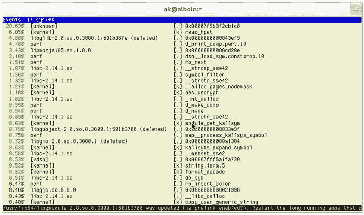

图 7-15：Perf top 示例

`Perf` 还提供了访问内核提供的软件跟踪点的功能。例如，`perf timechart record` 记录所有调度事件和空闲周期，并可以通过 `perf timechart report` 生成类似甘特图（GANTT）的图表。这对于理解短时间（几秒钟）内的工作负载行为非常有用。`Timechart` 首先将系统行为记录到 `perf.data`，然后生成一个 SVG 文件，以类似甘特图的形式可视化追踪数据。

```
% sudo perf timechart record sleep 1
[ perf record: Woken up 2 times to write data ]
[ perf record: Captured and wrote 1.289 MB perf.data (∼56298 samples) ]
% sudo perf timechart
Written 1.0 seconds of trace to output.svg.
```

然后可以在 SVG 查看器中查看 `output.svg`，例如使用 Chrome。SVG 时间图中提供了两组数据：

- 每个逻辑处理器上正在运行的内容的视图（图 7-16）
- 每个软件线程活动的视图（图 7-17）

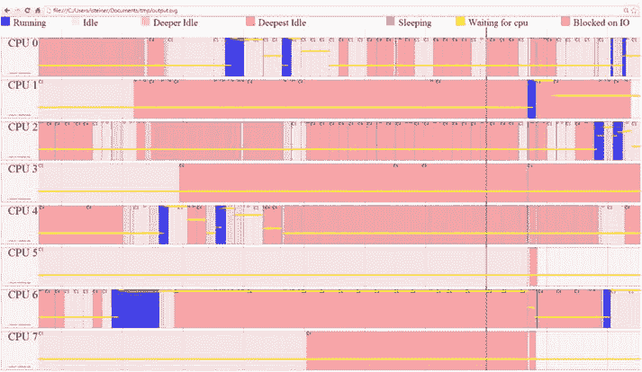

图 7-16：Timechart 第一部分：逻辑处理器活动

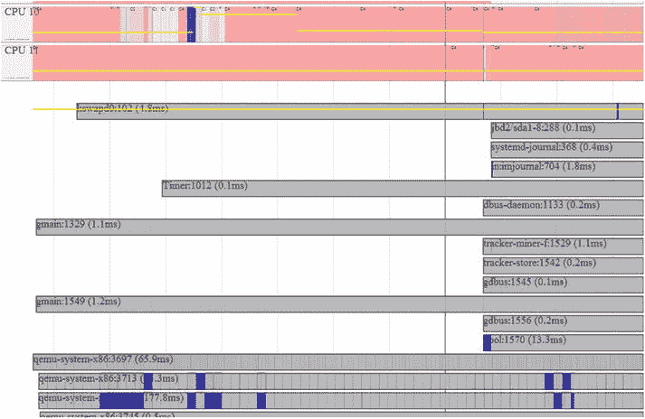

图 7-17：Timechart 第二部分：软件线程活动

图 7-16 中的逻辑处理器信息显示了每个线程请求的 C 状态以及在每个虚拟 CPU 上活动的线程（蓝色）。当核心处于睡眠状态时，它会提供关于它们是在等待 I/O（称为 `io_schedule` 例程）还是处于空闲状态等待 CPU（称为 `schedule` 例程）的指导。

图 7-17 中的软件线程视图显示了每个不同软件线程何时处于活动状态（蓝色）以及线程何时处于非活动状态（灰色）。追踪将显示线程在其首次被观察到执行时（不一定是它们实际开始执行时）的情况。

在某些情况下，查看原始追踪事件也很有用，这些事件可以通过脚本进行后期处理以提取感兴趣的信息。在具有许多线程的大型系统上，可视化时间图可能难以处理。`perf timechart record` 生成的数据文件可以使用 `perf script` 以文本格式查看，作为可视化时间图的替代方案。

```
% sudo perf script | less
swapper     0 [000] 176421.261802: power:cpu_idle: state=4 cpu_id=0
perf      7667 [001] 176421.262026: sched:sched_switch: prev_comm=perf top
swapper     0 [000] 176421.262692: sched:sched_wakeup: comm=qemu-system
swapper     0 [000] 176421.262694: power:cpu_idle: state=4294967295 cpu
```

第一行是进程（`swapper` 表示空闲），然后是 PID、CPU 编号、时间戳、事件名称和事件参数。在第一行中，CPU 0 进入 C 状态 4 的睡眠模式。稍后，在 CPU 1 上发生从 `perf` 到 `top` 线程的上下文切换。最终，一个 `qemu-system` 进程唤醒了 CPU 0，导致其退出空闲状态。

更多跟踪点可以通过 `perf list`（以 root 身份）显示，通过 `perf record` 记录，并通过 `perf script` 显示。

`perf` 中的几个有用的追踪特性是 `kprobes` 和 `uprobes`。它们允许您在内核或用户程序中动态创建新的跟踪点。这些可以通过 `perf probe` 命令访问。以下示例在 `malloc` 函数上设置了一个探针并测量 `malloc` 的访问情况：

```
// 列出可用的函数
% perf probe -F -x /lib64/libc.so.6  | grep malloc
Malloc
// 添加一个跟踪点
% sudo perf probe -x /lib64/libc.so.6 malloc
Added new event:
probe_libc:malloc    (on 0x82520)
// 收集追踪数据
% perf record -e probe_libc:malloc sleep 1
// 从追踪数据生成报告
% perf report
// 完成后移除跟踪点
% perf probe –d probe_libc:malloc
```

`perf stat` 命令也可用于访问 CPU 能源计量表（需要内核 3.14+）。以下示例命令每 100 毫秒收集一次单插槽系统上的软件包能耗。要获取多个插槽的细分数据，可以使用 `--per-socket`。

```
$ sudo perf stat -I100 -e power/energy-pkg/              -a sleep 1
#           time             counts   unit events
0.100177504              0.25 Joules power/energy-cores/      [100.00%]
0.100177504              0.86 Joules power/energy-pkg/
...
0.701274659              0.23 Joules power/energy-cores/
0.701274659              0.82 Joules power/energy-pkg/
```

`Perf` 有一个内置的简单性能监控事件列表（参见 `perf list`）。此外，也可以指定原始事件（`cpu/event=0x54,umask=0xFF/`）。

在 Xeon E5/E7 处理器上，也可能通过 `perf` 访问 `uncore` 事件。这可以通过 `pmu-tools` 中的 `ucperf.py` 工具完成。以下示例每秒打印插槽频率因热限制的比例。

```
sudo ./ucevent.py  PCU.PCT_CYC_FREQ_THERMAL_LTD
S0-PCU.PCT_CYC_FREQ_THERMAL_LTD
0.00
0.00
0.00
```


### IPMItool

访问 BMC 监控功能以及 BMC 健康状态、清单和管理功能最常用的工具是 `IPMItool`。这个开源命令行工具既支持通过经过身份验证的网络连接进行带外访问，也支持通过服务器上的设备驱动程序进行带内使用。

以下示例通过列出 SDR 来演示 `IPMItool` 的使用。此命令使用户能够确定有哪些传感器可用，并快速检查这些传感器的状态。在此示例中，为了简化，除了温度传感器和热传感器外，所有其他传感器都已被移除。通过调用工具的帮助选项，可以获取具体的命令和可用命令行选项的完整列表，并且可以在网上轻松找到其他信息。

```
# ipmitool -I lanplus -H xeon-bmc -U root -P pass sdr
```

```
BB P1 VR Temp    | no reading        | ns
Front Panel Temp | 22 degrees C      | ok
SSB Temp         | no reading        | ns
BB P2 VR Temp    | no reading        | ns
BB Vtt 2 Temp    | no reading        | ns
BB Vtt 1 Temp    | no reading        | ns
I/O Mod Temp     | no reading        | ns
HSBP 1 Temp      | no reading        | ns
SAS Mod Temp     | 25 degrees C      | ok
Exit Air Temp    | no reading        | ns
LAN NIC Temp     | 35 degrees C      | ok
PS1 Temperature  | 26 degrees C      | ok
PS2 Temperature  | no reading        | ns
P1 Therm Margin  | -59 degrees C     | ok
P2 Therm Margin  | -60 degrees C     | ok
P1 Therm Ctrl %  | 0 unspecified     | ok
P2 Therm Ctrl %  | 0 unspecified     | ok
P1 DTS Therm Mgn | -59 degrees C     | ok
P2 DTS Therm Mgn | -60 degrees C     | ok
P1 VRD Hot       | 0x00              | ok
P2 VRD Hot       | 0x00              | ok
P1 Mem01 VRD Hot | 0x00              | ok
P1 Mem23 VRD Hot | 0x00              | ok
P2 Mem01 VRD Hot | 0x00              | ok
P2 Mem23 VRD Hot | 0x00              | ok
DIMM Thrm Mrgn 1 | no reading        | ns
DIMM Thrm Mrgn 2 | no reading        | ns
DIMM Thrm Mrgn 3 | no reading        | ns
DIMM Thrm Mrgn 4 | no reading        | ns
Mem P1 Thrm Trip | 0x00              | ok
Mem P2 Thrm Trip | 0x00              | ok
Agg Therm Mgn 1  | no reading        | ns
BB +12.0V        | 10.78 Volts       | nc
BB +5.0V         | -1.65 Volts       | cr
BB +3.3V         | 1.91 Volts        | cr
BB +5.0V STBY    | 2.93 Volts        | cr
BB +3.3V AUX     | 1.91 Volts        | cr
BB +1.05Vccp P1  | 1.53 Volts        | cr
BB +1.05Vccp P2  | 1.04 Volts        | ok
BB +1.5 P1MEM AB | 1.48 Volts        | ok
BB +1.5 P1MEM CD | 1.03 Volts        | cr
BB +1.5 P2MEM AB | 1.03 Volts        | cr
BB +1.5 P2MEM CD | 0.78 Volts        | cr
BB +1.8V AUX     | 1.94 Volts        | nc
BB +1.1V STBY    | 1.30 Volts        | cr
BB +3.3V Vbat    | 3.08 Volts        | ok
BB +1.35 P1LV AB | disabled          | ns
BB +1.35 P1LV CD | disabled          | ns
BB +1.35 P2LV AB | disabled          | ns
BB +1.35 P2LV CD | disabled          | ns
BB +3.3 RSR1 PGD | 3.43 Volts        | ok
BB +3.3 RSR2 PGD | 0.65 Volts        | cr
```

以下示例命令演示了如何使用 `IPMItool` 深入查看特定风扇的传感器。第一个示例展示了如何读取已连接风扇的转速计。在某些情况下，SDR 中存在某个传感器，但由于其断电、断开连接或不受支持，当前无法报告测量值。为简化示例，此处已移除已断开连接的风扇。

```
# ipmitool -I lanplus -H xeon-bmc -U root -P pass sdr type fan
```

```
System Fan 1A    | 30h | ok  | 29.1  | 5890 RPM
System Fan 3A    | 34h | ok  | 29.5  | 5890 RPM
System Fan 5A    | 38h | ok  | 29.9  | 5890 RPM
CPU 1 Fan        | 3Ch | ok  | 29.11 | 5820 RPM
CPU 2 Fan        | 3Dh | ok  | 29.12 | 5400 RPM
```

下面示例中的示例命令演示了如何使用原始命令来读取风扇能量传感器。要访问 BMC 中更低层的能力，可能需要提供唯一的单字节值序列来指示特定命令及相关参数。有时有必要将原始命令与 `IPMItool` 一起使用，因为并非所有 BMC 命令都作为独立的命令行选项被捕获。有关如何构造原始命令的说明包含在 IPMI 规范中，而如何为传感器的名称和位置指定相关参数的说明则包含在服务器制造商提供的文档中。传感器的名称和位置可能因平台而异。

以下命令返回其中一个风扇的能量。该命令返回的最后 8 个字节包括 4 字节的运行能量（以毫焦耳为单位）和 4 字节的运行时间（以毫秒为单位）。该命令被执行两次以说明常见用法。定期读取这些传感器使用户能够计算功耗。例如，从第二个命令的能量中减去第一个命令的能量可得到能量增量。两个命令之间的能量增量除以时间增量即可计算出功率。

```
# ipmitool -I lan -H xeon-bmc -U root -P pass -b 6 -t 0x2c raw 0x2E 0xFB 0x57 01 0x00  0x3 0x0
```

```
57 01 00 19 f5 13 01 c7 e3 17 00
```

```
# ipmitool -I lan -H xeon-bmc -U root -P pass -b 6 -t 0x2c raw 0x2E 0xFB 0x57 01 0x00  0x3 0x0
```

```
57 01 00 f5 54 14 01 fb eb 17 00
```

> **注意**：`IPMItool` 也可用于访问节点管理器功能，因为节点管理器通过 IPMB 链路连接到 BMC。

有关组件级电源管理的更多信息，请访问 [`www-ssl.intel.com/content/www/us/en/data-center/data-center-management/node-manager-general.html`](http://www-ssl.intel.com/content/www/us/en/data-center/data-center-management/node-manager-general.html)。

### 操作系统监控工具

很多时候，用户更感兴趣的是从高层了解应用程序和操作系统正在做什么，而不太关注架构和微架构层面的细节。Linux 下常用的工具（`SAR`）和 Windows 下常用的工具（`Perfmon` 和 `Logman`）是获取有关软件功耗和性能特性信息的绝佳起点。


### SAR

`SAR` 是一款 Linux 工具，用于监控处理器时间、电源状态、调度、内存、I/O 以及许多其他操作系统可见的事件。`SAR` 按用户定义的时间间隔收集事件，并以每秒平均值的格式输出大量事件计数。对于若干被监控的事件，`SAR` 还能在系统级视图之下提供更多细节。例如，可以针对每个单独的逻辑处理器测量处理器时间，也可以针对每个单独的磁盘或网络接口测量 I/O 统计信息。通过 `SAR`，你可以深入了解资源使用情况。

用户定义的时间间隔以及数据收集时使用的间隔数量，均通过命令行参数来指定。例如，以下命令指定使用 `-A` 来测量所有事件，每秒一次，持续 120 秒。通过调用该工具的帮助选项可以获取所有可用命令行选项的完整列表，此外，也能方便地在网上找到更多信息。

```
# sar -A 1 120 > sar.dat
```

以下展示了一个输出示例，其中包含监控上下文切换和中断的部分。`SAR` 既可在系统级别测量中断，也可针对每个 IRQ 进行测量。用户可以利用 `SAR` 的输出，结合 `/proc/interrupts` 和 `/proc/irq/*/smp_affinity`，来确定具体是哪些设备产生了中断、中断频率有多高，以及这些中断在何处被处理。

```
08:46:14 PM    proc/s   cswch/s
08:46:24 PM      2.24 104049.64
08:46:14 PM      INTR    intr/s
08:46:24 PM       sum 198321.77
08:46:24 PM        19      1.12
08:46:24 PM        99   7552.09
08:46:24 PM       100   7574.47
08:46:24 PM       101   7297.25
08:46:24 PM       102   7580.26
08:46:24 PM       103   7472.13
08:46:24 PM       104   7808.85
08:46:24 PM       105   7774.36
08:46:24 PM       114   7650.66
08:46:24 PM       115   1660.83
08:46:24 PM       116   1443.44
08:46:24 PM       117   1593.69
08:46:24 PM       118   1750.97
08:46:24 PM       119   1373.35
08:46:24 PM       120   1674.57
08:46:24 PM       123   1417.90
08:46:24 PM       124   1298.17
08:46:24 PM       125   1331.54
08:46:24 PM       126   1375.99
08:46:24 PM       127   1025.64
08:46:24 PM       128   1324.62
08:46:24 PM       129   1425.33
08:46:24 PM       130   1441.81
08:46:24 PM       131      0.71
08:46:24 PM       132      0.51
08:46:24 PM       133      0.51
08:46:24 PM       134      0.51
08:46:24 PM       135      0.51
```

### Perfmon 和 Logman

`Perfmon` 是一款 Windows 工具，用于监控处理器时间、电源状态、调度、内存、I/O 以及许多其他事件。`Perfmon` 还允许应用程序将自己的事件添加到 `Perfmon` 基础架构中，使用户能够从应用程序的角度，与操作系统事件一起监控性能。通过 `Perfmon`，你可以深入了解资源使用情况。

`Perfmon` 事件既可以通过图形用户界面（GUI）实时可视化显示（如图 7-18 所示），也可以使用 Windows `Logman` 工具进行收集，以便离线分析。`Logman` 提供 `Perfmon` 的命令行自动化功能，以及事件跟踪等其他监控特性。它允许用户定义不同的数据收集器或监控事件集，并控制数据收集的时间和方式。用户可以选择创建始终运行的监控日志、在不同时间启动不同的数据收集脚本，以及将输出写入多种格式。

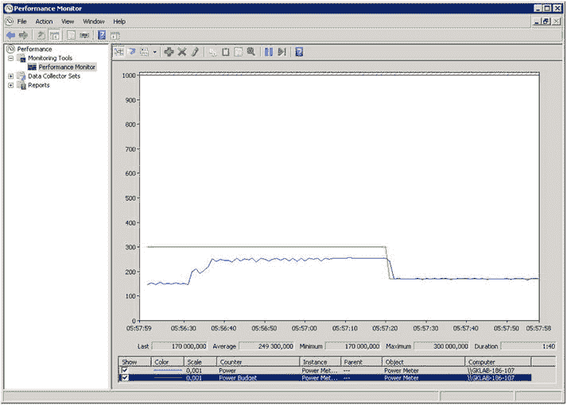

*图 7-18. 性能监视器中显示正在实施电源限制的节点管理器 ACPI 电源计量计数器*

Windows 的 `typeperf` 命令会列出系统上所有可用的 `Perfmon` 事件。用户可以将该命令的输出重定向到一个文件，并根据需要编辑该文件，只保留感兴趣的事件。随后，生成的文件可以作为输入提供给 `Logman`，以定义并创建新的数据收集器。以下是该命令的一个示例：

```
C:\Windows\System32\typeperf.exe -q > input_file
```

下面的示例命令创建了一个名为 `TEST` 的新数据收集器。`Logman` 包含许多命令行选项，用于定义收集间隔、输出格式和输出位置。通过调用该工具的帮助选项可以获取所有可用命令行选项的完整列表。

```
C:\Windows\System32\logman create counter TEST
--v -ow -f csv -si 12 -rf 00:01:20 -cf \path \input_file -o \path
```

下面的示例命令启动了 `TEST` 数据收集器。这将监控系统 120 秒，并根据定义数据收集器时使用的命令行选项，将结果写入一个逗号分隔值（CSV）文件。

```
C:\Windows\System32\logman start TEST
```

以下输出展示了一个示例，其中包含操作系统每秒发出的 C2 和 C1 请求计数。

```
12/4/2013 12:53:46 PM        147563.4769         42.47840145
12/4/2013 12:53:58 PM        147825.0577        180.6790098
12/4/2013 12:54:10 PM        149276.3783        120.0697295
12/4/2013 12:54:22 PM        148175.1804         70.16651533
12/4/2013 12:54:34 PM        145440.724          83.24879264
12/4/2013 12:54:46 PM        144713.8251        145.7252465
12/4/2013 12:54:58 PM        146356.6638        112.1651317
12/4/2013 12:55:10 PM        147555.4464        102.7483379
12/4/2013 12:55:22 PM        147615.9768         46.81029614
12/4/2013 12:55:34 PM        148977.9331        106.331977
```

