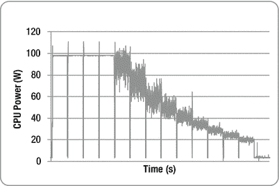
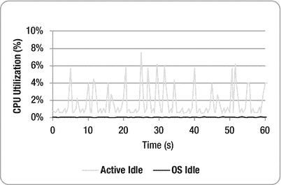
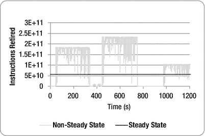
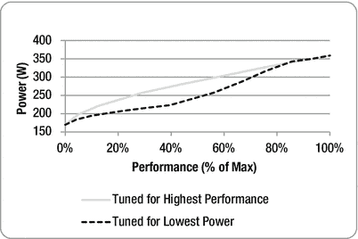
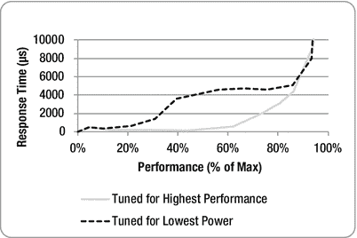
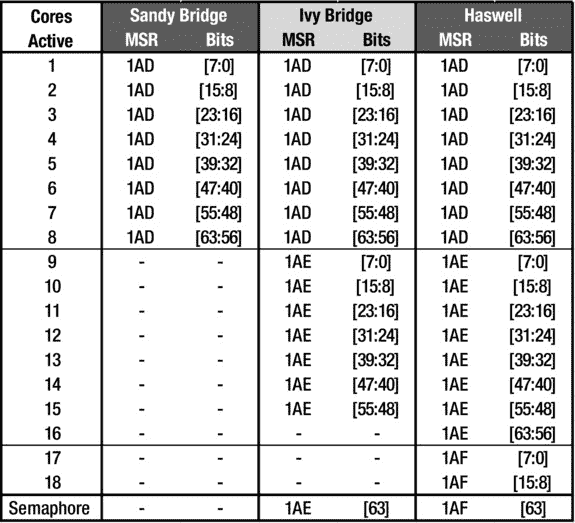
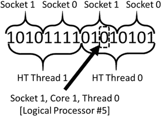

# 8. 特性评估与优化

服务器拥有种类繁多的硬件和软件配置选项。这些选项既包括启用或禁用某个功能等简单设置，也包括允许运维人员控制使用条件、功能或其他功能行为的更高级选项。本书中讨论的各个功能主要涉及电源管理——例如，`P-states`（性能状态）、`C-states`（休眠状态）、链路和设备状态。服务器还拥有大量为性能而设计的可配置功能，包括 `Turbo`（睿频加速）、内存预取器或内存控制器页面策略。此外，服务器还拥有大量为增加功能而设计的可配置功能，例如虚拟化、安全性或可靠性、可用性和可服务性（`RAS`）特性。

服务器同样拥有大量的软件选项，包括不同的操作系统、应用程序和管理软件选项。对于任何给定的工作负载，服务器的默认硬件和软件设置旨在提供低功耗与高性能之间的良好平衡。然而，对于许多工作负载而言，这些默认设置可能并非最优，或者可能与运维人员的性能、功耗或成本目标不一致。大多数平台会启用电源管理功能，因此在利用率较低时会积极使用这些功能。随着利用率的提高，它们的使用会趋于保守，当服务器达到满负荷时，这些功能会被禁用。在满负荷状态下，电源管理功能会被显式或隐式地禁用，因此电源管理不会对最大吞吐量产生负面影响。

上述所有不同类型的特性都会对性能、功耗或其他因素产生影响。具体影响会根据被测工作负载和所使用的系统组件而有显著差异。在许多情况下，明确了解各种配置选项将如何影响功耗或性能的唯一方法是在特定的系统配置上进行实验。例如，一个具有简单事务的 I/O 密集型工作负载可能会因 `PCIe L1` 状态而感受到不良的性能影响。然而，其影响将根据 I/O（网络或存储）、设备延迟、设备带宽以及系统是在低利用率还是高利用率下运行而有显著差异。对于单个特性的性能或功耗特性问题，没有放之四海而皆准的答案。

在决定是否进行调整、调整哪些特性或如何调整之前，运维人员需要确定他们的需求，例如功能、功耗和性能。确定优化目标也很重要。一个为追求最大性能而进行优化的运维人员可能会做出不考虑功耗消耗的决策，最终选择的特性和调整方案将与一个希望最小化功耗的运维人员截然不同。其他运维人员可能会采取更平衡的方法；他们可能希望尽可能降低功耗，但同时仍满足响应时间（性能）要求。还有一些运维人员会在不影响最大吞吐量的前提下，尽可能积极地使用电源管理。对于少量服务器而言，对高级特性进行调整的投入可能不值得。然而，随着部署的服务器数量增加，其价值会显著提升。

> **注意**
>
> 本章概述的流程会频繁提及如何调整以降低功耗或提升性能，以及两者之间的权衡。你可以使用相同的流程和分析技术来评估其他权衡因素，例如成本或功能。此外，需求可能不仅限于功耗和性能，还可能包括温度或可靠性限制。

使用正确的工具和流程，特性调整非常简单。第 2-6 章描述了各种电源管理特性，包括它们的工作原理、功耗和性能特性。第 7 章描述了如何监控这些特性以了解其使用情况。本章描述了一个针对数据中心对服务器进行特性评估和优化的流程。

以下步骤概述了优化服务器的方法。其中许多单独步骤将在本章后续部分进行更详细的描述。

1.  设定功耗和性能需求以及优化目标。例如，在满足响应时间要求的同时最小化能耗，或者在低于温度限制的前提下最大化性能。
2.  在目标环境中收集数据，以了解运行时的特性。这包括在一系列使用条件下，利用功耗、性能和热监控功能收集的数据。
3.  分析数据以识别与需求之间的差距，并了解运维人员需要进行哪些改进才能达到优化目标。
4.  分析数据以发现新的问题和机会。例如，运维人员可能在特性评估过程中发现，他们只使用了可用内存容量的一小部分，或者正在运行的软件线程数经常少于逻辑处理器数量。
5.  创建用于调整实验的测试环境。确定一个能代表目标环境的工作负载。重复使用能模拟类似应用和服务的行业及开源工作负载，或者基于目标环境的关键特性创建新的工作负载。
6.  确定可调整的选项，包括 BIOS 设置选项、操作系统选项和应用程序选项。
7.  测量目标工作负载并收集服务器处于默认设置下的数据。这代表基准测量值，所有后续实验都将与之进行比较。
8.  对每项确定的功能和调整，分别测量目标工作负载，且每次只更改一项。
9.  针对每项更改，收集并分析数据以确定其对功耗和性能的影响。
10. 识别那些有助于满足需求和优化目标的更改，并测量在组合使用这些更改后的目标工作负载性能。
11. 将对目标环境有益的更改进行部署。
12. 当需求、优化目标、使用条件或系统组件发生重大变化时，重复上述流程。

## 工作负载

工作负载是用于衡量服务器性能的软件服务、应用程序或测试工具。它们试图根据关注的使用条件来模拟具有代表性的使用场景。工作负载提供了一种可重复的方式来测量系统性能，在数据中心中，当你在实验并试图理解硬件或软件更改所产生的影响时，它们尤其有用。

性能可以根据所关注的工作负载以多种不同的方式来呈现。例如，吞吐量指标（如每秒事务数或每秒 I/O 次数）衡量平台的最大性能能力。延迟指标（如事务响应时间、计算作业完成时间或 I/O（驱动器和网络）延迟）衡量平台的响应能力。功耗指标（如平台功耗、内存功耗、频率和电压）用于了解每单位工作的能耗成本。多个工作负载会将关注的各种指标结合在一起，提供每瓦性能或每美元性能。

工作负载可用于研究系统组件的子集、整个系统或服务器集群。当代表性工作负载与广泛的数据收集（例如核心和 Uncore 性能监控单元、数字功耗计和操作系统指标）相结合，并对结果进行仔细分析时，可以深入了解系统行为。

### 识别合适的工作负载

任何工作负载的首要要求是其可测量性。一个服务、应用程序或测试工具在测量过程中必须捕获一个或多个指标，这些指标可用于传达各种测量的吞吐量、延迟或两者的综合指标。

工作负载必须是可重复的。如果在两次、三次或上百次实验之间未进行任何配置更改，那么测量结果必须相同。可重复性差的工作负载会使运维人员难以或无法判断测量到的性能变化是由于配置更改，还是仅仅因为正常的实验波动。理想情况下，用于实验的工作负载在测量的功耗和性能上其变化应低于 1%；然而，2%-3% 的变化很常见。如果变化超过 5%，则会带来问题，因为该工作负载无法再用于评估对系统配置进行较小或更细微更改所产生的影响。

工作负载必须是可复现的——每次测量都执行相同的事务或计算，使用相同的输入，并遵循相同的顺序或分布。可复现的工作负载在相同的时间间隔内测量性能，该时间间隔对于每次测量都相同。它们还可以重置为每次测量都相同的起始状态。例如，使用数据库的工作负载必须能够在每次测量前恢复备份数据库。

可扩展性差的工作负载或系统会影响测量的可重复性或可复现性。例如，用于测量计算性能的工作负载，如果存在 I/O 瓶颈，它将无法揭示更改带来的影响。类似地，仅使用少量线程的工作负载可能无法准确体现八核或十八核处理器之间的性能差异。

工作负载必须具有代表性。具有代表性的工作负载执行与被建模场景类似的事务或计算，并且还使用与被建模场景相同的软件栈和配置。例如，具有代表性的基础设施即服务（IaaS）工作负载将使用虚拟化环境。它将包含运行异构应用程序的虚拟机，会随时间变化改变服务器上的负载，并会改变运行实例的数量。许多工作负载包含随机元素以提高其代表性——例如，改变客户端思考时间或事务到达间隔率的工作负载。

不具有代表性的工作负载通常只对目标场景的一小部分进行建模。这使得测试环境中的调优结果更有可能不适用于生产环境。例如，测量单线程 TCP 往返延迟的测试工具不能代表 Web 服务器。运维人员可以对测试工作负载进行多项更改以提升其性能，但这些更改可能对生产工作负载没有影响或产生负面影响。

用于表征和优化的另一个关键属性是工作负载是否可配置；例如，运维人员是否能够改变科学工作负载中的问题规模，或改变事务工作负载中连接的客户端数量？拥有充足的配置选项是调整工作负载设置以最佳匹配目标环境的关键。

### 工作负载类型

工作负载有多种不同类型——例如，测试工具、能效基准测试、行业基准测试和数据中心工作负载。每种类型都有不同的应用领域、不同的目的或目标，以及不同的复杂程度。

#### 测试工具

测试工具不一定模拟具有代表性的服务或应用程序；相反，它们用于对系统中的单个组件或相关组件子集施加压力。例如，英特尔提供了一种用于表征缓存和内存性能的测试工具。英特尔内存延迟检查器工具（`Intel MLC`）可用于测量最大内存带宽、空闲延迟和加载延迟。¹ 尽管这些工具非常适合测试某些关键系统特性，但也很容易误解其结果。一个常见错误是在启用了时钟使能（CKE）节能功能的情况下测量空闲内存延迟。这些节能功能通常在空闲延迟测试期间启用，导致空闲延迟显著增加。`CKE` 对实际系统性能的影响通常要小得多。

还有一些专注于 I/O 的测试工具。开源工具`iperf`是测量网络带宽的热门工作负载；`NetPIPE`工作负载则以测量网络延迟而闻名。对于存储，开源工具`FIO`或`IOmeter`既流行又灵活，允许用户改变不同的 I/O 参数和思考时间。

测试工具可以初步表明某特定功能可能如何影响功耗或性能。它们在识别平台的基础能力方面也很有帮助，并且可以用作检测瓶颈的指南。在测量测试工具时，可以监控各个组件，以了解状态驻留时间、带宽或吞吐量限制。第 7 章概述了监控组件时需要关注的不同类型指标。

很容易误解某些微基准测试的结果。例如，空闲延迟基准测试（如`Intel MLC`）会因内存`CKE`节能特性而显示出显著的延迟增加（见第 3 章）。`CKE`不仅会因`CKE`唤醒而导致空闲延迟增加，而且预充电关闭（`PPD`）特性还会导致内存页面关闭（并进一步增加延迟）。用户基于此基准测试得出`CKE`会导致显著性能损失的结论并不罕见。实际上，在真实工作负载中，`CKE`对延迟的影响要小得多。

## 能效工作负载

能效工作负载用于研究系统的功耗和性能特征。它们会充分使用 CPU 和内存，并为系统行为提供出色的初步分析。最流行的能效工作负载是来自标准性能评估公司（SPEC）的`SPECpower_ssj2008`（`SPECpower`）和服务器能效评级工具（`SERT`）。`SPECpower`在业界被广泛使用，并拥有多年公布的测试结果，因此有大量数据可用于系统比较。

### SPECpower

`SPECpower`测量在 Java 虚拟机（JVM）中跨广泛 CPU 和内存利用率范围运行的简单事务。它包含空闲、最大吞吐量以及介于这两个端点之间的一系列负载点。它提供了一种可视化不同最大性能比率下功耗的方法。这种可视化，一个轴是功耗，另一个轴是性能，通常被称为负载线。本书中遍布这种可视化的示例；然而，许多示例使用了`SPECpower`之外的工作负载。`SPECpower`中由`SPEC`引入的负载线方法已在业界得到广泛应用，因为它可以轻松应用于不同的工作负载。

图 8-1 显示了`SPECpower`测量期间的 CPU 功耗。它展示了用于确定系统性能的几个校准负载点，以及从不同利用率一直到空闲的多个负载点。



图 8-1. 在`SPECpower`的各个负载水平下测量的 CPU 功耗

`SPECpower`具有一些代表性特征，但它缺少数据中心工作负载中常见的更复杂的事务。它没有运行完整的软件堆栈，也没有任何显著的存储或网络 I/O。因此，`SPECpower`包含一些在生产工作负载中不常见的特性。与典型的数据中心工作负载相比，`SPECpower`的功率状态转换数量少了一个数量级。在`SPECpower`中，处于低功耗状态的驻留时间远高于其他工作负载。在`SPECpower`中，事务是批量发起的，而不是由网络连接的客户端单独发起。这意味着工作负载在更长的时间内处于空闲和活动状态，导致其 P-state 行为与典型数据中心工作负载大相径庭。

由于该工作负载专注于 CPU 和内存，某些特性或平台级别的更改可能会提高`SPECpower`得分，但这在典型的数据中心工作负载中并不会带来好处。与所有工作负载一样，存在一些可能有利于`SPECpower`的优化，但这些优化通常不适用于其他场景。

> **注意**
>
> 工作负载选择中的一个重大挑战是在易用性和代表性之间取得平衡。模拟真实使用场景的工作负载往往包含大量网络连接的客户端、复杂的软件堆栈以及多个不同的被测系统。而易于安装、测量和维护的工作负载则不具备这些特点。

### 服务器效率评级工具（SERT）

`SERT`是`SPEC`正在开发的一套新工具套件，用于在更广泛的使用条件和应用中测量功耗和性能。它不是执行单个测试，而是包含多种不同的`worklet`，分别对 CPU（不同类型的操作，包括混合整数、浮点、数据引用和修改）、内存和驱动器进行压力测试。`SPECpower`负载是其中的一个`worklet`，因此`SERT`扩展了超越`SPECpower`所能进行的分析类型。

`SERT`已被美国环境保护署（EPA）采纳用于其服务器能源之星计划。`SERT`也正在被全球包括欧洲和亚洲在内的政府机构调查用于能效计划。有趣的是，`SERT`不仅用于功耗和性能评估，还被考虑用于政府的环境保护项目。

### 行业工作负载

行业工作负载通常是两层或三层的工作负载，事务基于更真实的交易到达间隔时间通过网络驱动。这些工作负载使用具有代表性的应用程序和软件堆栈，并且通常包含服务质量或响应时间要求。测量事务响应时间的能力是一个关键能力，因为它允许操作员描述电源管理功能对性能的影响。使用行业工作负载的缺点在于，它们代表了在工程师时间和硬件上的大量资源投入。

行业工作负载是表征和优化服务器的最佳可用工具之一。这些工作负载由各种开源组织和行业联盟维护和更新，并在业界得到广泛应用。本书中的大部分图表都是使用行业工作负载监控功耗和性能生成的。

许多优秀的行业工作负载涵盖了不同的市场领域。例如，许多 HPC 和科学计算工作负载涵盖了生命科学、计算机辅助工程、金融建模和天气模拟，其中许多是开源的。同样，有许多企业级工作负载模拟了数据库和邮件服务器、客户关系管理（CRM）系统以及企业资源规划（ERP）系统。还有许多云工作负载模拟了多租户环境，或利用 Web、内存缓存和数据库的分布式服务环境。

事务处理性能委员会（TPC）和`SPEC`是开发和维护工作负载的两个行业组织。TPC 工作负载，如`TPC-C`（订单录入 OLTP）、`TPC-E`（经纪公司 OLTP）和`TPC-DS`（决策支持系统），在功耗和性能表征方面很受欢迎。`SPEC`工作负载，如`SPECweb`（Web 服务器）、`SPECvirt`（基础设施整合）和`SPECimap`（邮件服务器），提供了类似的能力。除了行业组织之外，还有许多公司赞助的工作负载，例如 SAP 销售与分销（`SAP SD`）工作负载或`VMware VMmark`。

除了行业组织维护的工作负载之外，还有许多优秀的开源工作负载涵盖了不同的市场领域：例如，`Olio`（Web、社交网络）、`mcblaster`（对象缓存）、`HammerDB`（OLTP）和`TPoX`（基于 XML 的事务处理）。

> **注意**
>
> 开源工作负载是进行工作负载开发或定制工作负载以更好地模拟目标环境的绝佳起点。

行业工作负载更复杂、更真实，代表了更高一个层次。与`SPECpower`不同，大多数行业工作负载没有集成的功耗和性能指标，也不会自动生成负载线。然而，`SPECpower`中的负载线概念可以轻松应用于行业工作负载。

行业工作负载允许用户创建各种不同的负载，通常通过指定虚拟客户端的数量或客户端事务之间的延迟时间来定义。例如，`Olio`要求操作员指定将用于生成不同类型 Web 事务的用户数量。通过使用不同数量的用户运行，可以跨不同利用率或吞吐量水平进行测量。对于许多虚拟工作负载，需要数千个虚拟客户端才能达到最大吞吐量，因此通过改变用户数量可以轻松地对负载进行细粒度调整。

### 空闲工作负载

与行业工作负载的情况一样，用于测试空闲服务器的条件也应具有代表性。许多空闲功耗的测量是在服务器开机并完成初始化后不久进行的。此时服务器可能尚未初始化任何应用程序或服务并使其就绪。这种状态称为操作系统空闲。在操作系统空闲状态下，通常可以看到长时间、不间断的空闲持续时间，以及在封装 C 状态（`package C-states`）中极佳的驻留时间。

要获得具有代表性的测量结果，最好在系统上测量空闲状态，该系统的所有应用程序和服务均已初始化，并且刚刚完成运行一个代表性工作负载。这种状态称为活动空闲，与操作系统空闲不同，它可能包含间歇性的网络活动、定期的管理和安全操作以及零星的应用程序活动。虚拟化环境中的活动空闲通常包括运行不同软件堆栈的各种虚拟机，这增加了其复杂性。顾名思义，活动空闲比操作系统空闲要活跃得多，从而导致更高的功耗。图 8-2 展示了在加载了大量应用程序和服务的情况下，操作系统空闲与活动空闲之间活动程度的差异。



图 8-2. 活动空闲与操作系统空闲之间的 CPU 利用率变化

测量和比较操作系统空闲与活动空闲的差异有助于识别影响空闲功耗的软硬件组件。例如，使用轮询而非事件的应用程序，或改变操作系统计时器频率的应用程序，都可能导致更高的空闲功耗。由于大多数服务器在空闲状态下会花费大量时间，优化空闲状态可能与优化活动负载同样有益。操作人员可用于诊断活动空闲问题的工具将在第 7 章中讨论。

## 系统表征

硬件和软件监控工具是系统表征所需的关键能力。最佳的数据收集方法可能因工作负载类型或所收集数据的数量/类型而变化。

### 稳态与非稳态

在监控工作负载时，识别目标工作负载是稳态还是非稳态非常重要。在稳态工作负载期间，系统特性不会随时间发生显著变化。模拟事务处理系统的行业基准测试通常是稳态工作负载；`TPC-E` 或 `SPECweb` 就是这类工作负载的例子。这些工作负载在很长一段时间内重复执行预定义的事务组合。

对于许多工作负载，在达到稳态之前需要相当长的启动时间。当工作负载首次启动时，随着客户端连接、负载均衡以及常用数据被缓存，应用程序和系统特性会频繁变化。

非稳态工作负载包含频繁变化的系统特性。应用程序的行为可能会在一秒内发生变化——例如，模拟天气模式的科学应用程序，或具有不同映射和归约阶段的数据分析工作负载。图 8-3 展示了稳态和非稳态工作负载的指令退役率变化情况。可以清晰地识别出非稳态工作负载的多个不同阶段。



图 8-3. 非稳态与稳态工作负载之间指令退役的变化

### 数据收集

在工作负载期间收集数据时，有许多重要的考虑因素。如果数据收集工具执行过于频繁，或多个工具并行执行，可能会改变工作负载的行为。如果数据收集不是在一致的时间点开始和停止，则无法在不同测量值之间进行比较。

#### 收集时长

数据收集的开始时间和长度取决于工作负载是稳态还是非稳态。对于稳态工作负载，通常在启动阶段不收集功耗和性能数据，因为初始化阶段不是关注点。类似地，在降速阶段或当工作负载完成且正在将文件恢复到已知起始状态时，可以跳过数据收集。

当数据在启动阶段和降速阶段之间的稳态期间收集时，只需收集一小段时间的数据即可，因为系统特性不会从一个时刻到下一个时刻发生显著变化。在一分钟稳态期间收集的数据，其特性应与下一分钟收集的数据非常相似。对于具有几个重要时间间隔的工作负载，数据收集可能需要启动和停止。例如，`SPECpower` 可能需要在特定时间启动和停止工具，以便单独分析负载点。

对于非稳态工作负载，性能与功耗数据通常在整个测量期间持续收集。与稳态工作负载不同，只收集一小段时间的数据是不合理的，因为一分钟内收集的数据特性可能与工作负载剩余时间内收集的数据特性大相径庭。

#### 收集频率

如果以高频率收集功耗和性能事件，数据收集工具会频繁中断应用程序，从目标工作负载中窃取 CPU 周期。这可能会改变工作负载的自然行为，暴露出在数据收集停止时不会出现的功耗或性能问题。如果以低频率收集事件，则可能难以辨别有趣的工作负载特性。操作人员将无法既识别工作负载的独特阶段，又确定功耗和性能特性随时间如何变化。

**注意**

与硬件监控工具不同，操作系统工具可以在单个时间间隔内收集数百个不同的事件。如果同时收集太多事件，即使以低频率收集数据，也可能干扰工作负载。

对于稳态工作负载，以低频率收集数据会产生与高频率收集数据相似的结果。这简化了稳态工作负载的数据收集过程，因为只需少量数据即可表征该工作负载。对于非稳态工作负载，高频率收集是必要的。找到理想的数据收集频率需要进行一些试验，因为它因工作负载而异。目标是尽可能频繁地收集数据，同时不影响系统功耗或性能。

#### 事件排序与事件组

很多时候，需要分析在相同时间点采集的多个事件，才能全面了解组件或系统的行为。例如，为了描述工作负载在特定阶段的内存引用特征，操作员可能希望测量读取事务、写入事务、页面命中、页面空访问、页面未命中以及内存延迟。正如第 7 章中所述，这通常不可能实现，因为许多监控单元只能并行采集少量事件。

对于稳态工作负载，这并非重大问题。被监控的事件在连续时刻间所测得的数值非常相似，因此可以通过将事件拆分为若干不同的组，并在不同时间点分别测量，来获得对组件或系统行为所需的深入洞察。对于非稳态工作负载，监控单元的这一限制则可能成为问题。最佳实践是尽可能在时间上*紧密*地收集相关事件，并以高频率重复采集相同的事件组。

#### 多工具协同

在工作负载特征描述过程中，操作员可能需要使用多个不同的工具来测量数据，这些工具针对的是分布在软件、固件和硬件中的监控能力。当使用多个工具时，在某些情况下同时使用它们进行测量是有益的。例如，为了对非稳态工作负载进行全覆盖监测，或者当需要比较同时采集的软件指标与硬件指标时。在其他情况下，则逐一使用这些工具进行测量更为有利。例如，为了限制在稳态工作负载期间数据采集的侵入性。

与确定采集频率、事件组和事件排序的过程类似，在使用多个工具收集数据方面也有多种选择。这需要一些试验，因为每种选择都有其独特的优势和劣势。

### 方法论

对服务器进行特征描述和优化不仅需要良好的工作负载和数据收集策略，还需要正确的方法论。以下建议可作为基本服务器特征描述的指导原则。

*   在投入时间进行特征描述和分析之前，先对每台服务器进行质量测试。使用测试工具确认配置健康，并多次测量目标工作负载以确保工作负载的波动在可接受范围内。

*   始终使用监控工具收集数据。如果没有对功耗和性能特性的恰当可见性，就难以理解软件或硬件变更在前后两次测量间所产生的结果。

*   始终使用一致的基线测量，在整个实验过程中不对配置做任何更改。例如，如果更新了驱动程序或 `BIOS`、增加了硬盘容量、或重新配置了网络，那么在该服务器上进行的测量将无法与之前的测量结果进行比较。

*   每次测量之间只改变一个变量。例如，在一次测量中将多个软件优化耦合在一起，最终可能表现为功耗没有变化，而实际上，某些优化可能有帮助，另一些则可能有害。

*   始终自动化工作负载和数据收集。这能确保每次测量都以相同的开始时间、结束时间、采集频率和事件顺序进行。如果缺少这种时间上的一致性，不同测量之间的比较可能会得出误导性的结果。

*   使用受控的热环境。如果温度因天气、一天中的时间或其它系统的活动而显著变化，工作负载的可重复性可能会受到影响。

### 分析

由于在一次测量中可以监控成千上万个不同事件，采用自上而下的分析方法是分析服务器变更的最佳策略之一。首先，着眼于全局非常重要。需要分析的最关键指标是功耗、性能和成本，因为大多数特性调优都会导致其中一项或多项指标的增加或减少。性能将通过吞吐量和延迟（响应时间或完成时间）来衡量，并由目标工作负载进行采集。功耗将使用数字功率计进行测量，或者通过第 7 章中所述的监控功能，利用电源或电流传感器进行测量。

### 功耗指标

配置和调优更改可能导致系统功耗产生巨大差异。图 8-4 突显了这种变化的显著程度。本例中最低功耗调优方案能够在不影响最大吞吐量的情况下，最小化每笔交易的能量成本。



图 8-4. 功耗与性能（吞吐量）对比——服务器 OLTP 工作负载

为了更深入地理解配置或调优更改的影响，首先需要确定导致变化的一个或多个组件。然后，具体确定这些组件的功耗为何发生变化。针对给定的功耗增减，在收集的数据中存在若干事件和指标，可用于确定原因。

在理想情况下，系统能够进行组件级别的功耗测量，并且只需比较各个组件（处理器、内存、`PCH`、`LAN` 适配器、驱动器和风扇）的功耗，即可识别出导致功耗变化的组件。

然而，当前具备组件级功耗测量能力的系统并不常见。一种更容易实施的确定功耗变化的方法是识别活动状态、空闲状态以及运行条件的差异。这些是最终决定功耗的主要因素。例如，可以通过分析 CPU `C-state` 和 `P-state` 驻留及状态转换来识别 CPU 功耗的变化。可以通过分析每个风扇的转速计来识别风扇功耗的变化，也可以通过分析互连电压、频率和链路宽度来识别互连功耗的变化。

如果功耗测量和监控能力不足以确定导致功耗变化的原因，则可以利用性能和热事件来提供替代性洞察。例如，如果测量显示 `SSD` 的 `IOPS` 增加了 10 倍，这种活动增加可能表明驱动器功耗有可测量的增长。

系统功耗的变化始终是某个组件变化的结果，因为系统中各个组件之间存在许多复杂的依赖关系。例如，操作员可以通过限制所用内存频率和已安装容量来降低内存功耗；然而，这种更改可能会因为 CPU 等待从内存和驱动器返回数据而发生停顿，从而导致系统功耗增加。随着使用的工作负载变得更加复杂，组件和系统依赖关系的数量和复杂度也会增加。例如，在运行分布式应用程序的服务器集群中，调整任何一个节点可能会产生微小的局部差异，但当从整体上看待整个集群时，则可能产生显著的全局差异。

以下列表可作为自上而下功耗分析的优先级指南。虽然此列表针对功耗分析，但性能指标也很有价值，稍后将进行介绍。有关如何监控这些各种指标的更多详细信息，请参见 第 7 章。

- **CPU 功耗**

  - `P-state` 驻留

  - `C-state` 驻留与转换

  - 温度

- **内存功耗**

  - 频率与电压（运行时静态）

  - 自刷新与 `CKE` 驻留及转换

- **热管理**

  - 平台温度

  - 风扇功耗

  - 转速计

- **设备功耗**

  - 链路宽度与频率

  - I/O 带宽与每秒事务数

  - `QPI` `L1` 与 `L0p` 驻留及转换

- **其他**

  - 额外的系统性能指标

### 性能指标

配置和调优更改可能导致系统性能产生巨大差异。图 8-5 突显了这种变化的显著程度。该图强调了性能需求的重要性。如果这台服务器有一个性能需求，要求 95% 的事务在 10 毫秒内完成，那么最低功耗调优方案将在满足该性能需求的同时降低功耗和成本。然而，如果服务器的性能需求是 95% 的事务必须在 2 毫秒内完成，那么操作员可能需要为性能进行调优，并将系统负载控制在其最大容量的 80% 以内。



图 8-5. 响应时间与性能（吞吐量）对比

为了更深入地理解配置或调优更改的影响，首先需要确定导致变化的一个或多个组件。然后具体确定这些组件的性能为何发生变化。如果对目标工作负载在 CPU 频率和 I/O 子系统性能方面的敏感性有充分了解，则性能分析过程会更容易。

> **注意**
>
> 确定 CPU 性能敏感性的一个好方法是通过频率缩放研究。这涉及在多个固定频率范围内多次运行目标工作负载。结果允许操作员通过比较性能增长的百分比与频率增长的百分比，来计算两个频率之间的缩放效率。

如果工作负载表现出较差的频率缩放性能，那么事务时间可能主要消耗在等待内存或 `I/O` 上。或者，较差的频率缩放性能可能是由瓶颈导致的。例如，一个驱动线路速率网络流量的数据中心工作负载，不太可能因 CPU 频率变化而观察到显著的性能增减。

## 性能分析方法

通过分析 `CPI`、路径长度或电源状态驻留的变化，可以识别性能差异。例如，工作频率的降低几乎必然导致性能下降。`CPI` 的增加可能是缓存命中率下降或内存延迟增加的结果。通过分析诸如 `Linux perf` 等工具收集的执行配置文件，可以确定路径长度增加的来源。执行配置文件允许操作员深入分析到表现出行为变化的具体进程、模块或函数。

### 自上而下分析的优先级指南

以下列表是自上而下分析的优先级指南。请注意，上一节讨论的系统功耗，在理解性能变化时是需要考虑的非常重要因素。例如，监控 `C-state` 驻留和转换不仅能让操作员了解在特定状态中的时间，还能了解累积的退出延迟（`C0` 影响）以及缓存刷新的影响（`CPI` 影响）。有关如何监控这些各种指标的更多详细信息，请参见第 7 章。

- **CPU 性能**
  - 每指令周期数 (`CPI`)
  - 缓存未命中与延迟
  - 内存延迟
  - `C-state` 转换（延迟）与驻留 (`C0`)
  - 路径长度
  - 软件执行配置文件
  - `P-state` 驻留（频率）
  - 热节流
- **内存性能**
  - 内存延迟
  - 自刷新与 `CKE` 驻留及转换
  - 内存带宽
  - 热节流
- **互连功耗**
  - `QPI` `L1` 与 `L0p` 驻留及转换
- **设备性能**
  - 链路宽度与频率
  - I/O 带宽与每秒事务数

# 优化

系统中存在大量不同的优化机会，判断哪些值得投入精力可能颇具挑战性。本节将探讨多种不同的优化机会，并研究其中涉及的各种潜在权衡。除了强调有价值的优化机会外，还会介绍一些你可能希望避免的项目。某些优化必须在启动时于 BIOS 中执行，而另一些则可能在运行时进行。本章将尽可能提供如何在系统中进行不同更改的实用方法。

在某些特定情况下，电源管理算法也可以提供改进的性能。本节将重点介绍其中一些提升性能的机会。

## CPU 电源管理

通常情况下，CPU 是开始进行电源（和性能）优化的首要目标之一，因为它通常对平台的总体功耗贡献巨大。然而，有时 CPU 对平台总体功耗的影响并不那么显著。一个很好的例子是带有大量 JBOD（一堆磁盘）的存储系统。在这类系统中，CPU 功耗可能不是总体功耗的主要贡献者，因此可能不值得将精力集中在 CPU 优化上。进行任何优化工作的首要任务之一就是确定功耗的去向。应该对整个平台功耗进行特性分析，并与 CPU 子组件功耗进行比较（详见第 7 章）。CPU（和内存）通常占平台总体功耗的很大一部分，但在投入大量精力进行优化之前，应确认这一点。

第 2 章提供了本节讨论的许多功能的背景信息。

### P 状态与 Turbo

电压和频率对功耗有显著影响。在不需要高性能时以较低频率运行可以节省大量平台功耗，尤其是在高 TDP 的 Xeon 处理器上。

在低到中等利用率下运行时，使用较低频率（P 状态）可能会增加工作负载的响应时间。然而，如图 8-5 所示，许多工作负载在峰值利用率运行时（无论是否启用电源管理）的总体响应时间，远高于在较低利用率下启用电源管理时所观察到的响应时间。因此，这些功能对响应时间的影响可能并非最差延迟情况下的主导因素。

Turbo 可用于将实际运行频率提升至基础频率之上。在近几代处理器中，Turbo 通常能提供 10%–20%（或更高）的峰值性能提升。一个常见的误解是 Turbo 仅在很短时间内提供“突发”性能。虽然在受热约束的消费类设备中通常如此，但在服务器部署中通常并非如此。服务器工作负载通常可以无限期地维持一定水平的 Turbo 频率。

RAPL（以及其他频率管理算法）可以在 Turbo 运行时介入，以限制系统频率。频率通常由这些算法以（小）毫秒级的粒度进行管理。频率转换会阻塞执行约 10 至 20 微秒。这些算法已进行了调整，使得这些转换时间对系统的总体吞吐量（和性能）影响最小。然而，对延迟干扰非常敏感的用户（例如高频交易者）可能不希望使用 Turbo，以避免执行被阻塞。许多服务器工作负载能够轻松容忍这种延迟成本，而提高频率带来的好处远远超过了延迟成本。

另一个常见的误解是 Turbo 频率的能效低于禁用 Turbo 时的运行能效。虽然在某些处理器型号上确实如此，但并非总是如此。一些低功耗、低频率的产品在运行 Turbo 时能实现最佳的每瓦平台性能。

现代操作系统需要数十毫秒来检测需求和使用率的变化。因此，使用操作系统控制的 P 状态可能会导致短时间内运行频率低于系统需求的最佳值。未来产品中硬件电源管理的一个潜在优势是能够改善对需求和使用率变化的响应时间。

> **注意**
>
> 使用 P 状态和 Turbo 并非一个非此即彼的问题。现代操作系统可以被限制在某个频率范围内请求频率。这可以在对响应时间影响有限的情况下，实现显著的能效提升。

P 状态和 Turbo 不必是全有或全无的决定。例如，用户有一个通常运行在约 60%利用率、但偶尔需求会增加的的系统。该用户的系统型号可以在“全核 Turbo”（P0n）频率 3 GHz 和基础频率（P1）2.6 GHz 下运行。当客户让系统始终请求 Turbo 运行时，峰值性能有显著提升（这对于高需求时段很有用），但在典型需求水平下功耗也会显著增加。如果启用所有 Turbo 和 P 状态，能效会很好，但有时会出现不理想的响应时间特性。在这种情况下，用户可以指示操作系统始终请求至少 2.4 GHz 的频率。在这种配置下，用户可以在典型利用率下避免以 3 GHz 运行带来的功耗成本，然后在需求增加时切换到 3 GHz。

> **注意**
>
> 建议通过操作系统而非 BIOS 来控制 Turbo 和 P 状态。这为长期更改决策提供了极大的灵活性，无需重启系统（在大规模部署中，重启可能非常不受欢迎）。

BIOS 确实有禁用 Turbo 的能力，许多 BIOS 设计者将此选项暴露给最终用户。但是，系统中无法禁用频率转换。某些 BIOS 包含禁用 EIST（增强型英特尔 SpeedStep 技术）的选项，但这只会改变 P 状态在 ACPI 中向 OS 枚举的方式。

> **注意**
>
> 一些 OEM 厂商拥有专有的频率管理机制，通过利用 ACPI 支持的功能在 OS 和 CPU 之间运作。如果在 OEM 的 BIOS 中启用了这些功能，可能需要特别小心。

### Windows 中的频率控制

在 Windows 中，频率可以通过电源选项控制面板以及使用 `powercfg` 命令行工具进行管理。高性能调优选项（可在控制面板和通过 `powercfg` 获取）会指示操作系统始终请求最高频率。默认情况下，平衡模式会请求全频谱范围内的频率，包括如果 BIOS 启用了 Turbo 频率。² 在高级设置选项中，你可以找到额外的调优选项来控制所选频率的范围（请参阅最小处理器状态和最大处理器状态配置选项）。请注意，这些选项不控制 Turbo 范围内的行为。

`powercfg` 工具也可以用于管理频率选择和 Turbo 频率。³ 可以通过以下命令行禁用 Turbo（或将 0 改为 1 以启用）：

```
powercfg -setacvalueindex scheme_current sub_processor PERFBOOSTMODE 0
powercfg -setactive scheme_current
```

Turbo 范围之外的频率选择也可以通过 `powercfg` 控制：

```
powercfg -setacvalueindex scheme_current sub_processor PROCTHROTTLEMIN 60
powercfg -setacvalueindex scheme_current sub_processor PROCTHROTTLEMAX 100
powercfg -setactive scheme_current
```

可以使用以下命令从 `powercfg` 转储当前系统配置：

```
powercfg -Q
```

### Linux 中的频率控制

Intel P-state Linux 驱动程序提供了一种在 `sysfs` 中约束请求频率的机制。⁴ 这些文件当前位于 `/sys/devices/system/cpu/intel_pstate/`。

`max_perf_pct`、`min_perf_pct` 和 `no_turbo` 文件可用于按逻辑处理器粒度配置所需的 P-state 行为。此处配置的百分比值包括对 Turbo 范围的控制，使得即使在 Turbo 范围内也能限制使用的最大频率。虽然目前无法使用 `sysfs` 接口确定该范围中哪一部分用于 Turbo，但你可以通过执行以下命令（以 root 身份）在运行时禁用 Turbo：

```
# echo 1 >> /sys/devices/system/cpu/intel_pstate/no_turbo
```

可以选择频率的算法可以通过 `debugfs` 进一步调优。然而，大多数用户通常报告称，偏离默认配置所带来的收益微乎其微。

在引入 `intel_pstate` 驱动程序之前，Linux 默认使用 `acpi_freq` 驱动程序来管理频率。近年来，很少有精力用于优化此驱动程序以使其在服务器环境中良好运行，因此不推荐使用。`intel_pstate` 驱动程序的一个缺点是，需要在实际内核中提供对其的支持。在较旧的内核上无法将该驱动程序作为模块加载。请注意，在包含对 `intel_pstate` 支持的内核上，可以使用启动时内核参数 `intel_pstate=disable` 回退到较旧的 `acpi_freq` 驱动程序。

Linux 内核还支持 P-state “调控器”的概念，这些调控器控制频率选择算法的激进程度。对于 `acpi_idle`，`ondemand` 和 `performance` 调控器在服务器部署中很常见。`performance` 调控器简单地始终请求最高性能，而 `ondemand` 则尝试基于系统利用率更改频率。许多用户在使用 `ondemand` 调控器时遇到性能问题，迫使他们使用 `performance` 调控器（这有效地禁用了 Turbo 之外的 P-state）。使用 `intel_pstate` 后，`ondemand` 不再是选项。相反，`intel_pstate` 提供了 `performance` 和 `powersave` 选项。`performance` 调控器的工作方式与以前相同——系统将始终请求最高频率。`powersave` 调控器取代了 `ondemand`，并提供了一种新算法（与 `acpi_freq` 相比），旨在提供节能效果，同时避免使用 `acpi_freq ondemand` 时观察到的一些性能缺陷。

### Turbo 频率比限制

如第 2 章所述，处理器通常具有基于活动内核数量的不同最大 Turbo 频率。这些限制被固化到每个单元中，并且在给定的处理器 SKU 上是固定的。用户可以在运行时，通过使用 MSR `0x1AD`、`0x1AE` 和 `0x1AF`，基于活动内核数量来降低允许的最大 Turbo 频率。这些 MSR 的确切语义因处理器而异（并总结在图 8-6 中）。



**图 8-6.** Turbo 频率比限制配置

从 Sandy Bridge 代开始，特定的 Turbo 频率可以直接由操作系统请求。因此，在所有情况下可能都不需要使用这些 MSR 来控制 Turbo 频率。例如，如果你只是想使用 `intel_pstates` 设置一个最大请求频率，可以通过 `sysfs` 完成（如前所述）。然而，在其它使用 ACPI 的操作系统中，可能没有供用户进行如此级别控制的操作系统界面。在这种情况下，可以使用这些 MSR。这些 MSR 也可用于基于活动内核数量微调 Turbo 等级。然而，在实践中，通常不需要此类配置。在 Sandy Bridge 服务器上，MSR `0x1AD` 足以控制限制。寄存器中的每个字节指定了给定核心数量的倍率。最多有 8 个核心，因此 64 位 MSR 是足够的。

Ivy Bridge 服务器最多支持 15 个核心。添加了 MSR `0x1AE` 以便为每个核心提供 1 字节。用户需要首先配置 MSR `0x1AD`，然后再配置 `0x1AE`。当写入 MSR `0x1AE` 时，需要将位 [63] 设置为 1，以指示硬件应用该配置。

Haswell 服务器最多支持 18 个核心。添加了 MSR `0x1AF`，并且信号量位被移到了 MSR `0x1AF [63]`。

请注意，这些 MSR 是封装作用域的，意味着在一个给定插槽上的所有核心共享一份副本。在写入这些寄存器时，通常应该从系统每个插槽上的一个逻辑处理器执行写入操作。

Turbo 频率比限制为用户提供了一种在启用和禁用 Turbo 之间找到“折中方案”的机制。例如，用户可能会发现，完全使用 Turbo 会导致不期望的频率切换，而禁用 Turbo 则会显著降低峰值性能和吞吐量。通过将所有最大 Turbo 倍率降低到介于 `P1` 和 `P0n` 之间的某个水平，用户或许能够（在特定工作负载下）找到一个不会产生任何频率切换的可持续 Turbo 频率。这可以成为在完全禁用 Turbo 和使用全部 Turbo 能力之间一个有用的折中方案。

在 Haswell 处理器上，使用 AVX 指令可能会降低最大 Turbo 频率。用户可以使用 Turbo 频率比限制来设置最大 Turbo 频率，使其与使用 AVX 时达到的水平相匹配，从而在工作负载在 AVX 部分之间切换时提供更一致的频率。

请注意，由于可扩展性问题，这种方法可能会在未来的处理器代中停止使用，并被一个适配的接口所取代。

### 非核心频率缩放

非核心频率缩放（UFS）是在 Haswell E5/E7 平台上引入的。该功能可根据 CPU 内部的多种指标自主控制非核心的频率。UFS 不仅能够节省功耗，还能与核心共享功率，以提供更高的频率和更优的性能。UFS 状态转换会阻塞大约 20 `μs` 的系统流量。因此，这些转换被调整得较为罕见（转换间隔为数毫秒）。

UFS 频率算法可通过非架构性 MSR `0x620` 进行控制。`[7:0]` 控制最小倍率；`[15:8]` 控制最大倍率。通过这两个字段，可以对算法的范围进行限定。算法的内部机制不可配置，并且可能因代际不同而变化。

基础的（未经调整的）UFS 算法已针对大多数企业级工作负载进行了性能调优。一种常见（且简单）的替代配置是将此 MSR 设置为 `0x3F3F`，这将尝试将非核心频率锁定在处理器 SKU 允许的最高频率上。这种配置对延迟敏感的模型非常有用。许多网络用户也发现这种配置符合其使用场景。请注意，TDP 频率假设的前提是允许对 UFS 进行动态管理，将频率锁定在最大值可能导致在非常高功耗的工作负载下频率降至 P1 以下。在实践中，在真实工作负载下未观察到这种情况。

### 核心 C 状态

除了 P 状态和频率控制之外，核心 C 状态在一系列系统利用率下对 CPU 功耗产生了最大影响之一。如第 2 章所述，牢记核心 C6 在搭配睿频技术使用时，可以允许在只有少量线程活跃的时间段内以更高频率运行，从而带来显著的性能提升。这在某些遵循阿姆达尔定律⁵的并行工作负载中可能非常有价值。

与降低指令执行速度的 P 状态不同，C 状态通过牺牲“唤醒”时间来节省功耗，当恢复执行时会产生延迟。这些唤醒延迟，C6 状态通常为几十微秒，C1 状态约为 1 微秒。与 P 状态一样，这最终会体现为响应时间的增加。

当执行 `HLT`（暂停）指令时，核心将进入 C1 状态。这是指令集的一部分，且 C1 状态无法在硬件中禁用。核心 C1e 状态同样不能直接被硬件禁用。然而，BIOS 可以设置一个配置位，将 C1 请求提升为 C1e 请求。这通常被记录为“启用 C1e”，但这种定义并不严格准确。在 Windows 上，由于 ACPI 向操作系统枚举 C 状态的方式，通常会使用此位来启用或禁用 C1e。使用 ACPI 空闲驱动程序的老版本 Linux 也是如此。Linux 的 `intel_idle` 驱动程序会自动禁用从 C1 到 C1e 的提升，不受 BIOS 配置的影响，以便它能根据系统行为自主在这两种状态之间选择（当预测空闲周期较短时使用 C1，而空闲周期稍长时则使用 C1e）。

当操作系统执行 `MWAIT(C6)` 时，将使用核心 C6 状态。当前处理器上不存在禁用核心 C6 的硬件机制。BIOS 可以选择使用 ACPI 向操作系统枚举哪些 C 状态。不同的 BIOS 设计者以不同的方式向用户开放此选项。通过 BIOS 禁用 C6 将有效地在 Windows 以及使用 `acpi_idle` 驱动程序的老版本 Linux 上禁用此功能。

当前使用 `intel_idle` 驱动程序的 Linux 在决定使用哪些 C 状态时不会查看 BIOS 配置。因为 `intel_idle` 不查看 ACPI，所以 BIOS 无法将此信息传达给驱动程序。相反，它使用 `intel_idle.max_cstates` 内核参数来控制所使用的 C 状态级别。此定义是特定于产品（甚至内核版本）的，因此可能需要一些试验。请注意，将此参数设置为 `0x0` 将禁用驱动程序，而非禁用 C 状态，因此建议设置为大于 `0x0` 的值。

此外，还存在一个降级算法，可以自主决定使用比操作系统选择的更浅的 C 状态。通常，不建议用户操纵此配置。

> **注意**  
> 目前，CPU 不会自主授予比操作系统请求的更深层的 C 状态。

## 运行时核心禁用

C 状态可以通过提供访问更高睿频频率的途径，以及在功耗受限的环境中节省功耗来提升性能。尽管如果某个核心没有待处理的工作，操作系统会自主请求 C 状态，但也可以向操作系统提供一个提示，表明不应使用某个给定的 CPU。这将阻止 OS 向该核心调度任务，使其能够保持在深度 C 状态。请注意，这种行为并非 100% 可靠，因为在某些情况下（例如广播热中断），核心仍然可能被唤醒。但在实践中，它们往往非常有效。

在 Linux 上，这被称为核心下线（core offline），并且可以通过 `sysfs` 对单个核心执行此操作。

```
#echo 0 > /sys/devices/system/cpu/cpuX/online
```

在 Linux 上，逻辑处理器到物理核心的映射（包括插槽和超线程）在技术上由 BIOS 控制。可以使用 `sysfs` 发现拓扑结构：

`/sys/devices/system/cpu/cpu*/topology/*`

虽然建议发现和解码拓扑结构，但了解预期的一般情况也很有用。在实践中，该映射在大多数代际和配置中是一致的，最好通过一个示例来描述（参见图 8-7 的图示）。考虑一个双插槽系统，每个插槽上有两个四核处理器，且均支持 HT。`sysfs` 中枚举的逻辑处理器将如下所示：



`图 8-7. Linux 上双插槽、四核 CPU 的逻辑处理器位掩码示例`

- 逻辑处理器 0 至 3 代表插槽 0 上核心 0 至 3 的第一个线程。
- 逻辑处理器 4 至 7 代表插槽 1 上核心 0 至 3 的第一个线程。
- 逻辑处理器 8 至 11 代表插槽 0 上核心 0 至 3 的第二个线程。
- 逻辑处理器 12 至 15 代表插槽 1 上核心 0 至 3 的第二个线程。

Windows 有一个相关的功能，称为核心驻留（Core Parking）。此功能与 Linux 中可用的下线支持略有不同，并且它不提供强制某些核心保持关闭的机制。微软已不再推荐在服务器部署中使用核心驻留⁶，并且该功能在默认情况下已被禁用。

虽然 Windows 没有提供在操作系统层面强制关闭特定逻辑处理器的方法，但特定应用程序可以绑定到一组逻辑处理器上。结合操作系统请求的 C 状态，用户可以使用亲和性控制来促使操作系统不使用特定核心，从而允许它们进入深度 C 状态。可以使用 `coreinfo`⁷ 工具解码逻辑处理器到物理核心的映射。亲和性控制超出了本书的讨论范围。

## 封装 C 状态

与由操作系统控制的核 C 状态不同，当前的封装 C 状态由 CPU 自主管理。有关封装 C 状态的更多详情，请参见第 2 章。当所有核心都处于深度 C 状态时，封装 C 状态通过采取额外的节能措施来进一步节省功耗，这些措施在核心处于活动状态时是无法实现的。这些状态通常仅在系统利用率极低时才可能实现，并且其驻留时间可以通过软件进行监控，如第 7 章所述。

封装 C 状态的最大影响之一在于增加了外部设备与 DDR 内存通信的延迟。为了访问内存，CPU 必须从封装状态唤醒，这通常需要几十微秒。

当启用封装 C 状态时，Xeon E5 CPU 的空闲功耗约为 10-15 瓦。如果启用核 C 状态但禁用封装 C 状态，CPU 功耗将适度增加（增加量取决于处理器代际）。请注意，由于电源传输在较低功耗水平下效率往往更低，因此这一功耗增加会被电源传输效率损失放大（参见第 4 章）。一个粗略的经验法则是功耗增加约 1.5 到 2 倍。

封装 C 状态还会影响平台功耗。这种影响甚至可能比在 CPU 芯片上观察到的更大。最显著的影响来自内存自刷新。如果禁用了机会性自刷新，那么禁用封装 C 状态将导致内存仅使用 CKE 来节省功耗。这会对平台空闲功耗节省产生巨大影响，尤其是在内存容量较大的系统上。

正如本章“空闲工作负载”部分之前所述，封装 C 状态的一个限制是，持续在其上运行的软件通常会导致一种并非真正空闲的“活动空闲”状态。当系统能够在节点内的所有插槽上达到真正的空闲状态时，这些状态的节能效果最佳。这与许多消费级使用模式不同，后者出于电池续航考虑，会对空闲功耗进行积极优化和调校。为了充分利用空闲功耗节省的机会，可能需要额外的工作来调优（或停止）那些阻止系统进入真正空闲状态的软件。

如果用户的系统在空闲状态下花费了大量时间，那么启用封装 C 状态可以节省大量系统功耗。对于内存容量较大的系统尤其如此。封装 C 状态通常由 BIOS 控制。操作系统目前无法直接控制这些状态。也可以通过向 MSR `0xE2 [2:0]` (`CST_CONFIG_CONTROL`) 写入 `0x0` 来禁用它。

## 能效性能偏好

许多电源管理算法管理着系统中不同的功耗与性能权衡。其中一些算法是内部的，其调优参数外部不可见。能效性能偏好（EPB）提供了一种机制，让软件可以向 CPU 提示用户希望系统如何进行这些权衡。目前，这是一个架构级的 MSR，提供 4 个比特位，可从中选择最多 16 种不同的运行模式。数值越小代表更侧重性能，数值越大则代表更侧重节能。该功能旨在提供一个简单的接口来调优 CPU 的电源管理算法，而不是要求用户尝试调优 10 个可能因项目而异的不同特性。

在从 Sandy Bridge 开始的 Xeon E5/E7 处理器上，EPB 支持四种运行模式，而 MSR 的最低两个有效位被忽略。实际上，最终只有两种模式显示出显著价值：性能模式（EPB 值 0 到 3）和均衡性能模式（EPB 值 0 到 7）。还存在两种更深的模式（均衡能效和节能模式），但在实际应用中，很难将它们与均衡性能模式区分开来。表 8-1 概述了由 EPB 管理的一些关键特性。

`表 8-1. EPB 特性控制总结`

| 特性 | 性能模式 | 均衡性能模式 |
| :--- | :--- | :--- |
| 睿频降级 | 禁用 | 启用 |
| 内存 CKE | 禁用 | 启用 |
| QPI L0p | 禁用 | 启用 |
| 内部算法 | 性能优化 | 节能优化 |

动态切换是 Sandy Bridge E5 引入的另一个特性，当 CPU 检测到需要高性能时，它会自动将系统切换至性能模式。建议保持此功能启用。某些用户可能希望覆盖那些通常由 EPB 和动态 EPB 切换控制的决策，本章稍后将讨论这些有限的覆盖机会。请注意，在禁用了睿频的系统中，动态切换不会发生，因此在这样的系统上，选择合适的 EPB 模式更为重要。那些将系统配置为始终请求睿频（例如 Windows 或 Linux 的 `performance` 调控器）的用户，也会使系统始终处于性能 EPB 模式。

EPB 在 Atom 服务器或 Xeon E3 服务器上并未像在 E5/E7 产品线上那样经过优化。动态切换算法也仅在 E5/E7 上实现了产品化。

在最初设计时，EPB 由操作系统通过 `0x1B0 IA32_ENERGY_PERF_BIAS` 控制。在 Windows 上，“电源选项”控制面板中的“高性能”模式会自动选择 EPB 性能模式。在 Linux 上，最简单的方法是在所有线程上直接写入 MSR。Linux 上不能动态管理 EPB。

在 Sandy Bridge 上，添加了一个配置位，使得 BIOS 可以从操作系统处接管 EPB 的控制权。这由非架构级 MSR `0x1FC` (`MSR_POWER_CTL`) 控制。如果第[25]位为 0，则 EPB 由操作系统和 MSR `0x1B0` 控制。否则，由 OEM 控制。在这些情况下，EPB 可能通过一些现有的 BIOS 选项进行控制，以进一步简化最终用户的操作流程。

EPB 的最大影响之一是其睿频降级算法。对于已禁用睿频的用户，睿频降级没有影响。在这种情况下，使用 EPB 性能模式可能是最佳选择。然而，这种配置会导致 CKE 被禁用，这可能是不希望的。可以通过覆盖设置来确保 CKE 被使用，这将在本章稍后讨论。

对于使用睿频的用户，由于动态切换的存在，均衡性能模式已被证明能够在不影响大多数工作负载性能的情况下有效节省功耗。这种情况的一个缺点是当系统需求出现尖峰时。与操作系统类似，检测需求尖峰并做出相应响应需要时间（数十到数百毫秒）。

请注意，较新版本的 Linux 内核会检测到 EPB 启动配置为 `0x0`（性能模式）并自动将其重新编程为 `0x6`（均衡性能模式）。因此，您可能希望使用操作系统而不是 BIOS 来配置此模式。

## 超线程技术

超线程技术（`HT`）允许两个逻辑处理器共享一个物理核心。通过共享核心，它们通常会降低各自的线程性能，以换取更高的整体吞吐量和系统性能。启用 `HT` 本身对功耗几乎毫无影响。然而，当多个线程共享核心资源并提升核心的整体性能与吞吐量时，功耗通常会随之增加。在一个启用 `HT` 的核心上运行，但调度器只使用该核心上的两个逻辑处理器中的一个，其功耗与禁用 `HT` 时几乎相同。

尽管`HT`通常会提高核心的功耗，但它几乎总是以一种节能高效的方式实现的。这通常是现存最高效的性能优化手段之一；不过，确实存在一些无法从`HT`获益的工作负载。对内存带宽非常敏感的工作负载就是一个很好的例子。这类工作负载在启用`HT`执行时，可能会出现轻微的效率损失。但在实践中，为了提升能效而禁用`HT`，很少能带来显著回报。

`HT`通常可以在 `BIOS` 中禁用。也可以使用与核心下线（`core offlining`）相同的机制，指示 `Linux` 不要使用`HT`线程。这实际上能达到与 `BIOS` 禁用相同的效果。在 `Windows` 中，可以使用`/affinity`标志实现类似功能。

## 预取器

预取器可以在某些类型的工作负载上带来显著的性能提升。而在其他工作负载上，它们则收效甚微。甚至有些工作负载在启用预取器后性能会下降，但随着时间的推移，随着内存带宽的提升和预取器设计技术的进步，这种情况已经越来越少见了。

预取器几乎总会增加系统消耗的内存带宽。即使是那些未从预取中获得性能收益的工作负载，也可能观察到内存带宽的可测量增加。这种内存带宽的增加会提升平台功耗。因此，在那些性能提升甚微或完全没有提升的工作负载上禁用预取器，用户可能会看到能效的改善。

在许多服务器处理器上，可以使用`MSR 0x1A4`来配置预取器。`[3:0]` 位通常映射到系统中不同类型的预取器。将这些位设为 1 时，对应的预取器将被禁用。将全部四位设为`0xF`是禁用预取的有效方式。这可以在运行时进行，以便于轻松测试或部署。某些 `BIOS` 也提供了禁用预取器的接口，并使用相同的机制。`MSR 0x1A4`不是一个架构级 `MSR`，因此在未来可能会发生变化。

## PCIe

`PCIe` 的主要省电特性是 `L1`。多年来，在服务器生态系统中启用 `L1` 一直比较困难。它以增加使用该特性的 `PCIe` 设备的延迟为代价，节省相对较少的电量（在 `CPU` 上，对于一个 `x8` 连接大约能节省 `1W`，此外在连接的设备上还有额外节省）。

在一些 `Haswell E5` 平台上，`PCIe L1` 对空闲功耗的影响比之前在 `Sandy Bridge` 和 `Ivy Bridge` 上观察到的要大。在某些平台上，额外的平台级功耗优化依赖于所有链路都处于 `L1` 状态。这可以将 `L1` 从一项节省 `1W` 的特性转变为一项节省 `10W` 的特性。用户应该对 `L1` 进行实验，以最佳方式理解在给定系统上的权衡取舍。

`ASPM L1`的启用由 `BIOS` 控制。然而，操作系统也可以用来禁用`ASPM`。通常不建议在 `BIOS` 未启用`ASPM`的情况下从操作系统启用它。

在 `Linux` 中，可以使用内核参数 `pcie_aspm=off` 来禁用`ASPM`。也可以使用`sysfs`来禁用`ASPM`：

`/sys/modules/pcie_aspm/parameters/policy`

可以通过以下命令确定当前的`ASPM`配置：

```
> lspci -vvvv | grep ASPM
```

在 `Windows` 中，你可以通过 `powercfg /energy` 报告来确定`ASPM`是否已启用。可以使用`powercfg`来配置`ASPM`（假设它已被 `BIOS` 启用）。以下命令将禁用`ASPM`：

```
powercfg -setacvalueindex scheme_current sub_pciexpress aspm 0
```

担心 `PCIe` 延迟的客户应研究如何禁用 `L1`。而那些更注重功耗的用户则应评估`ASPM L1`，特别是当他们的部署已经使用了封装 C 状态（`package C-states`）时。

## QPI

`QPI` 支持两种主要的电源管理特性：`L1` 和 `L0p`（如第 3 章所述）。`QPI L1` 仅在封装 C 状态期间使用，并且由于其唤醒操作与其他更长延迟的操作并行进行，因此不会带来额外的性能开销。`L0p` 在运行时使用，确实会在功耗和性能之间进行一些权衡。

从 `Ivy Bridge E5/E7` 开始，`L0p` 会通过动态切换自动禁用，或者在选择了 `EPB` 性能模式时也会被禁用。`L0p` 会将跨插槽的数据移动延迟增加约 `10 ns`。这可能导致性能小幅下降（最多约 `1%`）。已禁用 `Turbo` 并希望获得最大性能的用户，应考虑将 `EPB` 设置为性能模式。

`QPI` 可以配置为以较低的频率运行。`QPI` 电压是固定的，因此通过降低频率来节省的功耗通常相对较小。链路的带宽与 `QPI` 频率直接成正比，并且当 `QPI` 以低频率运行时，还会带来少量的延迟代价（`<10 ns`）。在实践中，通过降低 `QPI` 频率来节省功耗，并不值得其在性能和灵活性方面造成的损失。

在某些系统上（特别是双插槽平台），插槽之间存在多个链路。可以禁用某些链路以节省显著的功耗（在低负载但非空闲的利用率下，大约能节省 `10W`），但代价是跨插槽通信带宽显著下降。这可能导致某些工作负载的性能严重损失。然而，一部分工作负载，例如那些主要从缓存执行或具有极好的 `NUMA` 优化和局部性的工作负载，可能只会观察到最小的性能损失。通过监控 `QPI` 链路带宽，你或许能够判断这是否是一个节省功耗的好机会。无法在运行时启用或禁用链路。

## 内存

在配备大容量内存的部署中，内存功耗可能成为整体平台功耗的主要组成部分。内存的功耗动态范围很广，因为大部分功耗是内存带宽的函数（与`CKE`和自刷新等电源管理操作无关）。一个粗略估算内存功耗的简单线性函数，其斜率和截距都取决于所部署内存的类型（容量、秩、工艺制程等）。第 3 章讨论了内存电源管理以及不同类型内存技术的功耗特性。除了内存本身固有的功耗缩放特性外，额外的 `CPU` 驱动电源管理功能也可以通过调整和配置来实现不同的功耗和性能特性。

一般来说，内存容量较小的用户可能无需过于激进地进行内存电源管理，而那些插满 `DIMM` 插槽的用户则应仔细权衡其选择。在这种情况下，“小容量”很难正式定义。随着向`DDR4`的过渡，功耗已显著改善，使得激进的电源管理变得不那么重要。对于`TDP`低于约 `50W` 的低功耗服务器而言，内存功耗的占比相对较大，建议快速检查内存电源管理配置。对于功耗更高的服务器，在`2DPC`配置（或更大）中部署`x4`设备的用户应评估其选项。而部署规模较小的用户，例如采用`1DPC x8`配置，可能更应优先考虑其他节能机会。

### CKE

`CKE`能以极小的性能损失换取中等程度的节能效果。因此，在应用程序活动期间，它通常用于在短时空闲时段节能。在性能基准测试中使用`CKE`通常会导致峰值性能下降约 `1%`，并且对响应时间影响极小，因为从该状态唤醒内存仅需约`10 ns`。不过，内存延迟基准测试会受到`CKE`的影响，尤其是因为`PPD`模式会强制关闭页面。这种延迟增加并不代表对实际工作负载的性能影响。

在支持动态切换和`EPB`的系统上（例如从 `Sandy Bridge` 开始的 `Xeon E5/E7` 级服务器），`CKE`会在性能模式下（或动态切换后）自动禁用。对于启用了 `Turbo` 且未将其操作系统配置为始终请求最高频率的系统，在较低系统利用率下，使用启用了动态切换的`EPB`均衡性能模式，既能节省功耗，又能有效避免 `1%`的峰值吞吐量下降。如果用户将系统配置为使用`EPB`性能模式，或始终请求最高频率，并且拥有大型内存拓扑且愿意牺牲约 `1%`的峰值吞吐量，则应考虑始终启用`CKE`。此配置必须通过`BIOS`完成，不同的`BIOS` `OEM` 厂商可能通过不同的机制提供此类配置。

某些平台提供了`APD`和`PPD`两种模式选项。⁸ 实际上，这两种运行模式之间的差异对功耗或性能的影响并非首要因素。例如，`APD`听起来应该具有略好的性能特性（功耗略高），但实际上，其影响基本不显著。因此，仅建议那些希望针对特定工作负载微调系统，并且在穷尽其他调优机会之后的用户，才考虑调整这些模式。

在 `Avoton/Rangeley` 平台上，`EPB`和动态切换无法控制`CKE`。它必须由`BIOS`进行静态配置。由于这些系统的 `SoC TDP` 功耗较低，较小内存容量对平台功耗的贡献占比会更大，用户应考虑针对`CKE`的选项。一个重要的例外是部署了大量`HDD`的存储场景。在这种情况下，内存功耗通常远低于硬盘功耗，使得`CKE`整体上不那么重要。

### 自刷新

自刷新相比`CKE`能节省更多功耗，但代价是显著的唤醒延迟（通常在几微秒量级）。因此，它通常针对较长的空闲时段，例如所有核心都处于休眠状态时。激进地使用自刷新可能导致性能损失，甚至增加完成一组工作所需的能量。

从概念上讲，有两种使用自刷新的方法。首先，它可以在深度封装 C 状态期间使用。在这种情况下，延迟成本实际上为零，因为唤醒可以与其他操作并行进行。为简化起见，我们将其称为`ForceSR`。其次，它可以在封装 C 状态之外使用。这被称为机会性自刷新（`OSR`）。由于自刷新在封装 C 状态下通常是“免费”的，因此用户无法获得针对此功能的控制选项。`OSR`配置与封装状态配置是分开的。

与`CKE`不同，`OSR`（以及 Force SR）不会由`EPB`性能模式或动态切换自动禁用。此决定必须在`BIOS`中做出。默认情况下，`OSR`被配置得非常不激进。它旨在针对封装 C 状态未激活的非常长的空闲时段，例如在具有出色 NUMA 优化的系统中，或者当封装 C 状态被禁用时。在多插槽系统的空闲状态下，当运行某些软件阻止了高封装 C 状态驻留，但在阻止封装 C 状态的偶发事件期间并未频繁访问所有通道/插槽上的内存时，`OSR`也能有效节省功耗。通过`BIOS`可以调整算法的激进程度，但建议不要这样做。

回想第 3 章的内容，`CK`行为是选择使用多深度的自刷新的一个选项。时钟可以保持活动状态，这能显著缩短唤醒延迟，但同时也会降低节能效果。实际上，`CK`活动状态下的自刷新相比`CKE`的节能优势微乎其微。因此，与启用/禁用的决策相比，这个选项不那么重要。

实际上，对于大多数用户来说，默认的`OSR`配置在节能方面是有效的，且不会对响应时间或吞吐量产生可观察到的显著影响。然而，对于对延迟敏感、且担忧约`5-10 μs`阻塞时间的用户，除了禁用封装 C 状态外，还应禁用`OSR`。

### 巡检擦除

`巡检擦除`是一项可靠性功能，它会逐步遍历内存，读取每一行并将其写回。其目的是在可纠正错误恶化为不可纠正错误之前检测并纠正它们。`巡检擦除`的带宽消耗非常小，不会在运行时对系统功耗产生实质性影响。但是，`巡检擦除`会阻止`OSR`。不过，由于同一时间仅擦除一个插槽上的部分通道，因此其余通道上仍有可能进行`OSR`。`巡检擦除`是避免不可纠正错误的非常有效的功能，不建议将其禁用。如果用户观察到某些通道无法进入`OSR`，很可能的原因就是`巡检擦除`。封装 C 状态已经过优化，能够在保持良好的平均擦除速率的同时，提供跨所有通道的自刷新功能。

## 网卡

第 4 章讨论了一些网卡（NIC）电源管理选项。表 8-2 概述了这些功能。网卡可以连接到任何系统中，因此电源管理配置由驱动程序而非 BIOS 管理。这种配置通常可以在运行时进行管理。

`表 8-2. 网卡优化总结`

| 特性 | 潜在节省功耗 | 成本 | 描述 |
| --- | --- | --- | --- |
| 介质速率 | 最高几瓦 | 吞吐量显著下降且延迟可能增加 | 网卡链路的速度有时可以重新配置，以牺牲带宽为代价节省功耗。这可以在运行时由软件驱动程序完成，但需要花费较长时间（在此期间网络连接会被阻断），因此不能频繁执行。 |
| 节能以太网 | 约 400 mW 至 2 W | < 约 16 μs | 针对网络的空闲电源管理特性。 |
| 中断调节 | 取决于平台 | 可配置，通常约 100-200 μs | 限制向 CPU 传递中断的速率，通常能带来功耗节省、吞吐量提升或两者兼得，但以增加延迟为代价。 |

中断调节是网卡最令人关注的功能之一。用户通常关心像 P-State 这样的特性（它可能引起约 10 微秒的延迟气泡），却忽略了中断调节（它可能导致比前者大 10 倍的延迟增加）。虽然此功能确实会增加延迟，但它在节省功耗和提高网络吞吐量方面都很有效。对延迟敏感的用户应考虑更改延迟调优参数，甚至禁用此功能，但他们应意识到这将增加 CPU 的负载。

DMA 合并是网卡的另一项功能。该功能在服务器部署中效果甚微。它默认不启用，通常也不建议在服务器中开启。

## 存储

存储电源管理由两个部分组成：存储控制器 PHY 和设备（HDD/SSD）。这些电源管理功能在服务器存储子系统以及消费类设备中都已标准化，并在第 4 章中进行了讨论。

如第 4 章所述，SATA 设备支持四种省电模式：工作、空闲、待机和休眠。待机和休眠状态都可能需要较长时间（秒级）才能唤醒，因此可能不适合服务器部署。另一方面，空闲状态的延迟成本极低，因此可以保持启用。对于可以接受长延迟唤醒的存储部署，允许使用待机状态，或显式使用休眠状态，有助于实现极低的空闲功耗。SATA 和 SAS 硬盘都可以自主（在可配置的定时器超时后）或根据主机的命令进入电源管理状态。表 8-3 概述了这种控制。请记住，对于 HDD，功耗很大程度上取决于电源管理操作的使用；而对于 SSD，功耗会随带宽消耗自动调整。

`表 8-3. SATA/SAS 硬盘电源管理配置`

| 类型 | 主机请求 | 定时器配置 |
| --- | --- | --- |
| SATA | 设置特性：进入电源状态 | 设置特性：扩展电源状态 |
| SAS | 启动/停止单元（SSU）命令 | 电源状态模式页 |

在 Linux 中，可以使用 `sdparm` 和 `hdparm` 工具来控制这些选项。`sdparn --all` 命令有助于发现硬盘是否支持电源管理的模式页。并非所有硬盘都支持全套配置选项，`–enumerate` 标志可用于探索通用模式页（与特定硬盘无关）。对于 `hdparm`，可以使用 `-B`、`-S` 和 `-M` 标志来控制某些硬盘的电源管理强度。还有其他标志可用于请求硬盘进入低功耗状态。

`Smartmontools` 是另一组可用于管理硬盘的工具。⁹ `smartctl` 是此软件包中一个经常使用的工具。这些工具在 Linux 上普遍可用，但也可在 Windows 上使用。

在 Windows 中，硬盘停转前的空闲时间可以通过 `powercfg` 设置（将其值设为 0 将禁用硬盘休眠）：

```
powercfg /Change disk-timeout-ac 15
```

SATA 激进链路电源管理（ALPM）的部分省电状态（Partial）能够实现低空闲功耗（约 100 mW），同时唤醒延迟低于 10 μs。在大多数服务器中，更深层次的省电状态带来的功耗节省极小，却可能导致显著的延迟。对延迟非常敏感的用户可以考虑禁用所有这些状态，但 Partial 状态在延迟和功耗节省之间提供了一个良好的折衷方案。

在 Linux 中，可以使用 `tlp` 和 `tuned-adm` 工具（取决于发行版）来管理广泛的电源管理选项，包括链路电源管理。¹⁰

> **注意**
>
> `tlp` 和 `tuned-adm` 工具对于管理 Linux 中的各种电源管理选项非常有用。

在 Windows 中，链路电源管理由磁盘子组中的 `powercfg` 控制。这些选项目前是隐藏的（未命名）。您可以使用以下命令探索当前配置。通过这样做，您可以确定与隐藏功能关联的 GUID，并以类似于之前某些命令行的方式对其进行配置。

```
powercfg -qh scheme_current sub_disk
```

## 热管理

CPU 热管理配置用于保护系统，且不可由用户调整。平台热管理由专有的 OEM 算法管理，因此具体细节超出了本书的范围。OEM 通常会提供不同的热管理选项。更激进的热管理算法会导致更高的系统温度，并可能出现短暂的热节流事件以及 Turbo 性能的轻微下降。在实践中，这些算法可以在不明显影响系统性能的情况下节省大量平台功耗。

将处理器冷却到极低温度往往成本过高且不必要。较低的温度可以节省漏电功耗，从而提升某些工作负载的 Turbo 性能，但这种影响是指数级的，并且随着温度下降，收益会迅速减少。CPU 漏电功耗的降低通常远小于冷却功耗的增加。