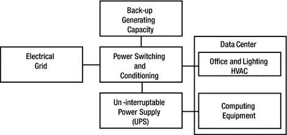
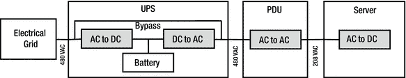
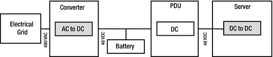
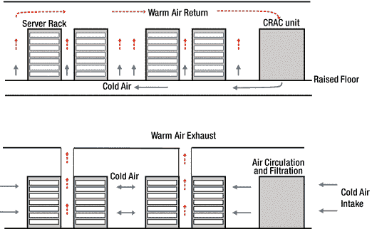
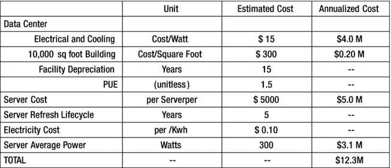
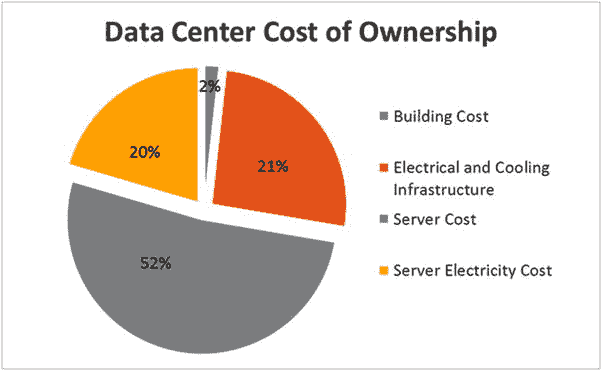

# 9. 数据中心管理

在前面的章节中，我们讨论了数据中心内部计算基础设施为实现能效而进行的优化。然而，在整个数据中心的框架内，这只是能源故事的一部分。

## 数据中心管理与电力分配

正如第 1 章所述，在整体能效的背景下，数据中心内围绕计算机的基础设施同样需要考虑。如果基础设施是支持计算所必需的，那么它就需要被纳入整体的能源方程式中。数据中心基础设施本身有多重使命：除了保护计算机免受湿度、极端温度和自然灾害等自然因素的影响外，它还为运维数据中心的工程师和技术人员提供办公空间，并管理计算资源。数据中心基础设施负责向计算资源输送能源，并处理它们产生的废热。它还通过提供物理安全以及在断电情况下的某种生存能力计划来实现弹性的使命。

在本章中，我们将涉及这些方面的许多内容，特别是它们与数据中心能源管理相关的内容。

## 数据中心设施

数据中心设施在形式、规模和架构上差异很大，具体取决于当地条件、经济因素和数据中心的需求。例如，数据中心可以建在大型专用建筑内，可以作为现有建筑内的专用空间，也可以建在因新用途而改造的现有建筑内。

大型专用数据中心——例如由 Google、Apple、Facebook 和 Microsoft 等大型互联网公司建造的数据中心——通常位于能够提供低成本电力且靠近其服务的大型人口中心（接近程度通常以小于 10-20 毫秒的 ping 时间衡量）的地理位置。这些数据中心的设施功率范围大约在 1 到 20 兆瓦之间。

相比之下，许多专用和通用数据中心则位于现有建筑内。这些数据中心通常规模较小，并且通常是为满足本地或特定用途而建造的。尽管较小的数据中心可以按照高能效标准建造，但在许多情况下，其重要性次于其他考虑因素，例如安全性、靠近特定物理位置，或者仅仅是便利性。

最有趣的设施之一是那些从其他用途翻新或改造而成的建筑。例如，Google 最近在芬兰一家改造后的造纸厂内建造了一个数据中心。¹ 由于阅读习惯的改变和平板电脑使用量的增加导致纸张需求变化，那些能够提供大量电力和冷却水的过时或过剩的造纸厂，成为了数据中心替代选址的优秀候选。²

其他数据中心建在了地下洞穴³或山顶上⁴，甚至有人提议将其建在近海的驳船上。⁵ 在每种情况下，尽管这些设施的物理基础设施大相径庭，但提供大量电力以及足够的废热移除能力始终是共同的需求。正是电力和冷却基础设施的工程学设计，真正决定了数据中心的效率。


### 电力基础设施

尽管数据中心在使命上可能有所不同——从提供网络边缘服务到核心计算，再到提供高度安全的数据处理与存储——但在几乎所有情况下，它们都需要经过严格调节的不间断电源，以满足客户要求的高可用性。供应数据中心的电力必须经过高度调节，以保护其中的服务器、存储系统和网络设备免受电力瞬变的影响。无论是欠压状态还是电涌，都可能导致设备可靠性问题，并根据持续时间和严重程度延长设备停机时间。图 9-1 展示了电网连接数据中心的高度示意性布局。当电网电力中断时，不间断电源（UPS）将承担数据中心的负载，直至备用发电机启动并达到满负荷状态。由于成本限制，通常仅对计算设备提供不间断供电支持。



图 9-1.

电网连接数据中心的示意图

#### 配电效率

尽管本书大部分内容关注服务器本身的能效，但影响数据中心整体效率的一个关键因素是将电能传输至服务器过程中的能量损耗。所谓的配电损耗（将电力从远程发电设施输送至使用地点）可能从几个百分点（当负载接近发电能力时，例如华盛顿州昆西市和俄勒冈州达尔斯市的大型数据中心，它们距离水力发电能源仅几英里）到 10%–20%（当数据中心距离发电站数百英里时）不等。虽然这些损耗对整体效率极为重要，但解决这一问题主要取决于数据中心的选址，这超出了本书的讨论范围。

#### 电力调节

数据中心的电力调节是设施最重要的任务之一。服务器的供电需要既“清洁”——即没有可能影响数据中心服务器可用性的尖峰或中断——又经济，以便数据中心以最低可行成本实现其使命。在本节中，我们将探讨实现这一目标的两种高层面拓扑结构，即所谓的交流（AC）和直流（DC）配电。

在交流配电中，服务器以交流电压供电，在美国通常为 208 VAC。交流配电是目前行业内最主流的方案。来自电网的能量首先为 UPS 系统供电，然后传输至机架级和行级配电单元（PDU），由其对单台服务器进行电能计量，同时保护相邻服务器免受任何单台服务器电气故障的影响。

图 9-2 展示了一个典型交流数据中心的配电图。来自电网的电力输入 UPS，进而为机架级或行级 PDU 提供清洁不间断的电力。这些单元将电力转换为服务器可用的电压级别，同时保护设施免受单台服务器故障的影响。其中突出显示了电力和电压转换环节。图中 UPS 带有旁路，以实现更高效率的运行。



图 9-2.

一个典型交流数据中心的配电图

这种标准拓扑结构的一个显著问题在于电网与服务器之间交直流电压的反复转换。每次转换都可能导致几个百分点的效率损失，从而推高电力成本。

通过使用 UPS 的旁路功能，或者通俗地说，其生态模式，可以消除 UPS 中的两次转换——交流转直流以及再转回交流。虽然可能存在关于电源故障时旁路与电池供电之间切换时间的担忧，但供应商的技术发展已在很大程度上缓解了这些担忧。典型的切换时间现在约为一个电源周期的四分之一，远低于数据中心 IT 设备的损坏阈值。绿色网格组织已将旁路功能采纳为“最佳实践方法”。⁶

作为交流方案的替代，有令人信服的证据表明，采用直流供电给数据中心可以提高整体效率。⁷ 效率提升主要源于消除了低效的交流转直流转换。图 9-3 展示了此类拓扑结构的一个例子。来自电网的电力输入经转换的 PDU，由其向电池和服务器提供 48 VDC 电压。图中突出显示了电压及交流转直流的转换步骤。



图 9-3.

一个典型直流数据中心的配电图

直流电力基础设施本质上比交流电力基础设施更简单，因为它减少了所需的转换次数，从而减少了昂贵的高可靠性大功率电气设备。然而，交流电力设备的供应基础和行业经验要丰富得多，因为交流一直是并且仍然是占主导地位的行业标准。例如，尽管直流电在通信领域多年来已被安全使用，但更传统的数据中心中的技术人员目前并未接受过使用它的培训。因此，尽管一种方法相对于另一种方法可能存在某些理论优势，但现实是，只要实施适当的工程实践（例如在交流方案中使用 UPS 旁路），两种方法都能实现高效率和低总成本。


#### 备份系统

数据中心的服务即使在断电时也需要维持。为此，数据中心依赖于由短期和长期备份系统共同构成的备用电源系统。短期系统旨在快速响应供电波动并提供电力，通常仅维持几分钟，直到大容量长期备份系统能够接管数据中心的全部电力负载。

`不间断电源`（`UPS`）长期以来一直使用大型铅酸电池阵列建造，许多数据中心至今仍沿用这种简单而可靠的技术。铅酸电池本质上与典型汽车中的电池类似，可以在公开市场上购买。这项技术已经成熟，多年来没有发生重大变化。使用电池的一个缺点是，它们需要定期维护和更换，以提供备份系统所期望的高可靠性。⁸

因此，数据中心运营商已寻找并实施了替代性的`UPS`方案。一种流行的替代方案是高速旋转飞轮系统。在这种情况下，能量并非像电池中那样以化学形式储存，而是通过高速、大质量的旋转飞轮以动能形式储存。飞轮系统比电池系统占用更少的空间，且维护需求显著降低。但它们也仅能提供几秒钟（通常在 10-20 秒范围内，具体取决于安装规模和负载）的自主供电能力，这意味着备份发电机需要能够在第一次就正常启动。此外，备份发电机的容量需要略微增加，因为除了为数据中心供电外，它们还必须在短时间内重新为飞轮系统充能，以恢复设施的备用状态。⁹ 飞轮系统还有一个额外优势，即它们使用`交流`电源运行，消除了对`直流`转换的需求。

数据中心最常见的长期备用电源类型是柴油发电机。柴油发电机的使用不仅在数据中心非常普遍，在医院等其他关键设施中也是如此，因此它们拥有完善的维护记录，并且很容易找到维修专家。通常，柴油发电机可能占数据中心资本成本的 10%左右。尽管有人提出通过智能 IT 技术来降低发电机容量的成本，但这些方案尚未被广泛采用。¹⁰

为避免成本以及必须定期运行大型柴油发电机组（伴随着废气和噪音）的某些缺点，数据中心的备用电源系统出现了一些创新。例如，位于瑞典的 Facebook 数据中心放弃了约 70%的典型备用发电机容量，因为他们能够利用该地区的冗余电网。这种方法很出色，能够以非常经济的成本规模轻松地为电网提供非常高的可靠性。然而，冗余电网并不常见，因此这种方法在大多数情况下用途有限。

柴油发电机的另一种替代方案是燃料电池。燃料电池通过电化学反应将燃料（通常是氢气或甲烷）转化为能量。与其他电源相比，燃料电池具有许多优势。除了相对紧凑和清洁外，它们还可以靠近负载放置，从而消除电网和配电损耗。事实上，一些数据中心运营商因此考虑完全放弃电网能源，并报告称在合理的成本参数假设下，总体拥有成本表现良好。¹¹

犹他州的`eBay`数据中心于 2013 年投入使用¹²，其大部分电力来自`Bloom Energy`公司建造的天然气燃料电池。据`eBay`称，这些燃料电池可将`CO2`排放量减少约 50%，并提高数据中心的可靠性。事实上，燃料电池是该数据中心的主要能源，从而降低了与备用发电机和`UPS`系统相关的成本。


### 冷却基础设施

为服务器供电是数据中心能源方程中的重要一环。而同等重要的另一方面，则是移除服务器产生的所有废热。需要特别指出的是，用于运行服务器（以及数据中心所有其他设备）的全部能量，都必须以废热的形式被移除。这意味着，例如，对于一个 10 兆瓦的数据中心负载，恰好需要消散 10 兆瓦的废热，才能平衡设施的能源输入。

了解数据中心冷却技术的发展历程颇具启发意义，因为它清晰地讲述了提升整体数据中心效率的基础设施方面所取得的进步。典型的建于上世纪 90 年代的数据中心主要依赖中央机房空调（CRAC）单元来提供冷却。来自服务器机架的暖风被吸入 CRAC 单元，冷却至低至华氏 60 度的温度，然后通过穿孔活动地板重新吹回机房。这种方法基本够用，但确实会出现热点（通常是由于空气循环的均匀性较差），这需要特殊处理。此外，进入机房的冷空气会立即与较暖的空气混合，降低了冷却单元的效率。

图 9-4 展示了两种数据中心的布局。上图是 2000 年之前典型的“宴会厅”配置。较新的数据中心，如图 9-4 底部所示，则将暖风和冷风隔离开，并利用当地环境空气来优化运营。



图 9-4. 两种数据中心类型：典型的旧式“宴会厅”配置（上）与当今的数据中心（下）

从 21 世纪初开始，工程师们意识到，通过将冷空气从服务器后部向上和向后推送，再将热空气从服务器前部抽出，从而实现冷热空气的隔离，可以显著提高冷却单元的效率。例如，T-Systems 和英特尔的一项研究发现，隔离冷热空气可以将模型数据中心的电能使用效率（PUE）从 1.8 降低到约 1.3，这意味着基础设施能耗的大幅降低。¹³ 该研究表明，即使是微小的空气泄漏，如果不加控制，也可能对基础设施的效率产生显著影响。

数据中心基础设施发展的第三个重要阶段是所谓“自然风冷却”（或称利用室外空气冷却数据中心）的出现。在许多气候区域，只要保持空气流通，室外空气的温度和湿度水平足以有效冷却服务器，无需空调设备的额外帮助。有许多按照此标准建造的数据中心实例，包括著名的“鸡舍”数据中心，它利用了热空气在横风处上升的趋势，从而将热空气排出建筑。¹⁴ 业界研究了不同气候条件支持自然风冷却的能力，绿色网格组织（The Green Grid）发表的研究考虑了更新后的 ASHRAE 标准允许更宽温度与湿度范围所带来的影响。¹⁵

数据中心设施发展的最后阶段是高温数据中心的出现。硅和计算机硬件组件能够承受比人类更高的温度。研究表明，即使是现成的组件也可以在 40°C 下安全运行。¹⁶ 为了进一步减少冷却需求，业界正推动实现 50°C 下的运行能力。

## 成本与计算基础设施的简化总成本模型

关于总拥有成本（TCO）模型已有大量研究成果，其中包括由乔纳森·库米（Jonathan Koomey）开发的一个优秀（且公开可用）的模型，该模型为确定准确的成本基准提供了大量细节。¹⁷

在本节中，我们不会提供详细的模型，而是侧重于更高层次的视角，以帮助您理解成本方面的大趋势。使用简化模型来做出可能相对复杂的商业决策存在固有风险，但利用它们来帮助塑造洞察力并认识宏观趋势则是有用的。

图 9-5 展示了一个 10,000 平方英尺数据中心的简化 TCO 模型。该模型计算了整个数据中心（包括建筑、基础设施和 IT 设备成本）的总拥有成本。模型包含的内容固然重要，但未包含的内容同样关键。重要的成本参数，如架构选择、软件许可、人工和保修范围、保险以及税费，都可能显著改变模型的结论，任何负责任的商业决策都必须将这些因素考虑在内。



图 9-5. 一个 10,000 平方英尺数据中心的简化 TCO 模型（按名义价值计算）

在最基本的层面上，成本模型考虑了资本成本（通常假设一次性发生，然后在某个标准折旧期内摊销，以将费用年化）和持续的运营费用，后者按实际使用情况支付。重要参数已在图 9-5 中突出显示。图 9-6 显示，运营电力成本在数据中心总拥有成本中占据了相当大的比重。年电力能源成本以及电力和冷却基础设施都直接与服务器消耗的瓦特数成比例，因此，服务器功耗的净降低可以在运营成本和资本成本两方面为数据中心节省开支。



图 9-6. 运营电力成本在数据中心总拥有成本中占据相当大的比重

如前所述，电力基础设施成本的区间主要取决于架构选择。诸如备用发电机的种类和数量、电力冗余、布局和位置等决策，都会广泛影响成本的选择。通常，每瓦特 8.00 美元到 20.00 美元的区间代表了合理的估计范围，尽管也可能出现高于或低于此范围的偏差。

业界已知的数据中心效率范围从 PUE = 1.1 到 3.0，其中 PUE 是电能使用效率的缩写，定义见第 1 章。通常，较旧设施中的 PUE 远高于使用环境冷却来降低间接费用的较新设施中的 PUE。


### 每美元每瓦性能

人们经常听到关心数据中心成本的人谈论“每美元每瓦性能”，然而在已发表的文献中，似乎对此短语并无确切描述。在本节中，我们将简要讨论具有每美元每瓦性能量纲的术语是如何引入到所有权成本方程中的。

为了让你理解这一点，我们需要增加一个维度，我们称之为计算功。计算功与物理功不同，但可以根据类似的方式来思考——对系统进行物理改变（在计算机的情况下，即对比特位的改变）。这种物理改变需要能量，因此，进行该改变所需的能量可以等同于所做的功。

就当前情况而言，我们将数据中心的计算工作率视为每秒交易数 `T`。具体的交易类型并不重要，我们做一个简化的假设，即这些交易是均匀的。如果服务器的容量（称为其性能）是每秒 `p` 笔交易，那么数据中心所需的服务器数量 `N` 就是：

```
N = T/p
```

现在，数据中心的总功耗 `P[total]` 将是服务器所需的功率 `P[server]` 加上基础设施消耗的功率，即：

```
P[total] = N * P[server] * PUE
```

代入上述关系式后，变为：

```
P[total] = T * P[server] * PUE / p
```

注意到能量等于功率乘以时间，我们可以通过考虑一个标准时间间隔（我们将其设为一年）内的功率和交易率 `T` 来将成本年化。当你进行一些简单的代数运算后，可以很容易地计算出以每美元运营能源成本的交易数表示的成本效率：

```
T / (P[total] * 能源成本) = p / (P[server] * 能源成本 * PUE)
```

请注意，成本所平均的时间段在分子和分母中均相互抵消，正如我们所期望的那样。等式的右边具有每美元每瓦性能的量纲。这个等式具有直观的吸引力。为了最大化运营效率，你会希望最大化每能源成本的交易数。该等式强调，实现这一目标需要最大化系统性能；最小化服务器功耗和能源成本；并最大化数据中心基础设施的效率。最大化每美元每瓦性能可以最小化每笔交易的成本。

