# 7. 监控

以最少精力即可实现针对功耗、性能或成本的服务器优化。此过程始于监控系统行为，以了解其使用方式以及可改进之处。电压、电流、能耗、功率和温度等传感器测量值，可识别出对服务器总功耗贡献最大的单个组件。延迟、带宽和吞吐量事件则揭示了提供额外性能所需付出的能量代价。通过监控电源状态转换、时钟中断和设备中断，用户可以更深入地了解服务器上任务的分布情况。本章将介绍多种监控能力及其工作原理，并讨论各种事件和指标、它们的收集方式，以及用户能从中获取哪些信息。第 8 章将继续介绍如何利用这些事件和统计数据来指导优化决策。

系统和子组件的监控有助于用户改进组件选择及未来系统设计。监控有助于软件优化，并能识别出改进资源利用率的机遇和问题。管理软件中的控制决策会利用监控来调整基础设施以适应不断变化的情况。例如，管理软件可以监控处理器利用率和内存带宽，来指导虚拟机迁移决策。或者，CPU 可以利用温度传感器来判断何时应将处理器降频至更低频率。

监控功能分布在平台的多个子组件中。处理器在核心和核心外部分别设立了可编程性能监控单元，基板配备了由管理控制器监控的电源和温度传感器，操作系统则监控单个应用程序的处理器、内存和 I/O 使用情况。比较来自不同子组件的监控数据，用户可以构建出关于功耗和性能如何影响能效的完整图景。

## 硬件监控

有多种机制可从 CPU 提取被监控的事件或统计数据。其中一些高层级机制汇总于表 7-1。尽管每种机制都包含一些独特功能和特性，但某些事件通过多种机制进行追踪的情况也并不少见。

表 7-1. CPU 硬件监控类型

| 机制 | 描述 |
| --- | --- |
| 性能监控计数器（固定计数器） | 这些计数器持续追踪单个固定统计量。在许多情况下，它们是自由运行的，意味着它们持续计数且无法停止或清除。许多关键的硬件统计数据都保存在固定计数器中。 |
| 性能监控计数器（可编程） | 硬件性能监控常被软件开发人员用于代码的特征分析和优化。大多数此类计数器可被配置为对广泛的事件进行计数。性能监控计数器同时存在于核心内部和核心外部。 |
| 状态快照 | 寄存器提供了某些系统状态的快照。软件可以在特定时间点读取此状态以了解系统特征。状态快照最常见的例子是温度状态寄存器。 |

访问 CPU 功耗统计数据有多种不同机制。然而，这些功能中的大部分需要内核级权限（Windows 中的管理员权限，Linux 中的 root 权限）。如果你没有这些权限，那么只有在系统管理员允许普通用户访问时，这些统计数据才可用。这些统计数据通常也无法在虚拟机内部获取，因为这些统计数据是针对整个系统的。

### 固定计数器

系统中提供了一些固定计数器用于追踪各种统计量。这些计数器无法被停止或清除（除非通过 CPU 冷启动或热复位）。当多个用户同时需要访问一个通用统计量时，这些计数器非常有用。固定计数器的缺点在于它们无法使用一些更强大的监控技术。

### 核心性能监控器

英特尔 CPU 的核心已历经多代，均采用标准的性能监控基础设施。每个硬件线程都有专用的可配置计数器（通常为四个）。每个计数器都有一个配置寄存器，允许用户选择要计数的特定事件。除了这四个可配置计数器外，核心上还有三个固定计数器。所有这些计数器都作为 MSR 实现，并被视为核心性能监控架构的一部分。核心性能监控器的详细信息已在《英特尔软件开发手册》（SDM）中做过详尽描述，因此此处不再赘述。更多信息请参考以下资源：
*   [`www.intel.com/content/dam/www/public/us/en/documents/manuals/64-ia-32-architectures-software-developer-manual-325462.pdf`](http://www.intel.com/content/dam/www/public/us/en/documents/manuals/64-ia-32-architectures-software-developer-manual-325462.pdf)。
*   核心性能监控事件作为 SDM 的一部分，按处理器系列列出，因为这些事件可能随代际发生变化。每个处理器的核心性能监控事件也在以下链接提供的公开文件（tsv 和 json 格式）中有描述：[`https://download.01.org/perfmon/`](https://download.01.org/perfmon/)。

在监控电源管理方面，核心中的三个固定计数器 MSR（`IA32_FIXED_CTR[0,1,2]`）功能非常强大。每个计数器都可以通过`IA32_FIXED_CTR_CTRL` MSR 进行配置，以监控正在执行的特定线程，或者在具有 SMT 的处理器上，监控核心上的所有线程。第一个固定计数器追踪已退役指令数，即处理器执行的每条指令的计数。第二个计数器追踪非暂停周期数，即处理器积极执行指令的周期数。第二个计数器始终以处理器的当前运行频率计数。第三个计数器与第二个类似，也追踪非暂停周期，但其始终以处理器的基准频率计数。软件可以使用`IA32_FIXED_CTR_CTRL` MSR 来配置固定计数器，使其监控特定线程或共享一个核心的所有线程。此配置通过写入`IA32_FIXED_CTR_CTRL` MSR 中一个名为`AnyThread`的特定字段来完成。同一个 MSR 接口还提供了选项，可以分别或同时追踪用户态时间或内核态时间。

已有许多软件工具可用于监控固定和可编程的核心性能监控器（本章稍后会讨论其中一部分）。使用计数器的最简单方法是采用基于时间的采样，步骤如下：
1.  清除计数器（以避免早期溢出）。
2.  在配置寄存器中配置所需事件，并使能计数器。
3.  等待一段时间（在应用程序执行期间）。
4.  再次读取计数器。
5.  重复步骤 1-4。

更高级的技术也是可行的，例如基于事件的采样（EBS）。在 EBS 中，不是在固定的时间内收集样本，而是当某个计数器达到期望值时，计数器会自动停止。此时，会产生一个中断，通知监控软件收集关于系统和软件状态的额外信息。EBS 不常用于电源管理监控，因此在此不作讨论。

### 非核心性能监视器

与核心性能监视不同，非核心的性能监视架构并非在所有代际和产品线中都是标准化的。从 Sandy Bridge 代开始，Xeon E5/E7 产品采用了一种通用架构。在其他英特尔产品上，很少将非核心性能监视功能产品化，因此本章将重点介绍 E5/E7 中可用的功能。

Sandy Bridge 引入的非核心性能监视与核心中的功能非常相似。计数器分布在非核心的不同模块中，能够同时收集大量统计数据。尽管大部分与功耗相关的统计数据存在于`PCU`的计数器中，但其他模块也存在与功耗相关的事件。

每当产品发布时，都会公布非核心性能监视功能和寄存器的产品特定详细信息。以下链接包含了最新一代产品的 E5/E7 非核心性能监视文档：
*   [`www.intel.com/content/dam/www/public/us/en/documents/design-guides/xeon-e5-2600-uncore-guide.pdf`](http://www.intel.com/content/dam/www/public/us/en/documents/design-guides/xeon-e5-2600-uncore-guide.pdf)
*   [`www-ssl.intel.com/content/dam/www/public/us/en/documents/manuals/xeon-e5-2600-v2-uncore-manual.pdf`](http://www-ssl.intel.com/content/dam/www/public/us/en/documents/manuals/xeon-e5-2600-v2-uncore-manual.pdf)
*   [`www.intel.com/content/www/us/en/processors/xeon/xeon-e5-v3-uncore-performance-monitoring.html`](http://www.intel.com/content/www/us/en/processors/xeon/xeon-e5-v3-uncore-performance-monitoring.html)

#### 全局冻结/解冻

非核心性能监视的一个挑战是协调分布在各个非核心模块中的大量监视单元。简单地在这些模块中读取所有计数器可能需要数十微秒。这种延迟既可能干扰工作负载的执行（尤其是在非常短的时间窗口内进行采样时），也可能导致收集到关于监视软件而非目标工作负载的统计数据。因此，非核心性能监视架构包含了一个全局的“冻结”和“解冻”功能。该功能试图同时启动和停止各个非核心模块中的所有计数器。虽然同步并非完美，但非核心性能监视（也称为偏移）冻结中的任何延迟通常远低于一微秒。

#### 边沿检测和状态平均时间

许多监视事件指定了一个条件，该条件在每个满足条件的周期内被计数。例如，如果有一个事件监视核心处于目标 C 状态的时间，那么当核心处于该目标 C 状态时，该计数器会在每个周期递增。除了测量处于状态的时间外，能够监视进入和离开某个状态的次数也很有用。例如，您可能希望能够计算进入目标 C 状态的次数。为了避免为时间和转换分别设置独立的事件，系统使用了 `边沿检测` 硬件，它可以将任何对时间（或周期）进行计数的事件转换为对转换次数进行计数的事件。

一种常见的监视技术是使用一个计数器监视周期，并使用另一个计数器监视边沿。通过使用这两个事件，用户可以计算某个状态的平均时间：

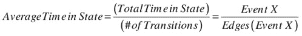

## 标准事件和占用事件

许多事件在给定的周期内仅递增 1。例如，如果您正在监视对 DRAM 的读取次数，一个标准事件会在每次读取时递增 1。

在性能监视中，进行排队和延迟分析时，测量不同队列的占用率非常有用。占用事件在每个周期内可以递增 1 或更多。占用事件也可以与阈值比较一起使用，当某个队列的占用率达到可配置的阈值或更高时，该事件递增 1。

对于性能监视，占用事件通常用于以下方式：

*   在给定占用率（或更高）下的时间¹ 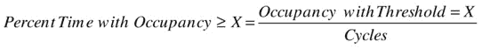

*   队列的平均占用率 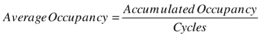 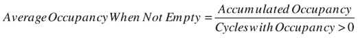

*   队列中的平均延迟 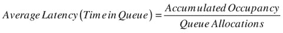

尽管“队列”在物理上并非电源管理的常见组成部分，但占用事件也可以应用于电源管理统计数据。例如，您可能想要了解所有核心同时处于核心 C6 状态的时间量。通过查看单个核心驻留状态，无法判断不同核心的活动在时间上的对齐情况。通过使用一个核心 C6 状态的占用事件，并将其阈值设置为系统中的核心数量，您可以计算出所有核心同时处于空闲状态的时间量。

## 状态快照

快照提供了系统特性的即时视图。这对于那些不经常变化的信息（如温度）特别有用。状态快照的一个缺点是，监视软件可能意外地收集到关于自身的信息。例如，如果监视软件以高采样率测量处理器频率，它可能导致频率升高到高于没有监视软件时的正常水平。

## 计数器访问和计数器约束

读取或写入计数器和快照通常需要一定的时间。访问核心可编程计数器可能需要数十个时钟周期，而访问非核心和其他计数器则可能需要数百个时钟周期。通过从整个系统收集大量信息，可能会干扰工作负载。收集的统计数据的量会对可执行的采样大小产生很大影响。通常，采样速度快于每 10 毫秒一次可能会导致显著的工作负载干扰。

计数器可以在处理器中以不同方式实现。大型硬件计数器可能相当昂贵（面积、功耗），并且并非总是理想的——尤其是在面积受限或多次复制的模块中。提供关于某些类型信息的即时信息也很困难或不可能，例如，用于监视能耗的计数器。通过常规同步逻辑精确监视能耗统计数据代价非常高昂。因此，一些固定计数器会定期使用这些信息进行更新，而不是即时更新。

## 事件和指标

前面章节描述的监视机制支持各种不同的可测量事件，例如核心温度、非核心 P 状态转换或在 CPU 互连上传输的高速缓存行。事件通常测量精确的低级事件发生、行为或状态时间。事件本身通常无法提供对系统或子组件行为有意义的洞察。因此，通常使用一个或多个低级事件来计算更高级别的功耗或性能指标。例如，内存性能的一个常见指标是带宽。它是基于一些低级事件（如 CAS 命令、DDR 频率和以 DDR 时钟周期为单位的测量持续时间）计算得出的。

事件和指标包括许多不同类型的统计数据。一些例子包括时间、温度、能量、电压、频率、延迟和带宽。存在于各个子组件中的特定事件和指标提供了对系统运行时特性的洞察。

### 时间 (RDTSC)

大多数软件环境都提供了访问系统时间信息的机制。通常，在收集功耗和性能监控统计数据时，这些 API 足以收集已用时间信息。

系统中有多种不同的时间测量方法。x86 架构包含一条用于获取时间的指令——读取时间戳计数器 (`RDTSC`)，该指令对用户空间应用和内核均可用。由于指令可能乱序执行，因此还提供了 `RDTSCP`（`RDTSC` 的序列化版本）。该版本确保在读取时间戳计数器之前，所有先前的指令都已执行完毕。`RDTSC` 在同一个插槽上的所有线程之间以及多插槽系统中的线程之间都是同步的。`RDTSC` 指令返回一个以处理器基础频率速率递增的周期计数值。虽然每个 CPU 上都有一个集中时钟，但时间戳计数器也维护在核心中，这使得访问速度非常快。与某些性能监控计数器不同，`RDTSC` 在所有电源管理状态下都会进行计数。系统上还存在其他几种定时器，但首选时间戳计数器，因为其中许多定时器访问所需时间要长得多。

大多数软件工具都会提供测量已用时间的 API，因此通常无需直接使用 `RDTSC` 指令。尽管本章中许多依赖于已用时间的统计数据和公式会使用增量 TSC，但这可以用给定软件环境提供的任何时间测量方式来替代。

### 基本性能

两个对于理解能效至关重要的基本性能指标是 CPI 和路径长度。CPI（即每指令周期数）衡量的是完成单条指令退役所需的平均 CPU 周期数。这是常用性能指标 IPC（即每周期指令数）的倒数。当计算工作简单、缺乏复杂操作且数据引用频繁命中核心缓存时，CPI 较低。当计算工作复杂、高延迟操作频繁且许多数据引用需要由内存满足时，CPI 较高。低 CPI 的软件能最大化各种子组件处于低功耗空闲状态的时间。它比高 CPI 的软件更节能。

路径长度衡量的是完成单个工作单元所需的平均指令数。该工作单元通常由所关注工作负载的吞吐量指标表示。例如，一个工作单元可能是一个 Web 服务器上的单个 HTTP 事务、一次数据库写入、复杂科学计算的一部分，或 I/O 测试工具中的一次单次磁盘读取。除了明显的性能优势外，低路径长度的软件还能最大化处于低功耗空闲状态的时间，因为完成一个工作单元所需的步骤更少。

性能可以通过更快地完成工作（降低 CPI）或通过使用更少的步骤完成工作（降低路径长度）来提高。在以下公式中，性能表示完成一个工作单元所需的时间。因此，性能通常可以通过将 CPI 乘以路径长度来表示。以下公式展示了如何计算这些基本性能指标。这些指标可以按逻辑处理器、按核心或按应用进程进行监控，也可以取平均值以提供系统级别的视图。

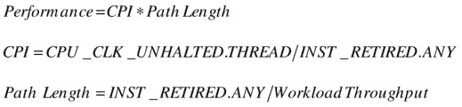

### 能耗

能耗通过插槽和内存 RAPL 特性进行监控（详见第 2 章）。作为 RAPL 的一部分，自由运行的能耗计数器会追踪处理器所消耗的焦耳数。所有由 RAPL 测量的能耗都以相同的格式表示，称为能量单位。一个能量单位代表固定数量的微焦耳能耗。以更大粒度的能量单位来测量能耗，可以使高分辨率的能耗计数器覆盖更广泛的值域。然而，一个能量单位所代表的具体微焦耳数可能会因处理器代际而异。`RAPL_POWER_UNIT MSR` 会暴露在给定处理器上用于 RAPL 的能量单位。第 12:8 位显示了能量单位。例如，Sandy Bridge 架构呈现的值为 `0x10`，这对应约 15.3 微焦耳的增量 (1/2¹⁶)。

> **注意：** 能量单位会根据代际发生变化。例如，Haswell 架构使用的单位（约 61 微焦耳）与 Sandy Bridge 和 Ivy Bridge 架构（约 15.3 微焦耳）不同。

一个时间窗口内消耗的能量和平均功率可以通过以下两个公式测量：

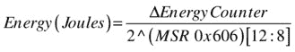

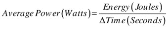

表 7-2 列出了处理器上可用的不同类型能耗统计数据。

**表 7-2.** 能耗统计

| 统计项 | 类型 | 描述 |
| :--- | :--- | :--- |
| 插槽能耗 | 固定自由运行计数器 | 插槽能耗报告 CPU 封装中所有逻辑（包括所有电源轨）所用能耗的估算值。并非所有电源轨都处于活跃测量状态，因此此处报告的功率仅供参考。 |
| DRAM 能耗 | 固定自由运行计数器 | DRAM 能耗提供系统中 DDR3/4 内存设备所用能耗的估算值。请注意，对 DRAM RAPL 的支持确实需要一定的平台启用，且并非所有系统都支持 DRAM RAPL。 |

# 核心能耗

| 核心能耗 | 固定自由运行计数器 | 核心能耗计数器是在 Sandy Bridge 代引入的，但在 Haswell 代被移除了。为核心域提供准确的能耗估算成本高昂。 |
| --- | --- | --- |

**注意：** 目前能耗计数器只有 32 位。例如，在 Sandy Bridge 架构上，计数器可能在几分钟后就会回绕。类似于汽车的里程表，当能耗计数器溢出时，它们会直接循环归零，从头开始计数。使用这些计数器的软件应检测并处理此溢出情况。

# 温度

现代处理器包含众多温度传感器，这些传感器对软件可见。这些传感器通常仅内核级软件可访问，因为它们通常位于 MSR 寄存器空间中。这些传感器有时被称为数字温度传感器（`DTS`）。温度数据通常相当精确，特别是在接近节流温度点时尤为准确。随着温度降低，`DTS` 的精确度往往会下降。

大多数服务器内存的 DIMM 上也包含温度传感器。RDIMM 始终如此，而 ECC UDIMM 也几乎总是如此。这些传感器被称为片上温度传感器（`TSOD`）。单个 `TSOD` 位于内存 DIMM 上（通常位于 DIMM 中部），而非每个设备都有独立传感器。由于 DRAM 设备可能较长，DIMM 长度方向上存在较大温度梯度的情况并不罕见。当 DIMM 的朝向与平台气流方向一致时尤其如此。当空气沿 DIMM 方向流经设备时，空气会升温，导致“最后一个”设备比第一个设备温度高得多。平台设计者在设计散热方案时会考虑这些梯度。由于 `TSOD` 位于设备中部，常见情况是一些设备温度较高，而另一些设备温度较低。

温度计数器并非报告以摄氏度为单位的具体温度，而是报告到节流的裕量（即最高允许温度与当前温度之间的差值）。到节流的裕量在核心级别通过 `IA32_THERM_STATUS` MSR 测量，在封装级别通过 `IA32_PACKAGE_THERM_STATUS` MSR 测量。封装温度报告了封装上所有传感器中的最高温度。这包括核心外可能存在的任何其他温度传感器。传统上，核心是服务器裸片上的热点，但在低功耗服务器设计中，由于封装功率预算中更大比例用于 I/O 功率，这一趋势开始改变。计算以摄氏度为单位的实际温度所需的最高允许温度，通过 `TEMPERATURE_TARGET` MSR 测量。

`IA32_THERM_STATUS` MSR 的作用域是线程级，意味着单个线程只能访问自身的温度信息。在某些系统中，多个线程可能共享一个温度传感器，因此总会得到相同的结果。除了报告温度外，`IA32_THERM_STATUS` MSR 还报告系统中可能已发生的热节流的日志和状态信息。`IA32_PACKAGE_THERM_STATUS` 和 `TEMPERATURE_TARGET` MSR 的作用域是封装级，意味着插槽上的所有线程共享相同的寄存器（及数据）。表 7-3 列出了系统上可获取的不同类型温度统计信息。

## 表 7-3. 温度统计信息

| 统计项 | 类型 | 描述 |
| --- | --- | --- |
| 核心温度 | 状态快照 | 核心温度通过 `IA32_THERM_STATUS`（`MSR 0x19C`）和 `TEMPERATURE_TARGET`（`MSR 0x1A2`）暴露。最高温度（或 `DTSMAX`）= `TEMPERATURE_TARGET` [`23:16`] 目标偏移量 = `TEMPERATURE_TARGET` [`29:24`] 到节流的裕量 = `IA32_THERM_STATUS` [`22:16`] 温度（`C`）= `DTSMAX` - 目标偏移量 - 到节流的裕量 |
| 封装温度 | 状态快照 | 封装温度通过 `IA32_PACKAGE_THERM_STATUS`（`MSR X B`）暴露。到节流的裕量 = `IA32_PACKAGE_THERM_STATUS` [`22:16`] |
| 附加封装温度传感器 | 状态快照 | 核心外通常确实存在传感器。尽管这些传感器的信息包含在 `PACKAGE_THERM_STATUS` 中，但尚未有标准化接口用于访问这些温度传感器的信息。 |
| 内存 DIMM 温度 | 状态快照 | 对于支持 `TSOD` DIMM 的系统，内存 DIMM 温度也维护在封装中。与其他封装传感器一样，没有用于访问温度信息的标准化寄存器集。虽然此信息目前未公开记录，但可以在平台级别使用 IPMI 监控内存 DIMM 温度。 |

# 频率与电压

在功耗与性能领域，频率是最重要的统计指标之一。系统中有多种机制用于监测工作频率。

两种主要机制是线程作用域的`IA32_PERF_STATUS`和`IA32_PERF_CTRL` MSR。`IA32_PERF_STATUS` MSR 保存了读取该寄存器的线程的当前频率比率。它还包含一个非架构字段，用于提供当前核心工作电压的参考信息。该电压字段在较旧一代的服务器 CPU 上不存在，但在许多当前世代的 CPU 中已具备此功能。`IA32_PERF_CTRL` MSR 与第 6 章中介绍的接口相同，允许操作系统为给定线程请求一个频率比率。与`IA32_PERF_STATUS` MSR 类似，`IA32_PERF_CTRL` MSR 也有一个用于请求电压的字段，但该字段已不再使用。电压现在由封装自主控制，写入这些位不会对系统行为产生影响。同时监测这两个寄存器，用户可以了解请求频率与授予频率之间的关系。

在基于 Haswell 微架构的 E5/E7 处理器上，非核心部分（Uncore）拥有自己的频率和电压（详情见第 2 章）。这些处理器包含一个`UNCORE_PERF_STATUS` MSR，用于保存非核心部分的当前工作比率。该寄存器并非架构性寄存器，通常仅在对非核心比率进行动态控制的系统上公开。

`IA32_APERF`和`IA32_MPERF` MSR 可用于测量用户定义时间窗口内的平均频率。这些自由运行的计数器有时也被称为`ACNT`和`MCNT`。从技术上讲，`ACNT`和`MCNT`没有架构定义，而是仅定义了这两者的比率。`ACNT`在线程活跃时，以线程当前运行的频率进行计数。`MCNT`在线程活跃时，以 CPU 的基础频率（P1）进行计数。当线程在 C1 或更深度的 C 状态中暂停时，这两个寄存器均不进行计数。

近期版本的 Windows 开始在核心中清零`ACNT`和`MCNT`，导致其他软件工具无法使用。较老版本的 Linux（2.6.29 之前）也有此行为。Linux 不再在运行时清零这些 MSR，以便其他软件工具（如内核附带的`turbostat`）也可以利用这些寄存器。

与`ACNT`和`MCNT`类似，固定计数器也可用于监测核心或特定线程在活动时的平均频率。该方法会自动过滤掉核心休眠的时间。当某个线程（或核心）未暂停时，`IA32_FIXED_COUNTER1` MSR 以当前频率的速率递增。当某个核心（或线程）未暂停时，`IA32_FIXED_COUNTER2` MSR 以处理器基础时钟的速率递增。如本章前面“核心性能监视器”所述，当固定计数器的 `AnyThread` 位设置为 0 时，计数器测量的是特定线程在活动期间的平均工作频率。当 `AnyThread` 位设置为 1 时，固定计数器测量的是整个核心的平均工作频率。

**注意**
系统中不同的线程报告不同的平均频率是很常见的，即使在不支持每核心 P 状态的处理器上也是如此。这是因为平均值仅在线程活跃时才进行计算。

要测量用户定义时间窗口内的平均非核心频率，可以使用 CPU 缓存代理中的可编程计数器对时钟进行计数（相关编程信息请参阅本章前面的非核心监测链接）。缓存代理时钟在封装 C6 状态时停止，因此在计算平均频率时需要考虑到这一点。表 7-4 列出了系统上可用的不同频率和电压统计信息。

## 表 7-4. 频率统计信息

| 统计信息 | 类型 | 描述 |
| --- | --- | --- |
| 当前核心频率 | 状态快照 | 核心频率通过 `IA32_PERF_STATUS`（`MSR 0x198`）公开。在 Nehalem 和 Westmere 世代：`` 在 Sandy Bridge（及其后续世代）：`` |
| 当前核心电压 | 状态快照 | 核心电压通过 `IA32_PERF_STATUS`（`MSR 0x198`）公开 `` |
| 请求的核心频率 | 状态快照 | 请求频率通过 `IA32_PERF_CTRL`（`MSR 0x199`）公开。`` |

### C-States

表 7-5 和表 7-6 列出了系统上可用的不同 C-State 统计信息。

**表 7-6. 封装 C-State 硬件统计信息**

| 统计项 | 类型 | 描述 |
| --- | --- | --- |
| 封装 C-State 驻留时间 | 固定自由运行计数器，性能监视器 | 与核心 C-State 类似，存在用于测量封装 C-State 驻留时间的自由运行计数器。• 封装 C2 通过`MSR 0x60D`公开。• 封装 C3 通过`MSR 0x3F8`公开。• 封装 C6 通过`MSR 0x3F9`公开。 |
| 封装 C-State 转换次数 | 非核性能监视器 | 驻留时间 MSR 非常适合监控驻留时间，但无法通过它们测量转换次数。因此，在 Ivy Bridge 上，测量驻留时间的相同事件被添加到了非核性能监控基础架构中。将这些事件用于驻留时间并结合边缘检测，可以监控转换次数。您可以通过以下公式计算在某个封装 C-State 中停留的平均时间（整个节点的平均空闲周期）：`` 您还可以计算封装 C-State 之间的平均时间：`` |

**表 7-5. 核心 C-State 硬件统计信息**

| 统计项 | 类型 | 描述 |
| --- | --- | --- |
| 核心 C-State 驻留时间 | 固定自由运行计数器 | 在许多代处理器上都增加了自由运行计数器，用于跟踪每个核心上的 C-State 驻留时间。它们以与`RDTSC`相同的速率（以处理器的基准频率）计数。• 核心 C1 通过`MSR 0x660*`公开。• 核心 C3 通过`MSR 0x3FC`公开。• 核心 C6 通过`MSR 0x3FD`公开。这些计数器指的是实际的硬件 C-State，而非 ACPI C-State。 |
| 核心 C0 驻留时间 | 核心性能监视器 | 如本章前面所述，`IA32_FIXED_COUNTER2`（设置`AnyThread = 1`）监视在核心 C0 状态下花费的周期数，并以处理器的基准频率计数。 |
| 核心 C1 驻留时间 | 公式 | 在不包含核心 C1 驻留时间 MSR 的处理器上，可以通过以下公式计算：`` |
| 线程活跃（TC0） | 核心性能监视器 | `IA32_FIXED_COUNTER2` MSR（设置`AnyThread = 0`）将监视当前线程处于 TC0 状态的时间量。它以处理器的基准频率计数。 |
| 线程 C1 | 公式 | 线程 C1 不容易测量（除了在支持核心 C1 驻留计数器但不支持 SMT 的处理器上）。可以使用以下公式：`` |
| 核心 C-State 占用率 | 非核性能监视器 | 非核提供了一个性能监视器，用于跟踪在给定时间点处于特定状态的核心数量。这可用于计算活跃核心的平均数量。此外，用户可以使用非核性能监视器中的阈值逻辑来统计具有给定数量活跃核心的周期数。详情请参阅特定处理器的非核性能监控指南，或参考`PCM`的源代码（稍后详述）中的示例。 |

*目前，只有基于 Silvermont 的处理器支持核心 C1 驻留时间。

### 内存功耗与性能

Xeon E5/E7 CPU 上的每个内存控制器通道都包含多个非核性能监控计数器和一个用于计数`DCLK`周期的固定计数器。在最近的处理器代中，内存控制器时钟在深度封装状态下被门控，性能监视器将在此状态下停止计数。表 7-7 列出了系统上可用的关键内存功耗和性能统计信息。

**表 7-7. 内存功耗与性能统计信息**

| 统计项 | 类型 | 描述 |
| --- | --- | --- |
| 带宽 | 非核性能监视器 | CAS 命令（详见第 2 章）指的是发往 DRAM 的读取和写入命令。通过计数 CAS 命令，可以测量内存带宽。`` |
| 时钟门控时间 | 非核性能监视器 | 每当时钟未被门控时，内存控制器中的固定性能监控周期计数器就会递增。通过结合使用`RDTSC`和固定周期计数器测量样本之间的时间，您可以计算出时钟门控的时间。`` |
| CKE | 非核性能监视器 | CKE 按秩进行控制。内存控制器有一个事件，用于计数 CKE 信号为高电平（且功耗为高）时花费的时间。可以从总时钟数中减去该时间，以确定 CKE 为低电平的时间。当内存控制器时钟被门控时，CKE 始终为低电平。`` |
| 自刷新 | 非核性能监视器 | 内存在通道级别应用自刷新。当一个通道完全进行时钟门控时，它也处于自刷新状态。因此，当计算实际处于自刷新的时间时，应将处于时钟门控状态的百分比时间始终添加到性能监视器计算出的总数中。自刷新主要用于空闲状态。即使在低利用率下，观察到处于自刷新状态和时钟门控状态的时间都非常少，这也是很常见的。`` |

内存带宽直接影响内存功耗。在构建系统时，所需的内存带宽也会显著影响采购决策。

### PCIe 电源管理

从 SoC 内部几乎无法了解 PCIe 电源管理的情况。

### QPI 电源管理与性能

QPI 提供了多种性能监视器。表 7-8 和 7-9 列出了系统上可获取的关键 QPI 电源和性能统计信息。QPI 模块中的性能监视计数器以该模块逻辑的时钟频率进行计数。QPI 链路以极高的频率运行，其单位是 GT/s（千兆传输/秒）。例如，Sandy Bridge 的运行频率高达 8 GT/s。在这些设计中，单个 flit（一个 80 位的传输单元）的数据在四次传输中完成（在此示例中，相当于 2 GHz 的速率）。从 Sandy Bridge 开始，用于 QPI 性能监视逻辑的时钟以该频率的一半运行（在此示例中相当于 1 GHz），并且该逻辑每个周期可以处理两个 flit。

### 表 7-9. QPI 性能统计信息

| 统计信息 | 类型 | 描述 |
| --- | --- | --- |
| 带宽 | 非核心性能监视器 | QPI 带宽不仅由缓存行的数据传输驱动，还由维护一致性和 QPI 协议的附加信息传输所驱动。QPI 性能监视器可以将协议开销 flit 与数据 flit 分开。与以下事件掩码配合使用的 `TxL_FLITS_G0` 事件（代码 `0x0`）可提供此信息。 <br>• 掩码：`0000_0001b`：空闲 flit <br>• 掩码：`0000_0010b`：数据 flit <br>• 掩码：`0000_0100b`：协议 flit <br>• 掩码：`0000_0110b`：已使用的 flit 总数（不包括空闲 flit） <br>请回忆，当 QPI 未处于 L1 状态时，它总是在传输 flit。当无需传输实际信息时，会使用空闲 flit。因此，一种简单的链路利用率测量方法是通过以下公式。 <br>对于 Sandy Bridge 和 Ivy Bridge： <br> <br>对于 Haswell： <br> <br>还可以减去在 QPI L1 状态中花费的周期，以便从利用率指标中过滤掉长时间的空闲周期，但在监控活跃工作负载时，这通常意义不大。数据带宽（GB/s）是另一个有趣的指标，它可以指示预期的 QPI 功耗。QPI 中的每个 flit 包含 8 字节的数据。因此，数据带宽可以通过以下公式计算： <br> |

### 表 7-8. QPI 电源统计信息

| 统计信息 | 类型 | 描述 |
| --- | --- | --- |
| QPI 频率 (GT/s) | 非核心性能监视器 | 对于 Sandy Bridge 和 Ivy Bridge，可以通过以下公式测量 QPI 模块的频率： <br>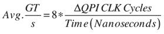 <br>对于 Haswell，可以通过以下公式测量 QPI 模块的频率： <br>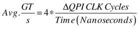 <br>请注意，此公式假设系统处于活动状态，从而阻止任何粗粒度的时钟门控发生。在几乎空闲的系统中，可能会测量到较低的频率。 |
| L0p 时间 | 非核心性能监视器 | 在 L0p 状态下花费的时间可以通过 QPI L0p 事件进行监控。 <br>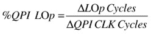 <br>通过使用边沿检测，还可以测量 L0p 转换的次数。请注意，L0p 转换阻塞数据传输的时间非常短。 |
| L1 时间 | 非核心性能监视器 | 在 L1 状态下花费的时间可以通过 QPI L1 事件进行监控。在最近的处理器代次中，L1 专门用于封装 C6 状态，因此几乎不需要单独测量其驻留时间。事实上，由于同时发生的时钟门控，在许多情况下此 QPI 计数器会停止计数。 |
| 时钟门控 | 非核心性能监视器 | 当链路处于 L1 状态时，某些处理器代次上的整个 QPI 模块可以被时钟门控。通过测量 QPI 周期，可以计算链路处于时钟门控和 L1 状态的时间量。为此，必须首先知道 QPI 链路的时钟频率。 <br>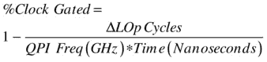 |

## 管理控制器监控

系统中的管理控制器，包括基板管理控制器（`BMC`）和 `PCH` 中的管理引擎（`ME`），提供了更广泛的平台级监控功能。`BMC` 连接到系统中的各种总线、传感器和组件，使其能够充当覆盖大量不同系统组件的集中式监控资源。`BMC` 还可以将监控功能与阈值配对以生成事件，例如指示某个组件温度已超过安全级别。

管理控制器监控补充了 CPU 和操作系统提供的监控功能。`BMC` 和 `ME` 提供了对许多无法在其他地方监控的独特监控事件的访问，例如风扇转速、电源、电压以及常规平台健康状况。它还允许在系统启动、断电或无响应时进行监控。如第 5 章所述，管理控制器的监控功能通过 `IPMI` 进行访问。

### 组件功耗传感器

了解单个组件的功耗以及各个组件如何累加形成平台总功耗，可以获得极大的洞察力。在理想的监控解决方案中，平台功耗（扣除 `PSU` 效率损失后）应等于所有单独测量组件的功耗总和。然而，大多数服务器只能测量 CPU 和内存功耗，这留下了不完整的图景。

> **注意**
> 一个常见的问题是“系统中的功耗是如何分解的？”一种工程方法是识别出消耗功率最多的几个组件，并将优化工作重点放在这些组件上。系统中功耗的分解在不同服务器之间差异很大，并且系统中的许多单个组件仅占总功耗的一小部分。

可以向基板添加额外的传感器来测量这些缺失的组件，报告功率或电流和电压。在电路板设计期间，添加这些计算组件功率所必需的增强型传感器的成本相对较小，例如，添加通过 `SMBus` 接口暴露读数的 `VR`，或添加可通过 `I2C` 访问的电流传感器。这些额外的传感器允许节点管理器（`NM`）固件计算平台中所有组件的能耗，以确定未说明的功耗来自何处。例如，`NM` 可以暴露 `PCH`、`LAN`、风扇和 `BMC` 的单独能耗测量值。当前一代的节点管理器支持多达 32 个额外的监控设备，因此可以以精细的粒度监控组件能耗。

与使用 CPU 能耗事件类似，`NM` 能耗事件与时间戳相关联，因此用户可以定期读取传感器，以在所需的时间窗口内计算功耗。

### 合成传感器

为了公开更多关于平台的信息，节点管理器为那些不易测量的平台特性添加了新的合成传感器。节点管理器 3.0 增加了报告体积气流和出风口温度的能力。这些值是基于服务器机箱特性化过程以及来自风扇转速传感器、平台消耗的能耗和进风口空气温度的当前读数计算得出的。外部管理软件可以根据数据中心内服务器的物理位置信息和报告的出风口温度创建热图。此信息可用于提高数据中心效率，例如，动态管理冷却设定点、识别热点或优化工作负载放置决策。

### 传感器与事件

`BMC` 与 `ME` 之间提供了大量用于监控的传感器、事件和指标。表 7-10 举例说明了用于表征服务器能效的主要事件。对各种传感器的支持及其具体名称可能因平台而异，因此表中使用通用或典型名称。许多不同类型的传感器，例如错误指示、硬盘状态或故障和活动 `LED` 状态，被有意排除在表外，以便专注于那些与功耗最相关的传感器。

### 表 7-10. 可通过 `IPMI` 访问的常见监控事件

| 类型 | 描述 |
| --- | --- |
| `PSU` 输入功率 | 监测进入电源的功率。这代表节点的总功耗。 |
| `PSU` 输出功率 | 监测电源输出的功率。有助于了解电源的效率。 |
| `PSU` 电流 | 监测 `PSU` 电流。有助于观察过流等状况，并验证 `PSU` 在设计规范内工作。 |
| `PSU` 电压 | 监测 `PSU` 电压。有助于观察欠压等状况，并验证 `PSU` 在设计规范内工作。 |
| 电压 | 监测各电源轨上的电压。这通常与某些警报配对使用，以确保电压不超过预期阈值。 |
| CPU 能耗 | 监测单个 CPU 的能耗。随时间监测能耗传感器有助于计算功耗。如果某个 CPU 消耗的功率显著高于其他 CPU，则需要调查。这可能存在通过优化软件来提高能效的机会。 |
| 内存能耗 | 监测共享通用 `VR` 的 `DIMM` 子集的能耗。有助于评估组件选择的影响。 |
| `LAN` 能耗 | 监测单个接口的 `LAN` 能耗。 |
| 风扇能耗 | 监测单个风扇的能耗。与风扇转速计和组件温度结合使用，有助于评估风扇转速控制的效率。 |
| `PCH` 能耗 | 监测包括 `ME` 在内的 `PCH` 能耗。 |
| `BMC` 能耗 | 监测 `BMC` 能耗。 |
| 机箱进风温度 | 监测前面板（冷空气进入处）的温度。 |


| 出风温度 | 监测后面板（热空气排出处）的温度。结合进风温度和组件温度，有助于了解热量排出情况。 |
| --- | --- |
| 扩展卡进风温度 | 监测指定扩展卡位置的温度。 |
| 扩展卡出风温度 | 监测指定扩展卡位置的温度。 |
| 主板温度 | 监测主板上的温度。 |
| PCH 温度 | 监测包括 ME 在内的 PCH 温度。 |
| PSU 温度 | 监测电源的温度。 |
| CPU 温度 | 监测单个 CPU 的温度。如果某个 CPU 运行温度显著高于其他 CPU，则需要调查。这可能存在通过优化软件来提高能效的机会。 |
| DIMM 温度 | 监测单个 DIMM 的温度。 |
| CPU 处理器热节流 | 监测因 CPU 达到或超过其最高安全工作温度而触发的热节流使用情况。 |
| CPU 热跳闸 | 监测热保护机制的使用情况。在这种情况下，系统被断电以防止因温度达到灾难性水平而损坏硬件。 |
| 内存热节流 | 监测因一个或多个 DIMM 达到或超过其最高安全工作温度而导致内存控制器使用带宽节流的情况。 |
| VR 热节流 | 监测 VR 达到或超过其最高安全工作温度的情况。 |
| 风扇转速计 | 监测单个风扇的转速（单位：RPM）。 |
| 体积空气流量 | 描述体积空气流量的指标，是风扇转速（RPM）和平台区域数量的函数。 |
| CPU 利用率 | 此 NM `CUPS`（每秒计算使用量）指标监控所有内核的平均利用率。可用于各种数据中心管理和编排功能，例如虚拟机放置。 |
| 内存利用率 | 此 NM `CUPS` 指标监控所有内存通道的平均内存利用率。 |
| I/O 利用率 | 此 NM `CUPS` 指标监控 `PCIe` 的平均 I/O 利用率。 |
| 整体利用率 | 这是一个复合指标，使用 CPU、内存和 I/O 的 `CUPS` 利用率指标的加权平均值来监控服务器利用率。它提供了工作负载性能和可用性指标的整体评估。有助于优化数据中心内功耗和散热的资源。 |

当将几个相关事件进行对比时，这些事件的实用性会大大增强。例如，同时监测 `PSU 输入` 和 `PSU 输出` 功率使用户能够计算 PSU 效率和功率转换损耗。

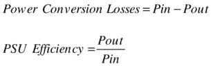

**注意**

在计算 PSU 效率时，最好使用在较长时间窗口内平均的 `Pout` 和 `Pin` 值。此方法考虑了 PSU 的电容，从而得到更具代表性的数值。

当使用代表生产环境的工作负载来测量 BMC 监控数据时，用户能够更深入地了解各个组件之间的交互。图 7-1 展示了不同服务器负载下的各种系统组件温度。

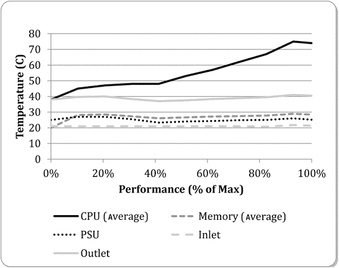

**图 7-1.** 不同服务器负载下的组件温度

图 7-1 中的组件温度可以与同时采集的图 7-2 进行比较。对比这些图可以说明风扇转速是如何提高以使每个组件保持在安全工作温度范围内的。结合组件级功耗来分析相关热事件，能使运营人员深入了解其散热解决方案的效率。

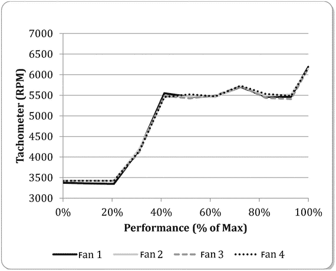

**图 7-2.** 不同服务器负载下的风扇转速


# 软件监控

第 6 章讨论了操作系统在选择电源状态时所扮演的角色，以及操作系统在管理系统资源时如何平衡性能与功耗。系统上运行的不同类型的应用程序可能会在调度、内存管理和 I/O 方面带来各种挑战。操作系统提供了全面的监控能力，使用户能够分析这些行为。这种分析使用户能够评估系统运行的效率，检测不良的应用程序行为，并发现硬件配置方面的问题。

操作系统会追踪许多与 CPU 监控相同的事件。例如，操作系统和 CPU 都可以监控内核时间和用户时间。在某些情况下，操作系统能够提供对 CPU 无法理解的事件的独特洞察。操作系统可以追踪系统调用所花费的时间、中断处理程序所花费的时间，以及提交和完成 I/O 所花费的时间。它们还可以追踪各个进程所花费的时间。这些增强功能使操作系统能够对诸如内核时间等事件提供更深入的洞察。在某些情况下，操作系统能够为同时被 CPU 和操作系统测量的事件添加不同的视角。例如，CPU 根据被授予的 `P` 状态来衡量 `P` 状态驻留时间。而操作系统则能够根据被授予的 `P` 状态和请求的 `P` 状态来衡量 `P` 状态驻留时间。

当操作系统事件与 CPU 事件结合使用时，用户可以更深入地理解软件/硬件接口。例如，CPU 能够测量一个具体的效果，比如某个核心有 90% 的时间处于空闲状态且仅使用 `C1` 状态。而操作系统则能够测量一个具体的原因，比如在该核心上频繁的网络中断处理导致了较高的 `C1` 驻留率。

CPU 和操作系统所测量事件的另一个区别在于准确性。CPU 事件通常是时钟周期精确的，而操作系统事件的准确性则可能因产品和版本而异。例如，某些事件可能只是被采样而非精确测量，而某些事件可能只在频率较低的时钟中断期间才会更新。

用于监控资源利用率和内核函数的事件在不同的操作系统中是通用的。尽管这些事件本身相似，但在事件名称和具体测量内容上可能存在一些细微差别。例如，一个操作系统可能在衡量驱动器延迟时包括了内核时间、队列时间和设备时间，而另一个操作系统可能只包含设备时间。本节将以操作系统无关的方式讨论常见的操作系统事件。在概述这些事件之后，将提供几个不同操作系统特定的工具及其使用方法的示例。

## 利用率与处理器时间

操作系统能够将活动时间和空闲时间分解成一组非常详细的信息。这些事件可用于确定执行应用程序代码所花费的时间，以识别在意外时间运行的应用程序，或识别运行频率高于预期的应用程序。例如，这些事件可以检测到那些可能导致系统无法进入低功耗空闲状态的侵入式管理或安全服务。

处理器时间事件可以跨逻辑处理器、跨核心或跨封装进行分析，以识别利用率不对称的情况。这可能表明软件配置错误，或由于并行设计不佳导致效率低下的遗留软件。这些事件也可用于评估随着时间推移，活动量增加或减少时的资源利用率。本章中的一些图表展示了这类示例，说明了事件如何在整个服务器负载范围内变化。表 7-11 列出了描述处理器时间的几个常见事件。

**表 7-11. 操作系统暴露的常见 CPU 利用率事件**

| 类型 | 描述 |
| --- | --- |
| 用户时间 | 监控执行应用程序代码所花费的时间。存在多种操作系统工具，例如 Windows 环境下的 `Perfmon` 或 Linux 环境下的 `SAR`，可以按线程、处理器或虚拟机细分用户时间。 |
| 内核时间 | 也称为特权时间，它监控操作系统所花费的时间，包括调度、内存管理以及与系统中不同设备的交互。 |
| 内核中断时间 | 监控处理硬件中断所花费的时间。这代表了中断中需要立即处理的高优先级部分，即上半部。 |
| 内核软中断时间 | 也称为软件中断时间、`softirq` 时间或延迟过程调用，它监控处理中断剩余的较低优先级操作所花费的时间，即下半部。 |
| 内核空闲时间 | 监控没有进程被调度或准备运行的时间。某些操作系统支持 `iowait`，这是一种更具体的内核空闲时间度量，用于区分空闲状态下是否有未完成的 I/O。 |
| 来宾时间（仅限 `VMM`） | 监控在虚拟化环境中运行来宾虚拟机所花费的时间。 |
| 等待时间（仅限 `VMM`） | 监控在虚拟化环境中等待争用物理资源所花费的时间。等待时间也称为偷取时间、调度时间或就绪时间。高值可能表示超额订阅或虚拟机频繁等待抢占另一个虚拟机。 |

图 7-3 展示了处理器时间的各个组成部分如何随着服务器负载的增加而变化。在最大吞吐量水平下，只有 85% 的时间用于执行应用程序代码，其余处理器时间用于执行常见的内核函数，例如执行系统调用或处理中断。减少系统时间的优化可以显著提高能效，因为它为完成工作的应用程序提供了额外的处理器时间。例如，在网络设备中启用中断合并可以减少中断总数，从而减少系统时间。

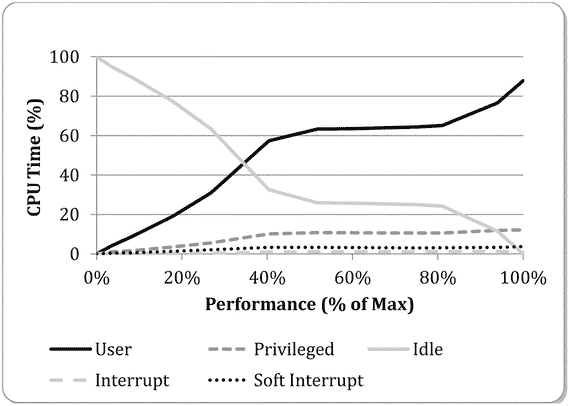
**图 7-3.** CPU 时间分解为不同类别

### 同步多线程（SMT）

在讨论处理器时间时，重新审视物理处理器和逻辑处理器（或超线程（`HT`）中的硬件线程）之间的关系非常重要。由于两个逻辑处理器共享物理处理器的缓存和执行单元，即使每个逻辑处理器仅以 50% 的利用率运行，也可能使物理处理器达到 100% 的利用率。两个 50% 利用率的逻辑处理器也可能只使物理处理器的利用率略高于 50%。对于数据中心工作负载，物理处理器的利用率通常比报告的逻辑处理器利用率高出 50%。图 7-4 展示了一个典型情况，即实际的物理处理器利用率显著高于逻辑处理器利用率。

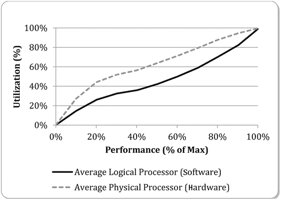
**图 7-4.** 逻辑处理器与物理处理器利用率之间的 CPU 时间对比

操作系统测量的是逻辑处理器的利用率，这可能会对硬件资源利用率给出误导性的画面，因为功耗以及主动和空闲电源管理功能的使用与物理处理器的利用率关系更为密切。最佳的整体利用率是使用本章前面描述的硬件机制来测量的。

### 虚拟化

虚拟化给处理器时间的监控带来了额外的挑战。如果从虚拟机内部测量利用率，那仅能衡量虚拟处理器的利用率，或者仅能衡量该虚拟机所拥有资源的利用率。例如，在虚拟机过度分配的情况下，虚拟机可能测得平均虚拟处理器利用率为 10%，而实际处理器自身的运行负载远高于此。因此，若仅因虚拟处理器平均利用率低就断定系统处于轻负载状态，是不准确的。

类似于通过比较物理处理器利用率与逻辑处理器利用率可以获得洞察，检查虚拟处理器利用率也能提供更多信息。对于系统级分析而言，最佳监控视角是从宿主机出发。宿主机拥有与原生操作系统相同的监控可见性，并且能够追踪各个客户虚拟机的个体利用率。

### 处理器电源状态请求

第 2 章和第 4 章曾介绍过，操作系统对于特定 `C` 状态或 `P` 状态的请求并不一定会被硬件完全批准。例如，操作系统可能请求一个高频率的 `P` 状态，但最终因为热事件而获得了一个更低频率的 `P` 状态。操作系统能够监控其自身的内部状态请求以及硬件所批准的状态。图 7-5 和图 7-6 展示了 `C` 状态驻留中软件请求状态与硬件批准状态之间的差异。在图 7-5 中，`ACPI C2`（硬件 `C6`）在整个服务器负载范围内都有被请求，但图 7-6 显示它实际上仅在 0% 到 20% 的负载区间内被使用。

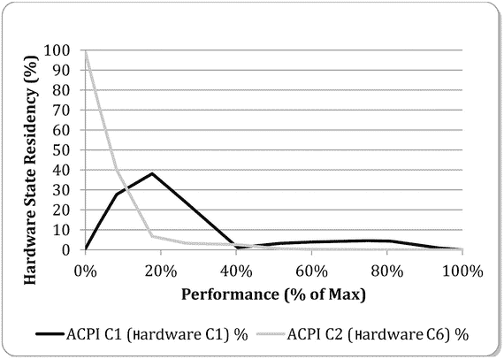
**图 7-6.** `ACPI C1` 和 `ACPI C2` 的硬件 `C` 状态驻留（已批准）对比

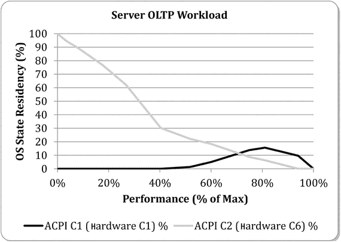
**图 7-5.** `ACPI C1` 和 `ACPI C2` 的软件 `C` 状态驻留（已请求）对比

在图 7-5 和图 7-6 中，`ACPI C1`（硬件 `C1`）和 `ACPI C2`（硬件 `C6`）的驻留时间之和等于总空闲时间。图中未表示的剩余时间为活动时间。

将请求的驻留状态与批准的驻留状态进行比较，可以突显各种硬件和软件控制策略的有效性。这些对比能够识别出意外状态驻留的来源，说明线程间 `P` 状态和 `C` 状态协调的影响，并有助于指导服务器调优决策。

请求状态与批准状态存在显著差异的一个原因是，软件是在逻辑处理器级别监控请求，而硬件则是在物理处理器级别进行监控。如果系统中一半的逻辑处理器请求 `C6`，另一半逻辑处理器请求 `C1`，那么每个核心很可能都处于 `C1` 状态。任何时候，当兄弟逻辑处理器请求不同状态时，较浅的那个状态会被批准。

请求状态与批准状态存在差异的另一个原因是，硬件会利用一些机制来限制深度 `C` 状态的使用，这些机制会在检测到显著的延迟影响时，或者在进入和退出深度 `C` 状态所消耗的能源成本无法通过短暂的空闲时长回收时被触发。这些机制在第 2 章中有详细描述。

表 7-12 和 7-13 列出了操作系统暴露出的用于监控 `C` 状态和 `P` 状态驻留及转换的几个常见事件。

**表 7-13. 操作系统暴露的常见 `P` 状态事件**

| 类型 | 描述 |
| --- | --- |
| 频率转换（软件请求） | 监控各种运行频率被请求的次数。针对每个逻辑处理器进行测量。用于评估 `P` 状态转换的延迟影响。 |

| 频率驻留百分比（软件请求） | 监控操作系统处于请求各种运行频率状态的时间百分比。针对每个逻辑处理器进行测量。对于所有核心共享同一封装内单个 P 状态的服务器，这可用于识别驱动频率升高的应用程序或线程。 |
| --- | --- |
| 运行频率（硬件批准） | 通过采样硬件反馈机制来监控运行频率，该机制指示任何逻辑处理器当前正在运行的频率。 |
| TSC 频率 | 也称为 CPU 基频，监控最大保证频率，即 P1。 |
| 最大频率百分比 | 监控当前运行频率与 CPU 基频的比率。大于 1 的值表示使用了睿频或非保证频率。用于确定在任何给定时间内睿频额外提供了多少频率。 |
| 处理器容量百分比 | 也称为`%processor utility`，监控在第 4 章中介绍的性能容量概念。 |

**表 7-12. 操作系统暴露的常见 C 状态事件**

| 类型 | 描述 |
| --- | --- |
| C1/C2/C3 驻留百分比（软件请求） | 监控操作系统请求 ACPI C1、ACPI C2 或 ACPI C3 状态的时间百分比。通常针对每个逻辑处理器进行测量。 |
| C1/C2/C3 驻留百分比（硬件批准） | 监控 CPU 核心实际处于各种状态的时间百分比。操作系统将本章前面描述的驻留 MSR 的输出映射到相应的 ACPI 状态。 |
| C1/C2/C3 转换次数 | 监控针对每种 ACPI C 状态类型的软件请求次数。由于逻辑处理器的协调性，操作系统的 C 状态转换计数通常远高于实际的硬件 C 状态转换次数。 |
| 平均空闲时间 | 监控逻辑处理器的平均空闲持续时间。 |
| 唤醒事件 | 也称为空闲中断事件，这些事件统计逻辑处理器因中断或中断事件而被唤醒的次数。用于评估 C 状态转换的延迟影响。 |
| 空闲状态 | 也称为核心停靠状态，该事件表示某个逻辑处理器不再可用于进程调度。这是执行整合的一种表现，在第 4 章中进行了讨论。 |

### 调度器、进程与线程

调度器在决定计算资源如何分配、共享和利用方面的决策，对能源效率起着关键作用。监控这一行为使用户能够深入了解同时运行多个虚拟机、应用程序或进程时的交互与影响。例如，如果操作系统过于激进地迁移进程，那么恢复执行上下文或引用远程内存所需的额外时间就会增加功耗。如果操作系统过于保守地迁移进程，则可能导致可扩展性问题与利用率不对称。当一部分逻辑处理器的利用率显著高于其他逻辑处理器时，会导致更激进地使用更高电压与频率状态，从而增加功耗。

第 2 章、第 3 章、第 4 章和第 6 章介绍了硬件和软件电源管理策略为了在低功耗与低延迟之间取得平衡所需做出的一系列决策。调度器在平衡高吞吐量与低延迟方面也面临着类似的挑战，并产生类似的影响。旨在最小化延迟的调度决策可以改善事务响应时间，但这可能会以牺牲能源效率为代价。如果为了改善延迟而降低最大吞吐量，则会导致需要更多的资源（和电力）来满足峰值性能需求。

能够描述和理解调度器、进程与线程行为的管理员，可以发掘调整线程亲和性与优先级以提升能源效率的机会。表 7-14 列出了几个用于监控调度器的常见事件。

**表 7-14. 操作系统公开的常见调度器、进程与线程事件**

| 类型 | 描述 |
| --- | --- |
| 处理器队列长度 | 也称为处理器队列深度，用于监控等待调度任务的队列长度。与其他处理器时间和中断事件结合使用，有助于识别利用率不对称的原因。 |
| 上下文切换 | 监控进程间执行上下文切换的次数。由于保存和恢复上下文会引入额外开销，因此对效率分析很有用。 |
| 迁移 | 监控进程或线程被调度到与上一次不同的逻辑处理器的次数。 |
| 系统调用 | 监控内核代表应用程序执行某些操作（例如读取或修改无法访问的数据，或与硬件设备交互）的请求次数。由于高系统调用率可能表明内核接口使用效率低下，因此非常有用。 |
| 进程/线程 | 监控当前的进程和线程数量。 |
| 进程/线程状态 | 监控进程和线程的当前状态。提供关于优先级、就绪运行状态以及线程等待原因的洞察。 |

### 中断

中断的频率、中断在逻辑处理器间的分布、中断处理在顶半部和底半部之间的划分以及中断的批处理，为深入了解服务器上的工作分布以及中断处理如何影响能源效率提供了更深刻的洞察。例如，当时钟中断或设备中断在空闲期间发生时，它们会导致逻辑处理器退出 C 状态。在低吞吐量时出现高中断率是不可取的，因为低吞吐量通常伴随着低利用率。当中断在活跃期间发生时，它们会导致进程和线程被挂起，直到中断处理完成。

将中断处理的顶半部与底半部分开，使得内核能够在单个逻辑处理器处理特定类型中断时并行处理中断。然而，底半部不一定在与处理中断相同的逻辑处理器上执行。由极少数逻辑处理器处理中断可能是不利的。这可能导致处理中断的逻辑处理器上的利用率显著升高，并导致中断的顶半部和底半部由不同的逻辑处理器处理。这会在调度以及访问不在任何逻辑处理器本地缓存中的共享数据时引入额外开销。由于额外的处理器间中断（IPI），硬中断和软中断的分布可能会增加中断的总数。

表 7-15 列出了可用于识别中断处理如何在逻辑处理器间分布的事件。

**表 7-15. 操作系统公开的常见中断事件**

| 类型 | 描述 |
| --- | --- |
| 设备中断 | 监控设备中断的次数。通过特定的 IRQ 和中断发生的位置进行监控非常有用。单个设备可能具有由不同逻辑处理器处理的多个 IRQ。 |
| 设备软中断 | 也称为软中断请求（softirq）或延迟过程调用（DPC）率，用于监控软件中断的数量及其发生位置。有助于了解中断处理的顶半部和底半部是否发生在同一个逻辑处理器上，或者某个逻辑处理器是否因中断处理而超载。 |
| 时钟中断 | 监控时钟中断的次数及其发生位置。有助于了解时钟中断是否会影响 C 状态驻留时间或调度决策的频率。 |
| 处理器间中断（IPI） | 监控用于在逻辑处理器之间通信的处理器间中断的数量及其发生位置。这些中断用于刷新缓存和转换后备缓冲区（TLB）、进行调度以及请求远程逻辑处理器执行某些操作。 |
| 中断合并 | 也称为中断调节或中断批处理，用于监控被批处理并周期性（而非正常时机）处理的硬件中断。这降低了处理中断的开销，但增加了事务响应时间。有助于确定默认的中断处理行为是偏向于能源效率还是低延迟。 |

### 内存

监控内存使用量和内存局部性至关重要，这有助于判断应用程序的内存使用方式如何影响能效。合理规划内存容量以满足应用需求（而非过剩）对能效至关重要。如果系统中存在过多空闲内存，大量电能将被消耗在无法带来性能提升的内存上。同样，如果可用内存不足，系统将因频繁的交换操作而严重影响性能和效率。

监控还能帮助判断已用内存的有效性。某些应用能够利用近乎无限的内存容量，但这未必有益。例如，将内存用作磁盘内容缓存的应用，其收益往往会达到递减点。此时，增加额外内存仅能带来极低的缓存命中率提升，相当于用极高的能耗代价换取极小的性能增益。

尽量减少对远程处理器的内存引用次数，能大幅提升效率。在非统一内存访问（NUMA）系统或多路处理器系统中，各处理器访问本地 DRAM 的速度远快于访问远程 DRAM 或其他插槽 DRAM 的速度。许多应用未针对 NUMA 进行充分优化，导致本地与远程内存访问量相当。使用远程内存完成操作所需的处理器时间更长，因为内存延迟的增加会体现在 CPU 停滞周期中。

**注意**

令人惊讶的是，有些环境采用了广泛且激进的高效优化技术，却仍在使用未针对 NUMA 优化的应用。应用的 NUMA 优化仍然是提升性能与能效时最容易错失的机会之一，尤其是考虑到无需任何硬件更改即可实现优化。

表 7-16 列出了可用于识别内存利用效率及分析内存引用局部性的常见事件。

**表 7-16. 操作系统暴露的常见内存事件**

| 类型 | 描述 |
| --- | --- |
| NUMA 局部性 | 监控由本地内存满足的内存引用百分比或数量。有助于了解软件在多插槽系统中的优化程度。可通过`NumaTOP`等 Linux 工具采集。NUMA 局部性对 CPU 利用率有显著影响。 |
| 总内存 | 监控系统的总内存容量。 |
| 已用/空闲内存 | 监控系统当前已使用的内存量。建议按具体应用、进程和线程进行监控，以识别优化空间。同时需了解用于磁盘缓存的内存容量，因为这部分内存虽显示为已用，但仍可供应用使用。 |
| 分页 | 监控物理内存与辅助存储设备之间移动的内存块或页面。 |
| 交换 | 监控物理内存与辅助存储设备之间移动的完整进程内存映像。交换操作对性能和能效影响严重。若系统频繁交换，需优化工作负载以减小工作集规模，或增加内存容量。 |

### I/O

识别 I/O 性能不足的问题至关重要，因为这会迫使部署更多服务器（消耗更多电力）才能满足性能需求。I/O 瓶颈会阻碍应用充分利用 CPU 和内存，导致系统组件消耗大量能源却难以完成有效工作。

判断何种 I/O 性能才算"足够"是一大挑战。当今不同技术的峰值性能差异巨大。例如，存储子系统可采用不同接口（3 Gb/s、6 Gb/s 或 12 Gb/s）、不同协议（SATA、SAS 或 FC）以及不同驱动器类型（HDD 或 SSD）。SSD 通过消除困扰许多工作负载的延迟瓶颈，能对系统行为产生巨大影响。除所用技术外，峰值性能还取决于 I/O 类型、块/数据包大小、读写混合比例，以及随机/顺序 I/O 混合比例。操作系统监控功能是了解特定工作负载特性及 I/O 子系统局限性的关键。

监控 I/O 时，理解 I/O 子系统的最大性能与性能需求之间的对比至关重要，这同时适用于网络和存储。图 7-7 对比了不同服务器负载下，驱动器的理论峰值 IOPS 和带宽与运行时实际测量值。

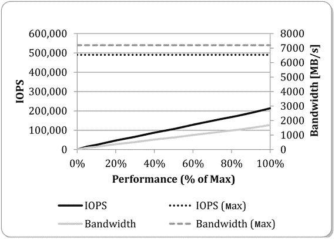

`图 7-7.` 运行时 IOPS 与带宽对比理论最大值

I/O 瓶颈常出现于技术更新换代阶段。CPU 与内存性能的提升速度与 I/O 子系统完全不同。升级至最新平台可能导致计算性能与 I/O 性能出现显著差异。另一个经常引发 I/O 性能不足问题的转型是虚拟化。当多个虚拟机共享 I/O 子系统时，流量增加、资源竞争加剧以及 I/O 流量多样性，都会导致 I/O 峰值性能显著下降。

部分 I/O 瓶颈可通过调优解决，例如启用 I/O 适配器的卸载功能、将流量分段或隔离至特定接口、启用中断批处理，或使用定向 I/O 虚拟化技术（VT-d）。表 7-15 列出了可用于监控 I/O 性能及比较运行时性能与峰值性能的常见事件。

`表 7-17.` 操作系统暴露的常见 I/O 事件

| 类型 | 描述 |
| --- | --- |
| 读/写次数（或 Rx/Tx） | 监控读写次数。用于计算 IOPS。 |
| 读/写字节数（或 Rx/Tx 字节数） | 监控读写带宽。建议按驱动器或接口级别监控，以定位潜在问题。 |
| 队列长度 | 监控读写的平均队列长度，或等待处理的 I/O 平均数量。用于识别 I/O 瓶颈。 |
| 队列等待时间 | 也称为队列延迟，监控 I/O 请求在提交给设备前在队列中的平均等待时间。用于识别 I/O 瓶颈。 |
| 服务时间 | 也称为设备延迟，监控提交给设备的 I/O 完成所需的平均时间。与队列等待时间结合使用，可了解 I/O 各阶段对端到端延迟的影响。 |
| 延迟 | 监控 I/O 的端到端延迟，包括内核时间。 |
| 利用率% | 监控设备处理 I/O 的活动时间百分比。 |
| 控制器空闲状态 | 监控各类控制器的设备电源状态。 |

# 工具

本章介绍了几种用于配置和访问监控功能的底层机制。在大多数使用场景中，这些复杂性可以由软件工具而非最终用户来管理。以下部分简要介绍了一些常见的软件工具及其示例用法。这并非旨在全面列出所有工具和用法。相反，它旨在向读者介绍可用于监控的工具类型以及如何使用它们。这些软件工具的详细文档可在网上获取。

## 健康检查

很多时候，用户只希望了解系统运行情况的高层概览，而不太想深入研究架构和微架构细节。Linux 有两种常用工具（`PowerTOP` 和 `turbostat`），Windows 也有两种（`Perfmon` 和 `Powercfg`），它们都是获取系统功耗特性信息的绝佳起点。

### Turbostat (Linux)

`Turbostat` 是一款简单但功能强大的工具，内置于 Linux 内核树中。它监控以下指标：
-   每线程：平均频率、活跃度
-   每核心：核心 C 状态、温度
-   每插槽：温度、插槽 C 状态、插槽功耗、核心功耗（若支持）、DRAM 功耗

`Turbostat` 有多个不同的命令行选项，可满足一系列使用场景的需求。只需不带任何参数运行它，它就会每秒输出一组统计数据的快照。图 7-8 展示了 `turbostat` 输出的一个示例。

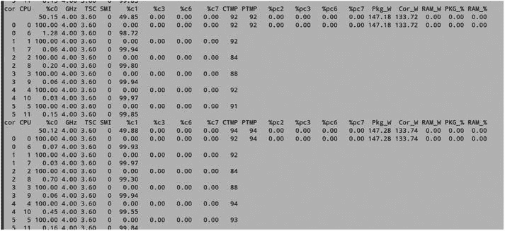

**图 7-8.** 来自 3.12 内核的 `Turbostat` 输出

`Turbostat` 通常与工作负载一起运行，以在测量期间获取系统的统计数据。请注意，虽然所提供的统计数据受工作负载影响很大，但它也会受到系统上运行的任何其他程序的影响。

```
>> turbostat <程序>
```

`-v` 选项是收集有关系统配置的各种调试信息的好方法。

```
>> turbostat -v
```

以一秒为间隔运行 `turbostat`，特别是在大型多插槽系统上，可能会扰动工作负载的行为（以及该工具的结果）。如果不需要一秒间隔的统计数据，请考虑增加监控间隔。这在尝试收集空闲系统的统计数据时特别有用。

```
>> turbostat -i 2
```

`Turbostat` 也可以用作监控系统中各种 MSR 的简单工具。`-m` 和 `-M` 选项将在每个样本周期内从每个线程读取一次相应的 MSR。`-M` 选项将输出 64 位结果，而 `-m` 选项则进行短输出。以下命令将以两秒为间隔转储 MSR 0x199。

```
>> turbostat -i 2 -M 0x199
```

`-C` 和 `-c` 选项提供了类似的功能，但这两个选项不是显示寄存器的原始值，而是提供当前样本与先前样本之间差值的转储。这对于随时间监控计数器的增量很有用。例如，以下命令将以每秒样本间隔转储 APREF（MSR 0xE7）的增量。

```
>> turbostat -i 1 -M 0xe7
```

并非所有发行版都自动包含 `turbostat` 二进制文件，但一旦你拥有内核源代码，编译和使用它就非常简单。该工具是独立的，因此如果你下载一个较新的内核（来自 `kernel.org`），它将包含源代码。`Turbostat` 要求你的内核支持 MSR。

```
// 下载后解压内核源代码
>> tar xf linux-3.12.20.tar.xz

// 查找源代码并切换到相关目录
>> cd linux-3.12.20
>> find . -name turbostat.c
>> cd tools/power/x86/turbostat/

// 构建工具
>> make

// 确保 MSR 内核模块已激活
>> sudo modprobe msr

// 运行工具
>> sudo ./turbostat
```

### PowerTOP (Linux)

`PowerTOP` 是一款用于描述电源管理特征和诊断电源管理问题的开源工具。与 `turbostat` 类似，它针对多种使用场景（不仅仅是服务器）。它是一个有用的补充，因为它提供了一些超出 `turbostat` 所能提供的信息。一些值得注意的补充包括 C 状态的平均时间和频率直方图。`Powertop` 还提供了大量针对消费类使用场景（设备空闲功耗）的信息。设备统计数据在服务器上通常相关性较低。图 7-9 展示了该工具的示例输出。

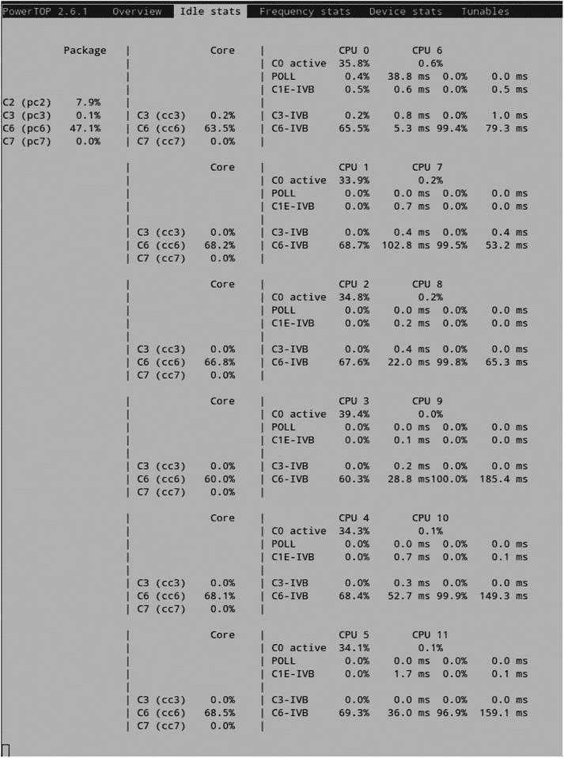

**图 7-9.** `Powertop` 2.6.1 空闲统计

基本的 `powertop` 命令行默认提供较慢的采样间隔（数秒）。这有助于最小化应用程序的开销，尤其是在空闲系统上，但它也会导致结果输出得更慢。时间参数可以加快速度（代价是增加 CPU 开销）。

`--html` 选项将转储一个 HTML 文件。默认情况下，这将收集该工具的单次测量结果。但是，可以收集更多测量结果，从而生成多个 HTML 文件。`--html` 选项可以与 `--workload` 参数一起使用，收集在某个工作负载执行期间的统计数据。与 `turbostat` 类似，`powertop` 将收集整个系统的统计数据，而不仅仅是指定的工作负载。

```
>> powertop --workload=./test.sh --html=test.powertop.html
```

### Powercfg (Windows)

`Powercfg` 是一款 Windows 命令行工具，使用户能够调整较低级别的操作系统电源管理设置。它允许用户启用和禁用功能、更改电源策略以及识别可能影响电源管理的问题。例如，可以使用 `Powercfg` 更改硬盘在闲置期间的电源选项设置，以及查询设备以了解它们支持的电源状态。

`Powercfg` 的独特应用之一是其生成能耗报告的能力。该选项分析系统并报告可能影响电源管理的事件和配置细节。`Powercfg` 能耗报告提供有关空闲中断、设备活动、设备不支持电源状态、操作系统计时器频率更改以及所支持的电源状态的详细统计数据。

以下示例命令使用 `Powercfg` 列出操作系统支持的不同电源策略，并指示当前活动的策略为“平衡”。此设置也对应于操作系统在初始化期间如何设置 `IA32_ENERGY_PERF_BIAS`。

```
C:\Windows\system32>powercfg -list
现有电源方案 (* 为活动状态)
-----------------------------------
电源方案 GUID: 381b4222-f694-41f0-9685-ff5bb260df2e  (平衡) *
电源方案 GUID: 8c5e7fda-e8bf-4a96-9a85-a6e23a8c635c  (高性能)
电源方案 GUID: a1841308-3541-4fab-bc81-f71556f20b4a  (节能)
```

以下示例命令展示了如何创建能耗报告。

```
C:\Windows\system32>powercfg.exe /energy
```

图 7-10 展示了能耗报告结果的示例。在此示例中，系统的插槽 C 状态驻留率很差，能耗报告已识别出多个连接到服务器但未启用 USB 选择性挂起的 USB 设备。此活动阻止了系统在其最低空闲功耗状态下最大化驻留率。

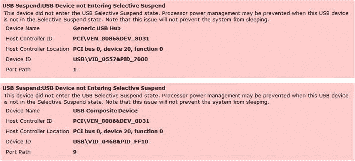

**图 7-10.** 由 Windows `Powercfg` 工具生成的能耗报告的一部分

## 硬件监控工具

对处理器核心和非核心中的各种性能计数器进行编程和读取可能变得相当复杂。为了简化此任务，有许多独立工具可以为用户执行事件编程、数据收集和可视化。

### Intel 性能计数器监视器 (PCM)

`PCM` 提供了一套独立的工具，用于处理计数器的编程和数据收集。`PCM` 还包含示例程序，演示了如何用开源 C++ 代码配置和读取性能计数器。这些示例程序能将原始事件转换为有意义的指标，例如以 GB/s 为单位的内存流量或以焦耳为单位的能耗。`PCM` 面向功耗与性能的监控及特性分析，以类似 BSD 许可证的授权方式提供源代码，下载地址为 [www.intel.com/software/pcm](http://www.intel.com/software/pcm)。

Intel `PCM` 可在多种平台上运行，包括 Linux、Microsoft Windows、FreeBSD 和 Mac OS X。之所以能做到这一点，是因为它仅需要一个驱动程序来对 MSR 进行编程。对于像 Windows 这样本身没有提供此类驱动程序的平台，软件包中也包含了该驱动程序的示例代码。在发布时并未提供二进制文件，但包含了编译说明。

`PCM` 有两种使用方式：(1) 作为一组独立工具使用，或 (2) 集成到应用程序中使用。图 7-11 展示了一个示例图表，该图表由独立的 `pcm-power` 工具在一个四路系统上收集的数据生成。

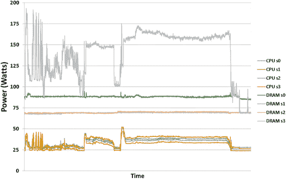

**图 7-11.** 由 PCM 在四路系统上收集的数据生成的插槽和 DRAM 功耗轨迹

## PCM工具

独立的命令行程序 `PCM` 与 `turbostat` 类似，它会按给定的时间间隔定期将输出打印到屏幕上。这个时间间隔可以作为第一个参数指定。对于拥有数十或数百个核心的大型服务器，通常使用 `-nc` 参数（例如 `pcm.x 1 -nc`）来抑制单个核心的指标会很有用。图 7-12 展示了一个四路系统的示例。

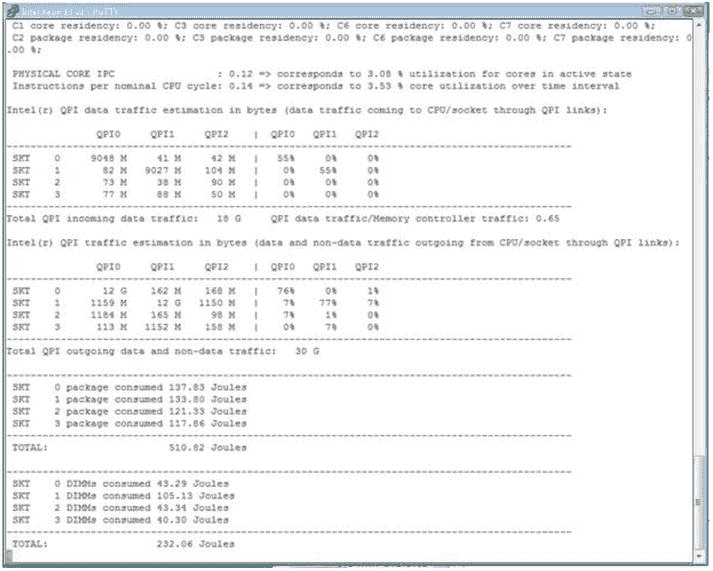

**图 7-12.** 独立 PCM 显示来自四路系统的功耗和性能指标

也可以通过将工作负载的可执行文件作为参数提供，从而在运行工作负载的整个期间内使用 `PCM` 进行监控。由于 `PCM` 监控的是整个系统，该脚本实际上可以作为一个之前已启动的服务器应用程序的工作负载驱动程序。请注意，在这种情况下，`PCM` 报告的是整个工作负载测量期间的指标，例如总能耗。

```
> pcm.x ./run_workload.sh
```

为了便于通过电子表格程序进行后期处理，另一个便捷的功能是能够使用 `-csv` 选项生成逗号分隔的列表：

```
> pcm.x 1 -csv 2>&1 | tee pcm.txt
```

`PCM` 包含一个专门针对功耗管理的工具：`pcm-power`。该工具可以测量通过 Xeon E5/E7 处理器上的非核心性能监视器提供的多项统计数据，包括：

*   核心 C 状态驻留时间

*   频率限制触发原因（热、功耗、操作系统请求、电气/保险丝）

*   频率转换统计信息

*   Prochot 统计信息

*   频率直方图

*   DRAM 功耗节省 (CKE 和自刷新)

例如，要以一秒为间隔监控系统中发生的频率转换次数（并隐藏内存统计信息），可以执行以下命令：

```
> pcm-power.x 1 -p 5 -m -1
```

图 7-13 显示了此命令的输出。除了显示频率转换统计信息外，还会显示一些功耗和热统计信息。附加信息是通过自由运行计数器收集的，因此无论命令行参数如何，都会显示出来。请注意，DRAM 能耗计数器在测试系统上未启用，因此报告为 0。DRAM RAPL 并非必需功能，且并非在所有平台上都支持。

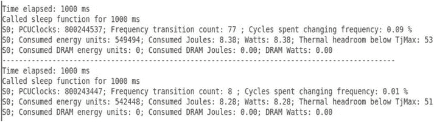

**图 7-13.** pcm-power 截图——频率转换

图 7-14 展示了一个示例，其中 `pcm-power` 通过使用以下命令行来监控系统为何无法达到最高可能频率（频率裁剪原因）。在此命令行中，使用了 `grep` 来过滤掉一些无关信息。

```
> pcm-power.x 1 -p 3 -m -1 | grep –E "(PCUClocks|limit cycles)"
```

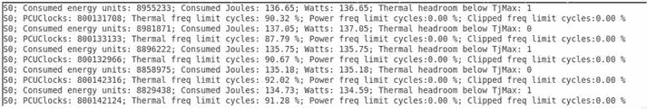

**图 7-14.** pcm-power 截图——频率裁剪原因

“TjMax 以下余量”显示为 1 或 0，表示系统处于热极限状态。同时，“热频率限制周期”徘徊在 90%，表明系统频率在绝大部分时间因热极限而受到限制。

此外，还提供了许多其他专门的独立应用程序：

*   `pcm-numa` 报告每个核心到本地和远程内存的流量。

*   `pcm-memory` 报告每个内存通道的内存流量。

*   `pcm-pcie` 报告进出 PCIe 设备的内存流量。

*   `pcm-power` 可以根据选择的参数报告多个值。

`KSysGuard` (KDE) 和 `Windows Perfmon` 都提供了实时监控各个计数器的可视化机制。请参阅 PCM 网页获取最新说明。

由于 `PCM` 以源代码形式分发，因此也可以直接集成到应用程序中，以便在应用程序执行时方便地收集系统范围的统计数据。初始化操作非常简单：

```
PCM * m = PCM::getInstance();
if (m->program() != PCM::Success) return;
```

实际的测量类似于测量时间，即在关键代码前后分别记录时钟，然后计算差值。对于性能计数器，每个核心、封装（插槽）和系统都有可用的状态。对于所有支持的指标，也预定义了函数：

```
SystemCounterState before = getSystemCounterState();
// 在此处运行你的代码
SystemCounterState after = getSystemCounterState();
```

然后，可以使用例如以下代码来显示特定的统计数据：

```
cout << "指令数: " << getInstructonsRetired(before, after)
     << "CPU 能耗  : " << getConsumedEnergy(before, after)
     << "DRAM 能耗 : " << getDRAMConsumedEnergy(before, after);
```

## Linux Perf

较新的 Linux 系统集成了一个名为 `perf_events` 的集成性能分析与追踪子系统。`perf_events` 子系统提供了一个访问 CPU 性能监控单元（PMU）的接口；它提供了访问 Linux 内核提供的软件跟踪点的接口，并负责管理不同用户之间的资源共享。一个名为 `perf` 的标准命令行工具允许访问 `perf_events` 接口。其他工具和库，例如 `NumaTOP` 或 `PAPI`，也会利用 `perf_events` 子系统。还有一些可用的图形界面前端，例如 `Eclipse perf` 或 `sysprof`。`perf` 工具通常作为 Linux 发行版中的一个软件包包含在内。包含 `perf` 使用文档的维基页面可在 [`perf.wiki.kernel.org/index.php/Tutorial`](https://perf.wiki.kernel.org/index.php/Tutorial) 找到。

`perf_events` 子系统集成在 Linux 内核中，其功能因内核版本而异。所有 `perf` 版本都支持基于采样的基本 PMU 性能分析。`perf top` 工具（如图 7-15 所示）是查看 CPU 当前时间花费在哪里的简便方法。

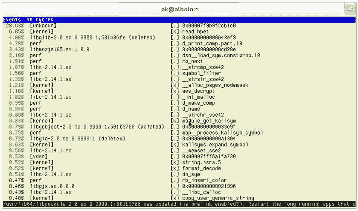

图 7-15：Perf top 示例

`Perf` 还提供了访问内核提供的软件跟踪点的功能。例如，`perf timechart record` 记录所有调度事件和空闲周期，并可以通过 `perf timechart report` 生成类似甘特图（GANTT）的图表。这对于理解短时间（几秒钟）内的工作负载行为非常有用。`Timechart` 首先将系统行为记录到 `perf.data`，然后生成一个 SVG 文件，以类似甘特图的形式可视化追踪数据。

```
% sudo perf timechart record sleep 1
[ perf record: Woken up 2 times to write data ]
[ perf record: Captured and wrote 1.289 MB perf.data (∼56298 samples) ]
% sudo perf timechart
Written 1.0 seconds of trace to output.svg.
```

然后可以在 SVG 查看器中查看 `output.svg`，例如使用 Chrome。SVG 时间图中提供了两组数据：

- 每个逻辑处理器上正在运行的内容的视图（图 7-16）

- 每个软件线程活动的视图（图 7-17）

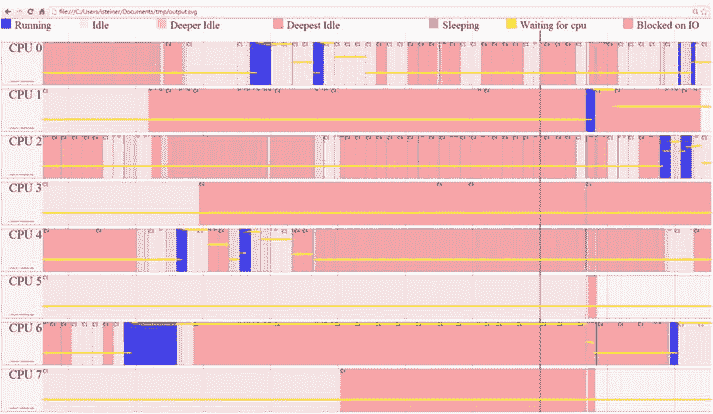

图 7-16：Timechart 第一部分：逻辑处理器活动

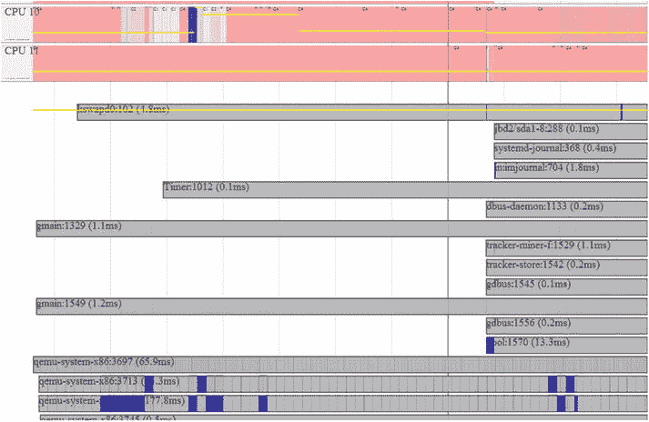

图 7-17：Timechart 第二部分：软件线程活动

图 7-16 中的逻辑处理器信息显示了每个线程请求的 C 状态以及在每个虚拟 CPU 上活动的线程（蓝色）。当核心处于睡眠状态时，它会提供关于它们是在等待 I/O（称为 `io_schedule` 例程）还是处于空闲状态等待 CPU（称为 `schedule` 例程）的指导。

图 7-17 中的软件线程视图显示了每个不同软件线程何时处于活动状态（蓝色）以及线程何时处于非活动状态（灰色）。追踪将显示线程在其首次被观察到执行时（不一定是它们实际开始执行时）的情况。

在某些情况下，查看原始追踪事件也很有用，这些事件可以通过脚本进行后期处理以提取感兴趣的信息。在具有许多线程的大型系统上，可视化时间图可能难以处理。`perf timechart record` 生成的数据文件可以使用 `perf script` 以文本格式查看，作为可视化时间图的替代方案。

```
% sudo perf script | less
swapper     0 [000] 176421.261802: power:cpu_idle: state=4 cpu_id=0
perf      7667 [001] 176421.262026: sched:sched_switch: prev_comm=perf top
swapper     0 [000] 176421.262692: sched:sched_wakeup: comm=qemu-system
swapper     0 [000] 176421.262694: power:cpu_idle: state=4294967295 cpu
```

第一行是进程（`swapper` 表示空闲），然后是 `PID`、`CPU` 编号、时间戳、事件名称和事件参数。在第一行中，`CPU` 0 进入 `C` 状态 4 的睡眠模式。稍后，在 `CPU` 1 上发生从 `perf` 到 `top` 线程的上下文切换。最终，一个 `qemu-system` 进程唤醒了 `CPU` 0，导致其退出空闲状态。

### 常用跟踪点

更多跟踪点可以通过 `perf list`（以 `root` 身份）显示，通过 `perf record` 记录，并通过 `perf script` 显示。

`perf` 中的几个有用的追踪特性是 `kprobes` 和 `uprobes`。它们允许您在内核或用户程序中动态创建新的跟踪点。这些可以通过 `perf probe` 命令访问。以下示例在 `malloc` 函数上设置了一个探针并测量 `malloc` 的访问情况：

```
// 列出可用的函数
% perf probe -F -x /lib64/libc.so.6  | grep malloc
Malloc
// 添加一个跟踪点
% sudo perf probe -x /lib64/libc.so.6 malloc
Added new event:
probe_libc:malloc    (on 0x82520)
// 收集追踪数据
% perf record -e probe_libc:malloc sleep 1
// 从追踪数据生成报告
% perf report
// 完成后移除跟踪点
% perf probe –d probe_libc:malloc
```

### 能耗与事件监控

`perf stat` 命令也可用于访问 `CPU` 能源计量表（需要内核 3.14+）。以下示例命令每 100 毫秒收集一次单插槽系统上的软件包能耗。要获取多个插槽的细分数据，可以使用 `--per-socket`。

```
$ sudo perf stat -I100 -e power/energy-pkg/              -a sleep 1
#           time             counts   unit events
0.100177504              0.25 Joules power/energy-cores/      [100.00%]
0.100177504              0.86 Joules power/energy-pkg/
...
0.701274659              0.23 Joules power/energy-cores/
0.701274659              0.82 Joules power/energy-pkg/
```

`perf` 有一个内置的简单性能监控事件列表（参见 `perf list`）。此外，也可以指定原始事件（`cpu/event=0x54,umask=0xFF/`）。

在 `Xeon E5/E7` 处理器上，也可能通过 `perf` 访问 `uncore` 事件。这可以通过 `pmu-tools` 中的 `ucperf.py` 工具完成。以下示例每秒打印插槽频率因热限制的比例。

```
sudo ./ucevent.py  PCU.PCT_CYC_FREQ_THERMAL_LTD
S0-PCU.PCT_CYC_FREQ_THERMAL_LTD
0.00
0.00
0.00
```

### IPMItool

访问 `BMC` 监控功能以及 `BMC` 健康状态、清单和管理功能最常用的工具是 `IPMItool`。这个开源命令行工具既支持通过经过身份验证的网络连接进行带外访问，也支持通过服务器上的设备驱动程序进行带内使用。

以下示例通过列出 `SDR` 来演示 `IPMItool` 的使用。此命令使用户能够确定有哪些传感器可用，并快速检查这些传感器的状态。在此示例中，为了简化，除了温度传感器和热传感器外，所有其他传感器都已被移除。通过调用工具的帮助选项，可以获取具体的命令和可用命令行选项的完整列表，并且可以在网上轻松找到其他信息。

```
# ipmitool -I lanplus -H xeon-bmc -U root -P pass sdr
```

# IPMI 传感器数据与监控工具

## 传感器读数状态

```
BB P1 VR Temp    | no reading        | ns
Front Panel Temp | 22 degrees C      | ok
SSB Temp         | no reading        | ns
BB P2 VR Temp    | no reading        | ns
BB Vtt 2 Temp    | no reading        | ns
BB Vtt 1 Temp    | no reading        | ns
I/O Mod Temp     | no reading        | ns
HSBP 1 Temp      | no reading        | ns
SAS Mod Temp     | 25 degrees C      | ok
Exit Air Temp    | no reading        | ns
LAN NIC Temp     | 35 degrees C      | ok
PS1 Temperature  | 26 degrees C      | ok
PS2 Temperature  | no reading        | ns
P1 Therm Margin  | -59 degrees C     | ok
P2 Therm Margin  | -60 degrees C     | ok
P1 Therm Ctrl %  | 0 unspecified     | ok
P2 Therm Ctrl %  | 0 unspecified     | ok
P1 DTS Therm Mgn | -59 degrees C     | ok
P2 DTS Therm Mgn | -60 degrees C     | ok
P1 VRD Hot       | 0x00              | ok
P2 VRD Hot       | 0x00              | ok
P1 Mem01 VRD Hot | 0x00              | ok
P1 Mem23 VRD Hot | 0x00              | ok
P2 Mem01 VRD Hot | 0x00              | ok
P2 Mem23 VRD Hot | 0x00              | ok
DIMM Thrm Mrgn 1 | no reading        | ns
DIMM Thrm Mrgn 2 | no reading        | ns
DIMM Thrm Mrgn 3 | no reading        | ns
DIMM Thrm Mrgn 4 | no reading        | ns
Mem P1 Thrm Trip | 0x00              | ok
Mem P2 Thrm Trip | 0x00              | ok
Agg Therm Mgn 1  | no reading        | ns
BB +12.0V        | 10.78 Volts       | nc
BB +5.0V         | -1.65 Volts       | cr
BB +3.3V         | 1.91 Volts        | cr
BB +5.0V STBY    | 2.93 Volts        | cr
BB +3.3V AUX     | 1.91 Volts        | cr
BB +1.05Vccp P1  | 1.53 Volts        | cr
BB +1.05Vccp P2  | 1.04 Volts        | ok
BB +1.5 P1MEM AB | 1.48 Volts        | ok
BB +1.5 P1MEM CD | 1.03 Volts        | cr
BB +1.5 P2MEM AB | 1.03 Volts        | cr
BB +1.5 P2MEM CD | 0.78 Volts        | cr
BB +1.8V AUX     | 1.94 Volts        | nc
BB +1.1V STBY    | 1.30 Volts        | cr
BB +3.3V Vbat    | 3.08 Volts        | ok
BB +1.35 P1LV AB | disabled          | ns
BB +1.35 P1LV CD | disabled          | ns
BB +1.35 P2LV AB | disabled          | ns
BB +1.35 P2LV CD | disabled          | ns
BB +3.3 RSR1 PGD | 3.43 Volts        | ok
BB +3.3 RSR2 PGD | 0.65 Volts        | cr
```

以下示例命令演示了如何使用 `IPMItool` 深入查看特定风扇的传感器。第一个示例展示了如何读取已连接风扇的转速计。在某些情况下，SDR 中存在某个传感器，但由于其断电、断开连接或不受支持，当前无法报告测量值。为简化示例，此处已移除已断开连接的风扇。

```
# ipmitool -I lanplus -H xeon-bmc -U root -P pass sdr type fan
```

```
System Fan 1A    | 30h | ok  | 29.1  | 5890 RPM
System Fan 3A    | 34h | ok  | 29.5  | 5890 RPM
System Fan 5A    | 38h | ok  | 29.9  | 5890 RPM
CPU 1 Fan        | 3Ch | ok  | 29.11 | 5820 RPM
CPU 2 Fan        | 3Dh | ok  | 29.12 | 5400 RPM
```

下面示例中的示例命令演示了如何使用原始命令来读取风扇能量传感器。要访问 BMC 中更低层的能力，可能需要提供唯一的单字节值序列来指示特定命令及相关参数。有时有必要将原始命令与 `IPMItool` 一起使用，因为并非所有 BMC 命令都作为独立的命令行选项被捕获。有关如何构造原始命令的说明包含在 IPMI 规范中，而如何为传感器的名称和位置指定相关参数的说明则包含在服务器制造商提供的文档中。传感器的名称和位置可能因平台而异。

以下命令返回其中一个风扇的能量。该命令返回的最后 8 个字节包括 4 字节的运行能量（以毫焦耳为单位）和 4 字节的运行时间（以毫秒为单位）。该命令被执行两次以说明常见用法。定期读取这些传感器使用户能够计算功耗。例如，从第二个命令的能量中减去第一个命令的能量可得到能量增量。两个命令之间的能量增量除以时间增量即可计算出功率。

```
# ipmitool -I lan -H xeon-bmc -U root -P pass -b 6 -t 0x2c raw 0x2E 0xFB 0x57 01 0x00  0x3 0x0
```

```
57 01 00 19 f5 13 01 c7 e3 17 00
```

```
# ipmitool -I lan -H xeon-bmc -U root -P pass -b 6 -t 0x2c raw 0x2E 0xFB 0x57 01 0x00  0x3 0x0
```

```
57 01 00 f5 54 14 01 fb eb 17 00
```

> **注意**：`IPMItool` 也可用于访问节点管理器功能，因为节点管理器通过 IPMB 链路连接到 BMC。

有关组件级电源管理的更多信息，请访问 [`www-ssl.intel.com/content/www/us/en/data-center/data-center-management/node-manager-general.html`](http://www-ssl.intel.com/content/www/us/en/data-center/data-center-management/node-manager-general.html)。

## 操作系统监控工具

很多时候，用户更感兴趣的是从高层了解应用程序和操作系统正在做什么，而不太关注架构和微架构层面的细节。Linux 下常用的工具（`SAR`）和 Windows 下常用的工具（`Perfmon` 和 `Logman`）是获取有关软件功耗和性能特性信息的绝佳起点。

### SAR

`SAR` 是一款 Linux 工具，用于监控处理器时间、电源状态、调度、内存、I/O 以及许多其他操作系统可见的事件。`SAR` 按用户定义的时间间隔收集事件，并以每秒平均值的格式输出大量事件计数。对于若干被监控的事件，`SAR` 还能在系统级视图之下提供更多细节。例如，可以针对每个单独的逻辑处理器测量处理器时间，也可以针对每个单独的磁盘或网络接口测量 I/O 统计信息。通过 `SAR`，你可以深入了解资源使用情况。

## 系统性能监控工具：sar 与 Perfmon

用户定义的时间间隔以及数据收集时使用的间隔数量，均通过命令行参数来指定。例如，以下命令指定使用 `-A` 来测量所有事件，每秒一次，持续 120 秒。通过调用该工具的帮助选项可以获取所有可用命令行选项的完整列表，此外，也能方便地在网上找到更多信息。

```bash
sar -A 1 120 > sar.dat
```

以下展示了一个输出示例，其中包含监控上下文切换和中断的部分。`SAR` 既可在系统级别测量中断，也可针对每个 IRQ 进行测量。用户可以利用 `SAR` 的输出，结合 `/proc/interrupts` 和 `/proc/irq/*/smp_affinity`，来确定具体是哪些设备产生了中断、中断频率有多高，以及这些中断在何处被处理。

```
08:46:14 PM    proc/s   cswch/s
08:46:24 PM      2.24 104049.64
08:46:14 PM      INTR    intr/s
08:46:24 PM       sum 198321.77
08:46:24 PM        19      1.12
08:46:24 PM        99   7552.09
08:46:24 PM       100   7574.47
08:46:24 PM       101   7297.25
08:46:24 PM       102   7580.26
08:46:24 PM       103   7472.13
08:46:24 PM       104   7808.85
08:46:24 PM       105   7774.36
08:46:24 PM       114   7650.66
08:46:24 PM       115   1660.83
08:46:24 PM       116   1443.44
08:46:24 PM       117   1593.69
08:46:24 PM       118   1750.97
08:46:24 PM       119   1373.35
08:46:24 PM       120   1674.57
08:46:24 PM       123   1417.90
08:46:24 PM       124   1298.17
08:46:24 PM       125   1331.54
08:46:24 PM       126   1375.99
08:46:24 PM       127   1025.64
08:46:24 PM       128   1324.62
08:46:24 PM       129   1425.33
08:46:24 PM       130   1441.81
08:46:24 PM       131      0.71
08:46:24 PM       132      0.51
08:46:24 PM       133      0.51
08:46:24 PM       134      0.51
08:46:24 PM       135      0.51
```

### Perfmon 和 Logman

`Perfmon` 是一款 Windows 工具，用于监控处理器时间、电源状态、调度、内存、I/O 以及许多其他事件。`Perfmon` 还允许应用程序将自己的事件添加到 `Perfmon` 基础架构中，使用户能够从应用程序的角度，与操作系统事件一起监控性能。通过 `Perfmon`，你可以深入了解资源使用情况。

`Perfmon` 事件既可以通过图形用户界面（GUI）实时可视化显示（如图 7-18 所示），也可以使用 Windows `Logman` 工具进行收集，以便离线分析。`Logman` 提供 `Perfmon` 的命令行自动化功能，以及事件跟踪等其他监控特性。它允许用户定义不同的数据收集器或监控事件集，并控制数据收集的时间和方式。用户可以选择创建始终运行的监控日志、在不同时间启动不同的数据收集脚本，以及将输出写入多种格式。

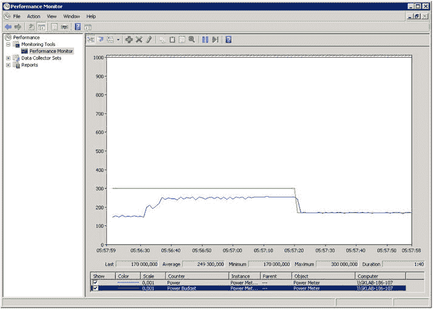

*图 7-18. 性能监视器中显示正在实施电源限制的节点管理器 ACPI 电源计量计数器*

Windows 的 `typeperf` 命令会列出系统上所有可用的 `Perfmon` 事件。用户可以将该命令的输出重定向到一个文件，并根据需要编辑该文件，只保留感兴趣的事件。随后，生成的文件可以作为输入提供给 `Logman`，以定义并创建新的数据收集器。以下是该命令的一个示例：

```
C:\Windows\System32\typeperf.exe -q > input_file
```

下面的示例命令创建了一个名为 `TEST` 的新数据收集器。`Logman` 包含许多命令行选项，用于定义收集间隔、输出格式和输出位置。通过调用该工具的帮助选项可以获取所有可用命令行选项的完整列表。

```
C:\Windows\System32\logman create counter TEST --v -ow -f csv -si 12 -rf 00:01:20 -cf \path\input_file -o \path
```

下面的示例命令启动了 `TEST` 数据收集器。这将监控系统 120 秒，并根据定义数据收集器时使用的命令行选项，将结果写入一个逗号分隔值（CSV）文件。

```
C:\Windows\System32\logman start TEST
```

以下输出展示了一个示例，其中包含操作系统每秒发出的 C2 和 C1 请求计数。

```
12/4/2013 12:53:46 PM        147563.4769         42.47840145
12/4/2013 12:53:58 PM        147825.0577        180.6790098
12/4/2013 12:54:10 PM        149276.3783        120.0697295
12/4/2013 12:54:22 PM        148175.1804         70.16651533
12/4/2013 12:54:34 PM        145440.724          83.24879264
12/4/2013 12:54:46 PM        144713.8251        145.7252465
12/4/2013 12:54:58 PM        146356.6638        112.1651317
12/4/2013 12:55:10 PM        147555.4464        102.7483379
12/4/2013 12:55:22 PM        147615.9768         46.81029614
12/4/2013 12:55:34 PM        148977.9331        106.331977
```

# 总结

有多种功能强大的工具可用于监控系统，以了解其功耗和性能特征。不同类型的监控能力，包括硬件监控、管理控制器监控和软件监控，都具有独特的优势和用途，有助于理解系统行为。

可以使用简单的指标将原始监控数据转换为更适合分析的格式，并且有许多软件工具可以帮助进行可视化。本章末尾概述的常见监控工具、使用实例以及输出示例，提供了一份快速上手的监控指南。第 8 章 将继续讨论可用于指导优化决策的监控技术，并附上具体的调优示例。

## 脚注

1.  可以同时在多个计数器中结合使用多个阈值事件来构建直方图。

2.  DCLK = DDR 内存标称速度的一半。

3.  如果你的内核编译时未包含 `msr` 支持（无论是内建还是通过内核模块），那么你将需要重新编译内核才能使用 `turbostat`。

