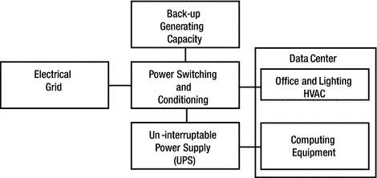
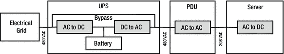
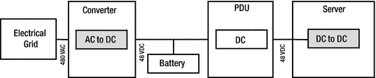
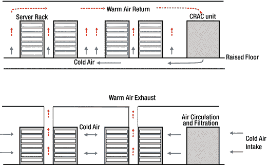
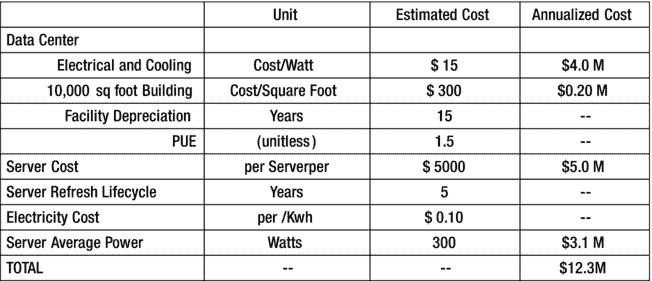
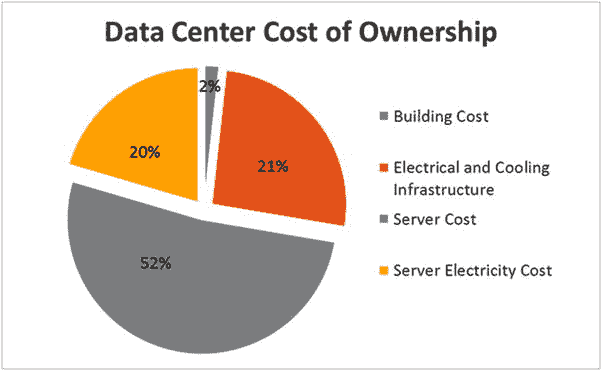

# 9. 数据中心管理

在前面的章节中，我们讨论了数据中心内部计算基础设施为实现能效而进行的优化。然而，在整个数据中心的框架内，这只是能源故事的一部分。

## 数据中心管理与电力分配

正如第 1 章所述，在整体能效的背景下，数据中心内围绕计算机的基础设施同样需要考虑。如果基础设施是支持计算所必需的，那么它就需要被纳入整体的能源方程式中。数据中心基础设施本身有多重使命：除了保护计算机免受湿度、极端温度和自然灾害等自然因素的影响外，它还为运维数据中心的工程师和技术人员提供办公空间，并管理计算资源。数据中心基础设施负责向计算资源输送能源，并处理它们产生的废热。它还通过提供物理安全以及在断电情况下的某种生存能力计划来实现弹性的使命。

在本章中，我们将涉及这些方面的许多内容，特别是它们与数据中心能源管理相关的内容。

## 数据中心设施

数据中心设施在形式、规模和架构上差异很大，具体取决于当地条件、经济因素和数据中心的需求。例如，数据中心可以建在大型专用建筑内，可以作为现有建筑内的专用空间，也可以建在因新用途而改造的现有建筑内。

大型专用数据中心——例如由 Google、Apple、Facebook 和 Microsoft 等大型互联网公司建造的数据中心——通常位于能够提供低成本电力且靠近其服务的大型人口中心（接近程度通常以小于 10-20 毫秒的 ping 时间衡量）的地理位置。这些数据中心的设施功率范围大约在 1 到 20 兆瓦之间。

相比之下，许多专用和通用数据中心则位于现有建筑内。这些数据中心通常规模较小，并且通常是为满足本地或特定用途而建造的。尽管较小的数据中心可以按照高能效标准建造，但在许多情况下，其重要性次于其他考虑因素，例如安全性、靠近特定物理位置，或者仅仅是便利性。

最有趣的设施之一是那些从其他用途翻新或改造而成的建筑。例如，Google 最近在芬兰一家改造后的造纸厂内建造了一个数据中心。¹ 由于阅读习惯的改变和平板电脑使用量的增加导致纸张需求变化，那些能够提供大量电力和冷却水的过时或过剩的造纸厂，成为了数据中心替代选址的优秀候选。²

其他数据中心建在了地下洞穴³或山顶上⁴，甚至有人提议将其建在近海的驳船上。⁵ 在每种情况下，尽管这些设施的物理基础设施大相径庭，但提供大量电力以及足够的废热移除能力始终是共同的需求。正是电力和冷却基础设施的工程学设计，真正决定了数据中心的效率。

### 电力基础设施

尽管数据中心在使命上可能有所不同——从提供网络边缘服务到核心计算，再到提供高度安全的数据处理与存储——但在几乎所有情况下，它们都需要经过严格调节的不间断电源，以满足客户要求的高可用性。供应数据中心的电力必须经过高度调节，以保护其中的服务器、存储系统和网络设备免受电力瞬变的影响。无论是欠压状态还是电涌，都可能导致设备可靠性问题，并根据持续时间和严重程度延长设备停机时间。图 9-1 展示了电网连接数据中心的高度示意性布局。当电网电力中断时，不间断电源（`UPS`）将承担数据中心的负载，直至备用发电机启动并达到满负荷状态。由于成本限制，通常仅对计算设备提供不间断供电支持。



图 9-1. 电网连接数据中心的示意图

#### 配电效率

尽管本书大部分内容关注服务器本身的能效，但影响数据中心整体效率的一个关键因素是将电能传输至服务器过程中的能量损耗。所谓的配电损耗（将电力从远程发电设施输送至使用地点）可能从几个百分点（当负载接近发电能力时，例如华盛顿州昆西市和俄勒冈州达尔斯市的大型数据中心，它们距离水力发电能源仅几英里）到 10%–20%（当数据中心距离发电站数百英里时）不等。虽然这些损耗对整体效率极为重要，但解决这一问题主要取决于数据中心的选址，这超出了本书的讨论范围。

#### 电力调节

数据中心的电力调节是设施最重要的任务之一。服务器的供电需要既“清洁”——即没有可能影响数据中心服务器可用性的尖峰或中断——又经济，以便数据中心以最低可行成本实现其使命。在本节中，我们将探讨实现这一目标的两种高层面拓扑结构，即所谓的交流（`AC`）和直流（`DC`）配电。

在交流配电中，服务器以交流电压供电，在美国通常为 208 VAC。交流配电是目前行业内最主流的方案。来自电网的能量首先为 `UPS` 系统供电，然后传输至机架级和行级配电单元（`PDU`），由其对单台服务器进行电能计量，同时保护相邻服务器免受任何单台服务器电气故障的影响。

图 9-2 展示了一个典型交流数据中心的配电图。来自电网的电力输入 `UPS`，进而为机架级或行级 `PDU` 提供清洁不间断的电力。这些单元将电力转换为服务器可用的电压级别，同时保护设施免受单台服务器故障的影响。其中突出显示了电力和电压转换环节。图中 `UPS` 带有旁路，以实现更高效率的运行。



图 9-2. 一个典型交流数据中心的配电图

这种标准拓扑结构的一个显著问题在于电网与服务器之间交直流电压的反复转换。每次转换都可能导致几个百分点的效率损失，从而推高电力成本。

通过使用 `UPS` 的旁路功能，或者通俗地说，其生态模式，可以消除 `UPS` 中的两次转换——交流转直流以及再转回交流。虽然可能存在关于电源故障时旁路与电池供电之间切换时间的担忧，但供应商的技术发展已在很大程度上缓解了这些担忧。典型的切换时间现在约为一个电源周期的四分之一，远低于数据中心 IT 设备的损坏阈值。绿色网格组织已将旁路功能采纳为“最佳实践方法”。⁶

作为交流方案的替代，有令人信服的证据表明，采用直流供电给数据中心可以提高整体效率。⁷ 效率提升主要源于消除了低效的交流转直流转换。图 9-3 展示了此类拓扑结构的一个例子。来自电网的电力输入经转换的 `PDU`，由其向电池和服务器提供 48 VDC 电压。图中突出显示了电压及交流转直流的转换步骤。



图 9-3. 一个典型直流数据中心的配电图

直流电力基础设施本质上比交流电力基础设施更简单，因为它减少了所需的转换次数，从而减少了昂贵的高可靠性大功率电气设备。然而，交流电力设备的供应基础和行业经验要丰富得多，因为交流一直是并且仍然是占主导地位的行业标准。例如，尽管直流电在通信领域多年来已被安全使用，但更传统的数据中心中的技术人员目前并未接受过使用它的培训。因此，尽管一种方法相对于另一种方法可能存在某些理论优势，但现实是，只要实施适当的工程实践（例如在交流方案中使用 `UPS` 旁路），两种方法都能实现高效率和低总成本。

#### 备份系统

数据中心的服务即使在断电时也需要维持。为此，数据中心依赖于由短期和长期备份系统共同构成的备用电源系统。短期系统旨在快速响应供电波动并提供电力，通常仅维持几分钟，直到大容量长期备份系统能够接管数据中心的全部电力负载。

不间断电源（`UPS`）长期以来一直使用大型铅酸电池阵列建造，许多数据中心至今仍沿用这种简单而可靠的技术。铅酸电池本质上与典型汽车中的电池类似，可以在公开市场上购买。这项技术已经成熟，多年来没有发生重大变化。使用电池的一个缺点是，它们需要定期维护和更换，以提供备份系统所期望的高可靠性。⁸

因此，数据中心运营商已寻找并实施了替代性的 `UPS` 方案。一种流行的替代方案是高速旋转飞轮系统。在这种情况下，能量并非像电池中那样以化学形式储存，而是通过高速、大质量的旋转飞轮以动能形式储存。飞轮系统比电池系统占用更少的空间，且维护需求显著降低。但它们也仅能提供几秒钟（通常在 10-20 秒范围内，具体取决于安装规模和负载）的自主供电能力，这意味着备份发电机需要能够在第一次就正常启动。此外，备份发电机的容量需要略微增加，因为除了为数据中心供电外，它们还必须在短时间内重新为飞轮系统充能，以恢复设施的备用状态。⁹ 飞轮系统还有一个额外优势，即它们使用交流电源运行，消除了对直流转换的需求。

数据中心最常见的长期备用电源类型是柴油发电机。柴油发电机的使用不仅在数据中心非常普遍，在医院等其他关键设施中也是如此，因此它们拥有完善的维护记录，并且很容易找到维修专家。通常，柴油发电机可能占数据中心资本成本的 10%左右。尽管有人提出通过智能 IT 技术来降低发电机容量的成本，但这些方案尚未被广泛采用。¹⁰

为避免成本以及必须定期运行大型柴油发电机组（伴随着废气和噪音）的某些缺点，数据中心的备用电源系统出现了一些创新。例如，位于瑞典的 Facebook 数据中心放弃了约 70%的典型备用发电机容量，因为他们能够利用该地区的冗余电网。这种方法很出色，能够以非常经济的成本规模轻松地为电网提供非常高的可靠性。然而，冗余电网并不常见，因此这种方法在大多数情况下用途有限。

柴油发电机的另一种替代方案是燃料电池。燃料电池通过电化学反应将燃料（通常是氢气或甲烷）转化为能量。与其他电源相比，燃料电池具有许多优势。除了相对紧凑和清洁外，它们还可以靠近负载放置，从而消除电网和配电损耗。事实上，一些数据中心运营商因此考虑完全放弃电网能源，并报告称在合理的成本参数假设下，总体拥有成本表现良好。¹¹

犹他州的`eBay`数据中心于 2013 年投入使用¹²，其大部分电力来自`Bloom Energy`公司建造的天然气燃料电池。据`eBay`称，这些燃料电池可将`CO2`排放量减少约 50%，并提高数据中心的可靠性。事实上，燃料电池是该数据中心的主要能源，从而降低了与备用发电机和`UPS`系统相关的成本。

## 冷却基础设施

为服务器供电是数据中心能源方程中的重要一环。而同等重要的另一方面，则是移除服务器产生的所有废热。需要特别指出的是，用于运行服务器（以及数据中心所有其他设备）的全部能量，都必须以废热的形式被移除。这意味着，例如，对于一个 10 兆瓦的数据中心负载，恰好需要消散 10 兆瓦的废热，才能平衡设施的能源输入。

了解数据中心冷却技术的发展历程颇具启发意义，因为它清晰地讲述了提升整体数据中心效率的基础设施方面所取得的进步。典型的建于上世纪 90 年代的数据中心主要依赖中央机房空调（CRAC）单元来提供冷却。来自服务器机架的暖风被吸入 CRAC 单元，冷却至低至华氏 60 度的温度，然后通过穿孔活动地板重新吹回机房。这种方法基本够用，但确实会出现热点（通常是由于空气循环的均匀性较差），这需要特殊处理。此外，进入机房的冷空气会立即与较暖的空气混合，降低了冷却单元的效率。

图 9-4 展示了两种数据中心的布局。上图是 2000 年之前典型的“宴会厅”配置。较新的数据中心，如图 9-4 底部所示，则将暖风和冷风隔离开，并利用当地环境空气来优化运营。



图 9-4. 两种数据中心类型：典型的旧式“宴会厅”配置（上）与当今的数据中心（下）

从 21 世纪初开始，工程师们意识到，通过将冷空气从服务器后部向上和向后推送，再将热空气从服务器前部抽出，从而实现冷热空气的隔离，可以显著提高冷却单元的效率。例如，T-Systems 和英特尔的一项研究发现，隔离冷热空气可以将模型数据中心的电能使用效率（PUE）从 1.8 降低到约 1.3，这意味着基础设施能耗的大幅降低。¹³ 该研究表明，即使是微小的空气泄漏，如果不加控制，也可能对基础设施的效率产生显著影响。

数据中心基础设施发展的第三个重要阶段是所谓“自然风冷却”（或称利用室外空气冷却数据中心）的出现。在许多气候区域，只要保持空气流通，室外空气的温度和湿度水平足以有效冷却服务器，无需空调设备的额外帮助。有许多按照此标准建造的数据中心实例，包括著名的“鸡舍”数据中心，它利用了热空气在横风处上升的趋势，从而将热空气排出建筑。¹⁴ 业界研究了不同气候条件支持自然风冷却的能力，绿色网格组织（The Green Grid）发表的研究考虑了更新后的 ASHRAE 标准允许更宽温度与湿度范围所带来的影响。¹⁵

数据中心设施发展的最后阶段是高温数据中心的出现。硅和计算机硬件组件能够承受比人类更高的温度。研究表明，即使是现成的组件也可以在 40°C 下安全运行。¹⁶ 为了进一步减少冷却需求，业界正推动实现 50°C 下的运行能力。

## 成本与计算基础设施的简化总成本模型

关于总拥有成本（TCO）模型已有大量研究成果，其中包括由乔纳森·库米（Jonathan Koomey）开发的一个优秀（且公开可用）的模型，该模型为确定准确的成本基准提供了大量细节。¹⁷

在本节中，我们不会提供详细的模型，而是侧重于更高层次的视角，以帮助您理解成本方面的大趋势。使用简化模型来做出可能相对复杂的商业决策存在固有风险，但利用它们来帮助塑造洞察力并认识宏观趋势则是有用的。

图 9-5 展示了一个 10,000 平方英尺数据中心的简化 TCO 模型。该模型计算了整个数据中心（包括建筑、基础设施和 IT 设备成本）的总拥有成本。模型包含的内容固然重要，但未包含的内容同样关键。重要的成本参数，如架构选择、软件许可、人工和保修范围、保险以及税费，都可能显著改变模型的结论，任何负责任的商业决策都必须将这些因素考虑在内。



图 9-5. 一个 10,000 平方英尺数据中心的简化 TCO 模型（按名义价值计算）

在最基本的层面上，成本模型考虑了资本成本（通常假设一次性发生，然后在某个标准折旧期内摊销，以将费用年化）和持续的运营费用，后者按实际使用情况支付。重要参数已在图 9-5 中突出显示。图 9-6 显示，运营电力成本在数据中心总拥有成本中占据了相当大的比重。年电力能源成本以及电力和冷却基础设施都直接与服务器消耗的瓦特数成比例，因此，服务器功耗的净降低可以在运营成本和资本成本两方面为数据中心节省开支。



图 9-6. 运营电力成本在数据中心总拥有成本中占据相当大的比重

如前所述，电力基础设施成本的区间主要取决于架构选择。诸如备用发电机的种类和数量、电力冗余、布局和位置等决策，都会广泛影响成本的选择。通常，每瓦特 8.00 美元到 20.00 美元的区间代表了合理的估计范围，尽管也可能出现高于或低于此范围的偏差。

业界已知的数据中心效率范围从 `PUE` = 1.1 到 3.0，其中 `PUE` 是电能使用效率的缩写，定义见第 1 章。通常，较旧设施中的 `PUE` 远高于使用环境冷却来降低间接费用的较新设施中的 `PUE`。

### 每美元每瓦性能

人们经常听到关心数据中心成本的人谈论“每美元每瓦性能”，然而在已发表的文献中，似乎对此短语并无确切描述。在本节中，我们将简要讨论具有每美元每瓦性能量纲的术语是如何引入到所有权成本方程中的。

为了让你理解这一点，我们需要增加一个维度，我们称之为计算功。计算功与物理功不同，但可以根据类似的方式来思考——对系统进行物理改变（在计算机的情况下，即对比特位的改变）。这种物理改变需要能量，因此，进行该改变所需的能量可以等同于所做的功。

就当前情况而言，我们将数据中心的计算工作率视为每秒交易数 `T`。具体的交易类型并不重要，我们做一个简化的假设，即这些交易是均匀的。如果服务器的容量（称为其性能）是每秒 `p` 笔交易，那么数据中心所需的服务器数量 `N` 就是：

```
N = T/p
```

现在，数据中心的总功耗 `P[total]` 将是服务器所需的功率 `P[server]` 加上基础设施消耗的功率，即：

```
P[total] = N * P[server] * PUE
```

代入上述关系式后，变为：

```
P[total] = T * P[server] * PUE / p
```

注意到能量等于功率乘以时间，我们可以通过考虑一个标准时间间隔（我们将其设为一年）内的功率和交易率 `T` 来将成本年化。当你进行一些简单的代数运算后，可以很容易地计算出以每美元运营能源成本的交易数表示的成本效率：

```
T / (P[total] * 能源成本) = p / (P[server] * 能源成本 * PUE)
```

请注意，成本所平均的时间段在分子和分母中均相互抵消，正如我们所期望的那样。等式的右边具有每美元每瓦性能的量纲。这个等式具有直观的吸引力。为了最大化运营效率，你会希望最大化每能源成本的交易数。该等式强调，实现这一目标需要最大化系统性能；最小化服务器功耗和能源成本；并最大化数据中心基础设施的效率。最大化每美元每瓦性能可以最小化每笔交易的成本。

# 总结

在本章中，我们证明了最大化数据中心效率最终归结为最大化服务器和数据中心基础设施的能源效率。配电在管理整体数据中心效率中扮演着重要角色。尽管交流电在目前的数据中心供电设计和配电中占主导地位，但直流电以更少的电源转换次数提供了同等的效率。随着数据中心转向像太阳能和燃料电池这类天生提供直流电的替代电源，我们可以预期直流电将在数据中心设计中占据更重要的地位。

最后，我们展示了总拥有成本在优化整体数据中心设计时提供了一套复杂的权衡方案，其中服务器性能和效率提升是整体优化中最有力的变量之一。这种优化归结为最大化“每美元每瓦性能”，以实现最大的成本效益。

## 脚注

[1] 参见 “芬兰哈米纳,” [www.google.com/about/datacenters/inside/locations/hamina/](http://www.google.com/about/datacenters/inside/locations/hamina/).
[2] 参见 Bart King, “平板电脑正显著减少媒体行业的纸张使用” (2011), [www.sustainablebrands.com/news_and_views/articles/tablets-are-significantly-reducing-media-industry%E2%80%99s-paper-use](http://www.sustainablebrands.com/news_and_views/articles/tablets-are-significantly-reducing-media-industry%E2%80%99s-paper-use).
[3] 参见 Nick Booth, “绿山公司将数据中心安置在挪威北约的洞穴中” (2013), [www.techweekeurope.co.uk/workspace/green-mountain-data-centre-norway-120063](http://www.techweekeurope.co.uk/workspace/green-mountain-data-centre-norway-120063).
[4] 参见 Rich Miller, “世界最高数据中心” (2013), [www.datacenterknowledge.com/archives/2013/04/05/the-worlds-highest-data-center/](http://www.datacenterknowledge.com/archives/2013/04/05/the-worlds-highest-data-center/).
[5] 参见 Rich Miller, “谷歌计划建设离岸数据驳船” (2008), [www.datacenterknowledge.com/archives/2008/09/06/google-planning-offshore-data-barges/](http://www.datacenterknowledge.com/archives/2008/09/06/google-planning-offshore-data-barges/).
[6] 参见 “不间断电源系统中的节能模式评估” (2012), [www.thegreengrid.org/en/Global/Content/white-papers/WP48-EvaluationofEcoModeinUninterruptiblePowerSupplySystems](http://www.thegreengrid.org/en/Global/Content/white-papers/WP48-EvaluationofEcoModeinUninterruptiblePowerSupplySystems).
[7] 参见 My Ton, Brian Fortenbery, and William Schudi, “用于提高数据中心效率的直流供电” (2008), [`hightech.lbl.gov/documents/data_centers/DCDemoFinalReport.pdf`](http://hightech.lbl.gov/documents/data_centers/DCDemoFinalReport.pdf).
[8] 参见 “实施最佳电池维护实践以避免数据中心停机” (2014), [www.datacenterknowledge.com/archives/2014/05/05/implementing-best-battery-maintenance-practices-avoid-data-center-downtime/](http://www.datacenterknowledge.com/archives/2014/05/05/implementing-best-battery-maintenance-practices-avoid-data-center-downtime/).
[9] 参见 “数据中心中的飞轮与电池之比较” (2012), [www.datacenterdynamics.com/focus/archive/2012/11/flywheel-versus-battery-data-center](http://www.datacenterdynamics.com/focus/archive/2012/11/flywheel-versus-battery-data-center).
[10] 同上。
[11] （未提供内容）
参见《不再需要电气基础设施》（2013）， [`research.microsoft.com/pubs/203898/FCDC.pdf`](http://research.microsoft.com/pubs/203898/FCDC.pdf)。
12 参见《介绍我们的盐湖城数据中心》（2013）， [`blog.ebay.com/introducing-our-salt-lake-city-data-center-advancing-our-commitment-to-cleaner-greener-commerce/`](http://blog.ebay.com/introducing-our-salt-lake-city-data-center-advancing-our-commitment-to-cleaner-greener-commerce/)。
13 参见 [www.t-systems.com/news-media/white-papers/827826_2/blobBinary/White-Paper_Data-Center-2020-I.pdf](http://www.t-systems.com/news-media/white-papers/827826_2/blobBinary/White-Paper_Data-Center-2020-I.pdf)。
14 参见戴维·菲洛，《打造更绿色的数据中心》（2009）， [`yodel.yahoo.com/blogs/product-news/serving-greener-data-centers-1853.html`](https://yodel.yahoo.com/blogs/product-news/serving-greener-data-centers-1853.html)。
15 参见《更新版空气侧自由冷却地图》（2012）， [www.thegreengrid.org/en/Global/Content/white-papers/WP46-UpdatedAirsideFreeCoolingMaps-TheImpactofASHRAE2011AllowableRanges](http://www.thegreengrid.org/en/Global/Content/white-papers/WP46-UpdatedAirsideFreeCoolingMaps-TheImpactofASHRAE2011AllowableRanges)。
16 参见《高效数据中心》（2011）， [www.intel.com/content/dam/doc/technology-brief/efficient-datacenter-high-ambient-temperature-operation-brief.pdf](http://www.intel.com/content/dam/doc/technology-brief/efficient-datacenter-high-ambient-temperature-operation-brief.pdf)。
17 参见乔纳森·库美，《数据中心总拥有成本简单模型》（2007）， [`wdminc.com/whitepapers/SimpleModelDetermingTrueTCO.pdf`](http://wdminc.com/whitepapers/SimpleModelDetermingTrueTCO.pdf)。

# 技术与术语
| `AC` | 交流电。 |
| `ACNT` | 一个常用术语，用于描述 `IA32_APERF` MSR，该寄存器用于计算用户定义时间窗口内的平均频率。 |
| `ACPI` | 高级配置与电源接口，BIOS 使用它来公开平台电源管理功能。 |
| `APIC` | 高级可编程中断控制器。 |
| `AR` | 应用比率，用于描述工作负载的 CPU 逻辑切换率。 |
| `ASHRAE` | 美国采暖、制冷与空调工程师学会。 |
| `ASPM` | 主动状态电源管理，是一种用于管理 PCIe 链路电源的功能。 |
| `Avoton` | 继 Centerton 之后的 Atom C2000 系列 SoC 的代号。 |
| `AVX` | 高级矢量扩展，是用于提升性能的整数和浮点指令。 |
| `Bin` | 用于描述任意两个 P 状态（Pn 和 Pn-1）之间频率增加的术语。 |
| `BIOS` | 基本输入/输出系统，指用于初始化服务器的固件。 |
| `BMC` | 基板管理控制器，是一种提供远程监控和管理功能的专用微控制器。 |
| `CC0`/`CC1`/`CC3`/`CC6` | 描述特定的核心级 C 状态。 |
| `Centerton` | Atom S1200 系列处理器的代号。 |
| `CKE` | 时钟使能信号，常用于标识内存的 rank 级掉电模式。 |
| `CLST` | 闭环系统节流，是一种电源管理功能，使用节点管理器和 PMBus 电源实现硬件保护。 |
| `CLTT` | 闭环热节流，利用温度监控来管理内存热节流。 |
| `CPI` | 每指令周期数，是一个基本性能指标。 |
| `CPU` | 中央处理器。 |
| `CPUID` | CPU 识别指令，用于发现处理器类型和功能。 |
| `CRAC` | 计算机房空调。 |
| `CRAH` | 计算机房空气处理机。 |
| `CSR` | 控制与状态寄存器，常用于电源管理监控或控制。 |
| `C-state` | 一种空闲状态，处理器在此状态下暂停执行指令。 |
| `DC` | 直流电。 |
| `DPC` | 每通道 DIMM 数，是用于描述平台内存配置比率的指标。 |
| `DRAM` | 动态随机存取存储器。 |
| `D-state` | 设备（PCIe、SATA）的低功耗空闲状态。 |
| `DTSMAX` | 处理器的最高允许温度。 |
| `Dynamic Switching` | 一种处理器电源管理功能，当容量高时会自动将平台切换到性能模式。 |
| `EBS` | 基于事件的采样，是一种监控技术，允许操作员将功耗和性能事件与导致这些事件的具体模块、功能和代码行关联起来。 |
| `ECC` | 内存纠错，用于提供针对瞬态错误和设备故障的保护。 |
| `EDP` | 电气设计点。 |
| `EEE` | 节能以太网，是一种降低 PHY 功耗的低功耗模式。 |
| `EN` | 将平台或处理器标识为入门级（Xeon E3 用于单路服务器）。 |
| `Energy Perf Bias` | 一个模型特定寄存器，用于控制电源管理功能的使用积极程度。 |
| `Entry Latency` | 从活动状态转换到空闲状态所需的时间（通常以微秒计）。 |
| `EP` | 将平台或处理器标识为高效性能（Xeon E5 用于两到四路服务器）。 |
| `EPA` | 美国环境保护署，负责能源之星计划。 |
| `EX` | 将平台或处理器标识为可扩展（Xeon E7 用于 4 路及更大规模服务器）。 |
| `Exit Latency` | 从空闲状态转换到活动状态所需的时间（通常以微秒计）。 |
| `FIVR` | 全集成电压调节器，是一种集成在处理器内部的高电流开关调节器。 |
| `G-state` | 标识平台整体电源状态的全局状态。 |
| `Haswell` | 继 Ivy Bridge 之后的 Xeon E5 v3 处理器的代号。 |
| `HDD` | 硬盘驱动器，是一种传统的旋转式硬盘。 |
| `IHS` | 集成散热器。 |
| `HLT` | 停机指令，操作系统使用它进入 C1 状态。 |
| `HPC` | 高性能计算。 |
| `HSC` | 热插拔控制器。 |
| `HT` | 超线程技术，是英特尔对同时多线程的实现。 |
| `I/O` | 输入/输出，用于描述通信能力，例如 DDR、PCIe 以及诸如 QPI 的一致性互连。 |
| `IA` | 英特尔架构术语，常用于标识英特尔产品特有的硬件功能。 |
| `IB` | InfiniBand，是一种低延迟、高吞吐量的通信链路，常用于高性能计算。 |
| `ICCMAX` | 平台能提供的最大电流功率输送。 |
| `IMON` | 电压调节器电流监控器，用于测量功率。 |
| `IPMI` | 智能平台管理接口，是一种独立于操作系统和规范的远程管理接口。 |
| `ITD` | 反向温度依赖性。 |
| `Ivy Bridge` | 继 Sandy Bridge 之后的 Xeon E5 v2 处理器的代号。 |
| `LDO` | 低压差稳压器，用于在具有单一输入电压的处理器中为各个核心提供可变电压。 |
| `Linpack` | 一个高性能计算基准测试，源自一套 Fortran 线性代数例程。 |
| `L-state` | 互连（PCIe、DMI、QPI）的低功耗空闲状态。 |
| `MBVR` | 主板电压调节器。 |
| `MCNT` | 一个常用术语，用于描述 `IA32_MPERF` MSR，该寄存器用于计算用户定义时间窗口内的平均频率。 |
| `MCP` | 多芯片封装，是将多个芯片集成在同一封装中的技术。 |
| `ME` | （英特尔）管理引擎，位于平台控制器中枢中，用于监控、功率封顶和硬件保护。 |
| `MMIO` | 内存映射输入/输出。 |
| `MSR` | 模型特定寄存器，常用于电源管理监控或控制。 |
| `MWAIT` | 监视等待指令，操作系统使用它进入 C1 或更深的 C 状态。 |
| `Nehalem` | Xeon 5500 处理器的代号。 |
| `NTB` | 非透明桥接，是一种使用 PCIe 在节点间创建非一致性互连的支持技术。 |
| `NUMA` | 非统一内存访问分配，为每个处理器的本地内存提供连续的内存区域。 |
| `NVMe` | 非易失性内存快速通道，是一种将 SSD 直接连接到 PCIe 的规范，提供比 SAS 和 SATA 更低的延迟和更高的性能。 |
| `OEM` | 原始设备制造商。 |
| `OLTP` | 联机事务处理。 |
| `OLTT` | 开环热节流，利用静态带宽限制来管理内存热节流。 |
| `OS` | 操作系统。 |
| `OSPM` | 操作系统电源管理，是一个常用术语，用于描述操作系统电源管理策略和设备驱动程序。 |
| `P1 frequency` | 代表 CPU 基础频率、保证频率或 CPU 的标称频率。 |
| `Path Length` | 路径长度是一个基本性能指标，用于衡量完成单个工作单元所需的平均指令数。 |
| `PC0`/`PC1`/`PC2`/`PC3`/`PC6` | 描述特定的封装级 C 状态。 |
| `PCH` | 也称为南桥，平台控制器中枢是一个连接到处理器的芯片组，集成了许多原本需要独立控制器（如存储、网络、USB、管理和传统设备）的功能。 |
| `PCIe` | 外围组件互连快速通道，是一种高速串行通信总线。 |
| `PCM` | 性能计数器监控器，是一套独立的工具，用于收集核心和核心外的电源与性能事件。 |
| `PCPS` | 每核心 P 状态，允许各个核心独立于其他核心的 P 状态，以各自的频率和电压运行。 |
| `PCU` | 电源控制单元，是用于实现 CPU 电源管理的内部微控制器。 |
| `PECI` | 平台环境控制接口，是管理控制器与 CPU 通信的接口。 |
| `PL1`/`PL2`/`PL3` | 功率等级，指示用于功率封顶和供电保护的特定功率限制。 |
| `P-Limit (I/O)` | 一种电源管理功能，允许核心外设备自主提高其核心外 P 状态以提升 PCIe 性能。 |
| `P-Limit (perf)` | 一种电源管理功能，允许空闲插槽提高其核心外 P 状态以改善监听和内存延迟。 |
| `PLL` | 锁相环，用于驱动时钟。 |
| `PMBus` | 电源管理总线，是一种用于电源功率管理的开放标准协议。 |
| `PMIC` | 电源管理集成电路，应用于在小型封装内集成多个电源转换控制器的集成电路。 |
| `Pn frequency` | 代表最低频率的 P 状态，或最节能的频率。 |
| `P-state` | 性能状态，是一种代表固定频率和电压工作点的活动状态。 |
| `PSU` | 电源供应单元。 |
| `PUE` | 电能使用效率，定义为数据中心总能耗与 IT 设备能耗之比。 |
| `PWM` | 脉冲宽度调制。 |

| `QPI` | 快速通道互连，用于多路通信。 |
| `RAPL` | 运行平均功率限制，是一种电源管理功能，用于在满足特定热或功率约束的同时最大化性能。 |
| `RDTSC` | 读取时间戳计数器指令，软件使用它来测量时间。 |
| `Sandy Bridge` | 继 Westmere 之后的 Xeon E5 处理器的代号。 |
| `SAS` | 串行连接 SCSI，是将磁盘连接到存储控制器的常见协议。 |
| `SATA` | 串行 ATA，是将磁盘连接到存储控制器的常见协议。 |
| `SEL` | 系统事件日志，是由管理固件使用的集中式事件日志。 |
| `Self-refresh` | 一种低功耗内存电源状态，其中 DIMM 自身负责处理刷新。 |
| `SKU` | 库存单位术语，常用于根据特定功能（微架构、核心数、频率、TDP）来标识 CPU。 |
| `SmaRT` | 智能穿越技术，允许服务器在交流电源短暂中断期间继续运行。 |
| `SMBus` | 系统管理总线，支持平台设备间的轻量级通信。 |
| `SMT` | 同时多线程。 |
| `SoC` | 片上系统，是将 CPU 与专用功能硬件组件集成在同一芯片上的技术。 |
| `SPEC` | 标准性能评估公司，创建并维护服务器基准测试。 |
| `SRAM` | 静态随机存取存储器。 |
| `SSD` | 固态硬盘，是一种将数据存储在闪存芯片中的高性能硬盘。 |
| `S-state` | 睡眠状态，使大部分平台组件断电。 |
| `SVID` | 串行 VID，是处理器封装与电压调节控制器之间的串行通信总线。 |
| `TC0`/`TC1`/`TC3`/`TC6` | 描述特定的线程级 C 状态。 |
| `TCO` | 总拥有成本，是一个估算系统直接和间接成本的指标。 |
| `TDP` | 热设计点，指定了 CPU 可消耗的功率，因此也指定了平台必须能够散发的热量，以避免热节流情况。 |
| `THERMTRIP` | 用于描述灾难性跳闸温度的术语，一旦超过该温度，硬件将立即关闭。 |
| `TIM` | 热界面材料，用于填充被冷却元件与散热器之间的空气间隙。 |
| `Tj` | 结温，描述芯片的内部温度。 |
| `TPC` | 事务处理性能委员会，创建并维护服务器基准测试。 |
| `TSC` | 时间戳计数器。 |
| `TSOD` | 片上热传感器，是内存中用于测量温度的热传感器。 |
| `T-state` | 一种活动状态，其中核心执行以固定间隔进行占空比循环，出于热、电气或功率原因。 |
| `Turbo frequency` | 代表 CPU 基础频率之上的机会性频率范围。 |
| `UFS` | 核心外频率缩放，描述了一种允许核心外设备维护自身 P 状态的电源管理功能。 |
| `UMA` | 统一内存访问分配，以交替方式将每隔一个缓存行分配到每个处理器的本地内存中。 |
| `Uncore` | 一个常用术语，用于描述核心之外的处理器片上逻辑。 |
| `USB` | 通用串行总线。 |
| `Vmin` | 用于最低频率 P 状态的最小电压。 |
| `VMM` | 虚拟机监控器。 |
| `VR` | 电压调节器。 |
| `Vret` | 维持电路状态所需的保持电压。 |
| `VT` | 虚拟化技术，是一个常用术语，用于描述在虚拟化环境中提升性能的技术。 |
| `Westmere` | 继 Nehalem 之后的 Xeon 5600 处理器的代号。 |
| `Xeon E3` | 用于单路服务器、面向低计算需求工作负载的处理器类型。 |
| `Xeon E5` | 用于双路服务器、面向大多数工作负载的处理器类型。 |
| `Xeon E7` | 用于 2 路到 256 路服务器、面向关键任务和纵向扩展工作负载的处理器类型。 |
| `Xeon Phi` | 用于加速工作站和集群性能的协处理器，通常用于 HPC。 |

# 索引

## A

- `AC/DC 电源`
- `升压级转换器`
- `隔离式降压级`
- `MOSFETs`
- `PDUs`
- `PMBus`
- `冗余`
- `共享电源`
- `ACPI` (参见 `高级配置与电源接口 (ACPI)`)
- `ACPI 接口`
    - `C 状态 (CST)`
    - `FFH`
    - `获取硬件限制 (GHL)`
    - `原始设备制造商 (OEM)`
    - `OSC` 和 `PDC`
    - `性能控制 (PCT)`
    - `支持的性能状态 (PSS)`
    - `功率平均间隔 (PAI)`
    - `功率影响`
    - `功率表`
    - `功率表能力 (PMC)`
    - `功率表测量 (PMM)`
    - `功率跳变点 (PTP)`
    - `P 状态域 (PSD)`
    - `设置硬件限制 (SHL)`
- `主动下电 (APD)`
- `主动状态电源管理 (ASPM)`
- `高级配置与电源接口 (ACPI)`
- `主动链路电源管理 (ALPM)`
- `APD` (参见 `主动下电 (APD)`)
- `架构，Turbo`
    - `消费类设备`
    - `C 状态`
    - `电气保护`
    - `熔断频率`
    - `功率/热限制`
    - `热保护`
- `ASHRAE`
- `ASPM` (参见 `主动状态电源管理 (ASPM)`)

## B

- `基板管理控制器 (BMC)`
- `基本输入输出系统 (BIOS)`
    - `BIOS 固件`
    - `ACPI 电源状态与转换`
    - `BMC`
    - `CPUID`
    - `CSRs`
    - `C 状态`
    - `定义`
    - `D 状态`
    - `IPMI`
    - `微码更新`
    - `MMIO`
    - `MSRs`
    - `操作系统 (OS)`
    - `PCU`
    - `PMCSR`
    - `P 状态`
    - `RDMSR` 和 `WRMSR`
    - `设置实用程序`
    - `S 状态`
    - `TLBs`
- `BL8` (参见 `8 位突发长度 (BL8)`)
- `BMC` (参见 `基板管理控制器 (BMC)`)
- `8 位突发长度 (BL8)`

## C

- `中央处理器 (CPU) 优化`
    - `电源管理`
    - `热管理`
- `芯片组集成`
- `时钟使能 (CKE) 省电`
- `闭环系统保护 (CLST)`
- `闭环系统节流 (CLST)`
- `闭环热节流 (CLTT)`
- `CLTT` (参见 `闭环热节流 (CLTT)`)
- `计算机房空调 (CRAC) 单元`
- `控制与状态寄存器 (CSRs)`
- `核心下线`
- `核心停泊`
- `CPU 架构`
    - `8 核 Atom Avoton 和 10 核 Xeon Ivy Bridge EP`
    - `Avoton SoC 和 Sandy Bridge 封装`
    - `缓存层次结构`
    - `组件`
    - `数字同步逻辑与时钟`
    - `外部通信`
    - `Intel 服务器处理器`
    - `I/O 电路`
    - `片上互连与非核心`
    - `电源控制单元 (PCU)`
    - `SRAM 和 eDRAM`
    - `热设计`
    - `线程、核心与模块`
    - `总拥有成本 (TCO)`
- `CPU 集成`
- `CPU 电源管理`
    - `分解`
    - `I/O 设备`
    - `逻辑功耗`
    - `常用术语`
        - `C 状态`
        - `核心 C 状态`
        - `模块`
        - `封装`
        - `线程`
    - `描述`
    - `频率、电压与温度`
    - `P 状态`
        - `基础时钟频率 (bclk)`
        - `每核心 P 状态 (PCPS)`
        - `每插槽 P 状态 (PSPS)`
        - `服务器世代`
        - `非核心频率缩放`
        - `电压调节器 (VRs)`
    - `网络服务器`
    - `S0ix`
    - `S 状态和 G 状态`
    - `T 状态`
    - `Turbo` (参见 `架构，Turbo`)
- `CPU 插槽`
    - `DP 平台`
    - `MP 节点`
    - `节点控制器`
    - `UP 服务器系统`
- `CPU 热管理`
- `CSRs` (参见 `控制与状态寄存器 (CSRs)`)
- `C 状态`
    - `BIOS`
    - `核心停泊`
    - `DDR 内存`
    - `Linux`
    - `逻辑处理器`
    - `操作系统`
    - `省电`
    - `系统利用率`
    - `Turbo 频率`
    - `工作负载，空闲`
- `客户关系管理 (CRM) 系统`

## D

- `数据中心`
    - `交流电源分配`
    - `气流管理系统`
    - `ASHRAE`
    - `备用电源系统`
    - `“自下而上”方法`
    - `鸡笼式机架`
    - `计算工作`
    - `冷却系统`
    - `直流电源分配`
    - `柴油发电机`
    - `数字经济`
    - `eBay`
    - `电网连接`
    - `能源消耗`
    - `能效与成本`
    - `能耗比例计算`
    - `Facebook`
    - `飞轮系统`
    - `自然空气冷却`
    - `燃料电池`
    - `绿色网格`
    - `互联网`
    - `IT 设备`
    - `铅酸电池`
    - `摩尔定律`
    - `自然灾害，避难所`
    - `网络边缘服务`
    - `电源与冷却基础设施`
    - `电源备份系统`
    - `电源调节`
    - `功耗`
    - `电源瞬态`
    - `PUE`
    - `规模与架构`
    - `服务器，散热`
    - `服务器`
    - `TCO 模型`
    - `总功率`
    - `地下洞穴/山顶`
    - `UPS`
- `数据操作`
- `直流到直流电源转换器`
    - `主板`
    - `线性稳压器`
    - `主板多相降压转换器`
    - `PMIC`
    - `单相降压转换器`
    - `SVID 电压调节器`
- `DDR 热管理`
    - `CLTT`
    - `MEMHOT`
    - `内存节流`
    - `OLTT`
    - `SMBus 监控`
    - `TSOD`
- `设备驱动程序`
- `DIMMs`
- `分布式电源管理 (DPM)`
- `配电损耗`
- `DMA 合并`

## E

- `ECC` (参见 `纠错码 (ECC)`)
- `EEE` (参见 `能效以太网 (EEE)`)
- `能效计划`
- `能效以太网 (EEE)`
- `能效性能偏差 (EPB)`
- `企业资源规划 (ERP) 系统`
- `美国环境保护署 (EPA)`
- `纠错码 (ECC)`
- `Exascalar 方法`
- `执行整合`
    - `能效`
    - `功率封顶`
    - `单线程性能`

## F

- `FFH` (参见 `功能固定硬件 (FFH)`)
- `FIVR` (参见 `全集成电压调节器 (FIVR)`)
- `频率管理算法`
- `全集成电压调节器 (FIVR)`
- `功能固定硬件 (FFH)`

## G

- `绿色网格`

## H

- `硬盘驱动器 (HDDs)`
- `硬件控制性能 (HWP)`
- `硬件监控`
    - `核心性能监视器`
    - `计数器访问与约束`
    - `CPI`
    - `C 状态统计`
    - `边沿检测与平均时间，状态`
    - `能耗`
    - `事件与度量`
    - `固定计数器`
    - `频率与电压`
    - `全局冻结/解冻`
    - `IPMItool`
    - `Linux perf`
    - `Eclipse perf/sysprof`
    - `集成分析与跟踪子系统`
    - `逻辑处理器活动`
    - `malloc 函数`
    - `perf top`
    - `qemu-system`进程
    - `软件线程活动`
    - `Xeon E5/E7 处理器`
    - `内存功耗与性能统计路径长度`
    - `PCIe 电源管理`
    - `PCM` (参见 `Intel 性能计数器监视器 (PCM)`)
    - `QPI 电源管理与性能`
    - `RDTSC`
    - `标准与占用事件`
    - `状态快照`

# I

## 行业工作负载

- ERP 和 CRM 系统
- 基于网络的服务器，特性分析与优化
- SPECpower
- TPC

## 集成图形

## 智能平台管理接口 (IPMI)

## Intel 内存延迟检查器 (Intel MLC) 工具

## Intel 性能计数器监视器 (PCM)

- 四插槽系统
- 频率裁剪原因
- 频率转换
- Xeon E5/E7 处理器

## Intel 服务器处理器

## Intel 软件开发人员手册 (SDM)

## Intel Xeon 处理器

## 中断调节

# J, K

## Java 虚拟机 (JVM)

# L

## 局域网电源管理

- ASPM
- 平衡网络流量
- EEE
- 中断调节
- 介质速度
- WoL

## Linux 发行版

- `CPUidle 基础设施`
- `IA32_ENERGY_PERF_BIAS`
- Intel 内核版本
- `ondemand`
- Linux 内核

## 负载线

# M

## 管理控制器

- 监控
- BMC 和 ME
- 功率传感器
- 传感器
- 合成传感器

## 管理引擎 (ME)

## 管理固件

- BMC
- CLST 定义
- 硬件保护
- IPMI
- 节点管理器 (参见 `(节点管理器)`)
- 功率封顶
- 传感器模型 (参见 `(传感器模型)`)
- 智能穿越 (SmaRT)
- 系统事件日志 (SEL)

## 内存缓冲芯片

- 容量
- DRAM 设备
- 管理
- 优化
- 电源管理
- 可靠性特性
- 转接卡
- 热传感器

## 内存映射输入/输出 (MMIO)

## 微型服务器

## Microsoft Windows Server

- 核心停泊
- C 状态策略
- 内存冷却
- 电源管理功能与改进
- 节能、平衡与高性能
- P 状态策略

## MMIO (参见 `内存映射输入/输出 (MMIO)`)

## 模型特定寄存器 (MSRs)

## 监控描述

- 管理固件热插拔控制器 (HSCs)
- 电源单元 (PSUs)
- 电压调节器 (VRs)
- 传感器测量
- 系统与子组件监控

## 摩尔定律

## 主板线性稳压器

## 主板多相降压转换器

## 主板电压调节器 (VRs)

- 突发模式
- 二极管仿真模式
- 损耗
- 相位脱落
- 功率损耗
- 单相降压转换器

## MSRs (参见 `模型特定寄存器 (MSRs)`)

## 多芯片封装 (MCP)

# N

## 网络

- 环境温度
- 连接介质描述
- 频率/电压
- 局域网组件功耗
- 局域网电源管理功能 (参见 `(局域网电源管理)`)
- 链路电源状态
- TDP
- 热管理
- USB 连接

## 网络接口卡 (NIC)

## 节点管理器

- BMC 的 API 属性
- 能力
- 外部接口与组件
- 高性能计算 (HPC) 环境
- 策略

## 非统一内存访问 (NUMA)

## 非易失性内存 express (NVMe)

## NUMA (参见 `非统一内存访问 (NUMA)`)

## NVMe (参见 `非易失性内存 express (NVMe)`)

# O

## OLTT (参见 `开环热节流 (OLTT)`)

## 片上端接 (ODT)

## 开环热节流 (OLTT)

## 操作系统能力 (OSC)

## 操作系统 (空闲)

## 操作系统监控工具

- Perfmon 和 Logman
- SAR

## 操作系统电源管理 (OSPM)

- 协作接口
- C 状态控制
- C 状态策略
- 固件控制
- `IA32_ENERGY_PERF_BIAS MSR`
- `IA32_PERF_CTL MSR (0x199)`
- `IA32_PERF_STATUS MSR`
- `MWAIT`
- 性能容量 (参见 `(性能容量)`)
- 性能影响
- 手机和平板电脑
- 电源状态协调
- 处理器利用率进程调度
- P 状态策略
- 定时器滴答频率
- 拓扑与容量感知
- T 状态控制
- Windows Server 控制面板

## 机会性自刷新 (OSR)

# P

## 巡检清理

## PCM (参见 `Intel 性能计数器监视器 (PCM)`)

## 性能容量

- 平均利用率频率
- 处理器利用率
- P 状态

## 性能指标

## 每瓦每美元性能

## 外围组件互连 Express (PCIe)

## 物理地址 (PA)

## 平台控制器集线器 (PCH) 架构

- 框图
- 能力
- 组件
- PCIe
- 锁相环
- 平台电源管理与 TDP
- 电源热管理
- 三芯片解决方案
- 双芯片 Xeon Intel 架构
- 使用配置

## 平台电源组件

## PMCSR (参见 `电源管理控制与状态寄存器 (PMCSR)`)

## PMIC (参见 `电源管理集成电路 (PMIC)`)

## 功率转换损耗

- 能量传输
- 固定损耗
- 主板 VRs
- 比例损耗
- 系统电源
- 类型

## 电源输送

- AC/DC 电源 (参见 `(AC/DC 电源)`)
- 框图—负载
- 组件
- 转换损耗 (参见 `功率转换损耗`)
- DC/DC 电源转换器
- 描述
- 双插槽功率转换
- 能量传输
- 主板
- 配电 (参见 `数据中心`)

## 电源管理算法

- APD
- CKE 生成
- CKE 省电
- 定义
- 设备功耗特性
- D 状态
- 热添加流程
- 链路频率/电压
- 链路电源状态
- 链路宽度
- ODT
- PCIe 性能
- PPD
- RAPL
- 自刷新
- 电压/频率

## 电源管理控制与状态寄存器 (PMCSR)

## 电源管理集成电路 (PMIC)

## 功率指标

## 节能技术

- 策略
- 降低功耗
- 关闭电源

## 电源使用效率 (PUE)

## PPD (参见 `预充电下电 (PPD)`)

## 预充电下电 (PPD)

## 预取器

## 处理器驱动能力 (PDC)

## 进程调度

## Prochot

## P 状态 (参见 `Turbo`)

## PUE (参见 `电源使用效率 (PUE)`)

# Q

## 快速路径互连 (QPI)

# R

## RAPL (参见 `运行平均功率限制 (RAPL)`)

## 可靠性、可用性与可服务性 (RAS) 特性

## 运行平均功率限制 (RAPL)

- 能力，产品世代
- 组件/约束
- DRAM
- IMON 与数字功率表
- Linpack (HPL)
- 功率节流，Turbo 2.0
- Sandy Bridge

# S

## SAS (参见 `串行连接 SCSI (SAS)`)

## SATA (参见 `串行高级技术附件 (SATA)`)

## 自刷新

## 传感器模型


- 现场可更换单元 (FRU)
- 传感器数据记录 (SDRs)
- `串行高级技术附件 (SATA)`
- `串行连接 SCSI (SAS)`
- `服务器芯片组`
    - 描述
    - 传统能力
    - PCH (参见 `平台控制器集线器 (PCH)`)
    - SoC 集成
- `服务器 CPU 架构` (参见 `CPU 架构`)
- `服务器效率评级工具 (SERT)`
- `服务器`
    - 硬件与软件配置
    - I/O 设备
    - 操作系统
    - 优化步骤
    - RAS 特性
- `服务器端 Java 操作 (ssj_ops)`
- `服务器片上系统 (SoC)`
- `硅工艺技术`
- `同时多线程 (SMT)`
- `单相降压转换器`
- `SMBus` (参见 `系统管理总线 (SMBus)`)
- `软件组件，电源管理`
- `软件计算`
- `软件监控`
    - 应用程序
    - C 状态事件
    - 频繁的网络中断处理
    - 硬件 C 状态驻留
    - 中断
    - I/O 性能
    - 内核时间
    - 逻辑处理器级别
    - 内存
    - Powercfg (Windows)
    - PowerTOP (Linux)
    - 产品与版本
    - P 状态事件
    - 调度器，进程和线程
    - 同时多线程 (SMT)
    - 软件 C 状态驻留
    - Turbostat (Linux)
    - 利用率与处理器时间
- `固态硬盘 (SSDs)`
- `SPEC` (参见 `标准性能评估公司 (SPEC)`)
- `SPECPower`
    - 双插槽服务器
    - Intel 的“嘀嗒”模式
    - Java 负载线功率比
    - 服务器
- `SRAM` (参见 `静态随机存取存储器`)
- `SSDs` (参见 `固态硬盘 (SSDs)`)
- `标准性能评估公司 (SPEC)`
- `静态随机存取存储器 (SRAM)`
- `存储`
    - 冷存储系统
    - 计算节点
    - 描述
    - 频率/电压
    - HDDs 和 SSDs
    - NVMe 电源状态
    - 功耗
    - SAS 和 SATA
    - 服务器
- `存储优化`
- `存储电源管理`
- `系统特性分析`
    - 分析
    - 收集频率数据收集
    - 事件排序与分组
    - 方法论
    - 稳态 vs. 非稳态
    - 工具
- `系统管理总线 (SMBus)`
- `系统内存架构`
    - BL8
    - 容量
    - CPU
    - DDRIO
    - CPU 互连 (QPI)
    - CPU I/Os
    - DDR 通道
    - DDR，CPU 平台
    - DDR3 和 DDR4
    - DDR4 DIMM
    - DDR 世代
    - 定义
    - 设备
    - 双列 (DR)
    - ECC
    - 不平衡内存
    - LRDIMMs
    - 内存热管理技术
    - NUMA
    - 八列 (OR)
    - PA
    - 四列 (QR)
    - RDIMMs
    - SODIMMs
    - UDIMMs
    - UMA
- `系统电源`
    - CLST
    - 冷冗余
    - 不同尺寸
    - 损耗
    - 750 W PSU 效率
    - 750 W PSU 损耗
    - 功率额定值

## T

- `TCO` (参见 `总拥有成本 (TCO)`)
- `TDP`
    - Xeon 处理器
- `技术与术语`
- `热控制输入——传感器`
    - 布局
    - 平台组件
    - 电源
    - 类型
    - 电压调节器
- `热梯度`
- `热管理`
    - 风冷系统
    - 空气加热
    - 组件温度规格
    - CPU 封装
    - 客户要求
    - 方程
    - 风扇速度控制
    - 加热类型
    - 散热器
    - 传热术语
    - IHS
    - 输入——传感器
    - 局部环境
    - 内存
    - 自然温度变化
    - 处理器
    - 服务器冷却系统
    - 系统考虑因素
    - TIM
    - VRs
    - 最坏情况角
- `片上热传感器 (TSOD)`
- `总拥有成本 (TCO) 模型`
- `事务处理性能委员会 (TPC)`
- `TSOD` (参见 `片上热传感器 (TSOD)`)
- `Turbo`
    - BIOS
    - “突发”性能
    - 频率控制
    - Linux
    - Windows
    - 现代操作系统
    - 比率限制
    - UFS 电压与频率

## U

- `UMA` (参见 `统一内存访问 (UMA)`)
- `非核心频率缩放 (UFS)`
- `统一内存访问 (UMA)`
- `不间断电源 (UPS)`

## V

- `虚拟机监视器 (VMM)`
    - 能效
    - 虚拟机管理程序模型
    - 空闲场景
    - 逻辑处理器利用率
    - 迁移
    - 电源状态控制
    - 服务器整合
    - 软件/硬件增强
- `VMM` (参见 `虚拟机监视器 (VMM)`)
- `VMWare ESX/ESXi`

## W, X, Y, Z

- `局域网唤醒 (WoL)`
- `WoL` (参见 `局域网唤醒 (WoL)`)
- `工作负载`
    - 特性分析与优化
    - 数据收集
    - 能效
    - Intel MLC
    - JVM 负载线
    - NetPIPE
    - 功率与性能
    - SERT
    - 软件服务
    - SPECpower
    - 测试工具
    - 事务/计算
    - 类型
    - 虚拟机
