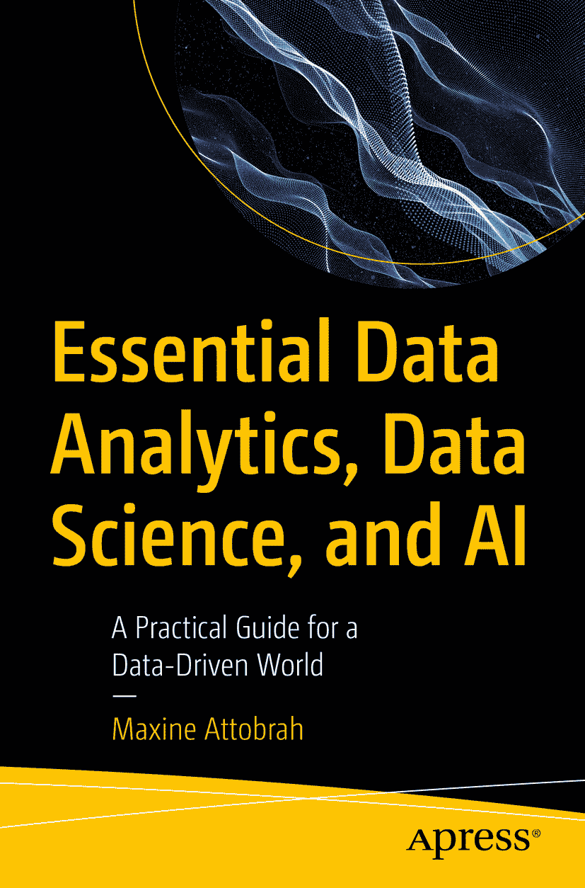

ISBN `979-8-8688-1069-5` e-ISBN `979-8-8688-1070-1` [`doi.org/10.1007/979-8-8688-1070-1`](https://doi.org/10.1007/979-8-8688-1070-1) © Maxine Attobrah 2024

本作品受版权保护。所有权利均由出版社独家授权并持有，涉及材料的全部或部分内容，具体包括翻译权、重印权、插图复用权、朗诵权、广播权、缩微胶片或其他物理形式复制权、传输或信息存储与检索权、电子改编权、计算机软件权，以及目前已知或未来开发的所有类似或不同方法的权利。本书中使用的一般描述性名称、注册商标、商标、服务标记等，即使在未有明确声明的情况下，也不意味着这些名称可豁免于相关保护性法律与法规，因此可自由通用。出版社、作者及编辑均认为，本书出版时提供的建议和信息是真实且准确的。对于书中内容可能存在的任何错误或疏漏，出版社、作者及编辑概不负责（无论明示或暗示）。出版社在已出版地图及机构归属的司法管辖权主张方面保持中立立场。

本 Apress 印次由 Springer Nature 旗下注册公司 APress Media, LLC 出版。注册公司地址为：1 New York Plaza, New York, NY 10004, U.S.A.

*献给我的家人、朋友和老师，感谢你们无尽的爱与支持，*
*献给我的父亲，在我相信自己之前，他就已相信了我，*
*献给我的母亲，感谢她始终为我祈祷，*
*献给上帝，指引我的脚步，赐予我坚持的力量，*
*以及所有怀揣梦想的人，愿你们的旅程通向美好的地方。*

## 序言

随着人工智能领域突破性创新的涌现以及随之而来的热潮，现在每个人都在谈论 AI——无论他们是否真的了解自己在说什么。这个话题之所以重要，是因为理解和运用数据的能力比以往任何时候都更为关键。然而，面对如此多的技术、术语和代码，探索 AI 常常令人望而生畏且不知所措。本书旨在打破这些障碍，为数据科学与机器学习世界提供一份平易近人且简明扼要的指南。

本书将带领读者逐步走完整个数据科学流程——从数据的获取、准备和处理，到执行探索性数据分析，再到训练和评估模型。尤为关键的是，本书并未止步于模型训练，还涵盖了至关重要的后续步骤：部署与监控模型，通过在线数据实验优化模型，以及处理关键考量因素，如安全性、可信度，以及如何让模型在真实世界场景中有效运作。

本书聚焦于真正重要的内容，避免用过多的代码让读者感到困扰，同时提供了大量示例和插图。书中反复讨论了多种实际应用案例以及其中涉及的决策过程。

对于任何希望穿透 AI 炒作迷雾、真正理解数据科学与机器学习的人来说，本书都是一本简明、实用且易于理解的伴侣——它将赋予你自信地驾驭这个快速变化的 AI 世界的能力。

Christian Kästner，卡内基梅隆大学计算机科学学院软件工程博士项目副教授兼主任

## 关于作者

## 关于技术审校