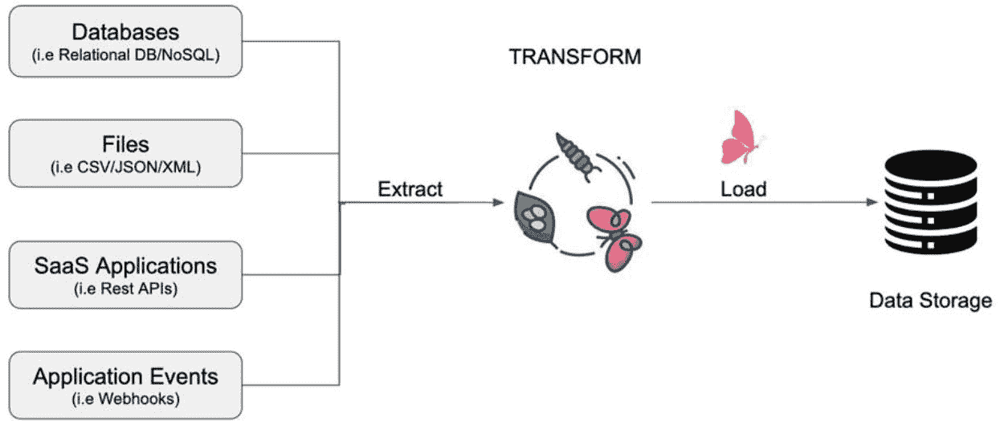
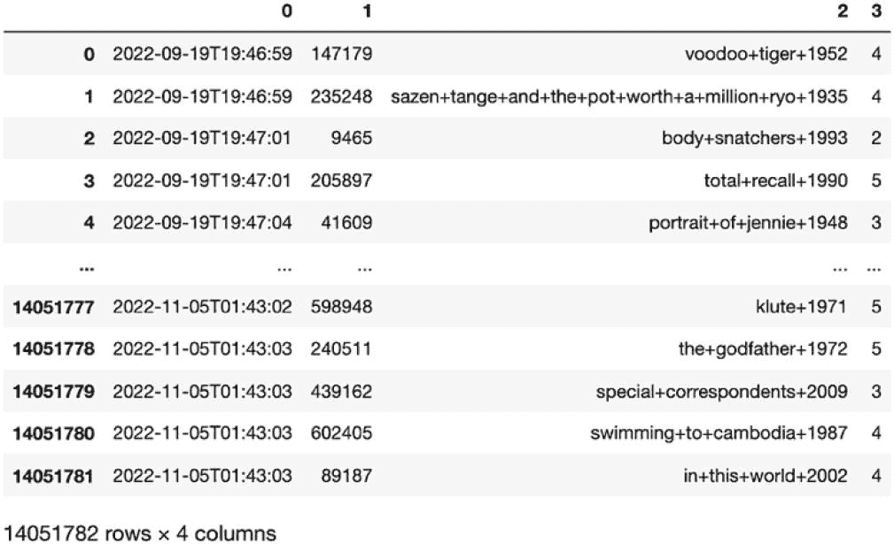
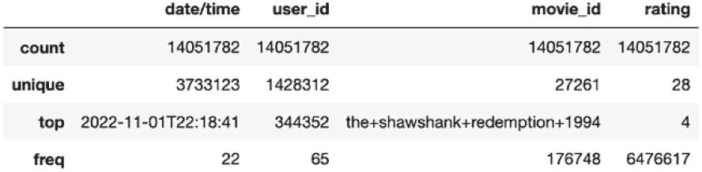
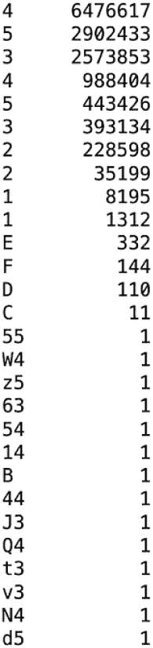
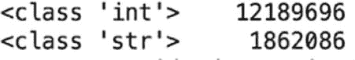
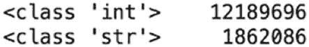
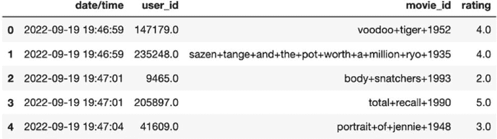
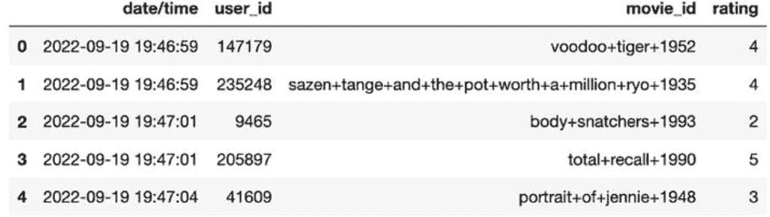

# 3. ETL 管道

确保机器学习模型的能力依赖于提供高质量的培训数据。预测的准确性和有效性直接取决于模型训练阶段所使用的数据集的质量。一个构建良好且经过精心整理的数据集是机器学习算法识别模式、掌握复杂关系并理解细微信息的基础。因此，由此产生的模型能更好地做出与数据内在复杂性一致的预测。

此外，高质量数据的重要性并不仅限于初始训练阶段。随着机器学习的演进并遇到新数据，持续预测的可靠性和相关性内在地与准确且有代表性的数据的持续可用性相关。维护一个健壮的数据基础设施可确保机器学习模型能够适应并响应环境变化，产生反映最新见解和模式的预测。

本质上，机器学习模型与高质量数据之间的共生关系，凸显了数据质量在这些智能系统的效能、适应性和持续成功中所扮演的关键角色。

## ETL 简介

ETL（提取、转换和加载）是创建高效机器学习算法的基础。ETL 是一个三步数据集成过程（如图 3-1 所示），其中数据从一个或多个数据源提取，经过转换（清洗、整理、格式化），然后加载到数据库中。



图 3-1

ETL 管道的示意图

市面上有多种具备友好用户界面的 ETL 工具可供选择，帮助你完成这些任务。不过，Python 也有许多开源 ETL 工具同样能胜任这些工作。其中，数据科学家社区中一个非常流行的工具是 `Pandas`。

在 ETL 的转换步骤中，探索性数据分析（EDA）和数据清洗是需要执行的重要任务，用于识别并移除诸如错误、损坏、重复或不一致的数据。

### ETL 的重要性

ETL 过程在确保数据（通常来自各种不同且不相关的源头）被统一成一致结构方面发挥着关键作用。随着企业从不同渠道、系统和应用积累信息，这些数据可能以不同的格式和结构存在。ETL 是一座桥梁，它将这种异构数据标准化，解决不一致性，并将其转换为标准格式。通过实施一致的结构，公司可以消除因不同数据源而产生的冗余、错误和差异。这种标准化不仅促进了无缝集成，还提高了整个组织内信息的可访问性。

此外，ETL 通过将来自不同部门或系统的信息整合到集中的数据仓库或数据库中，帮助企业打破数据孤岛。这种整合简化了数据检索和分析，提供了组织运营的全面统一视图。因此，不同部门的团队都依赖一个单一、可靠的信息源，从而促进协作并实现更高效的决策流程。

通过 ETL 过程获得的标准化和集中化数据，构成了数据驱动决策的基础。借助格式一致的整合数据集，企业能够提取有意义的见解、识别趋势并获得可操作的智能。这种新获得的清晰度使利益相关者能够依据准确、最新的信息做出明智的决策。从战略规划到运营调整，公司都能基于对数据的更深理解来调整其行动，从而培养一种基于证据决策的文化。

此外，ETL 便于进行历史数据追踪，使公司能够监控和评估其随时间推移的绩效。通过分析历史趋势和模式，企业可以识别需要改进的领域，评估战略举措的影响，并优化其运营。数据提取、转换和加载的持续循环不仅支持日常决策，也为长期业务优化奠定了基础，确保在不断变化的商业环境中保持适应性。本质上，ETL 使组织不仅能够理解其当前状态，还能在数据驱动的未来中发展和繁荣。以下是 ETL 带来的一些关键价值的总结：

*   **单一视角**

在当今的商业环境中，数据通常分散在各个系统和应用中，因此要全面了解你的业务是一项挑战。认识到 ETL 在数据集成中的重要性，可以使你利用 ETL，促进来自不同来源数据的整合和分析，从而对你的业务获得更全面的视图。

*   **流程自动化**

ETL 简化了重复性的数据处理任务，以提高分析效率。ETL 工具能够自动化数据迁移，并集成定期或按需的数据更新。这使得数据工程师能够将更少的时间花在数据移动和转换等日常任务上。

*   **数据治理**

数据治理关注数据的有效性、可访问性、一致性、完整性和安全性。ETL 通过在源系统和目标系统之间引入一个抽象层，从而在支持数据治理方面发挥作用，进而维护数据的安全性和血统。数据治理的重要性日益凸显，因为它促进了数据民主，提高了数据可访问性，并使所有利益相关者都能将其用于业务分析。

*   **可扩展性**

随着数据量和数据复杂性的增加，ETL 在数据集成中的重要性对于旨在保持竞争力的公司变得越来越关键。能够扩展 ETL 管道可确保海量数据的顺利提取、转换和加载。因此，公司能够有效处理不断增长的数据流入，而无需频繁升级系统，确保数据及时可用于分析和报告，并维持系统的功能性。可扩展性可以通过多种方法实现，包括分布式处理、并行处理、数据分区以及利用云解决方案。

*   **快速检索**

作为业务用户，高效地检索大量集成且精炼的数据，以支持决策制定。由于 ETL 工具在数据转换过程中处理了大部分工作，导入的数据在进入数据存储时已经是可用的格式。凭借清晰定义的视图，你的商业智能应用可以更快速地生成报告，因为在查询数据库时无需处理复杂的合并、连接记录或维护格式化标准问题。

*   **最大限度减少人为错误**

尽管付出努力，但手动管理数据会让你面临错误风险。数据处理早期阶段的一个小疏忽可能会导致重大后果。这是因为一个错误可能引发一连串更大的错误，形成恶性循环。认识到 ETL 解决方案的重要性后，许多组织已采用自动化来减少人工干预及相关的错误风险，确保提供高质量的数据。

*   **提升质量与统一性**

ETL 利用数据清洗和转换技术，帮助检测并纠正错误、不一致性及其他数据问题。这提升了决策所需的数据质量、可靠性、准确性和可信赖度。

## ETL 工具与技术

多年来，受数据源日益增长的复杂性和多样性，以及对高效数据集成解决方案日益增长的需求驱动，ETL 领域经历了一场显著的演进。最初，ETL 流程通常是定制编码的，这需要大量的开发工作和专业知识。然而，随着对更具可扩展性、用户友好性和适应性的解决方案的需求出现，各种专门的 ETL 工具进入了市场。

这些工具的功能差异很大，可满足不同的业务需求和技术要求。企业级 ETL 解决方案提供全面的特性和强大的支持，使其适用于大规模数据集成项目。这些工具通常具备高级功能，如数据质量管理和实时数据集成，以应对现代数据环境所带来的复杂挑战。

与此同时，开源 ETL 工具的兴起使数据集成领域更加大众化，提供了成本效益高的替代方案，并拥有强大的社区驱动开发模式。像 `Apache Kafka` 和 `Keboola` 这样的工具，体现了开源解决方案所带来的灵活性和定制可能性。这些工具不仅提供强大的 ETL 能力，还鼓励社区内的协作与创新。

此外，对定制化解决方案的需求催生了自定义 ETL 解决方案的开发，企业构建内部工具以精确满足其独特需求。当企业拥有现成工具无法轻易解决的特定数据集成需求或工作流时，这种方法尤其常见。虽然自定义解决方案提供了高度的定制性，但它们也需要持续的维护，并且可能缺少商业 ETL 工具中一些开箱即用的特性。

本质上，当今可用的各种 ETL 工具反映了数据集成领域的动态特性。无论企业选择企业级解决方案以获得全面支持，利用开源工具的协作力量，还是为专门需求开发自定义解决方案，不断演进的 ETL 工具生态系统都在帮助企业释放其数据的未来潜力方面持续发挥着关键作用。

### 企业级 ETL 软件

在广阔的数据集成领域，许多公司提供商业 ETL 软件，这些软件以其用户友好的图形用户界面而著称。这些 GUI 旨在简化设计和执行 ETL 管道的复杂性，提供直观的拖放界面，从而无需繁琐的编码。

这种可视化方法不仅使 ETL 流程大众化，让更广泛的专业人员能够积极参与，而且还增强了对整个工作流的理解。带有 GUI 的商业 ETL 工具通常配备预构建的连接器和转换，加速了管道开发，并便于快速适应不断变化的数据需求。

凭借诸如调度和监控等功能，这些工具简化了数据集成，有助于组织在管理多样且复杂的数据生态系统时提高整体效率。以下是企业级 ETL 解决方案的示例：

- `Informatica PowerCenter`

- `IBM InfoSphere DataStage`

- `Oracle Data Integrator`

### 开源 ETL

商业 ETL 软件通常价格不菲，对于寻求高级数据集成能力的组织来说是一项可观的投资。然而，相比之下，开源工具提供了成本效益高的替代方案，因为它们可以免费使用。这种可及性使得 ETL 能力的运用更加大众化，使得预算有限的企业也能受益于强大的数据集成工具。开源 ETL 工具的一个关键优势在于其固有的灵活性。具备编程专业知识的用户可以深入源代码，根据特定需求进行定制和调整。这种适应性对于具有独特数据处理需求的组织尤其有利，因为它使他们能够根据其数据环境的复杂性来微调 ETL 流程。源代码的开放性促进了协作社区的形成，鼓励知识共享和创新，用户可以为工具特性和功能的增强做出贡献。总的来说，开源 ETL 工具的可用性和适应性不仅减轻了财务限制，还使用户能够更好地控制其数据集成工作流的定制和优化。以下是开源 ETL 解决方案的示例：

- `Keboola`

- `Talend Open Studio for Data Integration`

- `Apache Kafka`

### 自定义 ETL

对于那些在其数据集成流程中寻求无与伦比的灵活性的人来说，创建专门满足特定需求的自定义 ETL 工具的想法变得颇具吸引力。利用像 `Python` 这样的编程语言，个人和组织可以着手创建与自身独特需求精确契合的定制解决方案。这种方法虽然提供了最大的适应性，但需要投入大量的精力。构建一个自定义 ETL 工具不仅包括初始编码，还包括创建全面的文档，以确保未来的用户和开发人员能够清晰理解并使用。责任并不止于初始开发；持续的维护对于应对不断变化的数据环境和需求至关重要。严格的测试对于保证工具的可靠性、可扩展性和性能变得不可或缺。尽管需要付出努力，但创建自定义 ETL 工具提供了无与伦比的控制和定制水平，允许以与组织数据生态系统的目标和复杂性精确一致的方式进行无缝数据集成。以下是可以用来创建自定义 ETL 解决方案的编程语言示例：

- `SQL`

- `Spark`

- `Python`

### ETL 云服务工具

云服务（如 `Amazon Web Services (AWS)`、`Azure` 或 `Google Cloud Platform (GCP)`）内的数据，都附带了这些平台原生内置的强大且集成的 ETL 工具。这些基于云的 ETL 解决方案提供了在云环境中处理数据工作流的无缝且全面的方法。例如，在 `AWS` 中，像 `AWS Glue` 这样的服务使用户能够高效地提取、转换和加载数据，不仅提供了可扩展的无服务器架构，还提供了自动化的数据发现和模式演化。`Azure` 的 ETL 产品，包括 `Azure Data Factory`，简化了跨各种服务的数据移动，为分析、报告和机器学习等不同场景创建数据管道提供了便利。类似地，`GCP` 提供了像 `Cloud Dataflow` 这样的工具，提供了使用 `Apache Beam` 进行 ETL 处理的完全托管服务，支持并行数据处理扩展。利用这些云服务内部的集成 ETL 工具，可以简化数据工作流的编排，优化性能，并利用云计算环境固有的弹性可扩展性，最终促成更高效、更精简的数据管理流程。以下是云 ETL 解决方案的示例：

- `AWS Glue`

- `Azure Data Factory`

- `Google Cloud Dataflow`

### 带代码的示例

下面的示例将使用 `Python` 完成。要跟着操作，你可以使用像 `Jupyter Notebooks`、`Google Colab`，甚至 `Visual Studio Code` 这样的软件应用程序，它们都是免费的。

`Pyjanitor` 是一个用于清理数据集的 `Python` 开源工具。这个工具的优势在于它为常见的 `Pandas` 程序提供了一个更易读、基于动词的方法链 API。这有助于使编写代码更清晰、更容易记忆。

#### 安装

通过运行以下命令安装 `pyjanitor`：

```
!pip3 install pyjanitor==0.28.1
!pip3 install pandas==2.2.2
```

#### 实现

1. 导入所需库。

我们将导入 `pandas` 来提取数据并帮助进行数据分析。`Pyjanitor` 用于清理数据。

```
import pandas as pd
import janitor
```

2. 提取。

在此示例中，目标是为电影推荐系统的机器学习模型提供高质量数据，以便它能预测给用户的相关推荐。可以使用多种类型的信息。然而，为了简化此示例，我们将仅使用包含我们系统中现有用户对电影评分的数据。这些数据位于一个名为 `ratings.csv` 的 CSV 文件中。

我们将从 CSV 文件中提取数据，并将其放入一个 `pandas` `DataFrame` 中，以便使用 `pyjanitor` 开始转换过程。

```
rating_data = pd.read_csv("ratings.csv", skipinitialspace = True, header = None)
```

我们的初始数据包含来自用户在不同时间对不同电影的 14,051,752 条评分，如图 [3-2] 所示。



图 3-2

初始电影评分图像

```
rating_data
```

3. 转换。

现在让我们对数据进行一些分析和清理。

首先，我们将使用 `pyjanitor` 的 `rename_column` 函数更改列名，使其更易于阅读。`Pyjanitor.rename_column()` 一次只能更改一列，因此我们将使用方法链来更改所有四列。

```
rating_data = (rating_data
.rename_column(0, 'date/time')
.rename_column(1, 'user_id')
.rename_column(2, 'movie_id')
.rename_column(3, 'rating'))
```

我们预期评分是 1 到 5 之间的整数。然而，通过初步分析，我们发现数据中有 28 个唯一的评分值，如图 [3-3] 中最后一列的第二行所示。



图 3-3

数据列摘要图像

```
rating_data.describe()
```

进一步分析显示，文件中混合了字符串和整数，如图 [3-4] 所示。例如，`5` 既作为数字输入，也作为文本输入。此文件中明显存在一些损坏数据，应予以删除。


图 3-4

唯一评分值图像

```
rating_data["rating"].unique()
```

在图 [3-5] 中，我们看到不同评分值出现的次数。评分为 `E` 的出现了 332 次。



图 3-5

数据中评分出现次数图像

进一步分析显示，`user_id` 列混合了整数和文本，如图 [3-7] 所示。我们预期 `user_id` 仅为整数。我们还希望每条评分输入的日期和时间采用日期时间格式，而不是文本格式，如图 [3-6] 所示。


图 3-6

数据日期时间的摘要类型

```
rating_data["date/time"].apply(type).value_counts()
```



图 3-7

用户 ID 数据摘要类型

```
rating_data["user_id"].apply(type).value_counts()
```


图 3-8

电影 ID 数据摘要类型

```
rating_data["movie_id"].apply(type).value_counts()
```



图 3-9

评分数据摘要类型

```
rating_data["rating"].apply(type).value_counts()
```

`user_id` 和 `rating` 列需要转换为整数。我们可以使用 `pyjanitor.change_type()` 函数来实现。我们还将把日期和时间的格式从字符串更改为日期时间格式。任何无法转换的内容将变为 `NaN`，并会从文件中删除。

所有这些步骤将使用方法链完成。

```
rating_data = (rating_data
.change_type("rating", dtype=int, ignore_exception="fillna")
.change_type("user_id", dtype=int, ignore_exception="fillna")
.to_datetime("date/time", format=" ISO8601", errors="coerce")
.dropna()
.reset_index(drop = True))
```

让我们看看完成上述步骤后评分列中的值。像 `E`、`F`、`G` 和 `Q4` 这样的评分已从我们的数据中删除。像 `1` 这样的评分则增加了。最初我们有数字版本的 `1` 出现了 8195 次，文本版本出现了 1312 次。现在只有一个版本，出现了 9507 次。这表明我们能够将文本转换为数字。任何不是数字的内容，如 `E` 或 `Q4`，都被删除了。

让我们查看数据的前五行（图 [3-10]），看看其他列是如何重新格式化的。`Rating` 和 `user_id` 被转换为数字，`date/time` 被转换为日期时间格式。



图 3-10

电影推荐数据图像

```
rating_data.head(5)
```

你可能注意到 `user_id` 和 `rating` 现在是小数值（即浮点数），而不是整数。这是因为在前面的步骤中将文本转换成整数时，`NaN`值没有对应的整数版本，导致整个列的数据都变成了浮点数。这与 `pandas.to_numeric()` 函数的工作方式类似。

要修复这两个列，我们可以再次使用 `change_type` 和方法链。

```
rating_data = (rating_data
    .change_type("rating", dtype=int, ignore_exception="fillna")
    .change_type("user_id", dtype=int, ignore_exception="fillna")
    .dropna()
    .reset_index(drop = True))
```

现在，如果我们查看前五行（图 [3-11]），可以看到 `user_id` 和 `rating` 列中的数据现在是整数格式。



```
rating_data.head(5)
```

### 加载

这会将转换后的数据导出到一个新的 `.csv` 文件中，该文件可用于机器学习算法。

```
rating_data.to_csv("clean_rating_data.csv")
```

### 案例研究与实际应用

## 零售分析

场景：某零售公司希望分析销售数据，以优化库存并提升整体业务绩效。

ETL 流程：从多种来源（销售点系统、在线平台）提取销售数据，通过清洗和标准化格式进行转换，然后加载到集中式数据仓库中。

成果：公司现在能够执行高级分析，例如预测需求趋势、识别热销产品以及优化库存水平。

### 医疗数据整合

场景：某医疗机构旨在通过整合电子健康记录（`EHR`）、化验结果和患者反馈数据来提升患者护理质量。

ETL 流程：从不同系统提取数据，通过确保数据一致性和隐私合规性进行转换，然后加载到统一数据库中。

成果：使医疗专业人员能够访问全面的患者病史，从而提升诊断准确性和个性化治疗方案。

## 社交媒体

场景：某社交媒体分析公司希望分析舆情趋势，帮助企业了解客户对其产品或服务的看法。

ETL 流程：从社交媒体平台提取数据，通过应用自然语言处理（`NLP`）技术分析情感倾向进行转换，然后将结果加载到数据存储中以供报告使用。

成果：企业能够深入了解客户满意度，识别改进领域，并据此调整营销策略。

## 金融交易欺诈检测

场景：某金融机构希望实时检测欺诈活动，以保障交易安全并保护客户利益。

ETL 流程：从多种渠道提取交易数据，通过应用异常检测算法进行转换，然后将标记的交易加载到欺诈监控系统中。

成果：有助于防范欺诈交易，减少经济损失，并维护客户信任。

## 智能家居自动化

场景：某物联网（IoT）领域的公司旨在创建一个智能家居平台，该平台能够学习用户行为并相应地调整家居自动化设置。

ETL 流程：从各种传感器和设备提取数据，通过识别使用模式进行转换，然后将洞察结果加载到中央系统中以控制家居设备自动化。

成果：用户可根据自身习惯体验个性化且自动化的家居环境，从而优化能源消耗并提升便利性。

## 结论

总之，数据的获取与管理是数据分析、数据科学和人工智能领域成功的关键基础。从探索各类数据源到利用 ETL 工具的强大功能，本章着重强调了制定稳健策略以获取真实世界数据和合成数据的重要性。无论是使用界面友好的商业 ETL 软件、利用开源工具实现经济高效的灵活性，还是涉足定制化 ETL 解决方案的领域，从业者都有多种选择来满足自身特定需求。此外，集成内置 ETL 工具的云服务进一步提升了数据工作流的效率。在我们应对不断变化的数据格局时，本章揭示了多样化的途径和可用的工具，使读者能够自信、富有创造力地以战略性的方式驾驭数据领域，迎接数据驱动事业所带来的独特挑战与机遇。


