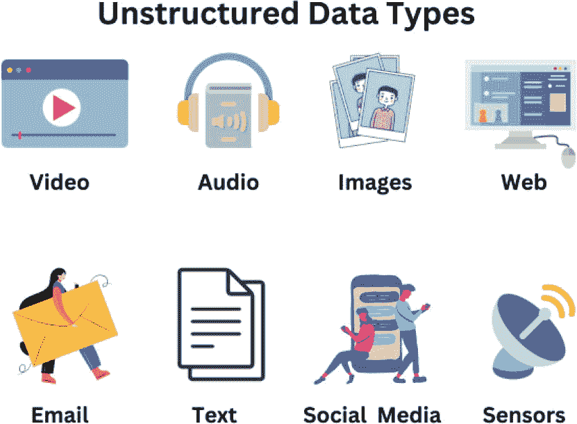
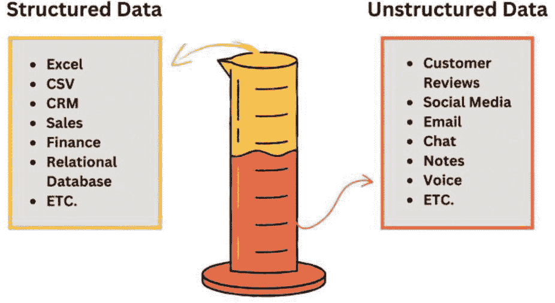
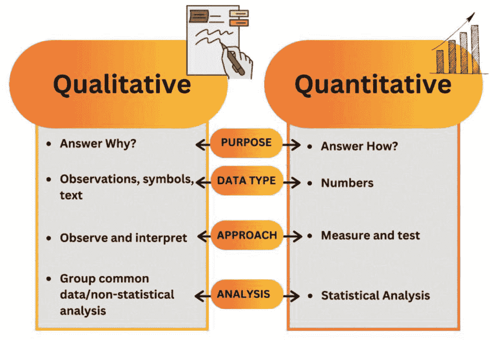
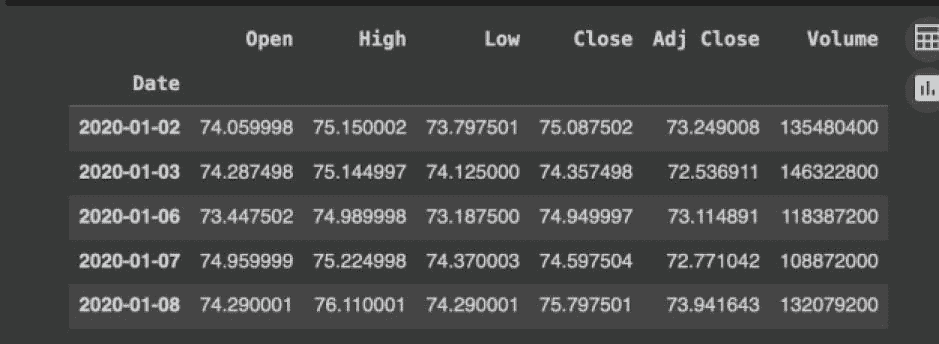
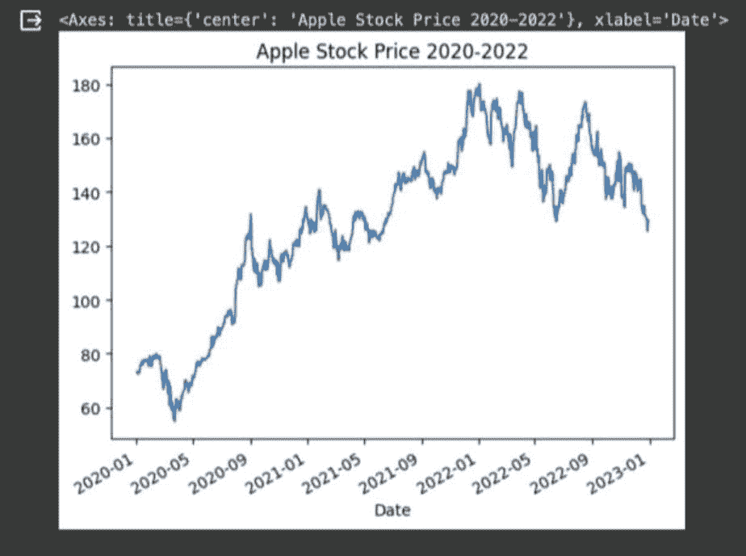
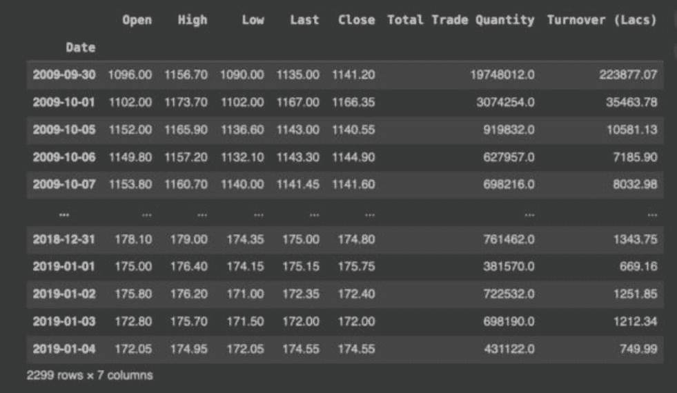
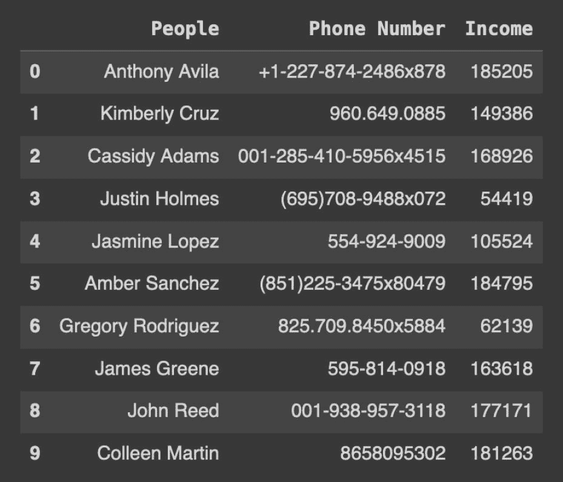

# 获取数据

数据是数据分析、数据科学和人工智能中最基本的工具之一。数据可以通过多种不同的方式呈现给你。大多数数据都是杂乱无章的，需要在使用前进行清理。

本章将深入探讨数据的多元化世界，揭示其各种类型，并探索获取数据的多种途径。我们将剖析从网络提取数据的复杂性，熟悉公共数据集这个“宝库”，并揭开应用程序编程接口（API）的神秘面纱。我们还将涉及通过调查和问卷收集数据这一传统而又至关重要的方法。最后，我们将讨论数据收集中的伦理和责任。

## 理解不同类型的数据

让我们讨论不同类型数据之间的关键区别，以便在你的项目中有效指导数据的收集与分析过程。

### 结构化数据

结构化数据是经过组织的数据，人和机器都能轻松读取。这类数据通常存在于你常见的工具中，如电子表格和关系型数据库。数据被分配了列，每一行代表该数据的一个实例。这类数据通常被称为表格数据。表格数据以包含行和列的表的形式组织。

结构化数据的优点在于，可以通过各种工具和技术轻松地搜索和分析它。而且，任何人即使没有特殊工具也能更容易地阅读它。这类数据非常适合商业智能、数据分析和人工智能应用。

## 非结构化数据

非结构化数据是指没有特定格式或结构的数据。现实世界中的大多数数据都处于这种形式。非结构化数据包括发票、图像、音频、视频和电子邮件。这类数据的一些示例可见于图 2-1。



图 2-1 — 非结构化数据示例图片

结构化数据与非结构化数据之间的区别在于对其所能进行的分析类型。结构化数据采用严格的格式，确保了数据的一致性。相比之下，非结构化数据则不具有一致性。图 2-2 直观地展示了这两种数据类型之间的差异。



图 2-2 — 结构化数据与非结构化数据对比示例图片

### 定量数据

定量数据是指具有数值属性的任何数据。这类数据可以被计数或测量。你可以利用这种类型的数据来回答诸如“有多少”、“多少量”或“多频繁”之类的问题。

### 定性数据

定性数据是无法用数字进行计数、测量或表达的信息。你可以利用它来回答诸如“为什么”、“如何”或“发生了什么”之类的问题。

在图 2-3 中，我提供了一些思考定性数据与定量数据差异的方式。



图 2-3 — 如何理解定性数据与定量数据的示例图片

### 时间序列数据

时间序列数据是在不同时间段收集的数据。这种类型的数据有助于理解趋势和季节性。趋势显示了数据的方向，揭示数据在特定时期内是增长、下降还是保持不变。例如，电子商务趋势显示了过去一年销售额的增长或下降，这可以帮助你为下一个财年做出调整。季节性则显示了定期出现的模式——例如，周六香草冰淇淋销售额的激增。

### 截面数据

截面数据是在某个单一时间点收集的数据。这种类型的数据有助于理解特定时刻不同项目之间的关系。


### 空间数据

空间数据或地理空间数据是指引用地球上特定位置的数据。例如，你能在数据的每一行中看到经纬度。这类数据通常使用地理信息系统（GIS）进行分析，常用的软件工具是 ArcGIS。

## 获取数据的方法

让我们探索各种收集数据的方法，从传统调查、网络爬取，甚至访问提供可下载数据集的流行网站，来为你的分析提供素材。

### 网络爬取：从网页中提取数据

简单来说，网络爬取就是从网站提取内容的过程。你可以从网站上复制/粘贴数据。然而，取决于你想要获取的数据量，这个过程可能会非常繁琐。通过使用编程语言等工具，你可以将时间从几小时缩短到几秒钟，还能再给自己续杯咖啡来度过工作日。注意，不要侵犯个人或公司的版权。

### API：应用程序编程接口

API 是两个或多个软件之间进行通信的一种方式，无需了解应用程序内部的所有细节。它作为处理数据传输的中间层，能够节省开发者的时间，并促进不同应用程序之间的协作。API 附带有文档，可视为代表双方协议的契约。它会告诉你，如果甲方以预定义的方式发送远程请求，那么甲方可以预期从乙方得到特定的输出。这使得公司能够与第三方开发者和商业伙伴共享其数据和功能。这就像在餐厅按照特定菜单点餐：你点某个特定菜品，就期望能收到它，而无需知道它是如何制作出来的。

### 问卷调查与调查

问卷是用于向个人或群体提问的书面问题集。调查是一种研究方法，它使用问卷来帮助人们通过评估数据和得出结论来了解全局。你可以使用 Google Forms 和 Typeform 等工具来创建调查。

## 热门网站与数据集

我有几个最喜欢的网站愿意与你分享，你可以用它们来获取数据。这些网站可以作为获取所需数据的宝贵资源。在数据分析、数据科学和人工智能的广阔领域中，数据集的可用性对于有意义的分析和模型开发至关重要。以下网站提供了访问各种数据集的途径，涵盖不同领域和兴趣。

## Kaggle

Kaggle 是一个面向数据科学和机器学习爱好者的在线平台。它由 Anthony Goldbloom 和 Jeremy Howard 于 2010 年创立，并于 2017 年被谷歌收购。该平台的用户可以与其他用户协作、上传数据集，并相互竞争以解决数据科学挑战。Kaggle 是获取免费数据集和练习技能的好地方。来自全球各地、背景各异的用户在这个平台上单独或共同学习并挑战自我。

在本章中，我多次提到表格数据。然而，在像 Kaggle 这样的平台上，你可以找到各种类型的数据——例如，图像。

面部表情识别 2013（FER2013）数据集包含 35,887 张 48x48 的灰度图像。其中有七种情绪：愤怒、厌恶、恐惧、快乐、悲伤、惊讶和中性。这可用于人工智能中执行情绪检测等任务。图 2-4 展示了该数据集中部分图像类型的示例。


图 2-4 FER2013 中随机选取的面部表情图像

## Hugging Face

Hugging Face 是另一个面向数据科学和机器学习爱好者的在线平台。Kaggle 和 Hugging Face 之间的一个显著区别是，这里没有竞赛。它为成员提供了查找数据集以及发现、训练和部署模型的方法。它由 Clement Delangue、Julien Chaumond 和 Thomas Wolf 于 2016 年创立。

### 带代码的示例

我接下来会提及的网站都附带使用 Python 的示例。你可以使用 Jupyter Notebooks、Google Colab 甚至 Visual Studio Code 等软件应用程序来跟着操作，这些软件都是免费的。

## Jupyter Notebook

Jupyter Notebook 是一个交互式网络应用程序，可用于共享代码、方程式和可视化内容。它支持多种语言，包括 R、Python 和 Scala。Notebook 通常以 `.ipynb` 格式保存，但也可以转换为 `.py` 等格式。数据科学家使用它进行数据探索、机器学习建模和实验。

## Google Colab

Google Colab 是一个托管在云端的免费 Jupyter Notebook 环境。如果你已经有 Google 账户，则无需设置。在下面的示例中，我将使用 Google Colab。

## Visual Studio Code

Visual Studio Code 是另一种可用于相同任务的应用程序。它更常见，因为你可以用它来完成其他软件工程任务。

## 热门网站与数据集

### Yahoo Finance

雅虎自 1994 年以来就一直存在，所以我假设我们都知道它是什么。该公司创建了一个 API，可以让你免费访问大量数据。你可以获取实时和历史金融数据。这些数据可以是货币、股票、债券、加密货币、市场分析，甚至新闻！

我将向你演示如何使用一个名为 `yfinance` 的流行 Python 包来使用它。

首先，我们将安装 Python 包 `yfinance`。

```
!pip3 install yfinance
```

接下来，我们将导入获取数据所需的必要库。我们需要导入 `yfinance`。为了编写代码更简单快捷，我们会将其导入为 `yf`。

```
import yfinance as yf
```

在这个示例中，我们将关注苹果股票。我们下载从 2020 年 1 月 1 日到 2022 年 12 月 31 日的股票数据。然后，我们将这些数据保存在 `apple_data` 中，并在后续步骤中使用它。

```
apple_data = yf.download("AAPL",
start = "2020-01-01",
end = "2022 – 12 -31")
```

可以想象，两年内的数据很多，因此通过调用 `.head()`，你可以看到数据的前五行，如图 2-5 所示。



图 2-5 数据的前五行

```
apple_data.head()
```

现在，我们可以绘制这些数据以查看任何趋势或模式。在这个示例中，我们将查看图 2-5 中 `Adj Close` 列的调整收盘价。



图 2-6 股票价格图输出

```
apple_data["Adj Close"].plot(title = "Apple Stock Price 2020 -2022")
```


### `Quandl`

`Quandl` 是一个为用户提供金融和替代数据集的平台。替代数据集包括券商研报和公司申报文件等数据。它由 Tammer Kamel 于 2011 年创立，并于 2017 年被纳斯达克收购。用户可使用超过 2000 万个数据集，其中部分免费，部分需付费。你可以通过两种方式下载数据：一种是以时间序列形式，另一种是通过表格。下面，我将演示如何检索数据。这次，我们将使用 API 来获取数据。要获取 API 密钥，你需要在 [`https://data.nasdaq.com/`](https://data.nasdaq.com/) 创建一个账户。

首先，我们将安装 Python 包 `Nasdaq Data Link`。

```
!pip3 install nasdaq-data-link
```

接下来，我们将导入必要的库来获取数据。我们只需要导入 `Nasdaq data link`。

```
import nasdaqdatalink
```

最后，我们将获取 `NSE/OIL` 的所有数据，并使用我们的 API 密钥输出。如图 2-7 所示，我们可以访问从 2009 年 9 月 30 日到 2019 年 1 月 4 日的石油数据。



图 2-7

`NSE/OIL` 提供的可用数据列表

```
nasdaqdatalink.get("NSE/OIL", api_key = "YOUR_API_KEY")
```

## 合成数据

合成数据模仿现实世界中的数据。它通常在真实数据因成本高昂或包含敏感信息而难以获取时创建。这类数据可以通过不泄露个人身份信息来缓解企业对数据隐私的担忧。客户信息泄露可能引发诉讼并影响品牌声誉，损害公司的利润。根据情况，生成合成数据有助于加快产品测试和原型开发的速度。合成数据生成是自动化或手动创建这些虚假数据的过程。这些数据可以使用 Excel 手动创建，或使用 Python 等工具通过计算机算法生成。

数据集可以是完全合成的，也可以是部分合成的。当数据集是完全合成时，它与现实世界毫无关联。然而，当数据是部分合成时，只有部分数据是假的。例如，在一个关于 2013 年至 2023 年购房情况的电子表格中，可能只有姓名、地址和电话号码会填入虚假数据。

有时也会遇到数据不足的情况。机器学习模型，尤其是深度学习模型，需要海量数据进行训练。在缺乏所需数据时，可能有必要使用合成数据扩充数据集。

尽管这类数据很有用，但应仅在必要时使用。你正在构建的东西最终会处理现实世界的事件，因此如果你能获取真实数据，就应该使用它。

让我们快速演示一个使用 Python 生成合成数据的例子。在此示例中，我将创建虚构的收入数据。

首先，我们将安装 Python 包 `Faker`。`Faker` 是一个可以生成姓名、地址、电话号码、电子邮件地址等信息的 Python 库！

```
!pip3 install faker
```

接下来，我们将导入创建样本数据所需的库。如前所述，`Faker` 生成虚假数据。`Pandas` 是一个帮助我们组织和清洗数据的库。我们将其导入为 `pd`，以使代码编写更简单快捷。`Random` 是一个生成随机数的库。我们需要它来生成随机收入。

```
from faker import Faker
import pandas as pd
import random
```

`Faker` 可以生成多种语言的数据。我特意添加了 `en_US`，以确保生成的信息与美国相关。这将使电话号码和人名的格式为美国人所熟知。

```
fake_data = Faker("en_US")
```

现在，我们将生成数据。我们将创建三个列表。`people` 列表将包含随机姓名，`phonenumbers` 列表将包含随机电话号码，`incomes` 列表将包含随机收入。

```
people = []
phonenumbers = []
incomes = []
```

在此示例中，我们将通过生成一个循环来创建一个包含十人、收入各异的列表。

```
for i in range(10):
    person_name = fake_data.name()
    phone_number = fake_data.phone_number()
    income = random.randrange(40000, 200000)
    people.append(person_name)
    phonenumbers.append(phone_number)
    incomes.append(income)
```

最后，我们将数据放入一个结构化格式中，以便读取，方法是将数据放入 `DataFrame`。`DataFrame` 将数据组织成一个类似电子表格的表格，包含行和列。

```
sample_data = pd.DataFrame()
sample_data["People"] = people
sample_data["Phone Number"] = phonenumbers
sample_data["Income"] = incomes
```

以下是数据输出的示例。如图 2-8 所示，数据以类似电子表格的结构化形式呈现。



图 2-8

`DataFrame` 中合成数据的输出

你也可以将 `DataFrame` 转换为实际的电子表格。下面，我使用 `.to_csv` 将 `DataFrame` 转换为 CSV 文件。

```
sample_data.to_csv("synthetic_data.csv", index = False)
```

### 遥测数据

遥测数据是指从设备或应用程序实时采集的原始数据。遥测数据的例子包括来自航天器的监测数据、来自汽车以获取车速的传感器数据，以及用户在移动/网络应用上的活动数据。

由于这些数据是原始的，我们需要以一种便于后续分析的方式对数据进行清洗和结构化处理。我们将在下一章讨论实现这一目标的方法。清洗完成后，这些数据可以显示在仪表盘上，用于监控设备或应用程序在生产环境中的运行状况。这些数据也可以反馈回系统，以随着时间的推移进一步改进系统。

## 案例研究与实际应用示例

让我们深入探讨一些例子，展示不同的数据收集方法（包括使用真实数据和合成数据）如何在各个行业中得以应用。

### 获取真实世界数据

让我们探索一些获取真实世界数据的实际例子，以理解如何利用这些数据进行分析并为决策提供信息。

#### 零售销售预测

场景：一家零售连锁企业旨在改进库存管理和销售预测。

数据收集方法：该公司收集历史销售数据、客户交易记录以及经济指标和天气模式等外部因素。

成果：通过分析这些数据，零售商可以预测未来的销售趋势，优化库存水平，并更有效地规划营销活动。

## 金融欺诈检测

场景：一家银行希望增强其欺诈检测系统以保护客户。

数据收集方法：实时收集包含用户行为、位置和交易记录在内的交易数据。

成果：通过分析数据中的模式，银行可以识别异常、检测潜在欺诈，并加强安全措施，以在未来保障客户账户的安全。

## 供应链优化

场景：一家制造公司希望优化其供应链，使其更具效率和成本效益。

数据收集方法：从供应商、生产线和分销网络收集数据。

成果：通过分析数据，公司可以识别任何瓶颈，缩短接到订单后的交付时间，并提升整体供应链绩效。


### 获取合成数据

我们来探讨一些生成合成数据以补充和增强真实世界数据集的实践案例。

#### 在医疗领域保护隐私

**场景**：研究人员需要在确保患者隐私的前提下共享医疗数据以进行合作研究。

**使用合成数据的理由**：不共享真实的患者记录，而是生成合成数据来模拟逼真的患者数据，以保护个人隐私。

**结果**：研究人员可以在合作分析中使用合成数据，同时维护患者的机密性并遵守隐私法规。

#### 图像识别

**场景**：一家公司正在开发图像识别模型，但缺乏足够多样化的数据集。

**使用合成数据的理由**：为了增强他们现有的真实数据集，生成合成图像以模拟光照条件、角度和背景的变化。

**结果**：在真实数据与合成数据组合上训练的模型表现出更优的性能，并且对未见过的全新场景具有更好的泛化能力。

## 伦理与责任

在本章中，我向你展示了获取数据的各种方法。然而，以合乎伦理且负责任的方式获取数据至关重要。你应当始终遵守数据保护法规，考虑所有隐私问题，并在可能时获得用户同意。以下是需要注意的几项法律。

### CCPA：加州消费者隐私法案

CCPA 是一项法律，允许加州任何居民查看公司所保存的关于他们的所有信息。居民还可以看到与哪些第三方共享了他们的数据清单。如果隐私准则遭到违反，该法律还允许居民起诉公司，即使公司尚未遭到黑客攻击。公司无需位于美国境内才会受到影响。年收入至少 2500 万美元、拥有至少 5 万用户、或有一半销售额来自出售用户数据的公司均受此法律约束。

### GDPR：通用数据保护条例

GDPR 是一项法律，规定了如何处理和传输欧盟 (EU) 内个人的个人数据。在欧盟任何国家内收集或从这些国家传输的所有数据均受其影响。如果违反该法律，罚款非常高。你将需要支付 2000 万欧元或全球年收入 4% 两者中的较高者。

### HIPAA：健康保险流通与责任法案

HIPAA 是一项联邦法律，旨在保护敏感的健康信息，防止其在未经同意或不知情的情况下被披露。这涵盖了任何形式或媒介中的所有可识别个人身份的健康信息。

## 使用数据集卡片增强透明度与理解

数据集卡片（也称为数据卡片）是记录和了解数据集特征的重要工具。它们提供了一种结构化格式来捕捉数据集的关键信息，使人们更容易评估其对于各种用例的适用性。数据集卡片是一份简洁的摘要，提供关于数据集的详细信息，包括其能力、局限性和预期用途。它通常包括但不限于以下关键部分：

*   **摘要**：对数据集、其目的以及其支持的任务（例如，摘要等）的简要概述。
*   **语言**：数据集中所包含语言的信息（例如，英语、法语等）。
*   **结构**：关于数据如何结构化概述，包括数据字段的示例和描述。
*   **创建**：关于数据集如何被整理和收集的信息。
*   **源数据**：关于原始数据来源的详细信息，包括收集方法和来源。
*   **注意事项**：使用数据的伦理和社会影响、偏差、已知局限性以及潜在风险。

### 为什么数据集卡片很重要？

数据集卡片通过提供清晰的文档来增强透明度，帮助人们理解他们正在处理的数据。通过包含数据集卡片，你可以确保数据被恰当使用，并节省人们大量理解如何使用数据的时间。数据集卡片对于任何参与数据分析、数据科学和机器学习的人都很有价值。它提供了一种标准化方式来传达重要信息。我鼓励大家在共享数据时创建数据集卡片。像 Hugging Face 和 Kaggle 这样的网站通常都包含此类文档。

## 结论

总而言之，显而易见，数据是数据分析、数据科学和人工智能的基础支柱。我们探讨了多种多样的数据类型以及各种获取方法，从网络抓取、访问公共数据集、利用 API 的力量，到创建你自己的数据。

理解数据、其类型以及如何获取数据，构成了你旅程中至关重要的第一步。你在本章中获得的知识和技能为你进一步探索数据分析、数据科学和人工智能世界的激动人心的冒险奠定了基础。

我们强调了伦理考量的重要性，这提醒我们，负责任的数据收集和使用是不容商榷的。重要要记住，数据的格局是不断演变的，因此，在你的数据实践中保持好奇心、恪守伦理并勤勉不懈，将确保你始终处于这个充满活力领域的前沿。拥抱复杂性，庆祝数据的多样性，让你对发现的热情引导你穿越数据分析、数据科学和人工智能错综复杂的织锦。

当你进入下一章时，请带着你已获得的见解和理解，准备好在实际的真实世界场景中应用它们。数据的世界广阔无边，充满潜力——有了知识、好奇心以及强烈的伦理指南针，你现在已准备好自信地航行。

