# 3. ETL 管道

确保机器学习模型的能力依赖于提供高质量的培训数据。预测的准确性和有效性直接取决于模型训练阶段所使用的数据集的质量。一个构建良好且经过精心整理的数据集是机器学习算法识别模式、掌握复杂关系并理解细微信息的基础。因此，由此产生的模型能更好地做出与数据内在复杂性一致的预测。

此外，高质量数据的重要性并不仅限于初始训练阶段。随着机器学习的演进并遇到新数据，持续预测的可靠性和相关性内在地与准确且有代表性的数据的持续可用性相关。维护一个健壮的数据基础设施可确保机器学习模型能够适应并响应环境变化，产生反映最新见解和模式的预测。

本质上，机器学习模型与高质量数据之间的共生关系，凸显了数据质量在这些智能系统的效能、适应性和持续成功中所扮演的关键角色。

## ETL 简介

ETL（提取、转换和加载）是创建高效机器学习算法的基础。ETL 是一个三步数据集成过程（如图 3-1 所示），其中数据从一个或多个数据源提取，经过转换（清洗、整理、格式化），然后加载到数据库中。

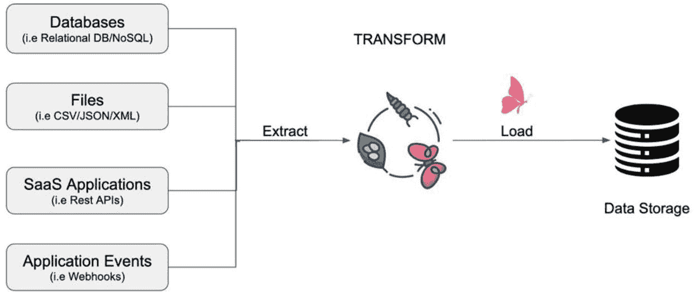

图 3-1

ETL 管道的示意图

市面上有多种具备友好用户界面的 ETL 工具可供选择，帮助你完成这些任务。不过，Python 也有许多开源 ETL 工具同样能胜任这些工作。其中，数据科学家社区中一个非常流行的工具是 `Pandas`。

在 ETL 的转换步骤中，探索性数据分析（EDA）和数据清洗是需要执行的重要任务，用于识别并移除诸如错误、损坏、重复或不一致的数据。

### ETL 的重要性

ETL 过程在确保数据（通常来自各种不同且不相关的源头）被统一成一致结构方面发挥着关键作用。随着企业从不同渠道、系统和应用积累信息，这些数据可能以不同的格式和结构存在。ETL 是一座桥梁，它将这种异构数据标准化，解决不一致性，并将其转换为标准格式。通过实施一致的结构，公司可以消除因不同数据源而产生的冗余、错误和差异。这种标准化不仅促进了无缝集成，还提高了整个组织内信息的可访问性。

此外，ETL 通过将来自不同部门或系统的信息整合到集中的数据仓库或数据库中，帮助企业打破数据孤岛。这种整合简化了数据检索和分析，提供了组织运营的全面统一视图。因此，不同部门的团队都依赖一个单一、可靠的信息源，从而促进协作并实现更高效的决策流程。

通过 ETL 过程获得的标准化和集中化数据，构成了数据驱动决策的基础。借助格式一致的整合数据集，企业能够提取有意义的见解、识别趋势并获得可操作的智能。这种新获得的清晰度使利益相关者能够依据准确、最新的信息做出明智的决策。从战略规划到运营调整，公司都能基于对数据的更深理解来调整其行动，从而培养一种基于证据决策的文化。

此外，ETL 便于进行历史数据追踪，使公司能够监控和评估其随时间推移的绩效。通过分析历史趋势和模式，企业可以识别需要改进的领域，评估战略举措的影响，并优化其运营。数据提取、转换和加载的持续循环不仅支持日常决策，也为长期业务优化奠定了基础，确保在不断变化的商业环境中保持适应性。本质上，ETL 使组织不仅能够理解其当前状态，还能在数据驱动的未来中发展和繁荣。以下是 ETL 带来的一些关键价值的总结：

*   **单一视角**

在当今的商业环境中，数据通常分散在各个系统和应用中，因此要全面了解你的业务是一项挑战。认识到 ETL 在数据集成中的重要性，可以使你利用 ETL，促进来自不同来源数据的整合和分析，从而对你的业务获得更全面的视图。

*   **流程自动化**

ETL 简化了重复性的数据处理任务，以提高分析效率。ETL 工具能够自动化数据迁移，并集成定期或按需的数据更新。这使得数据工程师能够将更少的时间花在数据移动和转换等日常任务上。

*   **数据治理**

数据治理关注数据的有效性、可访问性、一致性、完整性和安全性。ETL 通过在源系统和目标系统之间引入一个抽象层，从而在支持数据治理方面发挥作用，进而维护数据的安全性和血统。数据治理的重要性日益凸显，因为它促进了数据民主，提高了数据可访问性，并使所有利益相关者都能将其用于业务分析。

*   **可扩展性**

随着数据量和数据复杂性的增加，ETL 在数据集成中的重要性对于旨在保持竞争力的公司变得越来越关键。能够扩展 ETL 管道可确保海量数据的顺利提取、转换和加载。因此，公司能够有效处理不断增长的数据流入，而无需频繁升级系统，确保数据及时可用于分析和报告，并维持系统的功能性。可扩展性可以通过多种方法实现，包括分布式处理、并行处理、数据分区以及利用云解决方案。

*   **快速检索**

作为业务用户，高效地检索大量集成且精炼的数据，以支持决策制定。由于 ETL 工具在数据转换过程中处理了大部分工作，导入的数据在进入数据存储时已经是可用的格式。凭借清晰定义的视图，你的商业智能应用可以更快速地生成报告，因为在查询数据库时无需处理复杂的合并、连接记录或维护格式化标准问题。

*   **最大限度减少人为错误**

尽管付出努力，但手动管理数据会让你面临错误风险。数据处理早期阶段的一个小疏忽可能会导致重大后果。这是因为一个错误可能引发一连串更大的错误，形成恶性循环。认识到 ETL 解决方案的重要性后，许多组织已采用自动化来减少人工干预及相关的错误风险，确保提供高质量的数据。

*   **提升质量与统一性**

ETL 利用数据清洗和转换技术，帮助检测并纠正错误、不一致性及其他数据问题。这提升了决策所需的数据质量、可靠性、准确性和可信赖度。

## ETL 工具与技术

多年来，受数据源日益增长的复杂性和多样性，以及对高效数据集成解决方案日益增长的需求驱动，ETL 领域经历了一场显著的演进。最初，ETL 流程通常是定制编码的，这需要大量的开发工作和专业知识。然而，随着对更具可扩展性、用户友好性和适应性的解决方案的需求出现，各种专门的 ETL 工具进入了市场。

这些工具的功能差异很大，可满足不同的业务需求和技术要求。企业级 ETL 解决方案提供全面的特性和强大的支持，使其适用于大规模数据集成项目。这些工具通常具备高级功能，如数据质量管理和实时数据集成，以应对现代数据环境所带来的复杂挑战。

与此同时，开源 ETL 工具的兴起使数据集成领域更加大众化，提供了成本效益高的替代方案，并拥有强大的社区驱动开发模式。像 `Apache Kafka` 和 `Keboola` 这样的工具，体现了开源解决方案所带来的灵活性和定制可能性。这些工具不仅提供强大的 ETL 能力，还鼓励社区内的协作与创新。

此外，对定制化解决方案的需求催生了自定义 ETL 解决方案的开发，企业构建内部工具以精确满足其独特需求。当企业拥有现成工具无法轻易解决的特定数据集成需求或工作流时，这种方法尤其常见。虽然自定义解决方案提供了高度的定制性，但它们也需要持续的维护，并且可能缺少商业 ETL 工具中一些开箱即用的特性。

本质上，当今可用的各种 ETL 工具反映了数据集成领域的动态特性。无论企业选择企业级解决方案以获得全面支持，利用开源工具的协作力量，还是为专门需求开发自定义解决方案，不断演进的 ETL 工具生态系统都在帮助企业释放其数据的未来潜力方面持续发挥着关键作用。

### 企业级 ETL 软件

在广阔的数据集成领域，许多公司提供商业 ETL 软件，这些软件以其用户友好的图形用户界面而著称。这些 GUI 旨在简化设计和执行 ETL 管道的复杂性，提供直观的拖放界面，从而无需繁琐的编码。

这种可视化方法不仅使 ETL 流程大众化，让更广泛的专业人员能够积极参与，而且还增强了对整个工作流的理解。带有 GUI 的商业 ETL 工具通常配备预构建的连接器和转换，加速了管道开发，并便于快速适应不断变化的数据需求。

凭借诸如调度和监控等功能，这些工具简化了数据集成，有助于组织在管理多样且复杂的数据生态系统时提高整体效率。以下是企业级 ETL 解决方案的示例：

- `Informatica PowerCenter`

- `IBM InfoSphere DataStage`

- `Oracle Data Integrator`

### 开源 ETL

商业 ETL 软件通常价格不菲，对于寻求高级数据集成能力的组织来说是一项可观的投资。然而，相比之下，开源工具提供了成本效益高的替代方案，因为它们可以免费使用。这种可及性使得 ETL 能力的运用更加大众化，使得预算有限的企业也能受益于强大的数据集成工具。开源 ETL 工具的一个关键优势在于其固有的灵活性。具备编程专业知识的用户可以深入源代码，根据特定需求进行定制和调整。这种适应性对于具有独特数据处理需求的组织尤其有利，因为它使他们能够根据其数据环境的复杂性来微调 ETL 流程。源代码的开放性促进了协作社区的形成，鼓励知识共享和创新，用户可以为工具特性和功能的增强做出贡献。总的来说，开源 ETL 工具的可用性和适应性不仅减轻了财务限制，还使用户能够更好地控制其数据集成工作流的定制和优化。以下是开源 ETL 解决方案的示例：

- `Keboola`

- `Talend Open Studio for Data Integration`

- `Apache Kafka`

### 自定义 ETL

对于那些在其数据集成流程中寻求无与伦比的灵活性的人来说，创建专门满足特定需求的自定义 ETL 工具的想法变得颇具吸引力。利用像 `Python` 这样的编程语言，个人和组织可以着手创建与自身独特需求精确契合的定制解决方案。这种方法虽然提供了最大的适应性，但需要投入大量的精力。构建一个自定义 ETL 工具不仅包括初始编码，还包括创建全面的文档，以确保未来的用户和开发人员能够清晰理解并使用。责任并不止于初始开发；持续的维护对于应对不断变化的数据环境和需求至关重要。严格的测试对于保证工具的可靠性、可扩展性和性能变得不可或缺。尽管需要付出努力，但创建自定义 ETL 工具提供了无与伦比的控制和定制水平，允许以与组织数据生态系统的目标和复杂性精确一致的方式进行无缝数据集成。以下是可以用来创建自定义 ETL 解决方案的编程语言示例：

- `SQL`

- `Spark`

- `Python`

### ETL 云服务工具

云服务（如 `Amazon Web Services (AWS)`、`Azure` 或 `Google Cloud Platform (GCP)`）内的数据，都附带了这些平台原生内置的强大且集成的 ETL 工具。这些基于云的 ETL 解决方案提供了在云环境中处理数据工作流的无缝且全面的方法。例如，在 `AWS` 中，像 `AWS Glue` 这样的服务使用户能够高效地提取、转换和加载数据，不仅提供了可扩展的无服务器架构，还提供了自动化的数据发现和模式演化。`Azure` 的 ETL 产品，包括 `Azure Data Factory`，简化了跨各种服务的数据移动，为分析、报告和机器学习等不同场景创建数据管道提供了便利。类似地，`GCP` 提供了像 `Cloud Dataflow` 这样的工具，提供了使用 `Apache Beam` 进行 ETL 处理的完全托管服务，支持并行数据处理扩展。利用这些云服务内部的集成 ETL 工具，可以简化数据工作流的编排，优化性能，并利用云计算环境固有的弹性可扩展性，最终促成更高效、更精简的数据管理流程。以下是云 ETL 解决方案的示例：

- `AWS Glue`

- `Azure Data Factory`

- `Google Cloud Dataflow`

### 带代码的示例

下面的示例将使用 `Python` 完成。要跟着操作，你可以使用像 `Jupyter Notebooks`、`Google Colab`，甚至 `Visual Studio Code` 这样的软件应用程序，它们都是免费的。

`Pyjanitor` 是一个用于清理数据集的 `Python` 开源工具。这个工具的优势在于它为常见的 `Pandas` 程序提供了一个更易读、基于动词的方法链 API。这有助于使编写代码更清晰、更容易记忆。

#### 安装

通过运行以下命令安装 `pyjanitor`：

```
!pip3 install pyjanitor==0.28.1
!pip3 install pandas==2.2.2
```

#### 实现

1. 导入所需库。

我们将导入 `pandas` 来提取数据并帮助进行数据分析。`Pyjanitor` 用于清理数据。

```
import pandas as pd
import janitor
```

2. 提取。

在此示例中，目标是为电影推荐系统的机器学习模型提供高质量数据，以便它能预测给用户的相关推荐。可以使用多种类型的信息。然而，为了简化此示例，我们将仅使用包含我们系统中现有用户对电影评分的数据。这些数据位于一个名为 `ratings.csv` 的 CSV 文件中。

我们将从 CSV 文件中提取数据，并将其放入一个 `pandas` `DataFrame` 中，以便使用 `pyjanitor` 开始转换过程。

```
rating_data = pd.read_csv("ratings.csv", skipinitialspace = True, header = None)
```

我们的初始数据包含来自用户在不同时间对不同电影的 14,051,752 条评分，如图 [3-2] 所示。

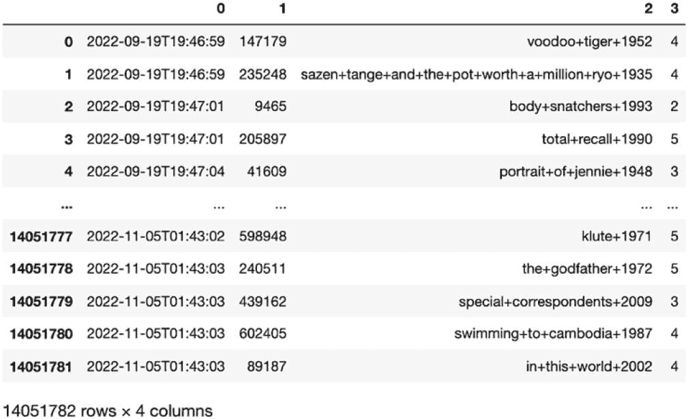

图 3-2

初始电影评分图像

```
rating_data
```

3. 转换。

现在让我们对数据进行一些分析和清理。

首先，我们将使用 `pyjanitor` 的 `rename_column` 函数更改列名，使其更易于阅读。`Pyjanitor.rename_column()` 一次只能更改一列，因此我们将使用方法链来更改所有四列。

```
rating_data = (rating_data
.rename_column(0, 'date/time')
.rename_column(1, 'user_id')
.rename_column(2, 'movie_id')
.rename_column(3, 'rating'))
```

我们预期评分是 1 到 5 之间的整数。然而，通过初步分析，我们发现数据中有 28 个唯一的评分值，如图 [3-3] 中最后一列的第二行所示。

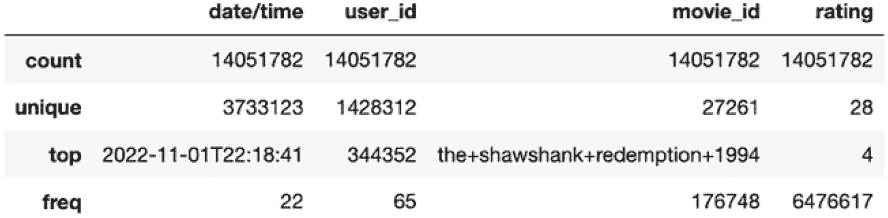

图 3-3

数据列摘要图像

```
rating_data.describe()
```

进一步分析显示，文件中混合了字符串和整数，如图 [3-4] 所示。例如，`5` 既作为数字输入，也作为文本输入。此文件中明显存在一些损坏数据，应予以删除。


图 3-4

唯一评分值图像

```
rating_data["rating"].unique()
```

在图 [3-5] 中，我们看到不同评分值出现的次数。评分为 `E` 的出现了 332 次。

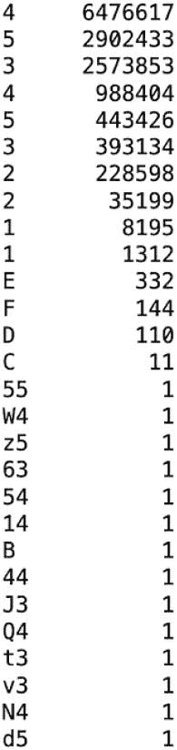

图 3-5

数据中评分出现次数图像

进一步分析显示，`user_id` 列混合了整数和文本，如图 [3-7] 所示。我们预期 `user_id` 仅为整数。我们还希望每条评分输入的日期和时间采用日期时间格式，而不是文本格式，如图 [3-6] 所示。

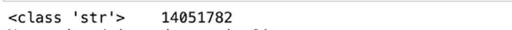

图 3-6

数据日期时间的摘要类型

```
rating_data["date/time"].apply(type).value_counts()
```

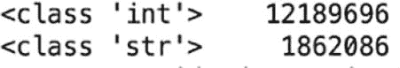

图 3-7

用户 ID 数据摘要类型

```
rating_data["user_id"].apply(type).value_counts()
```

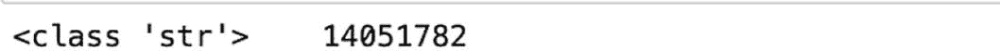

图 3-8

电影 ID 数据摘要类型

```
rating_data["movie_id"].apply(type).value_counts()
```

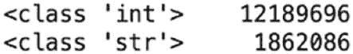

图 3-9

评分数据摘要类型

```
rating_data["rating"].apply(type).value_counts()
```

`user_id` 和 `rating` 列需要转换为整数。我们可以使用 `pyjanitor.change_type()` 函数来实现。我们还将把日期和时间的格式从字符串更改为日期时间格式。任何无法转换的内容将变为 `NaN`，并会从文件中删除。

所有这些步骤将使用方法链完成。

```
rating_data = (rating_data
.change_type("rating", dtype=int, ignore_exception="fillna")
.change_type("user_id", dtype=int, ignore_exception="fillna")
.to_datetime("date/time", format=" ISO8601", errors="coerce")
.dropna()
.reset_index(drop = True))
```

让我们看看完成上述步骤后评分列中的值。像 `E`、`F`、`G` 和 `Q4` 这样的评分已从我们的数据中删除。像 `1` 这样的评分则增加了。最初我们有数字版本的 `1` 出现了 8195 次，文本版本出现了 1312 次。现在只有一个版本，出现了 9507 次。这表明我们能够将文本转换为数字。任何不是数字的内容，如 `E` 或 `Q4`，都被删除了。

让我们查看数据的前五行（图 [3-10]），看看其他列是如何重新格式化的。`Rating` 和 `user_id` 被转换为数字，`date/time` 被转换为日期时间格式。

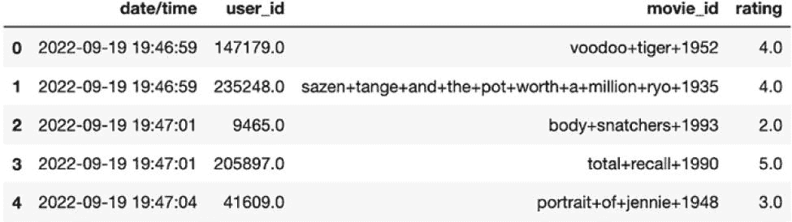

图 3-10

电影推荐数据图像

```
rating_data.head(5)
```

你可能注意到 `user_id` 和 `rating` 现在是小数值（即浮点数），而不是整数。这是因为在前面的步骤中将文本转换成整数时，`NaN`值没有对应的整数版本，导致整个列的数据都变成了浮点数。这与 `pandas.to_numeric()` 函数的工作方式类似。

要修复这两个列，我们可以再次使用 `change_type` 和方法链。

```
rating_data = (rating_data
    .change_type("rating", dtype=int, ignore_exception="fillna")
    .change_type("user_id", dtype=int, ignore_exception="fillna")
    .dropna()
    .reset_index(drop = True))
```

现在，如果我们查看前五行（图 [3-11]），可以看到 `user_id` 和 `rating` 列中的数据现在是整数格式。

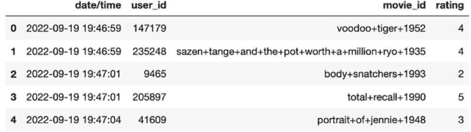

```
rating_data.head(5)
```

### 4. 加载

这会将转换后的数据导出到一个新的 `.csv` 文件中，该文件可用于机器学习算法。

```
rating_data.to_csv("clean_rating_data.csv")
```

### 案例研究与实际应用

## 零售分析

场景：某零售公司希望分析销售数据，以优化库存并提升整体业务绩效。

ETL 流程：从多种来源（销售点系统、在线平台）提取销售数据，通过清洗和标准化格式进行转换，然后加载到集中式数据仓库中。

成果：公司现在能够执行高级分析，例如预测需求趋势、识别热销产品以及优化库存水平。

### 医疗数据整合

场景：某医疗机构旨在通过整合电子健康记录（`EHR`）、化验结果和患者反馈数据来提升患者护理质量。

ETL 流程：从不同系统提取数据，通过确保数据一致性和隐私合规性进行转换，然后加载到统一数据库中。

成果：使医疗专业人员能够访问全面的患者病史，从而提升诊断准确性和个性化治疗方案。

## 社交媒体

场景：某社交媒体分析公司希望分析舆情趋势，帮助企业了解客户对其产品或服务的看法。

ETL 流程：从社交媒体平台提取数据，通过应用自然语言处理（`NLP`）技术分析情感倾向进行转换，然后将结果加载到数据存储中以供报告使用。

成果：企业能够深入了解客户满意度，识别改进领域，并据此调整营销策略。

## 金融交易欺诈检测

场景：某金融机构希望实时检测欺诈活动，以保障交易安全并保护客户利益。

ETL 流程：从多种渠道提取交易数据，通过应用异常检测算法进行转换，然后将标记的交易加载到欺诈监控系统中。

成果：有助于防范欺诈交易，减少经济损失，并维护客户信任。

## 智能家居自动化

场景：某物联网（IoT）领域的公司旨在创建一个智能家居平台，该平台能够学习用户行为并相应地调整家居自动化设置。

ETL 流程：从各种传感器和设备提取数据，通过识别使用模式进行转换，然后将洞察结果加载到中央系统中以控制家居设备自动化。

成果：用户可根据自身习惯体验个性化且自动化的家居环境，从而优化能源消耗并提升便利性。

## 结论

总之，数据的获取与管理是数据分析、数据科学和人工智能领域成功的关键基础。从探索各类数据源到利用 ETL 工具的强大功能，本章着重强调了制定稳健策略以获取真实世界数据和合成数据的重要性。无论是使用界面友好的商业 ETL 软件、利用开源工具实现经济高效的灵活性，还是涉足定制化 ETL 解决方案的领域，从业者都有多种选择来满足自身特定需求。此外，集成内置 ETL 工具的云服务进一步提升了数据工作流的效率。在我们应对不断变化的数据格局时，本章揭示了多样化的途径和可用的工具，使读者能够自信、富有创造力地以战略性的方式驾驭数据领域，迎接数据驱动事业所带来的独特挑战与机遇。

# 4. 探索性数据分析

在上一章中，我们讨论了什么是 ETL 流水线、其重要性以及如何实现它。一旦我们将数据加载到目标位置，接下来该做什么呢？有时，数据量可能非常庞大，令人难以确定从何处着手或结束。起初，你可能很难看出这些数据如何帮助你的组织。想象一下，你从过去继承了一个装满众多日志的宝箱。每本日志里都记载着故事、神秘的符号和地图。当你翻阅这些宝藏时，你意识到解开箱中秘密的关键在于理解并连接那些你发现的隐藏模式。同样，探索性数据分析就像翻阅一个数据宝库——每个数据集都是一组数字、变量和观测值的集合。正如你会仔细检查日志以破译其内容，从而拼凑出原作者的故事脉络一样，探索性数据分析涉及揭开层层表象，以获取隐藏于表面之下的洞察、趋势和异常。

## 探索性数据分析简介

在数据分析、数据科学和人工智能的广阔领域中，有一个关键步骤既像指南针又像放大镜——那就是探索性数据分析（`EDA`）。就如同经验丰富的探险家在勘测未知领域一般，`EDA` 深入数据集，挖掘隐藏的洞察与理解的瑰宝。在本章中，我们将踏上一段穿越数据探索领域的旅程，理解其重要性和变革力量。

探索性数据分析的本质在于其揭示数据褶皱中隐藏故事的能力。它是一种深入表面、仔细审视的艺术，旨在寻找潜伏其中的模式、异常和趋势。通过创建一个包含多样化统计分析技术、可视化工具和领域知识的工具箱，你能够为那些表面看似缺乏活力的数据集注入生机。你将把行与列转化为关于发现与启发的叙事。从消费者行为的奇特习性到金融市场的复杂动态，`EDA` 充当着数据诉说真相的管道。

此外，探索性数据分析不仅仅是通向更复杂分析的技术序曲，更是一段验证与发现的重要旅程。它是锻造假设、挑战假设、提炼洞察的熔炉。通过对数据质量和变量间关系的批判性观察，`EDA` 提供了基于证据的基础，数据分析和数据科学以及人工智能的稳健工具正是在此之上构建的。从本质上讲，它是在不确定性的汹涌海洋中指引你的灯塔，照亮通往知识和理解的道路。

数据分布描述了数据点在一个数据集中的散布方式。这可以显著影响在 `EDA` 过程中所使用的方法。常见的分布包括但不限于：

-   **正态分布**：正态分布也称为高斯分布，它是对称的，大多数数据聚集在均值附近。它形成一条钟形曲线，其中远离均值的值在数据中越来越罕见。在这种情况下，使用计算均值或标准差等标准技术来概括数据是有效的。
-   **偏态分布**：当数据不是对称分布时，它要么是右偏态，要么是左偏态。这种偏斜会影响如何选择汇总数据的方法。例如，在偏态分布中，均值可能具有误导性。因此，应使用中位数来更准确地代表中心值。直方图或箱线图等可视化方法可以突出显示这些模式。
-   **均匀分布**：在均匀分布中，每个结果出现的概率均等，因此在可视化时呈现矩形形状。传统技术可能不适用于这类数据，因为数据的任何单独区域都不占主导地位。

通过识别数据分布，你可以定制你的方法。那些对正态分布数据效果良好的技术可能不适用于偏态或均匀数据。

### 探索性数据分析的重要性

探索性数据分析之所以重要，有以下几个原因。下面，我将列出几个值得考虑的原因：

#### 1. 理解数据

它有助于科学家和分析师理解一个或多个数据集的结构、内容和关系。`EDA` 通过揭示模式、趋势和潜在偏差，为进一步的分析奠定了基础。它指导着分析的方向和提出的问题，从而驱动可操作的见解。

`EDA` 的一个关键要素是理解相关系数，它衡量两个变量之间关系的强度和方向。例如，皮尔逊相关系数衡量两个变量遵循线性关系的紧密程度。当两个变量具有线性关系时，意味着随着一个变量的增加或减少，另一个变量会以恒定速率增减，在图形上形成一条直线。皮尔逊相关系数的取值范围为 -1 到 1，其中越接近 1 的值表示越强的正线性关系，越接近 -1 的值表示越强的负线性关系，而 0 表示没有关系。正关系是指当一个变量增加或减少时，另一个变量朝相同方向移动。负关系是指当一个变量增加或减少时，另一个变量朝相反方向移动。

并非变量间的所有关系都是线性的。在某些情况下，变量可能仍然彼此相对地朝一致的方向移动，但并非以恒定速率。这被称为单调关系。在单调关系中，随着一个变量增加，另一个变量可以增加或减少，但不一定以恒定速率。例如，关系可能是弯曲的。在处理单调关系时，皮尔逊相关系数可能无法准确捕捉到关联的强度，这时就可以使用斯皮尔曼等级相关系数。斯皮尔曼相关系数衡量的是关系的一致性，而非其严格的线性。

`EDA` 允许分析师验证统计模型和方法所依据的假设。通过检查数据分布、相关性和其他属性，科学家可以确保他们的分析是适当且值得信赖的。

#### 2. 数据质量评估

评估数据质量使我们有机会发现任何额外的异常值、错误的数据条目、缺失值以及在 ETL 管道的转换部分可能遗漏的不一致性。这确保了所处理的数据对于分析和解释来说是可靠且准确的。

#### 3. 沟通与数据可视化

这使得您能够清晰、简洁地向领导层和利益相关者传达数据信息。对复杂数据的可视化展示，使其对公众和领导层来说更易于接触和理解。

#### 4. 特征选择与工程

在你完全理解你的数据之后，就更容易理解哪些数据对于下一步是必要的。在模型开发方面，并非所有模型都需要你的全部数据。你的数据越精简，你的模型就越能专注于分析那些你交给它解决的任务中真正重要的内容。即使作为人类，如果你只获得与问题相关的信息，而不是提供过多的信息，也更容易解决问题。

`EDA` 有助于识别用于预测建模和决策任务的相关特征或变量。它还通过对数据进行转换或组合来激发新特征的创建，从而增强模型的预测能力。

`EDA` 主要有三种类型：

| 产品编号 | 产品名称 | 类别 | 库存数量 | 价格 |
| --- | --- | --- | --- | --- |
| 0001 | 产品 1 | 电子产品 | 200 | 124.56 |
| 0002 | 产品 2 | 服装 | 15 | 45.21 |
| 0003 | 产品 3 | 电子产品 | 35 | 124.56 |
| 0004 | 产品 4 | 运动、健身与户外 | 100 | 54.21 |
| 0005 | 产品 5 | 娱乐 | 12 | 34.56 |
| 0006 | 产品 6 | 玩具 | 100 | 124.56 |
| 0007 | 产品 7 | 健康 | 200 | 4.99 |
| 0008 | 产品 8 | 学校与办公 | 300 | 45.21 |
| 0009 | 产品 9 | 宠物 | 30 | 32.01 |
| 0010 | 产品 10 | 电子产品 | 100 | 124.56 |

### 1. 单变量分析

单变量分析顾名思义。在进行这种分析时，您一次只探索一个变量。处理数据时，理解数据的内容可能会让人不知所措，因此一种方法可以是分别查看每个变量。单变量分析允许您总结并识别大量数据中的模式。您可以使用图表（例如条形图或频率分布表）来描述该变量中的数据。

假设您负责审查公司的库存数据库，并需要找到一种更好的方法来现代化其数据管理流程。为此，您需要了解数据中已经包含了什么。您找到的第一个数据集如下表所示。

乍一看，可能很难从这个数据中识别出关键见解，以了解其对公司的价值。我们可以使用单变量分析来剖析这些数据，以便更好地理解。您可以关注这些列中的任何一列，但对于此示例，让我们关注变量 `Category`。

| 类别 |
| --- |
| 电子产品 |
| 服装 |
| 电子产品 |
| 运动、健身与户外 |
| 娱乐 |
| 玩具 |
| 健康 |
| 学校与办公 |
| 宠物 |
| 电子产品 |

我们可以通过这个变量来观察各类别的频率分布。

| 类别 | 频率 |
| --- | --- |
| 电子产品 | 4 |
| 服装 | 2 |
| 运动、健身与户外 | 1 |
| 娱乐 | 1 |
| 玩具 | 1 |
| 健康 | 1 |
| 学校与办公 | 1 |
| 宠物 | 1 |

在这里，我们可以看到我们的库存中有更多电子产品。接下来，我们可以将此信息添加到条形图中，以便更直观地展示数据。

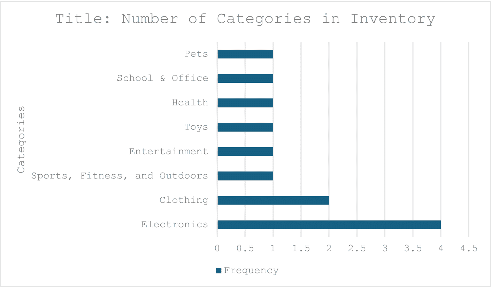

**图 4-1** 条形图显示数据集中各类别的数量

然后，我们可以针对上表中的每个变量继续进行相同的单独分析，以理解数据。

### 2. 双变量分析

双变量分析是对两个变量进行分析，以确定它们之间的关系。使用上表中的例子，我们可以分析类别和库存剩余数量之间的关系。我们也可以分析产品和价格之间的关系。其他例子包括，我们可以观察养宠物与情绪健康之间的关系。我们还可以分析金钱与幸福之间的关系。

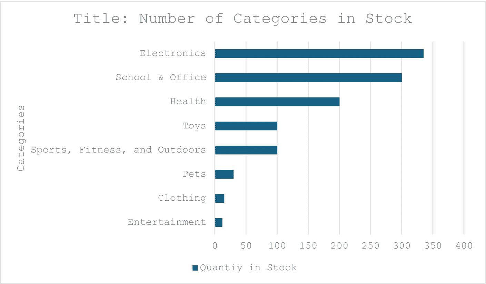

**图 4-2** 条形图显示我们库存中各类别的当前库存数量

### 3. 多变量分析

多变量分析涉及分析两个以上的变量，以确定它们之间的关系。它能够识别多个变量间的模式，并提供考虑多种因素的优点。它检查数据中影响主要结果的不同方面。

## EDA 的步骤

前三个步骤与 ETL 过程相关。

### 1. 数据收集

在当今世界，医疗、体育、制造业等诸多领域产生了海量数据。通过深入分析来利用数据价值的认识，在商业界已成为共识。然而，这种分析的有效性取决于从各种来源（如调查、社交媒体以及特定行业数据，如医疗记录）收集必要的数据。没有获取充足且相关的数据，后续工作便无法启动。

### 2. 识别并理解所有变量

随着分析之旅的开启，焦点便落在了可用数据宝库上，这些数据蕴藏着等待发掘的见解。数据环境中存在着代表无数特征或模式的动态数值，它们构成了理解与启发的基石。关键的第一步是识别那些对结果有影响的主要变量，并辨别它们潜在的影响。这一关键步骤为任何分析工作实现最终目标奠定了基础。

### 3. 数据集清洗

此步骤涉及精炼数据集，包括剔除空值和不相关数据。这种精炼确保数据只保留与分析目标相关的信息。这不仅节省了时间，还能在制定项目预算时减少计算资源的需求。数据预处理处理一系列问题，从标记空值到识别离群值和异常值，确保数据集为分析做好准备。

### 4. 检测相关变量

发现变量之间的相关性可以洞悉它们之间的关系。相关性矩阵显示了数据集中变量之间的相关系数。其值范围从 -1 到 1，其中 -1 表示变量间关系较弱，0 表示无关系，1 表示关系较强。相关性矩阵全面展示了这些联系，有助于理解变量间关键的内在关系。这在 EDA 过程中并非总是必需，但在选择用于训练机器学习算法的变量时可能有用。

### 5. 选择合适的统计技术

根据数据的性质（是分类数据还是数值数据）、数据量、变量类型以及分析目标，会使用各种统计工具。虽然应用于数值数据的统计公式很有价值，但图形化表示通常更吸引人，也更容易解释。

### 6. 结果的可视化与检查

完成分析后，必须彻底审查研究结果，以确保解释的准确性。观察数据趋势和变量间的相关性，为对数据参数和业务决策进行必要调整提供了宝贵见解。一位精通所有相关分析技术的技能娴熟的数据分析师或数据科学家，对此过程至关重要。

## 探索性数据分析（EDA）的工具与技术

有几种常用工具用于执行 EDA。这些工具使得检测模式、发现异常、检验假设和检查假设变得更容易。

### Python

在上一章中，我们提供了一些使用 `Python` 的例子。`Python` 目前是完成人工智能和数据科学任务最流行的编程语言之一。这是因为其语法易于阅读、拥有丰富的库、跨平台兼容性强以及强大的社区支持。这使得初学者和经验丰富的程序员都能更轻松地编写和理解代码，并促进了更快的开发与协作。

### R

`R` 是另一种流行的编程语言。它主要用于统计分析和数据可视化。它提供了广泛的数据处理、可视化和统计建模工具。对于统计学家和数据科学家来说，它是一种必不可少的工具。

## Tableau

`Tableau` 是一款用于报告和分析大量数据的流行工具。它使用户能够创建各种图表、图形、地图、仪表板和故事，以实现全面的数据可视化和分析。`Tableau` 强大的数据发现和探索功能允许用户快速回答重要问题并做出明智的业务决策。它不需要任何编程知识，使得无论技术经验如何，任何人都能立即上手使用。

## Power BI

`Power BI` 是另一款不需要编程知识的流行工具。与 `Tableau` 类似，它也用于报告和分析数据。它提供了一套业务分析工具，用于创建数据可视化并在组织内共享见解。

### 带代码的示例

我将在以下示例中使用 `Python`。你可以使用免费软件应用程序（如 `Jupyter Notebooks`、`Google Colab` 甚至 `Visual Studio Code`）进行同步操作。

#### 安装

1.  导入所需的库。

```python
```

# 数据分析：美国房价数据集

## 2. 查看数据

我们在此示例中使用的数据是关于美国房价的。该数据包含超过 4000 行。该数据集可在 Kaggle 上找到：[`https://www.kaggle.com/datasets/fratzcan/usa-house-prices`](https://www.kaggle.com/datasets/fratzcan/usa-house-prices)。

让我们通过运行以下代码，使用 `pandas` 加载数据集：

```bash
pip install pandas
```

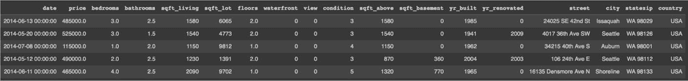

**图 4-3** 数据集中随机样本的图像

```python
housing_data = pd.read_csv("USA Housing Dataset.csv")
```

数据的时间范围是从 2014 年 5 月到 2014 年 7 月。该数据集中有 18 列：

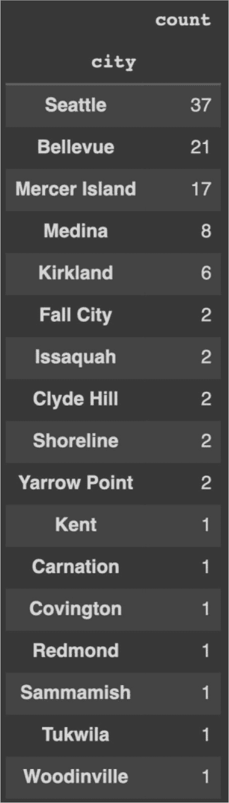

**图 4-4** 全国房价最贵城市列表及其对应价格房屋数量的图像

## 3. 探索数据

我们可以创建许多图表、表格和图形来帮助我们更好地可视化数据以理解它。让我们通过查看哪些城市的房价超过 150 万美元来探索数据。

```python
housing_data[housing_data["price"]>1500000][["city"]].value_counts()
```

在这里，我们可以看到在我们的数据集中，有 17 个城市有售价超过 150 万美元的房屋。在这份列表中，西雅图的房屋数量最多，有 37 套。

该数据集包含以下列：

- `date`：房产售出日期
- `price`：房产的售价
- `bedrooms`：房屋的卧室数量
- `bathrooms`：房屋的浴室数量
- `sqft_living`：生活区的平方英尺面积
- `sqft_lot`：地块的平方英尺面积
- `floors`：房产的楼层数
- `waterfront`：一个二元指标，表明房产是否有水景
- `view`：对房产景观质量的 0–4 等级评分
- `condition`：对房产状况的 1–5 等级评分
- `sqft_above`：地下室以上部分的平方英尺面积
- `sqft_basement`：地下室的平方英尺面积
- `yr_built`：房产建造的年份
- `yr_renovated`：房产最近一次装修的年份
- `street`：房产的街道地址
- `city`：房产所在的城市
- `statezip`：房产所在的州和邮政编码
- `country`：房产所在的国家

## 4. 查看变量之间的相关性

这个表格中有 18 列，但为了保持示例简单，我们只关注其中六个：

- `price`
- `bedrooms`
- `yr_built`
- `floors`
- `waterfront`
- `sqft_living`

你可以使用其他变量，但可能需要清理数据并重新格式化才能使用它们。

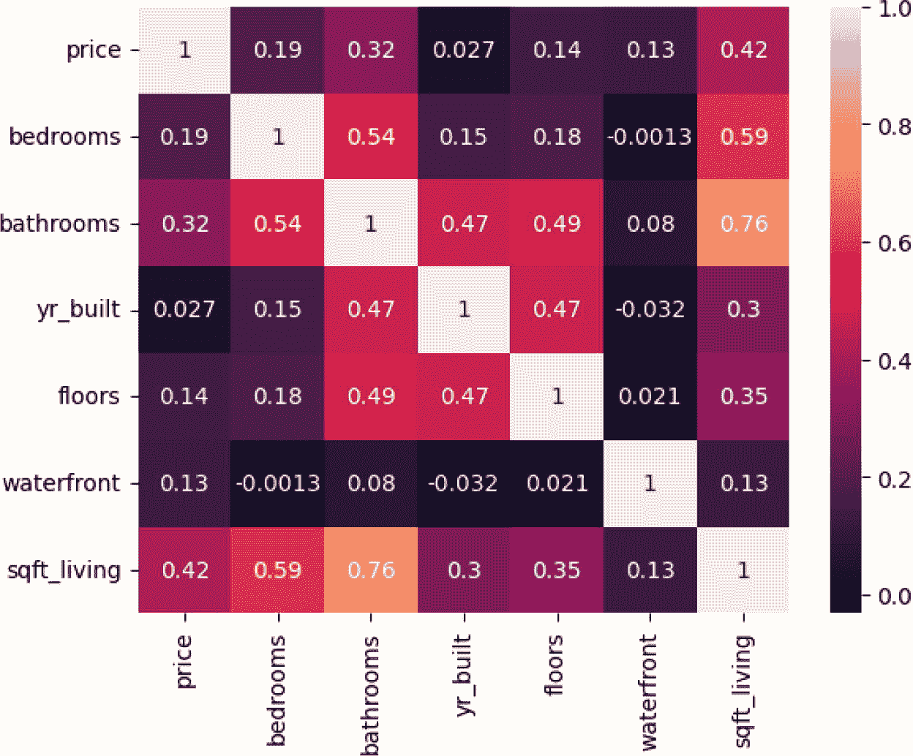

**图 4-5** 显示房价数据集中几个变量之间关系的相关矩阵

```python
correlation_matrix = housing_data[["price","bedrooms","yr_built","floors","waterfront","sqft_living"]].corr()

sns.heatmap(correlation_matrix, annot=True)

plt.show()
```

# 5. 机器学习模型

人工智能（AI）旨在让计算机系统足够智能，以完成通常需要人类思考的任务，例如理解语音、做出决策和识别模式。AI 是一个总称，涵盖了机器学习、自然语言处理等不同技术。

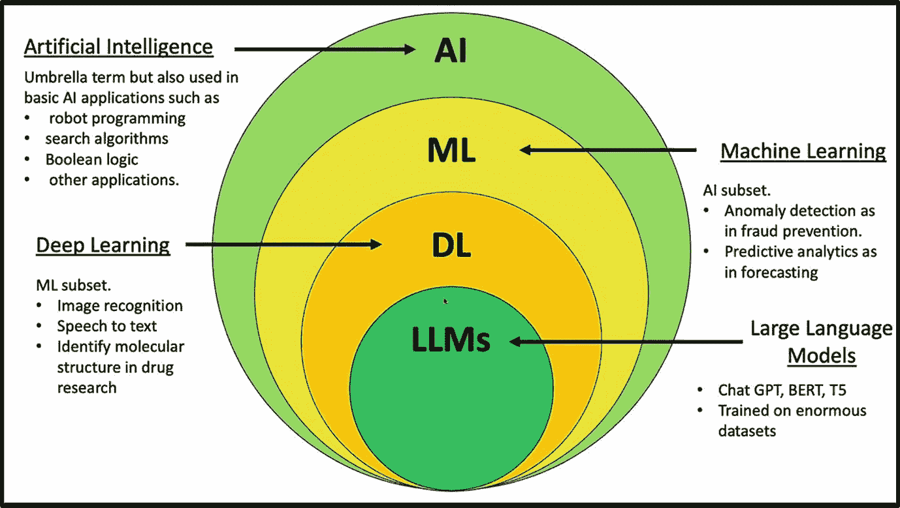

图 5-1

图片来源于 LinkedIn Pulse 上的博客文章《“AI-ML-DML-GEN AI - 根据价格排序”》，展示了人工智能（AI）、机器学习（ML）、深度学习（DL）和大语言模型（LLM）之间的层级关系（[人工智能、机器学习与深度学习关系图]，2024 年 4 月 23 日）

本章我们将聚焦于机器学习。机器学习模型是人工智能领域的关键组成部分。这些模型使系统能够从数据中学习、识别模式，并在最少人工干预的情况下做出决策。它们通过提供前所未有的自动化和预测能力，彻底改变了各个行业。自动化复杂流程并从海量数据集中获取可操作洞察的能力，已经革新了从医疗、金融到零售和交通等众多领域。

机器学习与数据分析和数据科学领域紧密相连，后两者的重点是收集、处理和分析数据，如前面章节所述。数据科学提供了从原始数据中提取有意义洞察的工具和技术，而机器学习则利用这些洞察进行预测并推动决策制定。在分析大型数据集、识别趋势以及确保我们在训练阶段拥有模型将在现实世界中遇到的代表性数据时，数据分析的作用尤为明显。这有助于创建不仅能进行预测，还能理解数据内部复杂关系的模型。

从这个意义上说，数据科学、数据分析和机器学习是相辅相成的：数据分析和数据科学帮助我们理解和解读数据，而机器学习则通过进行预测和自动化决策，帮助我们基于数据采取行动。

确保机器学习模型的高效性取决于训练数据的质量。一个构建良好且经过精心整理的数据集，是机器学习算法识别模式、把握复杂关系以及理解细微信息的基石。因此，由此产生的模型能更好地做出与数据内在复杂性相符的预测。

## 机器学习模型简介

机器学习模型是现代数据科学的基石。它们通过使组件能够从数据中学习，并在无需显式编程的情况下做出决策或预测，推动了众多行业的进步。这些模型能够随着经验的增加自动提升性能，使其成为解决复杂问题的强大工具。

在继续之前，让我解释一下机器学习模型与算法之间的区别。机器学习算法和模型这两个术语常被错误地互换使用，这可能会让初学者感到困惑。

算法是为完成某项任务而设计的一系列步骤。在机器学习中，算法是在数据集上运行以识别模式和规则的程序。可以把算法看作过程，而模型则是这个过程所产生的最终产物。模型利用算法从数据集中学习。换句话说，模型是对数据集进行拟合。所有这些过程的输出就是一个捕捉了这些模式的机器学习模型。你可以将模型视为一个应用程序或程序，你可以用它输入数据来进行预测或做出决策。算法是实现模型学习的关键，但一旦学习完成，模型就独立存在，成为对新的、未见过的数据进行未来预测或决策的工具。

这些模型生成的预测有助于你为业务做出数据驱动的决策。

`机器学习模型 = 数据 + 算法`

其核心在于，机器学习涉及使用算法在数据集上训练模型，以识别数据中的模式和关系。这个过程使模型在面对新的、未见过的数据时，能够做出预测或决策。根据模型训练的好坏程度，模型会以一定的准确度和置信度进行预测。机器学习算法有多种类型，每种类型适用于不同类型的任务：

## 监督学习

机器学习模型使用带标签的数据进行训练。这意味着数据被标记了正确答案。可以把这种情况想象成模型在有老师指导的情况下学习。数据包含输入和正确的输出，以帮助模型更快地学习。

假设你想训练一个机器学习模型来预测一辆二手兰博基尼的价值。

你会有一个数据集，其中包含已知的输入和输出值，用于训练模型。例如，数据可能包括：

- 里程数
- 车型（例如轿车、SUV 等）
- 颜色
- 燃料类型（例如柴油、混合动力、电动、汽油）
- 价格

模型的输入将是里程数、车型、颜色和燃料类型，而输出将是价格。

一旦模型对数据集进行了拟合，或者说从这个数据集中学习完毕，就会输出一个使用监督算法训练好的机器学习模型。你可以向这个模型提供它从未见过的新数据，并获得关于汽车价格的预测。监督学习算法有多种类型。

### 监督学习算法的类型

#### 回归

回归算法预测连续变量，例如价格或温度。

用于回归的监督学习算法示例：
- `线性回归`
- `随机森林回归`
- `决策树回归`
- `支持向量回归`

#### 分类

分类算法预测离散变量，例如：
- 是或否
- 0 和 1
- 红色、紫色、蓝色
- 真或假

预测结果被归类到一组不同的选项中。

用于分类的监督学习算法示例：
- `支持向量分类`
- `K-近邻算法 (KNN)`
- `逻辑回归`
- `决策树分类`
- `随机森林分类`

### 监督学习的应用场景

- 时间序列市场分析
- 客户分析
- 人力资源分配

## 无监督学习

无监督学习算法接收未标记的数据集，在不事先了解数据的情况下，寻找信息中的相似性和差异性。例如，如果你正在查看一个二手兰博基尼的数据集，算法可以根据车型或颜色等相似性自动对汽车进行分组。这样，就能识别出数据中的聚类，例如将相同车型的汽车归为一组。

### 无监督学习算法的类型

#### 聚类

聚类算法通过在你的数据集中寻找模式来对数据进行分组。相似度最高的项目将被归入同一组。

一些使用聚类的无监督学习算法：
- `高斯混合模型`
- `K 均值`
- `孤立森林`

#### 关联规则

该算法找出数据集中数据点之间的关系。它能找到经常同时出现的项目集合。例如，买花的人往往也会买巧克力。

一些使用关联规则的无监督学习算法：
- `Apriori`
- `Eclat`

### 无监督学习的一些用例

- 确定客户画像
- 异常检测
- 对象识别

## 半监督学习

机器学习算法接收包含标记和未标记数据混合的数据集作为输入。通常，标记数据量很小，而未标记数据量很大。

### 工作原理

1. 使用标记数据训练模型。
2. 使用步骤 1 中部分训练的模型，对未标记数据进行训练以预测输出，这些输出被视为伪标签，因为它们可能不准确。
3. 将标记数据模型的预测输出与未标记数据模型的预测输出关联起来。
4. 将标记训练数据的数据输入与未标记训练数据的数据输入关联起来。
5. 再次训练模型以获得更准确的预测。

### 半监督学习的一些用例

- 在搜索结果中标记和排列网页
- 图像和音频分析

## 强化学习

机器学习算法被训练用于做出系列决策。其中存在一个主体（算法），以及伴随许多障碍的奖励。与有监督和无监督学习不同，强化学习没有预先提供的外部训练数据集。主体通过采取行动生成自己的训练数据。它通过试错来学习解决问题。主体会根据其做出的决定获得奖励或惩罚。目标是最大化奖励的数量。

### 强化学习的一些用例

- 视频游戏
- 自动驾驶汽车
- 定制化训练系统

## 深度学习模型

深度学习是机器学习的一个子集。它专注于具有多个层（因此称为“深度”）的神经网络，这些网络试图模仿人脑的结构和功能。这些层由相互连接的节点（也称为神经元）组成，这些节点协同工作以处理信息并做出决策。

`神经网络`：一种人工智能技术，通过模仿人脑的结构和功能使计算机能够处理数据。这种被称为深度学习的机器学习方法，涉及多层相互连接的节点或神经元，类似于大脑的神经通路。它形成了一个自适应系统，使计算机能够从错误中学习并随时间不断改进。

深度学习模型有很多层。最基本的神经网络有三个层。一个简单的神经网络如图 5-2 所示。

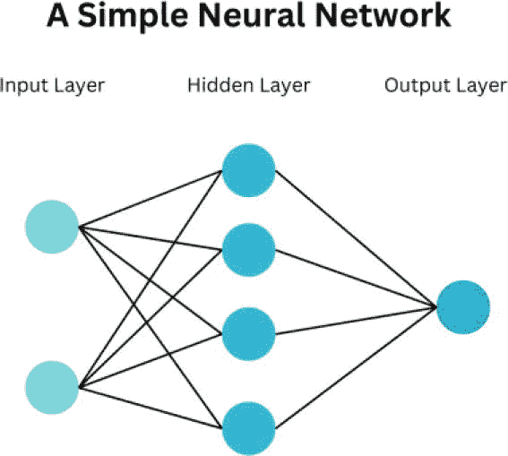

图 5-2 简单的神经网络可视化表示

1. 输入层：接收数据的第一层
2. 隐藏层：处理来自输入层输入的中间层
3. 输出层：产生预测或决策的最终层

深度学习网络具有多个隐藏层，其中多个节点相互连接，如图 5-3 所示。

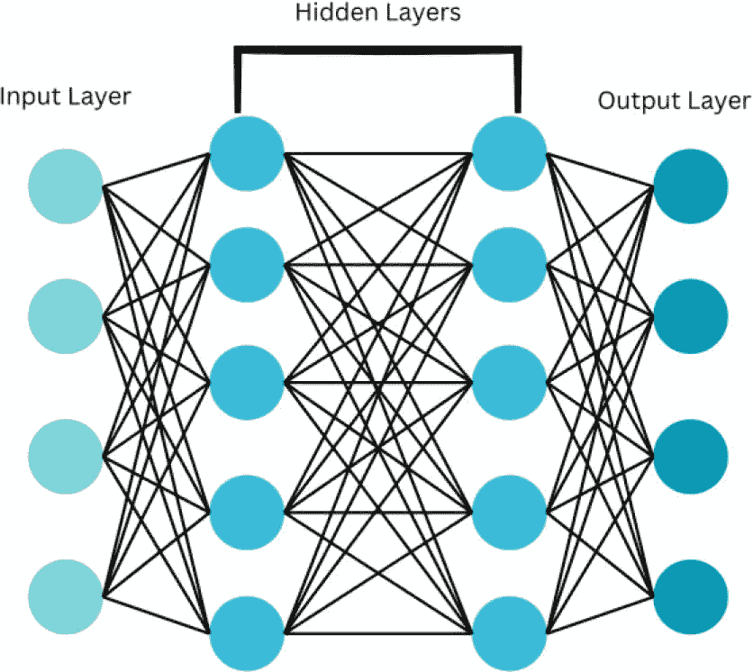

图 5-3 深度神经网络的可视化表示

与传统的机器学习方法（需要数据科学家选择和创建帮助模型从数据中学习的重要特征）不同，深度学习方法可以自动独立地找出这些重要特征。它直接从原始数据中发现模式和细节，无需额外帮助。这使得它们非常擅长理解复杂信息。然而，如果你对当前的任务和数据具备一些领域知识，事先进行一些初步的特征选择和工程处理，以让模型“轻松一点”，也并无坏处！深度学习模型还需要更多的计算能力和更多的数据来进行训练。

### 关键概念与术语

- **前馈（Feed Forward）**：前馈神经网络是一种基础类型的神经网络，其特点是信息流方向单一。数据仅朝一个方向传输，从输入节点经过隐藏节点，最终到达输出节点。每个节点处理输入信息后将其传递至下一层。
- **反向传播（Backpropagation）**：反向传播是一种神经网络的学习方法。它好比教网络从错误中学习，通过计算输出与正确答案的偏差，然后调整网络参数，使其输出结果更接近正确值，从而帮助改进神经网络。
- **循环神经网络（RNN）**：RNN 是一种经过训练、能够处理序列数据（如一系列随时间发生的事件）的神经网络。这使得 RNN 能够根据输入的顺序做出预测或决策。例如，RNN 可通过分析历史价格和市场趋势来预测股价的变动幅度。RNN 的独特之处在于其具备“记忆”能力，这意味着它会利用早期输入的信息来帮助理解当前输入，从而产生正确的输出。与其他将每个输入单独处理的神经网络类型不同，RNN 依赖于序列的顺序。想象一下烤蛋糕的过程，步骤的顺序至关重要。如果不按顺序混合配料，就无法烤出蛋糕。同样，RNN 会记住步骤的顺序，并利用这些信息来预测接下来会发生什么。
- **长短期记忆网络（LSTM）**：LSTM 是一种特殊的 RNN，旨在解决常规 RNN 存在的问题。常规 RNN 在处理长序列信息时，难以记住细节。这使得将之前发生的事情与当前情况联系起来变得困难。LSTM 通过其自身结构设计解决了这个问题，它能够长期记住信息。事实上，长期保留重要细节正是 LSTM 所擅长的！
- **卷积神经网络（CNN）**，又名 ConvNets：CNN 通常用于目标检测和图像分类任务。
- **生成对抗网络（GAN）**：GAN 由两个神经网络组成：一个称为生成器，另一个称为判别器。生成器的任务是创建与训练数据集相似的新样本，而判别器的任务是区分真实样本和生成器生成的样本。“对抗”一词源于这两个网络被设置为相互竞争的关系。GAN 可用于基于现有图像集合创建新图像，或通过学习歌曲数据库生成新音乐。GAN 还可用于根据文本描述生成逼真的图像，或改进现有照片。此外，它们也能用于生成具有与真实数据相同特性的新合成数据。
- **Transformer**：Transformer 是一种神经网络，它通过理解序列中各部分之间的上下文和关系，将输入序列（如一个句子）转换为输出序列。与 RNN 和 CNN 等其他神经网络不同，Transformer 一次性处理整个序列，而非逐步处理，因此速度更快、效率更高。这意味着它们需要的训练时间更少，运行速度也更快。Transformer 有两个重要特性，使其在文本预测等任务中表现出色：
    1. **位置编码（Positional Encoding）**：Transformer 并非仅仅按照单词出现的顺序读取它们，而是为每个单词分配一个唯一的编号。这有助于模型理解句子中单词的顺序，这对于理解句意至关重要。
    2. **自注意力机制（Self-attention）**：此特性允许模型同时关注句子中所有单词之间的关系。模型学习哪些单词彼此重要，这有助于预测序列中接下来可能出现的内容。例如，Transformer 可以通过分析单词通常如何组合在一起，“学习”语法规则。
- **大型多模态模型（LMM）**：一种结合了大型语言模型（LLM）和多模态（MM）的深度学习模型。
- **检索增强生成（RAG）**：RAG 是一种通过从外部来源获取事实信息来提高机器学习模型准确性的技术。`LLM` 和 `LMM` 功能强大，可以执行问答、文档文本提取或语言翻译等任务，但它们也存在一些局限性。例如，它们只能使用被训练过的信息，这些信息可能过时或不完整。有时，如果模型不了解某件事，甚至可能给出错误答案。RAG 通过允许模型在给出答案前查询可靠的信息源来帮助解决这些问题。这使得模型能够提供更准确、更新的响应，而无需重新训练或微调。
- **生成式人工智能（GEN AI）**：一种能够根据用户的请求或提示创建新内容的深度学习模型。
- **大型语言模型（LLM）**：一种只能理解和生成文本数据的深度学习模型。
- **多模态模型（MM）**：一种能够处理不同模态（例如文本、音频或图像）的深度学习模型。模型是多模态的可能意味着以下一种或多种情况：
    1. 输入和输出的模态不同（例如，图像到文本）。
    2. 模型的输入是多模态的（即模型可以同时接受文本和图像）。
    3. 模型的输出是多模态的（即模型可以同时生成文本和图像）。

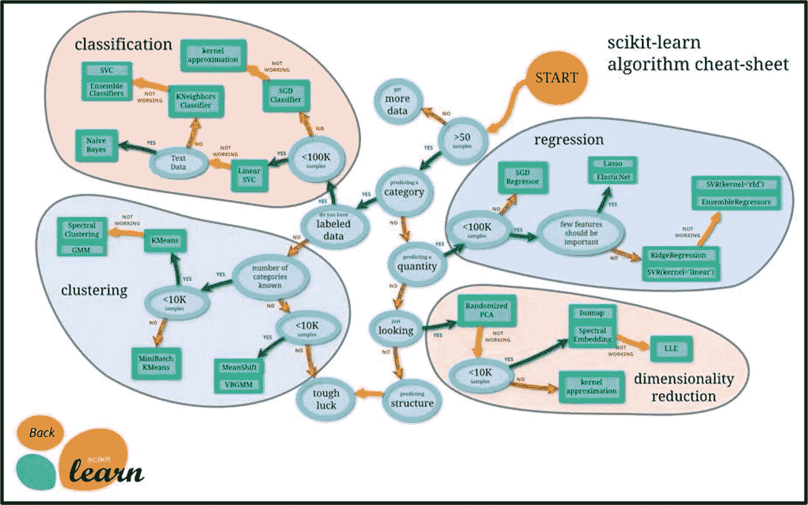

图 5-4 来自 `scikit-learn` 网站的指南，用于根据数据集大小、特征数量和解决的问题类型来帮助选择机器学习算法，如分类、聚类和回归（`scikit-learn` 算法速查表，无日期）

机器学习模型形式多样，各有优劣。模型的选择取决于具体问题、数据性质以及期望的结果。

## 机器学习模型的重要性

机器学习模型在各行各业都可能至关重要。

### 医疗保健

在医疗保健领域，ML 模型有助于提高诊断准确性、个性化治疗方案、预测患者结果以及辅助教育推广。例如，可利用深度学习模型分析医学影像，检测身体中的异常情况，如骨折和病变。模型在识别患有糖尿病、心脏病等慢性疾病风险的患者方面可发挥关键作用，从而实现早期干预，改善患者的生活预后。模型还可以加速从手写和扫描文档中提取患者信息的过程。

### 金融

金融领域可以通过多种方式应用机器学习模型，例如欺诈检测和预测。欺诈检测模型通过分析模式来识别欺诈行为，保护金融机构及其客户。在预测方面，机器学习模型可以分析市场趋势并预测潜在风险，帮助金融机构做出明智的决策。

### 零售业

机器学习可通过推荐系统、预测和库存管理来提升零售业的客户体验。通过分析客户行为与购买历史，推荐引擎能推荐符合个人偏好的商品，从而提高销售额和客户满意度。预测模型则可预测未来销售趋势，使零售商能够优化库存，减少因库存积压而产生的成本。

### 交通运输业

自动驾驶汽车和交通管理系统体现了人工智能在交通运输领域的变革性影响。无人驾驶汽车利用机器学习模型进行导航、物体检测和决策，旨在提升道路安全与效率。交通管理系统可通过分析实时数据，运用预测模型优化车流，从而缓解拥堵、缩短出行时间。该模型还可用于事件检测与管理。例如，可检测事故、逆行车辆以及酒后驾驶等异常行驶行为。这些信息可用于向相关部门发出警报。

### 市场营销

机器学习模型可用于分析消费者数据，以定位广告、细分市场并预测客户流失。这能帮助企业根据个人偏好与行为定制营销策略，从而提高活动效果与转化率。通过了解客户终身价值并识别潜在流失者，企业可主动实施留存策略，以维护忠诚的客户基础。

## 机器学习模型的工具与技术

### 编程语言

Python 是机器学习领域最流行的语言之一，以其可读性和丰富的库（例如 `TensorFlow`、`Keras`、`scikit-learn`、`PyTorch` 和 `Hugging Face Transformers`）而闻名。`Python` 的简洁性与多功能性使其成为初学者和经验丰富的从业者的理想选择。该语言支持快速原型设计与开发，使数据科学家和机器学习工程师能够快速高效地尝试不同算法与技术。

#### 框架与库

### TensorFlow

`TensorFlow` 是由谷歌开发的开源框架，用于构建和部署机器学习模型。它提供了灵活且全面的机器学习开发生态系统，包括模型训练、评估和部署工具。

### PyTorch

由 Meta 开发的 `PyTorch` 以其在研究与开发中的易用性而著称。`PyTorch` 深受研究人员和开发者的喜爱，常用于新想法的原型设计与实验。

### Keras

`Keras` 是一个用 `Python` 编写的高级神经网络 API，可运行在 `TensorFlow` 和 `PyTorch` 之上。它通过提供用户友好的 API 和完善的文档，简化了构建和训练深度学习模型的过程。对于希望快速开发与实验神经网络的初学者及从业者而言，`Keras` 非常有用。

### scikit-learn

`scikit-learn` 是一个用于回归、分类和聚类等经典机器学习算法的库。它提供了简单高效的数据分析与建模工具，在教育场景和实际应用中广受欢迎。`scikit-learn` 文档完善的 API 及其丰富的算法集合，使其成为实现标准机器学习任务的首选库。

### Transformers

`Hugging Face Transformers` 是一个开源库，简化了最先进机器学习模型的使用。它提供大量预训练模型，用于图像分类、命名实体识别和问答等任务。该库构建于 `PyTorch` 和 `TensorFlow` 之上，提供了便捷的接口来利用这些强大模型，使开发者和研究人员能轻松地将高级机器学习功能集成到项目中。

#### 集成开发环境

### Jupyter Notebook

`Jupyter Notebook` 是一个开源网络应用程序，支持交互式编码、可视化和机器学习模型的共享。它支持多种编程语言，并能与各类数据科学库无缝集成。`Jupyter Notebook` 使数据科学家能够记录工作流程、可视化结果，并以可重复的方式与他人协作。

### Google Colab

`Google Colab` 是一个免费的云服务，支持 `Jupyter Notebook`，并提供免费的 GPU 访问权限，因此非常适合进行机器学习实验。它提供了一个便捷的平台，用于开发和测试机器学习模型，无需复杂的设置或硬件资源。`Google Colab` 与 `Google Drive` 的集成功能，让笔记本和数据的存储与共享变得轻松。

其他可用于机器学习开发的 IDE 包括 Visual Studio Code 和 PyCharm。

#### 代码示例

在此示例中，我们将使用一个机器学习模型，根据工作年限来预测薪资。

1. 导入所需的库。

```python
```

# 简单线性回归示例

1.  首先，导入所需的库。

```python
import pandas as pd
from sklearn.model_selection import train_test_split
from sklearn.linear_model import LinearRegression
import matplotlib.pyplot as plt
import pickle
```

2.  加载数据集。此数据集可在 Kaggle 上找到：[`https://www.kaggle.com/datasets/abhishek14398/salary-dataset-simple-linear-regression`](https://www.kaggle.com/datasets/abhishek14398/salary-dataset-simple-linear-regression).


`图 5-5`：本示例所用数据集中的数据样本。这是数据集中的前几行。

```python
examp1_data = pd.read_csv("salary_dataset.csv")
examp1_data.head(5)
```

3.  我们将使用工作年限作为模型的输入，薪资作为模型的输出。

```python
x = examp1_data[["YearsExperience"]]
y = examp1_data[["Salary"]]
```

4.  我们首先需要分割数据集，以确保有足够的数据来训练和测试模型。通常，数据按照 80% 用于训练，20% 用于测试的比例分割。

我们将使用`x_train`和`y_train`进行训练，使用`x_test`和`y_test`测试模型。

`random_state`是一个参数，用于确保数据分割的可重复性。这意味着每次运行这行代码时，`x_train`、`x_test`、`y_train`、`y_test` 中分配的数据都是相同的，而不是随机的。

```python
x_train, x_test, y_train, y_test = train_test_split(x, y, train_size=.8, random_state=42)
model = LinearRegression()
model.fit(x_train, y_train)
```

5.  现在，让我们使用模型，根据模型从未见过的“工作年限”数据来预测薪资。这些数据已保存在变量`x_test`中。接下来，将预测结果保存在`lr_predictions`中，并将其绘制成图表。

```python
lr_predictions = model.predict(x_test)
```

6.  现在，绘制数据图表。

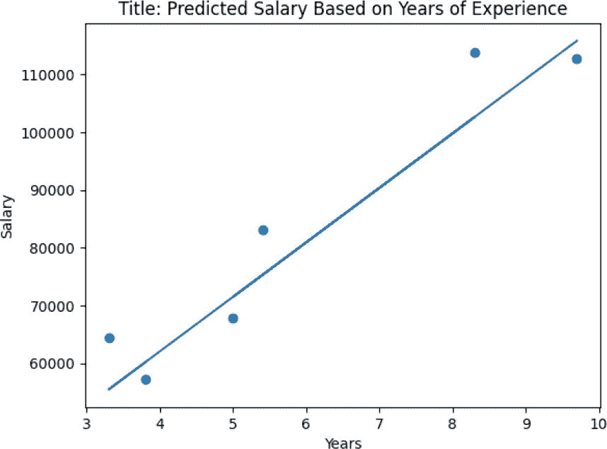

`图 5-6`：展示模型对未来十年薪资预测的图表。

```python
plt.scatter(x_test, y_test)
plt.plot(x_test, lr_predictions)
plt.xlabel("Years")
plt.ylabel("Salary")
plt.title("Title: Predicted Salary Based on Years of Experience")
```

7.  现在，保存模型以便后续使用。我们将其保存为一个 pickle 文件，命名为`lr_salary_determinator_model.pkl`。

```python
lr_model_pickle_file = "lr_salary_determinator_model.pkl"
with open(lr_model_pickle_file, "wb") as file:
    pickle.dump(model, file)
```

8.  现在，加载 pickle 文件，并再次使用之前`x_test`中的数据来运行模型。

```python
with open("lr_salary_determinator_model.pkl","rb") as file:
    model = pickle.load(file)
predictions = model.predict(x_test)
```

# 图像分类示例

在此示例中，我们将使用一个深度学习模型来识别图像中的动物。

1.  导入所需的库。

```python
from transformers import pipeline
from PIL import Image
```

2.  在此示例中，我们将使用一张动物图片。

```python
image = Image.open("ostrich.jpg")
```

3.  我们将使用 Hugging Face 上一个名为`google/vit-base-patch16-224`的模型。

```python
model_name= "google/vit-base-patch16-224"
image_classifier = pipeline("image-classification", model=model_name)
```

4.  将图像输入模型，等待其预测结果。

```python
image_classification_prediction = image_classifier(image)
```

5.  以下是模型的输出结果。它按置信度从高到低输出了五个预测。置信度最高的是鸵鸟，置信度为 0.99。模型的置信度得分范围通常是 0 到 1 或 0 到 100%。

```python
[{'label': 'ostrich, Struthio camelus', 'score': 0.9992263317108154},
 {'label': 'bustard', 'score': 9.642778604757041e-05},
 {'label': 'black stork, Ciconia nigra', 'score': 4.994613482267596e-05},
 {'label': 'zebra', 'score': 1.568139487062581e-05},
 {'label': 'flamingo', 'score': 1.4048618140805047e-05}]
```

# 6. 评估模型

评估机器学习模型就像检查食谱是否达到了预期效果。想象一下你在烤饼干，希望它们是我最喜欢的——柔软又有嚼劲！烤完后，你尝一口看看是否恰到好处。如果饼干太硬或太软，你就知道出了问题。同样地，当我们构建机器学习模型时，需要测试它以确保它按我们的预期运行。这种测试（即评估）能帮助我们判断模型是否做出了准确预测，或者是否需要调整"配料"以获得更好结果。

没有正确的评估，我们可能会信赖一个表现不佳的模型，就像端出味道不好的饼干。这可能导致错误的决策，尤其是当模型用于医疗等关键领域时。因此，评估模型有助于确保其可靠性，并值得信赖地做出正确决策。根据任务的不同，可以使用多种指标来评估机器学习模型。

## 评估模型简介

构建模型只是机器学习世界的起点。评估这些模型对于确保其在实际应用中的有效性和可靠性至关重要。模型评估涉及使用各种指标和技术来衡量机器学习模型在给定数据集上的表现。

## 评估模型的重要性

评估机器学习模型至关重要，原因如下：

1.  **性能评估**

    这有助于理解模型在未见过的数据上的表现，确保模型不仅记住了训练数据，而且能很好地泛化到新的、未知的信息。

2.  **模型比较**

    评估指标允许比较不同模型或算法，以便为特定任务选择性能最优的模型。

3.  **识别过拟合与欠拟合**

    过拟合发生在机器学习模型从训练数据中学习过多，近乎将其记住时。这意味着模型在处理熟悉数据时表现良好，但面对新信息时会遇到困难。就像学生死记硬背了考试的所有答案，却无法回答新问题一样。

    过拟合可能发生的一些原因：
    *   训练过程过长。
    *   训练数据不够多样化。
    *   模型对于数据过于复杂。

    欠拟合发生在机器学习模型没有从数据中学到足够知识，导致其在训练数据和测试数据上都表现不佳时。就像学生只粗略浏览了教科书，错过了关键概念。

    欠拟合可能发生的一些原因：
    *   训练时间不够长。
    *   模型对于数据过于简单。
    *   数据包含过多不必要的细节。

    找到过拟合与欠拟合之间的平衡点，是确保模型能处理好熟悉数据和新数据的关键。

4.  **超参数调优**

    假设你想教一个机器人识别猫。超参数就像你为机器人设定的学习规则。它们告诉机器人学习的速度（学习率）以及查看同一张图片的次数（轮次）。

    这与模型参数不同。模型参数是机器人从图片中学到的内容。它们就像机器人记住的关于猫的具体细节，比如耳朵的形状和毛色。

    超参数帮助机器人学习，而模型参数是机器人实际学到的东西。

    另一个类比是烤蛋糕。超参数就像你遵循的食谱。它们告诉你每种材料用多少（例如，两杯面粉）、蛋糕要烤多久（例如，30 分钟）以及烤箱的温度（例如，350°F）。这些是你在烤蛋糕之前做出的选择。

    而蛋糕本身就像模型参数。它们是遵循食谱的结果。蛋糕的具体风味、质地和外观取决于你遵循食谱的程度和食材的质量。

    所以，超参数指导了烘焙过程，而模型参数代表了最终成品。

    超参数的例子包括：
    *   `学习率`：决定算法在学习过程中更新其预测的速度。
    *   `权重衰减`：随着时间的推移逐渐降低学习率，以帮助模型更有效地学习。
    *   `轮次`：模型在学习过程中完整遍历整个训练数据集的次数。

5.  **部署就绪性**

    全面的评估能确保模型在部署到生产环境之前，达到必要的准确性和可靠性标准。

## 评估模型时的工具与技术

模型评估采用多种工具和技术，每种方法都适用于不同的问题类型与数据。下文将讨论机器学习模型评估中最常用的一些方法与指标。其中部分技术我曾在前几篇博客中讨论过，此处将继续补充定义和相关论述。

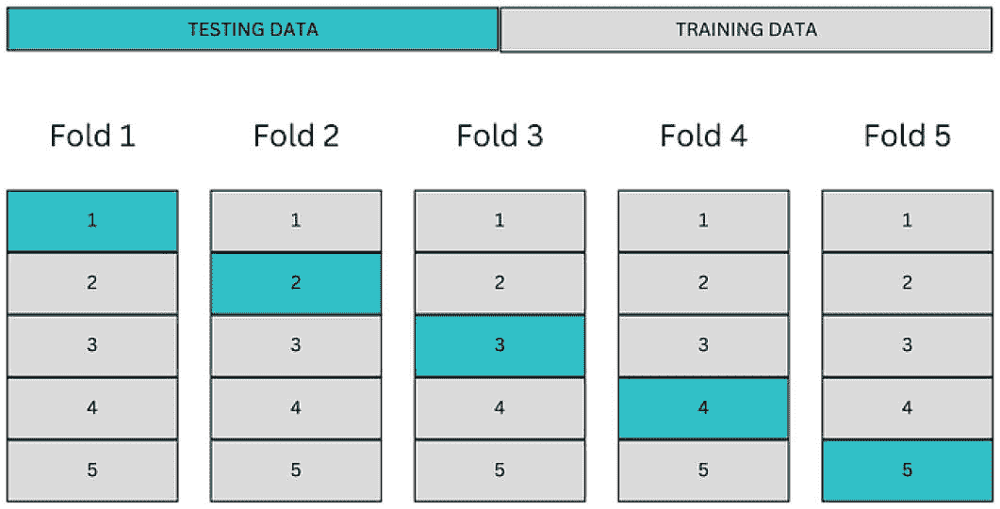

### 训练-测试集分割

训练-测试集分割是一种基础方法，将数据集分为两部分：训练集和测试集。模型在训练集上训练，并在测试集上进行评估以检验其性能。

### 交叉验证

交叉验证是将数据集分成多个子集，并在不同子集上训练模型，同时在剩余子集上进行评估。这有助于预估模型性能，并防止模型过拟合。该技术常用于确定模型的超参数。

交叉验证有多种类型。本书中将讨论 k 折交叉验证。

k 折交叉验证是指将数据集分成 K 组，利用这些组对模型进行 K 次训练和测试。每次迭代中，用于训练和测试模型的数据部分会轮换，直到完成第 K 次迭代。

#### 工作原理

1.  为 K 选取一个值，常用值为 10。
2.  将数据集分成 K 组。
3.  使用 K-1 组作为训练数据来训练模型，剩余 1 组作为测试数据评估模型。
4.  在训练数据集上训练模型，并在测试数据集上评估模型。
5.  使用评估指标（如`RMSE`、`MAE`、`accuracy`等）评估模型。本章后续将详细讨论这些指标。评估模型后，保存评估分数。
6.  重复步骤 1-5 共 K 次。但下一轮需使用不同的子集作为测试数据集。
7.  最后，计算评估分数的平均值。

在图 6-1 中，我展示了五折交叉验证的可视化表示。幸运的是，我们不必手动操作。已有诸如 Python 包等工具可用，有助于在划分数据集时减少错误。

## 混淆矩阵

混淆矩阵提供了模型预测的详细分解，展示了真正例、真负例、假正例和假负例。它通过表格形式呈现结果，直观展示模型预测的准确性。表格的行代表期望输出，列代表模型的预测输出。

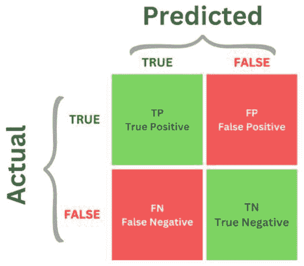

假设你想创建一个预测汽车是否为兰博基尼的模型。在该数据集中，正例指汽车是兰博基尼，负例指其他任何汽车。使用此方法评估模型时，需牢记四个术语。

### 指标

根据机器学习问题的类型，会使用不同的指标。你可以用这些指标评估模型，并比较多个模型的性能。以下是一些需考虑的指标列表：

#### 分类指标

**准确率**

利用上述混淆矩阵的解释，准确率是正确预测数除以总预测数。该数值介于 0 和 1 之间，0 表示模型未做出任何正确预测，1 表示所有预测都正确。业务相关人员喜欢这个指标，因为它简单易用。

假设你想让模型判断一个花篮中是否装有玫瑰。使用验证数据集，模型准确率将由它正确识别为玫瑰和正确识别为非玫瑰的数量之和除以总花朵数决定。

该指标仅在数据集平衡时有效。平衡数据集意味着每个类别都有同等数量的样本。如果一个类别的样本数量远多于其他类别，模型可能会始终预测数量多的类别，即使识别少数类别同样重要。这可能导致高准确率，但在识别不常见类别时性能较差，在需要识别这些少数类别的实际应用中可能会出现问题。

**精确率**

在模型所有预测为正例的结果中，有多少是真正的正例。该指标衡量模型正确识别的数量除以正确识别的总数与错误识别的总数之和。

这追踪了模型错误识别的项目。以我们的花为例，它追踪了被我们归类为玫瑰但实际上是向日葵的数量。

**召回率**

在所有真实的正例中，模型正确预测出了多少。该度量是模型正确识别的次数除以样本总数。它考虑了模型忽略的项目数量。它追踪了我们在花朵数据集中可能遗漏的玫瑰总数。

**F1 分数**

F1 分数综合考虑了精确率和召回率。它衡量了模型误分类的项目数量以及模型完全遗漏的正例数量。

**ROC-AUC**

-   接收者操作特征（ROC）：一个以不同阈值为基准，绘制真正例率与假正例率关系的图表。
-   真正例（TP）：数据集中为正例，且模型预测也为正例的数据点。
-   真负例（TN）：数据集中为负例，且模型预测也为负例的数据点。
-   假负例（FN）：数据集中为正例，但模型预测为负例的数据点。
-   假正例（FP）：数据集中为负例，但模型预测为正例的数据点。

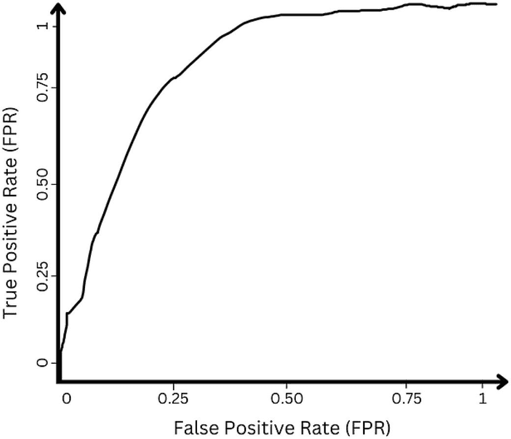

-   曲线下面积（AUC）：衡量 ROC 曲线下的面积。AUC 越高，模型预测能力越好。
-   真正例率（TPR）：验证数据集中为正例，且模型预测结果也为正例的数据点的概率。
-   假正例率（FPR）：验证数据集中为负例，但模型预测结果为正例的数据点的概率。

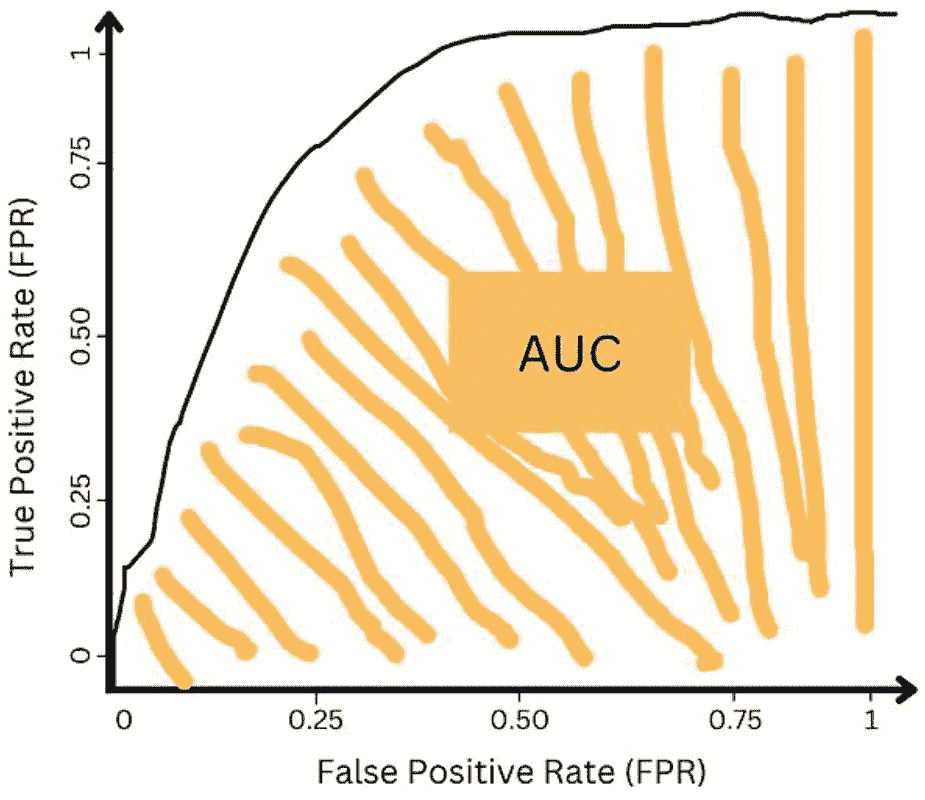

有时 AUC 和 ROC 会被合称为 AUROC（接收者操作特征曲线下面积）曲线。

#### 回归指标

**均方误差（`MSE`）**

`MSE`衡量模型预测的数据点与验证数据集中数据点的接近程度。它是残差平方的平均值。残差是指模型预测的数据点与验证数据集中数据点之间的差异，也常被称为误差。`MSE`的取值范围为 0 到无穷大。`MSE`越接近 0，模型性能越好。换言之，`MSE`应尽可能低。

**均方根误差（`RMSE`）**

`RMSE`是`MSE`的平方根，用于衡量模型预测的数据点与验证数据集中数据点的接近程度。与`MSE`类似，其取值范围为 0 到无穷大。`RMSE`越接近 0，模型性能越好。相比`MSE`，`RMSE`更受青睐，因为其单位未经平方，因此更易于解释模型的性能。

**平均绝对误差（`MAE`）**

`MAE`衡量模型预测的数据点与验证数据集中数据点之间的平均差异。它是模型预测值与验证数据集之间绝对误差的平均值。`MAE`越接近 0，模型性能越好。

**R 平方**

R 平方也称为决定系数。它衡量验证数据集中实际数据与拟合线（也称为回归线）的接近程度。

回归线是一条直线，表示目标变量如何随解释变量的变化而变化。目标变量是您希望模型预测的变量，而解释变量是作为输入帮助模型进行预测而选择的变量。

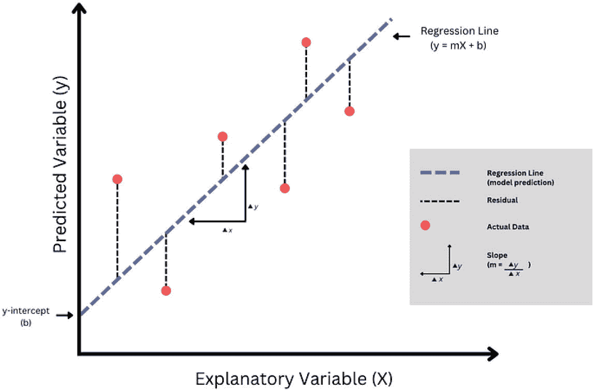

R 平方也衡量模型预测的数据点与验证数据集中数据点的接近程度。最好将 R 平方用于线性回归机器学习模型。其取值范围为 0 到 1。该值越接近 1，模型性能越好。

让我们回到第 5 章中的示例，我们使用机器学习模型来预测薪水。在上一章中，我们创建了一个模型但没有对其进行评估。既然我们已经学习了一些评估指标，让我们使用 R 平方来评估该模型。

导入所需的库。

```python
```

### 特征选择与特征工程

特征选择是从数据集中挑选出最重要的信息（特征），并剔除那些可能混淆模型的不必要内容。另一方面，特征工程则是创建数据集中原本不存在但可能有助于模型做出更好预测的新数据。

当我们训练一个机器学习模型时，通常从大量数据开始，但并非所有数据都有用。有些数据可能包含噪声、不相关，或者只是增加了模型训练负担的额外信息。通过只选择最佳特征，我们可以帮助模型运行得更快，并做出更好的预测。

例如，假设你要构建一个机器学习模型来预测哪些学生会在数学竞赛中表现出色。你的数据集中包含了学生的数学成绩、拥有数学书的数量以及他们最喜欢的电视节目。成绩和数学书数量可能有帮助，但他们最喜欢的电视节目可能无助于预测竞赛表现。因此，你会移除电视节目数据，专注于更相关的特征来构建模型。然而，你也可以通过特征工程创建一个新特征。例如，利用他们最喜欢的电视节目，创建一个特征来识别哪些节目具有浓厚的数学主题，并创建一个二元特征（例如，`Math-Focused-Show` = 1 或 0），以观察这是否会影响学生在竞赛中的表现。

### 预训练模型与微调模型

**预训练模型**：一个已经在大量数据上训练过以执行特定任务的模型。它可以按原样使用，也可以通过微调等方法进行调整，以适应不同行业和用例的各种需求。我们第二个代码示例中的模型就是一个预训练模型。

**微调模型**：微调是获取一个预训练模型，并通过使用一个更小、更专注的数据集对其进行调整，使其能更好地完成特定任务的过程。这有助于模型精炼其技能，并在手头的具体任务上表现得更好。

## 提示工程

提示（Prompt）是要求机器学习模型执行特定操作的文本，例如回答问题或完成任务。提示工程（Prompt Engineering）则是精心设计和调整这些提示，以使模型给出你想要的精确回复。这就像你给出指示或向某人提问的方式。在人工智能领域，模型从大量数据中学习，恰当的提示对于模型能否正确理解你的请求至关重要。

## 结论

机器学习模型通过自动化复杂任务、从海量数据集中发掘洞察并提供数据驱动决策，已深刻变革了各行各业。本章讨论的工具和技术为构建与部署机器学习模型奠定了全面基础。通过大量示例，我们展示了这些模型在解决实际问题中的实际应用和有效性。随着机器学习的持续演进，它将在不同领域解锁新机遇、推动创新。

机器学习模型凭借提供数据分析、预测和自动化的强大工具，彻底改变了众多领域。通过利用先进技术和稳健工具，这些模型能够解决复杂问题，并在各行业中推动显著进步。理解机器学习模型的重要性、工具、技术及潜在应用，对于充分发挥其潜力至关重要。

## 导入库

```python
import pandas as pd
from sklearn.model_selection import train_test_split
from sklearn.linear_model import LinearRegression
import matplotlib.pyplot as plt
```

## 示例一：线性回归预测薪资

加载数据集。此数据集可在 Kaggle 上找到：[`https://www.kaggle.com/datasets/abhishek14398/salary-dataset-simple-linear-regression`](https://www.kaggle.com/datasets/abhishek14398/salary-dataset-simple-linear-regression)。

```python
examp1_data = pd.read_csv("salary_dataset.csv")
examp1_data.head(5)
```

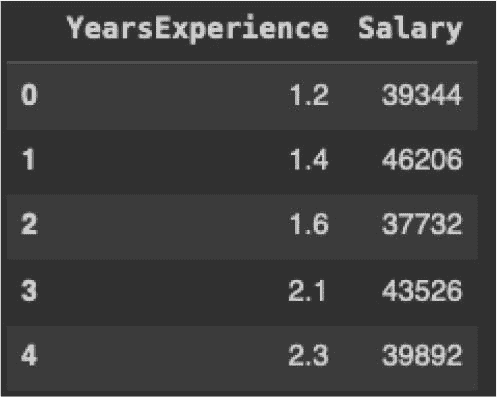
`图 6-6` 我们为此示例使用的数据集中数据的样本

我们将把工作经验年限作为模型的输入，把薪水作为我们希望模型输出的目标。

```python
x = examp1_data[["YearsExperience"]]
y = examp1_data[["Salary"]]
```

我们首先应拆分数据集，以确保有足够的数据用于训练模型，并有足够的数据用于测试模型。通常，数据按 80% 用于训练，20% 用于测试进行拆分。

我们将使用 `x_train` 和 `y_train` 进行训练，使用 `x_test` 和 `y_test` 来测试模型。

`random_state` 是一个参数，用于确保数据拆分的可重复性。因此，每次运行这行代码时，相同的数据将被设置到 `x_train`、`x_test`、`y_train`、`y_test` 中，而不是每次运行时使用数据集中的随机数字。

```python
x_train, x_test, y_train, y_test = train_test_split(x, y, train_size=.8, random_state=42)
```

让我们使用我们的数据训练一个线性回归模型。

```python
model = LinearRegression()
model.fit(x_train, y_train)
```

现在，让我们使用训练好的模型，利用模型未见过的经验年限数据来预测薪水。这些数据保存在变量 `x_test` 中。接下来，让我们将这些结果保存在 `lr_predictions` 中并进行绘图。

```python
lr_predictions = model.predict(x_test)
```

最后，让我们绘制数据。

```python
plt.scatter(x_test, y_test)
plt.plot(x_test, lr_predictions)
plt.xlabel("Years")
plt.ylabel("Salary")
plt.title("Title: Predicted Salary Based on Years of Experience")
```

如图 `图 6-7` 所示，我们模型中的回归线与实际数据（即散点）非常接近。

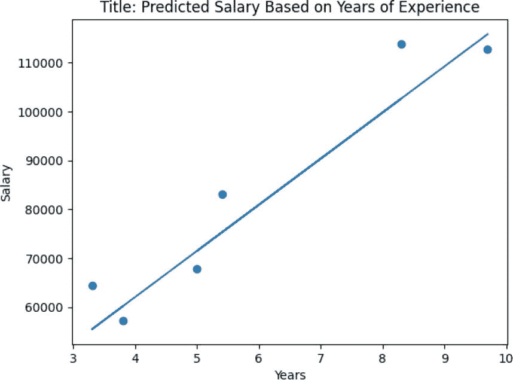
`图 6-7` 显示模型对未来十年薪水的预测图表

让我们使用 `scikit-learn` 中的 `r2_score` 计算 R 平方。

```python
r2_score(y_test, lr_predictions)
```

我们的结果是 `0.9024461774180497`，非常接近 1。

## 学习曲线

学习曲线会绘制模型在连续训练迭代过程中在训练集和评估集上的性能，有助于诊断模型是过拟合还是欠拟合。

## 带有代码的示例

### 包含代码的示例

在此示例中，我们将使用机器学习模型来预测葡萄酒的质量。该数据集包含 1600 行数据。葡萄酒的质量评分范围从 3 到 8，其中 8 表示优质，3 表示劣质。

导入所需的库。

```python
import pandas as pd
from sklearn.ensemble import RandomForestClassifier
from sklearn.model_selection import train_test_split, GridSearchCV
from sklearn.metrics import accuracy_score, classification_report
import matplotlib.pyplot as plt
```

加载数据集。该数据集可在 Kaggle 上找到：[`https://www.kaggle.com/datasets/uciml/red-wine-quality-cortez-et-al-2009/data`](https://www.kaggle.com/datasets/uciml/red-wine-quality-cortez-et-al-2009/data)。

```python
wine_data = pd.read_csv("wine-quality-data.csv")
wine_data.head(5)
```

我们将使用葡萄酒的 `quality` 作为模型的目标输出，其他列作为模型输入以帮助其进行预测。该列即图 `图 6-8` 中所示的最后一列。

```python
x = wine_data.drop(["quality"], axis=1)
y = wine_data["quality"]
```

在本示例中，我们将使用随机森林分类算法创建一个模型来进行葡萄酒质量预测。

```python
model = RandomForestClassifier(random_state=42)
```

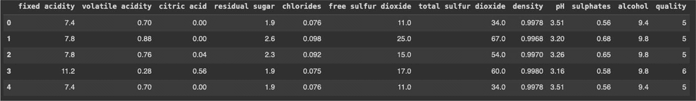
`图 6-8` – 本示例所用数据集中的数据样本。此处显示的是前五行。

让我们使用 `GridSearchCV` 来帮助我们选择训练用的超参数。`GridSearchCV` 是一种用于自动寻找机器学习模型最佳超参数组合的工具。

```python
hyper_params = {'criterion': ['gini', 'entropy', 'log_loss'],
                'max_depth': [5, 25, 50, 100, 200, 300, None],
                'n_estimators': [50, 100, 200, 500]}
grid = GridSearchCV(estimator=model, param_grid=hyper_params, scoring="accuracy", cv=10)
grid.fit(x, y)
```

让我们看看它得出了什么结果。

```python
print(grid.best_params_)
print(grid.best_score_)
```

我们的打印语句输出如下：

```python
{'criterion': 'gini', 'max_depth': 5, 'n_estimators': 200}
0.5922680817610062
```

因此，在我们提供给 `GridSearchCV` 的选项列表中，模型的最佳参数应将 `criterion` 设置为 `'gini'`，`max_depth` 设置为 `5`，`n_estimators` 设置为 `200`。这将为我们提供 `0.59` 的预估准确率得分。

现在我们将拆分数据集，以确保我们有足够的数据来训练模型和测试模型。通常，数据按 80% 用于训练、20% 用于测试的比例进行拆分。

我们将使用 `x_train` 和 `y_train` 进行训练，使用 `x_test` 和 `y_test` 来测试模型。

`random_state` 是一个参数，用于确保数据拆分的可重复性。因此，每次运行这行代码时，相同的数据会被分配到 `x_train`、`x_test`、`y_train`、`y_test`，而不是随机数字。

```python
x_train, x_test, y_train, y_test = train_test_split(x, y, train_size=.8, random_state=42)
```

现在，我们将使用通过 `GridSearchCV` 找到的参数作为超参数来训练我们的模型。

```python
model = RandomForestClassifier(criterion="gini", max_depth=5, n_estimators=200, random_state=42)
model.fit(x_train, y_train)
```

我们将使用新模型，根据测试数据集中的特征来预测葡萄酒的质量。

```python
predictions = model.predict(x_test)
accuracy_score(y_test, predictions)
```

准确率得分为 `0.56875`。

我们还可以查看模型在预测时认为哪些特征最重要，如图 6-9 所示。

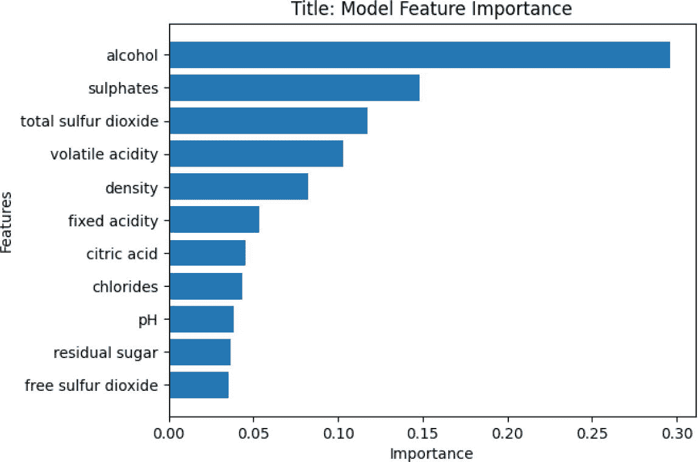

**图 6-9** – 展示模型在预测时认为最重要的特征图表。

```python
feature_importances = model.feature_importances_
feature_names = wine_data.columns
sorted_importance = feature_importances.argsort()
plt.barh(range(len(feature_importances)), feature_importances[sorted_importance])
plt.yticks(range(len(feature_importances)), [feature_names[i] for i in sorted_importance])
plt.ylabel("特征")
plt.xlabel("重要性")
plt.title("标题：模型特征重要性")
```

```

## 监控你的模型

机器学习流水线将整个过程自动化，从数据预处理到模型训练、评估和部署。这确保每个步骤都能一致且高效地执行，这对于可靠的模型评估至关重要。

流水线通过跟踪用于评估模型的指标来简化评估过程。这使得追踪和比较随时间部署的不同模型的性能变得更加容易。通过系统地对每个模型应用相同的评估标准，流水线有助于更可靠地识别性能最佳的模型。

`MLflow` 是一个集成了这些原则及其他功能的平台示例，它为管理机器学习项目提供了全面的解决方案。

## 机器学习模型可能有用的一些示例

1.  **信用卡欺诈检测** – 在信用卡欺诈检测场景中，由于数据集存在不平衡性（与合法交易相比，欺诈交易很少），评估模型性能至关重要。可以使用精确率、召回率、F1 分数和 ROC-AUC 等技术来衡量模型识别欺诈的有效性。
2.  **预测房价** – 在预测房价等回归任务中，可以使用平均绝对误差（MAE）、均方误差（MSE）和 R 平方等指标来评估模型性能。这些指标有助于理解预测的准确性。

## 结论

评估机器学习模型对于确保其对新数据的可靠性、准确性和泛化能力至关重要。通过使用多种工具和技术，如训练-测试拆分、交叉验证以及一系列评估指标，我们可以全面了解模型的性能。通过示例和用例，我们看到了如何将这些方法应用于不同类型的问题。适当的评估不仅是最佳实践，而且是部署稳健机器学习解决方案的必要条件。

# 7. 何时使用机器学习模型

机器学习模型已成为在各领域解决复杂问题的强大工具。如今，似乎每个人都在寻找方法，要么出于个人原因，要么为了推动业务发展，来应用机器学习。然而，并非所有问题都需要应用机器学习模型。虽然机器学习可以提供强大的解决方案，但重要的是要认识到，并非所有挑战都需要如此先进的技术。有时，更简单的基于规则的系统或其他传统方法可能更加高效和有效。用机器学习过度复杂化解决方案，可能会导致不必要的复杂性，却无法带来期望的价值。

想象你有一个问题需要解决——或许是优化现有系统、启动新业务，或是提升客户体验。你可能会考虑使用机器学习模型，但评估这种方法是否最合适至关重要。

## 何时使用机器学习模型简介

机器学习通过赋予系统无需显式编程即可从经验中学习和改进的能力，彻底改变了各个领域。从医疗保健和金融到零售和娱乐，机器学习是推动创新和效率的核心力量。在第 5 章中，我们讨论了不同类型的机器学习模型。然而，是否采用机器学习应审慎决策，因为它涉及复杂的算法、大量的数据和计算资源。本章将深入探讨机器学习模型能够发挥作用的判断标准和适用场景，确保其应用能产生最佳效果。本章将探讨何时选择机器学习模型是合适的，并提供指导方案以及其他可能更符合需求的替代选择。

## 理解何时使用机器学习模型的重要性

理解何时部署机器学习模型至关重要，原因如下：

1.  **资源优化**  
    机器学习项目需要在数据收集、处理和算法研发方面进行大量投入。正确判断是否需要机器学习，能确保资源得到有效利用。

2.  **问题适用性**  
    并非所有问题都适合用机器学习解决。有些问题可能更适合通过简单的统计方法或基于规则的体系来处理。误用会导致效率低下、效果不佳以及不必要的开支。

3.  **性能与可扩展性**  
    机器学习模型能够利用其处理海量数据和自动化决策等能力，为涉及大规模数据集和复杂问题的情况提供可扩展的解决方案。了解何时使用机器学习，有助于确保这些优势被用来提升性能。随着规模扩大，监控模型性能变得至关重要。在第 6 章中，我们讨论了各种类型的模型性能指标。这些指标有助于清晰了解模型的运行状况，帮助识别模型漂移或性能下降等问题，同时也能用于比较不同模型，以便为您的业务需求选择最合适的模型。

4.  **创新与竞争优势**  
    合理运用机器学习能催生创新解决方案，从而在市场中占据竞争优势。它可以实现流程自动化、挖掘洞察并增强决策能力。

## 评估机器学习模型的必要性与价值

### 识别合适的问题

有时，用最简单的方式解决问题才是上策。在决定是否使用机器学习模型时，必须考虑问题的复杂性以及模型所需的更新频率。如果一个问题能用直接的一次性解决方案解决（例如简单的计算），那么机器学习模型可能并非必要。机器学习模型最适合需要持续学习和频繁更新的场景，而这并非所有问题都具备。

机器学习模型在需要不断进化和适应的场景中表现出色。这些场景包括：需要持续调整的重大复杂问题、随时间推移而不断演进的开放式挑战、正确答案频繁变化的情况，以及本质上极其困难、挑战人类能力极限的问题。如果你的问题属于这些类别之一，那么机器学习模型可能是正确的选择。

### 应对开放式挑战

有些挑战规模庞大且具有开放性，这意味着它们没有单一的固定解决方案。这些问题会持续演变，需要长期投入且没有明确的终点。例如，为流媒体服务策划推荐内容就涉及每天处理新信息。

在这种情况下，设置好便不再过问的一次性解决方案很难奏效。相反，这些场景需要能够随时间适应和成长的机器学习模型，它能随着新数据的出现持续学习和更新。如果你的问题定义明确且范围有限，则可能不需要机器学习模型。然而，对于庞大且持续存在的挑战，机器学习模型可能是跟上不断变化的环境的正确选择。

我们在第 5 章中讨论过的模型类型中，有一个非常适合应对开放式挑战的例子——强化学习模型。这类模型通过与环境的互动进行学习，非常适合那些需要持续改进的任务，例如优化电商平台或流媒体服务的推荐系统，以及管理自动驾驶车辆。

### 适应动态环境中的变化

涉及变化的问题可能比较棘手，因为今天有效的方法明天可能就不灵了。当处理条件频繁或不可预测地变化的问题时，机器学习模型会非常有用。这些模型能够快速学习并适应新情况，确保它们随着事物的发展而保持有效。如果你的领域变化缓慢或遵循可预测的模式，那么更简单的方案可能就足够了。然而，如果你面临快速或出乎意料的变化，机器学习模型可能是跟上节奏、保持相关性的最佳方式。

### 解决棘手问题

有些问题极其复杂，甚至连人类也难以完美解决。例如，在复杂游戏中表现出色或理解外语。机器学习模型在解决这些挑战性问题方面取得了显著进展，但这需要多年的开发和数据积累。在需要处理海量数据或从复杂信息中提取模式等特定任务中，机器学习模型具有优势。通过持续整合用户反馈并优化模型，这些先进的解决方案可以在应对更本质的难题方面取得实际进展。

不过，有些领域仍然需要人类的直觉和专业知识，例如需要创造力、情商或深层上下文理解的任务。

### 成功部署机器学习模型的关键条件

要让机器学习有效发挥作用，不仅仅需要有挑战性的问题。该问题还需满足几个关键条件：

*   模型必须能够从长期使用过程中生成的数据中收集信息并进行学习。
*   模型应力求实现一个重要的目标。
*   总体投入应值得其投资。

#### 成功 AI 产品的关键条件

机器学习模型很少完美无缺，它们会犯错。关键在于，它们提供的价值要足以弥补其错误。对于一个可行的机器学习模型而言，它应当提供显著的好处，这些好处要超过其错误所造成的成本。例如，一个为顾客优化杂货购物的模型，偶尔可能会犯些小错，导致轻微延误。只要这些错误不常发生，并且系统总体上能为用户节省时间，它就可以被认为是有价值的。

相比之下，用于关键任务的模型，例如控制手术机器人或直升机，就必须可靠得多，因为错误可能带来严重后果。即使在这种高风险的情况下，模型也无需完美无缺，但必须显著优于其他备选方案。关键在于，一个机器学习模型必须能提供足够多的积极成果，以保证其被使用是合理的，即便它并不完美。

对于一个机器学习模型而言，若要被视为最高效，它必须能够直接影响预期结果。这意味着它要么能自动化处理流程，要么能提供信息和选项，以帮助用户实现其目标。当模型能够采取对产品目标产生清晰、即时影响的行动时，其效果最佳。如果模型的行动带来了积极结果，那么模型表现良好这一点应当是显而易见的；反之，如果结果不佳，那么模型性能的欠缺也应当是清晰的。影响结果的外部因素越少，机器学习模型就能越有效。

在部署机器学习模型时，找到恰当的平衡点很重要——目标过于宽泛，会使模型的行动与结果之间的关联难以建立。在庞大、复杂的产品中，可以为不同的任务使用多个机器学习模型。你也可以用一个模型处理多个任务，但用户提供的反馈与机器学习模型为了改进所需的特定决策之间的关联性就不够直接了。

#### 利用交互数据优化你的模型

机器学习模型会通过从最终用户与它们的交互方式中学习，从而随着时间的推移不断改进。当用户与你的产品（其中嵌入了机器学习模型）互动时，产品应收集关于用户行为、他们所体验的结果以及他们的反馈数据。这是遥测数据的一部分，这部分内容将在第 9 章中讨论。这些数据至关重要，因为它能帮助机器学习模型变得更智能、更高效，从而为最终用户创造更大价值。

例如，为了改进机器学习模型，记录用户交互的详细信息至关重要。这涉及到追踪以下内容：

-   用户看到了什么
-   他们如何回应
-   以及他们的体验是正面的还是负面的

通过分析这些数据，可以持续优化机器学习模型，以更好地满足最终用户的需求。这将提升你和你的公司的声誉及财务前景。

#### AI 产品的成本考量

与 AI 产品相关的成本不同于传统方法。这些成本包含三个主要组成部分：

-   **机器学习模型**：产品中负责做出决策并确定最佳行动方案的组成部分。
-   **实施**：涵盖后端系统、模型以及任何其他组件（包括用户界面）的实际开发和集成工作。
-   **编排**：涉及在产品整个生命周期内对其进行管理，以确保其持续满足目标并处理错误。

通常，AI 产品的机器学习模型部分成本较低，因为这些模型可以自动生成产品输出，取代了人工，并且它可以通过用户交互产生必要的训练数据。这减少了对人工数据收集的需求，总体上可以节省资金。然而，由于创建、集成和组织这些组件的复杂性增加，机器学习模型的实施成本可能与传统方法相当或略高。编排成本也往往更高，因为它们涉及持续的维护任务，如调优、更新和纠正错误。

#### 何时考虑其他方案

有时，你可能会遇到涉及用户、数据和决策制定的情况，但不确定是否需要机器学习模型。这种不确定性可能源于多种原因：你可能怀疑你的问题是否复杂到需要机器学习模型；你可能质疑实施这样一个模型所付出的努力和成本是否值得；或者你倾向于逐步解决问题，而不是从一开始就致力于研究和开发机器学习模型。

探索其他方法来解决棘手问题完全没问题，机器学习模型并非唯一的解决方案。

## 判断何时使用机器学习模型的工具与技巧

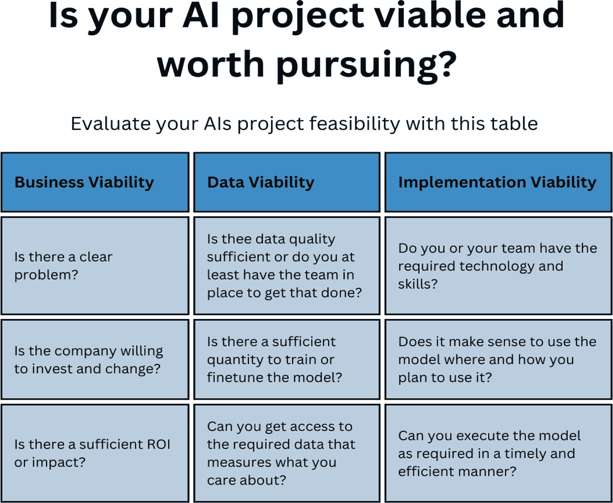

**在你决定是否将机器学习模型应用于产品或系统时，更多可供使用的关键指标**

1.  **大规模且复杂的数据集**  
    当数据量庞大且包含传统方法难以捕捉的复杂模式时，机器学习是一种有价值的工具。

2.  **预测性分析**  
    如果目标是根据历史数据预测未来趋势。

3.  **模式识别**  
    涉及模式识别的任务，如图像识别、异常检测和聚类分析，是机器学习的主要应用场景。

4.  **重复性任务自动化**  
    当重复性任务需要自动化时，例如在制造业或数据提取中，机器学习可以提供高效的解决方案。

5.  **适应与学习**  
    如果系统需要根据新数据随时间进行调整和改进，机器学习模型具备从数据中学习的能力，这使得它非常适合。

### 技术与工具

在第 5 章中，我们学习了不同的机器学习算法与技术。以下是选择算法时需要考虑的一些因素。

1.  **监督学习**  
    当结果变量已知时使用。相关技术包括线性回归、逻辑回归、决策树以及支持向量机。

2.  **无监督学习**  
    当结果变量未知时应用。相关技术包括聚类（k-means、层次聚类）和关联规则。

3.  **强化学习**  
    用于动态环境，模型通过动作及其结果进行学习。其应用包括自动驾驶汽车和游戏对弈。

4.  **深度学习**  
    机器学习的一个子集，专注于具有多层结构的神经网络。它特别适用于涉及图像、语音和文本处理的任务。

5.  **自然语言处理**  
    理解和生成人类语言的技术对于聊天机器人、情感分析和语言翻译等应用至关重要。

#### 代码示例

以下是一个无需使用机器学习的例子。

某公司希望为新员工分配唯一的员工 ID。这些 ID 可以是简单的递增数字，从 10001 开始。每入职一位新员工，ID 数字就增加 1。

之所以无需使用机器学习，是因为分配顺序 ID 是一个简单的任务。每位新员工将获得序列中下一个可用的数字。

以下是一个使用 `Python` 的示例。

假设您已将 ID 保存在数据库或 `Excel` 电子表格中；您将从上一次分配的员工 ID 开始，在此示例中为 10001：

```
```

`last_employee_id = 10001`

创建一个函数，根据前一个分配的 ID 来递增 ID 数字：

```python
def generate_employee_id(last_id):
    return last_id + 1
```

使用该函数为您的新员工生成下一个员工 ID：

```python
new_hire_id = generate_employee_id(last_employee_id)
```

即使使用 Python 来实现这一点可能也是多此一举，但因为这是一本技术书籍，我决定向您展示一个代码实现！

以下是一个可以使用机器学习的例子。

假设您经营一家葡萄酒商店，并且拥有客户信息数据集。您希望根据客户的购买行为将其分组，以便通过个性化营销策略来精准定位。我们在此示例中使用的数据有 2000 多行。

导入所需的库。

```python
import pandas as pd
from sklearn.cluster import KMeans
from sklearn.preprocessing import StandardScaler
import matplotlib.pyplot as plt
import seaborn as sns
```

加载数据集。此数据集可在 Kaggle 上找到：[`https://www.kaggle.com/datasets/imakash3011/customer-personality-analysis/data`](https://www.kaggle.com/datasets/imakash3011/customer-personality-analysis/data)

```python
data = pd.read_csv("marketing_campaign.csv", sep="\t")
```

该数据有 29 列，用于描述客户信息，例如婚姻状况、收入、孩子数量、在葡萄酒上的花费等。

```python
data.columns
```

输入上述代码后，您将看到如下方括号中所示的列名列表。

```
Index(['ID', 'Year_Birth', 'Education', 'Marital_Status', 'Income', 'Kidhome', 'Teenhome', 'Dt_Customer', 'Recency', 'MntWines', 'MntFruits', 'MntMeatProducts', 'MntFishProducts', 'MntSweetProducts', 'MntGoldProds', 'NumDealsPurchases', 'NumWebPurchases', 'NumCatalogPurchases', 'NumStorePurchases', 'NumWebVisitsMonth', 'AcceptedCmp3', 'AcceptedCmp4', 'AcceptedCmp5', 'AcceptedCmp1', 'AcceptedCmp2', 'Complain', 'Z_CostContact', 'Z_Revenue', 'Response'],
      dtype='object')
```

在此示例中，我们将重点根据客户的收入（`Income`）和他们在过去两年内购买的葡萄酒数量（`MntWines`）进行分组。与您在现实世界中遇到的大多数数据集一样，该数据需要进行清洗。为简化此示例，我们将把 `Income` 和 `MntWines` 列中的任何空值填充为 0。

```python
features = data[["Income","MntWines"]].fillna(0)
```

正如您在图 7-2 中所看到的，一些值彼此相差很大。在这里，我们将对这些值进行转换，使其具有通用的尺度。这将使 `k-means` 算法更多地关注数据的模式而非大小，尤其是考虑到这是一个基于距离的算法。

```python
scaler = StandardScaler()
scaled_features = scaler.fit_transform(features)
```

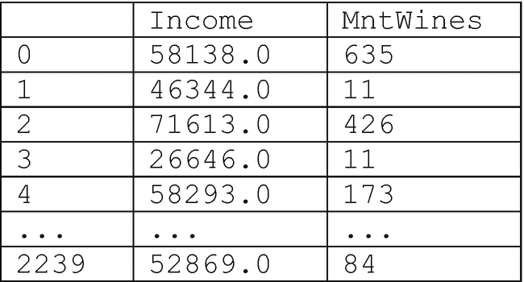
两列中的数据示例

在此示例中，我们将客户分为五个组。

```python
kmeans = KMeans(n_clusters=5)
clusters = kmeans.fit_predict(scaled_features)
```

识别出聚类后，我们将这些值放回表格中进行进一步分析。在这里，我们将聚类的值放入一个名为 `Clusters` 的新列中。聚类的取值范围是从 0 到 4。

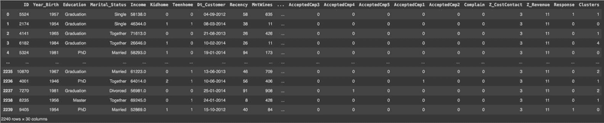
在最后一列添加聚类值后的数据集示例

```python
data["Clusters"] = clusters
```

现在，让我们根据聚类结果来分析数据。

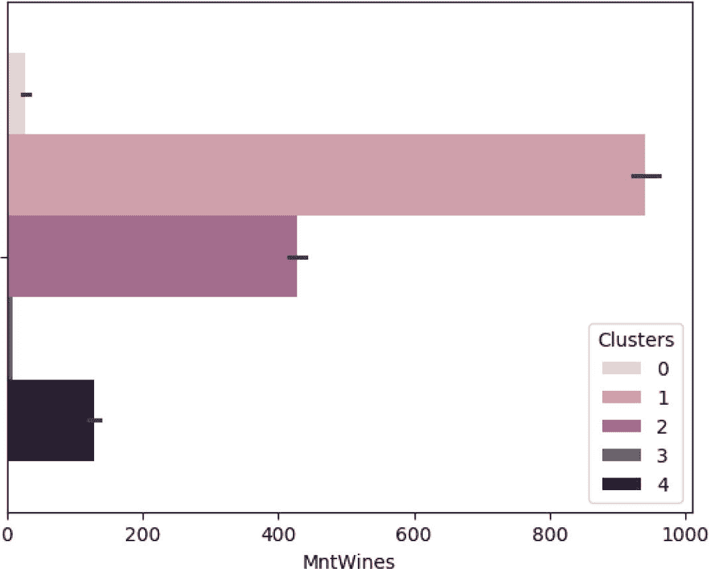
显示基于聚类的葡萄酒购买数量的条形图

```python
sns.barplot(data = data, x="MntWines", hue="Clusters")
```

在这里，我们可以看到聚类 1 中的人购买了最多的葡萄酒。

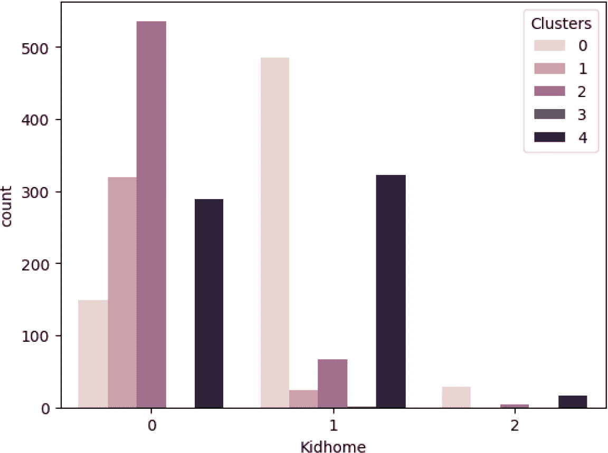
显示每个聚类孩子数量的条形图

```python
sns.countplot(data = data, x="Kidhome", hue="Clusters")
```

进一步的分析表明，聚类 1 中的大多数人没有孩子。因此，在策划一项旨在提高您店铺葡萄酒销量的营销活动时，您可能应该避开那些鼓励顾客在孩子由保姆照看时享受一瓶葡萄酒的活动，因为这不会引起您最重要客户群体的共鸣。

### 机器学习模型可发挥作用的示例

#### 金融：欺诈检测

在金融领域，机器学习模型对于检测欺诈交易至关重要。通过分析交易模式，这些模型可以识别出表明欺诈活动的异常情况。金融机构可以利用这些洞察来预防欺诈并保护资产。

#### 零售：个性化推荐

零售商可以利用机器学习模型向客户提供个性化推荐。通过分析购买历史、浏览行为和客户偏好，这些模型可以提升购物体验并增加销售额。

### 结论

机器学习模型通过为复杂问题提供高级解决方案，具有变革各个行业的巨大潜力。然而，是否使用机器学习，应基于对当前问题的透彻理解、数据的可用性以及潜在的收益来决定。通过识别适合机器学习和开发的恰当场景，您可以利用其力量来推动创新、提高效率并获得竞争优势。

## 机器学习模型的部署位置

打造一款 AI 驱动产品时，你需要决定在何处整合机器学习模型及做出预测或决策所需的信息，以及如何将这些输出结果发送给最终用户。一种选择是将机器学习模型直接部署在用户设备上。如果这样做，你需要考虑如何为所有用户保持模型更新。另一种选择是让模型在云端运行。这种情况下，你需要找出如何快速、经济且流畅地将必要数据从用户设备发送到云端的方法。

本章将解释在决定机器学习模型部署位置时需要注意的一些事项，并探讨其关键因素以及这些因素对不同类型 AI 驱动产品的重要性。

### 机器学习模型部署位置简介

机器学习通过为复杂挑战提供 AI 驱动的解决方案，极大地改变了各行各业。然而，这些解决方案的有效性在很大程度上受到部署和执行机器学习模型的具体环境的影响。为了确保最佳性能、可扩展性和可靠性，理解能够托管这些模型的各种环境至关重要。本章将探讨不同类型的环境，包括云服务、本地部署选项和混合系统，每种环境在部署机器学习模型时都具有独特的优势和考量。

### 决定机器学习模型部署位置时需考虑的关键因素

机器学习模型部署的环境会显著影响其性能和可用性。在确定 AI 驱动产品中机器学习模型的放置位置时，需要牢记以下几点：

*   **及时更新**

    更新机器学习模型需要多长时间？
    机器学习模型需要定期更新，以确保用户受益于最新的改进。当这些更新可直接在用户交互的设备上实施时，他们能更快地体验到好处。然而，如果模型托管在远程且更新需要互联网访问，这个过程可能会更慢，如果延迟导致代价高昂的错误，则可能引发重大问题。

    例如，如果你发布了一款广受欢迎的产品，收集用户反馈和交互数据来优化模型至关重要。在这种情况下，能够为所有用户快速更新模型对于保持发展势头和提供高质量体验至关重要。这在快速变化的场景中尤其如此，例如应对网络安全威胁，更新延迟可能导致模型失效。

    相反，在问题演变较慢的情况下，例如建造新建筑时，更新的延迟可能不那么关键。在施工期间，没有即时更新的 GPS 仍能正常工作。

    当缺乏及时的更新可能导致代价高昂的错误时，更新的紧迫性就显现出来了。如果你发现频繁收到客户投诉，却因模型更新缓慢而无法及时处理，这可能会损害你的声誉和财务状况，甚至造成巨大压力。

    **模型更新的策略**

    以下是一些有助于确保及时更新的不同策略：

    *   **持续集成/持续部署（CI/CD）管道**

        这种方法允许开发人员自动测试、构建模型更新并将其部署到生产环境中。`CI/CD` 管道通过自动化大部分更新过程来确保快速更新并最大限度地减少错误。

    *   **边缘设备的空中（OTA）更新**

        对于在边缘设备上运行的模型，`OTA` 更新允许在用户几乎不干预的情况下直接将更改推送到设备。这种方法确保了即使通常离线运行的设备，在定期连接到互联网时也能保持最新状态，最大限度地降低安全风险并在不大幅延迟的情况下改进功能。

    *   **基于云的训练**

        在云环境中，随着新数据的出现，模型可以快速重新训练和重新部署。云平台提供可扩展性，允许同时跨多个地点或用户应用更新。

*   **延迟**

    部署环境与最终用户的物理距离会影响模型的响应时间。这会影响模型在需要时生成响应的速度。
    你的 AI 驱动产品必须收集所需数据，执行预处理，并提取必要的特征作为机器学习模型的输入。模型生成响应后，你可能需要应用后处理，然后再将最终输出交付给最终用户。这些步骤中的每一步都可能耗费时间。

    如果所有处理都在同一设备上完成，则延迟最小。但是，如果机器学习模型托管在其他地方（例如云端），这个过程可能需要更长时间。在需要快速生成正确响应的情况下（例如在紧急情况下），这种延迟尤其成问题。例如，考虑一架自动驾驶直升机突然遇到障碍物。如果处理出现延迟，直升机可能无法及时避开障碍物，从而导致潜在危险后果。

*   **成本**

    部署和维护机器学习模型的成本因所选环境而异。运行 AI 驱动产品需要利用资源，这都需要花钱。以下是需要考虑的一些关键点：
    *   **分发机器学习模型的成本**
        *   分发机器学习模型涉及向用户发送更新，这对你和你的客户来说都需要花钱。成本取决于需要更新的客户数量、更新的大小以及发送更新的频率。
        *   对于使用 Wi-Fi 的用户来说，这可能不是什么大问题。然而，对于那些使用移动设备或数据流量有限的用户来说，下载更新的成本可能相当高。

    *   **执行机器学习模型的成本**
        *   运行机器学习模型会产生成本，尤其是在需要从云端发送和接收数据的情况下。这些数据交换的大小和频率会累积起来。
        *   最终用户设备上的机器学习模型会使用其资源，例如 `CPU`、`RAM` 和 `GPU`。虽然这可以为你（产品开发者）节省成本，但某些机器学习任务对于较小的设备（如手机）来说可能要求过高。在这种情况下，将模型放在云端可能更有效率。

*   **离线模式**

    如果最终用户没有连接到互联网会发生什么？你还应该考虑模型是否应该在无互联网连接的情况下也能工作。

    有时模型离线无法工作也是可以接受的。然而，在某些情况下，例如救生设备，产品在没有互联网连接的情况下工作至关重要。机器学习能力的部分功能应存在于最终用户的设备上。可以是完整版本，也可以是备用版本，以便在互联网连接恢复之前保持产品运行。

*   **可扩展性**

    云环境通常提供可根据需求调整的可扩展资源，而本地部署解决方案可能需要更多的前期投资和维护。

*   **安全性**

    不同的环境提供不同级别的安全性。例如，与公共云相比，敏感数据在私有的本地设置中可能得到更好的保护。

### 决定机器学习模型的部署位置

### 内置机器学习模型

你可以将机器学习模型直接集成到产品中，无需额外配置。可以收集训练数据、创建模型、将其添加到软件中，然后发布。

#### 优势

*   部署成本更低、更简单。
*   对于许多变化不大且不太复杂的问题，效果足够好。
*   可通过传统软件更新方式进行更新。
*   可通过评论等方式获得反馈。

#### 劣势

*   模型更新更具挑战性。

### 云端机器学习模型

云端机器学习意味着模型运行在云端，而非用户设备上。当用户需要某项功能时，应用程序将信息发送到云端，由云端处理并返回结果。

#### 优势

*   模型可以轻松快速地更新。
*   更易于跟踪和记录数据。

#### 劣势

*   随着用户量增加，云端需快速处理大量请求。若多人同时使用，系统需足够强大以应对需求。

### 存储式机器学习结果

存储式机器学习结果是指提前计算并保存结果以供后续使用。

**示例：** 设想一个图书推荐服务，它会提前计算有限列表或更新缓慢的列表中哪些书籍最适合不同流派和读者。完成详细分析后存储结果。当新读者寻求书籍推荐时，应用程序直接使用已存储的推荐结果，无需重新分析。

#### 优势

*   可运行实时计算会过慢的复杂模型。
*   由于结果已预先准备好并存储，能快速提供结果。

#### 劣势

*   仅当可根据明确信息（如特定位置或产品）查找结果时效果最佳。
*   若正确答案可能快速变化，则效果不佳。

### 混合使用不同方法

有时组合不同方法能获得最佳效果。以下是一些示例：

*   一个机器学习模型用于对特定任务进行深度分析，而设备上的另一个模型则处理其他事务。
*   应用程序大部分时间使用设备上的机器学习模型，但在做出非常重要的决策时，依赖云端更强大的模型进行双重校验。

组合方法有助于平衡各自弱点。但也会使应用程序更复杂。若出现错误，可能难以定位原因。可能是设备上的模型、云端模型，或是多种因素共同导致。

### 工具与技术

#### 云服务

云端平台如亚马逊云服务（`AWS`）、谷歌云平台（`GCP`）和微软 `Azure` 提供了部署机器学习模型的强大环境。这些平台提供多种服务，包括：

*   **托管机器学习服务：** `AWS SageMaker`、`AWS Bedrock`、`Google AI Platform` 和 `Azure Machine Learning` 提供构建、训练和部署模型的端到端解决方案。
*   **无服务器计算：** `AWS Lambda` 和 `Azure Functions` 允许在无需管理服务器的情况下响应事件运行代码。
*   **容器化：** `Docker` 和 `Kubernetes` 等工具支持在容器化环境中实现机器学习模型的可扩展和灵活部署。

#### 本地部署选项

对于有特定需求的组织，本地部署可提供对硬件和软件环境的控制。关键工具与技术包括：

*   **虚拟机：** 例如使用 `VMware` 创建隔离环境。
*   **专用硬件：** 使用专用硬件。
*   **自定义基础设施：** 构建和维护定制基础设施，以满足特定的性能和安全性需求。

### 边缘设备

在智能手机和物联网设备等边缘设备上部署机器学习模型，可最大限度降低延迟并减少数据传输成本。边缘部署技术包括：

*   **模型压缩：** 量化和剪枝等技术可减少模型大小和计算需求。
*   **边缘部署框架：** `TensorFlow Lite` 和 `PyTorch Mobile` 专为模型运行而设计。

### 混合系统

组合不同环境以发挥各自优势是一种战略方法。例如，初始模型训练可在云端进行，而推理可能在边缘设备上完成。混合系统的关键考量包括：

*   **数据同步：** 确保数据在不同环境间一致。
*   **网络架构：** 设计不同部署环境之间稳健且安全的通信通道。

### 行业需求的机器学习部署策略示例

#### 零售：云端推荐系统

零售商可利用云服务部署推荐系统，分析客户数据并提供个性化购物体验。

**更新与监控：** 在云端系统中，模型可持续重新训练和重新部署，而不会影响客户体验。云端环境还允许零售商监控推荐系统在各地区的表现，并根据不同的偏好或市场条件调整模型。

**有效性：** 云端部署可提供可扩展性，使系统能够处理庞大的客户群和实时数据分析。但若高峰购物时段云端基础设施未针对流量激增进行优化，延迟可能会影响有效性。

#### 医疗：用于实时诊断的边缘人工智能

在医疗领域，将机器学习模型部署在便携式诊断设备等边缘设备上，可实现实时分析并减少对互联网连接的依赖。例如，某公司开发了具有嵌入式 AI 功能的便携式超声设备，用于帮助现场诊断病情。

#### 制造：用于预测性维护的混合系统

制造商可使用混合系统：设备传感器数据在本地处理以实现实时异常检测，而更全面的分析和模型重新训练则在云端进行。这种方法可平衡低延迟监控与云端计算资源的需求。

**更新与监控：** 现场模型可通过 `OTA` 更新，而云端组件确保使用来自所有设备的最新数据对模型进行重新训练。监控这些系统涉及跟踪本地异常检测模型和用于深度分析的更复杂云端模型的性能。

**有效性：** 混合方法平衡了低延迟异常检测与云端计算资源的需求。本地模型确保实时监控，而云端重训练使整个系统能适应不断变化的条件。然而，平衡边缘与云端系统的同步对于确保流畅运行且不出现数据瓶颈至关重要。

### 结论

机器学习模型的部署环境是影响其有效性、性能和成本效益的关键因素。理解云端、本地和混合系统等不同环境的优势与局限性，能使组织根据自身特定需求做出明智决策。通过利用适当的工具和技术，企业可以优化机器学习模型的部署，从而获得最佳结果。

## 遥测技术

### 遥测技术简介

`遥测`一词源自希腊语词根"tele"（意为远程）和"metron"（意为测量），是指将仪器和设备的读数记录并传输到远程位置的过程。在机器学习领域，遥测技术在监控、诊断和优化机器学习模型性能方面扮演着关键角色。通过利用遥测技术，数据科学家和机器学习工程师能够洞悉模型行为、系统性能及用户交互，从而构建更健壮、更高效的系统。

机器学习中的`遥测`涉及从模型性能指标、系统日志和用户反馈等多种来源收集数据。这些数据随后可被传输至中央系统进行分析与可视化。从遥测中获得的洞察可用于微调模型、检测异常，并确保机器学习流水线的整体健康。

### 遥测的重要性

遥测在机器学习中的重要性不言而喻。它提供了一个持续反馈循环，对于维持机器学习模型的可靠性和准确性至关重要。以下是遥测至关重要的几个关键原因：

1.  模型性能监控

    遥测能够实时监控模型性能，从而检测数据漂移、模型衰退和性能退化等问题。这能确保模型随时间推移保持准确可靠。

2.  异常检测

    通过分析遥测数据可以检测模型行为或系统性能中的异常。这有助于在潜在问题影响最终用户之前发现并解决它们。

3.  系统优化

    遥测能提供系统性能洞察，包括资源利用率、延迟和吞吐量。这些信息可用于优化系统配置并提高效率。

4.  用户反馈整合

    遥测可以捕获用户交互和反馈，这对于提高模型准确性和用户体验具有宝贵价值。了解用户如何与系统交互，有助于更好地调整模型和实现个性化。

### 遥测工具与技术

可以采用多种工具和技术从 AI 系统中捕获遥测数据。这些工具大致可分为数据收集、传输和分析三类。

#### 数据收集工具

1.  记录器（如 Python 的`logging`模块）可记录来自机器学习模型和 AI 系统的事件与指标。这些日志能捕获关于模型预测、错误和性能指标的详细信息。

2.  `Prometheus`和`OpenTelemetry`提供了从 AI 系统收集指标的检测能力。这些工具可集成到机器学习流水线中，用于收集模型和系统性能指标的数据。

#### 数据传输工具

1.  消息代理（如`Kafka`和`RabbitMQ`）可将遥测数据从各种来源传输到中央系统。它们提供可靠且可扩展的数据传输解决方案。

2.  `REST API` 可将遥测数据传输到集中式系统。它们提供了灵活性，并易于与各种数据源和目标集成。

#### 数据分析工具

1.  仪表盘与可视化工具

    像`Grafana`和`Kibana`这样的工具能通过交互式仪表盘对遥测数据进行可视化。它们提供了基于遥测数据创建图表、图形和警报的强大功能。

2.  数据处理框架

    如`Apache Spark`和`Flink`等框架可以处理和分析大量遥测数据。它们提供实时和批量处理能力，适用于各种应用场景。

3.  应用监控工具

    像`New Relic`和`Datadog`这样的工具提供了监控应用（包括机器学习模型）性能的综合解决方案。它们具备收集指标、追踪请求和可视化数据的功能。

### 模型衰退，又称模型漂移

当机器学习模型因为其训练数据的分布发生变化而无法良好执行时，就会发生模型漂移。这可能导致错误的预测和糟糕的决策。由于世界在不断变化，模型需要定期审查和更新。

这种数据变化的一个例子就是数据漂移。在机器学习中，当模型训练所用的数据随时间开始变化，导致模型准确度下降时，就会发生数据漂移。如果机器学习模型没有为这些变化做好准备，它的表现可能就不如从前。

例如，在电子商务和语言翻译领域，模型漂移可能是一个挑战。如果客户偏好或趋势随时间改变，电子商务推荐系统可能会开始推荐不相关的产品。同样，语言用法、俚语或文化参考的变化也会影响模型的性能。在这两种情况下，若不对模型进行定期更新和监控，性能就会下降。

有一些专门设计用于检测和处理模型漂移的工具和框架。例如，Python 包如`scikit-multiflow`和`River`通过监控数据并在发生显著偏移时发出警报来支持漂移检测。这些工具有助于识别何时应该重新训练模型以适应数据中的新模式。

想象一下，你教一个机器人用苹果和橙子来识别水果。如果你突然给它看香蕉，模型可能会感到困惑，因为它没有接受过这种新水果的训练。这可能是由于数据收集方式改变，或者被研究的群体或事物发生了变化。如果一个模型是用来自一个国家数据训练的，但后来被用于另一个各方面都不同的国家，它可能就无法给出好的结果。

#### 漂移的类型

想象你正在训练一个机器学习模型来预测明天是否会下雨。

*   **目标漂移**：这就像在模型学会游戏规则后突然改变规则。如果你突然决定"毛毛雨"也算作下雨，模型可能会感到困惑，因为它之前只认为"雨"才符合条件。

*   **概念漂移**：这就像模型周围的世界发生了变化。也许它学会了在温暖天气预测下雨，但现在它需要在像下雪那样寒冷的地方预测下雨。这可是个巨大的变化！

*   **数据漂移，又称协变量漂移**：这就像改变了你提供给模型的信息。如果你过去通过输入温度和湿度来让模型预测下雨，但现在只给它温度，模型可能就没那么擅长预测了。

*   **标签漂移**：这就像在考试后更改了答案。如果之前下毛毛雨时你告诉模型"是"，但现在你却说"否"，那么机器就会对什么算作下雨感到困惑。

#### 检测漂移的方法

为了应对漂移，我们需要设计能够感知变化并据此调整的机器学习模型。这可能意味着定期检查模型的工作效果，并用新数据重新训练它，甚至创建能够在新情况出现时快速适应的模型。

让我们继续关注为天气预测而设计的模型这个例子。随着时间的推移，天气模式可能会改变，如果你的模型没有适应，它的预测就会变得不那么准确。

*   **定期检查**：我们需要定期测试 AI 模型的性能。这有助于我们及早发现问题。
*   **检测变化**：特殊工具可以帮助我们识别模型所使用的数据何时开始变化。这就像注意到天气模式的突然转变。有专门的算法用于检测漂移。
*   **预防问题**：我们可以通过向 AI 模型展示各种各样的数据来为其应对变化做准备。我们可以使用多种技术来实现这一点。例如，数据增强和合成数据生成有助于让模型接触到更广泛的代表性数据。这类似于教一个孩子认识不同类型的天气。
*   **更新模型**：如果你的模型开始出错，我们可以通过微调来教它新的信息，从而提高其准确性。这就像当孩子在某个科目上遇到困难时，给他额外的辅导。

### 遥测技术在现实世界中的应用示例

#### 电子商务推荐系统

在电子商务平台中，遥测技术可用于监控推荐系统的性能。系统会收集用户交互、模型预测和系统性能的数据。通过分析这些遥测数据，平台可以检测用户行为的变化，识别性能瓶颈，并优化推荐算法。

可收集的具体遥测数据包括：

*   **用户交互**：用户点击、购买、商品浏览、页面停留时间、用户对推荐内容的反馈
*   **模型预测**：生成的推荐内容
*   **系统性能**：模型响应时间

通过分析这些数据，你可以：

*   根据客户行为重新训练模型
*   识别偏差并采取纠正措施
*   改善响应时间以提升客户体验

**核心要点**：

*   通过持续的反馈循环提高模型准确性
*   及早发现异常，从而及时干预
*   通过更出色的个性化推荐提升用户体验

**挑战**：处理大量用户交互数据可能计算密集，需要强大的数据存储和处理基础设施。此外，在收集遥测数据的同时确保用户数据隐私至关重要。

#### 自动驾驶汽车

遥测技术在自动驾驶汽车的开发和运行中至关重要。车辆传感器收集各种参数的数据，例如速度、加速度、周围车辆以及行人等移动物体。这些数据用于实时分析和决策。遥测技术通过提供对系统性能的洞察并检测潜在问题，有助于确保自动驾驶汽车的安全性和可靠性。

可收集的具体遥测数据包括：

*   **传感器数据**：速度、加速度、转向角
*   **模型预测**：检测到的物体、基于交通状况或检测到的物体进行的路线优化
*   **车辆状态**：来自摄像头的信息
*   **环境数据**：天气状况

通过分析这些数据：

*   自动驾驶汽车可以利用这些数据进行实时决策。
*   你可以根据道路行驶经验重新训练车辆内的机器学习模型，以提升其性能。
*   你可以识别数据中的异常情况，例如传感器故障。

**核心要点**：

*   通过实时监控和分析提高安全性
*   根据遥测数据优化车辆性能
*   及早检测并解决系统异常

**挑战**：实时管理来自多个传感器的高数据量在计算上要求很高。此外，确保遥测数据的安全性和隐私性，尤其是在通过网络传输时，对于防止网络威胁至关重要。

#### 医疗保健监控系统

在医疗保健领域，遥测技术可用于远程监控患者。可穿戴设备收集健康指标数据，例如生命体征和活动水平。这些数据可以传输给医疗保健提供者进行分析和干预。遥测技术实现了对患者的持续监控，从而能够及时进行医疗干预并改善患者预后。

可收集的具体遥测数据包括：

*   **生命体征**：心率、血压
*   **活动水平**：步数、震颤
*   **模型预测**：疾病预测、药物有效性
*   **用户报告**：用户报告的症状、服用的药物

通过分析这些数据，你可以：

*   重新训练机器学习模型，以预测未来健康事件的可能性
*   识别偏差并采取纠正措施

**核心要点**：

*   模型可以通过分析新的遥测数据来适应患者状况的变化。
*   持续的患者监控有助于及早发现健康问题。
*   通过及时的医疗干预改善患者预后。
*   通过远程监控提高医疗保健提供者的效率。

**挑战**：管理患者数据的敏感性，同时确保遵守如 `HIPAA` 等隐私法规。持续健康数据的大量产出也可能带来存储挑战，尤其是在大规模的医疗系统中。模型可能很复杂，看起来像一个黑箱。确保模型如何得出预测的透明度，对于在医疗应用领域建立信任至关重要。

### 结论

遥测技术是 AI 系统的重要组成部分。它提供了一个持续的反馈循环，能够实现实时监控、异常检测和系统优化。通过利用遥测技术，你可以确保机器学习模型乃至整个 AI 系统的可靠性、准确性和效率。

遥测技术的实施需要结合数据收集、传输和分析工具。借助合适的工具和技术，你可以获得关于模型行为、系统性能和用户交互的宝贵见解。这些见解可用于微调模型和改善用户体验，从而提升声誉和收入。

随着机器学习的不断发展，遥测技术的作用将变得越来越重要。它将使你能够构建更稳健、更高效、更以用户为中心的系统，为智能技术的未来铺平道路。

## 对抗与滥用

机器学习已成为各行各业的关键组成部分，推动了自动化、数据分析和决策过程的进步。然而，机器学习的兴起也带来了新的挑战，尤其是在安全方面。对手可能会利用机器学习系统，导致严重的滥用并损害这些系统的完整性。本章深入探讨机器学习中的对抗与滥用性质，研究其重要性、工具、技术以及现实世界中的案例。

### 对手与滥用行为简介

机器学习中的对手是指有意操纵或利用机器学习模型以实现恶意目标的实体，可以是个人、团体或组织。这些对手试图通过扰乱或欺骗模型来获取个人、财务或战略利益。例如，对手可以通过略微修改钓鱼邮件来操控电子邮件垃圾邮件过滤器，使其无法被检测到，从而绕过安全系统。

滥用行为涵盖对手破坏、欺骗或操控系统的各种活动。滥用也指对机器学习系统的各类攻击或不道德用途，导致意外后果。例如，对手可能通过使用机器人人为地提升某些内容，欺骗推荐系统优先推送不相关或有害的材料。

#### 对手的类型

*   **数据投毒攻击：** 有意将误导性或错误数据放入训练数据集中，导致模型学习到错误的模式。这种攻击发生在训练阶段。可以通过以下几种方式进行：
    *   删除部分数据
    *   将现有数据修改为错误答案
    *   添加虚假数据

    示例：攻击者可能通过注入虚假图像来更改面部识别系统的训练数据，导致模型认错人员。

*   **规避攻击：** 修改输入数据以逃避模型检测。这发生在测试/生产阶段，通过对数据进行微小改动来实现。图 10-1 至 10-4 展示了许多此类示例。

    示例：攻击者可以略微修改停车标志的图像，如图 10-3 和 10-4 所示，使自动驾驶汽车的识别系统无法正确识别，从而造成严重的安全风险。

*   **模型逆向攻击：** 利用模型输出重建用于训练它的数据。

    示例：一个基于敏感健康数据训练的模型可能会被对手利用，从模型的预测中逆向还原出个人医疗信息，从而侵犯患者隐私。

这些攻击背后的动机多种多样。从获取经济利益到造成伤害，不一而足。对手可能是寻求利用漏洞的恶意行为者，例如心怀不满的前任，也可能是旨在破坏竞争对手系统的竞争者。

### 理解机器学习中的对手与滥用行为的重要性

#### 对安全与隐私的影响

一些机器学习模型处理敏感数据，使其成为对手的主要目标。了解滥用行为的可能性对于保护用户隐私和维护数据完整性至关重要。为了减轻这些风险，可以实施多种防护措施：

*   **加密：** 加密有助于保护静态和传输中的数据。数据在用于训练之前可以进行加密，确保即使数据被未经授权的人员截获或访问，也仍然不可读。例如，金融机构可以在将交易数据输入机器学习模型之前对其进行加密，以防止对敏感信息的未授权访问。

*   **访问控制：** 实施严格的访问控制确保只有授权人员才能访问敏感数据和机器学习模型。基于角色的访问控制可以限制谁能够查看、修改或用敏感信息训练模型。例如，医疗机构可以强制执行访问控制，使得只有获批的医务人员才能访问用于预测健康模型的患者记录。

*   **匿名化技术：** 匿名化是指在数据集用于机器学习模型之前，从中移除或掩盖个人身份信息（`PII`）。数据脱敏、差分隐私和 k-匿名性等技术可以通过使其难以追溯到个人来帮助保护用户隐私。例如，通过移除或掩盖患者标识符来匿名化健康记录，使研究人员能够在不泄露隐私的情况下将数据用于分析。

#### 经济与运营影响

利用机器学习系统的漏洞可能导致巨大的经济损失和运营中断。例如，对金融模型的对抗性攻击可能导致错误的预测，从而产生重大的经济后果。

#### 对机器学习系统的信任

维护对机器学习系统的信任对于其广泛采用至关重要。应对对手和滥用行为是确保这些系统可靠和安全的关键。

### 对抗性攻击可能的使用方式

#### 自动驾驶车辆中的数据投毒

自动驾驶车辆严重依赖机器学习模型进行导航。数据投毒可能涉及操纵传感器数据以导致错误的决策。

#### 医疗领域的模型逆向攻击

医疗领域的机器学习模型可能成为模型逆向攻击的目标，以提取敏感的患者信息。

#### 使用对抗性图像的规避攻击

让我们看一些实际例子。对抗性图像是专门设计用来欺骗神经网络，使其对其所看到的内容做出错误判断的图像。

卷积神经网络和视觉变换器通常用于识别图像中的物体。作为人类，我们通过观察抽象特征来识别物体。例如，对于熊猫，我们可能会寻找黑眼圈和皮毛等特征。机器学习模型以不同的方式识别这些物体，这使得它们容易受到对抗性图像的影响。以下是这些类型图像的多个示例。


图 10-4 在此示例中，微小的变化导致机器学习模型将停车标志分类为 45 英里/小时的限速标志，并将右转标志分类为停车标志


图 10-3 在此示例中，带有迷彩效果的艺术贴纸和涂鸦导致机器学习模型将停车标志分类为 45 英里/小时的限速标志，并将让行标志分类为错误类型

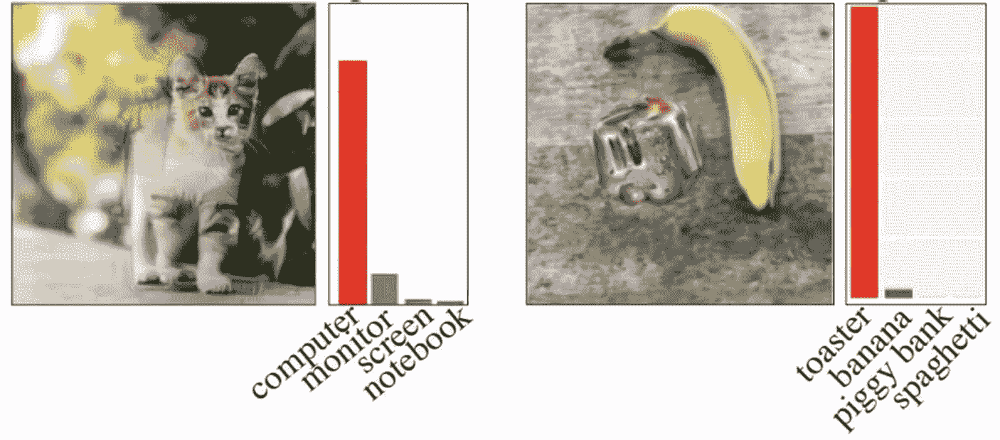

图 10-2 左侧的图像是一只猫，但已被修改得带有一些方块感。这导致用于识别该图像的模型将其判断为电脑。右侧的图像显然是一根香蕉，但该图像已被修改，在其左侧添加了一个物体，这导致模型将该图像识别为一个烤面包机

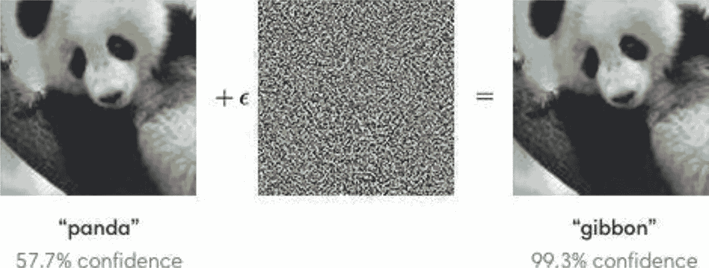

图 10-1 一个对抗性输入欺骗人工智能将熊猫误认为长臂猿的示例。该图像通过添加噪声被略微改变

### 降低风险

使用机器学习模型来发现滥用行为看似是个好主意。然而，攻击者改变策略来破坏机器学习模型，可能比你更新训练数据集和模型以应对这种新攻击更便宜、更迅速。

以下是一系列建议和注意事项，旨在降低与机器学习模型相关的风险，并促进其负责任地开发和使用。

*   **训练与测试**：在模型开发阶段整合强大的对抗训练技术。此过程涉及让模型接触训练数据集中各种对抗样本，以增强其抵御规避攻击的能力。在部署前还应进行严格测试，以评估模型的稳健性。这能确保模型能有效抵御那些潜在攻击。红队测试是测试机器学习模型的一种交互式方法，用于模拟攻击者可能利用的战术，以发现泄露敏感数据等漏洞。其目标是增强模型的稳健性。红队测试将在“道德考量”部分提及。

*   **数据清洗与验证**：在训练阶段，对数据进行清洗和验证以降低投毒攻击的风险至关重要。这包括实施严格的数据验证规则和机制，以检测并清除不适当的数据。对训练数据集进行定期审计有助于识别并移除任何可能损害模型完整性的受损数据。

*   **自适应安全措施**：采用自适应安全措施，在模型部署期间持续监控和分析模型行为，以检测表明存在对抗性攻击的异常活动。使用异常检测算法和入侵检测系统来实时识别并响应威胁。

*   **协作与信息共享**：在组织内部对人员进行人工智能相关风险及各类对抗性攻击的教育。通过鼓励主动采取防护措施、定期更新软件、应用安全补丁以及遵守 AI 开发和部署的最佳实践，强调网络安全意识的重要性。

*   **教育与认知**：鼓励 AI 社区内的协作与信息共享，以传播关于新兴对抗性威胁及有效应对措施的知识。

### 道德考量

为对抗性研究建立道德准则并促进负责任的披露实践至关重要。

正如白宫所言，2023 年 10 月 20 日，拜登总统发布了一项行政命令以管理人工智能的风险。该命令要求，对国家安全、经济安全或公共健康与安全有重大影响的人工智能系统，必须接受严格的安全测试和政府监管。通过这项行政命令，总统指示采取有史以来最全面的行动，以保护美国人免受人工智能系统潜在风险的侵害。以下是几项行动：

*   **最强大 AI 系统的开发者需与美国政府共享其安全测试结果及其他关键信息。**

    根据《国防生产法》，该命令将要求开发任何对国家安全、国家经济安全或国家公共卫生与安全构成严重风险的基础模型的公司，在训练模型时通知联邦政府，并分享所有红队安全测试的结果。这些措施将确保 AI 系统在公司公开发布前是安全、可靠且值得信赖的。

*   **制定标准、工具和测试，以帮助确保 AI 系统安全、可靠且值得信赖。**

    美国国家标准与技术研究院将为广泛的 AI“红队”安全测试设定严格标准，以确保其在公开前达到政府要求的护栏。国土安全部将在关键基础设施领域应用这些标准，并建立 AI 安全与保安委员会。能源部和国土安全部还将应对 AI 系统对关键基础设施以及化学、生物、放射、核能和网络安全风险构成的威胁。这些共同构成了任何政府为推进 AI 安全领域所采取的最重大行动。

*   **防范利用 AI 工程化危险生物材料的风险。**

    制定生物合成筛查的强有力标准。资助生命科学项目的机构将把这些标准作为联邦资助的条件。这创造了强大的激励措施，以确保进行适当的筛查并管理 AI 可能加剧的风险。

*   **通过建立检测 AI 生成内容和认证官方内容的标准与最佳实践，保护美国人免受 AI 驱动的欺诈和欺骗。**

    美国商务部将制定内容认证和水印指南，以清晰标记 AI 生成的内容。联邦机构将使用这些工具，让美国人更容易知道他们从政府收到的通信是真实的——并为私营部门和世界各国政府树立榜样。

*   **建立先进的网络安全计划，开发 AI 工具以发现并修复关键软件中的漏洞。**

    这建立在拜登-哈里斯政府正在进行的 AI 网络安全挑战赛的基础上。这些努力将共同利用 AI 可能改变游戏规则的网络能力，使软件和网络更加安全。

*   **指示制定一份《国家安全备忘录》，指导 AI 及安全方面的进一步行动。**

    该备忘录将由国家安全委员会和白宫办公厅主任制定。该文件将确保美国军方和情报界在其任务中安全、合乎道德且有效地使用 AI。它将指导采取行动，以对抗对手对 AI 的军事使用。

为了更好地保护美国人的隐私，包括 AI 带来的风险，总统呼吁国会通过两党数据隐私立法，以保护所有美国人，尤其是儿童。以下是一些被指示的行动：

*   **通过优先提供联邦支持以加速开发和使用隐私保护技术，保护美国人的隐私。**

    这其中包含那些利用尖端 AI 技术、并能在保护训练数据隐私的同时进行训练的 AI 系统。

    **加强隐私保护的研究与技术。**

    例如，通过资助一个研究协作网络来推动快速突破和发展，从而利用加密工具保护个人隐私。美国国家科学基金会也将与该网络合作，推动联邦机构采用领先的隐私保护技术（白宫，2023 年）。

类似地，欧盟也制定了名为《欧盟 AI 法案》的法规，对人工智能进行规范。

正如未来生命研究所提供的该法案高级别摘要所述，大部分规则适用于被视为高风险的人工智能系统。高风险系统涉及以下领域：生物识别、关键基础设施、教育与职业培训、就业、执法、移民、司法与民主进程，以及基本私人服务与基本公共服务及福利的获取和享受。根据规定，高风险 AI 提供者必须：

*   在 AI 系统全生命周期内建立风险管理体系
*   进行数据治理，确保训练、验证和测试数据集具有相关性、充分代表性，并尽可能根据预期目的做到无错误且完整
*   设计高风险 AI 系统，允许部署者实施人工监督
*   设计高风险 AI 系统，使其达到适当的准确性、鲁棒性和网络安全水平（《欧盟人工智能法案》）

这只是该文档中提到的部分规则。在本章中，我重点关注了那些我认为有助于在人工智能领域防范对手和滥用的规则。（《欧盟人工智能法案》）

除美国和欧盟外，其他国家也实施了相关规则和考量。中国的目标是到 2030 年成为领先的人工智能中心。《中国网络安全法》和《新一代人工智能发展规划》概述了人工智能中的数据保护和网络安全策略，重点关注合规性和主动风险管理。加拿大则制定了诸如“泛加拿大人工智能战略”和“加拿大人工智能委员会”等项目，以促进人工智能的负责任发展，并处理该领域内的伦理问题。

### 结论

对抗性攻击严重威胁着机器学习模型的可靠性和安全性。随着人工智能融入我们的生活，对抗性攻击的潜在后果也变得更加严重。为了减轻这些风险，需要采取多方面的方法。这包括强大的防御机制和持续的研究。这些攻击的潜在后果使得采用多层防御策略至关重要。在本章中，我们讨论了几种防御措施，可以减轻对手造成的风险，并为你的模型提供更好的保护，使其免受对手侵害。持续研究和改进安全实践的重要性怎么强调都不为过——新的攻击方法不断演变，需要持续的适应和创新。理解对手和滥用行为对于开发强大且安全的系统至关重要。通过研究工具、技术和示例，我们可以更好地预测潜在威胁，并制定缓解策略，从而创建更有韧性和值得信赖的人工智能系统。

## 与模型合作

### 引言

人工智能已不再局限于科幻小说的概念，它已成为我们日常生活和各行各业不可或缺的一部分。从 `Siri` 和 `Alexa` 等语音助手，到推动医疗保健和消费品创新的先进机器学习模型，人工智能的存在正日益渗透且不断增长。然而，伴随着这种快速进步，也出现了一系列的恐惧和误解。一些人担心人工智能会取代人类工作、侵犯隐私，甚至超越人类智力，达到无法挽回的地步。本章旨在解决这些担忧，强调我们为何应该拥抱而非恐惧人工智能。

### 技术发展的历史背景

回顾历史，重大的技术创新往往伴随着一定程度的怀疑和恐惧。例如，工业革命曾引发人们对机器取代体力劳动导致失业的担忧。同样，互联网的出现也带来了对隐私侵犯、失业和数据安全的恐惧。然而，随着时间的推移，这些技术被证明具有变革性，推动了经济增长，提高了生活质量，并创造了前所未有新就业机会。

人工智能代表着技术进步的又一次飞跃，有望带来巨大利益。人工智能的兴起正引发对失业的担忧，这合情合理，尤其是在涉及常规、重复性任务的领域。然而，人工智能也有潜力创造以前不存在的新角色，例如：人工智能维护、伦理管理、人工智能安全工程师、人工智能艺术总监和提示词工程师。虽然某些工作可能会被自动化，但其他工作将转向关注更难以被复制的人类技能。

理解这一历史背景有助于缓解恐惧，并为社会如何适应新技术并蓬勃发展提供了视角。只要以前瞻性的眼光、合乎道德的监督和平衡来管理，人工智能就可以成为一种变革性工具，能够提高生产力、创造新的角色并改善生活质量。

### 人工智能的优势：跨行业的变革潜力

#### 医疗保健：改进的诊断与个性化医疗

人工智能通过提高诊断准确性和实现个性化治疗方案，彻底改变了医疗保健领域。机器学习算法可以比人类放射科医生更精确地分析医学影像，捕捉到阿尔茨海默病等疾病的早期迹象。人工智能驱动的预测模型可帮助医生为患者量身定制治疗方案，提高医疗干预的有效性并减少副作用。

#### 教育：个性化学习

在教育领域，人工智能为学生提供了个性化的学习体验。智能辅导系统能适应个人学习风格和节奏，提供定制化的资源和反馈。例如多邻国（`Duolingo`）就是这样一个应用。多邻国是一款用于学习不同语言的应用程序。它根据学生的表现水平，提供适合其节奏和水平的听力、口语和阅读练习。

#### 制造业：自动化与预测性维护

人工智能通过自动化重复性任务和实现预测性维护来提升制造流程。由人工智能驱动的机器人提高了生产效率和一致性，而预测性维护模型则能预测设备故障，减少停机时间和维护成本。例如，亚马逊在其履约中心内与员工协同工作的机器人车队，用于运输货物；以及 `IBM` 的 `Maximo` 应用套件。该套件用于资产监控、预测性维护和可靠性规划等事务。

#### 日常生活：个人助理与智能家居设备

在我们的日常生活中，人工智能以 `Siri`、`Alexa` 和 `Google Assistant` 等个人助理的形式出现，通过管理日程、设置提醒和控制智能家居设备，让我们的生活更加便捷。这些进步凸显了人工智能通过自动化和智能辅助改善日常生活的潜力。

### 人工智能增强人类能力

人工智能真正的优势在于其增强人类智能和决策的能力。通过处理重复性和常规性任务，人工智能释放了人类的创造力、战略思维和问题解决能力。例如，在商业领域，AI 可以帮助识别市场和产品中的模式，从而支持更明智的决策；在医疗领域，AI 可以分析并提取文档中的文本，协助医疗专业人员更快地做出决策；在法律领域，AI 可以在海量信息中协助寻找与案件相关的法律文件。

此外，人工智能在各行各业提升了生产力。在设计和音乐等创意领域，AI 工具可以协助艺术家激发新想法、突破创作瓶颈。在科研领域，AI 能够通过分析复杂数据集、识别有助于突破的模式，来加速发现进程。通过增强人类能力，AI 有助于促进创新、推动进步。

然而，也存在负面影响。过度依赖 AI 进行决策可能导致批判性思维和解决问题能力的下降，因为人们可能会过于依赖 AI 系统来完成需要人类判断的任务。这在医疗或法律等领域尤其令人担忧，因为人类的监督对于确保合乎伦理的决策至关重要。应对这些风险的措施包括确保 AI 作为一种补充而非替代人类智能的工具。

### 成功的人工智能整合

#### 医疗健康

`Flo`是一款专注于女性健康的应用程序。它追踪月经周期、排卵、症状等信息。该应用使用机器学习算法，根据个人先前记录的信息（如年龄、经期日期和症状）来预测周期长度。它还提供个性化内容，如视频和文章，以教育最终用户。这些内容由健康和保健专家审核，以确保信息可靠。

#### 金融

`Betterment`是一个金融投资平台，利用 AI 根据用户的财务计划创建个性化档案。它使用算法实现交易、交易执行和投资组合管理的自动化。该公司成立于 2008 年。

#### 消费品

`iRobot`是一家消费级机器人公司。他们创造了一款名为`Roomba`的自主吸尘器。它使用机器学习算法绘制用户房产的地图。这有助于吸尘器在清洁时避开障碍物。最终用户还可以在应用中将生成的地图中的点标记为“清洁区域”，指示`Roomba`清洁这些特定点。例如，如果你的员工在办公室的`HC`房间用过午餐，你可以告诉`Roomba`“清洁`HC`桌下”。

### 应对常见的恐惧与误解

#### 人工智能对隐私的威胁：平衡创新与伦理考量

另一个常见担忧是人工智能对隐私构成威胁。如果管理不当，数据收集和分析可能导致隐私问题。然而，在创新与伦理考量之间取得平衡至关重要。实施强大的数据保护措施、网络安全要求以及透明的数据使用政策可以降低隐私风险。此外，如第 10 章所述，人工智能伦理方面的持续进步旨在确保 AI 系统尊重用户隐私并在伦理边界内运行。

#### 人工智能不可控力量的神话

确保对人工智能开发进行适当的监督和监管，有助于防止 AI 系统产生意外后果。《欧盟人工智能法案》和美国《关于人工智能的行政命令》是应对 AI 相关风险的监管框架和标准范例。

此外，人工智能联盟——一个由研究人员、开发者和组织组成的国际社区——正积极建设一个推动负责任 AI 创新的社区。他们的努力强调在保持科学严谨性的同时，确保信任、安全与多样性。

### 负责任的人工智能

负责任的人工智能是一种创建和部署 AI 系统的方法，旨在确保其符合伦理原则、法律要求和社会价值观。

### 理解偏见

图 11-1 至 11-6 展示了一些 AI 系统出错……非常严重出错的例子。

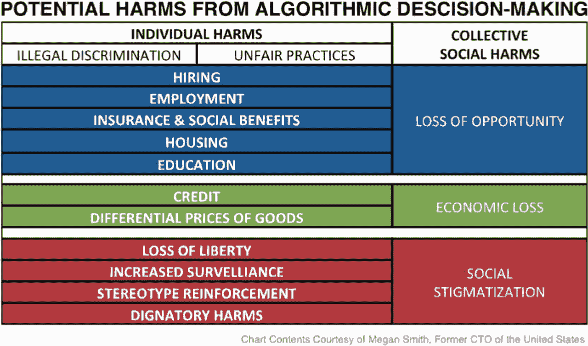

图 11-6 一张突显依赖算法危险性的图片，展示了这些系统如何导致机会丧失、经济损失和社会污名化，从而加剧不平等和社会危害。


图 11-5 一张展示因虚假面部识别匹配导致一名无辜黑人男子被错误监禁的社会不公图片。这强调了 AI 系统中的种族偏见问题。


图 11-4 一张展示乔伊·布奥兰维尼演示 AI 系统种族偏见的图片。该面部识别技术直到她戴上白色面具才识别出她的脸。


图 11-3 一张展示 Twitter 自动裁剪图片存在偏见的图片。它始终优先显示白种人的面孔而非黑种人面孔。


图 11-2 一张记录大卫·海涅迈尔·汉森指控 Apple Card 存在性别歧视的图片，由此引发了关于信用额度基于性别存在偏见的讨论。

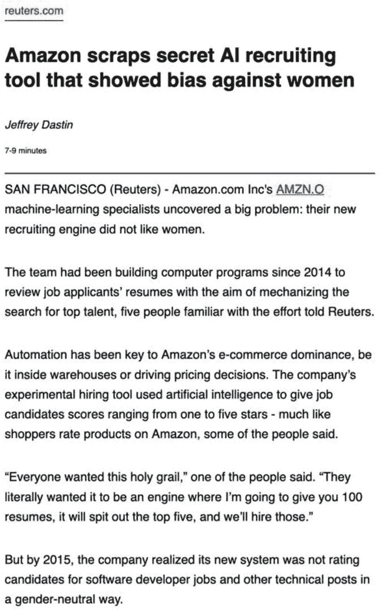

图 11-1 这张图片描述了亚马逊因偏见问题而放弃了一款 AI 招聘工具。这凸显了对招聘实践中不公平待遇的担忧，这种情况可能会加剧。

### 缓解偏见——人在回路方法

人在回路是一种协作方法，在 AI 系统的整个生命周期中融入人类的专业知识和输入。人类在训练、评估和管理系统等方面扮演着积极角色。这提供了关键的指导、反馈、数据标注和透明度。让人参与其中的目的是通过利用人类和机器学习模型的优势，提高 AI 系统的准确性、可靠性和适应性。随着模型变得越来越复杂并被社会广泛采用，人类的参与对于确保机器学习模型做出的决策在伦理上合理至关重要。目标是避免 AI 系统做出有害决策，正如上文“理解偏见”部分所示。

#### 人类参与回路的方式（包括但不限于）

*   在数据集输入机器学习算法前后，提供数据标注、数据质量保证。
*   向机器学习模型提供反馈。

#### 人在回路的好处

*   增强可靠性
    *   人类监督对于协助确保模型的可靠性至关重要。
*   透明性
    *   人类需要对其在机器学习过程中参与的每个步骤有一定理解。
*   缓解偏见
    *   人类成为决策过程的一部分，这有助于识别和缓解模型输出及训练数据集中潜在的偏见。
*   就业机会
    *   这可以为人们带来新的工作机会，强调尽管这项技术可能会取代一些工作，但它也能为人们带来新的就业机遇。

#### 人在回路中的挑战

在做出决策之前，必须全面审视问题的各个方面，以理解其中的权衡取舍。此过程中出现的一个主要挑战是速度。流程不再完全自动化。然而，系统输出变得更加可靠。这个流程可能会降低规模并增加成本。但是，系统的可靠性和来自客户/最终用户的信任有潜力得到提升。根据任务的不同，另一个挑战是人类也可能带有自身的偏见。不过，缓解这一问题的一种方法是，让一群背景多样的人依据一套商定的规则/要求来进行评估、提供反馈和标注数据集。

### 减少偏见——为何多样性至关重要

数据科学和机器学习团队的多样性对于识别和解决潜在偏见至关重要。拥有不同教育背景的人，以及来自不同性别、种族和拥有不同生活经历的人，能带来独特的视角和观察，使团队能够预见并缓解在开发 AI 系统过程中可能被忽视的挑战。这可以为企业避免声誉受损，并可能避免被起诉。

### 建立信任与透明度——伦理 AI：确保公平性、问责制和透明度

AI 的伦理部署对其被接受和取得成功至关重要。伦理 AI 包含公平性、问责制和透明度原则。公平性确保 AI 系统不会歧视个人或群体，而问责制要求开发者和组织对其 AI 系统的结果负责。透明度涉及让用户和利益相关者能够理解 AI 系统的工作原理。这将促进信任和知情决策。

目前已经制定了多项举措和框架来推广伦理 AI。例如，在第 10 章中提到的，美国总统拜登于 2023 年发布了关于 AI 的行政命令；欧盟的 AI 法案以及全球其他地区都为开发 AI 系统提供了一套全面的要求。这些指导方针强调了技术稳健性、隐私和透明度，确保 AI 系统在使社会受益的同时将风险降至最低。

### 教育与公众参与的作用

对公众进行 AI 及其益处的教育对于消除恐惧和促进接受至关重要。公众参与计划可以揭开 AI 的神秘面纱，消除误解并突出其积极潜力。与社区组织、地方政府和非营利组织的合作可以在接触不同人群方面发挥关键作用，确保每个人都能获得准确信息，并感到被纳入讨论范围。技术专家、政策制定者和公众之间的合作对于确保 AI 发展符合社会价值观和需求至关重要。

关于 AI 进展及其影响的`透明`沟通能够促进信任和知情决策。公开的网络研讨会、在线课程和 AI 素养宣传活动可以进一步以易于理解的方式传播知识，让人们能够按照自己的节奏学习。与利益相关者进行公开对话有助于解决担忧，并确保 AI 系统的设计方式能够惠及整个社会。

### AI 的未来：机遇与挑战

AI 的未来前景广阔，新兴趋势和应用将彻底改变各个领域。例如，自动驾驶汽车、自然语言处理和机器人技术领域的 AI 驱动进步将改变交通、通信、零售、教育、制造业以及其他领域。

在撰写本书时，苹果智能便是一个很好的例子，展示了 AI 未来可能实现的功能。

2024 年 6 月，苹果公司发布了苹果智能，这是一套该公司计划在其产品中实现的 AI 功能。他们计划实现许多功能。我将提及其中几个。他们推出的功能之一是数学笔记计算器。该计算器的功能之一是允许用户在数学笔记应用中书写数学方程时，实时求解这些方程。苹果智能的另一个功能是智能手写。这将通过实时拉直文本来提高使用苹果铅笔书写的笔记的可读性。这对于那些曾被赞扬“字写得像医生一样”的人来说，会有极大的帮助。

然而，伴随着这些机遇，也存在一些需要应对的挑战。确保 AI 的伦理使用、减轻 AI 模型中的偏见，以及管理 AI 应用带来的社会影响，这些都是需要重点关注的领域。例如，自主武器的研发引发了伦理问题。此外，各行业的岗位自动化有可能取代大量劳动力。通过主动应对这些挑战，我们可以充分利用 AI 的潜力来造福人类。这包括实施伦理监管（正如在第 10 章中所讨论的），以及让劳动者为 AI 驱动型经济下的新角色做好准备。

### 结论

总之，AI 是一种强大的工具，有潜力变革各个行业并增强人类能力。通过拥抱 AI 并解决常见的恐惧和误解，我们可以在确保伦理和负责任发展的同时，释放其全部潜力。技术发展的历史背景、AI 的切实益处，以及为推广伦理 AI 所做的持续努力，为我们以平衡的视角拥抱 AI 提供了令人信服的理由。展望未来，促进公众参与、教育利益相关者以及确保 AI 开发的透明度至关重要。通过这样做，我们可以创造一个 AI 造福全人类的未来，推动进步并提高生活质量。