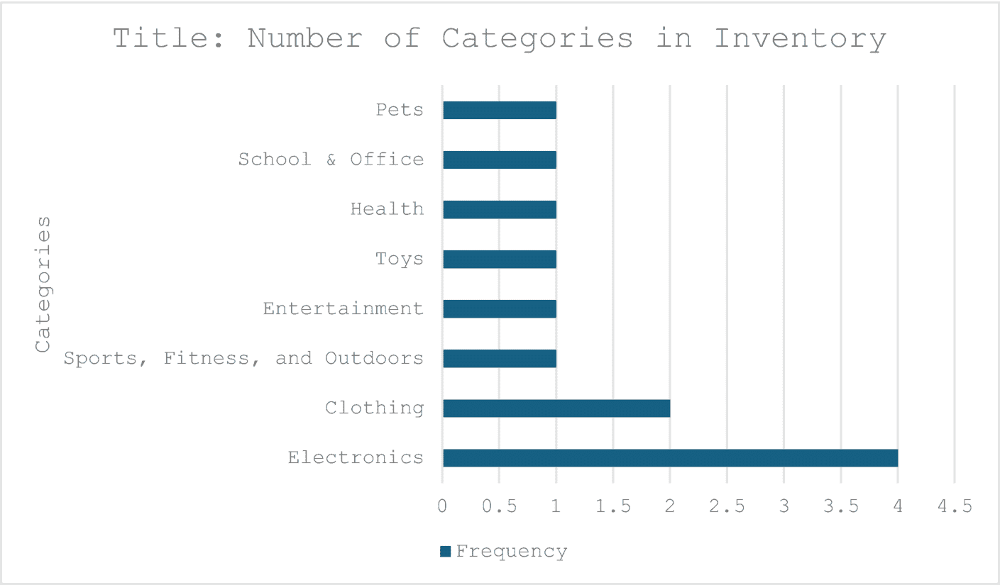
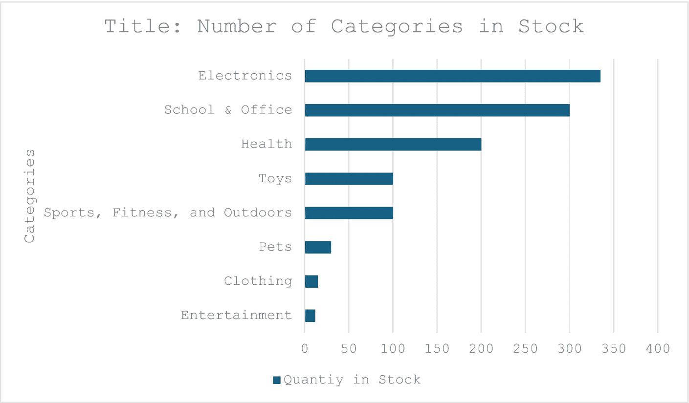
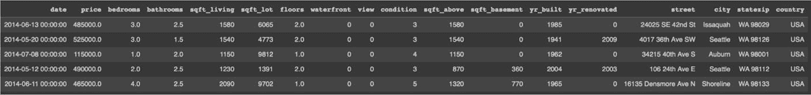
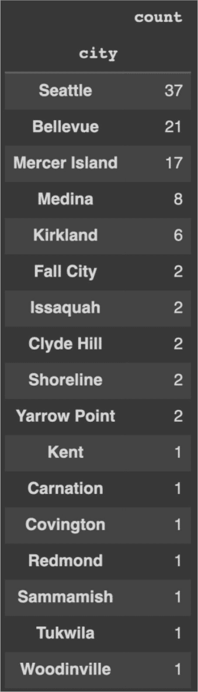
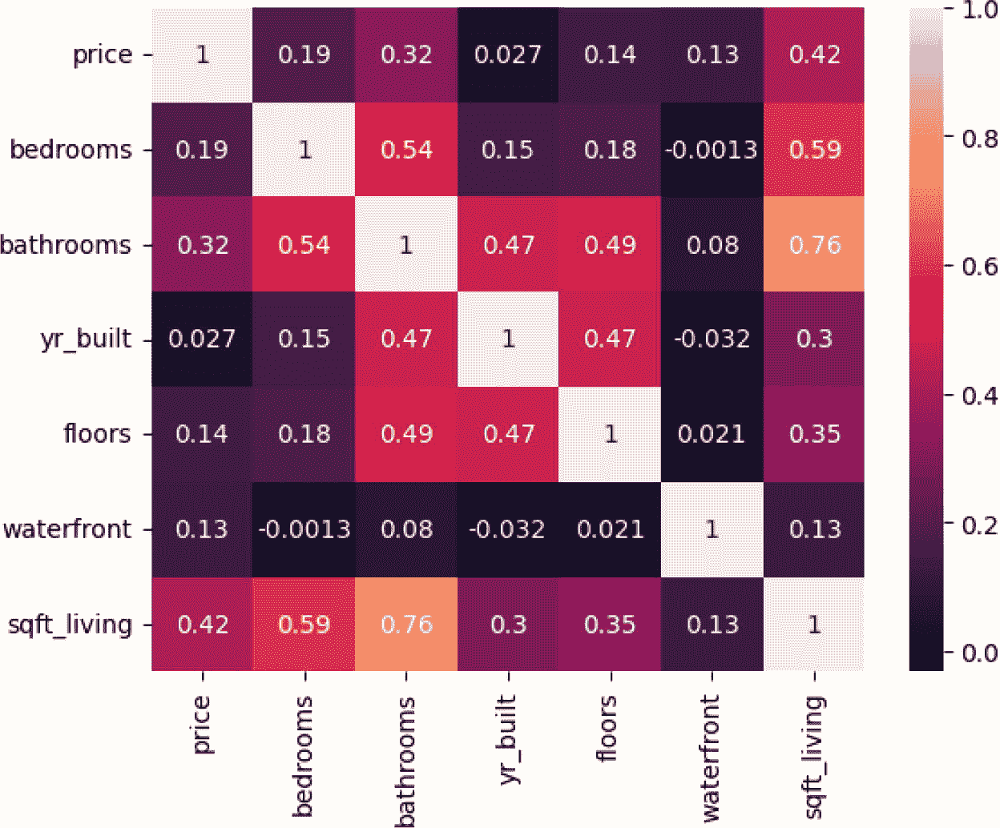
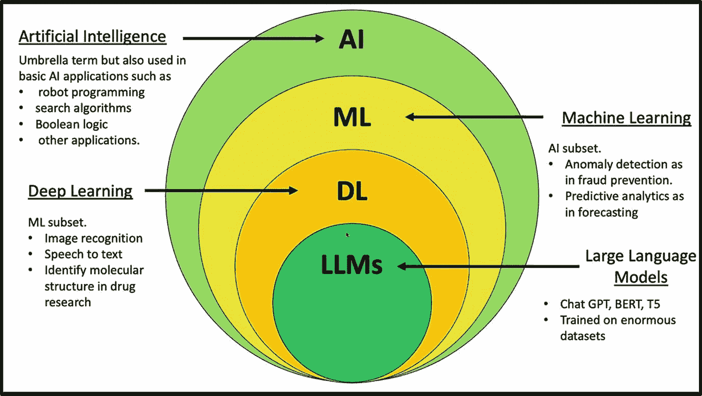

# 4. 探索性数据分析

在上一章中，我们讨论了什么是 ETL 流水线、其重要性以及如何实现它。一旦我们将数据加载到目标位置，接下来该做什么呢？有时，数据量可能非常庞大，令人难以确定从何处着手或结束。起初，你可能很难看出这些数据如何帮助你的组织。想象一下，你从过去继承了一个装满众多日志的宝箱。每本日志里都记载着故事、神秘的符号和地图。当你翻阅这些宝藏时，你意识到解开箱中秘密的关键在于理解并连接那些你发现的隐藏模式。同样，探索性数据分析就像翻阅一个数据宝库——每个数据集都是一组数字、变量和观测值的集合。正如你会仔细检查日志以破译其内容，从而拼凑出原作者的故事脉络一样，探索性数据分析涉及揭开层层表象，以获取隐藏于表面之下的洞察、趋势和异常。

## 探索性数据分析简介

在数据分析、数据科学和人工智能的广阔领域中，有一个关键步骤既像指南针又像放大镜——那就是探索性数据分析（`EDA`）。就如同经验丰富的探险家在勘测未知领域一般，`EDA` 深入数据集，挖掘隐藏的洞察与理解的瑰宝。在本章中，我们将踏上一段穿越数据探索领域的旅程，理解其重要性和变革力量。

探索性数据分析的本质在于其揭示数据褶皱中隐藏故事的能力。它是一种深入表面、仔细审视的艺术，旨在寻找潜伏其中的模式、异常和趋势。通过创建一个包含多样化统计分析技术、可视化工具和领域知识的工具箱，你能够为那些表面看似缺乏活力的数据集注入生机。你将把行与列转化为关于发现与启发的叙事。从消费者行为的奇特习性到金融市场的复杂动态，`EDA` 充当着数据诉说真相的管道。

此外，探索性数据分析不仅仅是通向更复杂分析的技术序曲，更是一段验证与发现的重要旅程。它是锻造假设、挑战假设、提炼洞察的熔炉。通过对数据质量和变量间关系的批判性观察，`EDA` 提供了基于证据的基础，数据分析和数据科学以及人工智能的稳健工具正是在此之上构建的。从本质上讲，它是在不确定性的汹涌海洋中指引你的灯塔，照亮通往知识和理解的道路。

数据分布描述了数据点在一个数据集中的散布方式。这可以显著影响在 `EDA` 过程中所使用的方法。常见的分布包括但不限于：

-   **正态分布**：正态分布也称为高斯分布，它是对称的，大多数数据聚集在均值附近。它形成一条钟形曲线，其中远离均值的值在数据中越来越罕见。在这种情况下，使用计算均值或标准差等标准技术来概括数据是有效的。
-   **偏态分布**：当数据不是对称分布时，它要么是右偏态，要么是左偏态。这种偏斜会影响如何选择汇总数据的方法。例如，在偏态分布中，均值可能具有误导性。因此，应使用中位数来更准确地代表中心值。直方图或箱线图等可视化方法可以突出显示这些模式。
-   **均匀分布**：在均匀分布中，每个结果出现的概率均等，因此在可视化时呈现矩形形状。传统技术可能不适用于这类数据，因为数据的任何单独区域都不占主导地位。

通过识别数据分布，你可以定制你的方法。那些对正态分布数据效果良好的技术可能不适用于偏态或均匀数据。

### 探索性数据分析的重要性

探索性数据分析之所以重要，有以下几个原因。下面，我将列出几个值得考虑的原因：

#### 1. 理解数据

它有助于科学家和分析师理解一个或多个数据集的结构、内容和关系。`EDA` 通过揭示模式、趋势和潜在偏差，为进一步的分析奠定了基础。它指导着分析的方向和提出的问题，从而驱动可操作的见解。

`EDA` 的一个关键要素是理解相关系数，它衡量两个变量之间关系的强度和方向。例如，皮尔逊相关系数衡量两个变量遵循线性关系的紧密程度。当两个变量具有线性关系时，意味着随着一个变量的增加或减少，另一个变量会以恒定速率增减，在图形上形成一条直线。皮尔逊相关系数的取值范围为 -1 到 1，其中越接近 1 的值表示越强的正线性关系，越接近 -1 的值表示越强的负线性关系，而 0 表示没有关系。正关系是指当一个变量增加或减少时，另一个变量朝相同方向移动。负关系是指当一个变量增加或减少时，另一个变量朝相反方向移动。

并非变量间的所有关系都是线性的。在某些情况下，变量可能仍然彼此相对地朝一致的方向移动，但并非以恒定速率。这被称为单调关系。在单调关系中，随着一个变量增加，另一个变量可以增加或减少，但不一定以恒定速率。例如，关系可能是弯曲的。在处理单调关系时，皮尔逊相关系数可能无法准确捕捉到关联的强度，这时就可以使用斯皮尔曼等级相关系数。斯皮尔曼相关系数衡量的是关系的一致性，而非其严格的线性。

`EDA` 允许分析师验证统计模型和方法所依据的假设。通过检查数据分布、相关性和其他属性，科学家可以确保他们的分析是适当且值得信赖的。

#### 2. 数据质量评估

评估数据质量使我们有机会发现任何额外的异常值、错误的数据条目、缺失值以及在 ETL 管道的转换部分可能遗漏的不一致性。这确保了所处理的数据对于分析和解释来说是可靠且准确的。

#### 3. 沟通与数据可视化

这使得您能够清晰、简洁地向领导层和利益相关者传达数据信息。对复杂数据的可视化展示，使其对公众和领导层来说更易于接触和理解。

#### 4. 特征选择与工程

在你完全理解你的数据之后，就更容易理解哪些数据对于下一步是必要的。在模型开发方面，并非所有模型都需要你的全部数据。你的数据越精简，你的模型就越能专注于分析那些你交给它解决的任务中真正重要的内容。即使作为人类，如果你只获得与问题相关的信息，而不是提供过多的信息，也更容易解决问题。

`EDA` 有助于识别用于预测建模和决策任务的相关特征或变量。它还通过对数据进行转换或组合来激发新特征的创建，从而增强模型的预测能力。

`EDA` 主要有三种类型：

| 产品编号 | 产品名称 | 类别 | 库存数量 | 价格 |
| --- | --- | --- | --- | --- |
| 0001 | 产品 1 | 电子产品 | 200 | 124.56 |
| 0002 | 产品 2 | 服装 | 15 | 45.21 |
| 0003 | 产品 3 | 电子产品 | 35 | 124.56 |
| 0004 | 产品 4 | 运动、健身与户外 | 100 | 54.21 |
| 0005 | 产品 5 | 娱乐 | 12 | 34.56 |
| 0006 | 产品 6 | 玩具 | 100 | 124.56 |
| 0007 | 产品 7 | 健康 | 200 | 4.99 |
| 0008 | 产品 8 | 学校与办公 | 300 | 45.21 |
| 0009 | 产品 9 | 宠物 | 30 | 32.01 |
| 0010 | 产品 10 | 电子产品 | 100 | 124.56 |

### 1. 单变量分析

单变量分析顾名思义。在进行这种分析时，您一次只探索一个变量。处理数据时，理解数据的内容可能会让人不知所措，因此一种方法可以是分别查看每个变量。单变量分析允许您总结并识别大量数据中的模式。您可以使用图表（例如条形图或频率分布表）来描述该变量中的数据。

假设您负责审查公司的库存数据库，并需要找到一种更好的方法来现代化其数据管理流程。为此，您需要了解数据中已经包含了什么。您找到的第一个数据集如下表所示。

乍一看，可能很难从这个数据中识别出关键见解，以了解其对公司的价值。我们可以使用单变量分析来剖析这些数据，以便更好地理解。您可以关注这些列中的任何一列，但对于此示例，让我们关注变量 `Category`。

| 类别 |
| --- |
| 电子产品 |
| 服装 |
| 电子产品 |
| 运动、健身与户外 |
| 娱乐 |
| 玩具 |
| 健康 |
| 学校与办公 |
| 宠物 |
| 电子产品 |

我们可以通过这个变量来观察各类别的频率分布。

| 类别 | 频率 |
| --- | --- |
| 电子产品 | 4 |
| 服装 | 2 |
| 运动、健身与户外 | 1 |
| 娱乐 | 1 |
| 玩具 | 1 |
| 健康 | 1 |
| 学校与办公 | 1 |
| 宠物 | 1 |

在这里，我们可以看到我们的库存中有更多电子产品。接下来，我们可以将此信息添加到条形图中，以便更直观地展示数据。



**图 4-1** 条形图显示数据集中各类别的数量

然后，我们可以针对上表中的每个变量继续进行相同的单独分析，以理解数据。

### 2. 双变量分析

双变量分析是对两个变量进行分析，以确定它们之间的关系。使用上表中的例子，我们可以分析类别和库存剩余数量之间的关系。我们也可以分析产品和价格之间的关系。其他例子包括，我们可以观察养宠物与情绪健康之间的关系。我们还可以分析金钱与幸福之间的关系。



**图 4-2** 条形图显示我们库存中各类别的当前库存数量

### 3. 多变量分析

多变量分析涉及分析两个以上的变量，以确定它们之间的关系。它能够识别多个变量间的模式，并提供考虑多种因素的优点。它检查数据中影响主要结果的不同方面。

## EDA 的步骤

前三个步骤与 ETL 过程相关。

### 1. 数据收集

在当今世界，医疗、体育、制造业等诸多领域产生了海量数据。通过深入分析来利用数据价值的认识，在商业界已成为共识。然而，这种分析的有效性取决于从各种来源（如调查、社交媒体以及特定行业数据，如医疗记录）收集必要的数据。没有获取充足且相关的数据，后续工作便无法启动。

### 2. 识别并理解所有变量

随着分析之旅的开启，焦点便落在了可用数据宝库上，这些数据蕴藏着等待发掘的见解。数据环境中存在着代表无数特征或模式的动态数值，它们构成了理解与启发的基石。关键的第一步是识别那些对结果有影响的主要变量，并辨别它们潜在的影响。这一关键步骤为任何分析工作实现最终目标奠定了基础。

### 3. 数据集清洗

此步骤涉及精炼数据集，包括剔除空值和不相关数据。这种精炼确保数据只保留与分析目标相关的信息。这不仅节省了时间，还能在制定项目预算时减少计算资源的需求。数据预处理处理一系列问题，从标记空值到识别离群值和异常值，确保数据集为分析做好准备。

### 4. 检测相关变量

发现变量之间的相关性可以洞悉它们之间的关系。相关性矩阵显示了数据集中变量之间的相关系数。其值范围从 -1 到 1，其中 -1 表示变量间关系较弱，0 表示无关系，1 表示关系较强。相关性矩阵全面展示了这些联系，有助于理解变量间关键的内在关系。这在 EDA 过程中并非总是必需，但在选择用于训练机器学习算法的变量时可能有用。

### 5. 选择合适的统计技术

根据数据的性质（是分类数据还是数值数据）、数据量、变量类型以及分析目标，会使用各种统计工具。虽然应用于数值数据的统计公式很有价值，但图形化表示通常更吸引人，也更容易解释。

### 6. 结果的可视化与检查

完成分析后，必须彻底审查研究结果，以确保解释的准确性。观察数据趋势和变量间的相关性，为对数据参数和业务决策进行必要调整提供了宝贵见解。一位精通所有相关分析技术的技能娴熟的数据分析师或数据科学家，对此过程至关重要。

## 探索性数据分析（EDA）的工具与技术

有几种常用工具用于执行 EDA。这些工具使得检测模式、发现异常、检验假设和检查假设变得更容易。

### Python

在上一章中，我们提供了一些使用 `Python` 的例子。`Python` 目前是完成人工智能和数据科学任务最流行的编程语言之一。这是因为其语法易于阅读、拥有丰富的库、跨平台兼容性强以及强大的社区支持。这使得初学者和经验丰富的程序员都能更轻松地编写和理解代码，并促进了更快的开发与协作。

### R

`R` 是另一种流行的编程语言。它主要用于统计分析和数据可视化。它提供了广泛的数据处理、可视化和统计建模工具。对于统计学家和数据科学家来说，它是一种必不可少的工具。

## Tableau

`Tableau` 是一款用于报告和分析大量数据的流行工具。它使用户能够创建各种图表、图形、地图、仪表板和故事，以实现全面的数据可视化和分析。`Tableau` 强大的数据发现和探索功能允许用户快速回答重要问题并做出明智的业务决策。它不需要任何编程知识，使得无论技术经验如何，任何人都能立即上手使用。

## Power BI

`Power BI` 是另一款不需要编程知识的流行工具。与 `Tableau` 类似，它也用于报告和分析数据。它提供了一套业务分析工具，用于创建数据可视化并在组织内共享见解。

### 带代码的示例

我将在以下示例中使用 `Python`。你可以使用免费软件应用程序（如 `Jupyter Notebooks`、`Google Colab` 甚至 `Visual Studio Code`）进行同步操作。

#### 安装

1.  导入所需的库。

```python
```

# 数据分析：美国房价数据集

## 2. 查看数据

我们在此示例中使用的数据是关于美国房价的。该数据包含超过 4000 行。该数据集可在 Kaggle 上找到：[`https://www.kaggle.com/datasets/fratzcan/usa-house-prices`](https://www.kaggle.com/datasets/fratzcan/usa-house-prices)。

让我们通过运行以下代码，使用 `pandas` 加载数据集：

```bash
pip install pandas
```



**图 4-3** 数据集中随机样本的图像

```python
housing_data = pd.read_csv("USA Housing Dataset.csv")
```

数据的时间范围是从 2014 年 5 月到 2014 年 7 月。该数据集中有 18 列：



**图 4-4** 全国房价最贵城市列表及其对应价格房屋数量的图像

## 3. 探索数据

我们可以创建许多图表、表格和图形来帮助我们更好地可视化数据以理解它。让我们通过查看哪些城市的房价超过 150 万美元来探索数据。

```python
housing_data[housing_data["price"]>1500000][["city"]].value_counts()
```

在这里，我们可以看到在我们的数据集中，有 17 个城市有售价超过 150 万美元的房屋。在这份列表中，西雅图的房屋数量最多，有 37 套。

该数据集包含以下列：

- `date`：房产售出日期
- `price`：房产的售价
- `bedrooms`：房屋的卧室数量
- `bathrooms`：房屋的浴室数量
- `sqft_living`：生活区的平方英尺面积
- `sqft_lot`：地块的平方英尺面积
- `floors`：房产的楼层数
- `waterfront`：一个二元指标，表明房产是否有水景
- `view`：对房产景观质量的 0–4 等级评分
- `condition`：对房产状况的 1–5 等级评分
- `sqft_above`：地下室以上部分的平方英尺面积
- `sqft_basement`：地下室的平方英尺面积
- `yr_built`：房产建造的年份
- `yr_renovated`：房产最近一次装修的年份
- `street`：房产的街道地址
- `city`：房产所在的城市
- `statezip`：房产所在的州和邮政编码
- `country`：房产所在的国家

## 4. 查看变量之间的相关性

这个表格中有 18 列，但为了保持示例简单，我们只关注其中六个：

- `price`
- `bedrooms`
- `yr_built`
- `floors`
- `waterfront`
- `sqft_living`

你可以使用其他变量，但可能需要清理数据并重新格式化才能使用它们。



**图 4-5** 显示房价数据集中几个变量之间关系的相关矩阵

```python
correlation_matrix = housing_data[["price","bedrooms","yr_built","floors","waterfront","sqft_living"]].corr()

sns.heatmap(correlation_matrix, annot=True)

plt.show()
```

# 5. 机器学习模型

人工智能（AI）旨在让计算机系统足够智能，以完成通常需要人类思考的任务，例如理解语音、做出决策和识别模式。AI 是一个总称，涵盖了机器学习、自然语言处理等不同技术。



图 5-1

图片来源于 LinkedIn Pulse 上的博客文章《“AI-ML-DML-GEN AI - 根据价格排序”》，展示了人工智能（AI）、机器学习（ML）、深度学习（DL）和大语言模型（LLM）之间的层级关系（[人工智能、机器学习与深度学习关系图]，2024 年 4 月 23 日）

本章我们将聚焦于机器学习。机器学习模型是人工智能领域的关键组成部分。这些模型使系统能够从数据中学习、识别模式，并在最少人工干预的情况下做出决策。它们通过提供前所未有的自动化和预测能力，彻底改变了各个行业。自动化复杂流程并从海量数据集中获取可操作洞察的能力，已经革新了从医疗、金融到零售和交通等众多领域。

机器学习与数据分析和数据科学领域紧密相连，后两者的重点是收集、处理和分析数据，如前面章节所述。数据科学提供了从原始数据中提取有意义洞察的工具和技术，而机器学习则利用这些洞察进行预测并推动决策制定。在分析大型数据集、识别趋势以及确保我们在训练阶段拥有模型将在现实世界中遇到的代表性数据时，数据分析的作用尤为明显。这有助于创建不仅能进行预测，还能理解数据内部复杂关系的模型。

从这个意义上说，数据科学、数据分析和机器学习是相辅相成的：数据分析和数据科学帮助我们理解和解读数据，而机器学习则通过进行预测和自动化决策，帮助我们基于数据采取行动。

确保机器学习模型的高效性取决于训练数据的质量。一个构建良好且经过精心整理的数据集，是机器学习算法识别模式、把握复杂关系以及理解细微信息的基石。因此，由此产生的模型能更好地做出与数据内在复杂性相符的预测。


