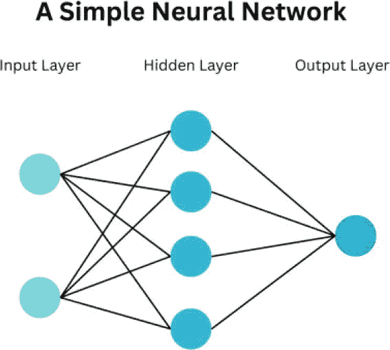
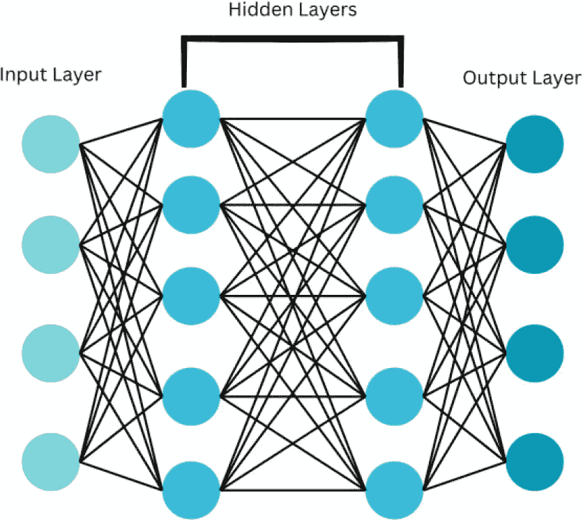
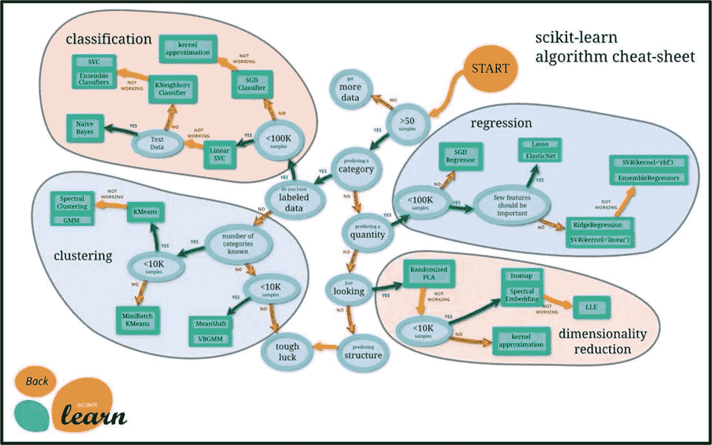
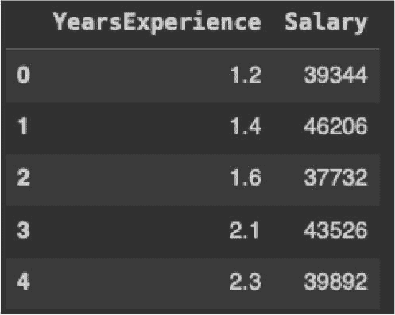
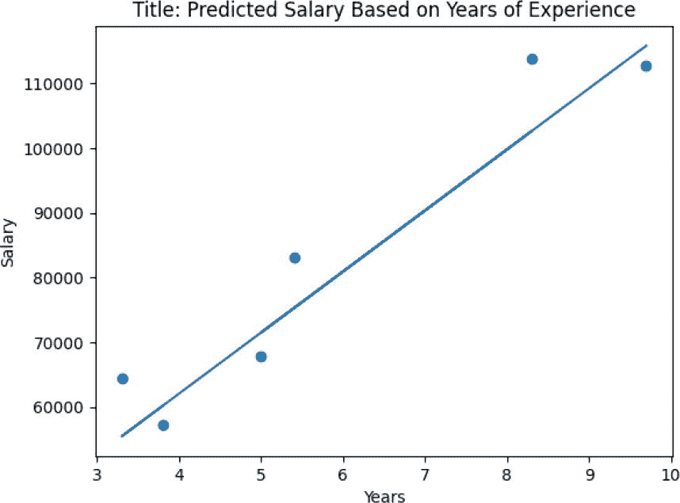

## 5. 机器学习模型简介

机器学习模型是现代数据科学的基石。它们通过使组件能够从数据中学习，并在无需显式编程的情况下做出决策或预测，推动了众多行业的进步。这些模型能够随着经验的增加自动提升性能，使其成为解决复杂问题的强大工具。

在继续之前，让我解释一下机器学习模型与算法之间的区别。机器学习算法和模型这两个术语常被错误地互换使用，这可能会让初学者感到困惑。

算法是为完成某项任务而设计的一系列步骤。在机器学习中，算法是在数据集上运行以识别模式和规则的程序。可以把算法看作过程，而模型则是这个过程所产生的最终产物。模型利用算法从数据集中学习。换句话说，模型是对数据集进行拟合。所有这些过程的输出就是一个捕捉了这些模式的机器学习模型。你可以将模型视为一个应用程序或程序，你可以用它输入数据来进行预测或做出决策。算法是实现模型学习的关键，但一旦学习完成，模型就独立存在，成为对新的、未见过的数据进行未来预测或决策的工具。

这些模型生成的预测有助于你为业务做出数据驱动的决策。

`机器学习模型 = 数据 + 算法`

其核心在于，机器学习涉及使用算法在数据集上训练模型，以识别数据中的模式和关系。这个过程使模型在面对新的、未见过的数据时，能够做出预测或决策。根据模型训练的好坏程度，模型会以一定的准确度和置信度进行预测。机器学习算法有多种类型，每种类型适用于不同类型的任务：

## 监督学习

机器学习模型使用带标签的数据进行训练。这意味着数据被标记了正确答案。可以把这种情况想象成模型在有老师指导的情况下学习。数据包含输入和正确的输出，以帮助模型更快地学习。

假设你想训练一个机器学习模型来预测一辆二手兰博基尼的价值。

你会有一个数据集，其中包含已知的输入和输出值，用于训练模型。例如，数据可能包括：

- 里程数
- 车型（例如轿车、SUV 等）
- 颜色
- 燃料类型（例如柴油、混合动力、电动、汽油）
- 价格

模型的输入将是里程数、车型、颜色和燃料类型，而输出将是价格。

一旦模型对数据集进行了拟合，或者说从这个数据集中学习完毕，就会输出一个使用监督算法训练好的机器学习模型。你可以向这个模型提供它从未见过的新数据，并获得关于汽车价格的预测。监督学习算法有多种类型。

### 监督学习算法的类型

#### 回归

回归算法预测连续变量，例如价格或温度。

用于回归的监督学习算法示例：
- `线性回归`
- `随机森林回归`
- `决策树回归`
- `支持向量回归`

#### 分类

分类算法预测离散变量，例如：
- 是或否
- 0 和 1
- 红色、紫色、蓝色
- 真或假

预测结果被归类到一组不同的选项中。

用于分类的监督学习算法示例：
- `支持向量分类`
- `K-近邻算法 (KNN)`
- `逻辑回归`
- `决策树分类`
- `随机森林分类`

### 监督学习的应用场景

- 时间序列市场分析
- 客户分析
- 人力资源分配

## 无监督学习

无监督学习算法接收未标记的数据集，在不事先了解数据的情况下，寻找信息中的相似性和差异性。例如，如果你正在查看一个二手兰博基尼的数据集，算法可以根据车型或颜色等相似性自动对汽车进行分组。这样，就能识别出数据中的聚类，例如将相同车型的汽车归为一组。

### 无监督学习算法的类型

#### 聚类

聚类算法通过在你的数据集中寻找模式来对数据进行分组。相似度最高的项目将被归入同一组。

一些使用聚类的无监督学习算法：
- `高斯混合模型`
- `K 均值`
- `孤立森林`

#### 关联规则

该算法找出数据集中数据点之间的关系。它能找到经常同时出现的项目集合。例如，买花的人往往也会买巧克力。

一些使用关联规则的无监督学习算法：
- `Apriori`
- `Eclat`

### 无监督学习的一些用例

- 确定客户画像
- 异常检测
- 对象识别

## 半监督学习

机器学习算法接收包含标记和未标记数据混合的数据集作为输入。通常，标记数据量很小，而未标记数据量很大。

### 工作原理

1. 使用标记数据训练模型。
2. 使用步骤 1 中部分训练的模型，对未标记数据进行训练以预测输出，这些输出被视为伪标签，因为它们可能不准确。
3. 将标记数据模型的预测输出与未标记数据模型的预测输出关联起来。
4. 将标记训练数据的数据输入与未标记训练数据的数据输入关联起来。
5. 再次训练模型以获得更准确的预测。

### 半监督学习的一些用例

- 在搜索结果中标记和排列网页
- 图像和音频分析

## 强化学习

机器学习算法被训练用于做出系列决策。其中存在一个主体（算法），以及伴随许多障碍的奖励。与有监督和无监督学习不同，强化学习没有预先提供的外部训练数据集。主体通过采取行动生成自己的训练数据。它通过试错来学习解决问题。主体会根据其做出的决定获得奖励或惩罚。目标是最大化奖励的数量。

### 强化学习的一些用例

- 视频游戏
- 自动驾驶汽车
- 定制化训练系统

## 深度学习模型

深度学习是机器学习的一个子集。它专注于具有多个层（因此称为“深度”）的神经网络，这些网络试图模仿人脑的结构和功能。这些层由相互连接的节点（也称为神经元）组成，这些节点协同工作以处理信息并做出决策。

`神经网络`：一种人工智能技术，通过模仿人脑的结构和功能使计算机能够处理数据。这种被称为深度学习的机器学习方法，涉及多层相互连接的节点或神经元，类似于大脑的神经通路。它形成了一个自适应系统，使计算机能够从错误中学习并随时间不断改进。

深度学习模型有很多层。最基本的神经网络有三个层。一个简单的神经网络如图 5-2 所示。



图 5-2 简单的神经网络可视化表示

1. 输入层：接收数据的第一层
2. 隐藏层：处理来自输入层输入的中间层
3. 输出层：产生预测或决策的最终层

深度学习网络具有多个隐藏层，其中多个节点相互连接，如图 5-3 所示。



图 5-3 深度神经网络的可视化表示

与传统的机器学习方法（需要数据科学家选择和创建帮助模型从数据中学习的重要特征）不同，深度学习方法可以自动独立地找出这些重要特征。它直接从原始数据中发现模式和细节，无需额外帮助。这使得它们非常擅长理解复杂信息。然而，如果你对当前的任务和数据具备一些领域知识，事先进行一些初步的特征选择和工程处理，以让模型“轻松一点”，也并无坏处！深度学习模型还需要更多的计算能力和更多的数据来进行训练。

### 关键概念与术语

- **前馈（Feed Forward）**：前馈神经网络是一种基础类型的神经网络，其特点是信息流方向单一。数据仅朝一个方向传输，从输入节点经过隐藏节点，最终到达输出节点。每个节点处理输入信息后将其传递至下一层。
- **反向传播（Backpropagation）**：反向传播是一种神经网络的学习方法。它好比教网络从错误中学习，通过计算输出与正确答案的偏差，然后调整网络参数，使其输出结果更接近正确值，从而帮助改进神经网络。
- **循环神经网络（RNN）**：RNN 是一种经过训练、能够处理序列数据（如一系列随时间发生的事件）的神经网络。这使得 RNN 能够根据输入的顺序做出预测或决策。例如，RNN 可通过分析历史价格和市场趋势来预测股价的变动幅度。RNN 的独特之处在于其具备“记忆”能力，这意味着它会利用早期输入的信息来帮助理解当前输入，从而产生正确的输出。与其他将每个输入单独处理的神经网络类型不同，RNN 依赖于序列的顺序。想象一下烤蛋糕的过程，步骤的顺序至关重要。如果不按顺序混合配料，就无法烤出蛋糕。同样，RNN 会记住步骤的顺序，并利用这些信息来预测接下来会发生什么。
- **长短期记忆网络（LSTM）**：LSTM 是一种特殊的 RNN，旨在解决常规 RNN 存在的问题。常规 RNN 在处理长序列信息时，难以记住细节。这使得将之前发生的事情与当前情况联系起来变得困难。LSTM 通过其自身结构设计解决了这个问题，它能够长期记住信息。事实上，长期保留重要细节正是 LSTM 所擅长的！
- **卷积神经网络（CNN）**，又名 ConvNets：CNN 通常用于目标检测和图像分类任务。
- **生成对抗网络（GAN）**：GAN 由两个神经网络组成：一个称为生成器，另一个称为判别器。生成器的任务是创建与训练数据集相似的新样本，而判别器的任务是区分真实样本和生成器生成的样本。“对抗”一词源于这两个网络被设置为相互竞争的关系。GAN 可用于基于现有图像集合创建新图像，或通过学习歌曲数据库生成新音乐。GAN 还可用于根据文本描述生成逼真的图像，或改进现有照片。此外，它们也能用于生成具有与真实数据相同特性的新合成数据。
- **Transformer**：Transformer 是一种神经网络，它通过理解序列中各部分之间的上下文和关系，将输入序列（如一个句子）转换为输出序列。与 RNN 和 CNN 等其他神经网络不同，Transformer 一次性处理整个序列，而非逐步处理，因此速度更快、效率更高。这意味着它们需要的训练时间更少，运行速度也更快。Transformer 有两个重要特性，使其在文本预测等任务中表现出色：
    1. **位置编码（Positional Encoding）**：Transformer 并非仅仅按照单词出现的顺序读取它们，而是为每个单词分配一个唯一的编号。这有助于模型理解句子中单词的顺序，这对于理解句意至关重要。
    2. **自注意力机制（Self-attention）**：此特性允许模型同时关注句子中所有单词之间的关系。模型学习哪些单词彼此重要，这有助于预测序列中接下来可能出现的内容。例如，Transformer 可以通过分析单词通常如何组合在一起，“学习”语法规则。
- **大型多模态模型（LMM）**：一种结合了大型语言模型（LLM）和多模态（MM）的深度学习模型。
- **检索增强生成（RAG）**：RAG 是一种通过从外部来源获取事实信息来提高机器学习模型准确性的技术。`LLM` 和 `LMM` 功能强大，可以执行问答、文档文本提取或语言翻译等任务，但它们也存在一些局限性。例如，它们只能使用被训练过的信息，这些信息可能过时或不完整。有时，如果模型不了解某件事，甚至可能给出错误答案。RAG 通过允许模型在给出答案前查询可靠的信息源来帮助解决这些问题。这使得模型能够提供更准确、更新的响应，而无需重新训练或微调。
- **生成式人工智能（GEN AI）**：一种能够根据用户的请求或提示创建新内容的深度学习模型。
- **大型语言模型（LLM）**：一种只能理解和生成文本数据的深度学习模型。
- **多模态模型（MM）**：一种能够处理不同模态（例如文本、音频或图像）的深度学习模型。模型是多模态的可能意味着以下一种或多种情况：
    1. 输入和输出的模态不同（例如，图像到文本）。
    2. 模型的输入是多模态的（即模型可以同时接受文本和图像）。
    3. 模型的输出是多模态的（即模型可以同时生成文本和图像）。



图 5-4 来自 `scikit-learn` 网站的指南，用于根据数据集大小、特征数量和解决的问题类型来帮助选择机器学习算法，如分类、聚类和回归（`scikit-learn` 算法速查表，无日期）

机器学习模型形式多样，各有优劣。模型的选择取决于具体问题、数据性质以及期望的结果。

## 机器学习模型的重要性

机器学习模型在各行各业都可能至关重要。

### 医疗保健

在医疗保健领域，ML 模型有助于提高诊断准确性、个性化治疗方案、预测患者结果以及辅助教育推广。例如，可利用深度学习模型分析医学影像，检测身体中的异常情况，如骨折和病变。模型在识别患有糖尿病、心脏病等慢性疾病风险的患者方面可发挥关键作用，从而实现早期干预，改善患者的生活预后。模型还可以加速从手写和扫描文档中提取患者信息的过程。

### 金融

金融领域可以通过多种方式应用机器学习模型，例如欺诈检测和预测。欺诈检测模型通过分析模式来识别欺诈行为，保护金融机构及其客户。在预测方面，机器学习模型可以分析市场趋势并预测潜在风险，帮助金融机构做出明智的决策。

### 零售业

机器学习可通过推荐系统、预测和库存管理来提升零售业的客户体验。通过分析客户行为与购买历史，推荐引擎能推荐符合个人偏好的商品，从而提高销售额和客户满意度。预测模型则可预测未来销售趋势，使零售商能够优化库存，减少因库存积压而产生的成本。

### 交通运输业

自动驾驶汽车和交通管理系统体现了人工智能在交通运输领域的变革性影响。无人驾驶汽车利用机器学习模型进行导航、物体检测和决策，旨在提升道路安全与效率。交通管理系统可通过分析实时数据，运用预测模型优化车流，从而缓解拥堵、缩短出行时间。该模型还可用于事件检测与管理。例如，可检测事故、逆行车辆以及酒后驾驶等异常行驶行为。这些信息可用于向相关部门发出警报。

### 市场营销

机器学习模型可用于分析消费者数据，以定位广告、细分市场并预测客户流失。这能帮助企业根据个人偏好与行为定制营销策略，从而提高活动效果与转化率。通过了解客户终身价值并识别潜在流失者，企业可主动实施留存策略，以维护忠诚的客户基础。

## 机器学习模型的工具与技术

### 编程语言

Python 是机器学习领域最流行的语言之一，以其可读性和丰富的库（例如 `TensorFlow`、`Keras`、`scikit-learn`、`PyTorch` 和 `Hugging Face Transformers`）而闻名。`Python` 的简洁性与多功能性使其成为初学者和经验丰富的从业者的理想选择。该语言支持快速原型设计与开发，使数据科学家和机器学习工程师能够快速高效地尝试不同算法与技术。

#### 框架与库

### TensorFlow

`TensorFlow` 是由谷歌开发的开源框架，用于构建和部署机器学习模型。它提供了灵活且全面的机器学习开发生态系统，包括模型训练、评估和部署工具。

### PyTorch

由 Meta 开发的 `PyTorch` 以其在研究与开发中的易用性而著称。`PyTorch` 深受研究人员和开发者的喜爱，常用于新想法的原型设计与实验。

### Keras

`Keras` 是一个用 `Python` 编写的高级神经网络 API，可运行在 `TensorFlow` 和 `PyTorch` 之上。它通过提供用户友好的 API 和完善的文档，简化了构建和训练深度学习模型的过程。对于希望快速开发与实验神经网络的初学者及从业者而言，`Keras` 非常有用。

### scikit-learn

`scikit-learn` 是一个用于回归、分类和聚类等经典机器学习算法的库。它提供了简单高效的数据分析与建模工具，在教育场景和实际应用中广受欢迎。`scikit-learn` 文档完善的 API 及其丰富的算法集合，使其成为实现标准机器学习任务的首选库。

### Transformers

`Hugging Face Transformers` 是一个开源库，简化了最先进机器学习模型的使用。它提供大量预训练模型，用于图像分类、命名实体识别和问答等任务。该库构建于 `PyTorch` 和 `TensorFlow` 之上，提供了便捷的接口来利用这些强大模型，使开发者和研究人员能轻松地将高级机器学习功能集成到项目中。

#### 集成开发环境

### Jupyter Notebook

`Jupyter Notebook` 是一个开源网络应用程序，支持交互式编码、可视化和机器学习模型的共享。它支持多种编程语言，并能与各类数据科学库无缝集成。`Jupyter Notebook` 使数据科学家能够记录工作流程、可视化结果，并以可重复的方式与他人协作。

### Google Colab

`Google Colab` 是一个免费的云服务，支持 `Jupyter Notebook`，并提供免费的 GPU 访问权限，因此非常适合进行机器学习实验。它提供了一个便捷的平台，用于开发和测试机器学习模型，无需复杂的设置或硬件资源。`Google Colab` 与 `Google Drive` 的集成功能，让笔记本和数据的存储与共享变得轻松。

其他可用于机器学习开发的 IDE 包括 Visual Studio Code 和 PyCharm。

#### 代码示例

在此示例中，我们将使用一个机器学习模型，根据工作年限来预测薪资。

1. 导入所需的库。

```python
```

# 简单线性回归示例

1.  首先，导入所需的库。

```python
import pandas as pd
from sklearn.model_selection import train_test_split
from sklearn.linear_model import LinearRegression
import matplotlib.pyplot as plt
import pickle
```

2.  加载数据集。此数据集可在 Kaggle 上找到：[`https://www.kaggle.com/datasets/abhishek14398/salary-dataset-simple-linear-regression`](https://www.kaggle.com/datasets/abhishek14398/salary-dataset-simple-linear-regression).



`图 5-5`：本示例所用数据集中的数据样本。这是数据集中的前几行。

```python
examp1_data = pd.read_csv("salary_dataset.csv")
examp1_data.head(5)
```

3.  我们将使用工作年限作为模型的输入，薪资作为模型的输出。

```python
x = examp1_data[["YearsExperience"]]
y = examp1_data[["Salary"]]
```

4.  我们首先需要分割数据集，以确保有足够的数据来训练和测试模型。通常，数据按照 80% 用于训练，20% 用于测试的比例分割。

我们将使用`x_train`和`y_train`进行训练，使用`x_test`和`y_test`测试模型。

`random_state`是一个参数，用于确保数据分割的可重复性。这意味着每次运行这行代码时，`x_train`、`x_test`、`y_train`、`y_test` 中分配的数据都是相同的，而不是随机的。

```python
x_train, x_test, y_train, y_test = train_test_split(x, y, train_size=.8, random_state=42)
model = LinearRegression()
model.fit(x_train, y_train)
```

5.  现在，让我们使用模型，根据模型从未见过的“工作年限”数据来预测薪资。这些数据已保存在变量`x_test`中。接下来，将预测结果保存在`lr_predictions`中，并将其绘制成图表。

```python
lr_predictions = model.predict(x_test)
```

6.  现在，绘制数据图表。



`图 5-6`：展示模型对未来十年薪资预测的图表。

```python
plt.scatter(x_test, y_test)
plt.plot(x_test, lr_predictions)
plt.xlabel("Years")
plt.ylabel("Salary")
plt.title("Title: Predicted Salary Based on Years of Experience")
```

7.  现在，保存模型以便后续使用。我们将其保存为一个 pickle 文件，命名为`lr_salary_determinator_model.pkl`。

```python
lr_model_pickle_file = "lr_salary_determinator_model.pkl"
with open(lr_model_pickle_file, "wb") as file:
    pickle.dump(model, file)
```

8.  现在，加载 pickle 文件，并再次使用之前`x_test`中的数据来运行模型。

```python
with open("lr_salary_determinator_model.pkl","rb") as file:
    model = pickle.load(file)
predictions = model.predict(x_test)
```

# 图像分类示例

在此示例中，我们将使用一个深度学习模型来识别图像中的动物。

1.  导入所需的库。

```python
from transformers import pipeline
from PIL import Image
```

2.  在此示例中，我们将使用一张动物图片。

```python
image = Image.open("ostrich.jpg")
```

3.  我们将使用 Hugging Face 上一个名为`google/vit-base-patch16-224`的模型。

```python
model_name= "google/vit-base-patch16-224"
image_classifier = pipeline("image-classification", model=model_name)
```

4.  将图像输入模型，等待其预测结果。

```python
image_classification_prediction = image_classifier(image)
```

5.  以下是模型的输出结果。它按置信度从高到低输出了五个预测。置信度最高的是鸵鸟，置信度为 0.99。模型的置信度得分范围通常是 0 到 1 或 0 到 100%。

```python
[{'label': 'ostrich, Struthio camelus', 'score': 0.9992263317108154},
 {'label': 'bustard', 'score': 9.642778604757041e-05},
 {'label': 'black stork, Ciconia nigra', 'score': 4.994613482267596e-05},
 {'label': 'zebra', 'score': 1.568139487062581e-05},
 {'label': 'flamingo', 'score': 1.4048618140805047e-05}]
```

# 6. 评估模型

评估机器学习模型就像检查食谱是否达到了预期效果。想象一下你在烤饼干，希望它们是我最喜欢的——柔软又有嚼劲！烤完后，你尝一口看看是否恰到好处。如果饼干太硬或太软，你就知道出了问题。同样地，当我们构建机器学习模型时，需要测试它以确保它按我们的预期运行。这种测试（即评估）能帮助我们判断模型是否做出了准确预测，或者是否需要调整"配料"以获得更好结果。

没有正确的评估，我们可能会信赖一个表现不佳的模型，就像端出味道不好的饼干。这可能导致错误的决策，尤其是当模型用于医疗等关键领域时。因此，评估模型有助于确保其可靠性，并值得信赖地做出正确决策。根据任务的不同，可以使用多种指标来评估机器学习模型。


