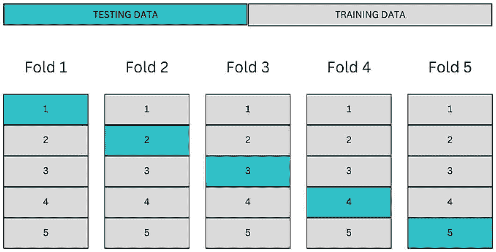
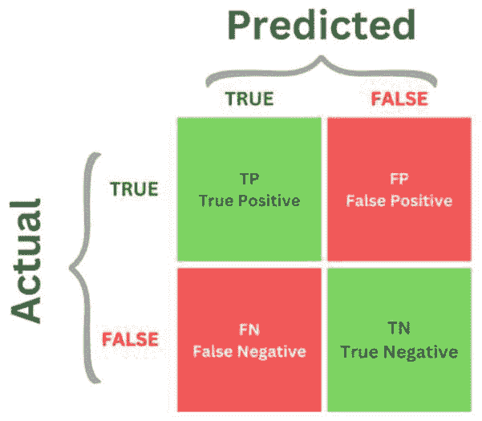
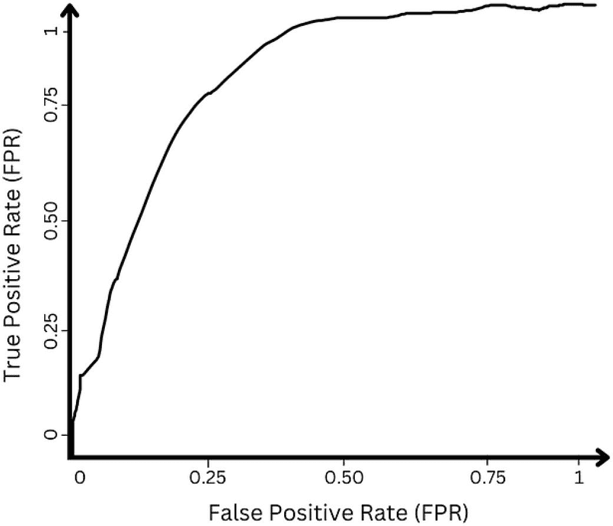
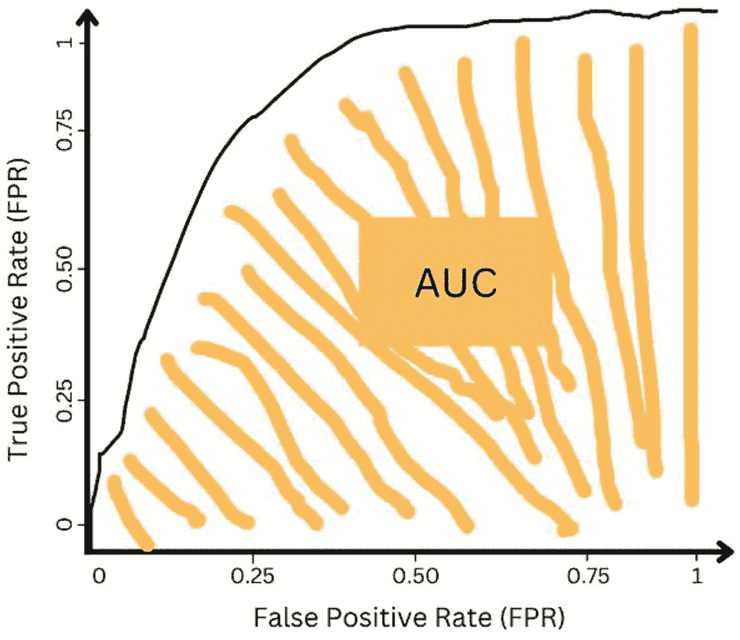
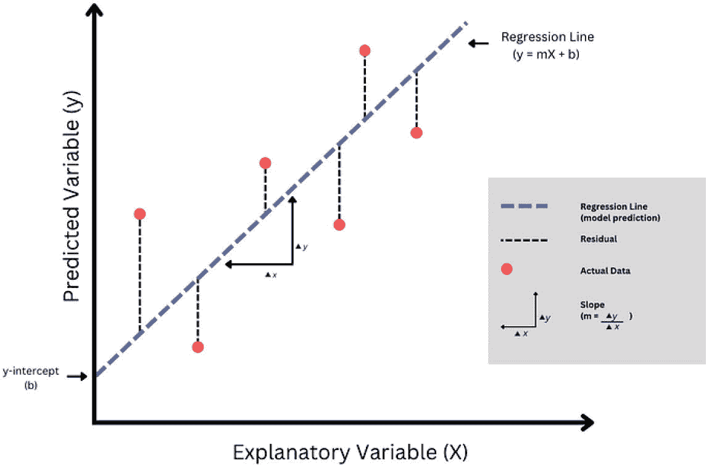
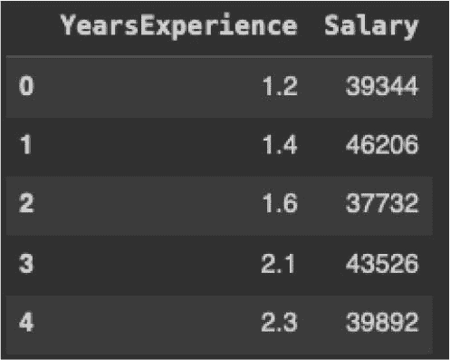
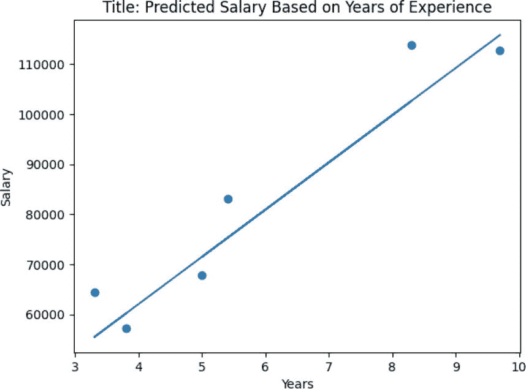
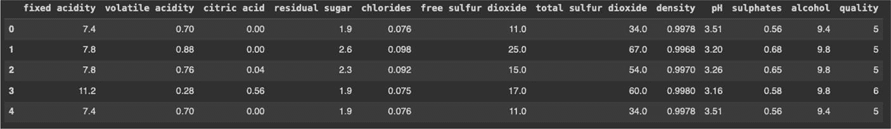
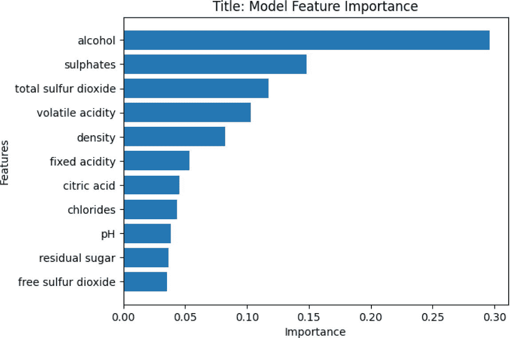

## 6. 评估模型简介

构建模型只是机器学习世界的起点。评估这些模型对于确保其在实际应用中的有效性和可靠性至关重要。模型评估涉及使用各种指标和技术来衡量机器学习模型在给定数据集上的表现。

## 评估模型的重要性

评估机器学习模型至关重要，原因如下：

1.  **性能评估**

    这有助于理解模型在未见过的数据上的表现，确保模型不仅记住了训练数据，而且能很好地泛化到新的、未知的信息。

2.  **模型比较**

    评估指标允许比较不同模型或算法，以便为特定任务选择性能最优的模型。

3.  **识别过拟合与欠拟合**

    过拟合发生在机器学习模型从训练数据中学习过多，近乎将其记住时。这意味着模型在处理熟悉数据时表现良好，但面对新信息时会遇到困难。就像学生死记硬背了考试的所有答案，却无法回答新问题一样。

    过拟合可能发生的一些原因：
    *   训练过程过长。
    *   训练数据不够多样化。
    *   模型对于数据过于复杂。

    欠拟合发生在机器学习模型没有从数据中学到足够知识，导致其在训练数据和测试数据上都表现不佳时。就像学生只粗略浏览了教科书，错过了关键概念。

    欠拟合可能发生的一些原因：
    *   训练时间不够长。
    *   模型对于数据过于简单。
    *   数据包含过多不必要的细节。

    找到过拟合与欠拟合之间的平衡点，是确保模型能处理好熟悉数据和新数据的关键。

4.  **超参数调优**

    假设你想教一个机器人识别猫。超参数就像你为机器人设定的学习规则。它们告诉机器人学习的速度（学习率）以及查看同一张图片的次数（轮次）。

    这与模型参数不同。模型参数是机器人从图片中学到的内容。它们就像机器人记住的关于猫的具体细节，比如耳朵的形状和毛色。

    超参数帮助机器人学习，而模型参数是机器人实际学到的东西。

    另一个类比是烤蛋糕。超参数就像你遵循的食谱。它们告诉你每种材料用多少（例如，两杯面粉）、蛋糕要烤多久（例如，30 分钟）以及烤箱的温度（例如，350°F）。这些是你在烤蛋糕之前做出的选择。

    而蛋糕本身就像模型参数。它们是遵循食谱的结果。蛋糕的具体风味、质地和外观取决于你遵循食谱的程度和食材的质量。

    所以，超参数指导了烘焙过程，而模型参数代表了最终成品。

    超参数的例子包括：
    *   `学习率`：决定算法在学习过程中更新其预测的速度。
    *   `权重衰减`：随着时间的推移逐渐降低学习率，以帮助模型更有效地学习。
    *   `轮次`：模型在学习过程中完整遍历整个训练数据集的次数。

5.  **部署就绪性**

    全面的评估能确保模型在部署到生产环境之前，达到必要的准确性和可靠性标准。

## 评估模型时的工具与技术

模型评估采用多种工具和技术，每种方法都适用于不同的问题类型与数据。下文将讨论机器学习模型评估中最常用的一些方法与指标。其中部分技术我曾在前几篇博客中讨论过，此处将继续补充定义和相关论述。



### 训练-测试集分割

训练-测试集分割是一种基础方法，将数据集分为两部分：训练集和测试集。模型在训练集上训练，并在测试集上进行评估以检验其性能。

### 交叉验证

交叉验证是将数据集分成多个子集，并在不同子集上训练模型，同时在剩余子集上进行评估。这有助于预估模型性能，并防止模型过拟合。该技术常用于确定模型的超参数。

交叉验证有多种类型。本书中将讨论 k 折交叉验证。

k 折交叉验证是指将数据集分成 K 组，利用这些组对模型进行 K 次训练和测试。每次迭代中，用于训练和测试模型的数据部分会轮换，直到完成第 K 次迭代。

#### 工作原理

1.  为 K 选取一个值，常用值为 10。
2.  将数据集分成 K 组。
3.  使用 K-1 组作为训练数据来训练模型，剩余 1 组作为测试数据评估模型。
4.  在训练数据集上训练模型，并在测试数据集上评估模型。
5.  使用评估指标（如`RMSE`、`MAE`、`accuracy`等）评估模型。本章后续将详细讨论这些指标。评估模型后，保存评估分数。
6.  重复步骤 1-5 共 K 次。但下一轮需使用不同的子集作为测试数据集。
7.  最后，计算评估分数的平均值。

在图 6-1 中，我展示了五折交叉验证的可视化表示。幸运的是，我们不必手动操作。已有诸如 Python 包等工具可用，有助于在划分数据集时减少错误。

## 混淆矩阵

混淆矩阵提供了模型预测的详细分解，展示了真正例、真负例、假正例和假负例。它通过表格形式呈现结果，直观展示模型预测的准确性。表格的行代表期望输出，列代表模型的预测输出。



假设你想创建一个预测汽车是否为兰博基尼的模型。在该数据集中，正例指汽车是兰博基尼，负例指其他任何汽车。使用此方法评估模型时，需牢记四个术语。

### 指标

根据机器学习问题的类型，会使用不同的指标。你可以用这些指标评估模型，并比较多个模型的性能。以下是一些需考虑的指标列表：

#### 分类指标

**准确率**

利用上述混淆矩阵的解释，准确率是正确预测数除以总预测数。该数值介于 0 和 1 之间，0 表示模型未做出任何正确预测，1 表示所有预测都正确。业务相关人员喜欢这个指标，因为它简单易用。

假设你想让模型判断一个花篮中是否装有玫瑰。使用验证数据集，模型准确率将由它正确识别为玫瑰和正确识别为非玫瑰的数量之和除以总花朵数决定。

该指标仅在数据集平衡时有效。平衡数据集意味着每个类别都有同等数量的样本。如果一个类别的样本数量远多于其他类别，模型可能会始终预测数量多的类别，即使识别少数类别同样重要。这可能导致高准确率，但在识别不常见类别时性能较差，在需要识别这些少数类别的实际应用中可能会出现问题。

**精确率**

在模型所有预测为正例的结果中，有多少是真正的正例。该指标衡量模型正确识别的数量除以正确识别的总数与错误识别的总数之和。

这追踪了模型错误识别的项目。以我们的花为例，它追踪了被我们归类为玫瑰但实际上是向日葵的数量。

**召回率**

在所有真实的正例中，模型正确预测出了多少。该度量是模型正确识别的次数除以样本总数。它考虑了模型忽略的项目数量。它追踪了我们在花朵数据集中可能遗漏的玫瑰总数。

**F1 分数**

F1 分数综合考虑了精确率和召回率。它衡量了模型误分类的项目数量以及模型完全遗漏的正例数量。

**ROC-AUC**

-   接收者操作特征（ROC）：一个以不同阈值为基准，绘制真正例率与假正例率关系的图表。
-   真正例（TP）：数据集中为正例，且模型预测也为正例的数据点。
-   真负例（TN）：数据集中为负例，且模型预测也为负例的数据点。
-   假负例（FN）：数据集中为正例，但模型预测为负例的数据点。
-   假正例（FP）：数据集中为负例，但模型预测为正例的数据点。



-   曲线下面积（AUC）：衡量 ROC 曲线下的面积。AUC 越高，模型预测能力越好。
-   真正例率（TPR）：验证数据集中为正例，且模型预测结果也为正例的数据点的概率。
-   假正例率（FPR）：验证数据集中为负例，但模型预测结果为正例的数据点的概率。



有时 AUC 和 ROC 会被合称为 AUROC（接收者操作特征曲线下面积）曲线。

#### 回归指标

**均方误差（`MSE`）**

`MSE`衡量模型预测的数据点与验证数据集中数据点的接近程度。它是残差平方的平均值。残差是指模型预测的数据点与验证数据集中数据点之间的差异，也常被称为误差。`MSE`的取值范围为 0 到无穷大。`MSE`越接近 0，模型性能越好。换言之，`MSE`应尽可能低。

**均方根误差（`RMSE`）**

`RMSE`是`MSE`的平方根，用于衡量模型预测的数据点与验证数据集中数据点的接近程度。与`MSE`类似，其取值范围为 0 到无穷大。`RMSE`越接近 0，模型性能越好。相比`MSE`，`RMSE`更受青睐，因为其单位未经平方，因此更易于解释模型的性能。

**平均绝对误差（`MAE`）**

`MAE`衡量模型预测的数据点与验证数据集中数据点之间的平均差异。它是模型预测值与验证数据集之间绝对误差的平均值。`MAE`越接近 0，模型性能越好。

**R 平方**

R 平方也称为决定系数。它衡量验证数据集中实际数据与拟合线（也称为回归线）的接近程度。

回归线是一条直线，表示目标变量如何随解释变量的变化而变化。目标变量是您希望模型预测的变量，而解释变量是作为输入帮助模型进行预测而选择的变量。



R 平方也衡量模型预测的数据点与验证数据集中数据点的接近程度。最好将 R 平方用于线性回归机器学习模型。其取值范围为 0 到 1。该值越接近 1，模型性能越好。

让我们回到第 5 章中的示例，我们使用机器学习模型来预测薪水。在上一章中，我们创建了一个模型但没有对其进行评估。既然我们已经学习了一些评估指标，让我们使用 R 平方来评估该模型。

导入所需的库。

```python
```

### 特征选择与特征工程

特征选择是从数据集中挑选出最重要的信息（特征），并剔除那些可能混淆模型的不必要内容。另一方面，特征工程则是创建数据集中原本不存在但可能有助于模型做出更好预测的新数据。

当我们训练一个机器学习模型时，通常从大量数据开始，但并非所有数据都有用。有些数据可能包含噪声、不相关，或者只是增加了模型训练负担的额外信息。通过只选择最佳特征，我们可以帮助模型运行得更快，并做出更好的预测。

例如，假设你要构建一个机器学习模型来预测哪些学生会在数学竞赛中表现出色。你的数据集中包含了学生的数学成绩、拥有数学书的数量以及他们最喜欢的电视节目。成绩和数学书数量可能有帮助，但他们最喜欢的电视节目可能无助于预测竞赛表现。因此，你会移除电视节目数据，专注于更相关的特征来构建模型。然而，你也可以通过特征工程创建一个新特征。例如，利用他们最喜欢的电视节目，创建一个特征来识别哪些节目具有浓厚的数学主题，并创建一个二元特征（例如，`Math-Focused-Show` = 1 或 0），以观察这是否会影响学生在竞赛中的表现。

### 预训练模型与微调模型

**预训练模型**：一个已经在大量数据上训练过以执行特定任务的模型。它可以按原样使用，也可以通过微调等方法进行调整，以适应不同行业和用例的各种需求。我们第二个代码示例中的模型就是一个预训练模型。

**微调模型**：微调是获取一个预训练模型，并通过使用一个更小、更专注的数据集对其进行调整，使其能更好地完成特定任务的过程。这有助于模型精炼其技能，并在手头的具体任务上表现得更好。

## 提示工程

提示（Prompt）是要求机器学习模型执行特定操作的文本，例如回答问题或完成任务。提示工程（Prompt Engineering）则是精心设计和调整这些提示，以使模型给出你想要的精确回复。这就像你给出指示或向某人提问的方式。在人工智能领域，模型从大量数据中学习，恰当的提示对于模型能否正确理解你的请求至关重要。

## 结论

机器学习模型通过自动化复杂任务、从海量数据集中发掘洞察并提供数据驱动决策，已深刻变革了各行各业。本章讨论的工具和技术为构建与部署机器学习模型奠定了全面基础。通过大量示例，我们展示了这些模型在解决实际问题中的实际应用和有效性。随着机器学习的持续演进，它将在不同领域解锁新机遇、推动创新。

机器学习模型凭借提供数据分析、预测和自动化的强大工具，彻底改变了众多领域。通过利用先进技术和稳健工具，这些模型能够解决复杂问题，并在各行业中推动显著进步。理解机器学习模型的重要性、工具、技术及潜在应用，对于充分发挥其潜力至关重要。

## 导入库

```python
import pandas as pd
from sklearn.model_selection import train_test_split
from sklearn.linear_model import LinearRegression
import matplotlib.pyplot as plt
```

## 示例一：线性回归预测薪资

加载数据集。此数据集可在 Kaggle 上找到：[`https://www.kaggle.com/datasets/abhishek14398/salary-dataset-simple-linear-regression`](https://www.kaggle.com/datasets/abhishek14398/salary-dataset-simple-linear-regression)。

```python
examp1_data = pd.read_csv("salary_dataset.csv")
examp1_data.head(5)
```


`图 6-6` 我们为此示例使用的数据集中数据的样本

我们将把工作经验年限作为模型的输入，把薪水作为我们希望模型输出的目标。

```python
x = examp1_data[["YearsExperience"]]
y = examp1_data[["Salary"]]
```

我们首先应拆分数据集，以确保有足够的数据用于训练模型，并有足够的数据用于测试模型。通常，数据按 80% 用于训练，20% 用于测试进行拆分。

我们将使用 `x_train` 和 `y_train` 进行训练，使用 `x_test` 和 `y_test` 来测试模型。

`random_state` 是一个参数，用于确保数据拆分的可重复性。因此，每次运行这行代码时，相同的数据将被设置到 `x_train`、`x_test`、`y_train`、`y_test` 中，而不是每次运行时使用数据集中的随机数字。

```python
x_train, x_test, y_train, y_test = train_test_split(x, y, train_size=.8, random_state=42)
```

让我们使用我们的数据训练一个线性回归模型。

```python
model = LinearRegression()
model.fit(x_train, y_train)
```

现在，让我们使用训练好的模型，利用模型未见过的经验年限数据来预测薪水。这些数据保存在变量 `x_test` 中。接下来，让我们将这些结果保存在 `lr_predictions` 中并进行绘图。

```python
lr_predictions = model.predict(x_test)
```

最后，让我们绘制数据。

```python
plt.scatter(x_test, y_test)
plt.plot(x_test, lr_predictions)
plt.xlabel("Years")
plt.ylabel("Salary")
plt.title("Title: Predicted Salary Based on Years of Experience")
```

如图 `图 6-7` 所示，我们模型中的回归线与实际数据（即散点）非常接近。


`图 6-7` 显示模型对未来十年薪水的预测图表

让我们使用 `scikit-learn` 中的 `r2_score` 计算 R 平方。

```python
r2_score(y_test, lr_predictions)
```

我们的结果是 `0.9024461774180497`，非常接近 1。

## 学习曲线

学习曲线会绘制模型在连续训练迭代过程中在训练集和评估集上的性能，有助于诊断模型是过拟合还是欠拟合。

## 带有代码的示例

### 包含代码的示例

在此示例中，我们将使用机器学习模型来预测葡萄酒的质量。该数据集包含 1600 行数据。葡萄酒的质量评分范围从 3 到 8，其中 8 表示优质，3 表示劣质。

导入所需的库。

```python
import pandas as pd
from sklearn.ensemble import RandomForestClassifier
from sklearn.model_selection import train_test_split, GridSearchCV
from sklearn.metrics import accuracy_score, classification_report
import matplotlib.pyplot as plt
```

加载数据集。该数据集可在 Kaggle 上找到：[`https://www.kaggle.com/datasets/uciml/red-wine-quality-cortez-et-al-2009/data`](https://www.kaggle.com/datasets/uciml/red-wine-quality-cortez-et-al-2009/data)。

```python
wine_data = pd.read_csv("wine-quality-data.csv")
wine_data.head(5)
```

我们将使用葡萄酒的 `quality` 作为模型的目标输出，其他列作为模型输入以帮助其进行预测。该列即图 `图 6-8` 中所示的最后一列。

```python
x = wine_data.drop(["quality"], axis=1)
y = wine_data["quality"]
```

在本示例中，我们将使用随机森林分类算法创建一个模型来进行葡萄酒质量预测。

```python
model = RandomForestClassifier(random_state=42)
```


`图 6-8` – 本示例所用数据集中的数据样本。此处显示的是前五行。

让我们使用 `GridSearchCV` 来帮助我们选择训练用的超参数。`GridSearchCV` 是一种用于自动寻找机器学习模型最佳超参数组合的工具。

```python
hyper_params = {'criterion': ['gini', 'entropy', 'log_loss'],
                'max_depth': [5, 25, 50, 100, 200, 300, None],
                'n_estimators': [50, 100, 200, 500]}
grid = GridSearchCV(estimator=model, param_grid=hyper_params, scoring="accuracy", cv=10)
grid.fit(x, y)
```

让我们看看它得出了什么结果。

```python
print(grid.best_params_)
print(grid.best_score_)
```

我们的打印语句输出如下：

```python
{'criterion': 'gini', 'max_depth': 5, 'n_estimators': 200}
0.5922680817610062
```

因此，在我们提供给 `GridSearchCV` 的选项列表中，模型的最佳参数应将 `criterion` 设置为 `'gini'`，`max_depth` 设置为 `5`，`n_estimators` 设置为 `200`。这将为我们提供 `0.59` 的预估准确率得分。

现在我们将拆分数据集，以确保我们有足够的数据来训练模型和测试模型。通常，数据按 80% 用于训练、20% 用于测试的比例进行拆分。

我们将使用 `x_train` 和 `y_train` 进行训练，使用 `x_test` 和 `y_test` 来测试模型。

`random_state` 是一个参数，用于确保数据拆分的可重复性。因此，每次运行这行代码时，相同的数据会被分配到 `x_train`、`x_test`、`y_train`、`y_test`，而不是随机数字。

```python
x_train, x_test, y_train, y_test = train_test_split(x, y, train_size=.8, random_state=42)
```

现在，我们将使用通过 `GridSearchCV` 找到的参数作为超参数来训练我们的模型。

```python
model = RandomForestClassifier(criterion="gini", max_depth=5, n_estimators=200, random_state=42)
model.fit(x_train, y_train)
```

我们将使用新模型，根据测试数据集中的特征来预测葡萄酒的质量。

```python
predictions = model.predict(x_test)
accuracy_score(y_test, predictions)
```

准确率得分为 `0.56875`。

我们还可以查看模型在预测时认为哪些特征最重要，如图 6-9 所示。



**图 6-9** – 展示模型在预测时认为最重要的特征图表。

```python
feature_importances = model.feature_importances_
feature_names = wine_data.columns
sorted_importance = feature_importances.argsort()
plt.barh(range(len(feature_importances)), feature_importances[sorted_importance])
plt.yticks(range(len(feature_importances)), [feature_names[i] for i in sorted_importance])
plt.ylabel("特征")
plt.xlabel("重要性")
plt.title("标题：模型特征重要性")
```


## 监控你的模型

机器学习流水线将整个过程自动化，从数据预处理到模型训练、评估和部署。这确保每个步骤都能一致且高效地执行，这对于可靠的模型评估至关重要。

流水线通过跟踪用于评估模型的指标来简化评估过程。这使得追踪和比较随时间部署的不同模型的性能变得更加容易。通过系统地对每个模型应用相同的评估标准，流水线有助于更可靠地识别性能最佳的模型。

`MLflow` 是一个集成了这些原则及其他功能的平台示例，它为管理机器学习项目提供了全面的解决方案。

## 机器学习模型可能有用的一些示例

1.  **信用卡欺诈检测** – 在信用卡欺诈检测场景中，由于数据集存在不平衡性（与合法交易相比，欺诈交易很少），评估模型性能至关重要。可以使用精确率、召回率、F1 分数和 ROC-AUC 等技术来衡量模型识别欺诈的有效性。
2.  **预测房价** – 在预测房价等回归任务中，可以使用平均绝对误差（MAE）、均方误差（MSE）和 R 平方等指标来评估模型性能。这些指标有助于理解预测的准确性。

## 结论

评估机器学习模型对于确保其对新数据的可靠性、准确性和泛化能力至关重要。通过使用多种工具和技术，如训练-测试拆分、交叉验证以及一系列评估指标，我们可以全面了解模型的性能。通过示例和用例，我们看到了如何将这些方法应用于不同类型的问题。适当的评估不仅是最佳实践，而且是部署稳健机器学习解决方案的必要条件。

