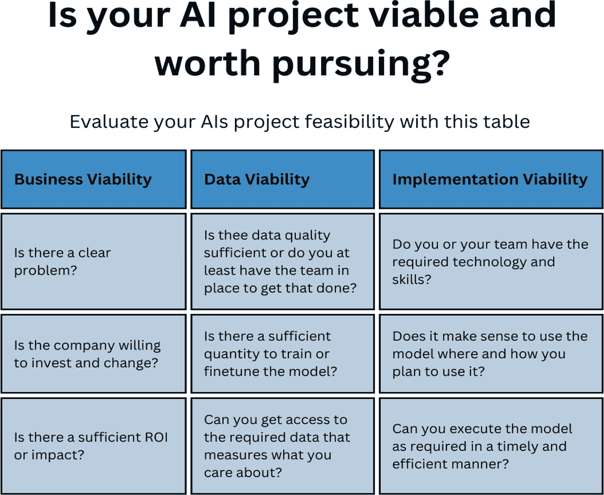
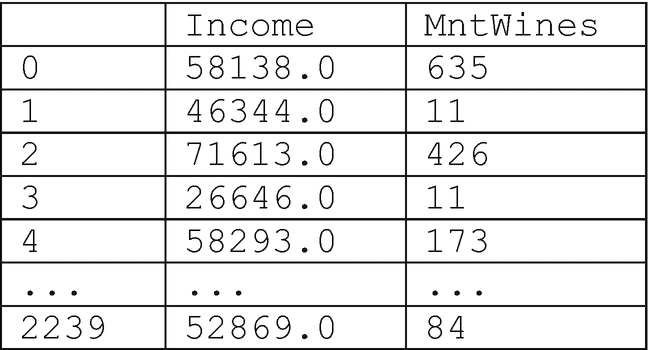
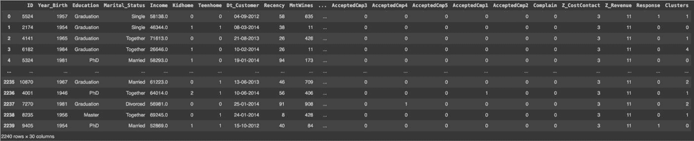
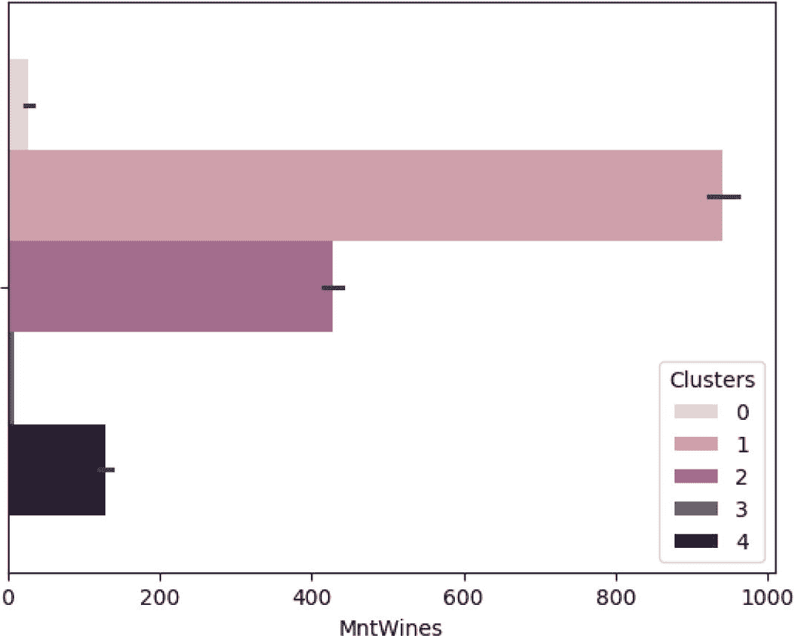
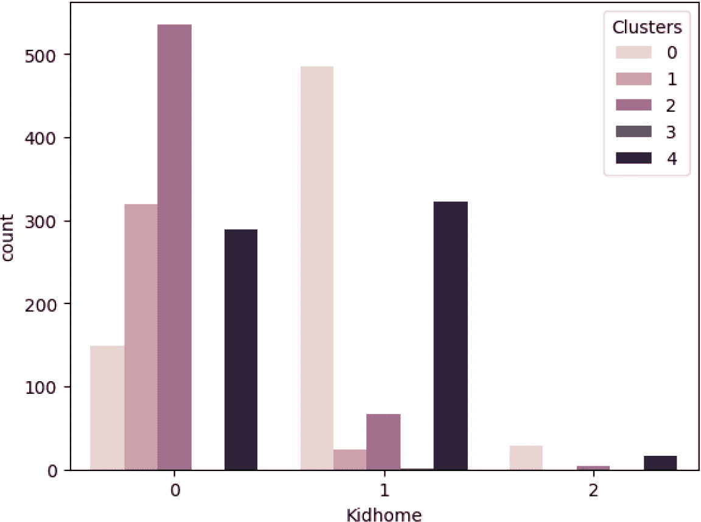

# 7. 何时使用机器学习模型

机器学习模型已成为在各领域解决复杂问题的强大工具。如今，似乎每个人都在寻找方法，要么出于个人原因，要么为了推动业务发展，来应用机器学习。然而，并非所有问题都需要应用机器学习模型。虽然机器学习可以提供强大的解决方案，但重要的是要认识到，并非所有挑战都需要如此先进的技术。有时，更简单的基于规则的系统或其他传统方法可能更加高效和有效。用机器学习过度复杂化解决方案，可能会导致不必要的复杂性，却无法带来期望的价值。

想象你有一个问题需要解决——或许是优化现有系统、启动新业务，或是提升客户体验。你可能会考虑使用机器学习模型，但评估这种方法是否最合适至关重要。

## 何时使用机器学习模型简介

机器学习通过赋予系统无需显式编程即可从经验中学习和改进的能力，彻底改变了各个领域。从医疗保健和金融到零售和娱乐，机器学习是推动创新和效率的核心力量。在第 5 章中，我们讨论了不同类型的机器学习模型。然而，是否采用机器学习应审慎决策，因为它涉及复杂的算法、大量的数据和计算资源。本章将深入探讨机器学习模型能够发挥作用的判断标准和适用场景，确保其应用能产生最佳效果。本章将探讨何时选择机器学习模型是合适的，并提供指导方案以及其他可能更符合需求的替代选择。

## 理解何时使用机器学习模型的重要性

理解何时部署机器学习模型至关重要，原因如下：

1.  **资源优化**  
    机器学习项目需要在数据收集、处理和算法研发方面进行大量投入。正确判断是否需要机器学习，能确保资源得到有效利用。

2.  **问题适用性**  
    并非所有问题都适合用机器学习解决。有些问题可能更适合通过简单的统计方法或基于规则的体系来处理。误用会导致效率低下、效果不佳以及不必要的开支。

3.  **性能与可扩展性**  
    机器学习模型能够利用其处理海量数据和自动化决策等能力，为涉及大规模数据集和复杂问题的情况提供可扩展的解决方案。了解何时使用机器学习，有助于确保这些优势被用来提升性能。随着规模扩大，监控模型性能变得至关重要。在第 6 章中，我们讨论了各种类型的模型性能指标。这些指标有助于清晰了解模型的运行状况，帮助识别模型漂移或性能下降等问题，同时也能用于比较不同模型，以便为您的业务需求选择最合适的模型。

4.  **创新与竞争优势**  
    合理运用机器学习能催生创新解决方案，从而在市场中占据竞争优势。它可以实现流程自动化、挖掘洞察并增强决策能力。

## 评估机器学习模型的必要性与价值

### 识别合适的问题

有时，用最简单的方式解决问题才是上策。在决定是否使用机器学习模型时，必须考虑问题的复杂性以及模型所需的更新频率。如果一个问题能用直接的一次性解决方案解决（例如简单的计算），那么机器学习模型可能并非必要。机器学习模型最适合需要持续学习和频繁更新的场景，而这并非所有问题都具备。

机器学习模型在需要不断进化和适应的场景中表现出色。这些场景包括：需要持续调整的重大复杂问题、随时间推移而不断演进的开放式挑战、正确答案频繁变化的情况，以及本质上极其困难、挑战人类能力极限的问题。如果你的问题属于这些类别之一，那么机器学习模型可能是正确的选择。

### 应对开放式挑战

有些挑战规模庞大且具有开放性，这意味着它们没有单一的固定解决方案。这些问题会持续演变，需要长期投入且没有明确的终点。例如，为流媒体服务策划推荐内容就涉及每天处理新信息。

在这种情况下，设置好便不再过问的一次性解决方案很难奏效。相反，这些场景需要能够随时间适应和成长的机器学习模型，它能随着新数据的出现持续学习和更新。如果你的问题定义明确且范围有限，则可能不需要机器学习模型。然而，对于庞大且持续存在的挑战，机器学习模型可能是跟上不断变化的环境的正确选择。

我们在第 5 章中讨论过的模型类型中，有一个非常适合应对开放式挑战的例子——强化学习模型。这类模型通过与环境的互动进行学习，非常适合那些需要持续改进的任务，例如优化电商平台或流媒体服务的推荐系统，以及管理自动驾驶车辆。

### 适应动态环境中的变化

涉及变化的问题可能比较棘手，因为今天有效的方法明天可能就不灵了。当处理条件频繁或不可预测地变化的问题时，机器学习模型会非常有用。这些模型能够快速学习并适应新情况，确保它们随着事物的发展而保持有效。如果你的领域变化缓慢或遵循可预测的模式，那么更简单的方案可能就足够了。然而，如果你面临快速或出乎意料的变化，机器学习模型可能是跟上节奏、保持相关性的最佳方式。

### 解决棘手问题

有些问题极其复杂，甚至连人类也难以完美解决。例如，在复杂游戏中表现出色或理解外语。机器学习模型在解决这些挑战性问题方面取得了显著进展，但这需要多年的开发和数据积累。在需要处理海量数据或从复杂信息中提取模式等特定任务中，机器学习模型具有优势。通过持续整合用户反馈并优化模型，这些先进的解决方案可以在应对更本质的难题方面取得实际进展。

不过，有些领域仍然需要人类的直觉和专业知识，例如需要创造力、情商或深层上下文理解的任务。

### 成功部署机器学习模型的关键条件

要让机器学习有效发挥作用，不仅仅需要有挑战性的问题。该问题还需满足几个关键条件：

*   模型必须能够从长期使用过程中生成的数据中收集信息并进行学习。
*   模型应力求实现一个重要的目标。
*   总体投入应值得其投资。

#### 成功 AI 产品的关键条件

机器学习模型很少完美无缺，它们会犯错。关键在于，它们提供的价值要足以弥补其错误。对于一个可行的机器学习模型而言，它应当提供显著的好处，这些好处要超过其错误所造成的成本。例如，一个为顾客优化杂货购物的模型，偶尔可能会犯些小错，导致轻微延误。只要这些错误不常发生，并且系统总体上能为用户节省时间，它就可以被认为是有价值的。

相比之下，用于关键任务的模型，例如控制手术机器人或直升机，就必须可靠得多，因为错误可能带来严重后果。即使在这种高风险的情况下，模型也无需完美无缺，但必须显著优于其他备选方案。关键在于，一个机器学习模型必须能提供足够多的积极成果，以保证其被使用是合理的，即便它并不完美。

对于一个机器学习模型而言，若要被视为最高效，它必须能够直接影响预期结果。这意味着它要么能自动化处理流程，要么能提供信息和选项，以帮助用户实现其目标。当模型能够采取对产品目标产生清晰、即时影响的行动时，其效果最佳。如果模型的行动带来了积极结果，那么模型表现良好这一点应当是显而易见的；反之，如果结果不佳，那么模型性能的欠缺也应当是清晰的。影响结果的外部因素越少，机器学习模型就能越有效。

在部署机器学习模型时，找到恰当的平衡点很重要——目标过于宽泛，会使模型的行动与结果之间的关联难以建立。在庞大、复杂的产品中，可以为不同的任务使用多个机器学习模型。你也可以用一个模型处理多个任务，但用户提供的反馈与机器学习模型为了改进所需的特定决策之间的关联性就不够直接了。

#### 利用交互数据优化你的模型

机器学习模型会通过从最终用户与它们的交互方式中学习，从而随着时间的推移不断改进。当用户与你的产品（其中嵌入了机器学习模型）互动时，产品应收集关于用户行为、他们所体验的结果以及他们的反馈数据。这是遥测数据的一部分，这部分内容将在第 9 章中讨论。这些数据至关重要，因为它能帮助机器学习模型变得更智能、更高效，从而为最终用户创造更大价值。

例如，为了改进机器学习模型，记录用户交互的详细信息至关重要。这涉及到追踪以下内容：

-   用户看到了什么
-   他们如何回应
-   以及他们的体验是正面的还是负面的

通过分析这些数据，可以持续优化机器学习模型，以更好地满足最终用户的需求。这将提升你和你的公司的声誉及财务前景。

#### AI 产品的成本考量

与 AI 产品相关的成本不同于传统方法。这些成本包含三个主要组成部分：

-   **机器学习模型**：产品中负责做出决策并确定最佳行动方案的组成部分。
-   **实施**：涵盖后端系统、模型以及任何其他组件（包括用户界面）的实际开发和集成工作。
-   **编排**：涉及在产品整个生命周期内对其进行管理，以确保其持续满足目标并处理错误。

通常，AI 产品的机器学习模型部分成本较低，因为这些模型可以自动生成产品输出，取代了人工，并且它可以通过用户交互产生必要的训练数据。这减少了对人工数据收集的需求，总体上可以节省资金。然而，由于创建、集成和组织这些组件的复杂性增加，机器学习模型的实施成本可能与传统方法相当或略高。编排成本也往往更高，因为它们涉及持续的维护任务，如调优、更新和纠正错误。

#### 何时考虑其他方案

有时，你可能会遇到涉及用户、数据和决策制定的情况，但不确定是否需要机器学习模型。这种不确定性可能源于多种原因：你可能怀疑你的问题是否复杂到需要机器学习模型；你可能质疑实施这样一个模型所付出的努力和成本是否值得；或者你倾向于逐步解决问题，而不是从一开始就致力于研究和开发机器学习模型。

探索其他方法来解决棘手问题完全没问题，机器学习模型并非唯一的解决方案。

## 判断何时使用机器学习模型的工具与技巧



**在你决定是否将机器学习模型应用于产品或系统时，更多可供使用的关键指标**

1.  **大规模且复杂的数据集**  
    当数据量庞大且包含传统方法难以捕捉的复杂模式时，机器学习是一种有价值的工具。

2.  **预测性分析**  
    如果目标是根据历史数据预测未来趋势。

3.  **模式识别**  
    涉及模式识别的任务，如图像识别、异常检测和聚类分析，是机器学习的主要应用场景。

4.  **重复性任务自动化**  
    当重复性任务需要自动化时，例如在制造业或数据提取中，机器学习可以提供高效的解决方案。

5.  **适应与学习**  
    如果系统需要根据新数据随时间进行调整和改进，机器学习模型具备从数据中学习的能力，这使得它非常适合。

### 技术与工具

在第 5 章中，我们学习了不同的机器学习算法与技术。以下是选择算法时需要考虑的一些因素。

1.  **监督学习**  
    当结果变量已知时使用。相关技术包括线性回归、逻辑回归、决策树以及支持向量机。

2.  **无监督学习**  
    当结果变量未知时应用。相关技术包括聚类（k-means、层次聚类）和关联规则。

3.  **强化学习**  
    用于动态环境，模型通过动作及其结果进行学习。其应用包括自动驾驶汽车和游戏对弈。

4.  **深度学习**  
    机器学习的一个子集，专注于具有多层结构的神经网络。它特别适用于涉及图像、语音和文本处理的任务。

5.  **自然语言处理**  
    理解和生成人类语言的技术对于聊天机器人、情感分析和语言翻译等应用至关重要。

#### 代码示例

以下是一个无需使用机器学习的例子。

某公司希望为新员工分配唯一的员工 ID。这些 ID 可以是简单的递增数字，从 10001 开始。每入职一位新员工，ID 数字就增加 1。

之所以无需使用机器学习，是因为分配顺序 ID 是一个简单的任务。每位新员工将获得序列中下一个可用的数字。

以下是一个使用 `Python` 的示例。

假设您已将 ID 保存在数据库或 `Excel` 电子表格中；您将从上一次分配的员工 ID 开始，在此示例中为 10001：

```
```

`last_employee_id = 10001`

创建一个函数，根据前一个分配的 ID 来递增 ID 数字：

```python
def generate_employee_id(last_id):
    return last_id + 1
```

使用该函数为您的新员工生成下一个员工 ID：

```python
new_hire_id = generate_employee_id(last_employee_id)
```

即使使用 Python 来实现这一点可能也是多此一举，但因为这是一本技术书籍，我决定向您展示一个代码实现！

以下是一个可以使用机器学习的例子。

假设您经营一家葡萄酒商店，并且拥有客户信息数据集。您希望根据客户的购买行为将其分组，以便通过个性化营销策略来精准定位。我们在此示例中使用的数据有 2000 多行。

导入所需的库。

```python
import pandas as pd
from sklearn.cluster import KMeans
from sklearn.preprocessing import StandardScaler
import matplotlib.pyplot as plt
import seaborn as sns
```

加载数据集。此数据集可在 Kaggle 上找到：[`https://www.kaggle.com/datasets/imakash3011/customer-personality-analysis/data`](https://www.kaggle.com/datasets/imakash3011/customer-personality-analysis/data)

```python
data = pd.read_csv("marketing_campaign.csv", sep="\t")
```

该数据有 29 列，用于描述客户信息，例如婚姻状况、收入、孩子数量、在葡萄酒上的花费等。

```python
data.columns
```

输入上述代码后，您将看到如下方括号中所示的列名列表。

```
Index(['ID', 'Year_Birth', 'Education', 'Marital_Status', 'Income', 'Kidhome', 'Teenhome', 'Dt_Customer', 'Recency', 'MntWines', 'MntFruits', 'MntMeatProducts', 'MntFishProducts', 'MntSweetProducts', 'MntGoldProds', 'NumDealsPurchases', 'NumWebPurchases', 'NumCatalogPurchases', 'NumStorePurchases', 'NumWebVisitsMonth', 'AcceptedCmp3', 'AcceptedCmp4', 'AcceptedCmp5', 'AcceptedCmp1', 'AcceptedCmp2', 'Complain', 'Z_CostContact', 'Z_Revenue', 'Response'],
      dtype='object')
```

在此示例中，我们将重点根据客户的收入（`Income`）和他们在过去两年内购买的葡萄酒数量（`MntWines`）进行分组。与您在现实世界中遇到的大多数数据集一样，该数据需要进行清洗。为简化此示例，我们将把 `Income` 和 `MntWines` 列中的任何空值填充为 0。

```python
features = data[["Income","MntWines"]].fillna(0)
```

正如您在图 7-2 中所看到的，一些值彼此相差很大。在这里，我们将对这些值进行转换，使其具有通用的尺度。这将使 `k-means` 算法更多地关注数据的模式而非大小，尤其是考虑到这是一个基于距离的算法。

```python
scaler = StandardScaler()
scaled_features = scaler.fit_transform(features)
```


两列中的数据示例

在此示例中，我们将客户分为五个组。

```python
kmeans = KMeans(n_clusters=5)
clusters = kmeans.fit_predict(scaled_features)
```

识别出聚类后，我们将这些值放回表格中进行进一步分析。在这里，我们将聚类的值放入一个名为 `Clusters` 的新列中。聚类的取值范围是从 0 到 4。


在最后一列添加聚类值后的数据集示例

```python
data["Clusters"] = clusters
```

现在，让我们根据聚类结果来分析数据。


显示基于聚类的葡萄酒购买数量的条形图

```python
sns.barplot(data = data, x="MntWines", hue="Clusters")
```

在这里，我们可以看到聚类 1 中的人购买了最多的葡萄酒。


显示每个聚类孩子数量的条形图

```python
sns.countplot(data = data, x="Kidhome", hue="Clusters")
```

进一步的分析表明，聚类 1 中的大多数人没有孩子。因此，在策划一项旨在提高您店铺葡萄酒销量的营销活动时，您可能应该避开那些鼓励顾客在孩子由保姆照看时享受一瓶葡萄酒的活动，因为这不会引起您最重要客户群体的共鸣。

### 机器学习模型可发挥作用的示例

#### 金融：欺诈检测

在金融领域，机器学习模型对于检测欺诈交易至关重要。通过分析交易模式，这些模型可以识别出表明欺诈活动的异常情况。金融机构可以利用这些洞察来预防欺诈并保护资产。

#### 零售：个性化推荐

零售商可以利用机器学习模型向客户提供个性化推荐。通过分析购买历史、浏览行为和客户偏好，这些模型可以提升购物体验并增加销售额。

### 结论

机器学习模型通过为复杂问题提供高级解决方案，具有变革各个行业的巨大潜力。然而，是否使用机器学习，应基于对当前问题的透彻理解、数据的可用性以及潜在的收益来决定。通过识别适合机器学习和开发的恰当场景，您可以利用其力量来推动创新、提高效率并获得竞争优势。

