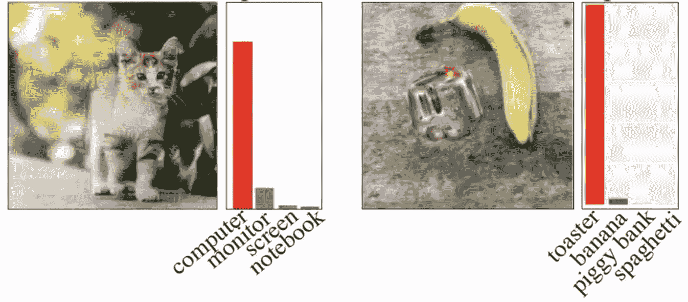
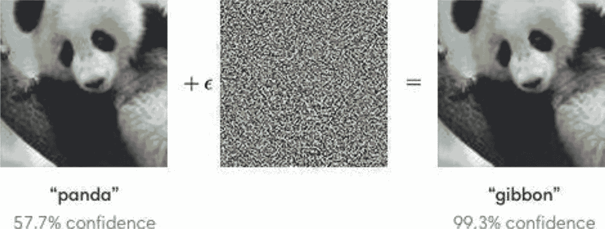

## 10. 对抗与滥用

机器学习已成为各行各业的关键组成部分，推动了自动化、数据分析和决策过程的进步。然而，机器学习的兴起也带来了新的挑战，尤其是在安全方面。对手可能会利用机器学习系统，导致严重的滥用并损害这些系统的完整性。本章深入探讨机器学习中的对抗与滥用性质，研究其重要性、工具、技术以及现实世界中的案例。

### 对手与滥用行为简介

机器学习中的对手是指有意操纵或利用机器学习模型以实现恶意目标的实体，可以是个人、团体或组织。这些对手试图通过扰乱或欺骗模型来获取个人、财务或战略利益。例如，对手可以通过略微修改钓鱼邮件来操控电子邮件垃圾邮件过滤器，使其无法被检测到，从而绕过安全系统。

滥用行为涵盖对手破坏、欺骗或操控系统的各种活动。滥用也指对机器学习系统的各类攻击或不道德用途，导致意外后果。例如，对手可能通过使用机器人人为地提升某些内容，欺骗推荐系统优先推送不相关或有害的材料。

#### 对手的类型

*   **数据投毒攻击：** 有意将误导性或错误数据放入训练数据集中，导致模型学习到错误的模式。这种攻击发生在训练阶段。可以通过以下几种方式进行：
    *   删除部分数据
    *   将现有数据修改为错误答案
    *   添加虚假数据

    示例：攻击者可能通过注入虚假图像来更改面部识别系统的训练数据，导致模型认错人员。

*   **规避攻击：** 修改输入数据以逃避模型检测。这发生在测试/生产阶段，通过对数据进行微小改动来实现。图 10-1 至 10-4 展示了许多此类示例。

    示例：攻击者可以略微修改停车标志的图像，如图 10-3 和 10-4 所示，使自动驾驶汽车的识别系统无法正确识别，从而造成严重的安全风险。

*   **模型逆向攻击：** 利用模型输出重建用于训练它的数据。

    示例：一个基于敏感健康数据训练的模型可能会被对手利用，从模型的预测中逆向还原出个人医疗信息，从而侵犯患者隐私。

这些攻击背后的动机多种多样。从获取经济利益到造成伤害，不一而足。对手可能是寻求利用漏洞的恶意行为者，例如心怀不满的前任，也可能是旨在破坏竞争对手系统的竞争者。

### 理解机器学习中的对手与滥用行为的重要性

#### 对安全与隐私的影响

一些机器学习模型处理敏感数据，使其成为对手的主要目标。了解滥用行为的可能性对于保护用户隐私和维护数据完整性至关重要。为了减轻这些风险，可以实施多种防护措施：

*   **加密：** 加密有助于保护静态和传输中的数据。数据在用于训练之前可以进行加密，确保即使数据被未经授权的人员截获或访问，也仍然不可读。例如，金融机构可以在将交易数据输入机器学习模型之前对其进行加密，以防止对敏感信息的未授权访问。

*   **访问控制：** 实施严格的访问控制确保只有授权人员才能访问敏感数据和机器学习模型。基于角色的访问控制可以限制谁能够查看、修改或用敏感信息训练模型。例如，医疗机构可以强制执行访问控制，使得只有获批的医务人员才能访问用于预测健康模型的患者记录。

*   **匿名化技术：** 匿名化是指在数据集用于机器学习模型之前，从中移除或掩盖个人身份信息（`PII`）。数据脱敏、差分隐私和 k-匿名性等技术可以通过使其难以追溯到个人来帮助保护用户隐私。例如，通过移除或掩盖患者标识符来匿名化健康记录，使研究人员能够在不泄露隐私的情况下将数据用于分析。

#### 经济与运营影响

利用机器学习系统的漏洞可能导致巨大的经济损失和运营中断。例如，对金融模型的对抗性攻击可能导致错误的预测，从而产生重大的经济后果。

#### 对机器学习系统的信任

维护对机器学习系统的信任对于其广泛采用至关重要。应对对手和滥用行为是确保这些系统可靠和安全的关键。

### 对抗性攻击可能的使用方式

#### 自动驾驶车辆中的数据投毒

自动驾驶车辆严重依赖机器学习模型进行导航。数据投毒可能涉及操纵传感器数据以导致错误的决策。

#### 医疗领域的模型逆向攻击

医疗领域的机器学习模型可能成为模型逆向攻击的目标，以提取敏感的患者信息。

#### 使用对抗性图像的规避攻击

让我们看一些实际例子。对抗性图像是专门设计用来欺骗神经网络，使其对其所看到的内容做出错误判断的图像。

卷积神经网络和视觉变换器通常用于识别图像中的物体。作为人类，我们通过观察抽象特征来识别物体。例如，对于熊猫，我们可能会寻找黑眼圈和皮毛等特征。机器学习模型以不同的方式识别这些物体，这使得它们容易受到对抗性图像的影响。以下是这些类型图像的多个示例。

图 10-4 在此示例中，微小的变化导致机器学习模型将停车标志分类为 45 英里/小时的限速标志，并将右转标志分类为停车标志

图 10-3 在此示例中，带有迷彩效果的艺术贴纸和涂鸦导致机器学习模型将停车标志分类为 45 英里/小时的限速标志，并将让行标志分类为错误类型

图 10-2 左侧的图像是一只猫，但已被修改得带有一些方块感。这导致用于识别该图像的模型将其判断为电脑。右侧的图像显然是一根香蕉，但该图像已被修改，在其左侧添加了一个物体，这导致模型将该图像识别为一个烤面包机

图 10-1 一个对抗性输入欺骗人工智能将熊猫误认为长臂猿的示例。该图像通过添加噪声被略微改变

### 降低风险

使用机器学习模型来发现滥用行为看似是个好主意。然而，攻击者改变策略来破坏机器学习模型，可能比你更新训练数据集和模型以应对这种新攻击更便宜、更迅速。

以下是一系列建议和注意事项，旨在降低与机器学习模型相关的风险，并促进其负责任地开发和使用。

*   **训练与测试**：在模型开发阶段整合强大的对抗训练技术。此过程涉及让模型接触训练数据集中各种对抗样本，以增强其抵御规避攻击的能力。在部署前还应进行严格测试，以评估模型的稳健性。这能确保模型能有效抵御那些潜在攻击。红队测试是测试机器学习模型的一种交互式方法，用于模拟攻击者可能利用的战术，以发现泄露敏感数据等漏洞。其目标是增强模型的稳健性。红队测试将在“道德考量”部分提及。

*   **数据清洗与验证**：在训练阶段，对数据进行清洗和验证以降低投毒攻击的风险至关重要。这包括实施严格的数据验证规则和机制，以检测并清除不适当的数据。对训练数据集进行定期审计有助于识别并移除任何可能损害模型完整性的受损数据。

*   **自适应安全措施**：采用自适应安全措施，在模型部署期间持续监控和分析模型行为，以检测表明存在对抗性攻击的异常活动。使用异常检测算法和入侵检测系统来实时识别并响应威胁。

*   **协作与信息共享**：在组织内部对人员进行人工智能相关风险及各类对抗性攻击的教育。通过鼓励主动采取防护措施、定期更新软件、应用安全补丁以及遵守 AI 开发和部署的最佳实践，强调网络安全意识的重要性。

*   **教育与认知**：鼓励 AI 社区内的协作与信息共享，以传播关于新兴对抗性威胁及有效应对措施的知识。

### 道德考量

为对抗性研究建立道德准则并促进负责任的披露实践至关重要。

正如白宫所言，2023 年 10 月 20 日，拜登总统发布了一项行政命令以管理人工智能的风险。该命令要求，对国家安全、经济安全或公共健康与安全有重大影响的人工智能系统，必须接受严格的安全测试和政府监管。通过这项行政命令，总统指示采取有史以来最全面的行动，以保护美国人免受人工智能系统潜在风险的侵害。以下是几项行动：

*   **最强大 AI 系统的开发者需与美国政府共享其安全测试结果及其他关键信息。**

    根据《国防生产法》，该命令将要求开发任何对国家安全、国家经济安全或国家公共卫生与安全构成严重风险的基础模型的公司，在训练模型时通知联邦政府，并分享所有红队安全测试的结果。这些措施将确保 AI 系统在公司公开发布前是安全、可靠且值得信赖的。

*   **制定标准、工具和测试，以帮助确保 AI 系统安全、可靠且值得信赖。**

    美国国家标准与技术研究院将为广泛的 AI“红队”安全测试设定严格标准，以确保其在公开前达到政府要求的护栏。国土安全部将在关键基础设施领域应用这些标准，并建立 AI 安全与保安委员会。能源部和国土安全部还将应对 AI 系统对关键基础设施以及化学、生物、放射、核能和网络安全风险构成的威胁。这些共同构成了任何政府为推进 AI 安全领域所采取的最重大行动。

*   **防范利用 AI 工程化危险生物材料的风险。**

    制定生物合成筛查的强有力标准。资助生命科学项目的机构将把这些标准作为联邦资助的条件。这创造了强大的激励措施，以确保进行适当的筛查并管理 AI 可能加剧的风险。

*   **通过建立检测 AI 生成内容和认证官方内容的标准与最佳实践，保护美国人免受 AI 驱动的欺诈和欺骗。**

    美国商务部将制定内容认证和水印指南，以清晰标记 AI 生成的内容。联邦机构将使用这些工具，让美国人更容易知道他们从政府收到的通信是真实的——并为私营部门和世界各国政府树立榜样。

*   **建立先进的网络安全计划，开发 AI 工具以发现并修复关键软件中的漏洞。**

    这建立在拜登-哈里斯政府正在进行的 AI 网络安全挑战赛的基础上。这些努力将共同利用 AI 可能改变游戏规则的网络能力，使软件和网络更加安全。

*   **指示制定一份《国家安全备忘录》，指导 AI 及安全方面的进一步行动。**

    该备忘录将由国家安全委员会和白宫办公厅主任制定。该文件将确保美国军方和情报界在其任务中安全、合乎道德且有效地使用 AI。它将指导采取行动，以对抗对手对 AI 的军事使用。

为了更好地保护美国人的隐私，包括 AI 带来的风险，总统呼吁国会通过两党数据隐私立法，以保护所有美国人，尤其是儿童。以下是一些被指示的行动：

*   **通过优先提供联邦支持以加速开发和使用隐私保护技术，保护美国人的隐私。**

    这其中包含那些利用尖端 AI 技术、并能在保护训练数据隐私的同时进行训练的 AI 系统。

    **加强隐私保护的研究与技术。**

    例如，通过资助一个研究协作网络来推动快速突破和发展，从而利用加密工具保护个人隐私。美国国家科学基金会也将与该网络合作，推动联邦机构采用领先的隐私保护技术（白宫，2023 年）。

类似地，欧盟也制定了名为《欧盟 AI 法案》的法规，对人工智能进行规范。

正如未来生命研究所提供的该法案高级别摘要所述，大部分规则适用于被视为高风险的人工智能系统。高风险系统涉及以下领域：生物识别、关键基础设施、教育与职业培训、就业、执法、移民、司法与民主进程，以及基本私人服务与基本公共服务及福利的获取和享受。根据规定，高风险 AI 提供者必须：

*   在 AI 系统全生命周期内建立风险管理体系
*   进行数据治理，确保训练、验证和测试数据集具有相关性、充分代表性，并尽可能根据预期目的做到无错误且完整
*   设计高风险 AI 系统，允许部署者实施人工监督
*   设计高风险 AI 系统，使其达到适当的准确性、鲁棒性和网络安全水平（《欧盟人工智能法案》）

这只是该文档中提到的部分规则。在本章中，我重点关注了那些我认为有助于在人工智能领域防范对手和滥用的规则。（《欧盟人工智能法案》）

除美国和欧盟外，其他国家也实施了相关规则和考量。中国的目标是到 2030 年成为领先的人工智能中心。《中国网络安全法》和《新一代人工智能发展规划》概述了人工智能中的数据保护和网络安全策略，重点关注合规性和主动风险管理。加拿大则制定了诸如“泛加拿大人工智能战略”和“加拿大人工智能委员会”等项目，以促进人工智能的负责任发展，并处理该领域内的伦理问题。

### 结论

对抗性攻击严重威胁着机器学习模型的可靠性和安全性。随着人工智能融入我们的生活，对抗性攻击的潜在后果也变得更加严重。为了减轻这些风险，需要采取多方面的方法。这包括强大的防御机制和持续的研究。这些攻击的潜在后果使得采用多层防御策略至关重要。在本章中，我们讨论了几种防御措施，可以减轻对手造成的风险，并为你的模型提供更好的保护，使其免受对手侵害。持续研究和改进安全实践的重要性怎么强调都不为过——新的攻击方法不断演变，需要持续的适应和创新。理解对手和滥用行为对于开发强大且安全的系统至关重要。通过研究工具、技术和示例，我们可以更好地预测潜在威胁，并制定缓解策略，从而创建更有韧性和值得信赖的人工智能系统。

