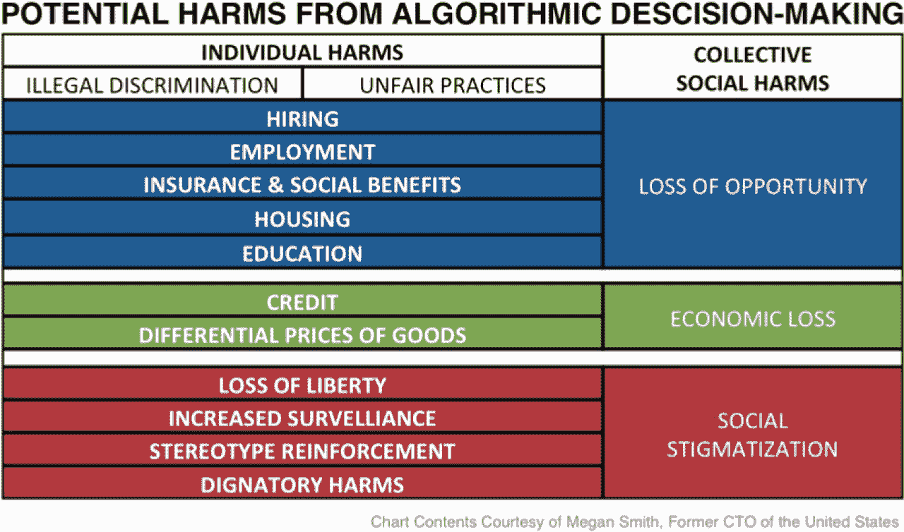
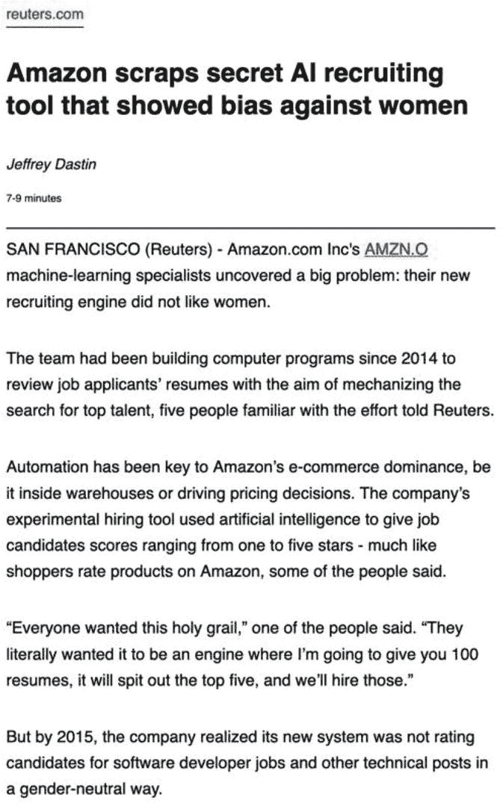

## 11. 与模型合作

### 引言

人工智能已不再局限于科幻小说的概念，它已成为我们日常生活和各行各业不可或缺的一部分。从 `Siri` 和 `Alexa` 等语音助手，到推动医疗保健和消费品创新的先进机器学习模型，人工智能的存在正日益渗透且不断增长。然而，伴随着这种快速进步，也出现了一系列的恐惧和误解。一些人担心人工智能会取代人类工作、侵犯隐私，甚至超越人类智力，达到无法挽回的地步。本章旨在解决这些担忧，强调我们为何应该拥抱而非恐惧人工智能。

### 技术发展的历史背景

回顾历史，重大的技术创新往往伴随着一定程度的怀疑和恐惧。例如，工业革命曾引发人们对机器取代体力劳动导致失业的担忧。同样，互联网的出现也带来了对隐私侵犯、失业和数据安全的恐惧。然而，随着时间的推移，这些技术被证明具有变革性，推动了经济增长，提高了生活质量，并创造了前所未有新就业机会。

人工智能代表着技术进步的又一次飞跃，有望带来巨大利益。人工智能的兴起正引发对失业的担忧，这合情合理，尤其是在涉及常规、重复性任务的领域。然而，人工智能也有潜力创造以前不存在的新角色，例如：人工智能维护、伦理管理、人工智能安全工程师、人工智能艺术总监和提示词工程师。虽然某些工作可能会被自动化，但其他工作将转向关注更难以被复制的人类技能。

理解这一历史背景有助于缓解恐惧，并为社会如何适应新技术并蓬勃发展提供了视角。只要以前瞻性的眼光、合乎道德的监督和平衡来管理，人工智能就可以成为一种变革性工具，能够提高生产力、创造新的角色并改善生活质量。

### 人工智能的优势：跨行业的变革潜力

#### 医疗保健：改进的诊断与个性化医疗

人工智能通过提高诊断准确性和实现个性化治疗方案，彻底改变了医疗保健领域。机器学习算法可以比人类放射科医生更精确地分析医学影像，捕捉到阿尔茨海默病等疾病的早期迹象。人工智能驱动的预测模型可帮助医生为患者量身定制治疗方案，提高医疗干预的有效性并减少副作用。

#### 教育：个性化学习

在教育领域，人工智能为学生提供了个性化的学习体验。智能辅导系统能适应个人学习风格和节奏，提供定制化的资源和反馈。例如多邻国（`Duolingo`）就是这样一个应用。多邻国是一款用于学习不同语言的应用程序。它根据学生的表现水平，提供适合其节奏和水平的听力、口语和阅读练习。

#### 制造业：自动化与预测性维护

人工智能通过自动化重复性任务和实现预测性维护来提升制造流程。由人工智能驱动的机器人提高了生产效率和一致性，而预测性维护模型则能预测设备故障，减少停机时间和维护成本。例如，亚马逊在其履约中心内与员工协同工作的机器人车队，用于运输货物；以及 `IBM` 的 `Maximo` 应用套件。该套件用于资产监控、预测性维护和可靠性规划等事务。

#### 日常生活：个人助理与智能家居设备

在我们的日常生活中，人工智能以 `Siri`、`Alexa` 和 `Google Assistant` 等个人助理的形式出现，通过管理日程、设置提醒和控制智能家居设备，让我们的生活更加便捷。这些进步凸显了人工智能通过自动化和智能辅助改善日常生活的潜力。

### 人工智能增强人类能力

人工智能真正的优势在于其增强人类智能和决策的能力。通过处理重复性和常规性任务，人工智能释放了人类的创造力、战略思维和问题解决能力。例如，在商业领域，AI 可以帮助识别市场和产品中的模式，从而支持更明智的决策；在医疗领域，AI 可以分析并提取文档中的文本，协助医疗专业人员更快地做出决策；在法律领域，AI 可以在海量信息中协助寻找与案件相关的法律文件。

此外，人工智能在各行各业提升了生产力。在设计和音乐等创意领域，AI 工具可以协助艺术家激发新想法、突破创作瓶颈。在科研领域，AI 能够通过分析复杂数据集、识别有助于突破的模式，来加速发现进程。通过增强人类能力，AI 有助于促进创新、推动进步。

然而，也存在负面影响。过度依赖 AI 进行决策可能导致批判性思维和解决问题能力的下降，因为人们可能会过于依赖 AI 系统来完成需要人类判断的任务。这在医疗或法律等领域尤其令人担忧，因为人类的监督对于确保合乎伦理的决策至关重要。应对这些风险的措施包括确保 AI 作为一种补充而非替代人类智能的工具。

### 成功的人工智能整合

#### 医疗健康

`Flo`是一款专注于女性健康的应用程序。它追踪月经周期、排卵、症状等信息。该应用使用机器学习算法，根据个人先前记录的信息（如年龄、经期日期和症状）来预测周期长度。它还提供个性化内容，如视频和文章，以教育最终用户。这些内容由健康和保健专家审核，以确保信息可靠。

#### 金融

`Betterment`是一个金融投资平台，利用 AI 根据用户的财务计划创建个性化档案。它使用算法实现交易、交易执行和投资组合管理的自动化。该公司成立于 2008 年。

#### 消费品

`iRobot`是一家消费级机器人公司。他们创造了一款名为`Roomba`的自主吸尘器。它使用机器学习算法绘制用户房产的地图。这有助于吸尘器在清洁时避开障碍物。最终用户还可以在应用中将生成的地图中的点标记为“清洁区域”，指示`Roomba`清洁这些特定点。例如，如果你的员工在办公室的`HC`房间用过午餐，你可以告诉`Roomba`“清洁`HC`桌下”。

### 应对常见的恐惧与误解

#### 人工智能对隐私的威胁：平衡创新与伦理考量

另一个常见担忧是人工智能对隐私构成威胁。如果管理不当，数据收集和分析可能导致隐私问题。然而，在创新与伦理考量之间取得平衡至关重要。实施强大的数据保护措施、网络安全要求以及透明的数据使用政策可以降低隐私风险。此外，如第 10 章所述，人工智能伦理方面的持续进步旨在确保 AI 系统尊重用户隐私并在伦理边界内运行。

#### 人工智能不可控力量的神话

确保对人工智能开发进行适当的监督和监管，有助于防止 AI 系统产生意外后果。《欧盟人工智能法案》和美国《关于人工智能的行政命令》是应对 AI 相关风险的监管框架和标准范例。

此外，人工智能联盟——一个由研究人员、开发者和组织组成的国际社区——正积极建设一个推动负责任 AI 创新的社区。他们的努力强调在保持科学严谨性的同时，确保信任、安全与多样性。

### 负责任的人工智能

负责任的人工智能是一种创建和部署 AI 系统的方法，旨在确保其符合伦理原则、法律要求和社会价值观。

### 理解偏见

图 11-1 至 11-6 展示了一些 AI 系统出错……非常严重出错的例子。



图 11-6 一张突显依赖算法危险性的图片，展示了这些系统如何导致机会丧失、经济损失和社会污名化，从而加剧不平等和社会危害。


图 11-5 一张展示因虚假面部识别匹配导致一名无辜黑人男子被错误监禁的社会不公图片。这强调了 AI 系统中的种族偏见问题。


图 11-4 一张展示乔伊·布奥兰维尼演示 AI 系统种族偏见的图片。该面部识别技术直到她戴上白色面具才识别出她的脸。


图 11-3 一张展示 Twitter 自动裁剪图片存在偏见的图片。它始终优先显示白种人的面孔而非黑种人面孔。


图 11-2 一张记录大卫·海涅迈尔·汉森指控 Apple Card 存在性别歧视的图片，由此引发了关于信用额度基于性别存在偏见的讨论。



图 11-1 这张图片描述了亚马逊因偏见问题而放弃了一款 AI 招聘工具。这凸显了对招聘实践中不公平待遇的担忧，这种情况可能会加剧。

### 缓解偏见——人在回路方法

人在回路是一种协作方法，在 AI 系统的整个生命周期中融入人类的专业知识和输入。人类在训练、评估和管理系统等方面扮演着积极角色。这提供了关键的指导、反馈、数据标注和透明度。让人参与其中的目的是通过利用人类和机器学习模型的优势，提高 AI 系统的准确性、可靠性和适应性。随着模型变得越来越复杂并被社会广泛采用，人类的参与对于确保机器学习模型做出的决策在伦理上合理至关重要。目标是避免 AI 系统做出有害决策，正如上文“理解偏见”部分所示。

#### 人类参与回路的方式（包括但不限于）

*   在数据集输入机器学习算法前后，提供数据标注、数据质量保证。
*   向机器学习模型提供反馈。

#### 人在回路的好处

*   增强可靠性
    *   人类监督对于协助确保模型的可靠性至关重要。
*   透明性
    *   人类需要对其在机器学习过程中参与的每个步骤有一定理解。
*   缓解偏见
    *   人类成为决策过程的一部分，这有助于识别和缓解模型输出及训练数据集中潜在的偏见。
*   就业机会
    *   这可以为人们带来新的工作机会，强调尽管这项技术可能会取代一些工作，但它也能为人们带来新的就业机遇。

#### 人在回路中的挑战

在做出决策之前，必须全面审视问题的各个方面，以理解其中的权衡取舍。此过程中出现的一个主要挑战是速度。流程不再完全自动化。然而，系统输出变得更加可靠。这个流程可能会降低规模并增加成本。但是，系统的可靠性和来自客户/最终用户的信任有潜力得到提升。根据任务的不同，另一个挑战是人类也可能带有自身的偏见。不过，缓解这一问题的一种方法是，让一群背景多样的人依据一套商定的规则/要求来进行评估、提供反馈和标注数据集。

### 减少偏见——为何多样性至关重要

数据科学和机器学习团队的多样性对于识别和解决潜在偏见至关重要。拥有不同教育背景的人，以及来自不同性别、种族和拥有不同生活经历的人，能带来独特的视角和观察，使团队能够预见并缓解在开发 AI 系统过程中可能被忽视的挑战。这可以为企业避免声誉受损，并可能避免被起诉。

### 建立信任与透明度——伦理 AI：确保公平性、问责制和透明度

AI 的伦理部署对其被接受和取得成功至关重要。伦理 AI 包含公平性、问责制和透明度原则。公平性确保 AI 系统不会歧视个人或群体，而问责制要求开发者和组织对其 AI 系统的结果负责。透明度涉及让用户和利益相关者能够理解 AI 系统的工作原理。这将促进信任和知情决策。

目前已经制定了多项举措和框架来推广伦理 AI。例如，在第 10 章中提到的，美国总统拜登于 2023 年发布了关于 AI 的行政命令；欧盟的 AI 法案以及全球其他地区都为开发 AI 系统提供了一套全面的要求。这些指导方针强调了技术稳健性、隐私和透明度，确保 AI 系统在使社会受益的同时将风险降至最低。

### 教育与公众参与的作用

对公众进行 AI 及其益处的教育对于消除恐惧和促进接受至关重要。公众参与计划可以揭开 AI 的神秘面纱，消除误解并突出其积极潜力。与社区组织、地方政府和非营利组织的合作可以在接触不同人群方面发挥关键作用，确保每个人都能获得准确信息，并感到被纳入讨论范围。技术专家、政策制定者和公众之间的合作对于确保 AI 发展符合社会价值观和需求至关重要。

关于 AI 进展及其影响的`透明`沟通能够促进信任和知情决策。公开的网络研讨会、在线课程和 AI 素养宣传活动可以进一步以易于理解的方式传播知识，让人们能够按照自己的节奏学习。与利益相关者进行公开对话有助于解决担忧，并确保 AI 系统的设计方式能够惠及整个社会。

### AI 的未来：机遇与挑战

AI 的未来前景广阔，新兴趋势和应用将彻底改变各个领域。例如，自动驾驶汽车、自然语言处理和机器人技术领域的 AI 驱动进步将改变交通、通信、零售、教育、制造业以及其他领域。

在撰写本书时，苹果智能便是一个很好的例子，展示了 AI 未来可能实现的功能。

2024 年 6 月，苹果公司发布了苹果智能，这是一套该公司计划在其产品中实现的 AI 功能。他们计划实现许多功能。我将提及其中几个。他们推出的功能之一是数学笔记计算器。该计算器的功能之一是允许用户在数学笔记应用中书写数学方程时，实时求解这些方程。苹果智能的另一个功能是智能手写。这将通过实时拉直文本来提高使用苹果铅笔书写的笔记的可读性。这对于那些曾被赞扬“字写得像医生一样”的人来说，会有极大的帮助。

然而，伴随着这些机遇，也存在一些需要应对的挑战。确保 AI 的伦理使用、减轻 AI 模型中的偏见，以及管理 AI 应用带来的社会影响，这些都是需要重点关注的领域。例如，自主武器的研发引发了伦理问题。此外，各行业的岗位自动化有可能取代大量劳动力。通过主动应对这些挑战，我们可以充分利用 AI 的潜力来造福人类。这包括实施伦理监管（正如在第 10 章中所讨论的），以及让劳动者为 AI 驱动型经济下的新角色做好准备。

### 结论

总之，AI 是一种强大的工具，有潜力变革各个行业并增强人类能力。通过拥抱 AI 并解决常见的恐惧和误解，我们可以在确保伦理和负责任发展的同时，释放其全部潜力。技术发展的历史背景、AI 的切实益处，以及为推广伦理 AI 所做的持续努力，为我们以平衡的视角拥抱 AI 提供了令人信服的理由。展望未来，促进公众参与、教育利益相关者以及确保 AI 开发的透明度至关重要。通过这样做，我们可以创造一个 AI 造福全人类的未来，推动进步并提高生活质量。

# 索引 A

## 滥用

- 访问控制
- 自适应安全措施

## Adj Close 列

## 对抗性攻击

- 投毒攻击
- 规避攻击、对抗性图像
- 模型反转攻击

## 对抗性图像

## 对抗性风险缓解

- 自适应安全措施
- 协作与信息共享
- 数据清洗与验证
- 教育与意识提升
- 建议与预防措施
- 训练与测试
- 训练数据集与模型

## 攻击者

- `投毒攻击`（定义）
- `规避攻击`（定义）
- `模型反转攻击`（定义）

## 人工智能

参见 人工智能

## AI 联盟

## AI 常见恐惧与误解

- 隐私威胁
- 不可控力量

## AI 驱动产品

- 开发（有效性、关键考量）
- `CI/CD` 流水线
- 基于云的训练
- 成本
- 延迟
- 离线模式
- `OTA` 更新
- 可扩展性
- 安全性
- 及时更新

## AI 集成

- 消费品
- 金融
- 医疗保健

## AI 工具

## AI 变革潜力

- 教育
- 日常生活
- 医疗保健
- 制造业

## 算法

## 亚马逊云服务

## 异常检测算法

## API

参见 应用程序编程接口

## Apple Intelligence

## Apple Pencil

## 应用监控工具

## 应用程序编程接口

## `ArcGIS`

## `AUC`（曲线下面积）

## 人工智能

- 教育与公众参与（作用）
- 增强人类能力
- 机遇与挑战
- 语音助手

## `AUC`

参见 `曲线下面积`

## 自动化复杂流程

## 自动驾驶车辆

## `AWS`

参见 亚马逊云服务

## Azure

# B

## 反向传播

## 平衡数据集

## Betterment

## 偏差

## 两党数据隐私立法

## 双变量分析

## 内置机器学习模型

# C

## 加州消费者隐私法案

## CI/CD

参见 持续集成/持续部署流水线

## 分类算法

## Cleaning zones 应用

## 基于云的 ETL

## 基于云的机器学习

## 基于云的训练

## 云平台

- 容器化

- 托管机器学习服务

- 无服务器计算

## 聚类算法

## 聚类范围

## CNN

参见 卷积神经网络

## 协作

## 结合机器学习方法

## 概念漂移

## 混淆矩阵

## 持续集成/持续部署流水线

## 卷积神经网络

## 相关矩阵

## 成本

## 信用卡欺诈检测

## 交叉验证技术

## 神秘符号与地图

## CSV 文件

## 自定义 ETL

# D

## 数据

- `API`
- `CCPA`
- `横截面数据`
- `数据集卡`
- `伦理与责任`
- `GDPR`
- `HIPAA`
- `Hugging Face`
- `Kaggle`
- `定性数据`
- `定量数据`
- `问卷调查`
- `真实世界数据`
- `空间/地理空间数据`
- `结构化数据`
- `调查`
- `合成数据`
- `时间序列数据`
- `非结构化数据`
- `网络爬虫`

## 数据分析工具

## 数据分析师

## 数据分析

## 数据卡

## 数据清洗

## 数据收集方法

## 数据收集工具

### 数据分布
- 检测变化
- 预防问题
- 定期检查
- 更新模型

## 数据漂移

## 数据驱动决策

## 数据探索

## 数据框

## 数据治理

## 数据基础设施

## 数据投毒攻击

## 数据处理框架

## 数据质量评估

## 数据科学

## 数据科学家

## 数据集

## 数据集卡

## 数据传输工具

## 决策制定

## 深度学习

## 深度学习模型

## 国土安全部

## 多样性

## 漂移检测方法

# E

## 电商推荐系统

## EDA

参见 探索性数据分析

## 边缘设备

## EHR

参见 电子健康记录

## 电子健康记录

## 加密

## 企业软件

## ETL

## 合乎道德的 AI

## 对抗性研究的伦理指南

## 欧盟 AI 法案

## 欧盟人工智能法案

## 评估机器学习模型

- AUC 与 ROC
- 混淆矩阵
- 交叉验证
- 数据集
- 部署
- F1 分数
- 医疗保健
- 超参数
- 指标
- 模型比较
- 过拟合
- 参数
- 性能评估
- 流水线
- 回归
- 回归线
- RMSE
- ROC 曲线
- R 平方
- 工具与技术
- 训练-测试分割
- 欠拟合

## 规避攻击

## 探索性数据分析

- 双变量分析
- 商业
- 金融
- 医疗保健
- 制造业
- 零售业
- 沟通与数据可视化
- 变量间的相关性
- 数据分布
- 数据收集
- 数据质量评估
- 数据集清洗
- 数据集
- 识别与理解所有变量
- 多变量分析
- 正态分布
- `Power BI`
- `Python`
- `R`
- 特征选择与工程
- 偏态分布
- 统计技术
- `Tableau`
- 工具箱
- 理解数据
- 均匀分布
- 单变量分析
- 变量
- 可视化（条形图、箱线图、热力图、直方图、折线图、饼图、散点图）
- 可视化与检查

## 提取、转换、加载

- 自动化流程
- 企业积累信息
- 云服务工具
- 自定义数据
- 日期与时间
- 数据驱动的未来
- 数据提取
- 数据治理
- 数据集成流程
- 数据电影 ID
- 数据源
- 数据用户 ID
- 数据仓库/数据库
- 开发
- 企业软件促进
- 金融交易欺诈检测
- 医疗数据集成
- 机器学习算法
- 最小化人为错误
- 开源
- `Pyjanitor`
- `Python`
- 质量与一致性
- 快速检索
- 零售分析
- 可扩展性
- 单一视角
- 智能家居自动化
- 社交媒体
- 标准化与集中化数据
- 时间
- 评分工具
- 评分类型
- 类型
- 唯一评分
- `user_id` 和 `rating` 列

# F

## ETL

参见 提取、转换、加载

## 面部表情识别 2013 数据集

## Faker

## 虚假面部识别

## 假阳性率

## 特征选择

## 前馈神经网络

## FER2013

参见 面部表情识别 2013 数据集

## 金融欺诈检测

## 金融市场

## 金融交易

## 微调模型

## Flo 应用

## FPR

参见 假阳性率

## 边缘部署框架

## 金融交易欺诈检测

## 欺诈检测模型

# G

## GAN
参见 生成对抗网络

## 高斯分布

## GCP
参见 谷歌云平台

## GDPR
参见 通用数据保护条例

## GEN AI
参见 生成式人工智能

## 通用数据保护条例

## 生成对抗网络

## 生成式人工智能

## 地理信息系统

## GIS
参见 地理信息系统

## 谷歌云平台

## Google Colab

# H

## 医疗保健数据

## 医疗数据集成

## 医疗监控系统

## 健康保险流通与责任法案

## 高风险系统

## HIPAA

参见 健康保险流通与责任法案

## Hugging Face

### 部署模型

### Quandl

### 合成数据

### 遥测

## Hugging Face Transformer

## 人在回路中

### 优势

### 挑战

### 数据标注与数据质量

### 定义

### 目的

## 人工监督

## 混合系统

### 数据同步

### 网络架构

## 超参数

# I

## IBM Maximo 应用套件

## 图像识别模型

## 工业革命互联网恐惧

## 物联网

## 入侵检测系统

## 物联网

# J

## Jupyter Notebook

# K

## Kaggle

## Keras

## K 折交叉验证

## K 均值算法

# L

## 标签漂移

## 大语言模型

## 大型多模态模型

## 延迟

## 学习曲线图

## LLM

参见 大语言模型

## LMM

参见 大型多模态模型

## 日志记录器

## 长短期记忆神经网络

# M

## 机器学习
- 算法开发
- Kaggle 熟练度

## MAE
参见 平均绝对误差

## 平均绝对误差

## 均方误差

## 机器学习部署策略与行业需求
- 医疗保健
- 制造业
- 零售业

## 机器学习模型与算法
- 方法
- 收益
- 具有挑战性的问题
- 清单
- 复杂度与频率
- 组件
- 成本
- 关键任务
- 数据
- 数据驱动决策
- 数据科学
- 开发与部署
- 电商平台
- 演进与适应
- 反馈
- 金融领域
- 指导与替代选择
- 医疗保健中的
- 医疗保健与金融
- 创新解决方案
- 市场营销
- 一次性解决方案
- 预测
- 问题
- 适用性
- 熟练度
- 资源
- 零售
- 零售商
- 可扩展解决方案
- 解决方案
- 运输领域
- 类型
- 用户交互

## MM
参见 多模态模型

## 模型压缩

## 模型漂移

## 模型反转攻击

## 单调关系

## MSE
参见 均方误差

## 多模态模型

## 多变量分析

# N

## 纳斯达克数据链接

## 国家标准与技术研究院

## 国家科学基金会

## 国家安全委员会

## 自然语言处理

## 神经网络

## NLP

参见 自然语言处理

## 正态分布

# O

## 离线模式

## 本地部署

## 开源 ETL

## 编排

## OTA

参见 `空中升级`

## OTA 更新

## 空中升级

# P

## 泛加拿大 AI 战略

## 模式识别

## 皮尔逊相关系数

## 个人助理

## 个性化内容

## 个性化学习

## 个人可识别信息

## PII

参见 个人可识别信息

## Power BI

## 预测分析

## 预训练模型

## 编程语言

## 提示工程

## `Pyjanitor`

- **`change_type()` 函数**
- 提取导入所需库
- 安装
- 加载转换
- 变量间 `Python` 相关性
- 数据探索
- 数据查看
- 安装库

## Python 包

## `PyTorch`

# Q

## Quandl

# R

## R 语言

## 种族偏见

## RAG

参见`检索增强生成`

## `ratings.csv`

## 真实世界数据

- `金融欺诈检测`

- `零售销售预测`

- `供应链优化`

## 受试者工作特征曲线

## 循环神经网络

## 红队测试

## 回归算法

## 回归任务

## 强化学习

## 强化学习

## 重复性任务

## 负责任 AI

## 零售分析

## 检索增强生成

## 风险管理系统

## RMSE

参见`均方根误差`

## RNN

参见`循环神经网络`

## 机器人技术

## ROC

参见`受试者工作特征曲线`

## Roomba

## 均方根误差

## R 平方

# S

## Scikit-learn
## 自注意力
## 半监督学习
## 偏态分布
## 智能家居自动化
## 社交媒体
## 一些问题
## 存储的机器学习结果
## 监督算法
## 监督学习
## 监督学习算法
## 供应链优化
## 共生关系
## 合成数据

- **医疗数据**
- **图像识别模型**

# T
## Tableau
## 表格数据
## 目标漂移
## 技术进步
## 技术创新
## 遥测
- **持续反馈循环**
- **数据分析工具**
- **数据收集工具**
- **数据传输工具**
- **描述**
- **微调模型**
- **实施重要性**
- **异常检测**
- **模型性能监控**
- **系统优化**
- **用户反馈集成中的机器学习作用**
## TensorFlow
## TPR
参见 真阳性率
## 交通管理系统
## Transformer
## 透明度
## 透明沟通
## 真阳性率

# U

## 理解攻击者与滥用

- 经济与运营影响
- 维护信任、安全与隐私的影响
- 访问控制
- 匿名化技术
- 加密

## 均匀分布

## 非结构化数据

## 单变量分析

## 无监督学习

# V
## 视觉 Transformer
## Visual Studio Code

# W, X

## 网络爬虫

# Y, Z
## Yahoo
## `yfinance`
```
```