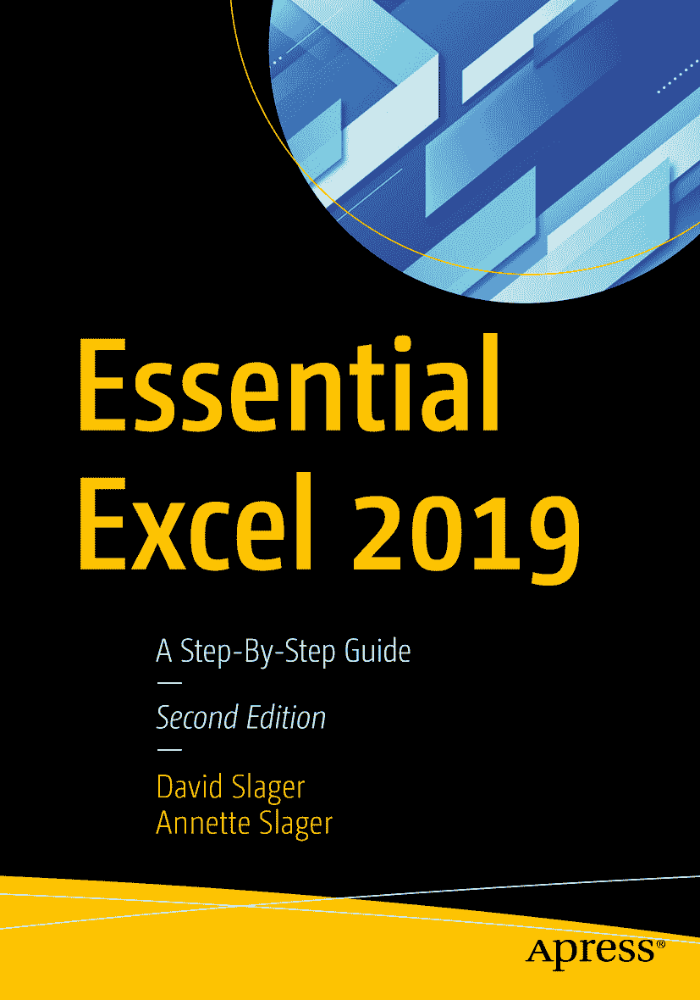

ISBN 978-1-4842-6208-5 e-ISBN 978-1-4842-6209-2 [`doi.org/10.1007/978-1-4842-6209-2`](https://doi.org/10.1007/978-1-4842-6209-2) © David Slager and Annette Slager 2020 本作品受版权保护。出版商保留所有权利，无论是涉及材料的全部或部分，特别是翻译、转载、重用插图、朗诵、广播、以缩微胶片或任何其他物理方式复制，以及传输或信息存储与检索、电子改编、计算机软件，或通过目前已知或未来开发的任何类似或不同方法。在本出版物中使用通用描述性名称、注册商标、商标、服务标志等，即使在缺乏特定声明的情况下，也不意味着这些名称不受相关保护法律和法规的约束，因此可自由使用。出版商、作者和编辑可以假定本书中的建议和信息在出版之日是真实和准确的。出版商、作者或编辑均不对本文所含材料或可能已发生的任何错误或遗漏提供明示或暗示的担保。出版商对已出版地图中的管辖权主张和机构隶属关系保持中立。本书通过 Springer Science+Business Media New York 在全球图书贸易中发行，地址：1 New York Plaza, Suite 4600, New York, NY 10004。电话：1-800-SPRINGER，传真：(201) 348-4505，电子邮件：orders-ny@springer-sbm.com，或访问 www.springeronline.com。Apress Media, LLC 是加利福尼亚州的有限责任公司，其唯一成员（所有者）是 Springer Science + Business Media Finance Inc (SSBM Finance Inc)。SSBM Finance Inc 是特拉华州的一家公司。

*谨以此书献給我们的父母 Andrew 和 Carrie (Sterk) Slager 以及 Russell 和 Florence Carson。我们感谢他们给予我们的所有爱、指引以及为我们做出的牺牲。*

*我们也谨以此书献给我们出色的孩子 Rhianna 和 Marten。*

