# 2. 导航与使用工作表

在本章中，你将学习如何使用鼠标和键盘命令在工作表中导航。你还会熟悉一些快捷键，这些快捷键有助于你在单元格之间快速移动，并开始练习在同一个工作簿内使用多个工作表。

阅读并完成本章学习后，你将能够：
- 在工作表中轻松移动
- 使用快捷键跳转到不同单元格
- 引用单个单元格、列、行或单元格区域
- 使用鼠标选择单元格
- 使用键盘选择单元格
- 使用名称框选择单元格
- 重命名工作表
- 添加和删除工作表
- 更改工作表的选项卡颜色
- 选择多个工作表
- 隐藏和取消隐藏工作表
- 对工作表进行重新排序和复制
- 在工作表之间移动

Excel 旨在让初学者能够快速学习和使用。这些练习将指导你探索如何创建、输入和操作数据。随着你熟悉 Excel 的功能，很容易进行各种调整。

## 使用键盘在单元格间移动

由于工作表中包含大量单元格，因此需要一种快速导航的方式。掌握移动快捷键能以最短时间定位到目标单元格，从而节省时间。单击单元格使其成为活动单元格，或使用表 2-1 中的组合键直接跳转到指定单元格。

### 表 2-1 跳转至单元格的快捷键

| 更改活动单元格的目标 | 按键 |
| --- | --- |
| 向下移动到下一个单元格 | `Enter` |
| 向上移动到上一个单元格 | `Shift + Enter` |
| 移动到下一个单元格 | `Tab` |
| 移动到上一个单元格 | `Shift + Tab` |
| 移动到行首单元格 | `Home` |
| 沿箭头方向移动到下一个单元格 | `上箭头`、`下箭头`、`左箭头`或`右箭头`键 |
| 移动到工作表中包含数据的最后一个单元格 | `Ctrl + End` |
| 移动到工作表首个单元格 | `Ctrl + Home` |
| 移动到下一屏的单元格 | `Page Down` |
| 移动到上一屏的单元格 | `Page Up` |
| 沿箭头方向移动到该方向最后一个单元格（前提是中间无空白单元格） | `Ctrl + 箭头键` |

### 练习 2-1：在工作表中移动

本练习将介绍使用键盘移动的基本技巧。

**注意** 在执行此练习时，如果所用计算机的箭头键同时具有其他功能，您可能需要根据需求单击 `Num Lock` 键来开启或关闭数字锁定功能。

1. 在 `另存为` 窗口的 `文件名` 文本框中输入 `第2章`，然后单击 `保存` 按钮。
2. 单击 `快速访问工具栏` 上的 `保存` 按钮 。由于您之前未保存此文件，系统会显示 `另存为` 窗口。

您可以将文件保存在 `OneDrive` 中，这是微软在网络上提供的免费存储空间。将工作簿保存到 `OneDrive` 的好处是，只要您能访问互联网，就可以在世界任何地方访问该工作簿。另一个好处是，您可以允许其他人访问它，而无需通过电子邮件发送。如果您授予他人权限，他们可以对工作簿进行更改或添加批注。

3. 单击左侧窗格的 `另存为`。
   (1) 单击 `这台电脑`。Excel 会在顶部显示 `文档` 文件夹，下方显示驱动器中的文件夹。
   (2) 输入 `Chapter2` 作为文件名，该文件将存储在 `文档` 文件夹中。
   (3) 单击 `保存` 按钮。Excel 会显示您最近使用过的位置，如图 2-2 所示。单击 `文档`（由于在第 1 章中使用过，该选项应会显示）。Excel 将打开 `另存为` 对话框。

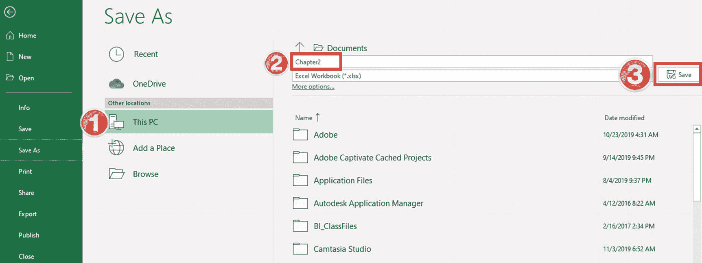
图 2-2 `文件` 选项卡（也称为 Backstage 视图）

4. 启动 Excel 程序。
5. 选择 `文件` ➤ `新建`，然后选择 `空白工作簿`。
6. 在 `Sheet1` 选项卡中输入如图 2-1 所示的数据。

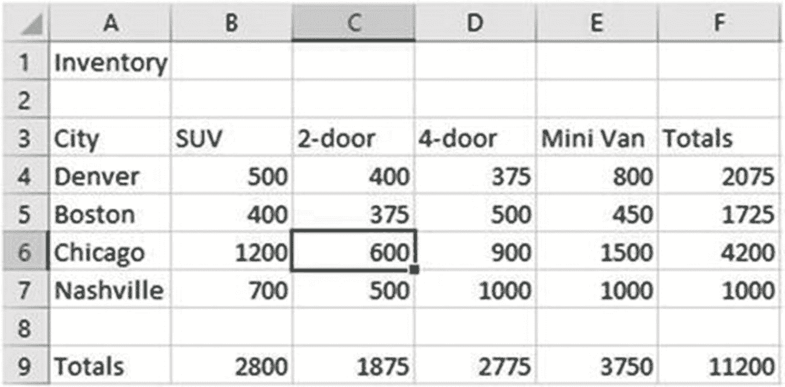
图 2-1 在工作表中输入这些值

#### 使用 Tab 键
按 `Tab` 键可将光标从当前单元格向右移动一个单元格。

1. 单击单元格 `C6`（`C` 列的第六行）。
2. 按 `Tab` 键移动到单元格 `D6`。
3. 按 `Tab` 键移动到单元格 `E6`。

#### 使用 Shift+Tab 键
按住 `Shift` 键的同时按 `Tab` 键可将光标向左移动一个单元格。

1. 按住 `Shift` 键，同时按 `Tab` 键移动到单元格 `D6`。
2. 按住 `Shift` 键，同时按 `Tab` 键移动到单元格 `C6`。
3. 按住 `Shift` 键，同时按 `Tab` 键移动到单元格 `B6`。

#### 使用箭头键
使用箭头键可沿箭头方向移动到下一个单元格。

1. 按上箭头键移动到单元格 `B5`。
2. 按右箭头键移动到单元格 `C5`。
3. 按下箭头键移动到单元格 `C6`。
4. 按左箭头键移动到单元格 `B6`。

#### Ctrl+End 键
按住 `Ctrl` 键的同时按 `End` 键，可将光标移动到包含数据的最后一个单元格。

1. 按住 `Ctrl` 键并按 `End` 键，跳转到单元格 `F9`。

#### Ctrl+Home 键
按住 `Ctrl` 键的同时按 `Home` 键，始终会将光标移动到单元格 `A1`。

1. 按住 `Ctrl` 键并按 `Home` 键，跳转到单元格 `A1`。

#### Page Down 键
按 `Page Down` 键可将光标向下移动一屏。

1. 按 `Page Down` 键两次，向下移动两屏。

#### Page Up 键
按 `Page Up` 键可将光标向上移动一屏。

1. 按 `Page Up` 键两次，向上移动两屏。
2. 单击 `快速访问工具栏` 上的 `保存` 按钮 。

在本节中，您学会了在输入数据时使用键盘在单元格之间移动。接下来，您将学习如何选择单元格，首先使用鼠标，然后使用键盘。

## 选择单元格

有多种方法可以选择单个单元格、一个单元格区域、单个单元格和单元格区域的组合，甚至是不相邻的单元格。选择多个单元格对于同时应用格式、创建公式、删除或插入整行或整列非常有用。

当您拖过相邻单元格块时（见图 2-3），Excel 会在 `名称框` 中显示该块的行数和列数。图 2-3 中的 `名称框` 显示该单元格块跨越三行两列。

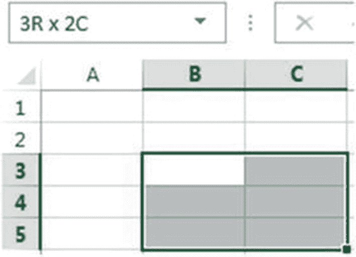
图 2-3 三行两列

### 使用鼠标选择单元格

表 2-2 说明了如何使用鼠标选择不同的工作表区域。

#### 表 2-2 如何使用鼠标选择不同的工作表区域

| 选择目标 | 操作方法 |
| --- | --- |
| 整列 | 将单元格指针定位在列标（字母）上，然后单击鼠标左键。 |
| 整行 | 将单元格指针定位在行号（数字）上，然后单击鼠标左键。 |
| 相邻单元格 | 用鼠标拖动以选择范围内的单元格——或单击范围内的第一个单元格，按住 `Shift` 键，再单击范围内的最后一个单元格。 |
| 不相邻单元格 | 按住 `Ctrl` 键，同时单击列标、行号或特定单元格。 |
| 工作表中所有单元格 | 单击 `全选` 按钮 。 |

### 使用鼠标取消选择单元格

出于某种原因，在笔记本电脑上使用鼠标取消选择单元格的功能可能无法使用。如果您使用的是台式机，请尝试以下方法：如果您已有选定的单元格区域，希望从中取消选择部分单元格，可以按住 `Ctrl` 键，同时拖过要从选定区域中移除的单元格。如果您需要重新选中已取消选择的单元格，或想要添加更多单元格，请继续按住 `Ctrl` 键并选择这些单元格。

### 练习 2-2：使用鼠标选择单元格

在本练习中，您将选择不同的单元格区域。虽然我们稍后会详细讲解格式设置，但通过这个简单练习，您可以初步了解如何使用它们。

#### 选择整行或整列

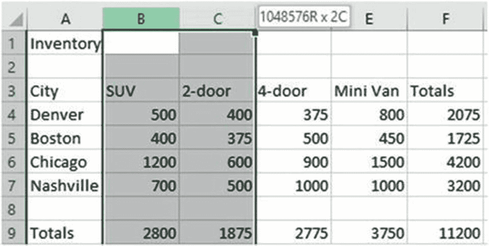
图 2-4 选择列标时，Excel 会显示已选择的行数和列数

# Excel 选择单元格的操作指南

1. 打开您在上一练习中创建的工作簿 `Chapter 2`。

2. 将光标置于列标 B 上。您会看到一个向下箭头；按住鼠标左键，拖动鼠标穿过列标 C，即可同时选中 B 列和 C 列。拖动时，您会看到一个框，其中显示当前选择的行数和列数。请参见图 2-4。

    单击工作表中的空白区域以清除选择。

    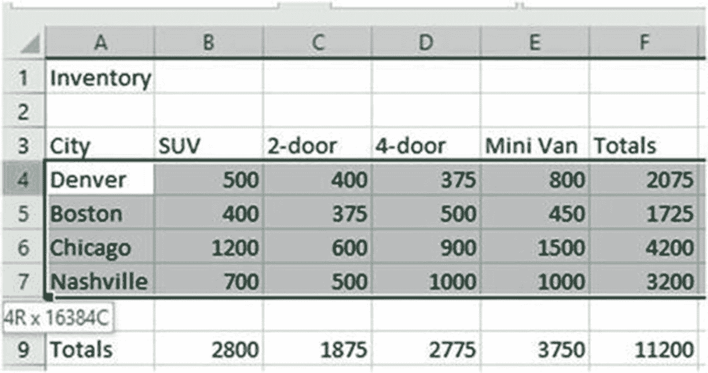

    图 2-5

    选择行标时，Excel 会显示已选择的行数和列数

3. 将单元格指针置于行标 4 上。光标会变为一个向右箭头，按住鼠标左键并向下拖动，即可选中行标 4、5、6 和 7。拖动时，您会看到一个框，其中显示当前选择的行数和列数。请参见图 2-5。

### 选择相邻单元格

1. 单击单元格 `B4`，按住 `Shift` 键，再单击单元格 `F9`。

2. 在功能区 **开始** 选项卡的 **数字** 组中，点击 `$`（这将为选定单元格添加货币符号、逗号和小数点）。

3. 单击单元格 `A3`，然后向右拖动至单元格 `F3`。

4. 在功能区 **开始** 选项卡的 **字体** 组中，点击 `B`（这将使选定单元格加粗）。

**注意：** 您也可以通过点击希望作为区域左上角的单元格，然后按住 `Shift` 键并点击希望作为区域右下角的单元格来选择相邻单元格。

### 选择不相邻的单元格

1. 为选择区域选择一个格式，例如更改字体颜色或字体大小。

2. 单击一个不属于当前选择区域的单元格，以清除之前的选择。

3. 单击列标 C。按住 `Ctrl` 键进行以下选择：
    - 拖动鼠标穿过行标 3 和 4。

4. 单击单元格 `E6`。

5. 单击单元格 `F9`。

6. 单击单元格 `A1`。

### 选择工作表中的所有单元格

1. 单击工作表左上角的 **全选** 按钮 。它位于行标上方，列标的左侧。

### 取消选择和重新选择工作表中的部分单元格

1. 仅当您使用台式电脑时执行以下操作：按住 `Ctrl` 键。拖过单元格区域 `C4:E7` 以取消选择这些单元格。保持按住 `Ctrl` 键，同时拖过单元格 `D5` 和 `D6` 以重新选择它们。

2. 单击 **快速访问工具栏** 上的 **保存** 按钮。

现在您已经学习了如何使用鼠标选择单元格，下一步是学习如何使用键盘组合键来选择单元格。下一部分有一个表格详细说明了操作方法。

---

## 使用键盘选择单元格

表 2-3 说明了如何使用键盘选择不同的工作表区域。

**表 2-3** 如何使用键盘选择工作表区域

| 选择目标 | 按键 |
| :--- | :--- |
| 整列 | `Ctrl + 空格键` |
| 多列 | `Shift + 左/右箭头键`，然后按 `Ctrl + 空格键` |
| 整行 | `Shift + 空格键` |
| 多行 | `Shift + 上/下箭头键`，然后按 `Shift + 空格键` |
| 箭头方向的单元格 | `Shift + 箭头键` |
| 从当前单元格到行首 | `Shift + Home` |
| 到工作表开头 | `Shift + Ctrl + Home` |
| 到工作表最后一个含数据的单元格 | `Shift + Ctrl + End` |
| 整个工作表 | `Ctrl + A` 或 `Ctrl + Shift + 空格键` |

**注意：** 如果您选择了一个空白单元格或没有相邻数据单元格的单元格，`Ctrl + A` 和 `Ctrl + Shift + 空格键` 会选择整个工作表。如果您在使用这些组合键时选中的单元格有相邻数据单元格，则只选择包含数据的相邻单元格区域。如果这一点不清楚，请不要担心。我们将在接下来的练习中尝试这两种情况，您将会看到它们是如何工作的。

---

### 练习 2-3：使用键盘选择单元格

继续使用上一个练习中的同一个工作簿。

#### 选择整列

按 `Ctrl + 空格键` 可选择活动单元格所在列的所有单元格。

1. 单击单元格 `D3`。
2. 按住 `Ctrl` 键，然后按 `空格键`。

#### 选择整行

按 `Shift + 空格键` 可选择活动单元格所在行的所有单元格。

1. 单击单元格 `C3`。
2. 按住 `Shift` 键，然后按 `空格键`。注意功能区 **字体** 组中的 `B` 按钮会高亮显示。这是因为您之前已将此行加粗。再次点击 `B` 按钮，可以取消该行的加粗效果。

#### 选择多列

1. 将光标移至单元格 `D1`。
2. 按住 `Shift` 键，同时按两次右箭头键。这将选中单元格 `D1`、`E1` 和 `F1`。松开 `Shift` 键。
3. 接着，按住 `Ctrl` 键，同时按 `空格键`。这将选中 D、E 和 F 整列。

#### 选择多行

1. 单击单元格 `A1`。
2. 按住 `Shift` 键，然后按两次下箭头键。
3. 按住 `Shift` 键，然后按 `空格键`。这将选中第 1、2 和 3 行。

#### 选择区域

在本练习中，您将使用不同的组合键选择几个不同的区域。

1. 单击单元格 `A1`。按住 `Shift` 键并持续按下箭头键，直到行号变为 7。继续按住 `Shift` 键并持续按右箭头键，直到选中 A 列到 G 列。然后，按住 `Shift` 键并按左箭头键取消选择 G 列。这将选中区域 `A1:F7`。
2. 单击单元格 `F3`。按住 `Shift` 键加 `Home` 键。这将选中从当前单元格到行首的所有单元格。
3. 单击单元格 `F4`。按住 `Shift` 键加 `Ctrl` 键再加 `Home` 键。这将选中从当前单元格到单元格 `A1` 的所有内容。

#### 从当前单元格选择到最后一个含数据的单元格

1. 在单元格 `J23` 中输入 `380`。按 `Ctrl + Home` 键移动到单元格 `A1`。
2. 按 `Shift + Ctrl + End` 键。这将选中 `A1` 和 `J23` 之间的所有单元格。

#### 选择整个工作表或所有单元格

1. 单击任意空白单元格。
2. 按 `Ctrl + A` 键。这将选中工作表中的所有单元格。
3. 再次单击一个空白单元格，然后按 `Shift + Ctrl + 空格键`，结果相同。

#### 选择整个数据块

1. 单击单元格 `B5`。按 `Ctrl + A` 键。这将选中数据块中的所有单元格。
2. 单击单元格 `B5`。按 `Shift + Ctrl + 空格键`。
3. 单击 **快速访问工具栏** 上的 **保存** 按钮。

您已经学习了如何使用鼠标和键盘选择单元格。接下来，您将学习如何通过输入单元格地址来选择单元格。

---

## 直接跳转到任意单元格

Excel 提供了两种直接跳转到任意单元格的方法。一种方法是在`名称`框中键入单元格地址，然后按 `Enter`。另一种方法是使用`定位`功能。

在`名称`框中输入单元格地址是更快捷的方法，但`定位`功能有一个好处，即它能存储你之前跳转过的单元格，便于在单元格之间来回切换。

可以通过单击`开始`选项卡，然后在`编辑`组中单击`查找和选择`箭头以查看下拉菜单来访问`定位`功能。请见图 2-8。此功能的快捷键是按 `Ctrl + G`。

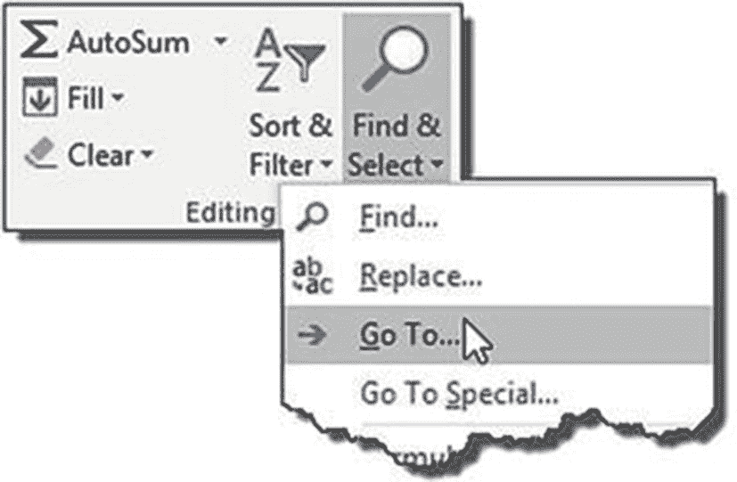

图 2-8

从`查找和选择`按钮中选择`定位`

选择`定位…`选项会弹出`定位`对话框。请见图 2-9。

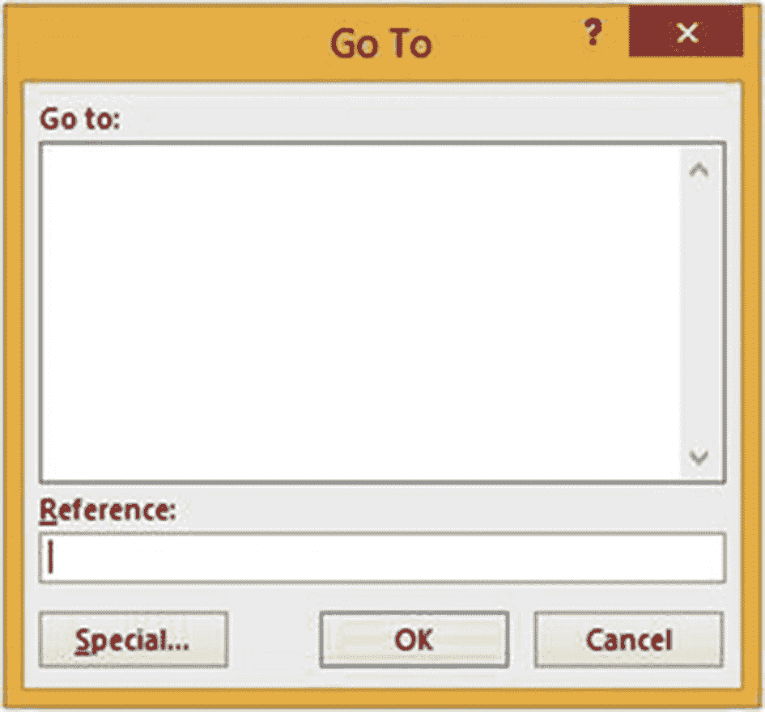

图 2-9

`定位`对话框

要跳转到特定单元格，你需要在`引用`区域键入目标单元格的地址，然后按 `Enter` 或单击`确定`按钮。

## 练习 2-5：练习直接跳转到任意单元格

图 2-13 工作表标签

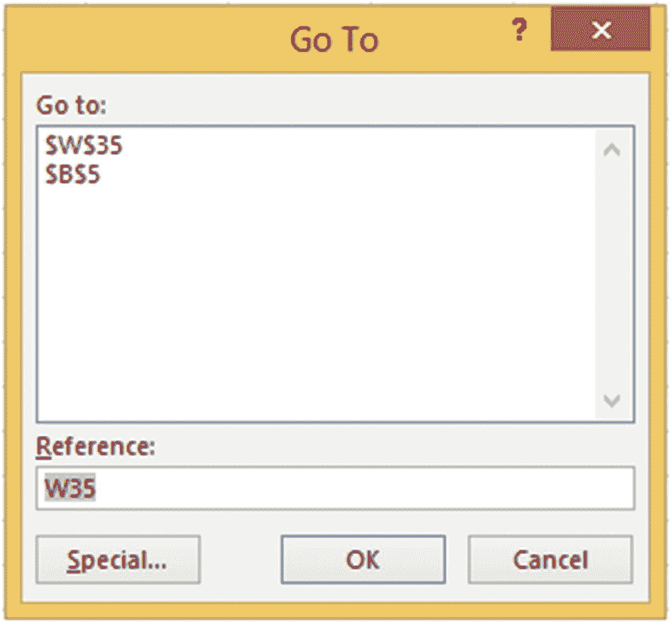

图 2-12 在`定位`区域中点击某个地址即可跳转回该地址

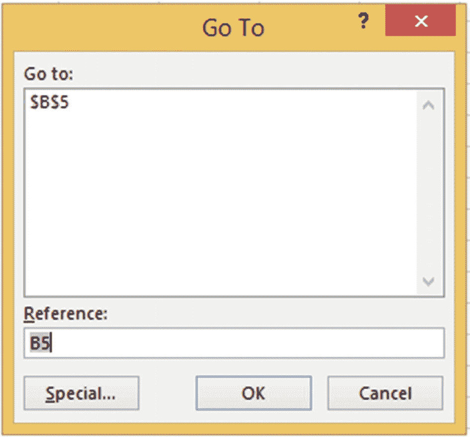

图 2-11 显示单元格地址 `B5`，因为这是启动`定位`功能时所在的位置

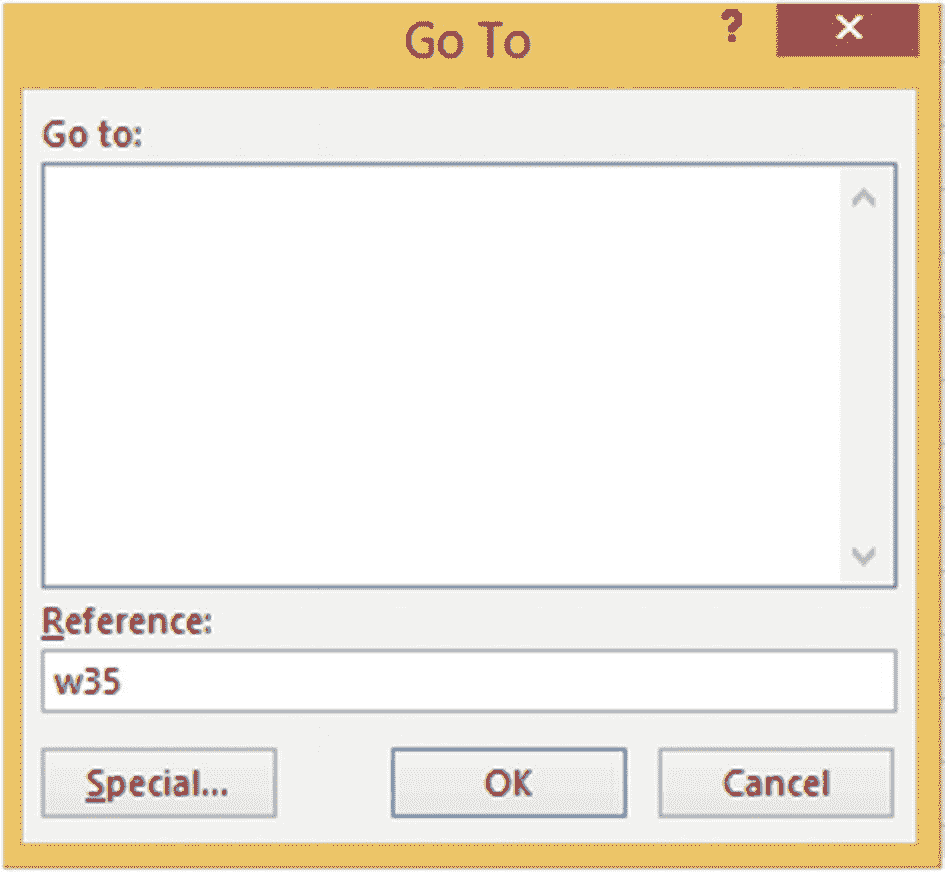

图 2-10 在`定位`对话框的`引用`区域中输入单元格地址

1.  在`定位`区域中单击 `$W$35`，然后单击`确定`按钮返回单元格 `W35`。
2.  按 `Ctrl + G`。在`定位`区域中单击 `$B$5`。单击`确定`按钮。
3.  在`引用`区域中，将 `B5` 覆盖输入为 `IV4`。单击`确定`按钮。
4.  你的光标应位于单元格 `IV4` 中。
5.  按 `Ctrl + G`。你之前使用`定位`跳转到的单元格地址，以及启动`定位`功能后的第一个单元格地址，都会显示在`定位`区域中。请见图 2-12。在`定位`区域中点击某个地址即可跳转回该地址。
6.  单击`确定`按钮。
7.  你现在应该位于单元格 `W35`。
8.  按快捷键 `Ctrl + G` 调出`定位`对话框。请见图 2-11。单元格地址 `B5` 显示在`引用`区域中，其绝对地址显示在`定位`区域中。绝对地址在列和行前面使用美元符号。绝对地址将在后面讨论。Excel 会保存你使用`定位`功能时所处的位置，以便你可以轻松跳转回原地。
9.  使用你在之前练习中创建的同一个工作表。
10. 单击单元格 `B5`。
11. 在功能区上，单击`开始`选项卡。在`编辑`组中，单击`查找和选择`按钮。选择`定位…`。
12. 在`引用`区域中输入 `w35`。请见图 2-10。

### 使用名称框跳转到单元格

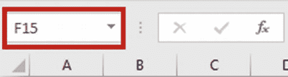

1.  在`名称`框中键入 `F15` 并按 `Enter`。

接下来，你将学习如何处理工作表。你将学习如何选择、重新排列它们以及更改它们的标签颜色——以及添加、删除和隐藏工作表。

## 工作表

Excel 中的电子表格被称为*工作表*。各个工作表一起存储在*工作簿*中。在 Excel 中保存工作时，你保存的不是单个工作表，而是工作簿。在一个工作表中输入的数据可以同时输入到其他工作表中。数据可以在工作表之间传递。数据也可以从其他工作簿或其他来源导入到工作表中。

一个工作簿可以包含一个或多个工作表。这些工作表的标签显示在屏幕的左下角。单击某个工作表标签会使该工作表成为当前工作表。当前标签很容易识别，因为其标签文本为粗体，并且文本下方有粗线。

除了添加和格式化数据之外，以下是处理工作表的一些方法：
- 重命名它们。
- 添加或删除它们。
- 隐藏和取消隐藏它们。
- 重新排序它们。
- 将它们复制到同一个工作簿。
- 将它们复制或移动到另一个工作簿。

### 命名工作表

如果添加第二个工作表，它将默认命名为 `Sheet2`。如果添加第三个工作表，它将默认命名为 `Sheet3`，依此类推。如果你创建三个工作表，删除 `Sheet3`，然后创建一个新工作表，它会将其命名为 `Sheet4`，而不会创建第二个 `Sheet3`。它会记住已使用过的名称。这些名称没有帮助，因为它们不提供任何关于工作表内容的信息，但幸运的是，你可以将它们重命名为更有意义的名称。

有两种方法可以重命名工作表：

图 2-14 a) 标签名称处于编辑模式，b) 标签已被重命名

- 右键单击工作表标签并选择`重命名`。这将高亮显示你右键单击的标签（见图 2-14a）并将标签文本置于编辑模式，你可以在其中覆盖输入当前文本（见图 2-14b）。
- 双击工作表标签也会将标签文本置于编辑模式。

### 添加和删除工作表

你可以向工作簿添加新工作表或删除它们。

可以通过执行以下任一操作来添加工作表：

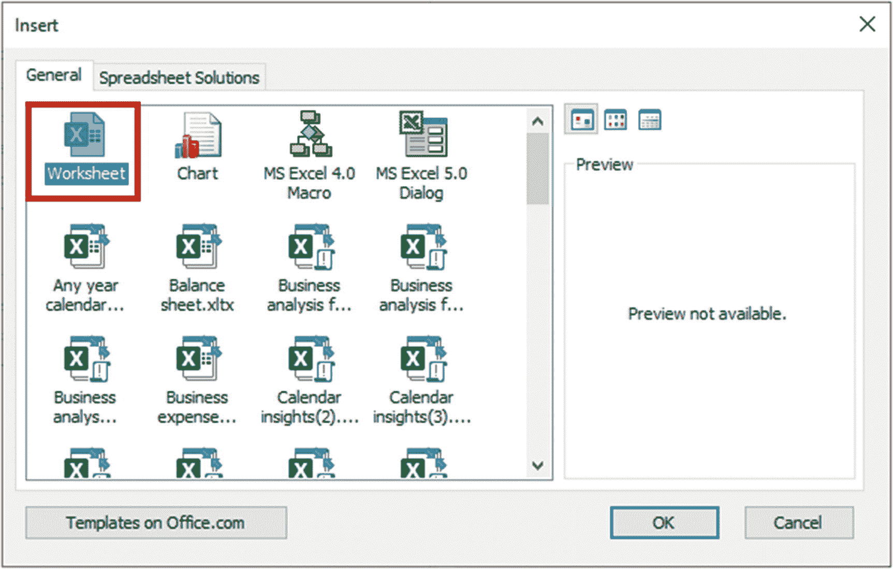

图 2-15 从`插入`对话框中选择`工作表`以添加空白工作表

- 单击`新建工作表`按钮 。单击`新建工作表`按钮会在当前选定工作表之后添加新工作表。
- 右键单击工作表标签并选择`插入`，这将显示`插入`对话框（见图 2-15）。选择`工作表`并单击`确定`以添加空白工作表。

你还可以添加称为模板的预建工作表。单击`电子表格解决方案`选项卡以查看可用的模板（见图 2-16）。`电子表格解决方案`选项卡上有一些非常精美的模板。有`血压追踪器`、`个人月度预算`模板、`贷款摊销`模板等等。单击一个模板可在预览区域中查看它。双击其中一个模板会将其作为工作表添加到你的工作簿中。

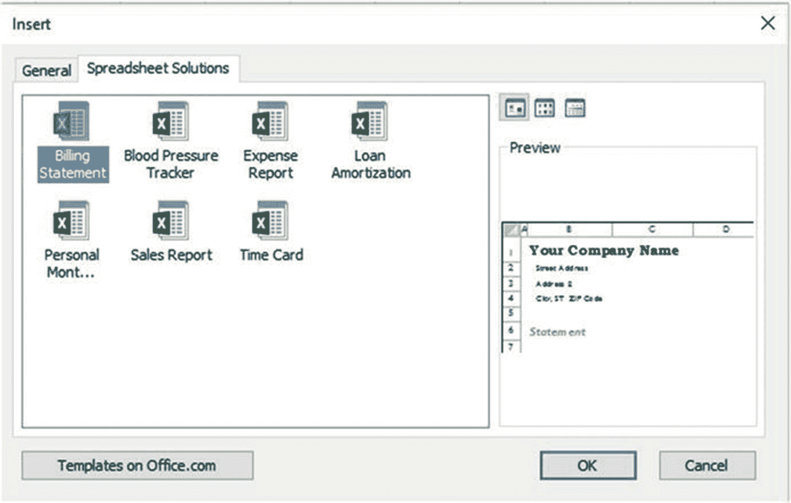

图 2-16 可用的模板

可以通过右键单击其标签并选择`删除`来删除工作表。

### 更改工作表标签颜色

你可以通过为不同标签设置不同颜色来轻松区分它们。右键单击标签，选择`标签颜色`，然后选择一种颜色，即可更改每个标签的背景颜色。见图 2-17。

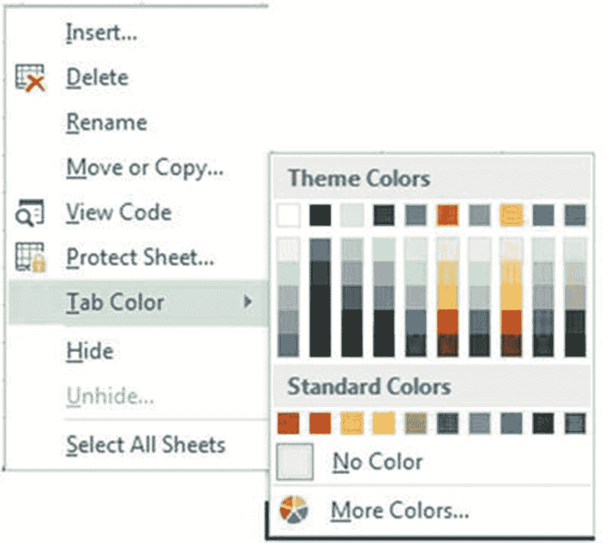

图 2-17 — 选择工作表`标签颜色`

### 选择多个工作表

你可以通过按住`Ctrl`键同时单击工作表标签来选择多个工作表。你也可以通过先单击要选的第一个工作表标签，然后按住`Shift`键并单击要选的最后一个工作表标签，来选择多个相邻的工作表。

### 隐藏和取消隐藏工作表

你可以通过右键单击工作表标签，然后从菜单中选择`隐藏`来隐藏工作表。隐藏不会删除工作表或以任何方式更改它。你可以通过右键单击任意工作表标签并选择`取消隐藏…`来恢复已隐藏的工作表。`取消隐藏`对话框会显示所有已隐藏的工作表。要取消隐藏工作表，只需选择要重新显示的工作表，然后单击`确定`按钮。见图 2-18。

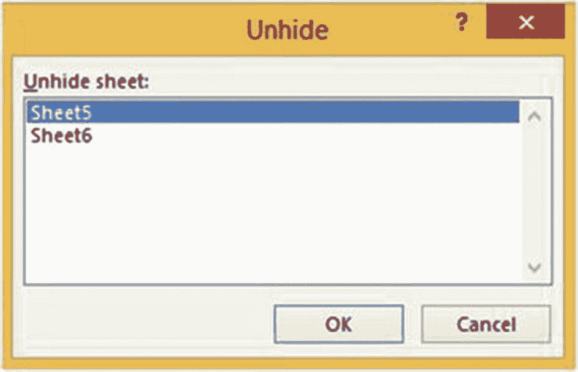

图 2-18 — 选择要取消隐藏的工作表

### 重新排序和复制工作表

你可以通过拖放工作表标签来更改工作表的顺序。拖动工作表标签时，光标会显示为一个文档图标。一个向下箭头会随拖动而移动，指示松开鼠标按钮时工作表将放置的位置。见图 2-19。

图 2-19 — 将工作表拖到新位置

更改工作表顺序的另一种方法是右键单击要移动的工作表标签，然后从上下文菜单中选择`移动或复制`。`移动或复制`对话框会显示工作簿中的所有工作表。你可以选择将其放在哪个工作表之前，或者选择`(移至最后)`使其成为工作簿中的最后一个工作表。见图 2-20。

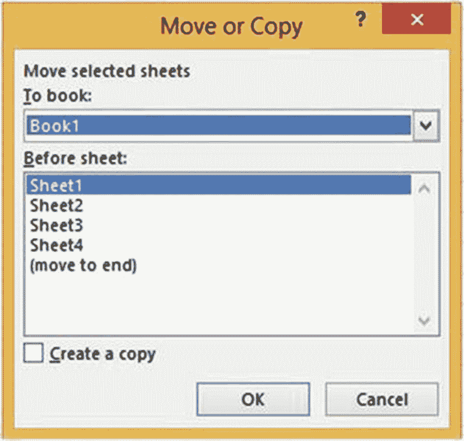

## 图 2-20 — 将当前工作表移至末尾或另一个工作表之前

`移动或复制`对话框有一个用于创建工作表副本的复选框选项。选择此选项将复制你所右键单击的工作表，并将新副本放置在对话框的`下列工作表之前：`区域中指定的位置。Excel 会将新副本命名为原工作表的名称，并在括号中添加副本的编号。图 2-21 显示`Sheet1`的副本被移到了末尾，并命名为`Sheet1 (2)`。如果再复制一份`Sheet1`，它将被命名为`Sheet1 (3)`。你也可以将复制的工作表重命名为更有意义的名称。

图 2-21 — Excel 在复制的工作表名称末尾添加了一个编号

**注意：** 你也可以将工作表移动或复制到其他工作簿。

### 使用标签按钮在工作表间移动

如果工作表标签左侧有圆点，则表示当前显示的标签左侧还有更多工作表。这些圆点被称为省略号。如果工作表标签右侧有省略号，则表示当前显示的标签右侧还有更多工作表。见图 2-22。

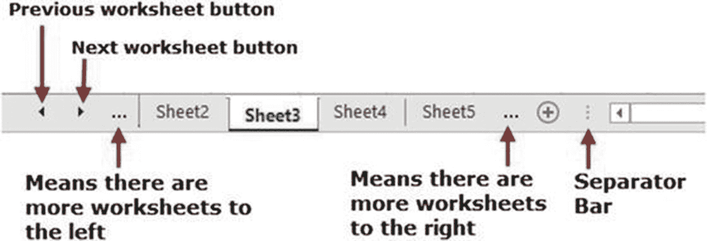

图 2-22 — 处理不可见的工作表

单击`下一张工作表`按钮会显示下一个工作表的标签（但不会更改当前选中的标签），结果如图 2-23 所示。

图 2-23 — 单击`下一张工作表`按钮后，显示`Sheet6`

此时单击`上一张工作表`按钮两次，会向后移动两个工作表标签。由于这是第一个工作表，`上一张工作表`按钮会变灰，并且左侧的省略号不再显示。见图 2-24。

图 2-24 — `上一张工作表`按钮变灰，左侧省略号按钮消失

如果你想要更多空间来显示工作表标签，可以将分隔条向右拖动。

如果将鼠标指针悬停在`上一张`或`下一张工作表`按钮上，会显示一个工具提示，列出可用选项。见图 2-25。

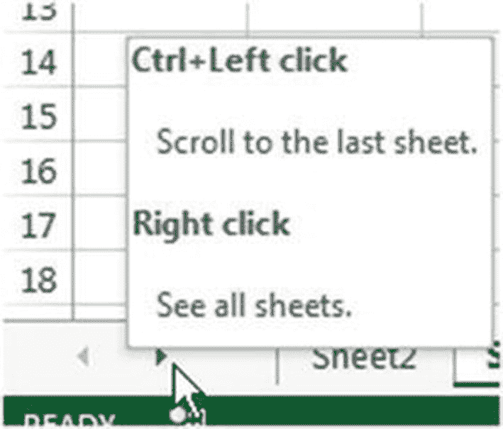

图 2-25 — 将鼠标指针放在`上一张`或`下一张工作表`按钮上时显示工具提示

按住`Ctrl`键的同时单击`上一张工作表`按钮，会滚动到第一个工作表。按住`Ctrl`键的同时单击`下一张工作表`按钮，会滚动到最后一个工作表。

如果你右键单击`上一张`或`下一张工作表`按钮，会显示一个对话框，其中列出所有工作表，你可以从中激活你想要的工作表。见图 2-26。

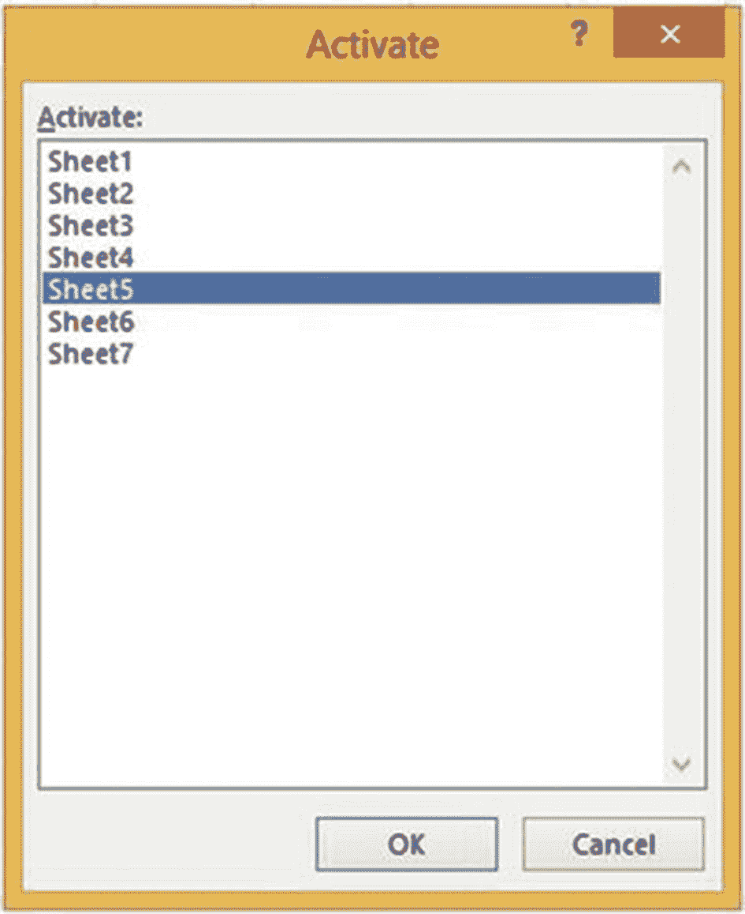

图 2-26 — 所有工作表都显示在`激活`对话框中

### 练习 2-6：使用工作表标签

本练习涵盖了如何在各个工作表标签间移动，以及如何隐藏和取消隐藏工作表。

图 2-29 — 将 `Qtr1 销售` 拖到 `Qtr1 费用` 之后

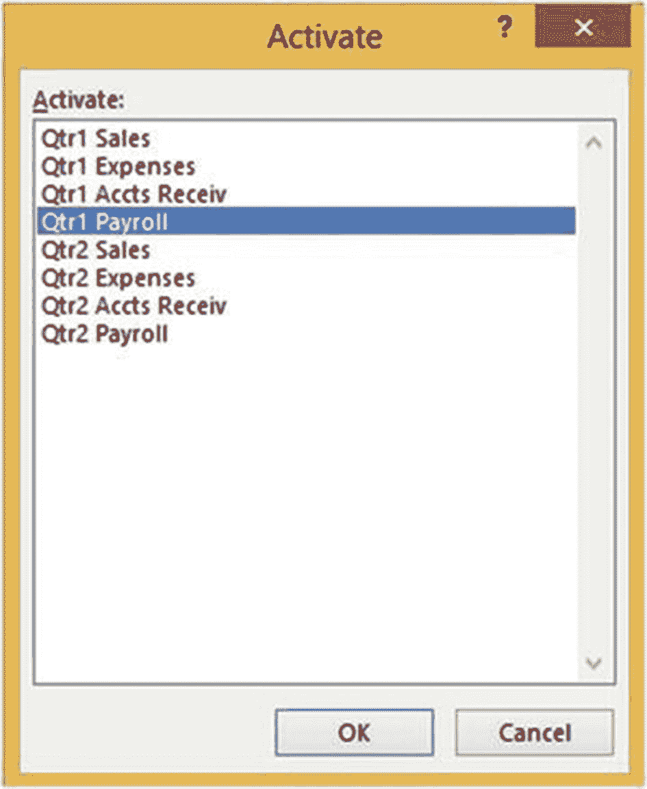

图 2-28 — 从`激活`对话框中选择`Qtr1 工资`

图 2-27 — 你的工作表标签应如图所示

1.  接下来，你将隐藏`Qtr1`和`Qtr2 应收账款`的工作表。单击 `Qtr1 应收帐款` 标签，按住`Ctrl`键，然后单击 `Qtr2 应收帐款` 标签。右键单击 `Qtr2 应收帐款` 标签，然后选择`隐藏`。

2.  现在，你将恢复这两个隐藏的工作表。右键单击任意一个标签，然后从菜单中选择`取消隐藏…`。选择 `Qtr1 应收帐款`，然后单击`确定`。该工作表将显示回其原始位置。右键单击任意一个标签，然后从菜单中选择`取消隐藏…`。选择 `Qtr2 应收帐款`，然后单击`确定`。

3.  让我们将工作簿中的`Qtr1`和`Qtr2 应收账款`工作表永久删除。单击`Qtr1 应收账款`选项卡，按住`Ctrl`键，然后单击`Qtr2 应收账款`选项卡。右键单击`Qtr2 应收账款`选项卡并选择`删除`。

4.  将`Qtr1 销售`选项卡移到`Qtr1 费用`选项卡之后，方法是单击`Qtr1 销售`选项卡，将其向右拖动，直到`Qtr1 费用`选项卡末尾出现向下箭头，然后松开鼠标左键。参见图 2-29。

5.  向左拖动分隔条 ，以便您只能看到前五个工作表选项卡。

6.  单击`下一个工作表`按钮  两次，以便查看右侧隐藏的下两个选项卡。

7.  单击`上一个工作表`按钮 ，以便查看左侧隐藏的选项卡。

8.  单击`Ctrl` + `下一个工作表`按钮  以查看最后一个选项卡。

9.  单击`Ctrl` + `上一个工作表`按钮 ，以便您能看到第一个选项卡。

10. 向右拖动分隔条 ，直到能看到全部八个工作表选项卡。

11. 要激活一个工作表，请右键单击`下一个选项卡`按钮或`上一个选项卡`按钮。从`激活`对话框中选择`Qtr1 工资`。参见图 2-28。单击`确定`按钮。

12. 创建一个名为`工作表选项卡`的新工作簿。

13. 右键单击`Sheet1`选项卡。从菜单中选择`重命名`。在`Sheet1`文本处键入`Qtr1 销售`。

14. 单击`新建工作表`按钮三次。

15. 双击`Sheet2`选项卡。在`Sheet2`文本处键入`Qtr1 费用`。按下`Enter`键。

16. 双击`Sheet3`。在`Sheet3`文本处键入`Qtr1 应收账款`。按下`Enter`键。

17. 双击`Sheet4`。在`Sheet4`文本处键入`Qtr1 工资`。

18. 插入四个新工作表。最初的工作表可能不再可见。别担心，它们仍然存在。将分隔条  向右拖远一点，以便您能看到所有工作表选项卡以及额外空间，从而可以在选项卡上编写更长的名称。

19. 将新工作表的命名方式与现有工作表相同，只是将`Qtr1`改为`Qtr2`。您的选项卡应该看起来像图 2-27 中那样。

将`Qtr2 销售`移到`Qtr2 费用`选项卡之后。

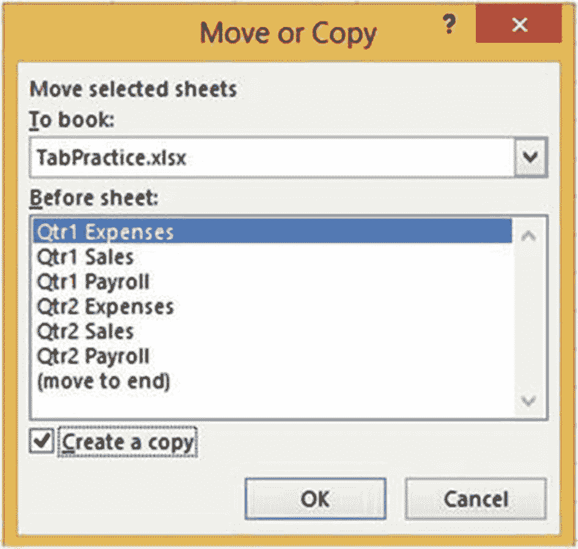

图 2-30

选择`创建副本`

1.  接下来，您将复制一个工作表，但在复制工作表之前，您需要向被复制的工作表中输入一些数据，以验证复制是否成功。单击`Qtr1 费用`选项卡。在几个单元格中输入一些数据。右键单击`Qtr1 费用`选项卡。选择`移动或复制`。这将调出`移动或复制`对话框。在`下列选定工作表之前：`区域中，选择`Qtr1 销售`。勾选对话框底部的`建立副本`复选框。参见图 2-30。单击`确定`。

工作表`Qtr1 费用`和`Qtr1 费用 (2)`应包含相同的数据。

2.  将工作簿另存为`Chapter2Tabs`。

当您进一步了解工作表函数和选项时，请思考您将如何使用这些数据。在阅读本书的过程中，您将学到更多关于如何规划与设计工作簿和工作表，以满足您当前和未来需求的知识。

## 总结

您已经学习了一种在工作表之间快速切换的方法，以及如何使用特殊的键盘快捷键跳转到不同的单元格。您还学习了如何在一个工作簿中创建和自定义多个工作表。在第 3 章中，您将创建不同类型的数据，并学习如何插入特殊字符以及调整列宽和行高。其中包括有助于您继续以最适合自身需求的方式使用 Excel 的数据输入快捷方式。

