# 3. 输入和编辑数据的最佳方法

在本章中，您将了解 Excel 工作表如何使用三种数据类型：文本、数值和日期/时间。理解这些不同类型的数据非常重要。您还将开始使用键盘上找不到的特殊字符。

Excel 提供了多种工具和功能，使您的数据输入快速、高效且符合您所需的格式。Excel 会根据您输入的数据类型自动确定数据的对齐方式。您输入的数据可以使用各种文本、数值和数据格式进行格式化。如果输入的数据不能以您期望的方式正好放入单元格，您可以调整列宽和行高。

Excel 的 `自动更正` 功能有助于纠正常见的拼写错误、纠正大小写误用、输入无法直接从键盘输入的特殊符号，以及为常用单词或短语创建输入快捷方式。

`自动完成` 和 `从下拉列表中选择` 功能允许您轻松复制现有的列值。`自动填充` 可用于创建重复单元格、输入数值序列、创建自定义列表或重复使用您教给它的模式。

阅读并完成本章练习后，您应能：
* 创建三种数据类型
* 插入特殊字符
* 更改列宽和行高
* 纠正输入错误
* 使用 `自动更正` 进行更正并为输入单词或短语创建快捷方式
* 使用 `自动完成` 输入数据
* 使用 `从下拉列表中选择` 输入数据
* 使用 `自动填充` 创建重复单元格和序列
* 创建自定义列表
* 向电子表格添加附注和批注

## 数据类型

可以在单元格中输入三种类型的数据：文本、数字以及日期和时间。

-   **文本数据**——文本数据也称为字符串数据。数据可以由字母、数字和一些符号的组合构成。文本数据在单元格中左对齐。你无法在公式中使用文本数据。

-   **数字数据**——数字单元格只能包含图 3-1 中所示的字符。
    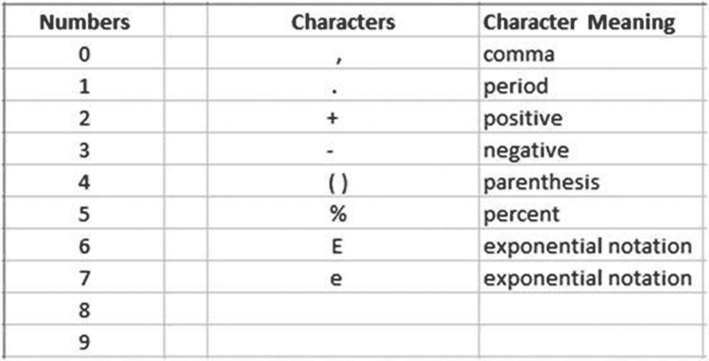
    **图 3-1** 数值中只能使用这些数字和字符
    如果单元格中包含任何其他字符，甚至是空格，Excel 都会将数据视为文本。只有包含数值的单元格才能用在公式中。数字数据在单元格中右对齐。

-   **日期和时间数据**——日期和时间数据可用于处理日期、时间，或两者组合。你可以将日期输入为 `January 16, 2005`、`01/16/05` 或 `01-16-2005`，但日期在单元格中的显示方式取决于该单元格的格式。日期和时间数据与数字数据一样，在单元格中右对齐。

> **注意**
> 如果你将日期输入为 `January 15 2010`，Excel 会将其显示为文本而非日期，因为缺少将其识别为日期的特征。如果你在日期后加上逗号，Excel 就能将其识别为日期并右对齐。

图 3-2 中的第一列显示了在单元格中实际输入的内容；第二列显示了该输入在 Excel 中的显示方式。你可以通过更改其格式来改变日期的显示方式，我们将在后续章节中介绍这一点。
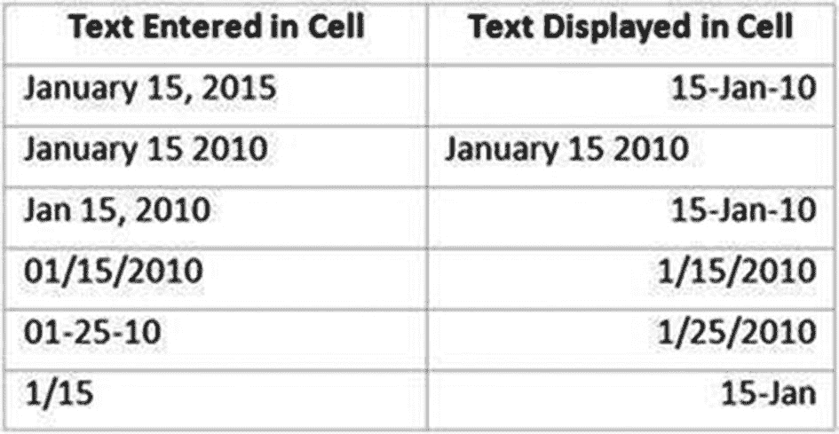
**图 3-2** 在单元格中输入的日期及其显示方式

> **注意**
> 在单元格中输入时间时，请确保在时间与 `AM` 或 `PM` 之间输入一个空格。时间应输入为 `11:35 AM` 而非 `11:35AM`。如果不加空格输入，该时间将被视为文本数据，并在单元格中左对齐（见图 3-3）。对于被视为文本的日期和时间，你将无法对其执行日期和时间函数。
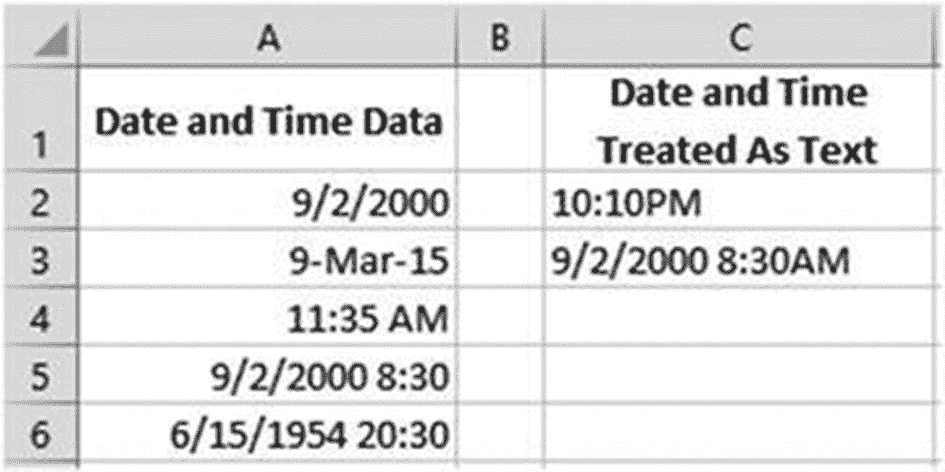
**图 3-3** 输入时间时不加空格使其成为文本输入而非日期

### 练习 3-1：练习输入不同类型的数据

在本练习中，你将创建一个新的工作簿并输入不同类型的数据。
1.  启动 Excel 程序。创建一个名为 `Chapter 3` 的新工作簿。
2.  在单元格 `A1` 中输入 `5 Text`。按 `Tab` 键。由于是文本，它保持左对齐。
3.  在单元格 `B1` 中输入 `12.75`。按 `Tab` 键。由于是数字，它右对齐。
4.  在单元格 `C1` 中输入 `2/13`。按 `Tab` 键。由于是日期，它右对齐。
5.  在单元格 `D1` 中输入 `12:15 PM`。按 `Tab` 键。由于是时间，它右对齐。
6.  在单元格 `E1` 中输入 `5:10AM`。按 `Tab` 键。由于你在 `AM` 前输入时间时没有加空格，Excel 将其左对齐，因为 Excel 认为它是文本。
7.  在单元格 `F1` 中输入 `March 3 2014`。按 `Tab` 键。由于你输入日期时在日期后没有加逗号，Excel 将其左对齐，因为 Excel 认为它是文本。
8.  将 `Sheet1` 工作表标签的名称更改为 `Data Types`。
9.  保存工作簿。

---

## 插入特殊字符

如果你想输入键盘上没有的字符，可以使用 Excel 的符号之一，例如 `≥` 或 `≤`。可以通过单击功能区中的 `插入` 选项卡，然后在 `符号` 组中单击 `符号` 按钮来访问这些特殊字符（见图 3-4）。

**图 3-4** `符号` 按钮位于功能区的 `符号` 组中

`符号` 对话框有两个选项卡，一个用于符号，另一个用于特殊字符。`特殊字符` 选项卡显示常用符号，如版权符号、商标符号、不同样式的右引号等。`符号` 选项卡包含更多特殊字符，这也是我们本节的重点。

`符号` 选项卡上可用的符号取决于所选字体。不同的字体可以创建不同的符号。某些字体比其他字体拥有更多可用的符号。例如，图 3-5 所示的 `通用（普通文本）` 选项提供了非常丰富的字符选择。
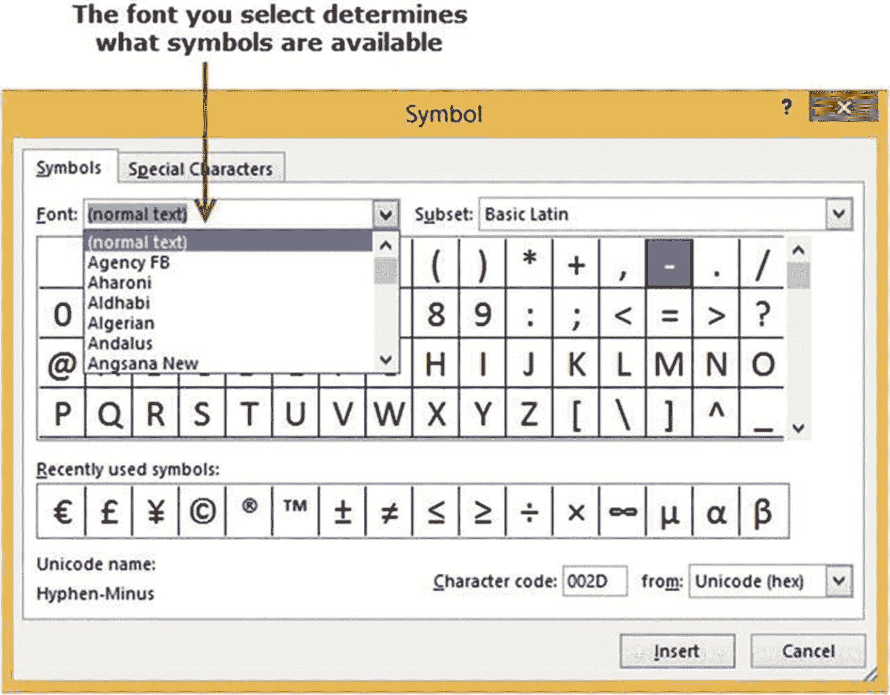
**图 3-5** 当需要输入键盘上没有的字符时使用此选项

`最近使用的符号` 列表显示你最近使用过的 36 个符号。你可以通过单击某个符号或特殊字符，然后单击 `插入` 按钮将其插入到单元格中。

单击 `插入` 按钮会将选定的符号放置到当前单元格中，但不会关闭 `符号` 对话框。这允许你在同一个单元格中插入多个符号，而无需重新打开 `符号` 对话框。如果 `符号` 对话框遮挡了你正在输入符号或特殊字符的单元格视图，你可能需要移动它。

单击 `来自:` 下拉框右侧的向下箭头，会显示三个可供选择的符号类别（见图 3-6）。
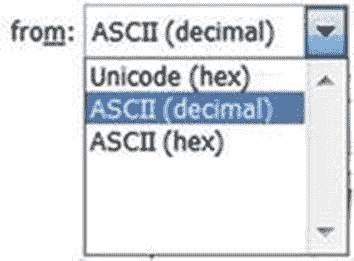
**图 3-6** 符号类别

> **注意**
> 图 3-6 中的三个选项是你的计算机表示数据的不同方式。
> - `Unicode` 代表通用编码。`Unicode` 代码可以显示超过 16,000 个符号。它用于表示全世界所有语言的符号。
> - `ASCII` 代表美国信息交换标准代码。`ASCII` 格式创建符号的方式已经存在很长时间。它能够创建多达 256 个不同的符号。它使用美国和西欧的符号。
> - `ASCII（十六进制）` 代码是十六进制格式。它们可以使用 0 到 15 的数字。

`字符代码` 是你所选符号的数值表示。同一个符号的字符代码会根据其是十进制格式还是十六进制格式而不同。如果你知道要使用的符号的字符代码，可以输入该代码来选择该符号。

### 练习 3-2：输入特殊字符

在本练习中，你将向电子表格中添加特殊字符。如果你已关闭上一次练习中的 `Chapter 3` 工作簿，请重新打开它。
1.  创建一个新工作表。将工作表标签重命名为 `特殊字符`。
2.  单击单元格 `B2`。在功能区上，单击 `插入` 选项卡。在 `符号` 组中，单击 `符号` 按钮。
3.  从 `字体` 下拉框中选择 `普通文本`，然后从对话框右下角的 `来自` 下拉列表中选择 `ASCII（十进制）`。增大 `符号` 对话框的大小，直到无需滚动即可看到所有符号。
4.  点击 `½` 符号。注意 `½` 符号的字符代码是 189。点击 `插入` 按钮。移动 `符号` 对话框，使其能够看到单元格 `B2`。
**注意** 遗憾的是，您无法在工作表中选择另一个单元格然后再插入另一个符号。您必须先关闭 `符号` 对话框，选择另一个单元格，然后重新打开 `符号` 对话框。
5.  点击 `符号` 对话框上的 `关闭` 按钮。
6.  在单元格 `C2` 中输入 `25`。不要按回车键。我们将在 25 后面添加一个 `¢` 符号。

## 如何更改列宽

3.  在功能区上的“符号”组中，点击“符号”按钮。在“字体”下拉框中拖动选中“普通文本”（如果尚未高亮显示）。输入`Ti`，然后按 Tab 键。这将显示 Times New Roman 字体的符号。点击`¢`符号，然后点击“插入”按钮。移动“符号”对话框，使其能够看到单元格 `C2`。

4.  点击来自下拉框中的向下箭头，选择“Unicode (十六进制)”。您将看到更多符号。点击不同的符号；当您这样做时，请注意，某些符号的字符代码中包含字母，如 `A`、`B`、`C`、`D`、`E` 或 `F`。

    **注意** 当您选择了“Unicode (十六进制)”时，右上角会出现一个子集下拉框。点击其中的一些不同子集。

1.  关闭“符号”对话框。

2.  点击单元格 `D2`。在功能区上的“符号”组中，点击“符号”按钮。在最近使用的符号中点击`½`符号。点击“插入”按钮。

3.  在“符号”对话框中点击特殊字符选项卡。双击“版权”符号。双击符号与先点击它再点击“插入”按钮的效果相同。移动“符号”对话框，使其能够看到单元格 `D2`。单元格 `D2` 应包含`½©`。

4.  点击“符号”选项卡。点击字体下拉框的向下箭头。选择“`Webdings`”。该字体包含一些您可能会觉得有用的图像。也可以看看 `Wingdings`、`Wingdings2` 和 `Wingdings3` 字体。

5.  关闭“符号”对话框。

6.  点击单元格 `E2`。如果您记住字符代码，可以直接在单元格中输入大多数 ASCII 符号。要直接在单元格中输入符号，您需要在按住 Alt 键的同时，在小键盘上输入字符代码。字符代码只能在小键盘上输入。在开始输入数字之前，请确保 Num Lock 键已开启。

7.  请记住，`½`符号的字符代码是 `189`。按住 Alt 键，输入`0189`，然后释放 Alt 键。您应该会看到`½`符号。需要额外的 `0` 来使其成为一个四位数字。

8.  点击快速访问工具栏 (QAT) 上的“保存”按钮``。

当您输入的文本长于列宽时，如果右侧的相邻单元格为空，则溢出的字符会显示在该单元格中。这些字符可能看起来是相邻单元格的一部分，但实际上它们并未存储在那里。它们存储在您输入它们的单元格中。在以下示例中，名称 `Anthony Bradtmueller` 显示在单元格 `A3`、`B3` 和 `C3` 中，但整个名称实际上仅存储在单元格 `A3` 中。见图 3-7。

``

图 3-7 文本溢出到下一个单元格

如果有溢出的字符，并且右侧相邻单元格不为空，则默认情况下溢出的字符会被隐藏，如图 3-8 所示。

``

图 3-8 文本被下一个单元格中的文本隐藏

如果您输入的是数字数据，列将自动扩展以适应数字的大小。如果您输入的数字是该列中最长的值，并且包含小数，则该小数可能不会显示在单元格中。如果您更改了包含数字数据的列的宽度，则该列中的单元格将不再自动调整以适应任何新输入的内容。如果已更改大小的列中的单元格包含比单元格宽度更长的数字数据，则该单元格将显示 `#` 符号而不是数字值。见图 3-9。

``

图 3-9 列宽不足时出现的`#`符号

`#`符号表示列宽不足以显示所有数据。看到这些`#`符号，新手用户往往会感到恐慌，认为电子表格出现了严重问题。

如果点击包含`#`符号的单元格，实际值会显示在公式栏中。请记住，当您在列中看到`#`符号时，简单的解决方法就是扩大列宽。

如果您在单元格中输入一个非常大的数字，可能会看到类似`1.24312E+12`的内容。这是指数记数法。如果您希望将该值显示为长数字，可以选择该单元格，单击“开始”选项卡中“数字格式”的下拉箭头，然后选择要转换成的格式。参见图 3-10。该数字可能太大而无法在单元格中显示；您需要加宽列宽才能查看该数字。

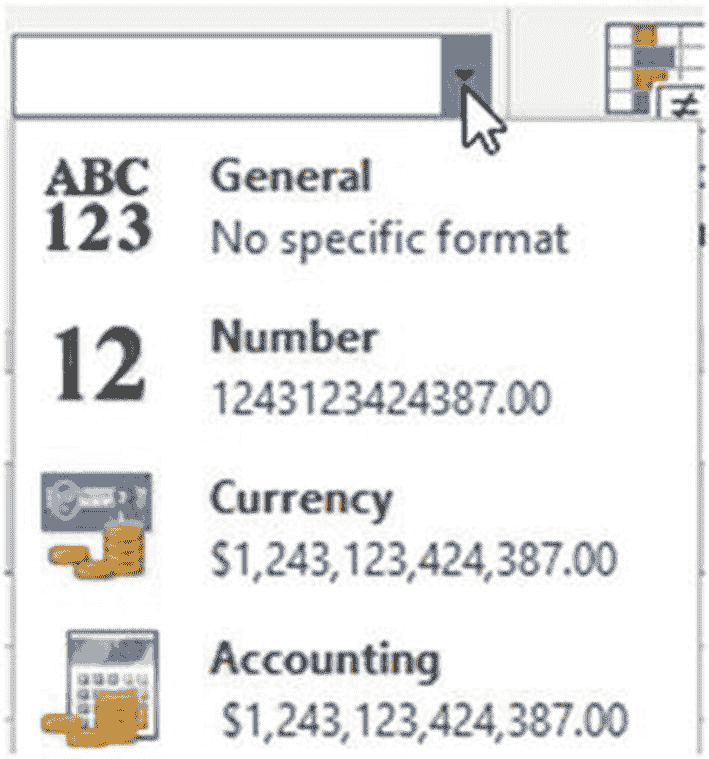

**图 3-10** 您可以将指数记数法值转换为以下格式之一

您可以通过将光标放在列标题之间的线上，然后按住鼠标左键来查看列宽（光标会变成双箭头）。默认列宽为`8.43`；假设您使用的是默认字体类型`Calibri`和字号`11`，这将允许显示大约 `8` 或 `9` 个字符。参见图 3-11。

**图 3-11** 检查列宽

可以使用鼠标拖动列来更改列宽。要扩展列宽，可以将光标放在列标题之间的线上，按住鼠标左键；当显示列宽时，将线向右拖动到所需宽度。拖动时，Excel 会显示宽度以及一条虚线垂直线，提示列边框将更改到的位置。参见图 3-12。

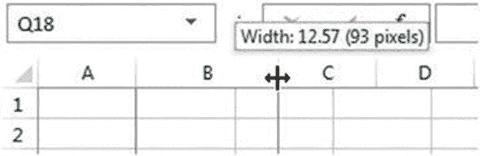

**图 3-12** 调整列宽

列宽可以缩小，也可以扩大。将双箭头向左拖动以缩小列的大小。

您还可以通过执行以下步骤更改列宽：

1.  右键单击列标题，然后选择“列宽”。此时会打开“列宽”对话框（参见图 3-13）。

    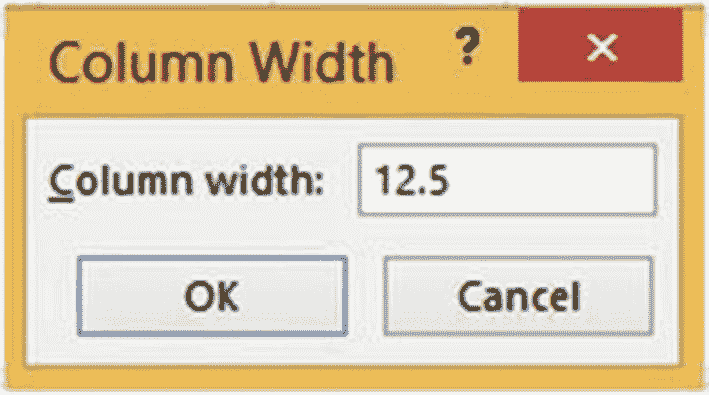

    **图 3-13** 更改列宽

2.  输入所需的宽度。您可以输入`0`到`255`之间的任何值。输入宽度`0`会将所选列隐藏。

3.  单击“确定”。

也可以通过单击“开始”选项卡，然后在“单元格”组中单击“格式”按钮，然后选择“列宽”来访问“列宽”对话框。参见图 3-14。

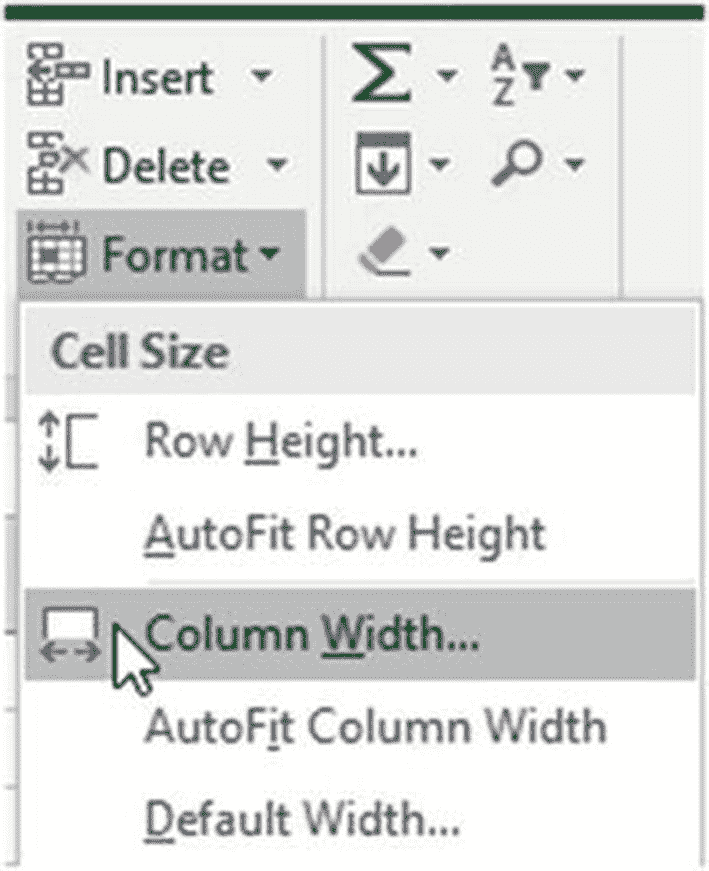

**图 3-14** 从“格式”按钮选择列宽

### 自动调整列宽以适合单元格中的字符数

您可以让 Excel 自动调整列的大小以适合单元格中的字符数。这可以通过选择要更改宽度的列标题，然后双击所选列的任意列标题之间的位置来完成。您还可以通过单击“开始”选项卡，在“单元格”组中单击“格式”按钮并选择“`自动调整列宽`”来执行自动调整。

### 更改多个列的列宽

您可以一次更改多个列的列宽。调整多个列宽与调整单个列宽所使用的方法之间的唯一区别是，您需要选择要更改宽度的所有列的列标题。所选列标题不必彼此相邻。以下步骤是同时更改多个列宽的示例：

1.  拖动鼠标选择要更改宽度的列的列标题。

    图 3-15 显示了列标题 `D`、`E` 和 `F` 已被选中。选中列标题即选中整个列。

    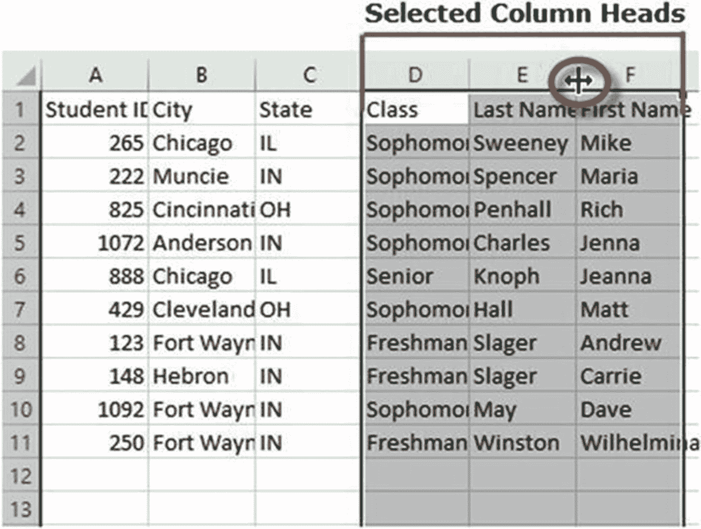

    **图 3-15** 整个列被选中

2.  将光标放在任意选定列标题之间。光标会变成双箭头，如图 3-15 所示。按住鼠标左键，向右拖动以展开所有选定列，或向左拖动以收缩所有选定列。

现在，让我们应用本节中学到的一些内容。

**练习 3-3：更改列宽**

在此练习中，您将创建一个新工作表，创建数据列，然后修改这些列的宽度。如果您已从上次练习中关闭了第 3 章工作簿，请重新打开它。

**表 3-1** 在工作表中输入数据

| 姓名 | 地址 | 职业 |
| --- | --- | --- |
| Pyle, Gomer | 308 Marine Barracks | Marine Private |
| Griffith, Andy | 408 Mayberry Ave. | Town Sheriff |
| Presley, Elvis | 215 Graceland | Rock Singer |
| Douglas, Lisa | 509 Green Acres | Unusual Housewife |

| Adams, Mortisha | 313 Spooky Lane | Strange Housewife |

1.  创建一个新工作表。将工作表标签重命名为"`Column Widths`"。

2.  将表 3-1 的数据输入到起始单元格`A1`的工作表中。不要调整列宽。

    输入数据后，您的工作表应如图 3-16 所示。

    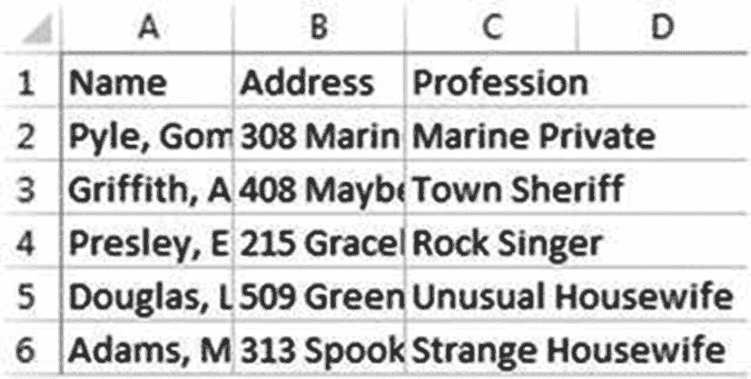

    `图 3-16` 不调整列宽输入数据

3.  在仍选中列标题 A、B 和 C 的情况下，单击功能区的`开始`选项卡。在`单元格`组中，单击`格式`按钮。选择`列宽`。

4.  在`列宽`对话框中，输入`20`并单击`确定`按钮。三列应各自具有`20`的列宽。

5.  再次单击`格式`按钮。选择`自动调整列宽`。列 A、B 和 C 将调整以适合其列中最长的文本。

6.  单击快速访问工具栏上的`保存`按钮 。

7.  将光标放在列标题 A 和 B 之间。将光标向左拖动，直到宽度为`7`。列 A 中的文本现在被列 B 中的文本部分遮盖。

8.  右键单击列标题 A，然后选择`列宽`。输入`8.43`作为列宽。单击`确定`。

9.  拖动选择列标题 A、B 和 C 以选中所有三列。

10. 双击列标题 B 和 C 之间。列 A、B 和 C 将调整以刚好适合其列中最长的文本，如图 3-18 所示。

    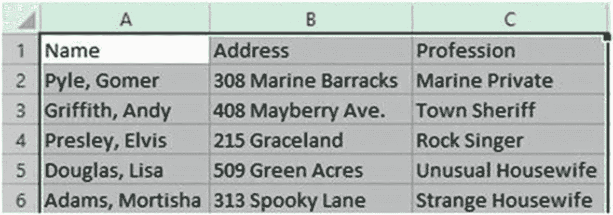

    `图 3-18` 列已调整以适合最长的列文本

11. 将光标放在列标题 A 和 B 之间。将光标向右拖动，直到宽度为`16.43`。参见图 3-17。

    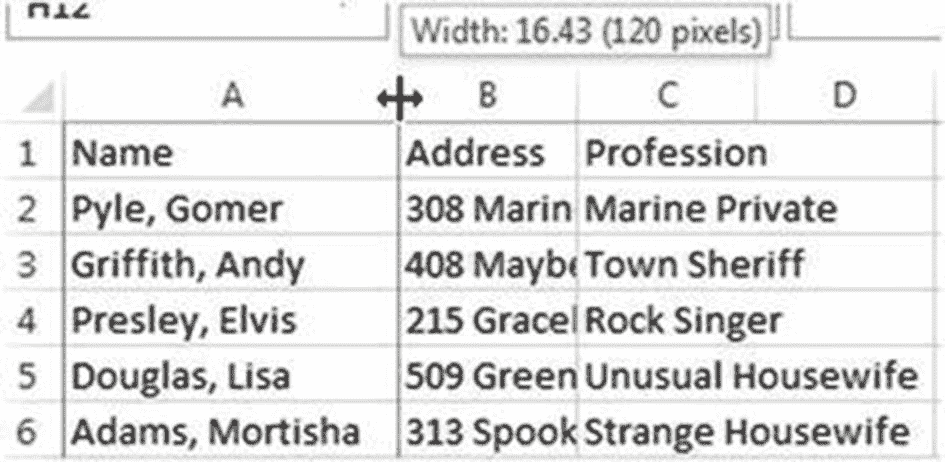

    `图 3-17` 在列标题之间拖动可调整列宽

现在您已学会调整列宽，接下来将学习如何更改行高，以便查看单元格中的所有文本。

## 如何更改行高

更改行高的操作与更改列宽类似。默认情况下，行高为`15.00`。

更改行高需先选中要调整高度的行。选择行的方法与选择列相同：单击特定行的行号，拖动鼠标选中相邻行，或按住`Ctrl`键的同时单击行号以选择不相邻的行（见图 3-19）。选中行后，将光标置于某选中行的行标题与另一行标题之间，向下拖动可增加行高，向上拖动则可减小行高。

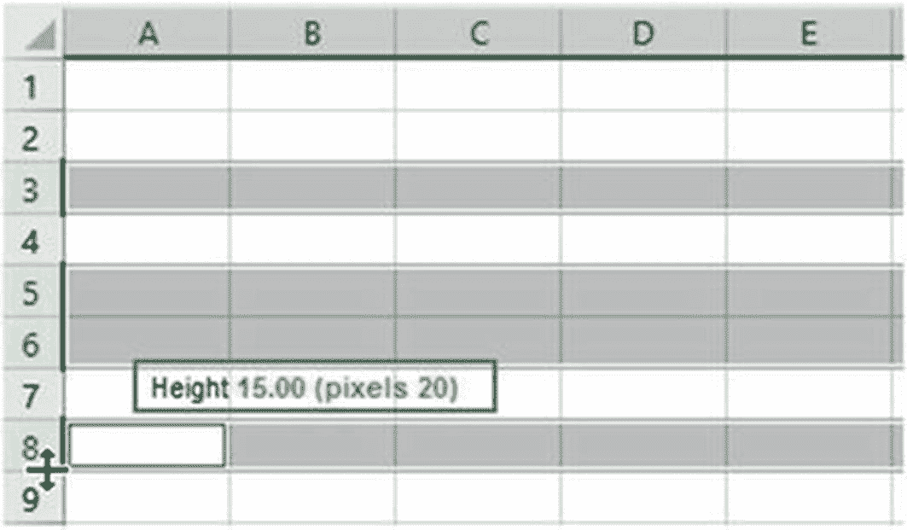

`图 3-19` 选择行后，向上或向下拖动以更改所选行的高度

双击选中行的行号之间的分隔线，可自动调整行高以适应该行中最高的文本或对象。

另一种更改行高的方法如下：

1.  选择要更改的行。

2.  在`开始`选项卡的`单元格`组中，单击`格式`。

3.  在菜单中选择`行高`或`自动调整行高`。

通过单击`全选`按钮，可以选中电子表格中的所有行。然后，通过在任何行标题之间上下拖动，即可调整所有行的高度。`全选`按钮位于`A 列`标题的左侧和`行 1`标题的上方。参见图 3-20。

`图 3-20` `全选`按钮

### 练习 3-4：更改行高

本练习使用您之前练习调整列宽时创建的同一电子表格。如果您已关闭上一练习中的第 3 章工作簿，请重新打开它。

1.  单击`行 2`的行号。按住`Ctrl`键，单击`行 5、6、9 和 12`的行号。将光标置于`行 9 和行 10`的行号之间，向下拖动，直到高度约为`22.5`。

2.  选中`单元格 A6`。在功能区的`开始`选项卡的`字体`组中，在`字号`文本框中输入`22`，然后按`Enter`键。姓名`Adams, Mortisha`现在部分被隐藏。双击`列 A 和列 B`的列标题之间的分隔线。此操作执行`自动调整列宽`，以容纳该列中最长的文本。

3.  双击`行 6 和行 7`的行号之间的分隔线。此操作执行`自动调整行高`，以容纳该行中最高的文本。

4.  单击`全选`按钮。将光标置于任意两个行标题之间，向下拖动直到高度变为`40.50`。双击任意两个行标题之间的分隔线，使所有行执行`自动调整行高`。

5.  在仍选中所有行的情况下，右键单击任意单元格，从菜单中选择`行高`。在`行高`中输入`25`，然后单击`确定`。

6.  单击任意单元格取消选中所有行。

7.  单击`快速访问工具栏`上的`保存`按钮 。

8.  首先，为`列宽`工作表创建一个副本：

    1.  右键单击`列宽`工作表标签。选择`移动或复制`。

    2.  在`移动或复制`对话框中，单击`下列选定工作表之前`列表中的`(移至最后)`。

    3.  选中`建立副本`复选框，然后单击`确定`按钮。

    4.  将`列宽 (2)`工作表标签重命名为`行高`。

您已学会通过更改行高和列宽来调整单元格大小。接下来，您将学习如何纠正数据输入错误。

## 纠正输入错误

在向工作表中输入数据时，有时会出错。如果出错，可以轻松清除或纠正已输入的内容。有几种方法可以清除或纠正单元格中的部分或全部数据。我们来了解如何删除或更改单元格中的特定字符，如何在接受数据输入之前清除数据（并将单元格恢复到之前的状态），以及如何清除已接受输入的单元格。

### 更改特定字符

如果需要纠正单元格中的特定字符，您有几种选择，具体取决于这些字符是什么以及是否已接受数据输入。首先，删除要更改的字符，然后在必要时键入正确的字符。以下是删除单元格中特定字符的几种方法：

-   在仍在单元格中输入数据时，您可以按`Backspace`键删除最后输入的字符。

-   如果需要纠正不是最后输入的字符，请单击该字符右侧，然后按`Backspace`键。

-   如果已接受单元格中的数据，请双击该单元格进入`编辑`模式，然后单击要更改的字符右侧，或使用左右箭头键将光标移动到要删除的字符处。

您可以通过执行以下任一操作来纠正输入错误：

-   按`Backspace`键移除最近输入的字符。

-   按`Esc`键清除尚未接受的输入。

-   单击编辑栏上的`取消`按钮清除尚未接受的输入。

-   右键单击已接受输入的单元格，选择`清除内容`。

如果只需要移除最近输入的字符，可以使用`Backspace`键。

### 将单元格恢复为其原始值

如果尚未接受数据输入，或者已接受但未执行任何其他操作，则可以将单元格恢复到其原始值。

当仍在单元格中键入数据时，可以清除已输入的内容，并将单元格恢复到之前的状态。如果它是一个空单元格，只需清除所有数据。另一方面，如果您更改了单元格中的值，请清除新输入内容并恢复单元格的原始值。使用以下任一技术，在新值被接受前将其恢复到以前的值：

-   按`Esc`键。

-   单击编辑栏上的`取消`按钮 。

如果在工作簿中已接受新数据输入但尚未执行任何其他操作，可以选择`快速访问工具栏`上的`撤消`按钮（见图 3-21），或按`Ctrl + Z`，这样会将单元格恢复到之前的状态：空单元格或包含之前的值。

`图 3-21` `撤消`按钮

### 清除已确认单元格中的内容

你可以通过右键单击单元格，然后选择`清除内容`来清除单元格中的内容。也可以单击功能区的`开始`选项卡，然后在`编辑`组中选择`清除` ➤ `清除内容`。

### 练习 3-5：输入和编辑数据

在此练习中，你将在一个新工作表中输入数据，然后对其进行编辑。如果你已关闭了上次练习中的第 3 章工作簿，请重新打开它。

1. 拖动鼠标选中列标题`A`、`B`和`C`。右键单击其中一个选中的列标题。选择`列宽`。输入`14`。单击`确定`按钮。

2. 双击单元格`A2`进入编辑模式。将`300`更改为`550`。按`Enter`键。

3. 单击单元格`B5`。按`F2`键进入编辑模式。将单词`Rdige`更改为`Ridge`。按`Enter`键。

4. 双击单元格`C2`。将编辑栏中的日期更改为`10/15/2002`。单击编辑栏中的`输入`按钮（复选标记）以确认更改，而不是按`Enter`键。

5. 双击单元格`C3`。将年份更改为`1998`，但不要按`Enter`键。你意识到其实不想做此更改。按`Esc`键将单元格恢复为原始值。重复此步骤，但这次不按`Esc`键，而是单击编辑栏上的`取消`按钮 。

6. 右键单击单元格`A6`。从菜单中选择`清除内容`。

7. 单击单元格`B6`。单击`开始`选项卡。在`编辑`组中，选择`清除` ➤ `清除内容`。

8. 单击`快速访问工具栏`上的`保存`按钮 。

9. 添加一个新的工作表并将其命名为`编辑数据`。

10. 输入图 3-22 中的数据。对于`C`列中的日期值，我们使用三种不同的格式：
    1. 在单元格`C2`中输入数据`10/15/1999`。
    2. 在单元格`C3`中输入数据`6-15-2001`。
       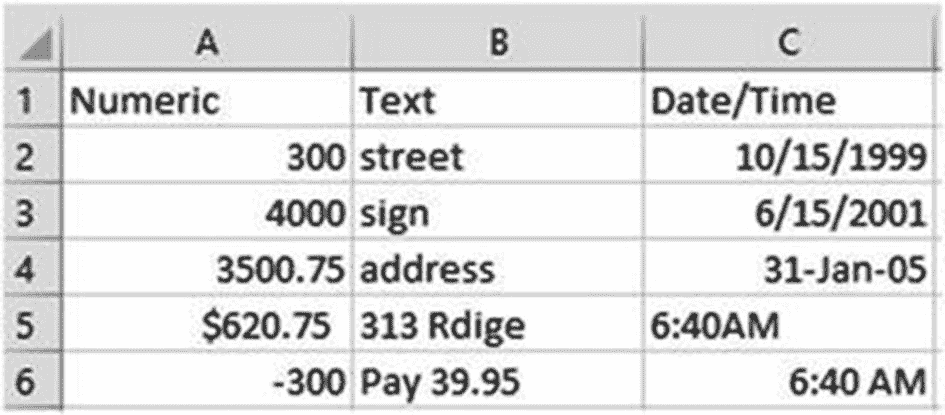
       *图 3-22 输入此数据*
    3. 在单元格`C4`中输入数据`Jan 31, 2005`。

你已经学会了如何处理自己造成的任何输入错误。现在，你将了解一些 Excel 功能，它们不仅能防止你犯数据输入错误，同时还能提高数据输入速度。

### 输入和更正数据的快捷方法

Excel 提供了`自动完成`、`从下拉列表中选择数据`、`自动填充`和`自动更正`等方法，以加快数据输入速度并确保数据输入无误。

#### 使用自动更正功能

Excel 的`自动更正`功能可以通过自动调整条目或在输入时修复常见的打字错误，来加快数据输入速度并防止工作表中出现错误。Excel 的`自动更正`功能在以下四种情况下非常有用：

*   *更正常见拼写错误的单词。* 如果你把“achieved”拼成“acheived”，Excel 会自动更正它。
*   *输入无法直接从键盘输入的特殊符号。* 如果你输入`(tm)`，Excel 会自动将其转换为商标符号 ™。
*   *为经常输入的单词或短语创建快捷方式。* 你可以输入自己的姓名缩写，Excel 会将其转换为你的全名。
*   *更正大写字母的误用。* 如果你输入`monday`，Excel 会将其更正为`Monday`。

> **注意**
> Microsoft Office 应用程序与 Excel 共享相同的`自动更正选项`；你对 Excel 中`自动更正`选项所做的任何更改、添加或删除，都会影响其他 Microsoft Office 应用程序中的这些选项，反之亦然。

#### 练习 3-6：使用自动更正

在此练习中，你将体验 Excel 默认的`自动更正`功能，然后了解如何根据自己的偏好进行修改。如果你已关闭了上次练习中的第 3 章工作簿，请重新打开它。

1. 添加一个新的工作表并将其命名为`自动更正`。
2. 在单元格`A1`中，输入`abbout`，然后按`Tab`键。Excel 将其更正为`about`。
3. 在单元格`B1`中，输入`(c)`，然后按`Tab`键。Excel 将`(c)`转换为版权符号。
4. 在单元格`C1`中，输入`(r)`，然后按`Tab`键。Excel 将`(r)`转换为注册商标符号。
5. 在单元格`D1`中，输入你的名字，但将前两个字母大写，例如`DAvid`，然后按`Tab`键。

你的结果应类似于图 3-23 所示。

*图 3-23 使用自动更正的结果*

##### 向自动更正列表添加项目

现在你已经了解了`自动更正`的默认工作方式，可以向`自动更正`中添加新项目了。

1. 在功能区上，单击`文件`选项卡。
2. 在左侧窗格中单击`选项`。这将打开`Excel 选项`。见图 3-24。
   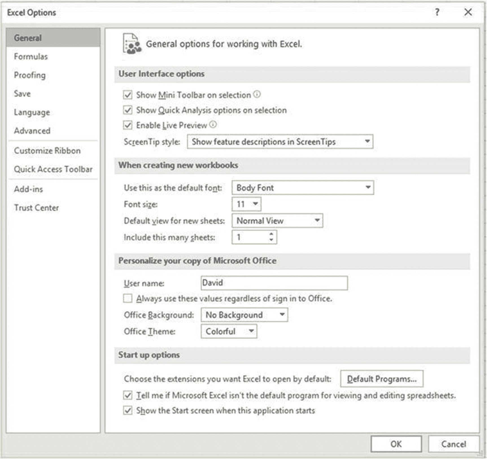
   *图 3-24 Excel 选项*
3. 在左侧窗格中单击`校对`。
4. 在右侧窗格的`自动更正选项`下，单击`自动更正选项`按钮。这将打开`自动更正`对话框。见图 3-25。
   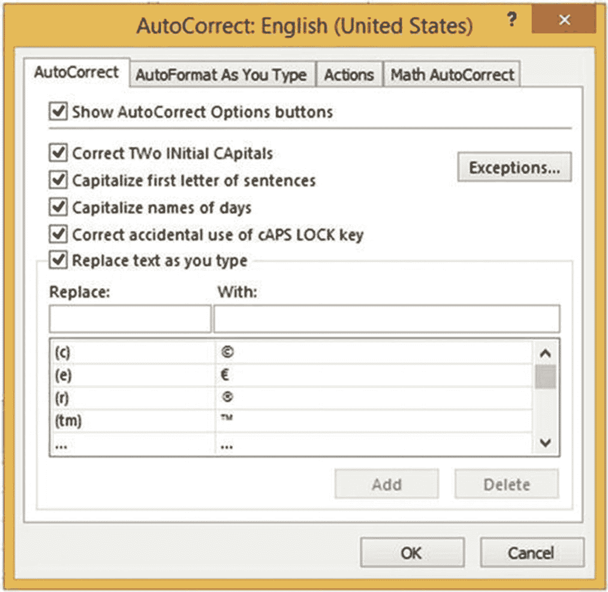
   *图 3-25 选中了“自动更正”选项卡的“自动更正”对话框*
5. 你可以看到有一个*更正前两个字母连续大写*的选项。这就是更正你名字输入的功能。还有用于将句首字母和星期名称首字母大写的选项，以及更正意外使用`Caps Lock`键的选项。
6. 查看选项卡的下半部分，有一个两列表格。左列标题为`替换`：右列标题为`为`：`替换`列中的条目将被替换为`为`列中的条目。你在表格中使用了三个条目。你在单元格中输入了`(c)`，它被替换为版权符号 `©`。你输入了`(r)`，它被替换为注册商标符号 `®`。如果你在表格中向下滚动，可以看到`abbout`将被替换为你已经输入过的`about`。
7. 在`替换`文本框中，将现有文本替换为你的姓名缩写。在`为`文本框中，将现有文本替换为你的全名。单击`添加`按钮。
8. 在`Replace`文本框中输入`phoneA`。在`With`文本框中输入`(380)599-1275`。点击`Add`按钮。你可以为你的家庭电话和手机创建电话号码快捷方式。
9. 输入你想要添加的任何其他更正或快捷方式。这可以节省大量时间。如果你经常输入公司名称，你应该为它或任何其他常用文本创建一个快捷方式。
10. 点击`AutoCorrect`对话框中的`OK`按钮。点击`Excel Options`对话框中的`Cancel`按钮。
11. 在单元格`A2`中输入`tommorrow`，然后按`Enter`键——它将被替换为`tomorrow`。
12. 在单元格`A3`中输入你的姓名缩写，然后按`Enter`键——它将被替换为你的全名。
13. 在单元格`A4`中输入`phoneA`，然后按`Enter`键——它将被替换为`(380)599-1275`。
14. 开启`Caps Lock`。按住`Shift`键的同时输入`E`。松开`Shift`键，然后输入`xcel`。单元格`A5`现在应包含`eXCEL`。按`Enter`键。
15. 浏览表格，看看还有哪些其他可用的更正项。
16. 在`Replace`文本框中输入`tommorrow`。在`With`文本框中输入`tomorrow`。点击`Add`按钮。新的自动更正项将被添加到列表中。见图 3-26。
    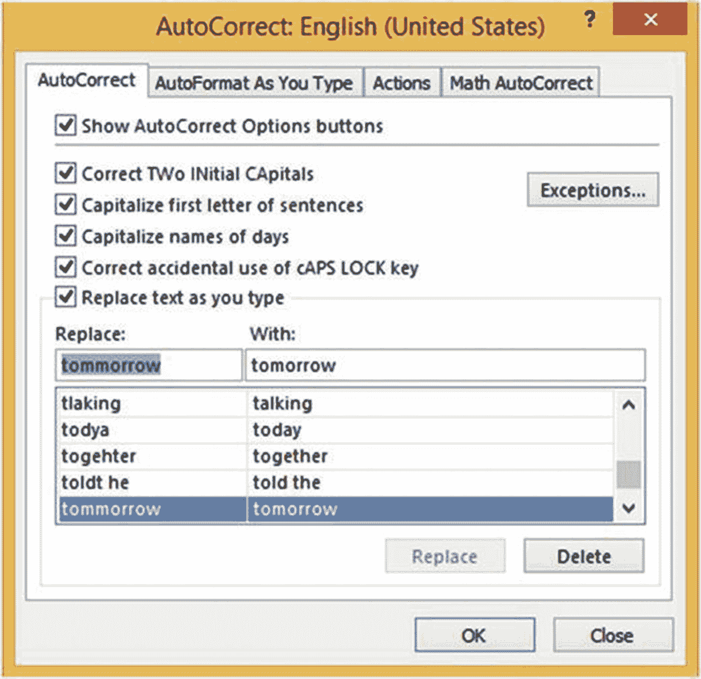
    *图 3-26 新的自动更正项已添加*
17. 单元格`A5`现在应包含`Excel`。这是通过“更正意外使用`cAPS LOCK`键”选项来修正的。

###### 从自动更正列表中删除项目

1. 在功能区上，点击`File`选项卡。
2. 在左侧窗格中点击`Options`。
3. 在`Excel Options`的左侧窗格中点击`Proofing`。
4. 在右侧窗格中，点击`AutoCorrect Options`按钮。
5. 在`Replace`文本框中输入`phoneA`；输入时，列表会跳转到你正在输入的字母。当列表中高亮显示`phoneA`时，按`Delete`按钮。

6. 删除你为姓名缩写创建的快捷方式。删除你创建的其他想要删除的快捷方式。

7. 点击`AutoCorrect`对话框上的`Close`按钮。点击`Excel Options`对话框上的`Cancel`按钮。

8. 点击快速访问工具栏上的`Save`按钮 。

你刚刚使用了 Excel 的自动更正功能来纠正拼写错误的单词，并为输入单词或短语创建了快速快捷方式。接下来，你将使用自动完成功能来复制列中已存在的数据。

### 使用自动完成输入数据

自动完成功能是自动设置的；没有需要点击的按钮或需要输入的命令。自动完成功能会把你正在输入的条目与同一列中已有的条目进行比较。当你输入时，Excel 会查找与你正在输入的单词以相同字母开头的单词。如果它在列中找到一个已有的单词，其开头字母与你已输入的字母相同，它就会将该单词放入活动单元格中。见图 3-27。

图 3-27

在你输入字母`sma`后，自动完成自动添加了字母`rt`

前两个字母对于列中的所有单词都是相同的。当你在单词`smart`的第二个条目中输入字母`a`时，Excel 发现只有一个单词以`sma`开头，因此它将单词`smart`放入单元格中。你可以按`Enter`键、`Tab`键或向下箭头键接受该单词，或者按`Esc`键清除该单元格。

只有在图 3-28 中的单词`savant`中键入第二个`a`之后，才有一个单词与迄今为止输入的所有字母匹配。你可以按`Enter`键、`Tab`键或向下箭头键接受该单词，或者按`Esc`键清除该单元格。

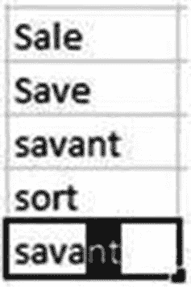

图 3-28

在你输入`sava`后，自动完成自动添加了字母`nt`

注意

如果当前单元格上方有一个空单元格，自动完成功能将不起作用。

### 从下拉列表中选择

`从下拉列表中选择`功能与自动完成功能类似。从下拉列表中选择功能与自动完成功能一样，允许你使用列中已有的条目。从下拉列表中选择功能允许你从自动排序的现有条目列表中进行选择。可以通过右键单击单元格并选择`从下拉列表中选择`或按`Alt + Down Arrow`来访问该列表。见图 3-29。

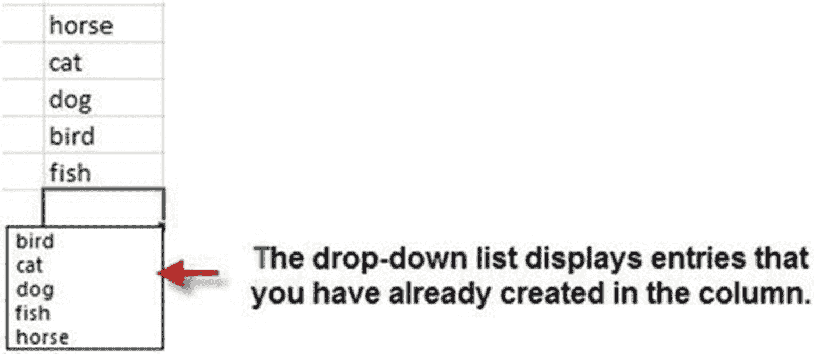

图 3-29

从下拉列表中选择

注意

如果当前单元格上方有一个空单元格，从下拉列表中选择功能将不起作用。

### 练习 3-7：自动完成与从下拉列表中选择

让我们使用自动完成和从下拉列表中选择功能来添加文本。

**自动完成**

让我们在本练习中看看自动完成的实际效果。如果你已关闭上一次练习中的第 3 章工作簿，请重新打开它。

1. 在单元格`A6`中输入字母`C`。单元格中出现名称`Carl`，因为没有其他以`C`开头的名称。

2. 在单元格`A7`中输入`Da`。由于该列中有两个以`D`开头的名称，此时 Excel 无法找到唯一的那个。在`Da`之后输入`v`。只有`Dav`开头的名称是唯一的，因此 Excel 会在单元格中输入`David`。按`Enter`键。

3. 在单元格`A8`中输入`Mar`。由于该列中有两个以`Mar`开头的名称，此时 Excel 无法找到唯一的那个。在`Mar`之后输入`t`。只有`Mart`开头的名称是唯一的，因此 Excel 会在单元格中输入`Marten`。

4. 添加另一个工作表，并将其命名为`AutoComplete`。

5. 如图 3-30 所示，在列`A`中输入名称。

   

   图 3-30

   在工作表中输入名称

**从下拉列表中选择**

在本练习中，你将使用从下拉列表中选择功能。

1. 点击`David`。按`Enter`键。

2. 按`Alt + Down Arrow`。选择`Marten`。按`Enter`键。

3. 点击快速访问工具栏上的`Save`按钮 。

4. 右键单击单元格`A9`，然后从菜单中选择`从下拉列表中选择`。

   请注意，你的条目会按字母顺序显示，并且不会显示重复项。见图 3-31。

   

   图 3-31

   条目按字母顺序排列，没有重复的名称

自动完成功能和从下拉列表中选择功能都提供了一种在列中快速创建重复数据的方法。自动完成功能在你输入时会自动提供建议供你选择。从下拉列表中选择功能会显示当前列中迄今为止输入的所有条目，然后让你从中选择一个进行复制。接下来，你将了解自动填充功能如何不仅允许你复制数据，还能创建重复的数据模式。

### 自动填充

自动填充功能允许你自动填充遵循某种模式或基于其他单元格中数据的单元格。它也可以用于创建重复的单元格、输入一系列值以及创建自定义列表。

### 使用自动填充创建重复单元格

您可以通过向所需方向拖拽`自动填充柄`，将一个单元格中的值复制到其他单元格。`自动填充柄`是活动单元格右下角的一个黑色小方块（图 3-32）。将光标移到`自动填充柄`上时，光标会变为加号形状（图 3-33）。

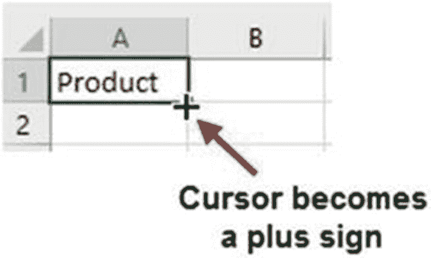

图 3-33

光标移动到`自动填充柄`上时变为加号

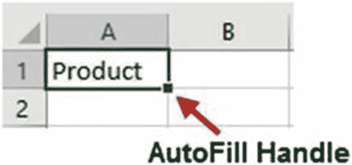

图 3-32

`自动填充柄`

当您将`自动填充柄`拖过其他单元格时，会显示一个`工具提示`，指明松开鼠标按钮后将在该单元格中填入的值（图 3-34）。

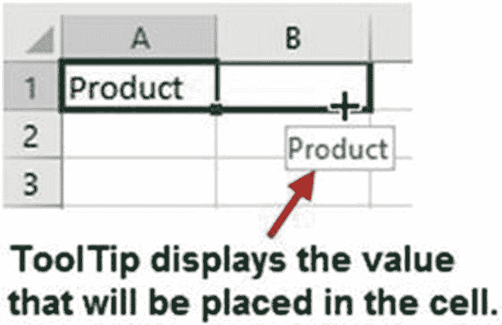

图 3-34

`工具提示`

图 3-35 显示了将`自动填充柄`从`A1`拖拽到`D1`的结果。

图 3-35

拖拽`自动填充柄`的结果

您可以随心所欲地将`自动填充柄`拖过任意数量的单元格，也可以朝任意方向拖拽。图 3-36 显示了向上拖拽`自动填充柄`的结果。

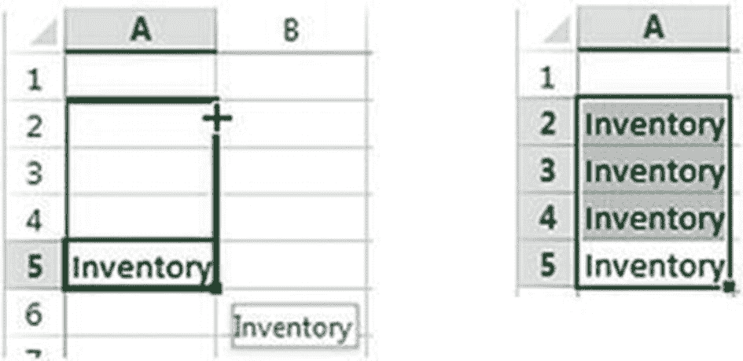

图 3-36

向上拖拽`自动填充柄`的结果

### 使用自动填充输入序列值

`自动填充`除了能够复制单元格值，还可以用来创建重复的数据列表序列。Excel 内置了与星期、月份、年份、数字等相关的数据序列。例如，您可以在一个单元格中输入`星期一`，然后使用`自动填充柄`在相邻单元格中自动输入一周中的其他日期。在拖拽`自动填充柄`时，Excel 会显示拖拽完成后将在该单元格中填入的内容（见图 3-37）。

图 3-37

当您使用`自动填充柄`拖过单元格时，Excel 会显示它将在此单元格中填入的内容

您从星期几开始输入都没有关系。如果您拖过的单元格超过七个，日期将开始重复。您也可以使用三个字符的星期缩写。

如图 3-38 所示拖过单元格，将得到图 3-39 所示的序列。

图 3-38：在星期几上使用`自动填充柄`，它将每七个单元格重复一次该日期。

图 3-39：以`星期五`开头拖拽`自动填充柄`的结果。

Excel 知道一年有四个季度。如果您输入`第一季度`，然后使用`自动填充柄`创建序列，Excel 会从`第一季度`到`第四季度`，然后以`第一季度`开始重复该模式。见图 3-40。

图 3-40：以`第一季度`开头的序列。

您也可以使用`Qtr`作为`Quarter`的缩写。如果单元格中包含一个单词后跟一个数字，Excel 会在序列中的每个单元格将该数字递增 1。见图 3-41。

图 3-41：以`第 2 节`开头的序列。

## 教 Excel 创建自动填充模式

您可以教 Excel 一个模式。如果您想显示每隔三个的数字，可以在一个单元格中输入值`1`，在下一个单元格中输入`4`。然后选中这两个单元格，使用`自动填充柄`拖过您希望包含在该模式中的尽可能多的单元格。这将产生一个`1`、`4`、`7`、`10`等模式。

如果您想显示一个以 15 分钟为间隔的相邻单元格序列，请选择前两个单元格来教给它这个模式（图 3-42），然后拖拽`自动填充柄`到您希望包含在模式中的单元格数量。拖拽完成后，结果将如图 3-43 所示。

图 3-42：选择两个相邻单元格来教 Excel 一个`自动填充`模式。

图 3-43：使用两个相邻时间拖拽`自动填充柄`的结果。

### 使用自动填充选项按钮

当您使用完`自动填充柄`来复制单元格或创建序列后，一个`自动填充选项`按钮会出现在最后选中单元格的右下方。

如果您使用`自动填充柄`复制了包含字母数据的单元格，单击`自动填充选项`按钮会弹出三个或更多选项。以水平格式复制字母数据时，单击`自动填充选项`按钮会弹出三个选项。默认选项是`复制单元格`。见图 3-44。

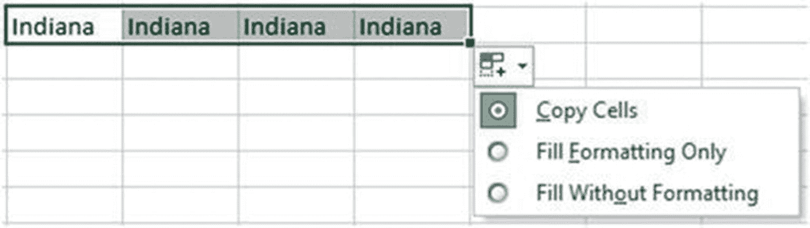

图 3-44：`自动填充选项`按钮提供的可用选项。

以垂直格式复制字母数据时，单击`自动填充选项`按钮会弹出四个选项。默认选项是`复制单元格`。见图 3-45。

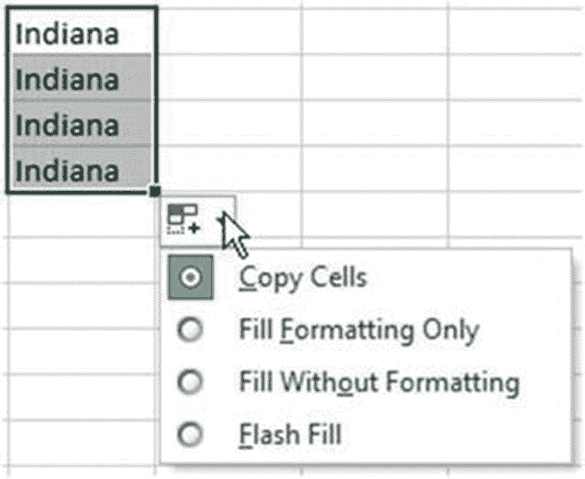

图 3-45：垂直复制数据时的`自动填充`选项。

如果您使用`自动填充柄`复制了数字数据，单击`自动填充选项`按钮会弹出四个或更多选项。见图 3-46。

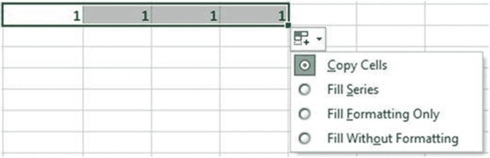

图 3-46：复制数字数据时的`自动填充`选项。

如果您使用`自动填充柄`复制了`日期`数据，单击`自动填充选项`按钮会弹出许多选项。见图 3-47。

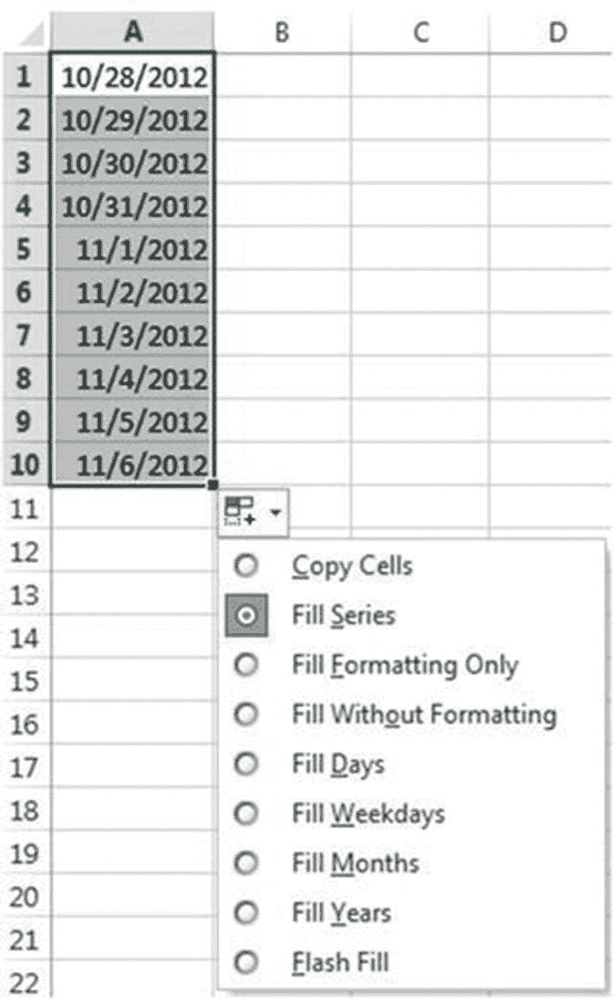

图 3-47：复制日期数据时的`自动填充`选项。

选择`复制单元格`选项会将您刚刚创建的序列恢复为用于创建序列的原始单元格的副本。十个单元格都将包含`2012/10/28`。`仅填充格式`选项仅会将您应用于原始单元格的任何格式复制到您使用`自动填充柄`拖过的单元格中。它不会向单元格中放置任何数据。`不带格式填充`选项会从原始单元格复制数据或创建序列，但不会将原始单元格中的任何格式应用于您使用`自动填充柄`创建的数据。

下一个练习，练习 3-8，将说明`自动填充选项`。

## 创建自动填充自定义列表

除了使用 Excel 的内置数据序列，你还可以创建自己的序列。如果你发现自己经常输入相同的值序列，那么你应该创建自己的数据序列来加快输入速度。可以在`自定义列表`对话框创建数据序列，通过单击功能区上的`文件`选项卡、在左窗格中选择`选项`、在左窗格中选择`高级`、向右滚动右窗格直到看到`常规`部分，然后单击`编辑自定义列表`按钮即可访问该对话框。请参见图 3-48。

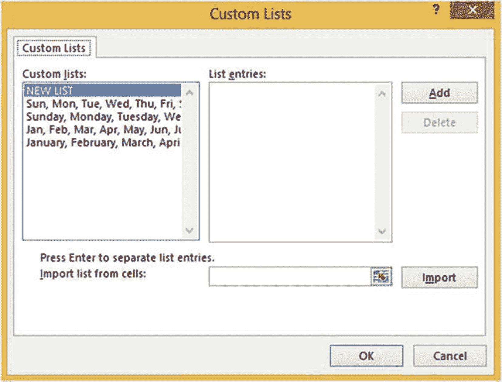

图 3-48：在`自定义列表`对话框中创建你自己的自定义列表。

在`列表条目`框中输入新的数据序列。然后单击`添加`将数据序列添加到`自定义列表`框中。你也可以通过在工作表上选择单元格并单击`自定义列表`对话框中的`导入`来创建新的自定义列表。

### 练习 3-8：练习使用自动填充柄和自动填充选项按钮

在本练习中，你将练习使用自动填充技术。如果上次练习后你关闭了第 3 章的工作簿，请重新打开它。

1.  添加另一个工作表，并将其命名为`AutoFill`。

2.  在单元格`A1`中输入`Tuesday`。使用`自动填充柄`向右拖动。当你拖动经过每个单元格时，注意观察 Excel 将要在该单元格中放置的内容。拖到单元格`J1`。

3.  在单元格`A2`中输入`Qtr1`。使用`自动填充柄`向右拖动到单元格`F2`。

4.  在单元格`A3`中输入`10:00`。使用`自动填充柄`向右拖动到单元格`F3`。

5.  序列可以垂直创建，也可以水平创建。在单元格`A4`中输入`Sep`。使用`自动填充柄`向下拖动到单元格`A14`。

6.  在单元格`H5`中输入`June`。使用`自动填充柄`向左拖动到单元格`C5`。现在你应该得到从 January 到 June 的序列。

7.  在单元格`C7`中输入`Store 3`。使用`自动填充柄`向右拖动到单元格`G7`。现在你应该得到从 Store 3 到 Store 7 的序列。

#### 教自动填充一个模式

你可以教自动填充使用一致的模式。

1.  在单元格`C9`中输入`1`。在单元格`D9`中输入`3`。选中这两个单元格。选中两个单元格后，将`自动填充柄`拖过单元格`H9`。

2.  在单元格`C10`中输入`1`。在单元格`D10`中输入`4`。选中这两个单元格。选中两个单元格后，将`自动填充柄`拖过单元格`H10`。

3.  在单元格`C11`中输入`8:30`。在单元格`D11`中输入`9:00`。选中这两个单元格。选中两个单元格后，将`自动填充柄`拖过单元格`H11`。

#### 使用自动填充选项按钮

尝试使用`自动填充选项`按钮。

图 3-50：选中的两个单元格被复制到其他单元格。

1.  选择`复制单元格`。不是填充序列，而是将原始的 Section 1 和 Section 2 复制到其他单元格。请参见图 3-50。

2.  在单元格`A16`中输入`Section 1`，在单元格`B16`中输入`Section 2`。选中这两个单元格。按`Ctrl + B + I`使两个单元格变为粗体和斜体。选中两个单元格后，将`自动填充柄`拖过单元格`F16`。

3.  单击`自动填充选项`按钮。请参见图 3-49。

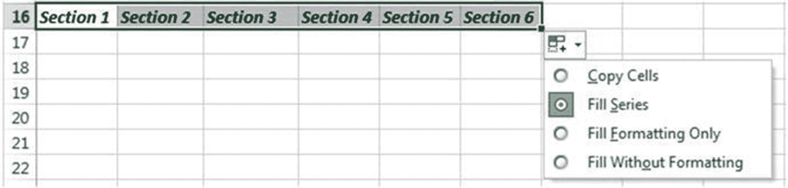

**图 3-49** 自动填充选项

在你拖动`自动填充柄`的同时按住`Ctrl`键是一种强制 Excel 复制值而不是创建模式的方法，而无需使用`自动填充选项`按钮。

1.  单击`快速访问工具栏`上的“保存”按钮 。

2.  单击`自动填充选项`按钮。选择`复制单元格`。列表由相同的复制单元格组成。请参见图 3-55。

    

    **图 3-55** 使用 `复制单元格` 选项

3.  单击`自动填充选项`按钮。选择`不带格式填充`。Excel 的日历从 1900 年 1 月 1 日开始，由于列表未设置格式，所以它显示的是自 1900 年 1 月 1 日以来的天数。请参见图 3-54。

    

    **图 3-54** `不带格式填充`选项显示自 1900 年 1 月 1 日以来的该日期天数

4.  单击`自动填充选项`按钮。选择`以年填充`。列表创建了一个包含相同月份和日期的年份序列。请参见图 3-53。

    

    **图 3-53** 自动填充选项 `以年填充` 调整年份，但保持月份和日期不变

5.  单击`自动填充选项`按钮。单击`仅填充格式`。使用`自动填充柄`填充的单元格中的数据被清除，但粗体和斜体格式仍应用于这些单元格。在单元格`D16`中输入单词`Sales`。单词 Sales 变为粗体和斜体。

6.  在单元格`A18`中输入`2/1/2013`。将`自动填充柄`拖过单元格`F18`。单击`自动填充选项`按钮。

7.  选择`以工作日填充`。列表跳过了周六和周日。

8.  单击`自动填充选项`按钮。选择`以月填充`。列表创建了一个包含相同日期的月份序列。请参见图 3-52。

    

    **图 3-52** 自动填充选项 `以月填充` 自动调整月份和年份，但保持日期不变

9.  按`Ctrl + Z`撤消更改。

10. 选择单元格`A16`和`B16`。按住`Ctrl`键的同时将`自动填充柄`拖过单元格`F16`。

11. 按`Ctrl + Z`撤消更改。

12. 选择单元格`A16`和`B16`。选中这两个单元格后，将`自动填充柄`拖过单元格`F16`。

13. 单击`自动填充选项`按钮。单击`不带格式填充`。使用`自动填充柄`填充的单元格会丢失其格式。请参见图 3-51。

    

    **图 3-51** 单元格中的值被复制，但不复制任何格式

至此，你已经掌握了 Excel 中所有用于输入数据的快捷方式。在本节中，你学习了如何复制数据和重复模式。你甚至学习了如何创建自己的模式。在下一节中，你将学习如何为单元格中的数据添加批注。批注可以作为你自己或他人记住数据来源或其所代表内容的辅助手段。

## 创建、查看、编辑、删除和格式化单元格批注

Excel 推出了一种新型批注，让您可以更轻松地与其他用户协作。在之前的版本中，您可以在单元格中创建一条批注。如果其他用户想要回复该批注，就需要再创建一条新的批注。如果您或其他用户想要继续回复这条新批注，又需要创建更多批注。新版批注就是为了解决这个问题而诞生的。现在，您可以在一个单元格中创建一条批注，所有用户都可以通过将他们的回复内容放入回复框来进行回应。

对于以前使用过 Excel 批注的用户来说，您需要了解术语上的变化。在 Excel 2016 及更早版本中被称为`批注（Comments）` 的功能，现在被称为`备注（Notes）`。功能区的“审阅”选项卡仍然包含“批注”组，与 Excel 2016 一致，但这些批注命令现在指的是新的协作式批注类型。以前被称为批注的功能，现在位于一个名为“备注”的新组中，该组出现在“批注”组的右侧。参见图 3-56。

**图 3-56** 新的“批注”组

“备注”组仅包含一个下拉命令。参见图 3-57。

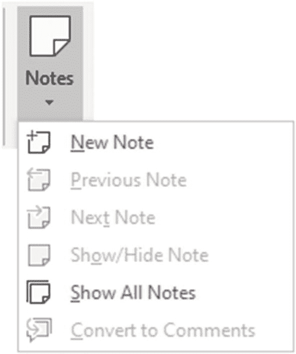

**图 3-57** “备注”组

我们首先来看看以前被称为批注而现在被称为备注的功能，然后再来看新的协作式批注。

您可以将备注附加到任何工作表单元格中。备注可以是您想与他人分享的信息，或者仅仅是为了帮助自己记忆——例如，公式是如何或为何输入的、数据来源何处、还有哪些数据需要输入，等等。您可以把备注想象成一张便签纸。在工作表中任何您想贴张便签以帮助记忆的地方，都可以创建一条备注。备注实际上比便签纸更好，因为它们不会从纸张上脱落，而且易于编辑。包含备注的单元格很容易通过其右上角的红色小三角来识别。将鼠标指针悬停在红色小三角上即可查看备注。参见图 3-58。

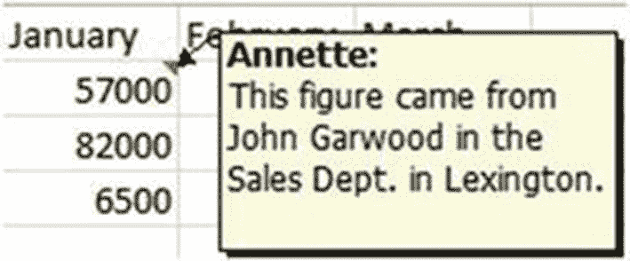

**图 3-58** 带有备注的单元格在右上角有一个红色小三角

### 如何添加备注

很少有人会花时间在 Excel 工作表中输入备注。但花时间添加备注是非常值得的。我认为让初学者一开始就养成良好的习惯非常重要，因此我在此数据输入章节中介绍备注，因为它应成为您常规数据输入流程的一部分。

1.  点击您要附加备注的单元格。
2.  右键点击该单元格，然后选择`插入备注`。
3.  在备注框中输入您的备注内容。
4.  点击备注框外部区域。

### 如何查看备注

请按照以下步骤查看备注：

1.  将鼠标指针悬停在一个红色小三角上。
2.  如果工作簿包含多条备注，您可以点击`上一条`或`下一条`按钮来逐条查看。
3.  默认情况下，备注会保持隐藏状态，直到您将鼠标指针悬停在红色小三角上。如果您希望备注即使鼠标指针移开红色小三角后仍保持可见，请点击`显示/隐藏备注`按钮。该按钮可从功能区获取，或者通过右键点击单元格并从快捷菜单中选择。

### 如何同时查看所有备注

您也可以通过以下操作来查看所有备注：

1.  点击`审阅`选项卡。
2.  在`备注`组中，点击`显示所有备注`。

### 如何更改备注的默认名称

默认情况下，Excel 会将您的用户名放在备注中。您可以通过以下操作删除或更改该名称：

1.  要删除备注中的用户名，请选中该名称并按`Delete`键。
2.  要更改所有备注的默认名称，请点击`文件`选项卡，然后在左侧窗格中点击`选项`。
3.  在左侧窗格中选择`常规`。
4.  在`个性化设置 Microsoft Office 副本`组中，在`用户名`文本框中输入您希望使用的名称。
5.  点击`确定`按钮。

**注意：** 您可能会在数月后不再使用某个工作表，而届时您原以为会记住的事情却早已忘记。如果您像我一样习惯把笔记写在纸上，很可能会弄丢，然后花几个小时去寻找。所以，请善待自己，经常在 Excel 中使用备注功能吧。

### 编辑和删除备注

如果您右键点击一个包含备注的单元格，快捷菜单中不再有`插入备注`选项，而是包含`编辑备注`和`删除备注`选项。点击`编辑备注`可将备注调出以供编辑。进行所需的更改，然后点击备注外部区域以更新备注。点击`删除备注`会直接删除该备注，不会要求任何确认。

### 打印批注

默认情况下，批注不会打印。打印批注的选项位于“`页面设置`”对话框中。可以通过单击功能区上的“`页面布局`”选项卡，然后单击“`页面设置`”组的对话框启动器来访问“`页面设置`”对话框。还可以通过单击“`文件`”选项卡，选择“`打印`”，然后点击“`页面设置`”链接来访问。进入“`页面设置`”对话框后，选择“`工作表`”选项卡。在批注下拉框中，你可以选择将批注打印在工作表数据的末尾，或者按它们在工作表中的显示方式打印。

### 练习 3-9：处理批注

在本练习中，你将添加、编辑、删除和打印批注。

#### 1. 新建一个名为“`批注`”的工作表。

#### 2. 右键单击任意单元格。选择“`插入批注`”。键入你希望作为批注的任何内容。

#### 3. 对另外三个单元格执行相同操作。现在你应该有四个带有红色三角形的单元格。

#### 查看批注

1. 将鼠标光标移到每个批注上以查看它。单击其中一个包含批注的单元格。

2. 在功能区的“`审阅`”选项卡上，单击“`批注`”按钮并选择“`显示/隐藏批注`”。该批注将显示出来。

3. 再次选择“`显示/隐藏批注`”。该批注现在被隐藏。

4. 单击“`批注`”按钮并选择“`下一条批注`”。重复此操作三次。单击“`批注`”按钮并选择“`上一条批注`”。重复此操作两次。

5. 单击“`批注``按钮并选择“`显示所有批注`”按钮。所有四个批注都显示出来。再次单击“`显示所有批注`”按钮。四个批注现在被隐藏。

#### 编辑批注

1. 右键单击第一个批注所在的单元格。单击“`编辑批注`”。

2. 在批注中键入更多文本。单击批注外部的某个位置。

#### 删除批注

1. 右键单击其中一个包含批注的单元格。

2. 单击“`删除批注`”。该批注被移除。该单元格不再包含红色三角形。

#### 打印批注

只有当前在工作表上显示的批注才会被打印。

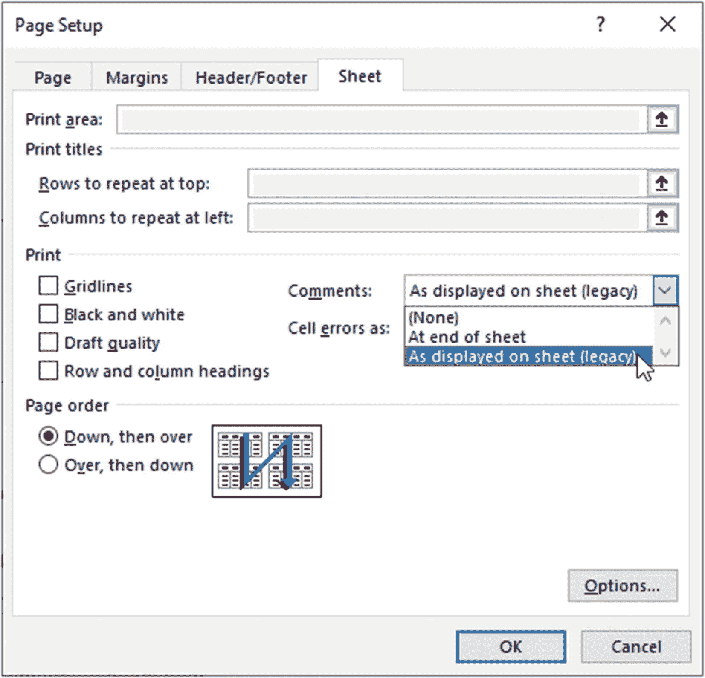
*图 3-59* — 选择批注的打印位置

1. 单击“`批注`”按钮并选择“`显示所有批注`”以一次显示所有批注。

2. 单击功能区上的“`文件`”选项卡。从左侧窗格中选择“`打印`”。

3. 点击位于“`设置`”选项底部的“`页面设置`”。这将打开“`页面设置`”对话框。

4. 单击“`页面设置`”对话框中的“`工作表`”选项卡。

5. 单击“`批注`”下拉框的向下箭头。这将显示三个选项。请参见图 3-59。

**注意** — 微软在“`页面设置`”对话框中并未将“`批注`”更改为“`批注`”。如果选择“`在工作表末尾`”，Excel 将同时打印批注和批注。如果选择“`如同在工作表中显示`”，Excel 将仅打印批注，而不打印批注。

- 选择“`无`”将不在打印输出中显示任何批注或批注。
- 选择“`在工作表末尾`”将在电子表格打印后打印批注和批注。打印输出会显示批注以及每个批注的单元格地址。请参见图 3-60。

*图 3-60* — 选择“`在工作表末尾`”的结果

- 选择“`如同在工作表中显示`”会按照批注在电子表格中的确切显示方式，在数据中打印它们。请参见图 3-61。

*图 3-61* — 选择“`如同在工作表中显示`”的结果

#### 更改批注的背景颜色或边框颜色

1. 右键单击批注的边框。选择“`设置批注格式`”。选择“`颜色与线条`”选项卡。你可以从“`填充`”区域选择颜色以更改背景。你可以从“`线条`”区域选择颜色以更改批注边框颜色。点击“`确定`”按钮。

### 新的协作批注

批注和新批注之间的区别在于，新批注功能包含一个回复框。使用旧的批注方法，每个想要回复你某条批注的人都必须创建一条新批注，但使用新批注，每当用户想要回复时，都会在批注中添加一个新的回复框。这使得在电子表格上的协作变得更加容易。这些新批注有时被称为线程批注，因为每个用户都在创建新线程。

新的批注功能在 Word、Access 和 PowerPoint 中也可用。图 3-62 显示了一个新的线程批注。包含批注的单元格右上角会出现一个图标。将鼠标光标移到该图标上以显示关联的批注。

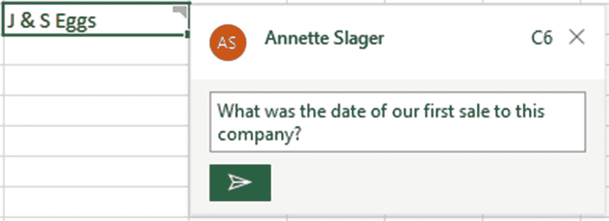
*图 3-62* — 输入批注

批注会显示用户的姓名缩写和姓名以及单元格地址。在框中输入你的批注，然后点击下面的“`发布`”按钮。点击“`发布`”按钮会显示该批注及其发布的时间和日期。请参见图 3-63。如果你需要修改批注，请点击“`编辑`”。一个新的“`回复`”框出现，供其他用户添加对批注的回复。与批注不同，你不能更改批注的大小或背景颜色。

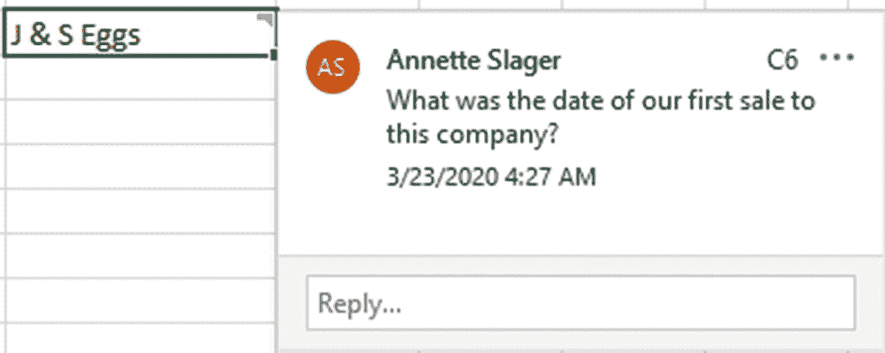
*图 3-63* — 已发布的批注

发布批注后，你期望得到回复。要获得回复，你可以通过电子邮件将电子表格发送给某人、在 OneDrive 上共享或通过网络驱动器共享。如果你正在与使用同一台本地计算机的人共享文档，你将需要更改用户信息。这可以通过单击功能区上的“`文件`”，然后在左侧窗格中选择“`帐户`”来完成。在右侧窗格的顶部，你将看到当前用户信息。点击“`切换帐户`”以切换到其他用户。请参见图 3-64。

*图 3-64* — 切换用户

点击“`切换帐户`”会在 Excel 窗口的右上方弹出一个对话框。请参见图 3-65。你可能看到其他可用的用户，你可以从中选择你想要的用户。如果没有其他用户可供选择，则点击“`使用其他帐户登录`”。然后你需要输入 Microsoft 帐户的用户名和密码，或创建一个新帐户。

*图 3-65* — 以其他用户身份登录

然后，第二个用户可以将鼠标光标移到批注图标上，然后在“`回复`”框中输入他的回复。请参见图 3-66。

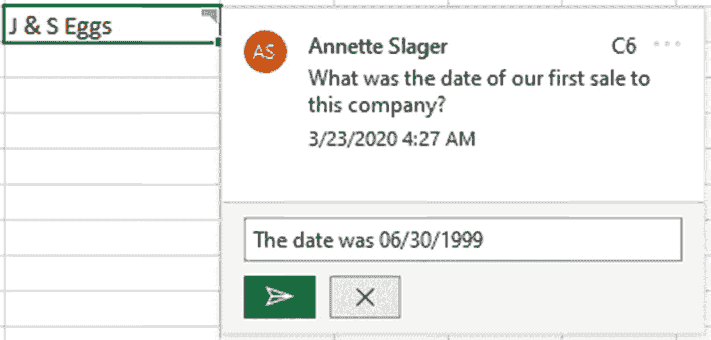
*图 3-66* — 回复批注

图 3-67 显示了第二个用户点击“`发布`”按钮后批注的样子。现在另一个用户或同一个用户可以发布另一条批注。这个过程可以持续进行。

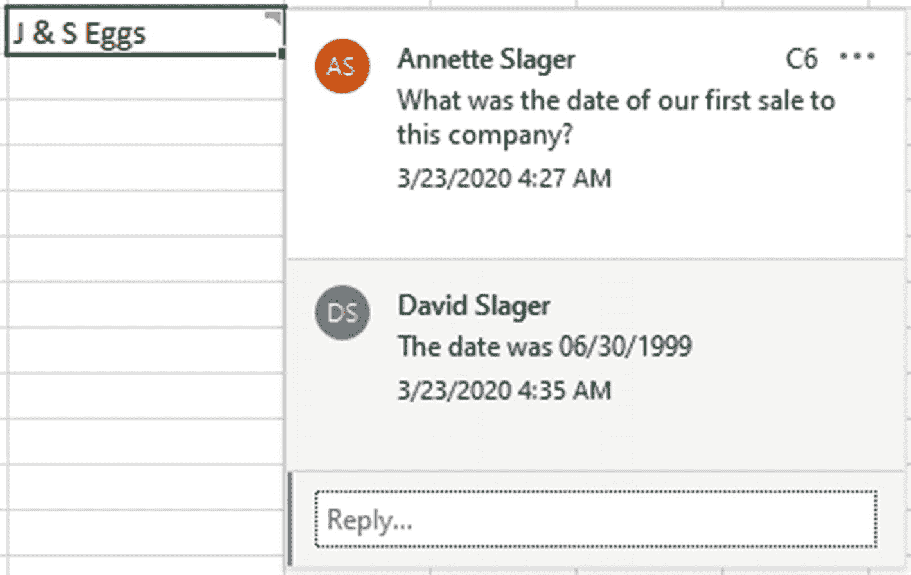
*图 3-67* — 发布了回复后的批注

用于批注的按钮位于功能区的“`审阅`”选项卡上。请参见图 3-68。

*图 3-68* — 批注按钮

当你在电子表格中显示所有笔记时，它们会出现在引用它们的单元格旁边，但点击“`显示批注`”（`Show Comments`）并不会产生相同效果；实际上，它会在表格右侧的窗格中显示所有批注。参见图 3-69。你可以直接在窗格中输入对批注的回复，而无需将光标移到批注图标上再输入回复。

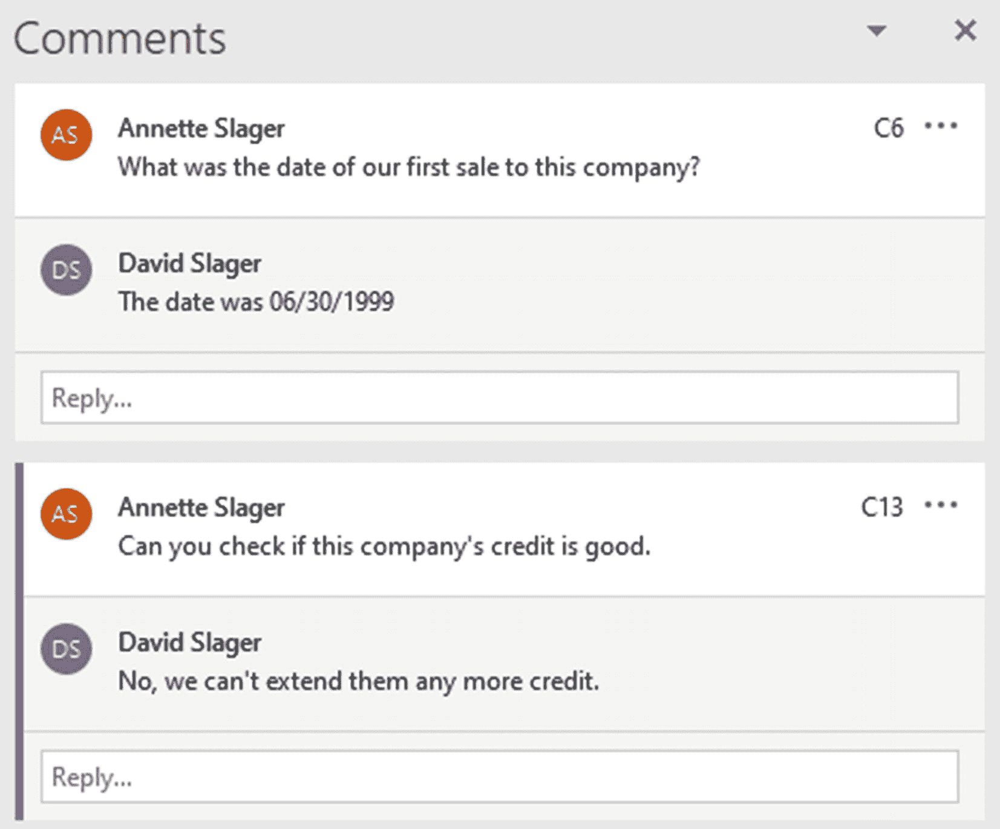
*图 3-69* — 所有批注可在窗格中显示

你可以使用“`下一条批注`”（`Next Comment`）和“`上一条批注`”（`Previous Comment`）按钮跳转到其他批注。要删除批注，请选中包含批注的单元格，然后点击“`删除`”（`Delete`）按钮。

如需打印批注，请点击功能区中的“文件”（`File`）选项卡，然后点击“打印”（`Print`）。接着点击“页面设置”（`Page Setup`），再点击“工作表”（`Sheet`）选项卡。点击“批注”旁的下拉箭头，选择“工作表末尾”（`At end of sheet`）。注意，“如同工作表中的显示”（`As displayed on sheet`）（旧版）选项将无法用于打印批注。

## 本章小结

本章涵盖了各种数据类型，以及这些类型如何影响数据在单元格中的显示和调整方式。同时，还介绍了输入和编辑数据的多种方法。

本章重点介绍了如何调整工作表中列和行的大小与外观，以及如何使用特殊字符和 Excel 的“自动更正”（`AutoCorrect`）功能。你可以创建、编辑、删除和打印添加到单元格中的笔记和批注。

Excel 的“自动更正”（`AutoCorrect`）功能非常实用，可用于纠正常见拼写错误、纠正大小写误用、输入无法直接从键盘输入的特殊符号，以及创建用于输入常用词或短语的快捷方式。

“自动完成”（`AutoComplete`）和“从下拉列表中选择”（`Pick from Drop-down List`）功能可让你轻松复制现有的列值。

在第 4 章中，你将学习如何使用更复杂的数据和单元格格式化功能。此外，还有多种用于呈现和格式化数值数据（包括会计用途的数据）的选项。你还将开始使用迷你工具栏和上下文菜单，这些工具提供了针对当前操作的更多快捷选项。

