# 1. 熟悉 Excel

Excel 是一个功能强大且用途广泛的电子表格程序，可同时满足商业和个人需求。它拥有卓越的能力，可用于使你记录的任何类型的数据更加高效和富有成效。在第一章中，你将学习创建工作表的基础知识，以及如何使用功能区（Ribbon）——一个驱动 Excel 中用户友好资源的特性。

阅读并完成本章后，你应该能够：

- 了解 Excel 是什么以及它的一些功能
- 创建、保存和打开工作簿
- 识别当前单元格
- 使用功能区（Ribbon）
- 使用并自定义快速访问工具栏（Quick Access Toolbar）
- 在工作表中输入数据
- 通过使用屏幕提示（Screen Tips）和“告诉我你想要做什么”（Tell Me What You Want to Do）功能获取帮助

## 什么是 Excel？

Excel 是一款电子表格程序。电子表格是由排列成行和列的单元格组成的网格，你可以在其中输入和存储数据。Excel 能够满足你的个人和专业需求。

使用 Excel，你可以执行以下所有操作：

- 创建、编辑、排序、分析、汇总、格式化数据，并制作图表。
- 管理预算和处理工资单。
- 跟踪投资、贷款、销售、库存等。
- 执行假设分析，以确定诸如“如果每加仑汽油价格上涨 20 美分”会减少多少利润，或者“如果我将贷款期限从 15 年延长到 20 年”会对我的月供、总还款额和总利息产生多大影响。

你可以通过添加图片、剪贴画、形状、SmartArt、视频和音频来美化电子表格的外观，或更好地传达其意图。

Microsoft Office 是微软最赚钱的产品。微软在 Microsoft Office 2016 中将大部分精力投入到更新 Excel 上，此后又添加了许多新功能。

## Excel 版本

> **注意：** PC 版与 Mac 版之间存在差异。本书仅涵盖 PC 版。

获取 Excel 主要有三种方式：你可以使用免费的在线版本、订阅并每月付费，或者一次性购买。

Office 在线版对所有用户免费。你可以通过互联网浏览器访问。由于通过浏览器访问，Windows 和 Mac 用户看到的界面相同。它是 Office 产品的精简版。请访问 [`www.office.com`](https://www.office.com)。

微软将其 Microsoft Office 产品分为“家庭版”和“商业版”。

它们有三种家庭版：

- **Office 365 家庭版**——订阅后，你可以获得微软添加的最新功能更新。该订阅可供多达六位用户同时在你的所有不同设备上使用。你的订阅包含每位用户 1 TB 的云存储空间和 Skype 访问权限。你将获得 Excel、Word、PowerPoint 和 Outlook。如果你使用的是 PC（而非 Mac），你还可以获得 Publisher 和 Access。
- **Office 365 个人版**——与 Office 365 家庭版相同，只是仅限一人订阅。
- **Office 家庭与学生版 2019**——购买此产品需一次性付费。它只能安装在一台 PC 上。你只能获得 Excel、Word 和 PowerPoint。微软会为你提供新的安全更新，但不会提供任何新功能。你需要购买下一个版本才能获得新功能。新版本大约每三年推出一次。

> **注意：** Office 365 订阅与一次性购买的 Office 家庭与学生版 2019 之间的区别在于你可以使用产品的时间长短。如果你拥有 Office 365 订阅，一旦停止支付订阅费用，你将无法再使用它；但如果你一次性购买了家庭与学生版 2019，你就可以永久使用它。

有四种“商业版”Office 类型。它们都是订阅制，费用按“每用户”计算。这四种不同类型提供不同的产品和服务。

如果你是订阅用户，自本书出版后可能会有新增内容或变更。作为订阅用户，你可能注意不到何时添加了新功能。那么，你如何知道何时添加了新功能呢？你可以单击 `帮助` 选项卡，然后选择 `新增功能` 或者 `文件` ➤ `账户` ➤ `新增功能`。

你如何确保拥有最新更新？Office 365 默认会自动更新。如果你想要确保拥有最新更新，请单击 `文件` 菜单，然后单击左窗格中的 `账户`，单击 `Office 更新` 按钮，然后选择 `立即更新`。（请记住，Excel 2019 只有安全更新。）

## 电子表格的历史

VisiCalc（Visible Calculator 的缩写）是第一款面向公众的计算机化电子表格。它由丹·布里克林和鲍勃·弗兰克斯顿于 1979 年为 Apple IIe 创建，随后于 1981 年为新推出的 IBM PC 发布。在此之前，个人电脑的销售一直很缓慢，因为能做的事情不多。早期的个人电脑非常昂贵，而且没有任何预编好的应用程序。购买者大多是计算机程序员，他们觉得电脑很迷人，并希望能够在家里练习编程。那时，程序员工作在被称为大型机的大型计算机上。在当时，你不能像今天这样去商店购买软件。那时，公司的程序员编写公司所需的所有程序。每家公司都自己编写工资单程序、库存程序等等。他们不互相分享软件。有了 VisiCalc，企业现在拥有了一个能带来巨大好处的产品。个人电脑的销量猛增。VisiCalc 成为世界上第一款超级应用。VisiCalc 还引发了一场革命，许多公司成立的唯一目的就是为了创建供公众购买的软件。

Lotus 1-2-3 电子表格程序于 1983 年发布。它是专门为 IBM PC 开发的。它比 VisiCalc 更快、图形功能更好，并很快取代了后者。Lotus 1-2-3 极大地促进了 IBM PC 的销售。

自 20 世纪 90 年代以来，Microsoft Excel 一直主导着电子表格市场。

## 关于本书

一本教你所有可能选项的 Excel 书籍会大到让你无法随身携带。在本书中，你将读到关于 Excel 主题的内容，随后是练习。你可以通过阅读来学习，但为了充分理解不同的主题，你应该动手完成练习。书中包含大量插图，以便于你跟进和理解。

当你研读本书中的材料，探索不同的选项并尝试不同的事物时，请思考如何能将所学应用于不同的环境。切记，在练习中要有意识地思考每一步，而不仅仅是按照书的指示去点击位置和输入文本。Excel 功能极其强大，能处理许多事情，所以请允许自己进行实验。目标是在本书练习之外，使用 Excel 解决你自己的问题，因此在阅读和完成练习的过程中，请思考如何利用你正在学习的知识。要富有创新精神，思考如何利用 Excel 来解决各种问题。

## Excel 导航基础

在开始使用 Excel 之前，我们先来认识一下该程序的主要组成部分。图 1-1 显示了一个 Excel 工作簿。添加的箭头用于突出显示工作簿不同区域的作用。

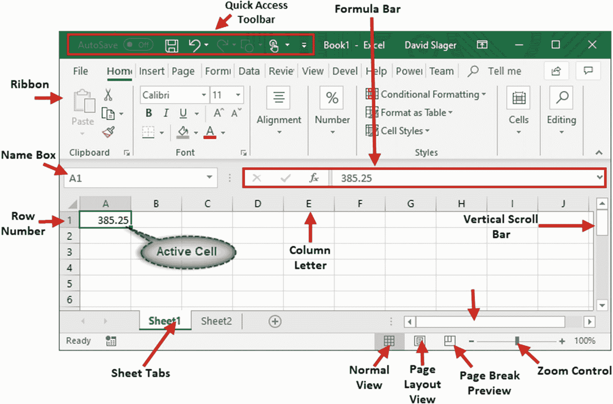

图 1-1

一个 Excel 工作簿

**注意** 您的 Excel 程序可能与此工作簿不完全匹配。微软正通过互联网不断地对 Office 365 进行更改。例如，您的功能区可能看起来略有不同。Excel 2019 的功能区看起来与 Office 365 中 Excel 的功能区稍有不同。

图 1-1 显示了工作簿和工作表的基本组件。我将从快速访问工具栏 (QAT) 开始，沿着工作表顺时针讲解：

- QAT 是一个快捷工具，用于存储您最常使用且希望快速访问的命令。
- 公式栏显示当前选中单元格的公式。Excel 在每个单元格中显示公式的结果，而不是公式本身。此栏允许您查看产生单元格结果的公式。
- 垂直滚动条和水平滚动条允许您在工作表页面中移动。
- 缩放控件、分页预览、页面布局视图和普通视图是允许您控制工作表查看方式的按钮：
  - 缩放控件允许您增加或减少工作表在屏幕上的大小（缩放百分比）。
  - 分页预览允许您控制一页结束和另一页开始的位置。这通过允许以对用户有意义的方式组织页面，使工作表更加用户友好。
  - 页面布局视图显示页面打印时的外观。使用此功能可确保打印出的工作簿整洁且易于阅读。
  - 普通视图是默认视图。它显示您在工作时工作簿的外观。工作表标签允许您选择要处理或查看的工作表。Excel 中的许多工作簿都有多个工作表。
- 行号告诉您在工作簿中所处的行。Excel 最多可有 1,048,576 行。列由字母标识。Excel 电子表格中有 16,384 列。这意味着单个工作表包含超过 170 亿个单元格。每个单元格可容纳 32,767 个字符。一个工作簿中可以包含多少个工作表取决于您计算机的可用内存。每个单元格由一个由列字母和行号组成的地址来标识。
- 名称框显示您当前所在单元格的地址。图 1-1 中的名称框显示 `A1`，这是当前活动单元格的地址。
- 功能区提供对所有 Excel 功能的访问。本章后面及后续章节将更详细地讨论功能区。

## 创建、保存和打开工作簿

第一步是创建工作簿。您应该考虑工作簿中需要什么以及将如何使用数据。为工作簿选择一个能反映其用途的名称。这将使其在您再次打开和使用时易于识别。接下来，确保在添加新数据的过程中随时保存您的工作。养成经常保存工作的习惯可以防止浪费时间。

我们将通过创建新工作簿开始我们的 Excel 之旅，然后检查工作簿的不同部分。启动 Excel 的方式取决于您的操作系统。Excel 的启动方式与您使用的任何其他应用程序相同。

### 练习 1-1：创建并保存工作簿

在本练习中，我们将创建一个简单的空白工作簿并保存它。

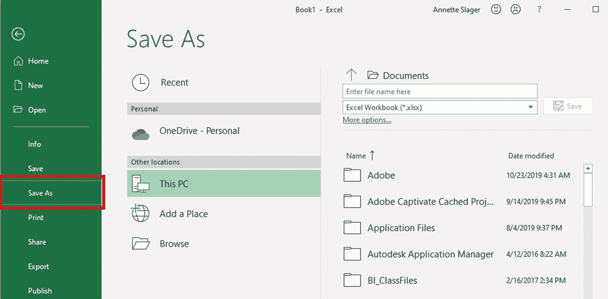

图 1-3

保存工作簿的位置

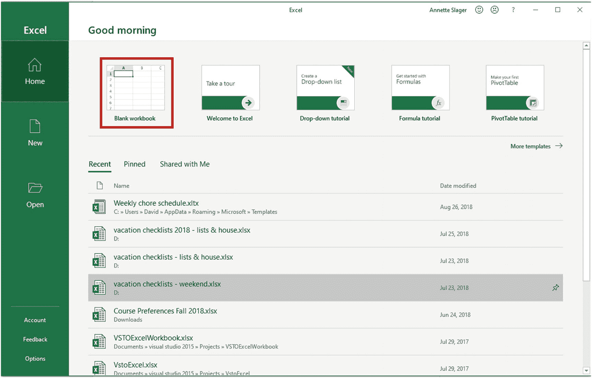

图 1-2

Excel 启动窗口

1. 单击任意单元格，输入您想要的任何值，然后按 Enter 键。
2. 单击位于窗口左上角快速访问工具栏上的保存按钮 （参见图 1-1）。第一次保存工作簿时，Excel 会显示“文件”选项卡，其中“另存为”选项被突出显示。见图 1-3。

**注意** 您将在第 6 章中了解更多关于从“文件”选项卡（称为“后台视图”）保存工作簿的内容。

3. 当您开始一个新工作簿时，您有两个选择：
   - 您可以单击“空白工作簿”按钮，从一个空白工作簿开始。
   - 您可以单击众多模板按钮之一，基于您选择的模板创建新工作簿。

对于本练习，请单击“空白工作簿”。

4. 启动您的 Excel 程序。如果您使用的是 Windows 10，请选择“开始”，然后滚动到 Excel 并单击它。图 1-2 显示了启动窗口。

**注意** 您窗口上的文件名不会与图 1-2 中显示的文件名相同，因为它们是我打开过的文件的名称。

您可以将文件保存到许多不同的位置。如果您在学校使用本书，应询问您的讲师应将文件保存在何处。单击“浏览”按钮将打开“另存为”窗口。

5. 单击“浏览”。

根据您 Windows 的版本，您的“另存为”窗口可能与图 1-4 中的略有不同。如果您以前使用过文件资源管理器，此窗口的工作方式相同。单击一个文件夹，然后，如果需要，在构建文件保存路径时单击该文件夹内的子文件夹。路径是您必须经过才能到达文件的驱动器和文件夹。图 1-4 中正在保存的工作簿被设置为保存在“文档”文件夹中。您可能希望直接将文件存储在“我的文档”文件夹中，或者可能希望在“我的文档”文件夹下创建一个文件夹，然后将文件存储在其中。文件名默认为 `Book1.xlsx`。您应该将其更改为与您正在处理的内容更相关的名称。可以通过拖动选中 `Book1` 字样然后输入新名称来更改文件名。

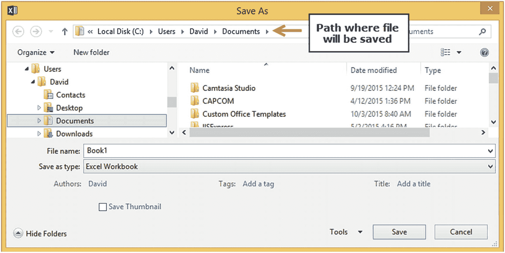

图 1-4

“另存为”窗口

6. 通过单击“另存为”窗口左侧窗格中的文件夹，直到到达您想要存储文件的位置，从而为工作簿创建保存路径。

2.  将文件名从`Book1`更改为`MyFirstWorkbook`。Excel 会自动为文件名添加`.xlsx`扩展名。确保**另存为类型**为`Excel Workbook(*.xlsx)`。

3.  单击`Save`按钮。

4.  在另一个单元格中输入任意值，然后按`Enter`。

5.  单击位于快速访问工具栏上的`Save`按钮。由于之前已保存过该文件，因此`另存为`窗口不会出现。Excel 会保存该文件及其所有更改。

6.  点击右上角的`X`关闭 Excel。

此练习向您展示了创建工作簿的基础知识。接下来，您将练习打开同一个工作簿以继续处理它。

### 练习 1-2：打开工作簿并新建一个

在本练习中，我们将打开上一个练习中创建的文件，进行一些更改，然后使用新名称保存。这将创建一个新的工作簿。

1.  启动 Excel。

图 1-5 中的窗口显示了最近打开的工作簿。您在上一个练习中创建的`MyFirstWorkbook`文件位于列表顶部。

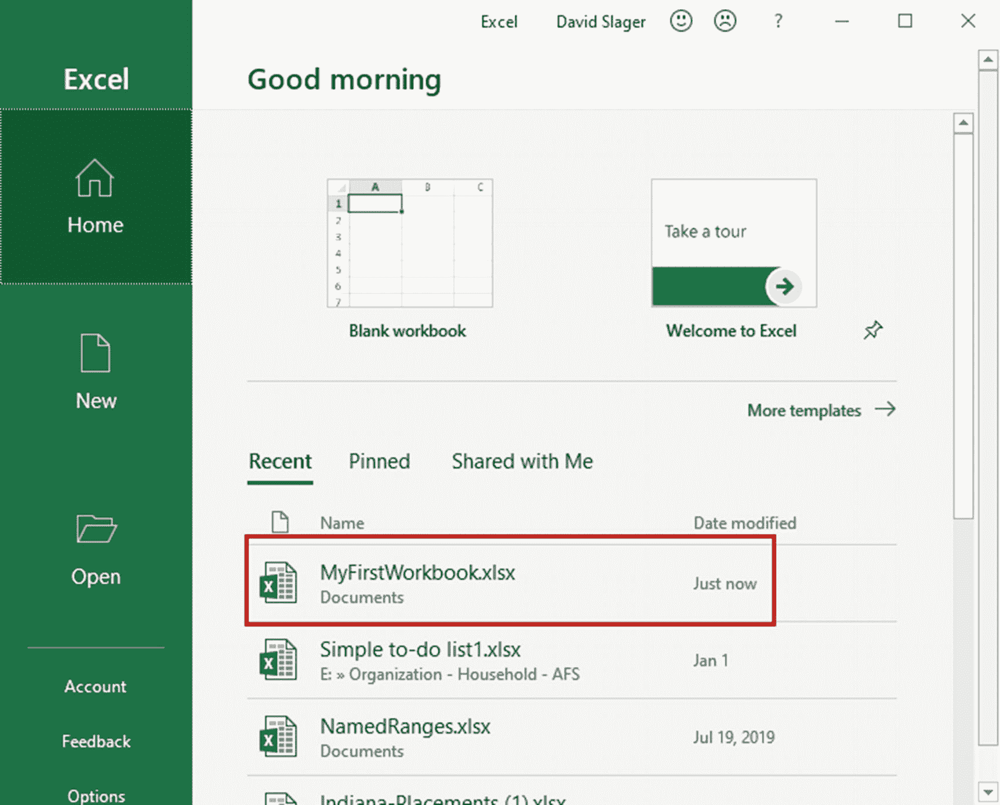

图 1-5
打开最近使用过的工作簿

1.  单击`MyFirstWorkbook`。该工作簿随即打开。

接下来，我们将向此工作簿添加额外的单元格值，然后以不同的名称保存。

#### 以不同的名称创建另一个工作簿

1.  在空白单元格中输入任意值。

2.  单击功能区上的`文件`选项卡。

3.  在左窗格中，单击`另存为`。

4.  单击`浏览`。

5.  您可以将此文件保存在与保存`MyFirstWorkbook`相同的`文档`文件夹中。将名称更改为`MySecondWorkbook`，然后单击`保存`按钮。

现在您有两个独立的工作簿：一个名为`MyFirstWorkbook`，另一个名为`MySecondWorkbook`。`MySecondWorkbook`包含与`MyFirstWorkbook`相同的数据，以及您添加的额外单元格值。接下来，您将了解功能区。通过此功能，您可以访问编辑和自定义选项，使 Excel 满足您的特定需求。

## 认识功能区

从 Office 2007 开始，Microsoft Office 弃用了下拉菜单，转而采用一种称为“功能区”（Ribbon）的选项卡设计。见图 1-6。

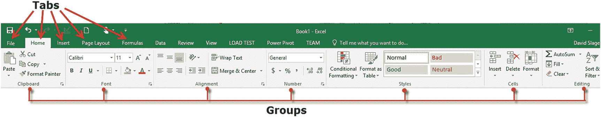

图 1-6
展示了功能区的选项卡和组

功能区由选项卡、组和命令按钮组成。默认的 Excel 功能区包含`文件`、`开始`、`插入`、`页面布局`、`公式`、`数据`、`审阅`、`视图`和`Power Pivot`选项卡。根据您的设置，功能区可能包含其他选项卡。每个选项卡被划分为多个组。按钮排列在这些组内。Excel 允许您根据自己的需求更改功能区。您可以创建自己的选项卡或在现有选项卡中添加新组。您可以将最常用的命令放置在自定义组中。很多人抱怨 Microsoft 不断更改功能区及其选项卡的外观。您的功能区可能与下图略有不同。

### 功能区上下文选项卡

除了启动 Excel 时看到的选项卡外，还有许多其他选项卡会根据您正在处理的内容出现和消失。这些被称为**上下文相关选项卡**，因为这些选项卡会根据您使用它们的*上下文*而显示。当您处理图表、绘图、图片、数据透视表和数据透视图、SmartArt 图形、页眉或页脚等内容时，这些上下文选项卡就会出现。上下文选项卡有一个额外的标签显示在选项卡上方。这些标签具有不同的背景颜色。图 1-7 显示了在处理图片时出现的上下文`格式`选项卡。它的上方有一个名为**图片工具**的标签。图 1-8 显示了在单击工作表中的图表时出现的两个额外选项卡：一个`设计`选项卡和一个`格式`选项卡。

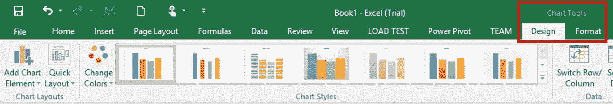

图 1-8
选中图表时显示的额外选项卡

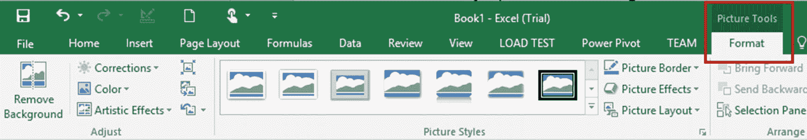

图 1-7
选中图像时显示的额外选项卡

这些额外的选项卡出现在**图表工具**标签下。这些选项卡仅在导致它们出现的对象处于活动状态时才会显示。单击对象之外的其他区域将会移除这些选项卡。

### 调整功能区大小

调整 Excel 窗口大小也会调整功能区的大小。随着窗口尺寸缩小，按钮开始垂直对齐，如图 1-9 所示。

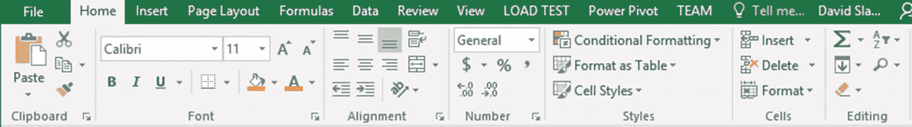

图 1-9
按钮垂直对齐

进一步缩小功能区尺寸，如图 1-10 所示，会使按钮消失。单击组中的箭头将使该组的按钮显示在功能区下方。

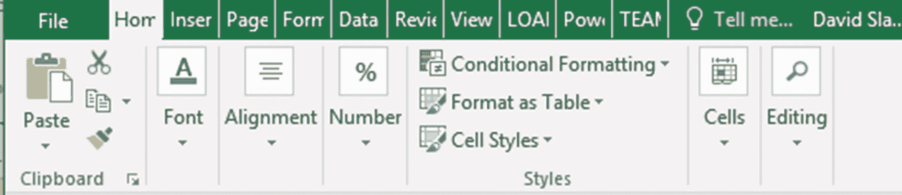

图 1-10
调整大小后的功能区可能不显示按钮

在您操作时，可能需要调整功能区的大小以适应您的工作空间。下一个练习将向您展示如何操作。

### 练习 1-3：调整 Excel 窗口和功能区的大小

如果您在窗口的右上角看到“向下还原”按钮（图 1-11），这意味着您的窗口当前处于最大尺寸。当屏幕最大化时，您无法缩小窗口尺寸。

图 1-11
“向下还原”按钮

图 1-12
“最大化”按钮

1.  如果显示了“向下还原”按钮，请单击它。

2.  将光标移动到窗口的右边缘。光标将变为一个双向箭头。将右边缘向左拖动以缩小窗口。拖动窗口时，请注意按钮如何开始垂直对齐，并且随着您进一步向左拖动，组中的按钮开始消失。

3.  单击“最大化”按钮（图 1-12）。

您的窗口现在应已最大化，并且功能区应显示其所有命令按钮。

#### 使用对话框启动器

在某些功能区组的右下角，有带框的箭头。如图 1-13 所示，它们被称为对话框启动器。对话框启动器提供一组选项供用户选择。对话框是一种窗口，其中包含可供选择的选项，您必须在此窗口中做出响应后才能返回另一个窗口。它通常包含一个`OK`按钮和一个`Cancel`按钮。

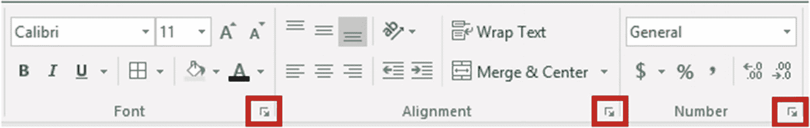

图 1-13

对话框启动器

单击`字体`组、`对齐方式`组或`数字`组的对话框启动器，将弹出图 1-14 中的`设置单元格格式`对话框。

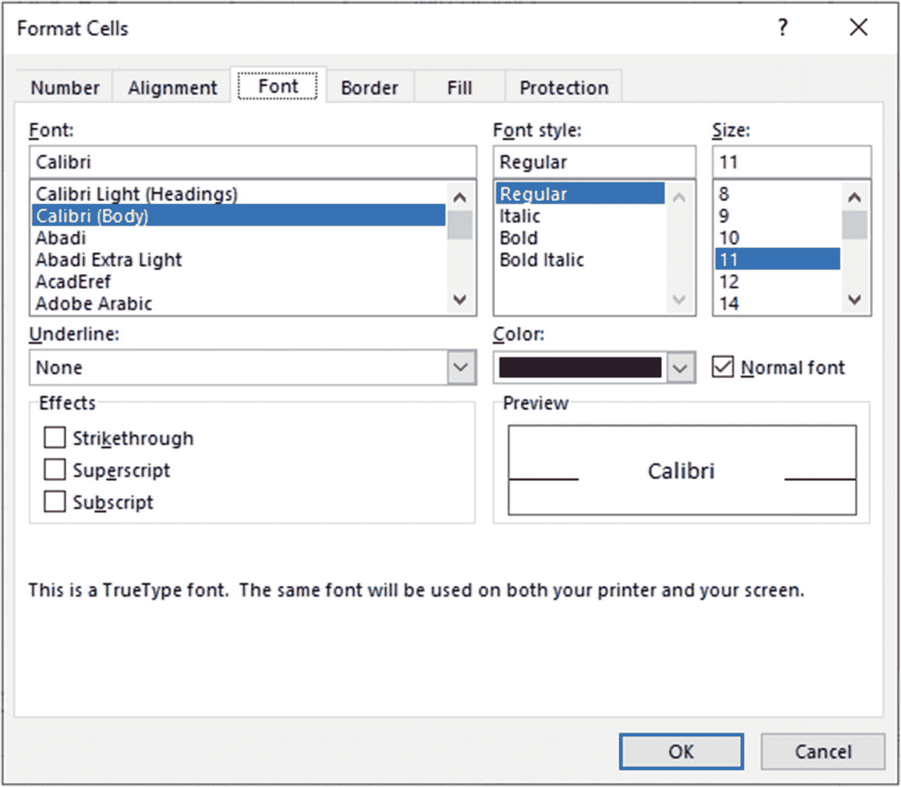

图 1-14

从`字体`对话框启动器打开的`设置单元格格式`对话框

如果您单击`字体`组的对话框启动器，`字体`选项卡将被选中。如果您单击`对齐方式`组的对话框启动器，`对齐`选项卡将被选中。我们将在后续章节中使用对话框启动器。

#### 最小化和隐藏功能区

如果您认为功能区占用了过多的窗口空间，您可以将其最小化，使其仅显示选项卡名称，或者将其完全隐藏。单击 Excel 窗口右上角的功能区显示按钮，会显示三个选项。如图 1-15 所示。

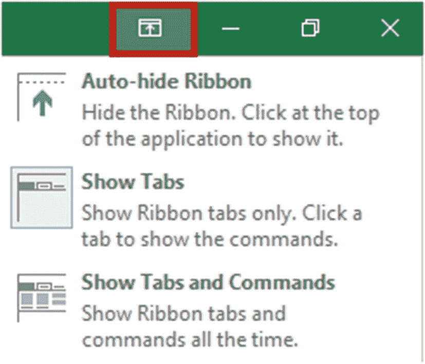

图 1-15

三个功能区选项

这些选项是：

*   **自动隐藏功能区**——将 Excel 工作簿置于全屏模式，并完全隐藏功能区。当功能区处于自动隐藏模式时，您会在窗口右上角看到此图标 。单击这三个点或屏幕顶部它们左侧的任何位置，功能区将重新显示。单击电子表格时，功能区将再次隐藏。

*   **显示选项卡**——仅显示功能区选项卡。单击某个选项卡将显示包含其按钮的组。单击电子表格的任意位置将再次隐藏组及其按钮。在此模式下，按 `Ctrl + F1` 如同切换开关，可以隐藏和取消隐藏组及按钮。

*   **显示选项卡和命令**——此选项使功能区始终保持完全显示。

您也可以通过单击功能区最右侧的向上箭头  来折叠功能区。

#### 使用功能区快捷键

按下键盘上的 `Alt` 键，会显示每个选项卡以及快速访问工具栏的快捷键，如图 1-16 所示。按下快速访问工具栏上某个按钮对应的快捷键，将执行该命令。

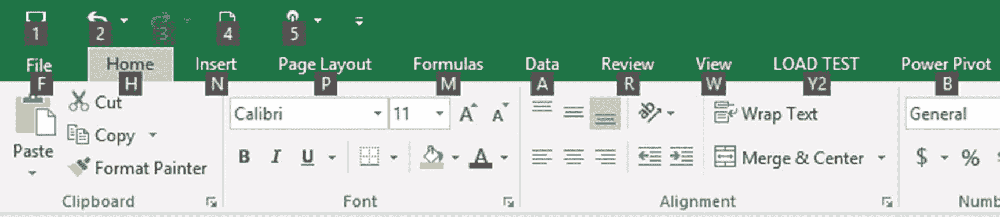

图 1-16

功能区选项卡和快速访问工具栏的快捷键

输入某个功能区选项卡的快捷键将使该选项卡变为活动状态。如图 1-16 所示，按下 `F` 键将使`文件`选项卡变为活动状态，按下 `H` 键将使`开始`选项卡变为活动状态。请注意，`N` 键用于`插入`选项卡。大多数快捷键字母与选项名称无关。

当您按下所需选项卡的字母键时，该选项卡上的每个选项都会显示快捷键。图 1-17 显示了`开始`选项卡上所有选项的快捷键。请注意，您可能需要输入多个字母作为快捷键。有趣的是，即使`开始`选项卡是默认选中的，您仍然需要为它按下 `H` 键，才能显示其下的所有快捷键。您首次按下 `Alt` 键时，它不会自动显示所选选项卡下的命令。

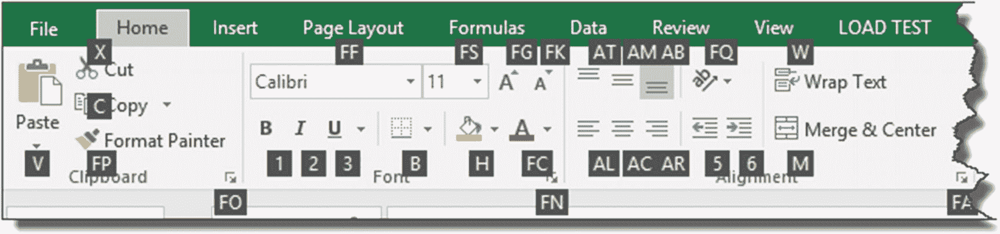

图 1-17

`开始`选项卡命令的快捷键

按下选项卡中的某个快捷键将执行该命令，或者如果该命令有更多可用选项，则会显示更多快捷键。例如，使用键盘应用`合并后居中`选项，您可以执行以下操作：

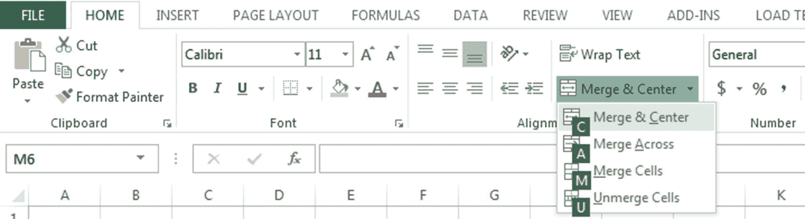

图 1-18

`合并后居中`类别下的命令快捷键

1.  按下 `Alt` 键，然后按下 `H` 键以选择`开始`选项卡。
2.  按下 `M` 键以选择`合并`按钮。
3.  然后按下 `C` 键以选择`合并后居中`选项。见图 1-18。

注意

即使您要使用的命令所在的选项卡处于活动状态，您也必须先按下 `Alt` 键，再按下该选项卡的快捷键。换句话说，如果快捷键没有显示出来，您就不能使用它。

现在，您应该能够使用功能区来导航和在工作表中输入数据了。功能区驱动着 Excel 程序的功能。

除了使用功能区中的命令，您还可以从快速访问工具栏（QAT）中选择它们。这将是我们在下一节中要介绍的内容。

## 快速访问工具栏

快速访问工具栏为您存储和访问以下内容提供了一个快速便捷的位置：

*   您最常使用的工具
*   功能区中通常找不到的工具
*   您创建的宏

默认情况下，如图 1-19 所示的快速访问工具栏位于 Excel 窗口左上角的功能区上方。

图 1-19

快速访问工具栏（QAT）

默认情况下，快速访问工具栏（QAT）显示：

*   `自动保存`按钮
*   保存按钮（图标为软盘形状）
*   撤销和恢复按钮
*   一个下拉按钮，您可以通过它选择其他要显示在 QAT 上的工具

单击 QAT 右侧的下拉按钮，会显示`自定义快速访问工具栏`，您可以从中选择其他按钮添加到您的 QAT 中。见图 1-20。

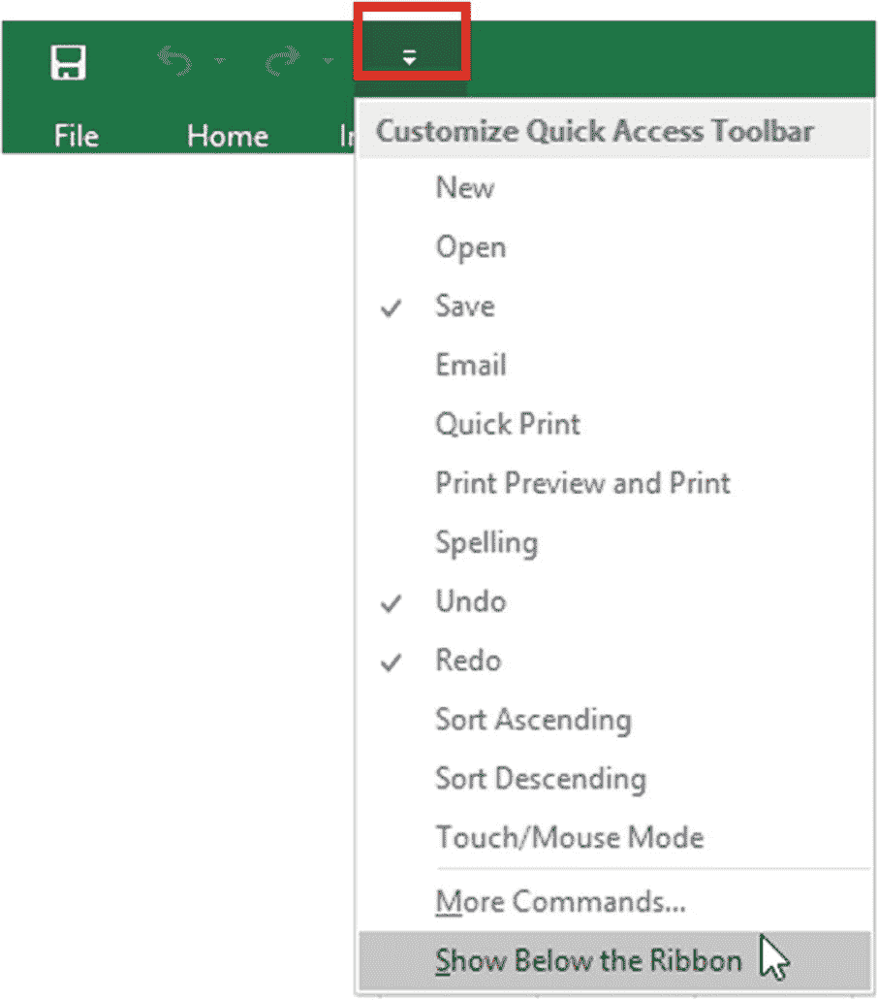

图 1-20

单击下拉按钮以选择要添加到 QAT 或从 QAT 中删除的项目

可以从下拉菜单中选择`在功能区下方显示`选项，将 QAT 移动到功能区下方。这可能是一个更好的位置，因为它可以为额外的工具提供更多空间。

### 自动保存

`自动保存`按钮保持灰色，除非您正在处理存储在`OneDrive`上的工作簿。当`自动保存`开启时，您每次对工作簿进行更改，都会立即保存到`OneDrive`上的工作簿中。只有当您在`OneDrive`上与其他人共享工作簿，并且希望他们能够立即访问您所做的任何更改时，才应开启`自动保存`。

### 在触摸模式与鼠标模式间切换

如今许多显示器都具备触摸屏功能，因此微软新增了一个`触摸/鼠标模式`按钮。通过从`QAT`下拉菜单中选择，即可将该按钮添加到`QAT`中。请参见图 1-20。点击`触摸/鼠标模式`按钮的下拉箭头，会显示两个选项，如图 1-21 所示。

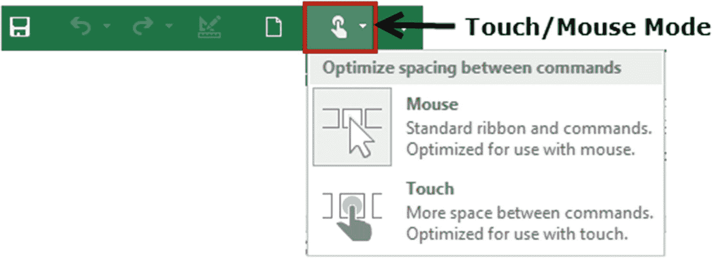

**图 1-21** – 优化功能区以适配鼠标或触摸屏的选项

`触摸`选项适用于使用触摸屏的用户。选择触摸选项后，功能区按钮之间的间距会增大，如图 1-22 所示，从而更便于用手指准确选择按钮。

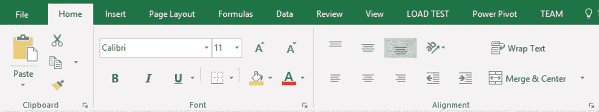

**图 1-22** – 为触摸屏显示器设置的功能区

在任何一款 Microsoft Office 产品中更改`触摸`和`鼠标`模式，都会同时应用于所有 Office 产品。

你可以轻松地从快速访问工具栏中移除按钮：右键单击要移除的按钮，然后选择`从快速访问工具栏中移除`；或者点击下拉按钮，然后点击要移除的已勾选项目。

你的`QAT`不仅限于`自定义快速访问工具栏`菜单中显示的项。功能区上的按钮也可以通过右键单击功能区按钮，然后从菜单中选择`添加到快速访问工具栏`，从而添加到`QAT`中。请参见图 1-23。

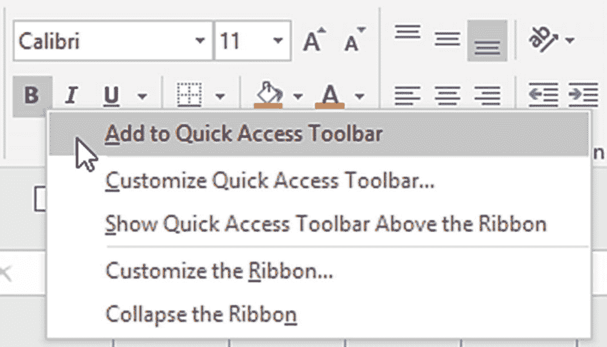

**图 1-23** – 将功能区按钮添加到 QAT

`QAT`上按钮的显示顺序可以重新排列。你可以将`QAT`的自定义设置保存到文件中，之后再将设置导入到另一个工作簿中。

有三种方法可以打开 Excel 选项窗口中的`QAT`自定义设置：

-   点击`QAT`上的下拉箭头，然后选择`其他命令…`。
-   右键单击功能区，然后选择`自定义快速访问工具栏…`。
-   点击功能区的“文件”选项卡。选择`选项`。在`Excel 选项`窗口的左侧选择`快速访问工具栏`。

#### 练习 1-4：使用快速访问工具栏

在本练习中，你将把命令按钮添加到你的`QAT`中。

**图 1-24** – 快速访问工具栏

1.  点击快速访问工具栏的下拉按钮，然后从`自定义快速访问工具栏`菜单中选择`打印预览和打印`。
2.  点击快速访问工具栏的下拉按钮，然后选择`新建`。
3.  点击快速访问工具栏的下拉按钮，然后选择`打开`。

    `打印预览和打印`、`新建`和`打开`按钮已添加到你的快速访问工具栏末尾。请参见图 1-24。

    请注意，这些工具会按照被选择的顺序显示。

**图 1-25** – 快速访问工具栏

4.  右键单击`QAT`上的`打印预览和打印`按钮 ，然后选择`从快速访问工具栏中移除`。
5.  右键单击`QAT`，然后选择`在功能区下方显示快速访问工具栏`。
6.  点击功能区的`审阅`选项卡。在`校对`组中，右键单击`拼写检查`按钮，然后选择`添加到快速访问工具栏`。你的`QAT`现在应如下图所示。请参见图 1-25。

### 识别当前单元格

列由字母表示。行由数字表示。列字母与行号的组合为每个单元格提供了唯一的地址。工作表中的第一个单元格地址为`A1`。位于`G`列和第`5`行交叉处的单元格地址为`G5`。单元格地址也称为单元格引用。各个单元格包含文本、数字或公式。公式的结果会显示在插入该公式的同一个单元格中。

图 1-26 中的当前（活动）单元格是`B6`。可以通过以下方式识别当前单元格：

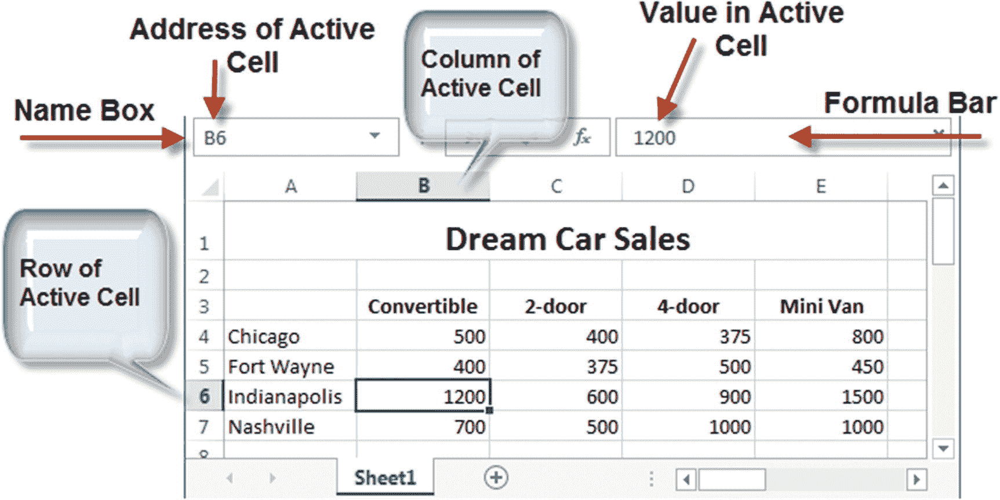

**图 1-26** – 识别当前单元格的不同方式

-   其边框加粗。
-   其列标和行标被高亮显示。
-   其地址显示在名称框中。
-   单元格的值或公式显示在编辑栏中。

一旦识别出当前单元格，你就可以开始输入数据了！

## 在工作表中输入数据

只有在执行以下任一操作后，您在单元格中输入的数据才会被接受：

- 按下 `Tab` 键——光标移至下一个单元格。
- 按下 `Enter` 键——光标移至下一个单元格。
- 按下任意方向键——光标沿箭头方向移至下一个单元格。
- 单击编辑栏上的对勾图标——光标停留在当前单元格。
- 按下 `Ctrl + Enter`——光标停留在当前单元格。

**注意** 在数据被接受之前，无法对单元格中的数据进行格式设置。

如果要覆盖单元格中的所有数据，可以单击该单元格并键入新数据。如果只想更改单元格中的部分数据，则需要进入**编辑**模式。双击单元格可进入**编辑**模式；按下 `F2` 键也可达到相同效果。在单元格中输入数据时，数据会同时显示在活动单元格和编辑栏中。由于数据同时出现在单元格和编辑栏中，因此在任一位置进行修改都会更新单元格数据。

### 练习 1-5：输入并接受单元格条目

在本练习中，在单元格中输入数据，并使用不同的选项来接受条目。

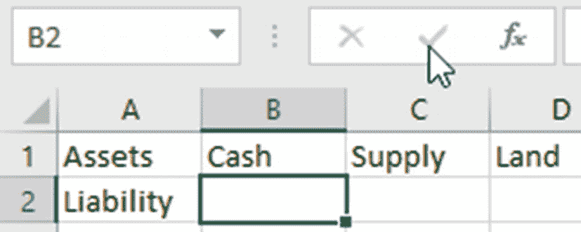

图 1-28

数据被接受后，按钮变为灰色

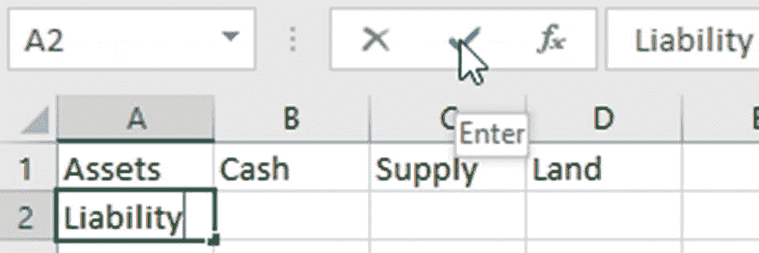

图 1-27

单击**输入**按钮以接受数据

1. 在单元格 `C2` 中输入 `Wages`。当您开始在单元格中键入文本时，状态栏上的“**就绪**”字样会变为 `Enter`。按下 `Tab` 键。

2. 双击单元格 `C1`。查看状态栏的左下角，您应该会看到您处于 `Edit` 模式。将 `Supply` 更改为 `Supplies`。无论是在单元格 `C1` 中还是在编辑栏中进行更改，结果都一样。完成后按下 `Enter` 键。

3. 单击单元格 `A2`。按下 `F2` 键。这是使单元格进入 `Edit` 模式的另一种方法。将 `Liability` 更改为 `Liabilities`。按下 `Ctrl + Enter`。

4. 单击一次单元格 `D1`。由于没有双击，您并未处于 `Edit` 模式。状态栏仍显示 `Ready`。注意光标并未显示。键入字母 `R`。单元格中的单词 `Land` 被清除。完成单词 `Replace` 的输入。按下 `Ctrl + Enter`。

5. 在单元格 `C5` 中输入 `Use`。按下向下方向键。

6. 在单元格 `C6` 中输入 `the`。按下向左方向键。

7. 在单元格 `B6` 中输入 `arrow`。按下向上方向键。

8. 在单元格 `B5` 中输入 `keys`。按下向右方向键。

9. 按下 `Tab` 键。注意状态栏左下角的“`Ready`”字样。这表示该单元格已准备好让您输入数据。

**注意** 如果看不到“`Ready`”字样，请右键单击窗口底部 Excel 的状态栏，然后选择**单元格模式**。

10. 按下 `Tab` 键。

11. 在单元格 `B2` 中输入 `Loan`，但不要按下 `Tab` 键。单击编辑栏上的**取消**按钮 。条目被清除。再次在单元格 `B2` 中输入 `Loan`。按下 `Ctrl + Enter`。单元格 `B2` 仍为活动单元格。光标仍在单元格 `B2` 中，但您看不到它。

**注意** 另一种取消正在输入或清除已被接受的文本的方法是将光标移动到单元格右下角的正方形上（参见左侧的单元格）。光标将变为十字准线。将光标向单元格中心拖动。文本会淡出，如右侧单元格所示，当您松开鼠标按钮时，文本将消失。

12. 接下来，在单元格 `A2` 中输入 `Liability`，但不要按下 `Tab` 键。将光标移到编辑栏中的对勾标记上。如果单元格中的数据尚未被接受，它会改变颜色。见图 1-27。单击**输入**按钮（对勾标记）。数据被接受，按钮变为灰色。见图 1-28。

13. 首先，输入一些列标题，并使用 `Tab` 键接受它们：
    1.  在单元格 `A1` 中输入 `Assets`。注意，当您在单元格 `A1` 中键入文本时，它也会同时被键入到编辑栏中。按下 `Tab` 键。

    2.  在单元格 `B1` 中输入 `Cash`。按下 `Tab` 键。

    3.  在单元格 `C1` 中输入 `Supply`。按下 `Tab` 键。

    4.  在单元格 `D1` 中输入 `Land`。按下 `Enter` 键。单元格 `A2` 变为活动单元格。

## 获取帮助

Excel 在程序中为用户提供帮助。屏幕提示和**告诉我你想要做什么**功能可以在您处理工作表时解答有关格式设置和数据输入的问题。**智能查找**允许您搜索单元格内容。Excel 功能区上的选项卡之一是**帮助**选项卡，其中包含其他帮助功能。

### 屏幕提示

屏幕提示是快速获取关于功能区命令和屏幕上某些其他对象信息片段的一种方式。只需将光标移到对象上即可查看屏幕提示。屏幕提示会显示对象的名称及其功能。某些屏幕提示还提供图形说明来阐释命令的功能。图 1-29 显示了位于**开始**选项卡下的**对齐方式**组中的**合并后居中**按钮的屏幕提示。如果您想要更多信息，可以单击**告诉我更多**链接。

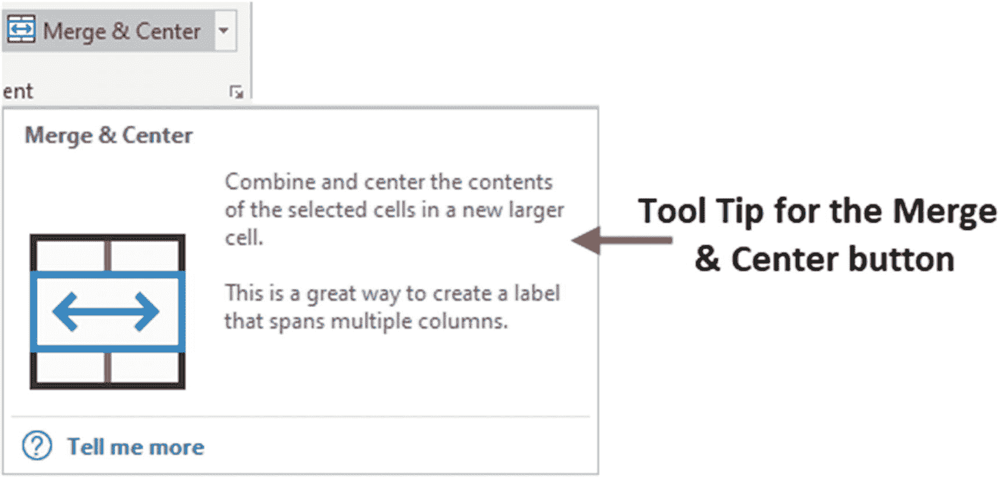

图 1-29

**合并后居中**按钮的屏幕提示

### Excel 的“告诉我你想要做什么”功能

此功能是 Office 2016 新增的。在 Word 和 PowerPoint 中也能找到它。它位于功能区选项卡区域。单击该文本框时，会显示你最近的操作请求。你可以选择其中一个请求，也可以开始在文本框中输入。Excel 会根据你已输入的字符显示可用的功能。

假设我需要帮助创建图表。我首先在文本框中输入一个 `C`。你可能在想，为什么图 1-30 中的列表显示的项目并不都是以 `C` 开头的？原因是 `数学与三角函数`、`其他` 和 `财务` 是公式组，其中有些公式以 `C` 开头。`从模板新建` 出现是因为某些模板以 `C` 开头。我可以输入更多文本来精炼列表中显示的内容。

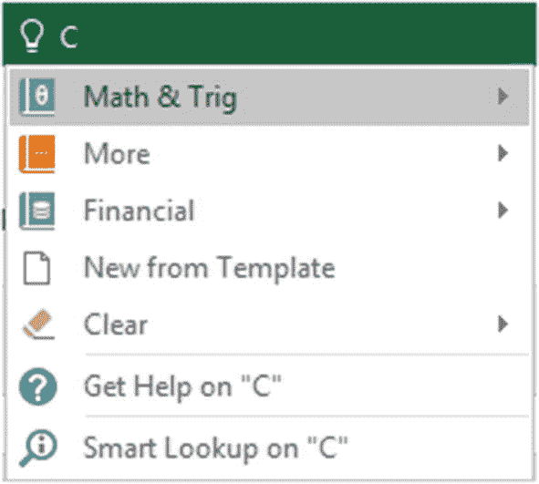

图 1-30  
“告诉我你想要做什么”功能的建议选择

当我输完单词“Chart”后，列表已变为与图表相关的项目。见图 1-31。

如果已选择了某个数据区域，如图 1-32 所示，那么当我单击图 1-31 中的 `创建图表` 时，会显示一个“插入图表”窗口，如图 1-33 所示，我可以从中选择想要的图表。

如果我在单击 `创建图表` 时没有选择任何数据，则会收到一条关于如何创建图表的提示消息。

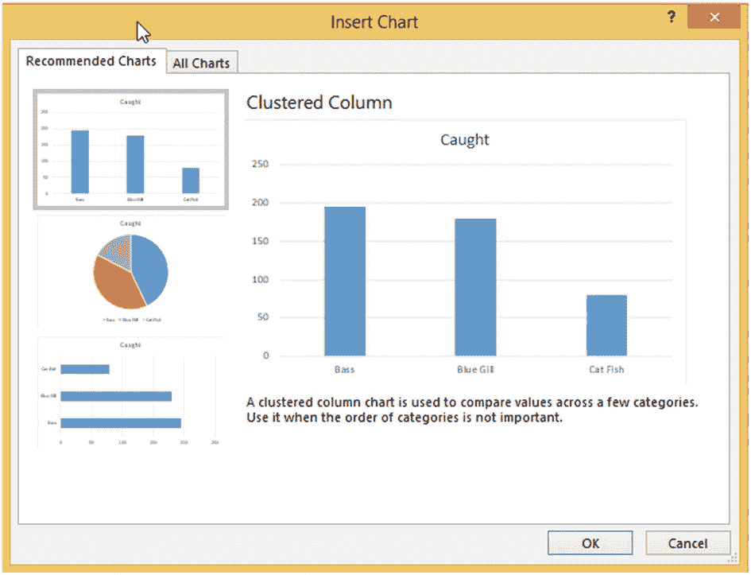

图 1-33  
“插入图表”窗口

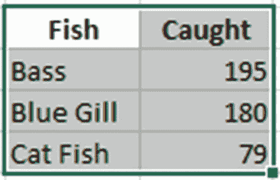

图 1-32  
在“告诉我你想要做什么”功能中输入单词 Chart 之前选择的数据

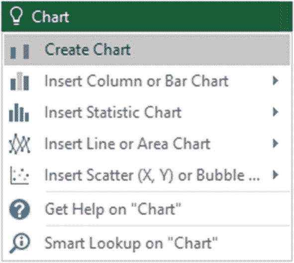

图 1-31  
在“告诉我你想要做什么”功能中输入单词 Chart 后提供的建议

图 1-31 中列表的最后一项是 `对“Chart”进行智能查找`。单击 `智能查找` 会对你在文本框中输入的内容执行互联网搜索。

你还可以使用 `智能查找` 搜索已在单元格中输入的文字，方法是右键单击该单元格并选择 `智能查找`。图 1-34 显示了从包含文本 `mammoth` 的单元格中选择 `智能查找` 后的结果。有两个选项卡：`探索`（默认显示）和 `定义`。单击 `定义` 会显示该词的起源及其各种含义，如图 1-35 所示。

图 1-35  
单词 Mammoth 的起源及其各种含义

图 1-34  
对单词 Mammoth 使用智能查找的结果

### “帮助”选项卡

Excel 的最新更新包含一个专门用于帮助和支持的选项卡。你还可以向 Microsoft 提供反馈，告诉他们你喜欢什么、不喜欢什么以及对改进 Excel 的建议。“帮助”选项卡只包含一个组。如图 1-36 所示。

图 1-36  
“帮助”选项卡

#### 新增功能

单击 `新增功能` 按钮会向 Office 365 用户展示 Excel 中新增的最新功能。见图 1-37。

图 1-37  
新增功能

#### 显示培训

`显示培训` 选项会显示一系列培训类别。见图 1-38。

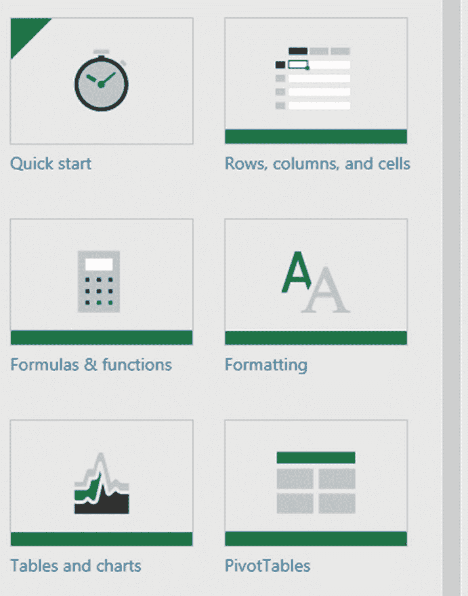

图 1-38  
培训选项

当你单击某个类别时，会看到该类别下帮助主题的列表。单击 `快速入门` 类别会显示如图 1-39 所示的主题。单击其中任何一个主题，即可获得该主题的帮助。

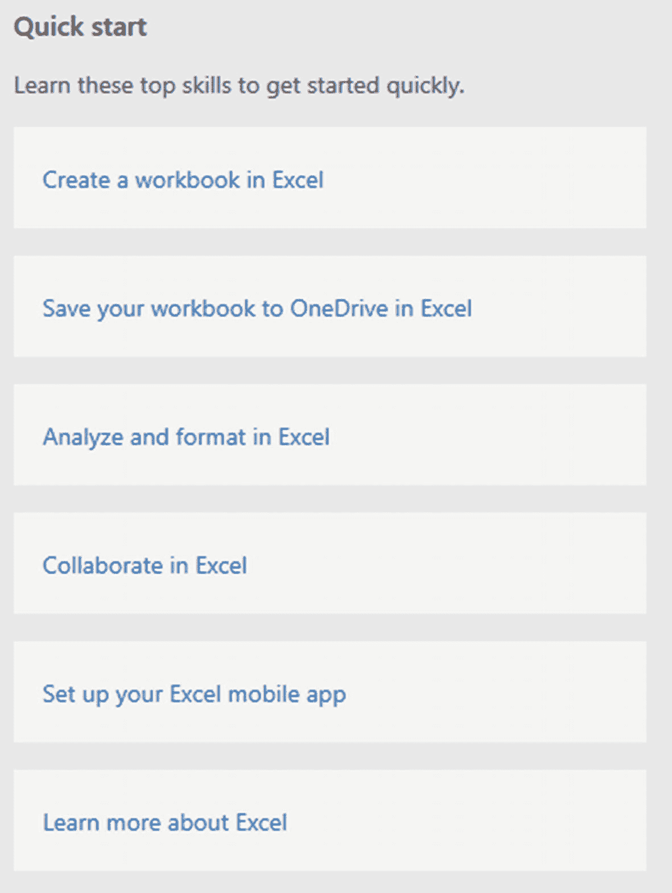

图 1-39  
快速入门主题

#### 联系支持人员

`联系支持人员` 选项会弹出一个文本框，你可以在其中输入遇到的问题。输入问题后单击 `获取帮助` 按钮，会显示一些自助解决方案供你尝试。如果这仍然没有解决你的问题，你可以单击窗口底部的 `实时聊天` 获取 Microsoft 支持人员的帮助。见图 1-40。

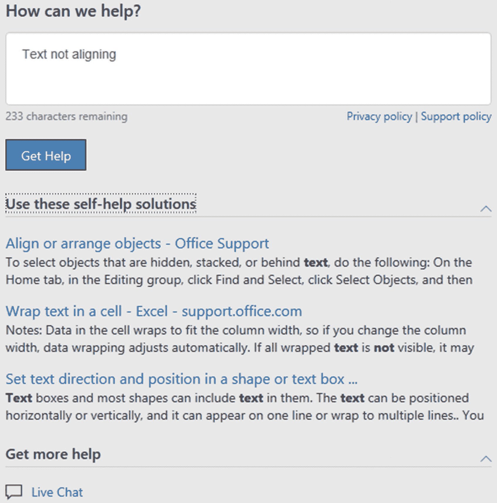

图 1-40  
联系支持人员

#### 帮助

在“帮助”选项卡上单击 `帮助` 按钮，提供了选择帮助主题或输入搜索主题的另一种方式。见图 1-41。

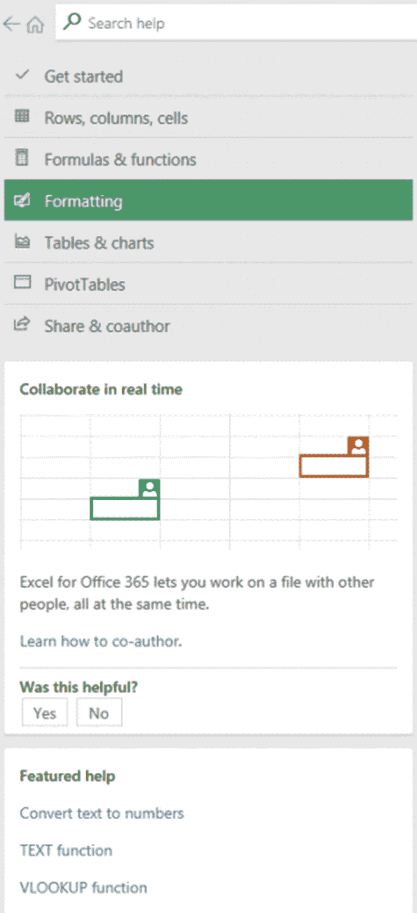

图 1-41  
帮助

## 总结

你已经学会了如何创建、保存和打开工作表，以及如何使用功能区。你还练习了自定义功能区以及创建快速访问工具栏以满足特定需求。这些是开始使用 Excel 强大功能所需的基本技能。Excel 拥有丰富的帮助功能。它提供了多种途径来获取同一个帮助主题。你可以就任何主题向 Excel 寻求帮助。屏幕提示和“告诉我你想要做什么”功能是 Excel 中最方便的两种帮助功能。你可以在处理工作表时，获得关于格式化和输入数据等问题的直观帮助。智能查找让你无需离开工作表即可使用互联网资源。你可以使用“帮助”选项卡上的任何附加功能来获取更多帮助或 Microsoft 支持。在第 2 章中，你将练习在工作表中移动。你将学习有用的快捷键，帮助你高效、轻松地在工作表中移动，减少在重复性任务上花费的时间。

