# 8. Excel 的预置函数

本章涵盖了一些最常用的函数，这些函数允许你执行诸如仅在满足特定条件时对值求和、根据条件是否为真执行某些操作、确定日期之间的天数、获取当前日期和时间等操作。你将学习如何手动输入函数或使用`函数`向导。

阅读并完成本章后，你应该能够：
- 创建嵌套函数
- 使用`函数`向导
- 计算两个日期之间的天数
- 根据零个条件、一个条件或多个条件对一系列值求和
- 从日期中获取月份、日或年
- 根据条件为真或假显示不同的值
- 根据你设置的条件获取最高或最低值
- 获取当前日期和时间并在公式中使用它们

## Excel 的内置函数

Excel 拥有超过 450 个预定义的内置公式，这些公式被称为函数。你不仅限于使用这些函数，还可以创建自己的函数。每个函数都有唯一的名称。函数按类别分组。函数类别位于`公式`选项卡的`函数库`组中。点击`其他函数`按钮可以找到更多类别。参见图 8-1。

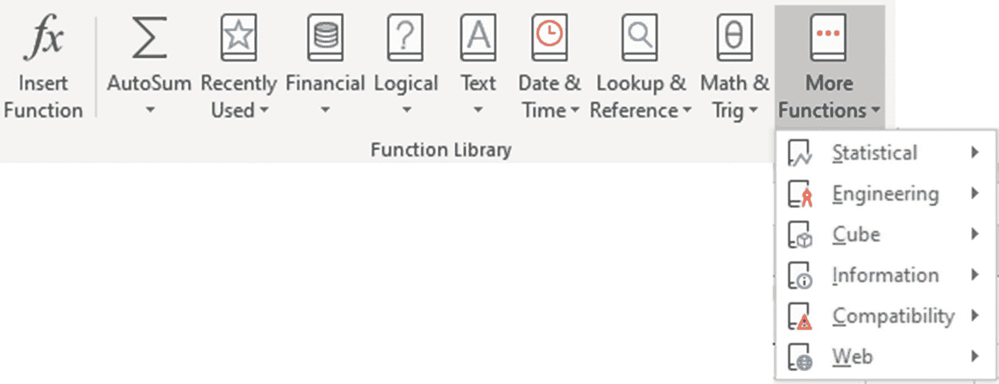

图 8-1 Excel 函数按类别分组

表 8-1 描述了主要的预置函数。

表 8-1 函数类别及其描述

| 函数类别 | 函数描述 |
| --- | --- |
| `自动求和` | `自动求和`下拉箭头显示“自动”函数。这些与我们之前查看的函数完全相同，它们位于`开始`选项卡的`编辑`组中。这些函数可以返回一个单元格区域的总和、平均值、计数、最大值和最小值。 |
| `兼容性` | 这些是为与早期版本的 Excel 兼容而保留的函数。这些函数都已被更新的函数取代，因此除非你需要向后兼容，否则不应使用它们。 |
| `多维数据集` | 这些函数返回数据库中使用的多维数据集分析的值。 |
| `日期与时间` | 用于处理日、日期和时间的函数。 |
| `工程` | 用于工程计算的函数。 |
| `财务` | 用于处理贷款、投资、利息、折旧、未来值等的函数。 |
| `信息` | 用于帮助你确定单元格中存在的数据类型的函数。 |
| `逻辑` | 逻辑函数主要用于比较，其结果将为`真`或`假`。 |
| `查找与引用` | Excel 的`查找与引用`函数可用于简化在列表或数据表中查找值或查找单元格的引用。 |
| `数学与三角函数` | 用于执行简单和复杂数学计算的函数。 |
| `统计` | 对数据范围执行统计分析的函数。 |
| `文本` | 处理文本字符串的函数。 |
| ` Web ` | 从 Web 服务获取数据的函数。 |

`最近使用的`按钮实际上不是一个类别。它显示你最近使用过的最后十个函数。这提供了一种快速跳转到你可能最常用的一些函数的方法。

## 函数构造

每个类别由与其类别相关的独立函数组成。图 8-2 显示了一些`逻辑`函数。

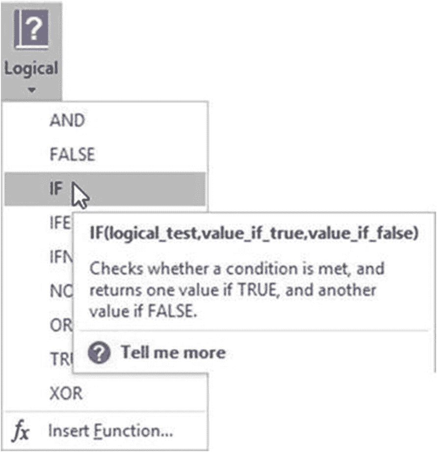

图 8-2 逻辑函数

将光标移到函数上会显示一个工具提示。该工具提示提供了函数的描述及其语法。每个函数都有其特定的语法。语法是函数在单元格中如何显示的规则。函数通常包含参数。参数是传递给函数进行运算的值。`IF`函数有三个参数（`logical_test`、`value_if_true`和`value_if_false`）。参数之间始终用逗号分隔。你需要为参数输入值或单元格地址。点击`告诉我更多`将提供更多帮助。

`IF`函数的一个示例是`=IF(C3>25000,C3*6%,C3*5%)`。`IF`函数将在本章后面得到完整解释。现在我们已经了解了函数的创建方式，接下来我们将介绍你最可能经常使用的函数。

## 对值求和的函数

有三个对单元格值求和的函数。表 8-2 描述了它们。

表 8-2 求和函数描述

| 函数 | 描述 |
| --- | --- |
| `SUM` | 对一系列值求和，而不测试任何条件。 |
| `SUMIF` | 用于对满足你指定条件的值求和。 |
| `SUMIFS` | 仅在满足多个条件时对值求和。 |

### SUM 函数

我们将了解`SUM`函数是如何构建的。`SUM`函数是数学与三角函数之一。`SUM`函数用于对一组值进行求和，是最常用的函数。`SUM`函数应该对你来说并不陌生，因为当你使用自动求和时，实际上就是在运行`SUM`函数。

`SUM`函数的语法是：

```
=SUM(number1, [number2], [number3]...)
```

函数名称通常以全部大写字母书写；但函数名并不区分大小写。你可以用小写字母输入函数名称。如果用`小写字母`输入函数，Excel 会将其自动转换为大写。

函数名称后面跟着一对括号。如果函数需要参数，则参数放在括号内。`SUM`函数具有参数`number1`、`number2`和`number3`。参数`number2`和`number3`放在方括号内。放在方括号内的参数是`可选参数`。最后一个参数后面的三个点（省略号）表示参数列表并未结束。你可以在`SUM`函数的括号内放置任意数量的参数。

在输入函数时，Excel 提供了很大的帮助。正如我们在第 7 章中看到的，在单元格中输入函数时，首先输入一个`=`号，后跟函数名称。当你键入函数名称的字母时，Excel 会根据你已输入的字母逐步缩小函数的选择范围。请参见图 8-3。

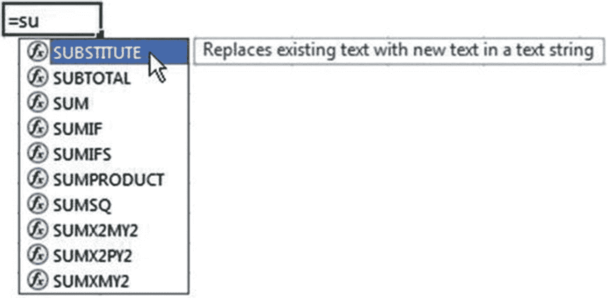

图 8-3 当你输入函数名称的字母时，Excel 会帮助你找到以这些字母开头的函数。

点击某个函数名称会弹出该函数功能的描述。

当你输入了足够的字符，将函数范围缩小到你想要的那个时，按 Tab 键。Excel 会在函数名称后放置一个左括号，并弹出一个工具提示来帮助你输入函数。工具提示中第一个参数会被高亮显示。请参见图 8-4。

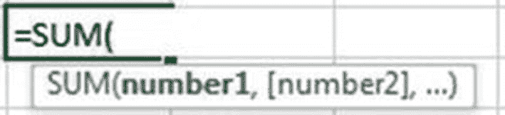

图 8-4 第一个参数被高亮显示。

输入第一个参数和一个逗号（在此示例中为`23,`）后，工具提示中的第二个参数变为高亮显示，并且会显示第三个参数选项。请参见图 8-5。

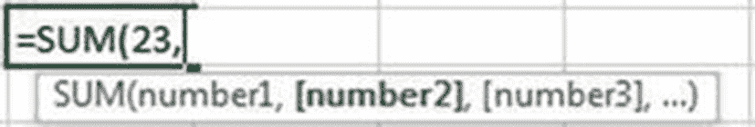

图 8-5 第二个参数被高亮显示。

每次你输入一个参数，工具提示中就会增加一个额外的参数。请参见图 8-6。

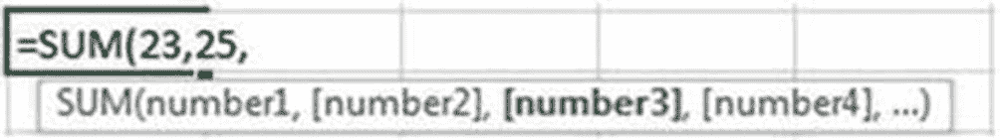

图 8-6 工具提示中增加了一个额外参数。

如果你需要修改已输入的某个参数，请点击工具提示中的该参数。这将会选中函数中的该参数，然后你就可以进行修改。请参见图 8-7。

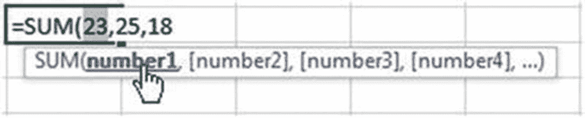

图 8-7 点击工具提示中的参数以选中函数中的该参数。

你不需要在最后一个参数后输入逗号。也不一定要输入右括号。当你确认输入时，Excel 会自动为你输入右括号。函数返回的结果会显示在你输入函数的单元格中。完整的函数会显示在编辑栏中。请参见图 8-8。

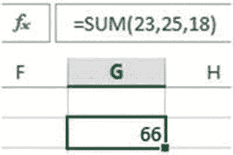

图 8-8 函数的结果显示在单元格中。该单元格的公式显示在编辑栏中。

公式中输入的单值称为常量。`常量`是一个不会更改的值。

参数入口不必像我们在`SUM`函数中输入的那样都是单个值。`SUM`函数也可以使用区域名称、单个单元格引用和单元格区域作为其参数。每个参数可以输入什么内容取决于所使用的函数。表 8-3 展示了几个使用不同参数的`SUM`函数示例。

表 8-3 使用不同参数的 SUM 函数

| 函数 | 说明 |
| --- | --- |
| `=SUM(3,5,8)` | 将单个值 3、5 和 8 相加，结果为 16。 |
| `=SUM(销售额)` | 将名为`销售额`的区域中的值相加。 |
| `=SUM(B3:B9)` | 将区域`B3`到`B9`中的值相加。 |

# Excel 函数应用指南：求和与条件求和

如果你想对一个名为 `采购` 的不同工作表中区域 `C5` 到 `C10` 的单元格求和，可以按图 8-9 所示输入公式。

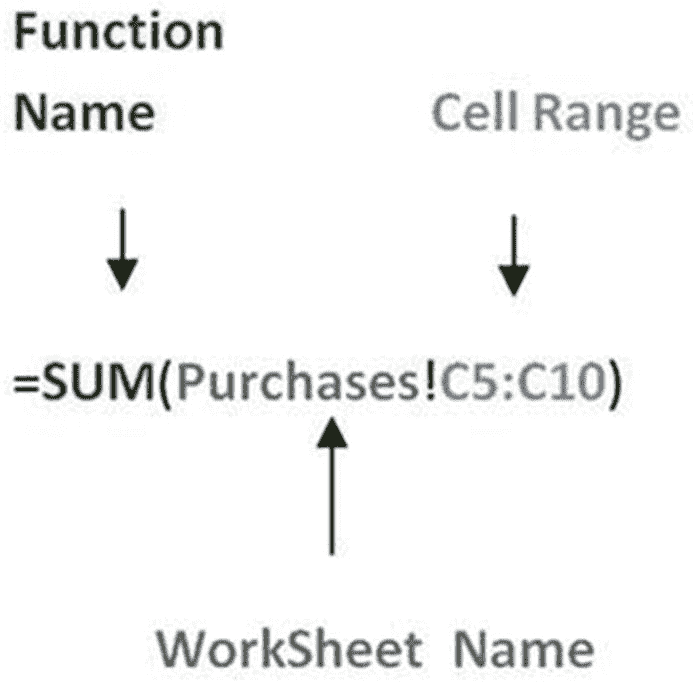

*图 8-9：使用 `SUM` 函数对不同工作表中的区域求和。*

你可以键入 `采购!`，或者点击名为 `采购` 的工作表，Excel 会自动将工作表名称和感叹号一起输入到公式中。

如果你只想对 C 列中的值进行求和，那么可以使用快捷方式 `C:C`。公式可以写为 `=SUM(采购!C:C)`。

## 使用插入函数选项

正如我们在第 7 章中所讨论的，单击函数库组中的“插入函数”按钮会弹出“插入函数”对话框。请参见图 8-10。

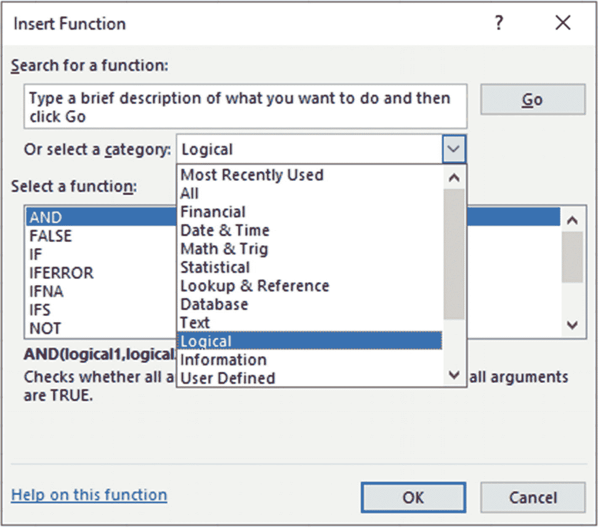

图 8-10 插入函数对话框

单击“或选择类别”列表框的下拉箭头，会弹出与函数库组中相同的类别列表。这里唯一的额外类别是“全部”类别。如果你不知道想使用的函数属于哪个类别，单击“全部”类别会以字母顺序列出所有类别中的所有函数。当你单击不同函数时，每个函数的语法和描述会随之显示。

使用“插入函数”选项的一个主要原因在于它的搜索功能。你可以在搜索文本框中输入对所需函数功能的描述，然后点击“转到”按钮。Excel 会提供一个可能满足你需求的函数列表。（在 Excel 2019 中，“插入函数”的搜索功能不如 Excel 2016 中好用。希望微软能修复这个问题。）在图 8-11 中，输入了“add numbers”进行搜索。Excel 返回了一个符合该条件的函数列表。接下来需要由你决定列表中哪个函数最符合需求。

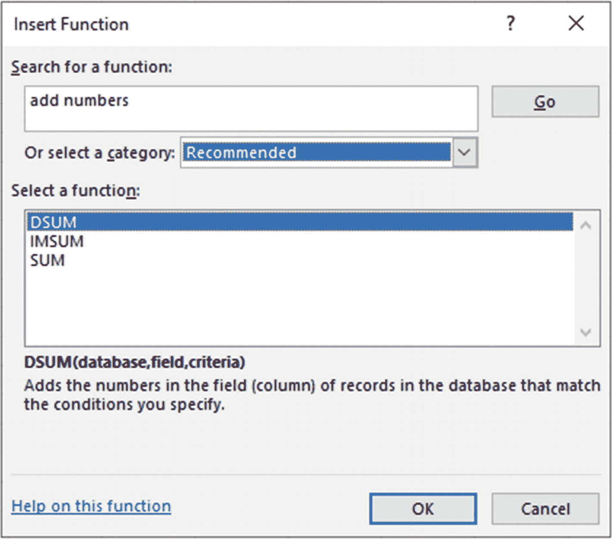

图 8-11 在“搜索函数”文本框中输入你想要执行的操作，然后 Excel 会尝试找到一个满足你需求的函数

## 练习 8-1：使用 SUM 函数

我们将使用 `SUM` 函数对三列数字进行求和。

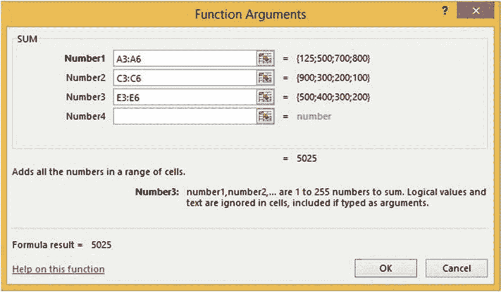

图 8-16 已添加了更多参数。前三个参数已添加完毕，结果为 5025

1.  创建一个新工作簿。将图 8-12 中的数据输入到工作表中。将工作表命名为“Sum”。

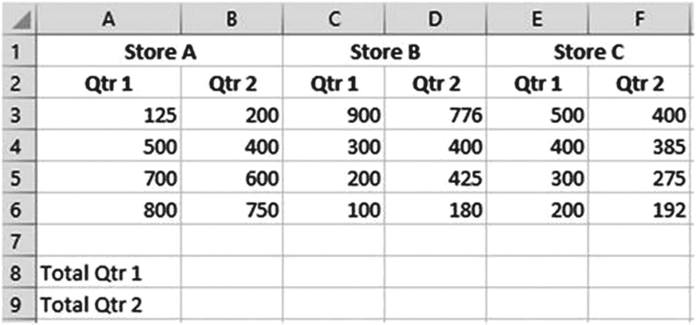

图 8-12 按此格式在工作表中输入数据

结果将放入单元格 `B8` 中。

2.  单击单元格 `B8` 内部。在“公式”选项卡的“函数库”组中，单击“插入函数”按钮。
3.  在“搜索函数”框中输入 `add numbers`。按 Enter 键或单击“转到”按钮。在“选择函数”列表框中单击 `SUM`。单击“确定”按钮。
4.  “函数参数”对话框打开。如果对话框遮挡了工作表中的数字，请将其移开。每个必需参数都会出现一个输入框。单击 `Number1` 框内部。必需参数以粗体显示。`Number1` 是 `SUM` 函数唯一的必需参数。请参见图 8-13。

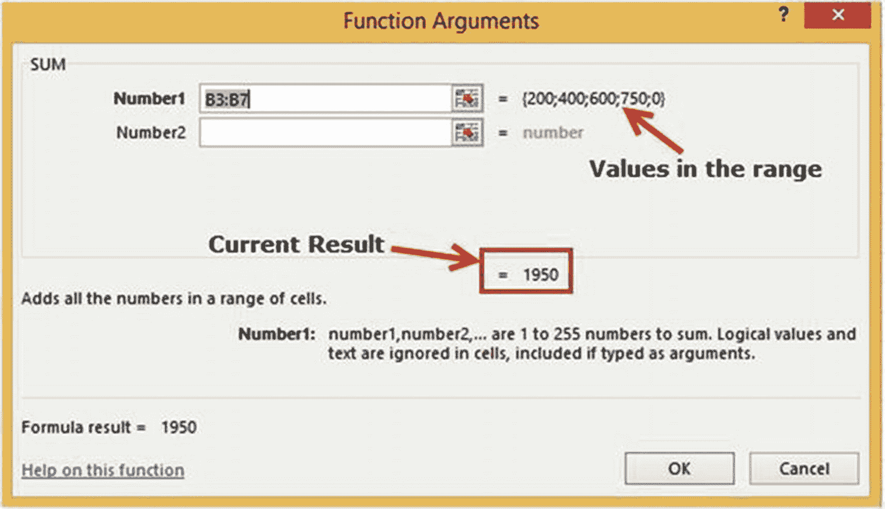

图 8-13 Excel 假设你想对单元格区域 `B3:B7` 求和，并自动为第一个参数输入了该区域

参数 `Number1` 包含区域 `B3:B7`，因为它尝试对其上方的值进行求和。正在求和的值显示在 `Number1` 框的右侧。其中包含单元格 `B7` 的 0。这不会影响当前的总和，正如你所见，当前总和为 1950。
5.  拖动鼠标选中单元格 `A3:A6`。该区域的值以及当前总和都会显示出来。请参见图 8-14。

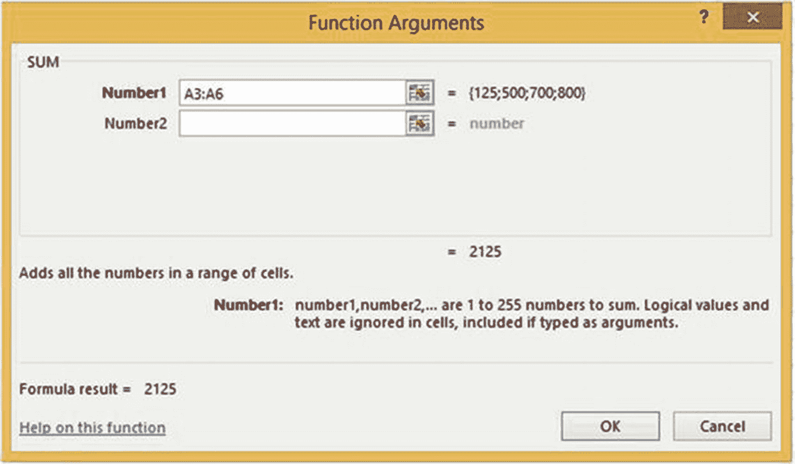

图 8-14 Excel 对区域 `A3:A6` 中的值进行求和

6.  当对话框遮挡了需要使用的数据时，可以使用折叠对话框按钮来折叠窗口。单击 `Number2` 框内部。单击 `Number2` 框右侧的按钮。窗口会折叠成仅显示当前参数的一个框。拖动鼠标选中单元格 `C3:C6`。请参见图 8-15。完成选择后，单击展开对话框按钮，将窗口展开回原状。


图 8-15 折叠后的窗口

7.  `Number3` 参数已添加到窗口中。单击 `Number3` 框内部。`Number4` 参数已添加。拖动鼠标选中单元格 `E3:E6`。图 8-16 显示了结果。单击“确定”按钮。

使用相同的步骤，看看你是否能得到单元格 `B9` 的答案。

你已经学会了如何对单个区域或多个区域中的所有值同时求和。如果你只想对区域中部分值（例如费用）求和，但仅限于娱乐费用，该怎么办？你将在下一节中了解如何实现。

## SUMIF——对满足指定条件的单元格求和

`SUMIF` 函数用于对满足 `criteria` 参数中指定条件的值区域进行求和。`SUMIF` 函数仅在基于单个条件进行求和时有效。如果需要基于多个条件进行求和，则需要使用 `SUMIFS` 函数，这将在下一节中介绍。

`SUMIF` 函数的语法如下：

```
SUMIF(range, criteria, [sum_range])
```

参数说明：

*   `range` – 作为条件判断依据的单元格区域。该区域包含将由条件进行检查的值，以确定它们是否包含在求和中。
*   `criteria` – 值要包含在求和中必须满足的条件。如果条件包含任何文本、逻辑或数学符号，则必须用双引号括起来。如果条件只是数字，则无需使用引号。
*   `[sum_range]` – 可选参数。如果使用了此可选区域，则将对该区域中的单元格进行求和，而不是对第一个参数中的区域进行求和。条件判断仍将基于第一个区域参数。

### 使用必要参数的 `SUMIF` 函数

图 8-17 包含一系列需要求和的值，但我们只想对其值大于 900 的项目求和。在 `B1:B6` 范围内，只有两个值大于 900：1100 和 1500。

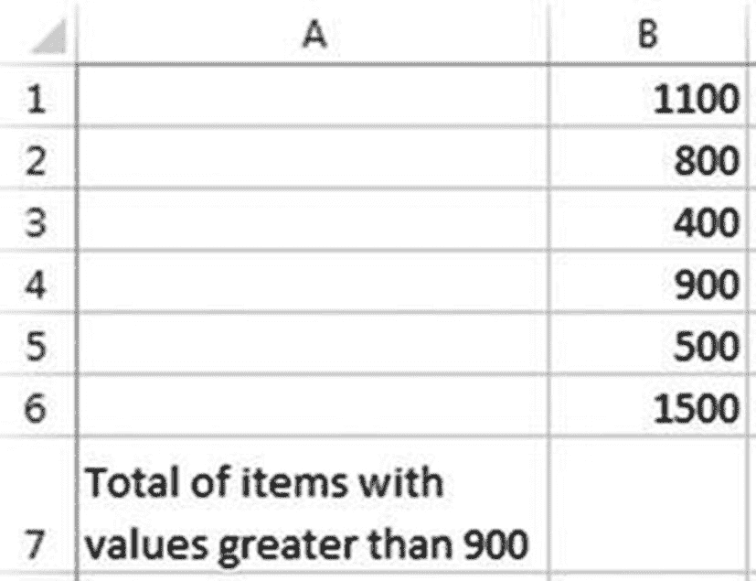

图 8-17 将求和大于 900 的值

用于求和大于 900 值的公式中使用的参数是：

*   `B1:B6` 是条件所依据的值范围。
*   `">900"` 是条件。由于条件包含的不仅仅是数字，因此必须用双引号括起来。

完整公式为 `=SUMIF(B1:B6,">900")`。我们将此公式放在单元格 `B7` 中。两个大于 900 的数字（1100 + 1500）相加的结果是 2600。参见图 8-18。

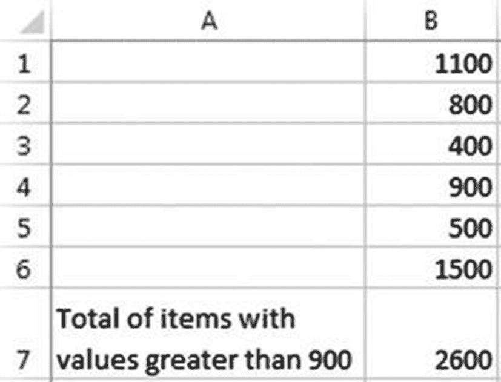

图 8-18 `SUMIF` 函数的结果

图 8-19 显示了一个项目列表及其价格。我们只想对价格恰好为 99 美分的项目求和。输入到单元格 `B10` 的公式是 `=SUMIF(B2:B8,0.99)`。由于我们只对那些恰好为 `.99` 的值求和，因此不需要任何额外的逻辑符号，因为等号是可选的。由于条件只是一个数字，因此无需将其放在双引号内。

# 图 8-19 — 四个 **.99** 价格的总和

## 使用可选的 `sum_range` 参数

当使用可选的 `sum_range` 参数时，你的条件基于与要求和的单元格不同的单元格范围。

我们想求一所高中男生和女生的总人数。图 8-20 显示了此工作表。该工作表使用单独的公式来确定男生和女生的人数。用于确定男生人数的公式中使用的参数是：

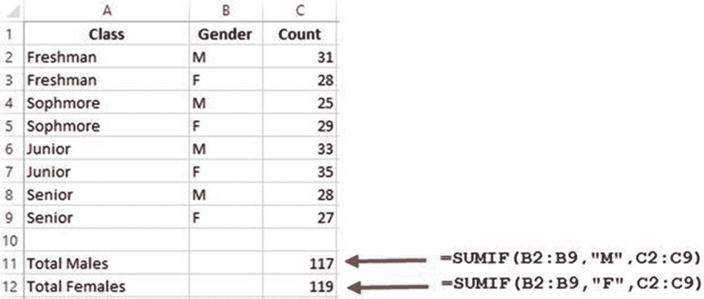

图 8-20 — `SUMIF` 函数的结果

- `B2:B9` 是条件所依据的**范围**。

- `"M"` 是**条件**。

- `C2:C9` 是 **sum_range**。它是满足条件时将被求和的单元格范围。

在单元格 `C11` 中输入的公式是：

```
=SUMIF(B2:B9,"M",C2:C9)
```

用于计算女生人数的公式唯一区别在于条件是 `"F"`。在单元格 `C12` 中输入的公式是：

```
=SUMIF(B2:B9,"F",C2:C9)
```

## `SUMIFS` — 对满足多个条件的单元格求和

`SUMIFS` 函数与 `SUMIF` 函数类似，区别在于 `SUMIFS` 函数用于在满足多个条件（而非单个条件）时对值求和。

`SUMIFS` 函数的语法是：

```
SUMIFS(sum_range, criteria_range1, criteria1, [criteria_range2, criteria2], . . .)
```

参数说明如下：

- `sum_range` 是你要对其应用条件的单元格。该范围包含将由条件检查以确定是否将其纳入求和的值。

- `criteria_range1` 是用于评估关联条件的第一个范围。

- `criteria1` 是定义 `criteria_range1` 参数中哪些单元格将被添加的条件。

- `Criteria_range2, Criteria2,...` 你可以添加多达 126 个附加范围及其关联条件。

图 8-21 显示了一家公司的银行存款及其各分支机构每笔存款的日期。我们想对 **B** 列中的银行存款求和，但前提是满足以下条件：

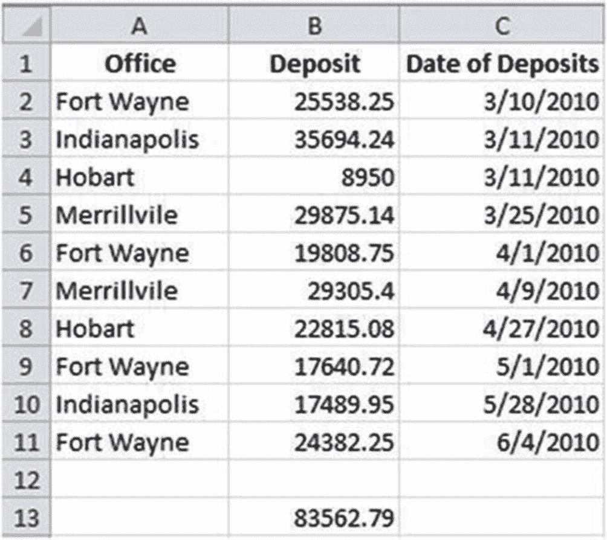

图 8-21 — `SUMIFS` 函数的结果

- 不是霍巴特办事处。

- 存款金额必须至少为 20,000。

- 存款日期必须为 03/12/2010 或之后。

将添加符合我们条件的存款的公式是：

```
=SUMIFS(B2:B11,A2:A11,"Hobart",B2:B11,">=20000",C2:C11,">=03/01/2010")
```

用于求和银行存款的公式中使用的参数如下：

- `B2:B11` 是 `sum_range`。此范围包含如果满足条件我们想要求的值。

我们只想要不是霍巴特的分支机构。

- `A2:A11` 是 `criteria_range1`。

- `"<>Hobart"` 是 `criteria1`。（`<>` 表示不等于。）

存款金额必须至少为 20,000。

- `B2:B11` 是 `criteria_range2`。

- `">=20000"` 是 `criteria2`。（`>=` 表示大于或等于。）

存款日期必须是 3/12/2010 或之后。

- `C2:C11` 是 `criteria_range3`。

- `">=03/12/2010"` 是 `criteria3`。

图 8-22 突出显示了满足所有条件的行。这些是唯一满足所有三个条件的存款：(1) 不是霍巴特分行，(2) 存款大于或等于 20000，(3) 存款日期在 3/12/2010 或之后。这三行存款相加的结果是 83562.79。

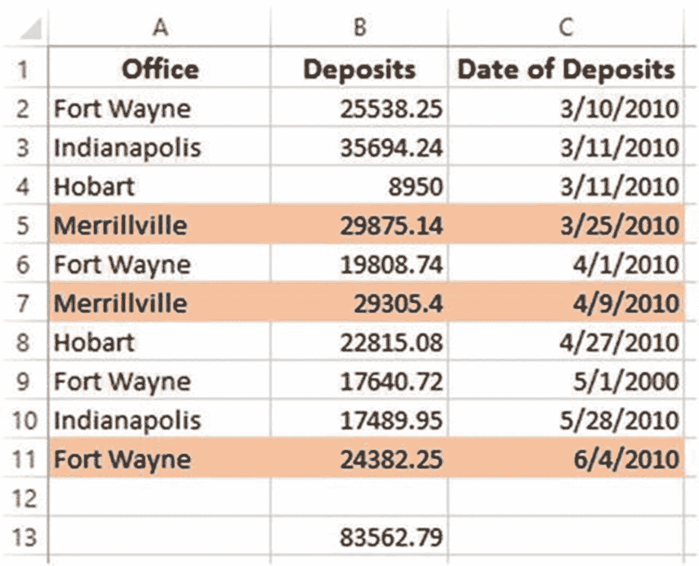

图 8-22 — 满足 `SUMIFS` 条件的行被突出显示

### 为条件使用单元格地址而非单元格值

如果你正在检查某个项目是否等于条件范围中的一个值，你可以指定包含该项目值的单元格地址作为条件。在图 8-23 中，我们想对在韦恩堡参加 Excel 课程的学员进行求和。单元格 `E2` 和 `F2` 可用于条件，因为它们包含要对照条件范围检查的值。

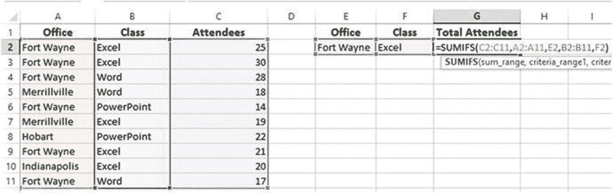

图 8-23 — `SUMIFS` 的条件在单元格 `E2` 和 `F2` 中

图 8-24 显示了在单元格 `G2` 中输入的公式。

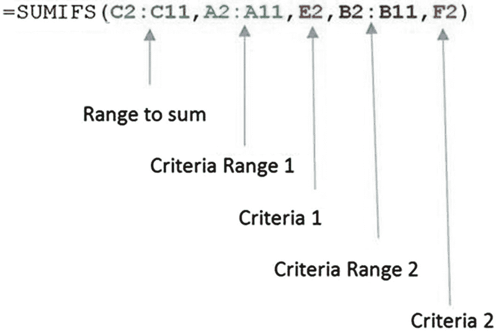

图 8-24 — 分解 `SUMIFS` 公式

### 在 `SUMIFS` 函数中处理空单元格

图 8-25 中的工作表对已完成但尚未发货的项目的值进行汇总。将用于 `SUMIFS` 参数的两个条件是：完成日期不为空且发货日期为空的那些项目。该图突出显示了同时满足这两个条件的项目。

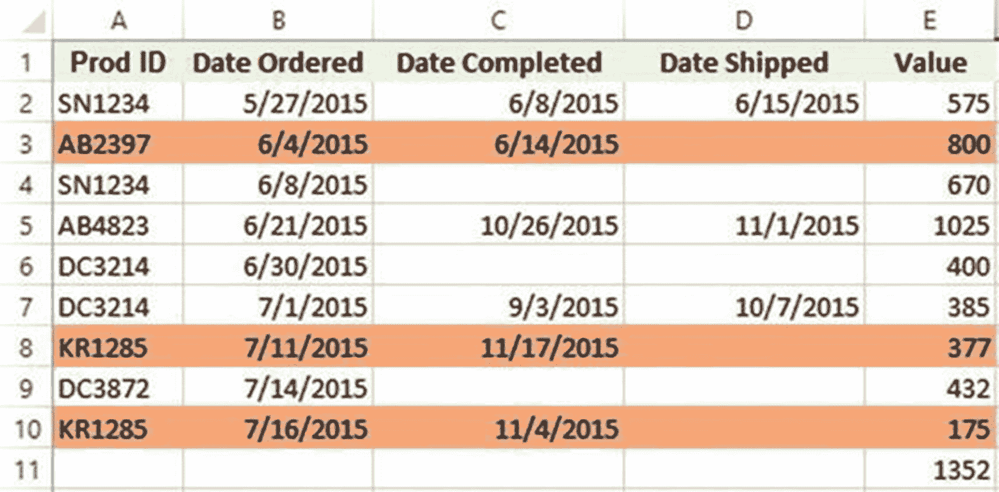

图 8-25 — 项目已完成但未发货的行被突出显示

条件如下：

- 完成日期单元格的条件是 `"<>"`（`<>` 表示不为空）。

- 发货日期的条件是 `""`（两个引号放在一起测试是否为空）。

在单元格 `E11` 中输入的公式是 `=SUMIFS(E2:E10,C2:C10,"<>",D2:D10,"")`。

> 注意：当测试条件范围是否为空时，单元格必须确实是空单元格，而不能是公式无结果返回的结果。

## IF — 根据条件为真或假返回不同的值

`IF` 函数根据条件为真或假返回不同的值。

`IF` 函数的语法为：

```
IF(logical_test , [value_if_true], [value_if_false])
```

参数说明如下：

- `logical_test`：被测试的条件。

- `[value_if_true]`：如果条件为真，则执行此步骤。

- `[value_if_false]`：如果条件为假，则执行此步骤。

如果被测试的条件为真，则使用 `value_if_true` 参数中的值；否则，使用 `value_if_false` 参数中的值。

假设单元格 `A2` 中的值为 20。如果你在单元格 `A1` 中输入以下公式：

```
=IF(A2=20,"Equal 20","Not equal 20")
```

那么单元格 `A1` 将显示 "Equal 20"。如果你将单元格 `A2` 的值改为 19，则单元格 `A1` 的值将变为 "Not equal 20"。

### 练习 8-2：使用 IF 函数

我们需要计算每位员工的总工资。如果员工工作时间超过 40 小时，他将获得正常工资 1.5 倍的加班费。总工资将通过将员工的常规工资和加班费相加来计算。

将使用一个 `IF` 函数来计算员工的常规工资；另一个 `IF` 函数将用于计算其加班费。

如果员工工作 40 小时或更少，他的常规工资和总工资将是工作小时数乘以工资率。

如果员工工作 40 小时或更多，则他的常规工资将是 40 小时乘以工资率。员工超过 40 小时的工作时间将用于计算加班费。如果我们为范围命名，计算常规工资所需的公式为 `=IF(hours>40, 40*rate, hours*rate)`。

如果条件（`hours > 40`）为真，我们取 **40 * rate**；如果条件为假，则取 **hours * rate**。

要计算加班费，我们再次需要测试工作时间是否大于 40。如果工作时间大于 40，我们需要将工作小时数减去 40 得到加班小时数。加班小时数将乘以工资率再乘以 1.5。如果工作小时数为 40 或更少，则加班费为 0。

图 8-26 显示了计算加班费的公式。


图 8-26：加班费计算公式

# 格式化 Excel 数据与函数

## 更改列格式与公式输入

我们需要更改"常规工资"、"加班费"和"总工资"列，使其显示两位小数。我们还希望加班费显示为短横线而不是零。将单元格格式设置为"会计"类型可以实现这一点：

1.  选择单元格`D2:F8`。
2.  右键单击单元格，然后选择"设置单元格格式"。
3.  选择"数字"选项卡。
4.  在"分类"中选择"会计"。单击"符号"的下拉箭头，然后选择"无"。
5.  单击"确定"按钮。图 8-31 显示了结果。

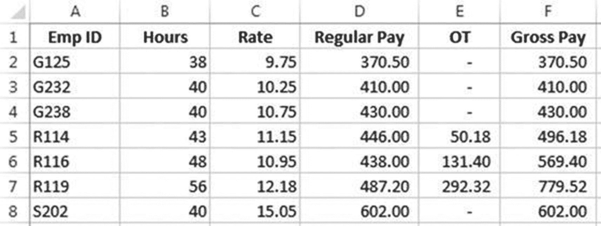
*图 8-31：将范围 D2:F8 格式化为会计格式的结果*

1.  在单元格`D2`中输入此公式：`=IF(hours >=40,40*rate,hours*rate)`。按`Tab`键。
2.  在单元格`E2`中输入此公式：`=IF(hours > 40,(hours - 40)*rate* 1.5,0)`。按`Tab`键。
3.  在单元格`F2`中输入此公式：`=Regular_Pay+OT`。按`Enter`键。
4.  选择范围`D2:F2`。向下拖动自动填充手柄至第 8 行。图 8-30 显示了结果。

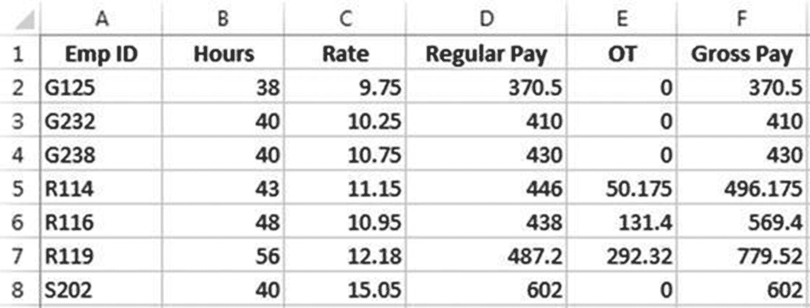
*图 8-30：使用自动填充手柄复制公式的结果*

1.  在功能区中，单击"公式"选项卡。在"定义的名称"组中，单击"根据所选内容创建"按钮。在"从选定区域创建名称"对话框中，选择"首行"。见图 8-29。

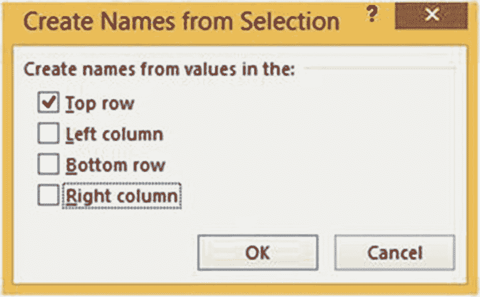
*图 8-29：在"从选定区域创建名称"对话框中选择"首行"*

1.  选择范围`B1:E8`，如图 8-28 所示。

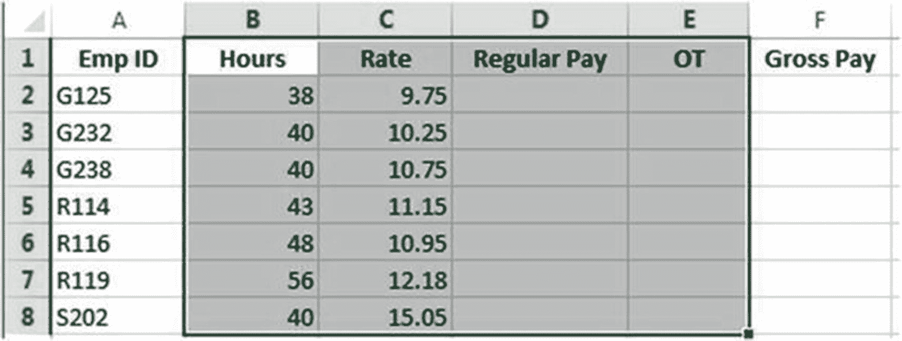
*图 8-28：选择范围 B1:E8*

1.  在新工作表中输入图 8-27 中的数据。将工作表命名为"Payroll"。

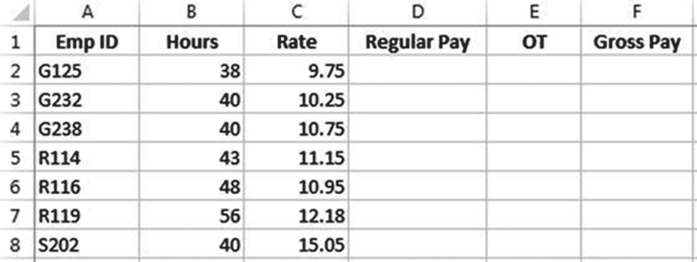
*图 8-27：在名为 Payroll 的新工作表中输入此数据*

你已经使用`IF`语句来测试条件；如果条件为真，函数执行一个操作；如果条件为假，则执行另一个操作。接下来，你将了解`AND`函数，然后是`OR`函数。这些函数单独使用时作用不大，它们只返回`TRUE`或`FALSE`。它们的强大之处在于与其他函数结合使用时。`OR`函数之后的练习演示了如何在`IF`函数中组合这些函数。

## AND — 如果所有参数都为真，则返回 TRUE

`AND`函数返回`TRUE`或`FALSE`。如果其所有参数都为真，则返回`TRUE`；如果任何一个参数不为真，则返回`FALSE`。

`AND`函数的语法为：

```
AND(logical1, [logical2], . . .)
```

`AND`函数可用于评估最多 255 个逻辑条件。

图 8-32 显示了包含三个逻辑条件的`AND`函数。所有这三个条件都为真；因此，函数返回`TRUE`。

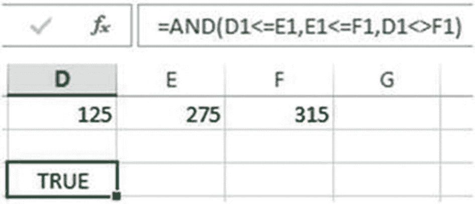
*图 8-32：测试三个条件的 AND 函数*

图 8-33 中的最后一个条件为假。单元格`D1`中的值不等于单元格`F1`中的值。因此，`AND`函数返回`FALSE`，因为即使只有一个逻辑条件为假，它也会返回`FALSE`。

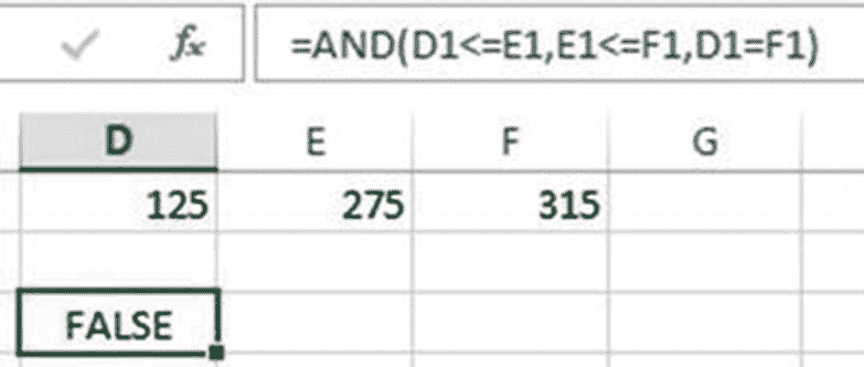
*图 8-33：第三个条件为假，返回假*

## OR — 如果任一参数为真，则返回 TRUE

`OR`函数如果其任何参数为真，则返回`TRUE`；如果其所有参数都为假，则返回`FALSE`。

`OR`函数的语法为：

```
OR(logical1,[logical2],...)
```

图 8-34 显示了包含三个逻辑条件的`OR`函数。所有这三个条件都为假。当且仅当所有参数都为假时，`OR`函数才返回`FALSE`。

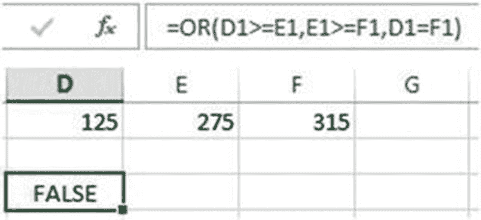
*图 8-34：所有条件都为假，因此 OR 函数返回 FALSE*

图 8-35 中的第一个逻辑条件为真。单元格`D1`中的值小于单元格`E1`中的值。其他条件为假。`OR`函数返回`TRUE`，因为即使只有一个逻辑条件为真，该函数也会返回`TRUE`。

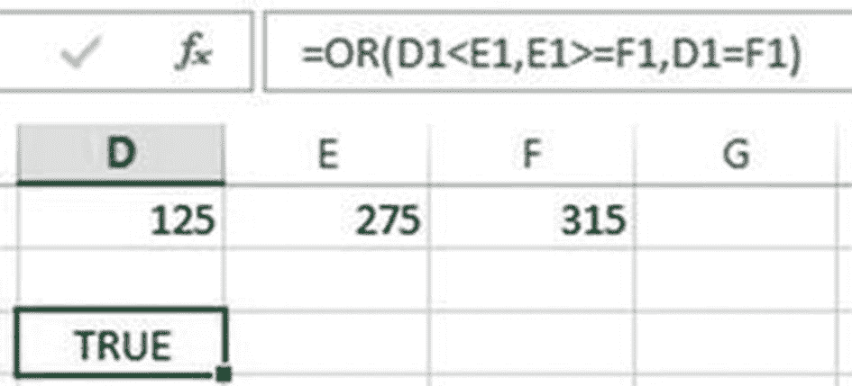
*图 8-35：只有第一个条件为真；因此 OR 函数返回 TRUE*

## 嵌套函数

有时，单个函数无法满足你的需求。在这种情况下，你需要创建嵌套函数。嵌套函数将两个或多个函数的操作合并到单个函数中。嵌套函数作为另一个函数的参数使用。Excel 允许最多嵌套 64 个函数。这应该远超你的实际需求。

### 练习 8-3：创建嵌套函数

在本练习中，你将创建嵌套了不同运算符的函数。

#### 在 IF 函数中嵌套 AND 函数

1.  单击“取消”按钮。
2.  按`Ctrl + Enter`接受公式。单元格`D2`为空。
3.  使用自动填充柄将公式从`D2`复制到`D11`。
4.  单击“取消”按钮。
5.  如果你只想查看或更改`AND`函数，可以单击单词`AND`，然后单击功能区上的“公式”选项卡。在“函数库”组中，单击“插入函数”按钮。见图 8-41。你可以看到，该范围内的第一个单元格的“年龄”不小于 21。

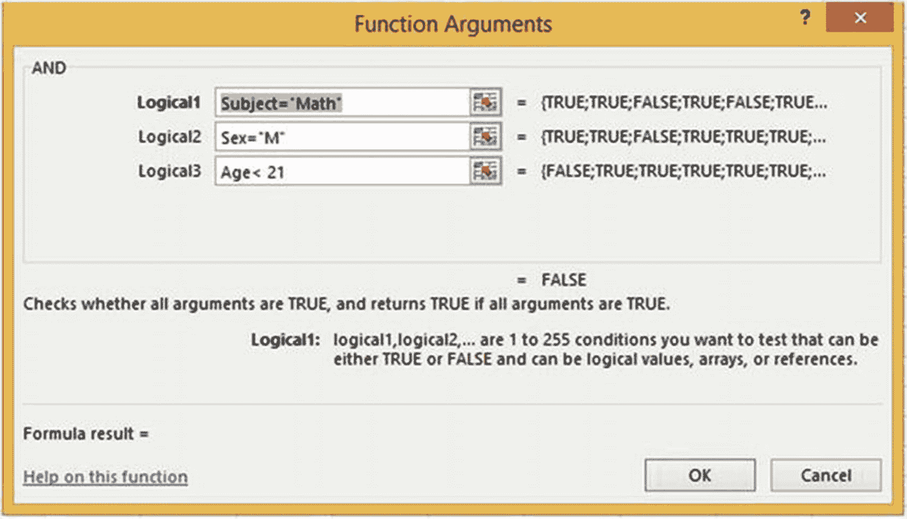
*图 8-41：显示每个单元格的逻辑参数结果*

6.  为“真值”参数输入`"A",`。为“假值”参数输入`"")`。这将显示为空白。完整的公式是`=IF(AND(Subject="Math",Sex="M",Age<21),"A","")`。如果你没有为“假值”部分输入`""`，Excel 会默认显示单词`False`。
7.  如果你想查看或更改公式，可以单击单词`IF`，然后单击“插入函数”按钮（“公式”选项卡 ➤ “函数库”）。你可以看到`AND`条件为假；因此，我们的结果是空白的。见图 8-40。

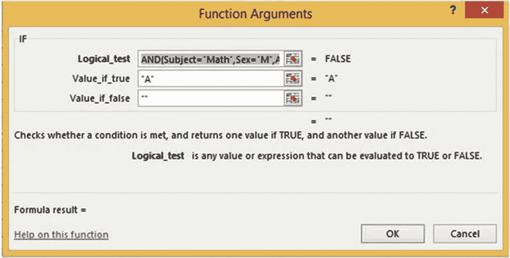
*图 8-40：“函数参数”对话框显示“逻辑测试”的结果*

8.  按`F3`弹出区域名称。选择“性别”，然后单击“确定”按钮。
9.  输入`="M",`。现在的公式应该是`=IF(AND(Subject="Math",Sex="M",`。
10. 按`F3`弹出区域名称。选择“年龄”，然后单击“确定”按钮。
11. 输入`<21),`。现在的公式应该是`=IF(AND(Subject="Math",Sex="M",Age<21),`。`AND`函数已完成，现在你回到了`IF`函数，准备为参数`[value_if_true]`输入数据。见图 8-39。

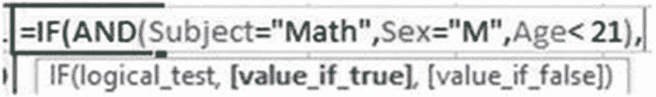
*图 8-39：AND 函数已完成；`[value_if_true]` 已高亮显示，提示你现在应为 IF 函数输入此参数*

12. 现在我们将输入要测试的三个条件中的第一个：
    1.  按`F3`弹出区域名称。选择“科目”，然后单击“确定”按钮。
13. 输入`="Math"`后跟一个逗号。输入逗号会高亮显示第二个参数`[logical2]`。见图 8-38。

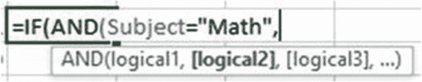

图 8-38：在函数中输入逗号会高亮显示工具提示中的下一个参数

14. 选择单元格区域 `A1:C11`。在功能区“公式”选项卡的“定义的名称”组中，单击“从所选内容创建”。在“从所选内容创建名称”窗口中，仅选中“首行”。单击“确定”按钮。

15. 单击名称框的下拉箭头以查看你的已命名区域。

16. 单击单元格 `D2` 内部。通过输入 `=IF(AND(` 开始公式。Excel 工具提示显示 `AND` 函数所需的参数。见图 8-37。

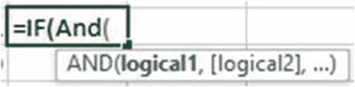

图 8-37：AND 函数的工具提示

17. 将图 8-36 中的数据输入到工作表中。将工作表命名为“Nested”。

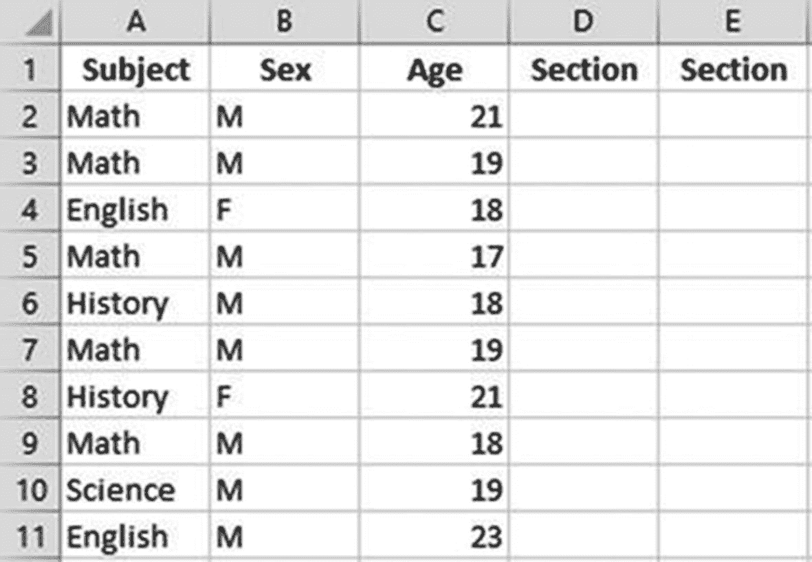

图 8-36：在名为 Nested 的工作表中输入此数据

数学专业、男性且年龄小于 21 岁的学生将被分入 A 部。此问题需要使用嵌套在 `IF` 函数中的 `AND` 函数。`AND` 函数将是待测试的条件。如果条件为真，我们将在单元格中显示 A。如果条件为假，我们将显示空白。

#### 在 IF 函数中嵌套 OR 函数

让我们创建另一个 `IF` 函数，但这次我们将在其中嵌套一个 `OR` 函数，用于测试学生是否为女性或年龄是否为 21 岁及以上。如果学生满足其中任一条件，他/她将被分入 B 部。

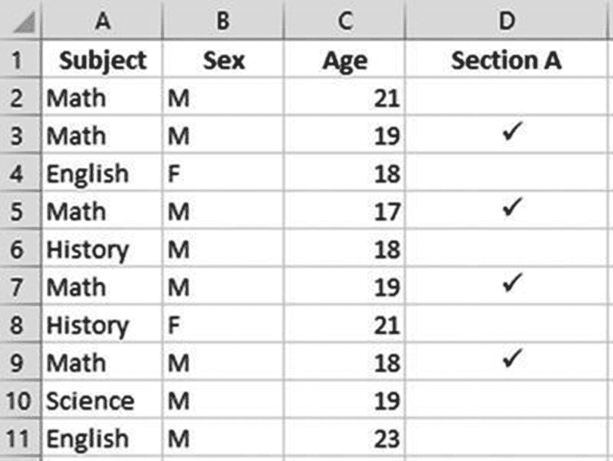

图 8-43：使用 Wingdings 字体创建对勾标记

1.  删除 E 列。

2.  将单元格 `D1` 中的文本更改为“A 部”。

3.  单击单元格 `D2`。在公式栏中，选择 `IF` 公式真值部分的 `A`。

4.  按住 `Alt` 键，然后在数字小键盘上输入 `0252`。公式应为 `=IF(AND(Subject="Math",Sex="M",Age<21),"ü","")`。

5.  选择单元格 `D2` 上的自动填充柄，并将其向下拖动到单元格 `D11`。

6.  选中区域 `D2:D11` 后，将字体类型更改为 Wingdings。图 8-43 显示了结果。

7.  在单元格 `E2` 中，输入公式 `=IF(OR(`。

8.  按 `F3` 弹出区域名称。选择“性别”，然后单击“确定”按钮。

9.  输入 `Sex = "F",`。

10. 按 `F3` 弹出区域名称。选择“年龄”，然后单击“确定”按钮。

11. 输入 `Age >= 21),`。函数现在是 `=IF(OR(Sex="F",Age>=21),`。`OR` 函数已完成，现在你回到了 `IF` 函数，准备为参数 `[value_if_true]` 输入数据。

12. 输入 `"B","")`。完整的公式是 `=IF(OR(Sex="F",Age>=21),"B","")`。

13. 与嵌套 `AND` 函数一样，单击公式中的单词 `IF`，然后单击“插入函数”或单击公式中的单词 `OR`，会在“函数参数”窗口中显示该部分公式。

14. 使用自动填充柄将公式从 `E2` 复制到 `E11`。选择单元格区域 `B2:E11`。将选定区域的数据居中。图 8-42 显示了结果。

让我们对应用程序进行一项更改：如果学生满足男性、历史专业且年龄在 21 岁以下的条件，则在 D 列中放置一个对勾标记。对勾标记是 Wingding 字体集的一部分。按住 `Alt` 键，然后在数字小键盘上输入 `0252` 即可创建对勾标记（仅在使用数字小键盘时有效）。然后必须为该单元格选择 Wingding 字体。

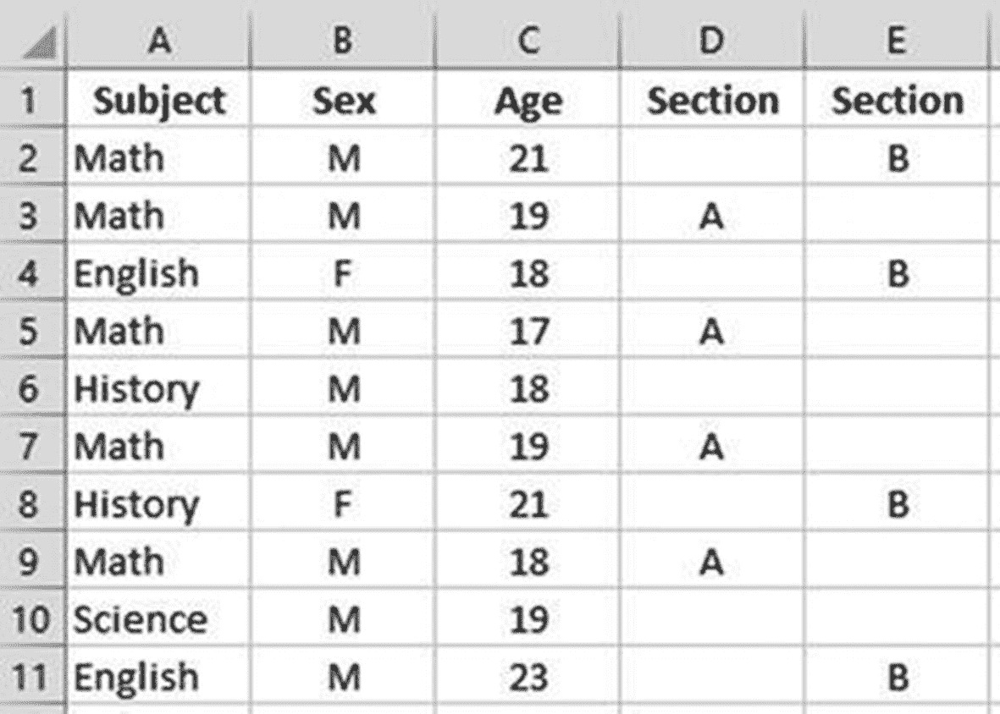

图 8-42：区域 `B2:E11` 在单元格中居中

你已经创建了嵌套的 `AND` 和 `OR` 函数。你几乎可以将任何函数嵌套在另一个函数内。这使你的函数具有更大的灵活性。

## Excel 2019 新函数

Excel 2019 引入了 `IFS`、`MAXIFS` 和 `MINIFS` 函数。

我们已了解了 `IF` 函数和嵌套函数。在 Excel 2019 之前，在 `IF` 语句中嵌套 `IF` 语句会创建一个很长且可能非常复杂的函数。Excel 2019 的新 `IFS` 函数允许你执行相同的功能，而无需使用嵌套。

### IFS——基于条件返回值

`IFS` 函数的语法如下：

```
IFS(逻辑测试 1, 值为真时返回的结果, [逻辑测试 2, 值为真时返回的结果], ...)
```

现在我们有一些测试分数，需要为其评定等级。分数 90 或以上为 A，80 或以上为 B，70 或以上为 C，60 或以上为 D，低于 60 为 F。请参见图 8-44。

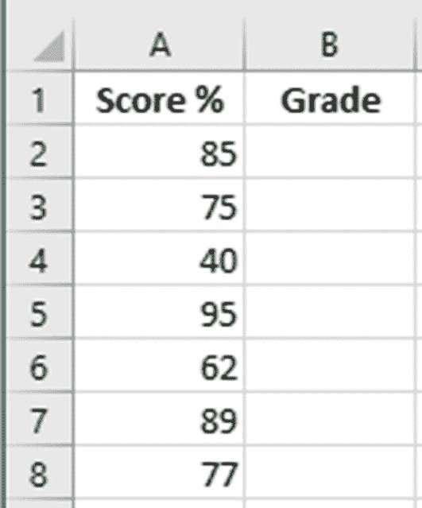

图 8-44：需要为测试分数查找等级

现在，我们使用功能区“公式”选项卡上“函数库”组中的“插入函数”命令来输入此函数。

首先在单元格 `B2` 中输入 `=IFS(` 来启动函数。在功能区的“公式”选项卡上，单击“插入函数”命令。系统会为我们的函数添加右括号 `)`，并打开 `IFS` 函数的“函数参数”窗口。参见图 8-45。

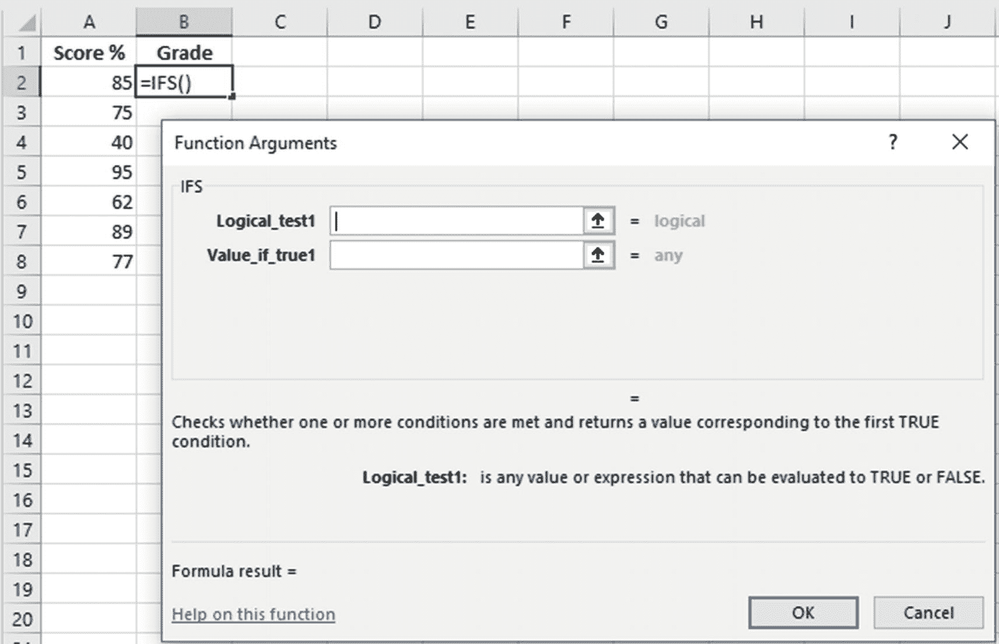

图 8-45：在“函数参数”窗口中打开 IFS 函数

第一个逻辑测试将是 `A2 >= 90`。对于该逻辑测试，我们希望返回的值是 A。这个 A 需要放在引号内。任何非数值的内容都应使用引号括起来。输入第一个测试的数据后，Excel 会显示下一个条目的文本框。你应该按 `Tab` 键进入下一个条目。如果按 `Enter` 键，窗口将关闭，当前输入的内容将成为你的函数。请注意逻辑测试右侧显示的 `FALSE`。参见图 8-46。这表明 Excel 告诉你单元格 `B2` 不符合该逻辑测试的条件。

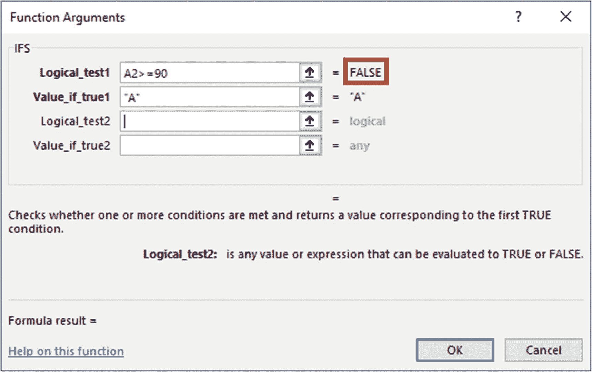

图 8-46：为第一个逻辑测试输入参数

第二个逻辑测试及其关联值已在图 8-47 中输入。请注意第二个逻辑测试右侧显示的 `TRUE`。Excel 告诉我们单元格 `B2` 中的值满足逻辑测试 2 的条件。我们将为此函数输入的其他逻辑测试结果也均为 True，但 `IFS` 函数会将第一个为 True 的逻辑测试所对应的值插入到单元格中。在窗口底部，你可以看到该函数的结果将是 B。已添加滚动条，以便我们可以继续添加新的测试。

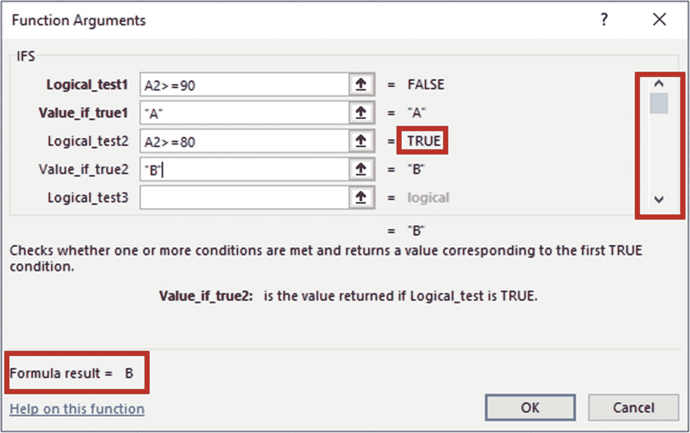

图 8-47：为第二个逻辑测试输入参数

输入其余测试和值并按 `Enter` 键后的结果显示在图 8-48 中。

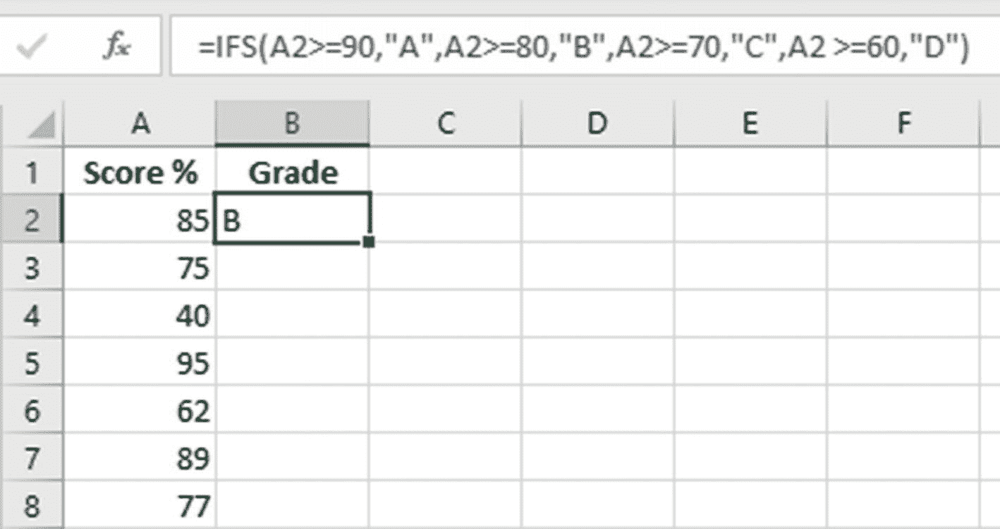

图 8-48：第一个分数的结果

双击自动填充句柄可填充其他等级。参见图 8-49。分数为 40 时出现 `#N/A` 错误。此分数未满足任何测试条件。这是因为我们没有测试分数低于 60 的条件。

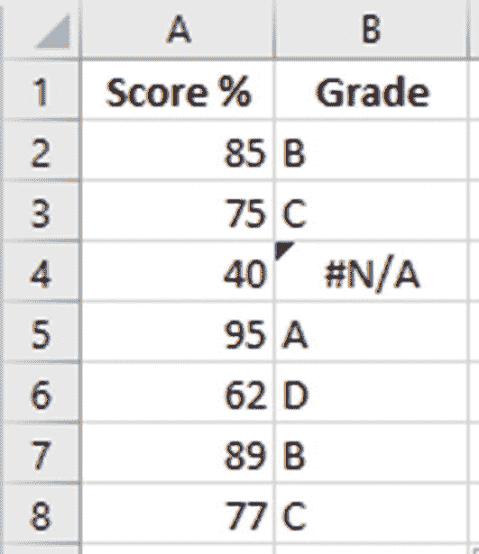

图 8-49：使用自动填充句柄后的结果

单击单元格 `B2`，然后再次单击“插入函数”命令，可在“函数参数”窗口中重新打开该函数。现在，我们可以输入针对分数低于 60 的测试，并为其分配值 F。参见图 8-50。

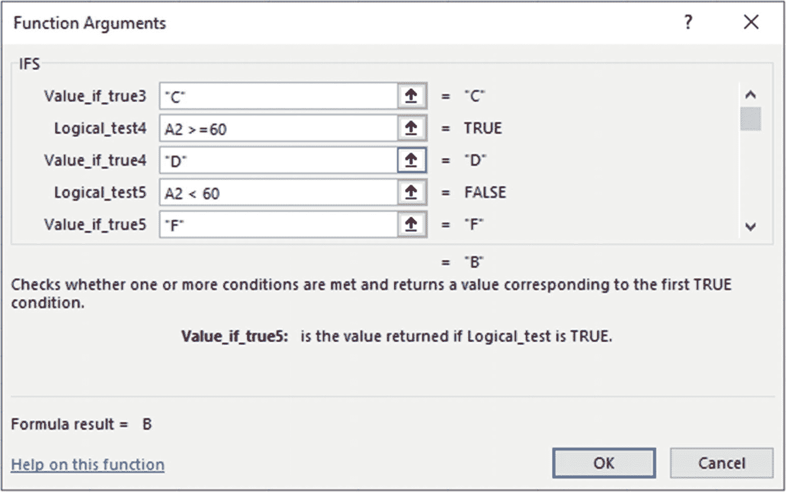

图 8-50

# IFS 函数的高级应用

现在，当我们从单元格`B2`向下拖动自动填充句柄时，可以看到分数 40 已被分配为 F 等级。参见图 8-51。


图 8-51：使用`IFS`函数计算出的等级

我们也可以通过为最后一个测试输入`TRUE`来获得相同的结果。

```
=IFS(A2>=90,"A",A2>=80,"B",A2>=70,"C",A2 >=60,"D",TRUE,"F")
```

如果没有满足任何测试条件，将最后一个测试设为`TRUE`会使与此测试关联的值成为默认值。

我们再来看一个`IFS`函数。我们的工厂根据员工生产的零件数量支付报酬。我们想根据员工产生的废品数量来奖励或惩罚他们。图 8-52 显示了生产数量、废品数量以及废品率。我们将根据废品率对生产数量进行加减，并将结果放入 E 列。

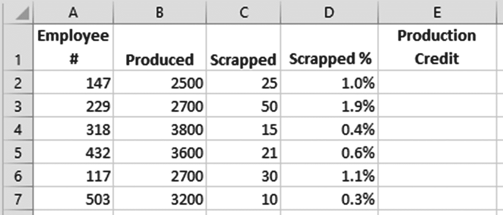
图 8-52：用于计算生产信用的电子表格

表 8-4 显示了根据员工产生的废品数量，将从其生产数量中增加或扣除的额度。

表 8-4：从员工生产数量中增加或扣除的额度

| 废品率 | 生产数量调整值 |
| --- | --- |
| <= 0.5% | + 300 |
| <= 1% | + 150 |
| <= 1.5% | 0 |
| 高于 1.5% | – 300 |

因为`IFS`函数使用第一个为`TRUE`的逻辑测试，所以我们不必担心`<= 1%`这一条件也会包含`<= 0.5%`。一旦满足某个逻辑测试的条件，`IFS`函数会忽略之后的所有内容。

让我们为废品率创建一个命名区域，以便在函数中使用。请记住，一种方法是单击单元格`D2`，然后双击自动填充句柄以选中该列中的其他单元格，接着在名称框中输入`Scrapped`，并按 Enter 键。

现在，我们可以在单元格`E2`中开始输入公式，先键入`=IFS(`，然后单击功能区“公式”选项卡上的“插入函数”命令。

图 8-53 显示了最初的输入内容。在 Logical_test1 右侧，可以看到第三行和第六行满足了第一个测试的条件。在窗口底部，可以看到单元格`E2`的结果将是 2650。

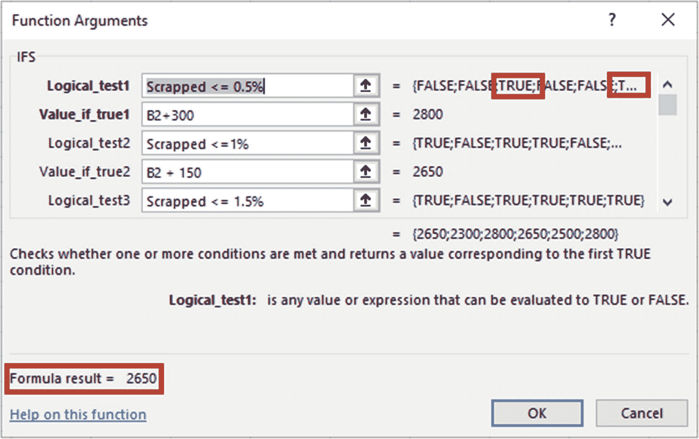
图 8-53：IFS 函数的参数

完整的函数是：

```
=IFS(Scrapped <= 0.5%,B2+300,Scrapped <=1%,B2 + 150,Scrapped <= 1.5%,B2,TRUE,B2 - 200)
```

最后一个测试使用了`TRUE`，使得对于那些未在任何其他逻辑测试中评估为真的值，其默认值为`B2 – 200`。在此示例中，1.9% 将使用默认值，因为它未在任何逻辑测试中评估为真。

结果如图 8-54 所示。

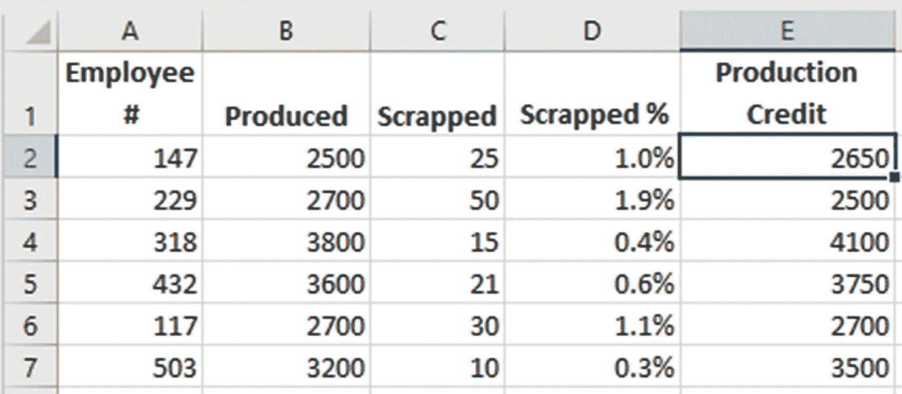
图 8-54：生产信用的结果

## MAXIFS 和 MINIFS——基于条件返回最高值或最低值

在第 7 章中，我们使用自动计算工具`MAX`和`MIN`来查找某个值范围内的最高值和最低值。`MAXIFS`和`MINIFS`的功能与此相同，区别在于我们可以添加条件，以确定该范围内的哪些值将用于确定最大值和最小值。

`MAXIFS`函数返回由一组给定条件或条件集指定的单元格中的最大值。

`MAXIFS`函数的语法如下：

```
=MAXIFS(max_range, criteria_range1, criteria1, [criteria_range2, criteria2], ...)
```

参数说明如下：

*   `max_range`是用于设定条件的单元格。此范围包含的值将由条件进行检查，以确定它们是否用于计算最大值。
*   `criteria_range1`是用于评估相关条件的第一个区域。
*   `criteria1`是由数字、表达式或文本定义的条件，用于确定哪些单元格将被评估为最大值。
*   `criteria_range2`, `criteria2`,... 最多可以添加 126 个额外的区域及其相关条件。

我们将创建一个仅需要单个条件的`MAXIFS`和`MINIFS`函数。练习 8-4 将让你练习使用多个条件。

我们要找出三个产品类别（电视、音响和家电）的最高和最低销售额。请参阅图 8-55。


图 8-55：用于确定最高和最低销售额的工作表

我们将通过在单元格`F2`中输入`=MAXIFS(`来开始我们的函数，如图 8-56 所示。


图 8-56：开始使用`MAXIFS`函数

此时会显示该函数的工具提示。第一个需要输入的是`max_range`。这是我们将从中获取最大值的值范围。点击单元格`C2`，然后按`Shift + Enter`选择此区域。另外两个产品以及`MINIFS`函数也将使用相同的区域，因此我们希望锁定此区域。按`F4`键。现在添加一个逗号，进入下一个选项`criteria_range1`。这是我们设定条件的区域。点击单元格`A2`，然后按`Shift + Enter`选择此区域。按`F4`键将区域设为绝对引用。请参阅图 8-57。


图 8-57：将`max_range`和`criteria_range1`设为绝对单元格引用

现在我们可以输入逗号，然后点击单元格`E2`，因为这是我们的条件。我们在`E`前面加上美元符号（$），但不在`2`前面加（混合单元格引用），这样当我们向下复制公式时，列保持不变，而行会发生变化。请参阅图 8-58。


图 8-58：将`criteria1`设为混合单元格引用

按`Ctrl + Enter`，然后双击自动填充手柄，以获取三个类别的结果。请参阅图 8-59。


图 8-59：`MAXIFS`函数的结果

单元格`F3`中的公式是：

```
=MAXIFS($C$2:$C$19,$A$2:$A$19,$E3)
```

列`E`保持不变，但行调整为`3`，因此对于该行，我们的条件是音响。

现在我们可以使用`MAXIFS`函数的副本来创建`MINIFS`函数。我们将复制单元格`F2`中的函数，然后将其粘贴到单元格`G2`中。在公式栏中，将`MAXIFS`更改为`MINIFS`：

```
=MINIFS($C$2:$C$19,$A$2:$A$19,$E2)
```

按`Ctrl + Enter`，然后双击自动填充手柄，以获取三个类别的结果。如图 8-60 所示，第 13 行是电视机的最高销售额，第 9 行是电视机的最低销售额。


图 8-60：`MAXIFS`和`MINIFS`函数的结果

**练习 8-4：使用`MAXIFS`和`MINIFS`函数**

在本练习中，你将为`MAXIFS`和`MINIFS`函数使用两个条件。第一个条件是销售代表，第二个条件是产品类别。打开工作簿`Chapter8.xlsx`。请参阅图 8-61。


图 8-61：用于使用 `MAXIFS` 和 `MINIFS` 函数的电子表格


图 8-63：产品类别的第二个条件，使用混合单元格引用

1.  输入一个逗号。现在可以输入第二个条件。点击单元格 `A2`。按住 `Ctrl + Shift` 键，然后按下方向键。按 `F4` 键锁定此区域。
2.  输入一个逗号。我们想要找出 Russell Carson 的最高的电视机销售额。点击单元格 `F2`。你需要锁定列，而不是行，因此在 `F` 前面加上美元符号（`$`）。
3.  在单元格 `G2` 中输入 `=MAXIFS(`。
4.  点击单元格 `C2`。按住 `Ctrl + Shift` 键，然后按下方向键。按 `F4` 键锁定此区域。
5.  输入一个逗号。第一个条件区域是销售代表的值。点击单元格 `B2`。按住 `Ctrl + Shift` 键，然后按下方向键。按 `F4` 键锁定此区域。
6.  输入一个逗号。条件是销售代表 Russell Carson。点击单元格 `E2`。按 `F4` 键锁定此单元格。请参阅图 8-62。


图 8-62：Russell Carson 的第一个条件，使用绝对单元格引用

现在公式为：

```
=MAXIFS($C$2:$C$19,$B$2:$B$19,$E$2,$A$2:$A$19,$F2)
```

7.  点击单元格 `G2`。按 `Ctrl + C` 复制该单元格。点击单元格 `H2`。按 `Ctrl + V` 粘贴。
8.  双击单元格 `H2` 以显示公式。将 `MAXIFS` 改为 `MINIFS`。按 `Ctrl + Enter`。双击自动填充手柄向下复制函数。请参阅图 8-65。


图 8-65：`MAXIFS` 和 `MINIFS` 函数的结果

9.  按 `Ctrl + Enter`。双击自动填充手柄，将公式向下复制到音响和家电行。家电的最高销售额为零，因为 Russell Carson 没有销售任何家电。请参阅图 8-64。


图 8-64：`MAXIFS` 函数的结果

你已经学会了如何使用 `IFS` 函数，根据你指定的条件选择要输入到单元格中的值。你还学会了如何根据你指定的条件，在某个值范围内查找最高值和最低值。

接下来，你将学习处理日期相关的函数。你将了解如何获取当前日期和时间、计算两个日期之间的天数，以及通过添加或减去天数来操作日期。

## 日期函数

Excel 允许在公式中使用日期和时间。Excel 之所以能做到这一点，是因为它实际上将日期和时间存储为数字。Excel 将日期存储为序列号。序列号将 `1/1/1900` 视为日历的第一天，即第 1 天。`1900` 年 `1` 月 `2` 日为第 2 天，`1900` 年 `1` 月 `3` 日为第 3 天，依此类推。由于 Excel 将 `1/1/1900` 视为第一天，因此不能使用任何早于该日期的日期。如果使用了，Excel 会将该日期视为文本。

通过将日期和时间格式设置为“常规”，可以查看 Excel 如何处理它们。

在图 [8-66] 的示例中，`1/1/1900` 被输入到单元格 `A1` 和 `B1` 中。日期 `3/2/1010` 被输入到单元格 `A2` 和 `B2` 中。单元格 `B1` 和 `B2` 的格式被设置为“常规”。


图 8-66
`B` 列显示了 `A` 列中的日期在格式化为“常规”时的样子

单元格 `B2` 显示 `40239`，这是从 `1/1/1900` 到 `3/2/2010` 之间的天数。

Excel 将时间存储为 `0` 到 `1` 之间的值。`12:00 AM` 将被存储为 `0`，`11:59:59 PM` 将被存储为 `.9999`。

### TODAY 函数——返回当前日期

`TODAY()` 函数返回当前日期，该日期来自计算机的内部时钟。`TODAY()` 函数不使用任何参数。即使 `TODAY` 函数不使用任何参数，也必须在函数名后输入括号，以便 Excel 将其识别为函数。

`TODAY` 函数的语法为：

```
=TODAY()
```

有关示例，请参见表 [8-5]。

表 8-5
各种 `TODAY` 函数公式的说明和结果

| 公式 | 说明 | 如果今天是 `10/11/2015` 时的结果 |
| --- | --- | --- |
| `=TODAY()` | 返回当前日期。 | `10/11/2015` |
| `=TODAY() + 10` | 返回未来 10 天后的日期。 | `10/21/2015` |
| `=TODAY() – 5` | 返回 5 天前的日期。 | `10/06/2015` |

`TODAY()` 函数会在每次打开或刷新工作表时重新计算。换句话说，如果你在 `2016` 年 `5` 月 `1` 日的工作表中输入公式 `=TODAY()`，然后在 `2016` 年 `6` 月 `30` 日重新打开该工作表，日期将更新为 `06/30/2016`。可以通过将日期设为静态来阻止这种动态更新。

使 `TODAY()` 函数返回的日期成为静态日期


图 8-67
显示为序列日期的日期

1. 双击包含 `TODAY()` 函数的单元格。这会将单元格置于编辑模式。
2. 按下刷新键 (`F9`)。这会将日期更改为序列日期。见图 [8-67]。
3. 按 Enter 键确认输入。序列号将恢复为日期格式。该日期将始终显示为输入时的日期。

#### 练习 8-5：将 TODAY 函数与 INT 函数一起使用

在本练习中，你将使用 `TODAY` 函数和某人的出生日期来确定其年龄。


图 8-69
将 `TODAY` 函数与 `INT` 函数一起使用的结果


图 8-68
在名为“年龄”的工作表中输入这些数据

1. 单击单元格 `C2` 内部。确定年龄的公式是：用当前日期减去出生日期，再除以 `365.25`。除以 `365.25` 是为了适应每四年一次的闰年。
2. 输入 `=(TODAY()-B2)/365.25`。
   我们在 `TODAY()-B2` 外面加了一对括号，因为需要先进行这个计算，再进行除法。如果不加括号，Excel 会先计算 `B2` 除以 `365.25`。
3. 按 Enter 键。结果是一个小数。我们通常将某人的年龄显示为整数。
   我们将使用 `INT` 函数去掉年龄的小数部分。`INT` 函数将一个值向下舍入到最接近的整数。
4. 双击单元格 `C2`。
5. 将光标放在编辑栏中等号后面。输入 `INT(`。
6. 按键盘上的 End 键，将光标放在函数末尾。
7. 输入右括号。此时你的公式应为 `=INT((TODAY()-B2)/365.25)`。
8. 按 `Ctrl + Enter`。
9. 向下拖动填充柄至单元格 `C5`。如果这是在 `2016` 年 `2` 月运行的，结果将如图 [8-69] 所示。
10. 将图 [8-68] 中的数据输入到新工作表中。将工作表命名为“年龄”。我们要确定 `B` 列中出生日期对应的年龄。请将你的姓名和出生日期添加到列表中。

### NOW 函数——返回当前日期和时间

# 日期与时间函数

## NOW 函数
`NOW` 函数与 `TODAY` 函数类似，不同之处在于 `NOW` 函数除了返回当前日期外，还包含时间。另一个区别是 `NOW` 函数不是动态的。当您重新打开工作表时，它不会更新到当前日期。

`NOW` 函数的语法为：
```
=NOW()
```
表 8-6 显示了 `NOW` 函数在 2015 年 10 月 20 日下午 3:18 应用的示例。

**表 8-6**
`NOW` 的应用

| 公式 | 显示当前日期和时间 |
| --- | --- |
| `=NOW()` | `10/20/2015 15:18` |

请注意，`NOW` 函数以 24 小时制显示时间。你可以更改时间格式，使其以使用 AM 或 PM 的 12 小时制显示。将时间更改为 12 小时制需要自定义格式。此日期和时间  是在单元格中输入 `=NOW()` 的结果。要更改为显示 AM 或 PM 的 12 小时制格式，请右键单击该单元格并选择“设置单元格格式”。这将弹出“设置单元格格式”对话框。见图 8-70。确保为“类别”选择了“自定义”，并为“类型”选择了 `m/d/yyyy h:mm`。


**图 8-70**
选择“自定义”类别以及日期和时间类型

然后在类型末尾添加 `AM/PM`。见图 8-71。结果将显示在“示例”区域中。然后点击“确定”按钮，单元格将显示与“示例”区域中相同的值。


**图 8-71**
添加 `AM/PM` 可将时间从 24 小时制更改为显示 AM 或 PM 的 12 小时制

如果只想显示时间而不显示日期，可以使用以下公式：
```
=NOW() – TODAY()
```

## DATE 函数——返回日期的序列号
`DATE` 函数返回在 `DATE` 参数中提供的日期的序列号。

`DATE` 函数的语法为：
```
=DATE(year, month, day)
```
`DATE` 函数中的所有参数都是必需的。

当你创建新工作簿时，默认情况下所有单元格都以常规格式显示。如果你输入公式 `=DATE(2015, 10, 20)`，Excel 将自动将单元格的格式更改为日期类型并显示 `10/20/2015`。该日期作为序列号存储，以便可以在公式中使用。如果将单元格的格式设置为日期或时间以外的其他格式，Excel 会将该日期显示为序列号。请记住，序列号是自 1900 年 1 月 1 日以来经过的天数。

> **注意**
> 使用 `DATE` 函数时，应始终输入四位数的年份。如果输入一位或两位数的年份，Excel 会将其视为 1900 年代。例如，如果你输入 `=DATE(09,05,14)` 或 `=DATE(9,05,14)`，Excel 会假定年份是 1909 年而不是 2009 年。

`DATE` 函数最适用于从其他单元格获取年、月、日，或者希望将日期用作公式的一部分的情况。你不能直接在公式中输入日期。如果你输入的公式是 `=09/07/2015–09/05/2015`，Excel 会将斜杠视为除号。如果要在公式中使用日期，则应使用 `DATE` 函数。如果你想知道两个日期之间的天数，可以输入类似 `=DATE(2015,4,25) - DATE(2015,2,20)` 的公式，或者假设单元格 A2 中有公式 `=DATE(2015, 4, 25)`，单元格 B2 中有公式 `=DATE(2015,2,20)`。输入公式 `=A2-B2` 将返回结果 64。该结果是这两个日期之间的天数。

> **注意**
> 如果你将 `DATE` 函数作为公式的一部分输入，例如 `=DATE(2015,5,13) – DATE(2015,2,15)`，Excel 会返回数字而非日期，因为它将其格式化为常规类型。如果直接在单元格中输入 `=DATE(2011,5,13)`，Excel 会将其显示为日期，因为 Excel 将其格式化为日期类型。

## MONTH、DAY 和 YEAR 函数
你可以通过使用 `MONTH`、`DAY` 和 `YEAR` 函数从日期中仅提取月、日或年部分。

`MONTH`、`DAY` 和 `YEAR` 函数的语法为：
```
=MONTH(Serial Date)
=DAY(Serial Date)
=YEAR(Serial Date)
```
从日期中提取月、日或年是通过使用相应的函数，并将日期的单元格地址或日期本身作为参数来完成的。

表 8-7 显示了使用 `DAY`、`YEAR` 和 `MONTH` 函数的结果。

**表 8-7**
使用 `DAY`、`YEAR` 和 `MONTH` 函数检索日期值

| 单元格 A1 中的值 | 公式 | 结果 |
| --- | --- | --- |
| 05/15/2010 | `=MONTH(A1)` | 5 |
| | `=DAY(A1)` | 15 |
| | `=YEAR(A1)` | 2010 |

你可以从 `TODAY` 或 `NOW` 函数中获取当前的月、日或年，如表 8-8 所示。

**表 8-8**
使用 `TODAY` 函数返回当前日期值

| 公式 | 描述 | 如果今天是 2015 年 11 月 16 日的结果 |
| --- | --- | --- |
| `=MONTH(TODAY())` | 返回当前月份。 | 11 |
| `=DAY(TODAY())` | 返回当前日期。 | 16 |
| `=YEAR(TODAY())` | 返回当前年份。 | 2015 |

> **注意**
> 你不能直接在公式中使用日期，例如 `=MONTH(03/15/2010)`，因为该日期不是以序列日期格式存储的，而 `MONTH`、`DAY` 和 `YEAR` 函数只能使用以序列日期存储的日期。

可以对 `MONTH`、`DAY` 和 `YEAR` 函数进行值的加减。假设我们的企业试图在订单日期后的三个月内完成订单。我们可以通过将订单日期的月份加 3 来实现。所需日期的日和年与订单日期相同。我们将使用图 8-72 中的数据。


**图 8-72**
此示例中使用的数据

以下公式将输入到单元格 C2 中，然后向下复制到单元格 C5：
```
=DATE(YEAR(B2),MONTH(B2)+3,DAY(B2))
```
图 8-73 显示了结果。单元格 B4 中的月份是 10。将 10 加 3 应该得到月份 13，但 Excel 足够智能，知道没有 13 月，并自动调整日期，使月份变为一月，年份变为 2013 年。将单元格 B5 中的月份加 3 会自动将月份调整为二月。


**图 8-73**
Excel 自动调整了跨年的日期

如果天数超过月份所包含的天数，Excel 也会自动调整日期。

## DAYS——返回两个日期之间的天数
`DAYS` 函数用于计算两个日期之间的天数。

`DAYS` 函数的语法为：
```
DAYS(end_date, start_date)
```
参数描述如下：
- `end_date` 和 `start_date` 是你想了解天数差的两个日期。

如果日期 `1/5/1994` 位于单元格 A1 中，你想知道该日期与今天之间的天数差，则应将今天的日期作为结束日期，`1/5/1994` 作为开始日期。你可以在单元格中输入以下公式：
```
=DAYS(TODAY(),A1)
```

### 练习 8-6：使用 DAYS 函数
在此练习中，我们将使用 `DAYS` 函数来确定一系列开始日期和结束日期之间相隔的天数。


**图 8-76**
在 C 列中使用 `DAYS` 函数的结果


**图 8-75**
选中单元格 A2


**图 8-74**

使用自动填充柄输入的日期

1. 按`Ctrl + Enter`。使用自动填充柄将公式向下复制到单元格 C10。图 8-76 显示了结果。

2. 在单元格 C2 中，输入`=DAYS(`。

3. 选择单元格 B2 作为`end_date`参数。输入逗号。

4. 选择单元格 A2 作为`start_date`参数。参见图 8-75。

5. 创建一个名为“DAYS”的新工作表。

6. 输入图 8-74 所示的数据：
   - 输入并格式化列标题。
   - 在单元格 A2 中输入日期，然后按住`Ctrl`键，同时使用自动填充柄将日期向下复制到单元格 A12。请记住，按住`Ctrl`键复制单元格，而不是创建序列。
   - 在单元格 B2 中输入日期，然后将自动填充柄从单元格 B2 拖动到 B5。
   - 在单元格 B6 中输入日期，然后将自动填充柄从单元格 B6 拖动到 B10。参见图 8-74。

现在你已经掌握了使用`DAYS`函数的经验，请尝试以下练习：

**计算你已经活了多少天。**

1. 在单元格 A11 中输入你的生日。
2. 在单元格 B11 中输入`=TODAY()`。
3. 在单元格 C11 中输入`=DAYS(B11,A11)`。

**计算距离圣诞节还有多少天。**

1. 在单元格 A12 中输入`=TODAY()`。
2. 在单元格 B12 中输入当年圣诞节的日期。
3. 在单元格 C12 中输入`DAYS`函数以计算当前日期与圣诞节之间的天数。

你已经学习了如何处理日期并只提取你需要的日期部分。请记住，你不能直接在数学公式中使用日期；相反，你必须在公式中使用日期的单元格地址。

## 本章小结

本章主要介绍了函数。你已学会输入公式的两种方法：直接在单元格中输入，或使用“插入函数”选项。“插入函数”对话框能帮助你查找所需函数。该对话框的另一优点是会显示你输入的每个参数的结果。建议你在对某个函数足够熟悉之前，尽量使用“插入函数”功能，之后再切换到更快捷的直接在单元格中输入函数的方法。你还了解了函数如何根据是否存在条件来决定执行何种操作。

下一章将介绍错误处理，以及如何保护工作簿免受他人无意或故意输入错误数据的影响。

